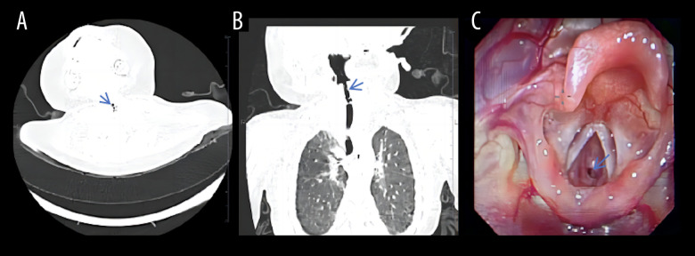
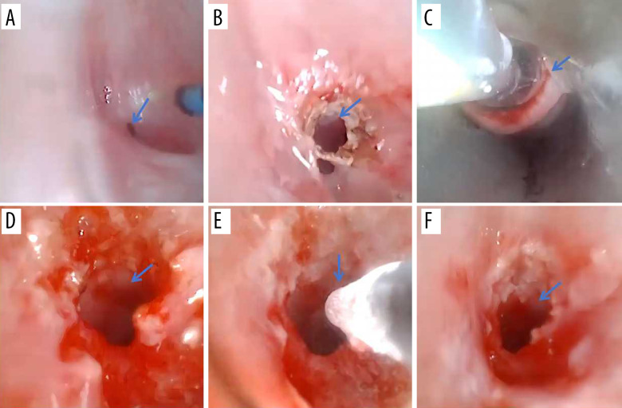
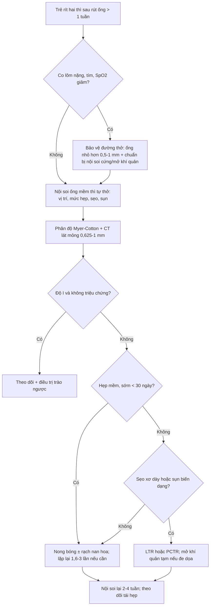
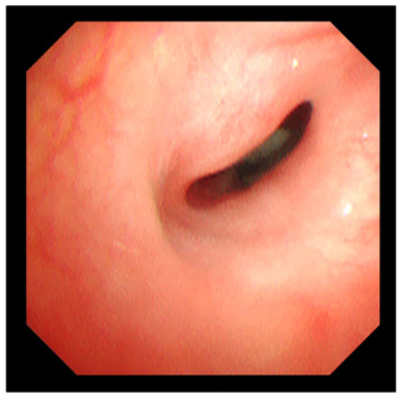

# 3047 — Hẹp khí quản mắc phải sau đặt nội khí quản ở trẻ: phân độ Myer–Cotton, CT–nội soi, nong bóng/laser & khi nào cắt nối

**Tags:** `pattern:rit-hai-thi` `pattern:hep-duong-tho` `pattern:hep-duoi-thanh-mon` `vung:duong-tho` `vung:thanh-quan` `vung:khi-quan` `anatomy:thanh-quan` `score:Myer-Cotton` `protocol:CT-lat-mong` `protocol:noi-soi-ong-mem` `protocol:nong-bong`
**Mức chắc chắn (certainty):** tổng hợp y văn (literature synthesis) — ghép **loạt 172 trẻ hẹp thanh quản sẹo sau đặt nội khí quản** (J Clin Med 2026, PMC13163590), **29 nhũ nhi ≤ 1 tuổi** (Afr J Thorac Crit Care Med 2026, PMC13277382), **tổng quan 2026 về nong bóng nội soi** (J Clin Med 2026, PMC13116667), **ca 2 tháng tuổi độ III** (Am J Case Rep 2025, PMC12758065), **meta-analysis độ chính xác CT/CTVB** (Eur Arch Otorhinolaryngol 2026, PMC13002695) và **ca hẹp khí quản “im lặng” 15 tuổi** (Cureus 2026, PMC13419857). Không có ca do nhóm tự chụp.

> **Câu hỏi thực hành:** bé gái **2 tháng tuổi**, tiền sử **đặt nội khí quản 10 ngày** vì viêm phổi do ho gà, nay **rít hai thì + co lõm ngực**, điều trị “viêm phế quản” 2 tuần không đỡ. Câu hỏi: **đây là di chứng hẹp đường thở hay còn phù sau rút ống, chụp gì, phân độ nào, và nong bóng được không?**
> Bài chốt **ba quyết định**: **(1) rít hai thì kéo dài > 1 tuần sau rút ống = nội soi đường thở, không chờ “croup”; (2) phân độ Myer–Cotton bằng nội soi + đo CT lát mỏng; (3) hẹp mềm/sớm < 30 ngày → nong bóng ± rạch nan hoa; hẹp sẹo xơ/có sụn độ III–IV → cân nhắc tạo hình thanh–khí quản hoặc cắt nối.** Nối [3005 – U máu dưới thanh môn](../3005-u-mau-duoi-thanh-mon-nhu-nhi/lesson.md), [612 – Cấp cứu đường thở trên ở trẻ](../612-cap-cuu-duong-tho-tren-tre-em/lesson.md), [602 – Khí phế quản mềm](../602-tracheobronchomalacia-o-tre-bpd/lesson.md), [694 – Mềm sụn thanh quản](../694-mem-sun-thanh-quan-o-nhu-nhi/lesson.md).

## 1. Tổng quan bệnh học – cơ chế hình ảnh: vì sao 1 mm sẹo đã làm trẻ ngạt

- **Định nghĩa và vị trí:** hẹp đường thở mắc phải sau đặt nội khí quản (post-intubation airway stenosis) hay gặp nhất ở **dưới thanh môn – vòng sụn nhẫn** vì đây là **đoạn hẹp nhất và là vòng sụn kín** của đường thở trẻ. Trong **172 trẻ** hẹp thanh quản sẹo sau đặt nội khí quản, **85,3% (146/171) ở dưới thanh môn**, **11,1% thể phối hợp**, chỉ **2,9% ở thanh môn** và **0,7% trên thanh môn** (PMC13163590). Hẹp **khí quản** thật (dưới sụn nhẫn) thường gặp sau **mở khí quản** hoặc sau bóng chèn (cuff) đặt quá lâu, và là thực thể cần phân biệt với hẹp dưới thanh môn.
- **TẠI SAO áp lực ống lại gây sẹo:** bóng chèn/ống tạo áp lực lên niêm mạc vượt **áp lực tưới máu mao mạch (~25–30 mmHg)** → **thiếu máu niêm mạc → loét → viêm sụn → mô hạt → xơ hóa co kéo**. Sẹo xơ không co giãn theo nhịp thở, nên hẹp **cố định** và gây **rít cả thì hít vào và thở ra**. Theo định luật Poiseuille, **sức cản tỉ lệ nghịch với bán kính mũi 4 (R ∝ 1/r⁴)**: ở nhũ nhi, đường kính dưới thanh môn bình thường chỉ **4–5 mm**; giảm còn **2 mm** làm sức cản tăng **~16 lần** — vì vậy một vòng sẹo **1–2 mm** đã đủ gây suy hô hấp.
- **Tần suất – con số thực tế:** khoảng **90%** hẹp thanh–khí quản ở trẻ là **mắc phải**, **10%** bẩm sinh (PMC13116667). Tần suất hẹp dưới thanh môn mắc phải ở trẻ đã giảm còn **~1–2%** ở nhũ nhi đặt nội khí quản kéo dài; một nghiên cứu Australia ghi nhận **0,93%** ở 50 nhũ nhi/trẻ; các loạt cũ hơn nêu **~3%** trẻ từng đặt nội khí quản (PMC13163590, PMC13277382). Không phải “bệnh hiếm gặp trong ICU”.
- **Yếu tố nguy cơ – định lượng:**
  - **Ống quá cỡ** gặp ở **52% (15/29)** nhũ nhi bị hẹp trong loạt Nam Phi (PMC13277382); đây là yếu tố **có thể phòng** rõ nhất.
  - **Đặt ống nhiều lần:** **> 5 lần thử** làm tăng nguy cơ hẹp **gấp 5 lần** (PMC13277382 dẫn lại); trong loạt 172 trẻ, **82,6%** được đặt ống **cấp cứu** và **31,6%** có đặt lại ống.
  - **Thời gian đặt ống:** mỗi **5 ngày** đặt ống thêm làm tăng nguy cơ **50,3%** (PMC13277382 dẫn lại); loạt 29 nhũ nhi có thời gian đặt ống trung bình **9,9 ± 7,0 ngày**.
  - **Tuổi nhỏ:** **70,8%** trẻ trong loạt 172 được đặt ống lần đầu **trong năm đầu đời**, tuổi trung vị **6,2 tháng**; tuổi đặt ống lần đầu và kiểu đặt ống (cấp cứu/chương trình) là **hai biến duy nhất liên quan đến độ nặng** (p = 0,02 và p = 0,04).
  - **Trào ngược dạ dày–thực quản, nhiễm trùng đường thở, đặt lại ống, rút ống không dự kiến** đều làm nặng thêm; **rút ống không dự kiến** gặp ở **31%** loạt Nam Phi.
- **Diễn tiến thời gian – mấu chốt để chọn can thiệp:** hẹp **sớm < 30 ngày sau rút ống** thường còn **mềm, màng mỏng**, đáp ứng nong bóng tới **100%**; hẹp **mạn > 30 ngày** đã thành **sẹo xơ trưởng thành**, tỷ lệ thành công chỉ còn **~39%** (PMC13116667). Vì vậy câu hỏi “hẹp bao lâu rồi?” quan trọng không kém “hẹp bao nhiêu %”.
- **TẠI SAO CT hữu ích nhưng không thay nội soi:** CT đo được **đường kính, diện tích lòng, chiều dài đoạn hẹp, khoảng cách tới dây thanh và mức xâm lấn sụn** — những thứ quyết định chọn nong bóng hay cắt nối. Meta-analysis 14 nghiên cứu (người ≥ 12 tuổi) cho **CT gộp Se 91,5% / Sp 90,8%**, **CTVB đo đường kính Se 92% / Sp 88%**, còn **MRI độ đặc hiệu rất thấp 6–46%** nên không dùng đơn độc (PMC13002695). Tuy nhiên **nội soi ống mềm/ống cứng vẫn là tiêu chuẩn vàng** vì thấy được **niêm mạc, mô hạt, sụn hở, và đánh giá động**.
- **Ngưỡng định nghĩa hẹp:** ở trẻ **đủ tháng**, đường kính dưới thanh môn **≤ 4 mm** là hẹp; ở trẻ **sinh non**, **≤ 3 mm** là bất thường (PMC13116667, PMC13277382). Đây là ngưỡng **tuyệt đối**, cần đối chiếu với **đường kính ống nội khí quản phù hợp tuổi** và **diện tích lòng** trên CT.
- **Phân bố độ nặng:** trong 172 trẻ, **độ 1: 39,5%**, **độ 2: 23,3%**, **độ 3: 26,2%**, **độ 4: 11%** → **37,2%** có hẹp **độ 3–4** (nặng); **62,8%** đã từng mở khí quản (PMC13163590). Con số này giải thích vì sao bài toán không chỉ là “nong bóng cho tất cả”.

## 2. Mẫu hình + chẩn đoán phân biệt theo vị trí và pha tiếng rít (Gamut)

- **Định khu bằng pha tiếng rít:**
  - **Thì hít vào:** tắc nghẽn **ngoài lồng ngực** — mềm sụn thanh quản, liệt dây thanh, hẹp thanh môn, nang thung lũng.
  - **Thì thở ra:** tắc nghẽn **trong lồng ngực** — khí phế quản mềm, chèn ép mạch máu, hẹp khí quản thấp.
  - **Hai thì:** tổn thương **cố định** — hẹp dưới thanh môn do sẹo, hẹp khí quản, vòng mạch, u trong lòng.
- **Gamut theo vị trí:**
  - **Thanh môn:** dính dây thanh sau chấn thương/đặt ống, u nhú, liệt dây thanh.
  - **Dưới thanh môn:** **hẹp sẹo mắc phải (hay gặp nhất)**, hẹp bẩm sinh, u máu dưới thanh môn, nang dưới thanh môn, hẹp do bỏng/hít.
  - **Khí quản:** hẹp sau mở khí quản (trên lỗ mở), hẹp do bóng chèn, u nhú lan, u máu, dị vật, khí phế quản mềm.
- **Gamut theo bối cảnh:**
  - **Sau đặt nội khí quản kéo dài:** hẹp sẹo dưới thanh môn/khí quản — nghĩ ngay khi **rít hai thì xuất hiện 1–6 tuần sau rút ống**.
  - **Sau mở khí quản:** hẹp **trên lỗ mở** hoặc tại lỗ mở, thường kèm u hạt.
  - **Trẻ nhỏ có u máu da vùng râu:** u máu dưới thanh môn (bài 3005).
  - **Trẻ khỏe, rít thì hít vào, giảm khi nằm nghiêng:** mềm sụn thanh quản (bài 694).
  - **Rít thì thở ra, xẹp > 50% khi thở ra:** khí phế quản mềm (bài 602).
- **Mnemonic “STENOSIS”:** **S**car sau đặt ống, **T**racheostomy (hẹp trên lỗ mở), **E**ndotracheal tube quá cỡ/kéo dài, **N**eoplasm (u nhú, u máu), **O**bstruction (dị vật), **S**ubglottic congenital, **I**nfection (croup, viêm màng bạch hầu), **S**ynechia (dính dây thanh).

## 3. Bảng so sánh phân biệt (ma trận đối chiếu)

| Thực thể (entity) | Hình ảnh điển hình | Chốt vào (rule-in) | Chốt loại (rule-out) | Gợi ý xác nhận |
|---|---|---|---|---|
| **Hẹp dưới thanh môn mắc phải (acquired SGS)** | Hẹp chu vi hoặc một bên ngay dưới dây thanh, **sẹo xơ**, có thể mức độ 1–4; CT thấy **giảm diện tích lòng**, sụn nhẫn dày/không đều | **Tiền sử đặt nội khí quản + rít hai thì 1–6 tuần sau rút ống + hẹp tại vòng nhẫn** | Niêm mạc bình thường, không tiền sử đặt ống, hẹp do co thắt thoáng qua | Nội soi ống mềm + CT lát mỏng; phân độ Myer–Cotton |
| **Hẹp dưới thanh môn bẩm sinh** | Vòng sụn nhẫn **hẹp đối xứng**, không sẹo, có thể hình elip; triệu chứng từ sơ sinh | **Triệu chứng ngay sau sinh, không tiền sử đặt ống, không mô hạt** | Có sẹo, có tiền sử ống, hẹp tiến triển theo tuần → mắc phải | Nội soi + CT; đo đường kính, đối chiếu tuổi |
| **Mềm sụn thanh quản (laryngomalacia)** | Nắp thanh môn hình omega, mô phễu **sa vào lòng thì hít vào**, mở thì thở ra; không khối cố định | **Rít THÌ HÍT VÀO, giảm khi nằm nghiêng, khởi phát ≤ 2 tuần tuổi** | Rít hai thì + khối/hẹp cố định + không thay đổi theo tư thế | Nội soi động khi trẻ tự thở |
| **U máu dưới thanh môn (SGH)** | Khối **nhẵn, dưới niêm mạc**, ngấm mạnh **118–300 HU**; nội soi màu hồng/tím, mềm, dễ chảy máu | **Trẻ < 6 tháng + rít hai thì + khối ngấm mạnh + u máu da (24%)** | Khối không ngấm, bờ xâm lấn, sụn phá hủy → u khác | Nội soi + CECT; **không sinh thiết**; propranolol |
| **Hẹp khí quản sau mở khí quản / bóng chèn** | Hẹp khu trú **tại hoặc trên lỗ mở khí quản**, đoạn hẹp **ngắn**, có thể thấy sụn gãy/xơ | **Tiền sử mở khí quản + hẹp đúng vị trí lỗ mở + khoảng cách tới dây thanh xa** | Hẹp lan tỏa, không liên quan lỗ mở → nghĩ bẩm sinh/viêm | Nội soi + CT; đo chiều dài đoạn hẹp |
| **Khí phế quản mềm (TBM)** | Khí quản **xẹp > 50% diện tích lòng thì THỞ RA**, trở về bình thường thì hít vào; CT động/expiratory | **Xẹp động thì thở ra, không hẹp cố định** | Hẹp cố định cả hai thì, không đổi theo nhịp thở → sẹo | Nội soi/CT động; nghiệm pháp thở ra |
| **Vòng mạch chèn ép (vascular ring)** | Khí quản bị **đẩy/chèn một bên** bởi mạch, hẹp lan, không khối trong lòng; CTA/MRA thấy vòng mạch | **Rít hai thì + bú khó + không đáp ứng nong bóng + thấy mạch vòng** | Không có mạch vòng, có khối/hẹp trong lòng → nội tại | CTA/MRA + siêu âm tim; nội soi đánh giá động |
| **Dị vật / u nhú thanh quản** | Dị vật cản quang hoặc khối trong lòng; u nhú nhiều nốt sùi, không ngấm mạnh | **Khởi phát đột ngột sau hóc + một bên; u nhú ở trẻ lớn/khàn kéo dài** | Hẹp chu vi đều, tiền sử đặt ống, không khối → sẹo | Nội soi ± sinh thiết (u nhú), CT nếu dị vật cản quang |

*Bé gái **2 tháng tuổi**, viêm phổi do ho gà, **đặt nội khí quản 10 ngày**. **(A)** CT ngang, **(B)** CT vành: hẹp khu trú dưới thanh môn (mũi tên xanh); **(C)** nội soi ống mềm: lòng chỉ còn **như đầu đinh ghim**, niêm mạc dày xơ — **hẹp độ III Myer–Cotton**. Nguồn: Am J Case Rep 2025 (PMC12758065), **CC BY-NC-ND 4.0**, nguyên bản.*

*Cùng bệnh nhân: **(A)** trước can thiệp; **(B–E)** **laser holmium 0,5–1,0 J/xung**, **nong bóng 6 mm ở 14 atm**, áp lạnh **−70°C**; **(F)** sau lần can thiệp đầu, lòng đã mở rộng rõ. Đây là bằng chứng “nong bóng đơn thuần chưa đủ với sẹo xơ dày — cần rạch/laser trước”. Nguồn: Am J Case Rep 2025 (PMC12758065), **CC BY-NC-ND 4.0**, nguyên bản.*

## 4. Protocol chẩn đoán – phân độ – điều trị

- **Bước 0 — bảo vệ đường thở trước mọi thứ:** nếu **co lõm nặng, tím, SpO₂ giảm, kiệt sức** → **đặt ống nhỏ hơn 0,5–1 mm** so với tuổi, chuẩn bị **nội soi cứng/mở khí quản**; **không đặt ống mù nhiều lần** vì làm tăng nguy cơ hẹp thêm. Trong loạt 172 trẻ, **62,8%** đã phải mở khí quản — phần lớn vì chẩn đoán muộn.
- **Bước 1 — nội soi ống mềm (linh hoạt) khi trẻ còn tự thở:** xác định **vị trí, chu vi, mức hẹp, mô hạt/sẹo, sụn hở, động học**. Đây là **tiêu chuẩn vàng** và là nơi **phân độ Myer–Cotton**:
  - **Độ I:** hẹp **≤ 50%** lòng.
  - **Độ II:** **51–70%**.
  - **Độ III:** **71–99%**.
  - **Độ IV:** **không còn lòng** (hoàn toàn tắc).
- **Bước 2 — CT cổ–ngực lát mỏng (0,625–1 mm), dựng vành/đứng:** đo **đường kính nhỏ nhất, diện tích lòng, chiều dài đoạn hẹp, khoảng cách tới dây thanh**, đánh giá **sụn nhẫn/khí quản** và **loại trừ vòng mạch**. Không cản quang nếu chỉ hẹp sẹo; **có cản quang** khi nghi u máu/vòng mạch. **CTVB** hỗ trợ mô phỏng lòng nhưng **không thay nội soi** (Se 92%/Sp 88%).
- **Bước 3 — chọn can thiệp theo độ + độ “chín” của sẹo:**

| Tình huống | Lựa chọn đầu tay | Số liệu / lưu ý |
|---|---|---|
| **Độ I, không triệu chứng** | Theo dõi + điều trị trào ngược; nội soi lại khi có triệu chứng | Không can thiệp chỉ vì “thấy hẹp” |
| **Độ I–II, hẹp mềm/sớm < 30 ngày** | **Nong bóng ± rạch nan hoa** | Thành công tới **100%** ở hẹp sớm; gộp **65–86%**, meta **65,3%**, loạt mắc phải **82,3–86%** |
| **Độ II–III, sẹo xơ dày** | **Rạch nan hoa bằng laser/dao lạnh + nong bóng**, có thể nhắc lại | Cần **1,6–3 lần** nong/trẻ; tái hẹp **51,6–59,2%** trong một số loạt |
| **Độ III–IV, sụn biến dạng/hẹp dài** | **Tạo hình thanh–khí quản (LTR)** hoặc **cắt nối sụn nhẫn–khí quản (PCTR)** | PCTR cho giải mở ống **90–96%**; LTR một thì giữ ống **7–10 ngày**, hai thì đặt stent **≥ 6 tuần** |
| **Độ IV/đe dọa tính mạng** | **Mở khí quản tạm** + can thiệp thì sau | Không nong bóng mù khi không kiểm soát được đường thở |

- **Kỹ thuật nong bóng (theo tổng quan 2026):**
  - Chọn bóng **lớn hơn đường kính ngoài ống nội khí quản phù hợp tuổi ~2 mm**, tối thiểu **6 mm**; ví dụ trẻ 4 tuổi dùng ống 5,0 mm (đường kính ngoài ~7 mm) → bóng **7–8 mm**.
  - Ca minh họa dùng **bóng 6 mm, 14 atm**; tổng quan nêu bóng **10 mm, 10 atm × 30 giây × 3 lần + 60 giây × 1 lần**.
  - **Rạch nan hoa trước** nếu sẹo dày (laser/dao lạnh) để phá vòng xơ; **áp lạnh −70°C** sau nong nhằm giảm mô hạt (ca minh họa).
  - Sau nong: **dexamethasone, kháng sinh, giảm trào ngược**; có thể giữ ống nhỏ hơn phủ **betamethasone 0,5 mg + gentamicin 1 mg** trong **~48 giờ** làm nẹp tạm — giúp tránh mở khí quản **~85% (50/59)** trong một loạt.
- **Theo dõi:** nội soi lại **2–4 tuần**, sau đó **3–6 tháng**; đánh giá **rít, co lõm, tăng cân, giọng nói, nuốt**. **Không dùng CT lặp lại thường quy** nếu lâm sàng ổn — ưu tiên nội soi để giảm liều xạ (ALARA).

## 5. Biến thể bình thường và cạm bẫy

- **Bẫy 1 — “croup tái phát” hoặc “hen”:** hẹp sẹo **không sốt, không đáp ứng kháng sinh/khí dung, nặng dần theo tuần**. Trẻ **< 1 tuổi** rít sau đặt ống + thất bại điều trị “viêm phế quản” → **nội soi**. Trong loạt 172 trẻ, nhiều ca chỉ được chẩn đoán khi đã mở khí quản.
- **Bẫy 2 — phù sau rút ống vs hẹp thật:** phù do chấn thương ống thường **xuất hiện trong 24–72 giờ** và **giảm sau vài ngày** với dexamethasone; hẹp sẹo xuất hiện **1–6 tuần** và **không giảm**. Đừng gọi “hẹp” khi mới rút ống 1 ngày.
- **Bẫy 3 — chỉ đọc CT ngang:** một lát ngang có thể bị đọc là **dày niêm mạc đối xứng** hoặc bỏ sót hẹp lệch bên; luôn dựng **vành/đứng**, đo tại **điểm hẹp nhất**, so với **đường kính ống phù hợp tuổi**.
- **Bẫy 4 — CT bình thường không loại trừ hẹp động:** **khí phế quản mềm** chỉ xẹp thì thở ra; CT thì hít vào có thể bình thường. Nếu nghi, làm **CT động/expiratory** hoặc nội soi động.
- **Bẫy 5 — bỏ sót hẹp “im lặng”:** trẻ có **bệnh thần kinh, chậm phát triển, khó nuốt** có thể không phàn nàn; hẹp chỉ lộ ra khi **nhiễm trùng, co giật, gắng sức** — ca 15 tuổi trong y văn vào viện vì **trạng thái động kinh**, đặt ống 3 lần thất bại mới phát hiện hẹp dưới thanh môn **lỗ kim** (PMC13419857). Luôn hỏi tiền sử đặt ống ở trẻ **thở máy kéo dài** dù hiện không rít.
- **Bẫy 6 — nong bóng quá tay:** bóng quá lớn/áp lực quá cao có thể gây **rách niêm mạc, vỡ khí quản, tràn khí màng phổi/trung thất**. Chọn bóng theo **đường kính ngoài ống + 2 mm**, không theo “cảm giác”.
- **Bẫy 7 — nhầm hẹp bẩm sinh với mắc phải:** hẹp bẩm sinh **không có sẹo, không tiền sử ống**, triệu chứng sớm; hẹp mắc phải **có sẹo và tiền sử**. Điều trị và tiên lượng khác nhau.

## 6. Tự lượng giá — Blind Quiz

**Ca 1 — Bé gái 2 tháng tuổi, đặt nội khí quản 10 ngày vì ho gà, rít hai thì + co lõm ngực.**

- Câu hỏi 1: Mô tả **vị trí và mức hẹp** trên CT (A, B) và nội soi (C). Phân độ Myer–Cotton?
- Câu hỏi 2: Vì sao không thể chỉ điều trị như “croup” và cho về?

<b>Bấm để hiện đáp án (findings + chẩn đoán)</b>

- Dấu hiệu (findings): **(A, B)** hẹp khu trú ngay **dưới dây thanh tại vòng sụn nhẫn**, lòng còn rất nhỏ; **(C)** nội soi thấy **lỗ thông như đầu đinh ghim**, niêm mạc dày, xơ — **hẹp 71–99% = độ III**.
- Chẩn đoán (diagnosis): **hẹp dưới thanh môn mắc phải sau đặt nội khí quản**, độ III Myer–Cotton.
- Vì sao không phải croup: croup **sốt, khởi phát nhanh, đáp ứng dexamethasone/khí dung**, không kéo dài nhiều tuần; đây là **sẹo cố định** sau 10 ngày ống.
- Nguồn ảnh: Am J Case Rep 2025 (PMC12758065), CC BY-NC-ND 4.0.

**Ca 2 — Cùng bệnh nhân, can thiệp nội soi.**

- Câu hỏi 3: Ảnh B–E thực hiện những bước gì? Vì sao phải **rạch/laser trước** khi nong bóng ở sẹo dày? Chọn bóng theo nguyên tắc nào?

<b>Bấm để hiện đáp án</b>

- Dấu hiệu (findings): **(B)** laser holmium **0,5–1,0 J/xung** cắt mô xơ; **(C–E)** nong bóng **6 mm, 14 atm**, sau đó **áp lạnh −70°C**; **(F)** lòng mở rộng ngay sau can thiệp.
- Chẩn đoán (diagnosis): hẹp dưới thanh môn độ III, điều trị **đa mô thức nội soi**; rút oxy dần **ngày 5**, nội soi **1 tháng** không tái hẹp.
- Vì sao rạch trước: sẹo xơ dày có **độ đàn hồi cao**, nong đơn thuần dễ **co lại ngay**; rạch nan hoa phá vòng xơ giúp bóng mở đều.
- Chọn bóng: **đường kính ngoài ống nội khí quản phù hợp tuổi + ~2 mm**, tối thiểu **6 mm**; tránh bóng quá lớn gây vỡ khí quản.
- Nguồn ảnh: Am J Case Rep 2025 (PMC12758065), CC BY-NC-ND 4.0.

**Ca 3 — Hình nội soi phân độ (ôn lại):**

- Câu hỏi: Hình này thuộc độ mấy? Nếu trẻ **không có tiền sử đặt ống** và triệu chứng từ sơ sinh, nghĩ gì?

<b>Bấm để hiện đáp án</b>

- Dấu hiệu: lòng dưới thanh môn còn **khe hẹp**, ước **71–99%** → **độ III**.
- Nếu không tiền sử đặt ống + triệu chứng sớm: nghĩ **hẹp dưới thanh môn bẩm sinh** hoặc **u máu/nang**; cần nội soi + CT, không mặc định là sẹo mắc phải.
- Nguồn ảnh: J Clin Med 2026 (PMC13116667), CC BY 4.0.

## Bài liên quan chéo

- [3005 – U máu dưới thanh môn ở nhũ nhi: rít HAI thì + propranolol](../3005-u-mau-duoi-thanh-mon-nhu-nhi/lesson.md)
- [694 – Mềm sụn thanh quản ở nhũ nhi](../694-mem-sun-thanh-quan-o-nhu-nhi/lesson.md)
- [612 – Cấp cứu đường thở trên ở trẻ em](../612-cap-cuu-duong-tho-tren-tre-em/lesson.md)
- [602 – Khí phế quản mềm ở trẻ BPD](../602-tracheobronchomalacia-o-tre-bpd/lesson.md)
- [600 – Tổng quan Hệ Nhi khoa](../600-tong-quan-nhi-khoa/lesson.md)

> Không dùng để chẩn đoán độc lập khi chưa có người hướng dẫn.
