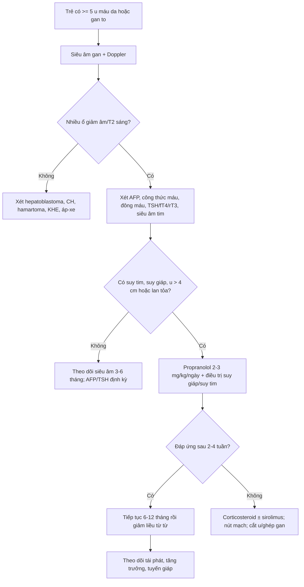
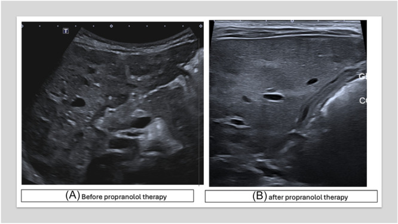

# 3048 — U máu gan ở nhũ nhi (infantile hepatic hemangioma): suy tim do shunt, suy giáp tiêu thụ & khi nào propranolol

**Tags:** `pattern:u-mau-gan` `pattern:nhieu-o-gan` `pattern:shunt-dong-tinh-mach` `vung:gan` `anatomy:gan` `protocol:Sieu-am-Doppler` `protocol:MRI-gan` `protocol:propranolol` `incidentaloma:u-mau-gan`
**Mức chắc chắn (certainty):** tổng hợp y văn (literature synthesis) — ghép **87 trẻ u máu gan** (J Clin Med 2024, PMC11122465), **ca u máu gan lan tỏa + suy giáp tiêu thụ kèm tổng quan 64 ca** (Ital J Pediatr 2025, PMC12186321), **ca u máu gan đa ổ + suy tim cung lượng cao** (JPGN Reports 2026, PMC13398648), **ca u máu gan lan tỏa điều trị propranolol đơn thuần** (Front Oncol 2024, PMC10859491). Không có ca do nhóm tự chụp.

> **Câu hỏi thực hành:** bé trai **2 tháng tuổi**, **10 u máu da nhỏ**, bú kém, chướng bụng, gan to; siêu âm thấy **vô số ổ giảm âm trong gan**, MRI **nhiều nốt T2 sáng gần thay toàn bộ nhu mô gan**. Câu hỏi: **có phải di căn/u ác không, có cần sinh thiết không, và vì sao phải xét nghiệm tuyến giáp + tim?**
> Bài chốt **ba quyết định**: **(1) ≥ 5 u máu da + gan to = siêu âm gan, nghĩ u máu gan nhũ nhi (IHH); (2) IHH đa ổ/lan tỏa có thể gây suy tim cung lượng cao do shunt và suy giáp tiêu thụ do D3 — phải đo TSH/fT4/rT3 và siêu âm tim; (3) propranolol 2–3 mg/kg/ngày là điều trị đầu tay, không sinh thiết khối điển hình.** Nối [3005 – U máu dưới thanh môn](../3005-u-mau-duoi-thanh-mon-nhu-nhi/lesson.md), [630 – Khối u đặc ổ bụng trẻ em](../630-u-bung-nhi-neuroblastoma-vs-wilms/lesson.md), [1804 – Suy giáp tiêu thụ do D3 lạc vị](../1804-suy-giap-tieu-thu-do-u-mach-mau-ngoai-gan/lesson.md), [674 – U quái gan](../674-u-quai-te-bao-mam-gan-o-tre/lesson.md).

## 1. Tổng quan bệnh học – cơ chế hình ảnh: vì sao “u máu gan” không phải một bệnh

- **Phân loại trước khi chẩn đoán:** u mạch máu gan ở trẻ gồm **u mạch máu nhũ nhi (infantile hemangioma, IH)** — **GLUT1 dương**, xuất hiện **sau sinh**, tăng sinh **3–9 tháng**, thoái triển chậm trong nhiều năm — và **u mạch máu bẩm sinh (congenital hemangioma, CH)** — **GLUT1 âm**, đã **tối đa kích thước lúc sinh**, gồm **RICH** (thoái triển nhanh), **NICH** (không thoái triển) và **PICH** (thoái triển một phần). Trong gan, IH thường **đa ổ (multifocal)** hoặc **lan tỏa (diffuse)**; tổn thương **một ổ (focal)** ở gan thường là **CH** hơn là IH thật — đây là cạm bẫy phân loại hay gặp.
- **Tần suất – định lượng:** u máu gan gặp **0,64/10.000 trẻ sinh sống** trong một loạt đơn trung tâm lớn; khoảng **8,6%** u gan ở trẻ xuất hiện **trước 2 tháng tuổi**, và **60%** trong số đó là u máu gan (PMC11122465). **IHH là u mạch máu nội tạng hay gặp nhất ở nhũ nhi**, thường đi kèm **u máu da**.
- **Phân loại theo số lượng – quyết định biến chứng:**
  - **Một ổ (focal):** thường không triệu chứng, ít shunt; nhiều khả năng là **CH**.
  - **Đa ổ (multifocal):** nhiều ổ, có thể kèm **≥ 5 u máu da**; nguy cơ **shunt động–tĩnh mạch → suy tim cung lượng cao** và **suy giáp tiêu thụ**.
  - **Lan tỏa (diffuse):** **vô số ổ thay gần toàn bộ nhu mô gan**, gan to nhanh, nguy cơ **hội chứng khoang bụng**, suy tim, suy giáp, chảy máu — nhóm nặng nhất.
- **TẠI SAO có shunt và suy tim:** các ổ u mạch máu có **mao mạch lớn, dòng chảy thấp–trung bình nhưng tổng lưu lượng cao**; khi u lớn/đa ổ, máu từ **động mạch gan** đi tắt qua u vào **tĩnh mạch gan** → **shunt động–tĩnh mạch trong gan** → tăng cung lượng tim, giảm sức cản hệ thống, suy tim cung lượng cao. Ca minh họa có **gradient qua đường ra thất phải 18 mmHg** trước điều trị, giảm còn **9 mmHg** sau propranolol (PMC13398648).
- **TẠI SAO suy giáp:** u mạch máu biểu hiện **deiodinase type 3 (D3)** — enzyme chuyển **T4 → reverse T3 (rT3)** và **T3 → T2** (bất hoạt). U càng lớn, càng nhiều D3 → **tiêu thụ hormone tuyến giáp ngoại vi** → **TSH tăng, fT4/fT3 thấp hoặc bình thường, rT3 tăng**. Đây là **suy giáp tiêu thụ (consumptive hypothyroidism)** — không phải suy giáp do tuyến giáp, nên **liều LT4 thường cao hơn nhiều**.
- **TẠI SAO hình ảnh là “nhiều ổ giảm âm/T2 sáng”:** trên siêu âm, các ổ là **mô mạch máu đặc, đồng nhất, giàu tế bào nội mô** nên **giảm âm** so với nhu mô gan; Doppler thấy **dòng chảy trong ổ và tăng lưu lượng ở động mạch gan/tĩnh mạch gan**. Trên MRI, các ổ có **khoang mạch máu chậm dòng/giãn** chứa nhiều nước → **T2 rất sáng**; sau tiêm, **ngấm mạnh thì động mạch và duy trì thì muộn** do máu ứ trong khoang mạch, **không thải thuốc kiểu HCC**. Đây là lý do **T2 sáng + ngấm mạnh kéo dài** gợi u mạch máu, không gợi u ác.
- **Ngưỡng kích thước và nguy cơ:** khối **> 4 cm** được coi là **u máu gan lớn**, có nguy cơ biến chứng; trong loạt 87 trẻ, **5/87 (5,7%)** có u lớn > 4 cm và **tất cả đều có triệu chứng** (PMC11122465). **Gan to + bụng chướng + suy dinh dưỡng** là dấu hiệu “u lớn có triệu chứng”, không phải “u lành theo dõi được”.
- **Tiên lượng – con số cần nhớ:** u nhỏ không triệu chứng thường **thoái triển hoàn toàn**; u lớn có triệu chứng, đặc biệt **lan tỏa + suy tim + suy giáp**, có thể tử vong. Loạt 87 trẻ ghi nhận **60% thoái triển hoàn toàn** ở nhóm điều trị; y văn cũ nêu **tử vong 30–100%** ở u máu gan có biến chứng nếu không điều trị (PMC11122465 dẫn lại) — con số này dùng để giải thích mức độ nguy hiểm, **không dùng tiên lượng cá nhân**.
- **AFP — không phải “ung thư” là xong:** AFP có thể **tăng rất cao** trong IHH (trung vị **76.818,7 ng/mL** ở nhóm điều trị so với **627,2** ở nhóm theo dõi) và **giảm nhanh trong 3 tháng đầu**, gần như không đo được sau **6 tháng**. Vì vậy **AFP cao đơn thuần không loại trừ IHH**; điều quan trọng là **xu hướng giảm**, còn **AFP tăng dần** mới gợi **hepatoblastoma** (PMC11122465).

## 2. Mẫu hình + chẩn đoán phân biệt theo số lượng, tuổi và biến chứng (Gamut)

- **Theo số lượng:** **một ổ** (focal) · **đa ổ** (multifocal) · **lan tỏa** (diffuse, thay gần toàn bộ gan). “Vô số ổ” trên siêu âm/MRI = **lan tỏa**, không phải “nhiều nốt đa ổ”.
- **Theo tuổi:**
  - **Sơ sinh – 1 tháng:** **CH (RICH/NICH)** đã có kích thước tối đa lúc sinh; **IHH** có thể còn nhỏ và **lớn dần sau sinh**.
  - **1–6 tháng:** **IHH** đang **tăng sinh mạnh**, dễ suy tim/suy giáp; **hepatoblastoma** cũng ở nhóm tuổi này (nhưng AFP tăng và khối đặc không đồng nhất).
  - **6 tháng–3 tuổi:** **hepatoblastoma**, **mesenchymal hamartoma**, di căn **neuroblastoma**; IHH thường đã qua đỉnh và bắt đầu thoái triển.
- **Theo biến chứng — “5C”:** **C**utaneous (≥ 5 u máu da) · **C**ardiac failure (shunt) · **C**ompartment syndrome (hội chứng khoang bụng) · **C**onsumptive hypothyroidism (D3) · **C**ompression (chèn ép đường mật/tiêu hóa).
- **Gamut chính:** IHH đa ổ/lan tỏa · CH (RICH/NICH) · hepatoblastoma · mesenchymal hamartoma · kaposiform hemangioendothelioma (KHE) · di căn neuroblastoma · áp-xe gan · nang gan đơn thuần.
- **Điểm khác biệt cốt lõi:** **IHH có u máu da + gan to + shunt/suy giáp**, **hepatoblastoma có AFP tăng dần + khối đặc không đồng nhất + vôi hóa**, **KHE có giảm tiểu cầu/coagulopathy (Kasabach–Merritt)**, **CH có kích thước tối đa lúc sinh và tự thoái triển**.

## 3. Bảng so sánh phân biệt (ma trận đối chiếu)

| Thực thể (entity) | Hình ảnh điển hình | Chốt vào (rule-in) | Chốt loại (rule-out) | Gợi ý xác nhận |
|---|---|---|---|---|
| **IHH đa ổ/lan tỏa** | Nhiều ổ **giảm âm** trên siêu âm, **T2 rất sáng**, ngấm mạnh thì động mạch và duy trì; gan to; Doppler tăng lưu lượng | **≥ 5 u máu da + gan to + nhiều ổ T2 sáng + AFP giảm dần** | Khối đặc không đồng nhất, vôi hóa thô, AFP tăng dần → nghĩ hepatoblastoma | Siêu âm Doppler + MRI gan; TSH/fT4/rT3; siêu âm tim |
| **CH (RICH/NICH)** | **Một ổ** lớn, bờ rõ, có thể **hoại tử/xuất huyết** trong u; ngấm **từ ngoại vi vào trung tâm** ở RICH | **Đã tối đa kích thước lúc sinh + GLUT1 âm + tự thoái triển (RICH)** | Lớn dần sau sinh, nhiều ổ, kèm u máu da → IHH | Siêu âm/MRI theo dõi; sinh thiết chỉ khi không điển hình |
| **Hepatoblastoma** | Khối **đặc không đồng nhất**, **vôi hóa 40–50%**, có thể xâm lấn tĩnh mạch cửa; AFP rất cao | **AFP tăng dần + khối đặc + vôi hóa + tuổi 6 tháng–3 tuổi** | Nhiều ổ T2 sáng đều, AFP giảm dần, có u máu da → IHH | AFP + MRI/CT; sinh thiết trước hóa trị |
| **Mesenchymal hamartoma** | Khối **đa nang**, vách mỏng, dịch; có thể chiếm cả thùy | **Khối nang nhiều vách + AFP bình thường + trẻ < 2 tuổi** | Khối đặc ngấm mạnh, nhiều ổ nhỏ → IHH | MRI/CT; sinh thiết nếu chẩn đoán không rõ |
| **KHE (kaposiform hemangioendothelioma)** | Khối **mờ, xâm lấn**, mô mềm quanh gan, **giảm tiểu cầu nặng** | **Giảm tiểu cầu + coagulopathy (Kasabach–Merritt) + tổn thương mờ xâm lấn** | Tiểu cầu bình thường, nhiều ổ rõ, T2 sáng đều → IHH | Công thức máu, đông máu, MRI; sinh thiết |
| **Di căn neuroblastoma** | Nhiều nốt gan, thường có **khối nguyên phát thượng thận**, di căn xương/tủy | **Khối thượng thận + catecholamine/metanephrine tăng + nốt gan** | Không có u nguyên phát, có u máu da, AFP giảm → IHH | CT/MRI bụng–ngực, MIBG, xét nghiệm catecholamine |
| **Áp-xe gan** | Ổ **dịch hoại tử**, viền ngấm, có thể khí trong ổ; sốt cao | **Sốt + đau bụng + bạch cầu tăng + ổ viền ngấm** | Không sốt, nhiều ổ T2 sáng đều, đáp ứng propranolol → IHH | Siêu âm/CT, cấy máu; dẫn lưu nếu ổ lớn |

*Bé trai **2 tháng tuổi**, **10 u máu da**, gan to. Siêu âm: gan hơi to, **vô số ổ giảm âm–đồng âm, đường kính trung bình 15 mm**, bờ rõ — hình ảnh **IHH lan tỏa**. Nguồn: Ital J Pediatr 2025 (PMC12186321), **CC BY 4.0**, nguyên bản.*

*Cùng bệnh nhân: MRI T2W thấy **nhiều nốt tăng tín hiệu mạnh, đường kính tối đa 20 mm**, phân bố rải rác **gần như thay toàn bộ nhu mô gan** — tương ứng thể **lan tỏa**. T2 sáng do khoang mạch máu chậm dòng chứa nhiều nước, không phải mỡ. Nguồn: Ital J Pediatr 2025 (PMC12186321), **CC BY 4.0**, nguyên bản.*

## 4. Protocol chẩn đoán – điều trị – theo dõi

- **Bước 1 — sàng lọc bằng siêu âm bụng:** theo **AAP**, trẻ có **≥ 5 u máu da** cần **siêu âm gan** để tìm IHH nội tạng; cân nhắc siêu âm cả khi **< 5 u máu da nhưng có gan to, suy dinh dưỡng, suy tim, vàng da**. Siêu âm là **đầu tay**, không cần chuẩn bị đặc biệt, không xạ.
- **Bước 2 — siêu âm Doppler + MRI gan khi cần:** siêu âm mô tả **số ổ, kích thước, giảm âm, dòng chảy trong ổ, tăng lưu lượng động mạch gan**. MRI (T2 + DCE) khi **không rõ số ổ, nghi CH/u ác, cần đo thể tích gan**. CT chỉ khi MRI không khả dụng hoặc cần đánh giá mạch; **tránh xạ ở trẻ nhỏ nếu không cần**.
- **Bước 3 — xét nghiệm bắt buộc:**
  - **Công thức máu + đông máu:** tìm **giảm tiểu cầu/coagulopathy** (KHE/Kasabach–Merritt).
  - **AFP:** nền và **theo dõi xu hướng**; AFP cao có thể gặp trong IHH, nhưng **tăng dần** gợi hepatoblastoma.
  - **TSH, fT4, fT3, rT3:** tầm soát **suy giáp tiêu thụ** ở **mọi trẻ IHH lan tỏa/đa ổ**; TSH cao + rT3 cao + fT4 thấp/bình thường là chìa khóa.
  - **Siêu âm tim:** tìm **suy tim cung lượng cao**, giãn nhĩ/thất, tăng gradient đường ra thất phải; đo **RVOT VTI/gradient** làm marker theo dõi.
- **Bước 4 — điều trị theo mức độ:**

| Mức độ | Điều trị | Số liệu / lưu ý |
|---|---|---|
| **Không triệu chứng, u nhỏ < 4 cm, không shunt** | **Theo dõi** bằng siêu âm mỗi **3–6 tháng** | Phần lớn thoái triển; loạt 87 trẻ: nhóm theo dõi **75 trẻ**, không u nào > 4 cm |
| **Có triệu chứng / u > 4 cm / shunt / suy giáp** | **Propranolol 1–3 mg/kg/ngày**, thường **2–3 mg/kg/ngày** chia 2–3 lần | Đáp ứng trong **vài ngày đến 4 tuần**; ca 8,5 tháng: gan giảm, suy tim hết sau **4 tuần**, gradient RVOT **18 → 9 mmHg** |
| **Không đáp ứng propranolol** | **Corticosteroid** (prednisolone **1–2 mg/kg/ngày**) ± **sirolimus 1,6 mg/m²/ngày** | Dùng trong loạt 87 trẻ; theo dõi nhiễm trùng, tăng đường huyết |
| **Shunt lớn/suy tim khó kiểm soát** | **Nút mạch (embolization)** ± phẫu thuật | Cầu nối trước mổ; nguy cơ nhồi máu gan, chảy máu |
| **U lớn chèn ép, vỡ, không đáp ứng** | **Cắt u/cắt gan** hoặc **ghép gan** | Ca lan tỏa nặng có thể cần ghép; trong 64 ca suy giáp, **18,75%** cần mổ/ghép |
| **Suy giáp tiêu thụ** | **LT4 liều cao**, trung bình **24,04 mcg/kg/ngày** (dải **1–110**), ± **liothyronine** | **92,85%** ca trong tổng quan cần LT4; **28,8%** cần thêm liothyronine; propranolol có thể làm giảm nhu cầu LT4 |

- **Theo dõi propranolol:** đo **nhịp tim, huyết áp, glucose** trước và sau liều đầu; cho bú đều, tránh bỏ bữa (nguy cơ **hạ đường huyết**); thận trọng ở trẻ **sinh non/nhẹ cân/hen**. **Không ngừng đột ngột** — giảm liều từ từ sau khi u thoái triển để tránh **bùng phát/tái phát**.
- **Theo dõi dài hạn:** siêu âm **mỗi 3–6 tháng** trong năm đầu, sau đó **6–12 tháng** đến khi hết; theo dõi **AFP, TSH/fT4** cho đến khi bình thường; đánh giá **tăng trưởng, tim, phát triển**.

*Bé gái **8,5 tháng**, IHH **đa ổ** + **suy tim cung lượng cao** (gradient RVOT **18 mmHg**), điều trị **propranolol 2 mg/kg/ngày**. **(A)** trước điều trị: nhiều ổ giảm âm; **(B)** sau điều trị: gan gần như bình thường, u thoái triển rõ. Nguồn: JPGN Reports 2026 (PMC13398648), **CC BY-NC-ND 4.0**, nguyên bản.*

## 5. Biến thể bình thường và cạm bẫy

- **Bẫy 1 — gọi mọi “hemangioma gan” là IHH:** tổn thương **một ổ** ở gan thường là **CH (RICH/NICH)**, đã tối đa lúc sinh và tự thoái triển; điều trị/tiên lượng khác IHH. Đừng mặc định “u máu = propranolol”.
- **Bẫy 2 — sinh thiết khối điển hình:** IHH là **tổn thương mạch máu**, sinh thiết có thể **chảy máu nặng**; chẩn đoán dựa vào **lâm sàng + siêu âm/MRI + AFP/TSH + đáp ứng propranolol**. Chỉ sinh thiết khi **không điển hình** hoặc nghi u ác.
- **Bẫy 3 — AFP cao = ung thư:** AFP có thể **76.818 ng/mL** trong IHH và giảm dần; **xu hướng** quan trọng hơn một giá trị tuyệt đối. **AFP tăng dần** mới đáng lo.
- **Bẫy 4 — bỏ sót suy giáp tiêu thụ:** trẻ có thể chỉ **bú kém, chậm tăng cân, táo bón, ngủ nhiều**; không đo TSH/fT4/rT3 sẽ bỏ sót. Trong 64 ca, **92,85%** cần LT4, liều trung bình **24,04 mcg/kg/ngày** — cao hơn suy giáp thường.
- **Bẫy 5 — nhầm suy tim do shunt với viêm phổi/nhiễm trùng:** ca 8,5 tháng được chẩn đoán ban đầu là **viêm tiểu phế quản**, chỉ phát hiện **tim to + suy tim cung lượng cao** khi chụp ngực. Luôn **nghe tim, đo gan, siêu âm tim** ở trẻ IHH gan to.
- **Bẫy 6 — Kasabach–Merritt không phải IHH:** **KHE** mới gây **giảm tiểu cầu + coagulopathy**; IHH thường **không** gây KMP. Gọi KMP cho IHH dẫn tới điều trị sai (steroid/embolization thay vì propranolol).
- **Bẫy 7 — propranolol gây hạ đường huyết:** trẻ **nhỏ, sinh non, bú kém**; cho bú đều, đo glucose, không bỏ bữa; ngừng thuốc đột ngột có thể **bùng phát u**.
- **Bẫy 8 — “nhiều nốt” không đồng nghĩa di căn:** ở trẻ có **u máu da**, nhiều nốt T2 sáng đều trong gan là **IHH**, không phải di căn; nhưng nếu có **khối thượng thận** hoặc **AFP tăng dần**, phải tìm **neuroblastoma/hepatoblastoma**.

## 6. Tự lượng giá — Blind Quiz

**Ca 1 — Bé trai 2 tháng tuổi, 10 u máu da, gan to, bú kém.**

- Câu hỏi 1: Mô tả hình ảnh siêu âm. Vì sao phải xét nghiệm **TSH, fT4, rT3**?

<b>Bấm để hiện đáp án (findings + chẩn đoán)</b>

- Dấu hiệu (findings): gan hơi to, **vô số ổ giảm âm–đồng âm, bờ rõ, đường kính trung bình 15 mm**, phân bố khắp gan.
- Chẩn đoán (diagnosis): **IHH lan tỏa** (thể diffuse) — nhiều ổ thay gần toàn bộ nhu mô.
- Vì sao xét nghiệm tuyến giáp: u mạch máu biểu hiện **D3**, chuyển T4→rT3, gây **suy giáp tiêu thụ**; ca này **TSH 33,05 mU/L**, **rT3 2 ng/mL**, fT4 16,8 pg/mL — TSH cao + rT3 cao là chìa khóa.
- Nguồn ảnh: Ital J Pediatr 2025 (PMC12186321), CC BY 4.0.

**Ca 2 — Cùng bệnh nhân, MRI gan.**

- Câu hỏi 2: Vì sao các nốt **T2 rất sáng**? Cần phân biệt với những gì, và dấu hiệu nào loại trừ u ác?

<b>Bấm để hiện đáp án</b>

- Dấu hiệu: nhiều nốt **tăng tín hiệu mạnh trên T2**, đường kính tối đa **20 mm**, gần như thay toàn bộ nhu mô gan.
- Cơ chế: khoang mạch máu **chậm dòng/giãn** chứa nhiều nước → T2 sáng; sau tiêm ngấm mạnh và duy trì do ứ máu, **không thải thuốc**.
- Phân biệt: **hepatoblastoma** (khối đặc không đồng nhất, vôi hóa, AFP tăng dần), **mesenchymal hamartoma** (đa nang), **KHE** (giảm tiểu cầu), **di căn neuroblastoma** (có u thượng thận).
- Loại trừ u ác: **u máu da + nhiều ổ T2 sáng đều + AFP giảm dần + đáp ứng propranolol**.
- Nguồn ảnh: Ital J Pediatr 2025 (PMC12186321), CC BY 4.0.

**Ca 3 — Bé gái 8,5 tháng, IHH đa ổ, suy tim cung lượng cao, trước và sau propranolol.**

- Câu hỏi 3: Vì sao u máu gan gây **suy tim**? Theo dõi đáp ứng bằng dấu hiệu nào ngoài kích thước u?

<b>Bấm để hiện đáp án</b>

- Dấu hiệu: **(A)** nhiều ổ giảm âm trước điều trị; **(B)** sau propranolol, gan gần bình thường, u thoái triển rõ.
- Cơ chế suy tim: **shunt động–tĩnh mạch trong gan** → tăng lưu lượng, giảm sức cản hệ thống → **suy tim cung lượng cao**; ca này gradient RVOT **18 mmHg** trước, **9 mmHg** sau.
- Theo dõi: **cân nặng, gan to, nhịp thở, siêu âm tim (gradient RVOT/VTI)**, không chỉ đo kích thước u; propranolol **2 mg/kg/ngày**, cải thiện trong **4 tuần**, gần hết sau **8 tháng**.
- Nguồn ảnh: JPGN Reports 2026 (PMC13398648), CC BY-NC-ND 4.0.

## Bài liên quan chéo

- [3005 – U máu dưới thanh môn ở nhũ nhi: rít HAI thì + propranolol](../3005-u-mau-duoi-thanh-mon-nhu-nhi/lesson.md)
- [630 – Khối u đặc ổ bụng trẻ em: neuroblastoma vs Wilms](../630-u-bung-nhi-neuroblastoma-vs-wilms/lesson.md)
- [1804 – Suy giáp tiêu thụ do D3 lạc vị](../1804-suy-giap-tieu-thu-do-u-mach-mau-ngoai-gan/lesson.md)
- [674 – U quái gan ở trẻ](../674-u-quai-te-bao-mam-gan-o-tre/lesson.md)
- [600 – Tổng quan Hệ Nhi khoa](../600-tong-quan-nhi-khoa/lesson.md)

> Không dùng để chẩn đoán độc lập khi chưa có người hướng dẫn.
