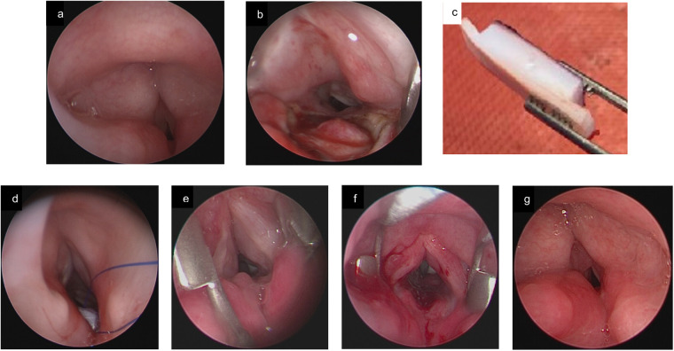
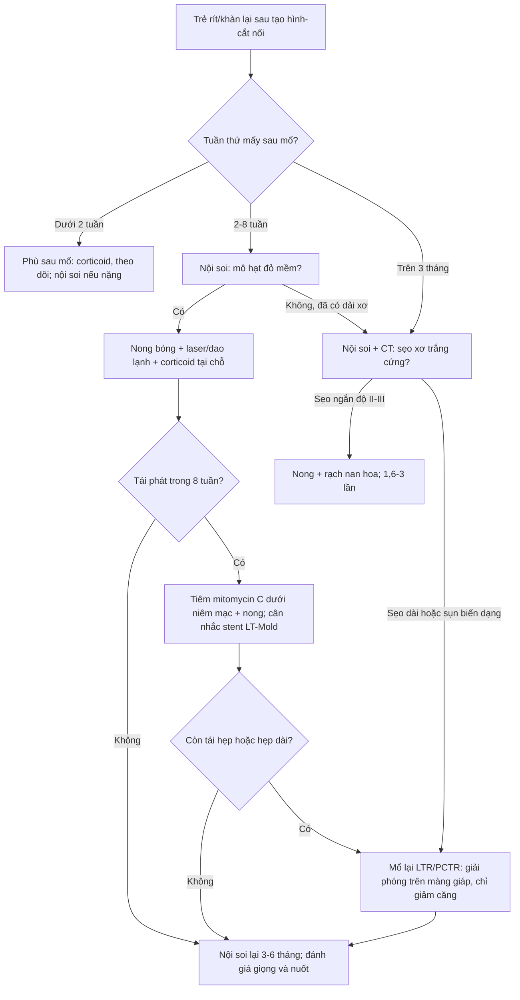
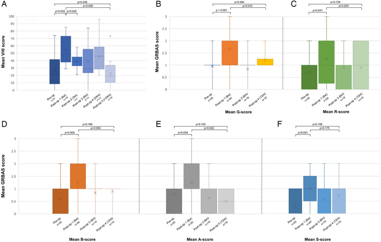
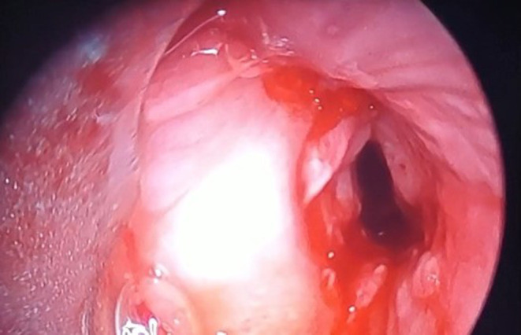
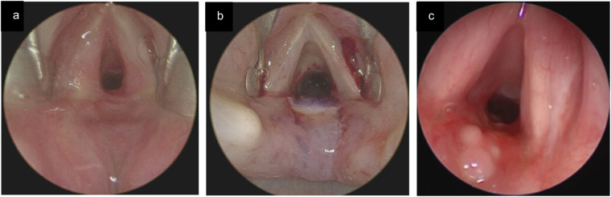

# 3049 — Hẹp thanh–khí quản TÁI PHÁT sau tạo hình/cắt nối ở trẻ: mô hạt hay sẹo, khi nào nong lại – đặt stent – mổ lại

**Tags:** `pattern:hep-duong-tho` `pattern:hep-tai-phat` `pattern:mo-hat` `vung:duong-tho` `vung:thanh-quan` `vung:khi-quan` `anatomy:thanh-quan` `score:Myer-Cotton` `protocol:noi-soi-ong-mem` `protocol:CT-lat-mong` `protocol:nong-bong` `protocol:stent-duong-tho`
**Mức chắc chắn (certainty):** tổng hợp y văn (literature synthesis) — ghép **44 trẻ mổ mở đường thở 10 năm** (Eur Arch Otorhinolaryngol 2026, PMC13249641), **tổng quan chiến lược phẫu thuật 2025** có ảnh nội soi tái hẹp/mô hạt (Front Pediatr 2025, PMC12417507), **37 ca cắt sụn nhận–khí quản + kết cục giọng** (Front Surg 2025, PMC11865094), **meta-analysis LTR vs PCTR** (Laryngoscope Investig Otolaryngol 2025, PMC12267102), **ca 10 tuổi tái hẹp + stent Montgomery** (Int Med Case Rep J 2026, PMC13200192) và **46 trẻ đặt LT-Mold** (J Laryngol Otol 2025, PMC12571591). Không có ca do nhóm tự chụp.

> **Câu hỏi thực hành:** bé trai **2 tuổi**, **hẹp dưới thanh môn độ III** sau đặt nội khí quản, đã **tạo hình thanh–khí quản một thì**. Sáu tuần sau mổ trẻ **rít lại, giọng khàn nặng**; nội soi thấy **vòng mô đỏ quanh miệng nối**. Câu hỏi: **đây là mô hạt hay sẹo thật, có phải mổ lại không, và vì sao không được gọi “thất bại” quá sớm?**
> Bài chốt **ba quyết định**: **(1) tái hẹp là biến cố thường gặp, không phải biến chứng hiếm — mô hạt quanh miệng nối 40,5%, tái hẹp sẹo dài hạn 5,4% sau PCTR, 51,6–59,2% ở một số loạt nong bóng; (2) phân biệt “mô hạt còn non” (nội soi + nong/laser/steroid/MMC) với “sẹo xơ co kéo” (mổ lại) bằng tuổi sẹo, không bằng cảm giác; (3) đánh giá thành công bằng cả rút ống, giọng nói và nuốt — VHI tăng gấp đôi ở tháng đầu dù khí quản đã thông.** Nối [3047 – Hẹp khí quản sau đặt nội khí quản](../3047-hep-khi-quan-sau-dat-noi-khi-quan-o-tre/lesson.md), [3005 – U máu dưới thanh môn](../3005-u-mau-duoi-thanh-mon-nhu-nhi/lesson.md), [612 – Cấp cứu đường thở trên ở trẻ](../612-cap-cuu-duong-tho-tren-tre-em/lesson.md), [602 – Khí phế quản mềm](../602-tracheobronchomalacia-o-tre-bpd/lesson.md).

## 1. Tổng quan bệnh học – cơ chế hình ảnh: vì sao miệng nối lại hẹp

- **Vị trí “nóng” nhất là miệng nối, không phải chỗ hẹp cũ.** Sau tạo hình thanh–khí quản (laryngotracheoplasty, LTP) hoặc cắt nối sụn nhận–khí quản (partial cricotracheal resection, PCTR), ba nơi dễ hẹp lại: **đường khâu miệng nối**, **diện ghép sụn** (nếu thiếu niêm mạc phủ) và **lỗ mở khí quản/thượng lỗ** ở trẻ còn cannula. Trong loạt **37 ca PCTR**, biến chứng hay gặp nhất **không phải hẹp** mà là **màng fibrin/mô hạt tại miệng nối: 40,5% (15/37)**; tái hẹp thật chỉ **5,4% (2/37)** và cả hai đều xử lý được bằng nội soi (PMC11865094). Ngược lại, các loạt nong bóng nội soi lặp lại ghi **tái hẹp 51,6–59,2%** (PMC13116667, đã dẫn ở bài 3047) — **con số khác nhau vì “tái hẹp” được định nghĩa khác nhau**, không phải vì bệnh khác nhau.
- **TẠI SAO mô hạt xuất hiện rồi thành sẹo:** miệng nối là **vết thương xuyên toàn bộ thành** (niêm mạc → sụn → mô quanh khí quản). Quá trình lành qua 3 pha: **viêm (0–7 ngày) → tăng sinh mô hạt (tuần 1–6) → tái tạo/xơ hóa (tuần 6 đến nhiều tháng)**. Mô hạt là **mạch máu non, giàu nguyên bào sợi, phù nề**, nên trên nội soi **đỏ, mềm, dễ chảy máu**; khi trưởng thành, nguyên bào sợi biến thành **nguyên bào cơ sợi (myofibroblast)** và tiết **collagen type I** → **dải xơ trắng, co kéo, không co giãn**. Đây là lý do **cùng một “vòng hẹp” nhưng tuổi khác nhau thì điều trị khác nhau**: mô hạt đáp ứng nong/laser, sẹo xơ co kéo thì nong lại sẽ hẹp lại.
- **TẠI SAO hẹp 1–2 mm đã gây suy hô hấp:** theo định luật **Poiseuille**, sức cản đường thở **R ∝ 1/r⁴**. Dưới thanh môn nhũ nhi chỉ **4–5 mm**; giảm còn **2–3 mm** làm sức cản tăng **3–16 lần**. Vì vậy trên ảnh, một **vòng mô hạt dày 1–2 mm** trông “nhỏ” nhưng tương đương hẹp **50–70%** diện tích lòng.
- **TẠI SAO miệng nối dễ thiếu máu:** khí quản được nuôi **theo đoạn** bởi các nhánh bên (động mạch giáp dưới, động mạch phế quản) đi vào **phần màng sau–bên**; bóc tách chu vi quá rộng hoặc kéo căng miệng nối sẽ **cắt đứt nguồn cấp đoạn** → thiếu máu → **mô hạt nhiều, sẹo xơ, bục miệng nối**. Vì vậy phẫu thuật viên dùng **giải phóng trên màng giáp (suprahyoid release)** và **chỉ giảm căng khí quản–móng** để hạ lực căng — chính là các thủ thuật được mô tả trong loạt 53 ca mổ lại (PMC12321650), nơi **92,5% (49/53) cai ống** nhưng **24,5% (13/53) có biến chứng**, trong đó **tái hẹp 7 ca** và **mô hạt tại miệng nối 5 ca**.
- **TẦN SUẤT – con số của lượt mổ đầu:** trong **44 trẻ** mổ mở đường thở (10 năm, trung bình **4,1 ± 2,9 tuổi**, **60% độ III**, **34% độ IV**), **70,5% (31/44) cai ống được**, **68,2% trong 6 tháng**; **15,9% vẫn còn cannula** ở lần theo dõi cuối (trung vị **159 ngày**); số lần nội soi trung bình trước khi cai ống là **2,2** (PMC13249641). Nghĩa là **“mổ một lần là xong” là ngoại lệ**, không phải quy tắc.
- **Yếu tố quyết định tái hẹp – định lượng:**
  - **Độ hẹp ban đầu:** độ III–IV có tỷ lệ lành xấu hơn do **thiếu niêm mạc còn lại** — tổng quan nêu rõ đây là cơ chế chính của tái hẹp sau LTR (PMC12417507); phân tích đa biến của loạt 44 trẻ cho thấy **độ hẹp liên quan độc lập với cai ống muộn** (PMC13249641).
  - **Thời gian mang cannula trước mổ:** nhóm cai ống được có **25,03 tháng** (IQR 17,92–38,30) so với **49,77 tháng** (IQR 21,57–61,90) ở nhóm thất bại, **p = 0,064** — xu hướng rõ nhưng chưa đạt ý nghĩa thống kê (PMC13249641).
  - **Nhiễm khuẩn đường thở:** **20,5% (9/44)** nhiễm vết mổ/miệng nối, và **100% ca nhiễm đều có đặt stent** (so với 62,9% ở nhóm không nhiễm, **p = 0,041**); cấy trong mổ dương **70,5%**, **Pseudomonas aeruginosa 38,6%**, tụ cầu **18,2%** — chủ yếu là **colonization** mạn của trẻ mang cannula (PMC13249641).
  - **Stent:** không làm tăng tỷ lệ cai ống (**71,0% vs 69,2%**, p = 1,00) nhưng **gắn với nhiễm và mô hạt**; thời gian đặt trung vị **6 ngày** (IQR 0–8) trong loạt này, còn với **LT-Mold** thì **80% trẻ cần > 2 tháng**, thời gian cai ống trung bình **229 ngày** (PMC12571591).
  - **Đồng mắc:** bệnh thần kinh, hẹp đa tầng, bất thường đường thở phối hợp là lý do thất bại cai ống trong meta-analysis LTR vs PCTR (PMC12267102).
- **TẠI SAO ảnh nội soi đủ để chẩn đoán, CT chỉ để đo:** nội soi thấy **màu, độ mềm, mô hạt, chỉ khâu lộ, sụn hở** — những thứ quyết định điều trị; CT lát mỏng chỉ trả lời **chiều dài đoạn hẹp, diện tích lòng, khoảng cách tới dây thanh, mức xâm lấn sụn**. Vì vậy **CT không bao giờ thay nội soi**, và **nội soi không đo được chiều dài chính xác** dưới màn hình 2D.

## 2. Mẫu hình + chẩn đoán phân biệt theo thời điểm và vị trí (Gamut)

- **Theo thời điểm sau mổ — trục quyết định số 1:**
  - **< 2 tuần:** **phù sau mổ, tụ máu, màng fibrin**. Chưa gọi là tái hẹp; nội soi chỉ khi có triệu chứng nặng.
  - **2–8 tuần:** **mô hạt non** (đỏ, mềm, dễ chảy máu) — đỉnh của “cửa sổ can thiệp nội soi”. Đây là lúc **nong bóng ± laser ± corticoid ± mitomycin C** hiệu quả nhất.
  - **2–6 tháng:** **sẹo xơ non đang co** — còn đáp ứng một phần với nong nhưng **tái hẹp nhanh** nếu vòng xơ đã trưởng thành.
  - **> 6 tháng:** **sẹo xơ trưởng thành, co kéo, hẹp dài** — nong chỉ là tạm; cân nhắc **mổ lại**.
- **Theo hình thái (pattern):**
  - **Vòng chu vi (circumferential ring)** — hẹp đều, thường tại miệng nối.
  - **Web/màng lệch bên** — di chứng hẹp một phần, hay gặp sau nong không đủ.
  - **Mô hạt khu trú** — cục đỏ, cuống rộng, tại đường khâu hoặc lỗ mở khí quản.
  - **Hẹp dài lan tỏa (> 1 cm)** — gợi ý **thiếu niêm mạc/diện ghép xơ**, không phải sẹo vòng đơn thuần.
  - **Hẹp động (xẹp thì thở ra)** — **khí quản mềm**, không phải sẹo; điều trị khác hoàn toàn.
- **Gamut theo vị trí sau mổ:**
  - **Thanh môn:** dính mép sau (posterior glottic web), mô hạt kẽ phễu thanh môn, liệt dây thanh do tổn thương thần kinh quặt ngược.
  - **Dưới thanh môn/miệng nối:** hẹp sẹo, mô hạt, **chỉ khâu lộ**, bục miệng nối.
  - **Khí quản trên/thượng lỗ:** **u hạt trên lỗ mở khí quản (suprastomal granuloma)**, sa sụp thành trước.
  - **Khí quản dưới:** hẹp mới do cannula/bóng chèn, khí quản mềm.
- **Gamut theo bối cảnh lâm sàng:**
  - **Rít lại sau một khoảng “im lặng”** → tái hẹp/mô hạt.
  - **Khàn đơn thuần, không rít** → tổn thương thanh môn/dây thanh, không phải hẹp khí quản.
  - **Ho ra máu + đau** → **chỉ khâu lộ/bục miệng nối** hoặc nhiễm.
  - **Sốt + tăng tiết + xẹp phổi tái diễn** → **nhiễm màng sinh học quanh stent**, không phải hẹp.
  - **Khó nuốt/hít sặc sau mổ** → tổn thương thanh quản trên/dây thanh, cần đánh giá nuốt riêng.

## 3. Bảng so sánh phân biệt (ma trận đối chiếu)

| Thực thể (entity) | Hình ảnh điển hình | Chốt vào (rule-in) | Chốt loại (rule-out) | Gợi ý xác nhận |
|---|---|---|---|---|
| **Mô hạt tại miệng nối** | Khối **đỏ, mềm, bóng**, bề mặt ướt, dễ chảy máu khi chạm; bờ rộng, không có dải xơ trắng | **Xuất hiện 2–8 tuần sau mổ + đỏ/mềm + chảy máu khi nội soi** | Dải **trắng, cứng, co kéo**, không chảy máu → sẹo xơ | Nội soi ống mềm; thử nong nhẹ thấy mềm |
| **Tái hẹp sẹo xơ (cicatricial)** | Vòng **trắng ngà**, đối xứng hoặc lệch, lòng hẹp cố định; CT thấy **diện tích lòng giảm**, sụn dày | **> 2–3 tháng + vòng xơ cứng + hẹp cố định cả 2 thì** | Mô hạt đỏ mềm, hẹp động → không phải sẹo | Nội soi + CT lát mỏng đo chiều dài |
| **Thiếu niêm mạc/diện ghép xơ** | Hẹp **dài > 1 cm**, bề mặt **không biểu mô hóa**, sụn ghép nhợt, có thể lộ sụn | **Hẹp dài đúng vị trí ghép + không có niêm mạc phủ** | Hẹp ngắn khu trú, niêm mạc liên tục → sẹo vòng | Nội soi; CT dựng vành/đứng |
| **U hạt trên lỗ mở khí quản** | Khối đỏ **ngay trên cannula**, cuống rộng, có thể van một chiều gây bít thì thở ra | **Trẻ còn cannula + khối đỏ sát lỗ mở + khó cai ống** | Khối trong lòng khí quản xa lỗ mở → tổn thương khác | Nội soi qua lỗ mở/ống mềm; thử bịt cannula |
| **Chỉ khâu lộ/bục miệng nối** | **Sợi chỉ trắng/xanh** nhô vào lòng, quanh đó mô hạt; có thể thấy bóng khí/mủ | **Thấy chỉ + mô hạt khu trú + chảy máu/ho ra máu** | Bề mặt nhẵn, không có vật liệu khâu → không phải | Nội soi; CT có cản quang nếu nghi bục |
| **Nhiễm màng sinh học quanh stent** | Dịch/mảng bám trên stent, lòng stent hẹp do **màng nhầy dày**, trẻ sốt tái diễn | **Stent đang lưu + sốt/tăng tiết + mảng bám trong stent** | Stent sạch, không sốt, không tăng tiết → không nhiễm | Nội soi hút/cấy dịch; không cấy máu đơn thuần |
| **Khí quản mềm động (tracheomalacia)** | Khí quản **xẹp > 50% diện tích thì thở ra**, trở về bình thường thì hít vào | **Xẹp động, thay đổi theo nhịp thở, không hẹp cố định** | Hẹp cố định cả 2 thì → sẹo | Nội soi động/CT thì thở ra |
| **Hẹp mới ở vị trí khác** | Hẹp **cách miệng nối**, tại chỗ cannula/bóng chèn cũ | **Vị trí hẹp không trùng miệng nối + tiền sử cannula dài** | Hẹp đúng đường khâu → tái hẹp miệng nối | Nội soi toàn bộ + CT từ dây thanh đến carina |

*Bé **2 tuổi**, hẹp dưới thanh môn **độ III** sau đặt nội khí quản. **(a)** trước mổ: lòng chỉ còn lỗ nhỏ; **(b)** mở sụn nhẫn đường giữa sau, thấy niêm mạc thực quản lồi vào; **(c)** thiết kế mảnh ghép sụn sườn; **(d)** đặt sụn với chỉ an toàn; **(e)** nội soi **2 tháng sau mổ: hẹp lại đáng kể** — mô hạt/sẹo non tại miệng nối; **(f)** ngay sau **nong bóng**: lòng mở rộng, có máu; **(g)** **3,5 tháng**: lòng thông, biểu mô hóa. Đây là ví dụ “tái hẹp không đồng nghĩa thất bại mổ”. Nguồn: Front Pediatr 2025 (PMC12417507), **CC BY**, nguyên bản.*

## 4. Protocol theo dõi – phân độ – điều trị

- **Bước 1 — lịch nội soi chủ động, không chờ triệu chứng:** các loạt trên lấy **6 tuần sau mổ** làm mốc chuẩn (nội soi đánh giá lành thương, gỡ stent, quyết định cai ống trong **24–48 giờ** nếu đủ điều kiện); stent trong thanh quản (Montgomery T-tube, LT-Mold) giữ **tối thiểu 6 tuần**, PPI **ít nhất 6 tuần** (PMC12417507). Trong loạt 44 trẻ, mỗi trẻ được nội soi trung bình **2,2 lần** trước khi cai ống (PMC13249641).
- **Bước 2 — phân độ lại bằng Myer–Cotton tại chỗ hẹp:** **độ I ≤ 50%**, **II 51–70%**, **III 71–99%**, **IV không còn lòng**. Ghi thêm **chiều dài**, **khoảng cách tới dây thanh**, **có/không lộ sụn/chỉ** — vì **cùng độ III nhưng hẹp 3 mm so với hẹp 15 mm có chiến lược khác nhau**.
- **Bước 3 — CT lát mỏng 0,625–1 mm, dựng vành/đứng** khi cần đo chiều dài hoặc nghi hẹp đa tầng; **không cản quang** nếu chỉ hẹp sẹo. Không chụp CT lặp lại thường quy (ALARA) khi nội soi đã đủ.
- **Bước 4 — thang điều trị theo “tuổi sẹo”, không theo cảm giác:**

| Tình huống | Lựa chọn | Số liệu / lưu ý |
|---|---|---|
| **Mô hạt non 2–8 tuần** | **Nong bóng ± laser/dao lạnh + corticoid tại chỗ** | Hẹp **sớm < 30 ngày** đáp ứng nong tới **100%**, hẹp mạn **~39%** (PMC13116667) |
| **Mô hạt tái phát nhiều lần** | **Tiêm mitomycin C dưới niêm mạc** ± nong | 16 ca: **tái hẹp 37,5%**, trung vị **136,5 ± 43,9 ngày**; an toàn, không biến chứng (PMC12653368) |
| **Sẹo vòng ngắn, độ II–III** | **Nong + rạch nan hoa**, lặp lại **1,6–3 lần** | Tái hẹp **51,6–59,2%** ở một số loạt nong (PMC13116667) |
| **Cần nẹp lâu, thanh quản phức tạp** | **Stent thanh quản: LT-Mold / Montgomery T-tube** | LT-Mold 46 trẻ: cai ống **93%**, **80% cần > 2 tháng**, thời gian trung bình **229 ngày**; **83% thở bình thường**, **67% giọng bình thường/khàn nhẹ** (PMC12571591) |
| **Stent dưới dây thanh không dung nạp** | **Montgomery airway stent** (sau khi đã thất bại stent silicone) | Ca 10 tuổi: stent silicone dưới dây thanh gây **phù thanh quản nặng phải mở khí quản cấp cứu**; Montgomery cải thiện **RR 26 → 16**, SpO₂ **96%**, hết rít (PMC13200192) |
| **Sẹo xơ trưởng thành, hẹp dài, sụn biến dạng** | **Mổ lại: LTR/PCTR**, giải phóng trên màng giáp + chỉ giảm căng | 53 ca mổ lại: cai ống **92,5%**, biến chứng **24,5%**, tái hẹp **7**, mô hạt **5** (PMC12321650) |
| **So sánh kỹ thuật** | **LTR vs PCTR** ở độ II–III | Cai ống **83,93% vs 96,59%** (p = 0,47); **LTR tái hẹp và mổ lại nhiều hơn** (PMC12267102) |

- **Bước 5 — đánh giá kết cục 3 trục, không chỉ “đã rút ống”:** **(1) đường thở** (rút ống, PEF, nội soi); **(2) giọng** — VHI sau PCTR **27,5 (±23,7)** trước mổ, **54,9 (±18,7)** sau 1 tháng (**p = 0,002**), giảm còn **22,2 (±18,1)** sau 2 năm (**p = 0,036**); **(3) nuốt/hít sặc**. PEF tăng **43,7%**, MIF tại 50% tăng **1,3 L/s** (PMC11865094). Bộ công cụ giọng nên thống nhất: **CAPE-V** (dùng ở **72,7%** nghiên cứu), **tần số cơ bản + thời gian phát âm tối đa** (**58,3%**), **pVHI** (**54,5%**) (PMC9158415).
- **Bước 6 — xử lý nhiễm và cai an thần:** cấy dịch đường thở định hướng kháng sinh (P. aeruginosa và tụ cầu thường gặp); **hội chứng cai** sau an thần kéo dài gặp **34,1%**, cao hơn ở mổ **một thì (50% vs 15%, p = 0,02)** — cần phác đồ giảm liều có cấu trúc, không cắt đột ngột (PMC13249641).

*37 ca PCTR (chủ yếu hẹp vô căn ở nữ, **89,2%**). **(A)** VHI tăng từ **27,5** trước mổ lên **54,9** sau 1 tháng (**p = 0,002**) rồi giảm còn **22,2** sau 2 năm (**p = 0,036**); **(B–F)** độ khàn (G), thô (R), thở (B), yếu hơi (A), căng (S) theo thời điểm. Thông điệp: **đường thở thông không đồng nghĩa giọng tốt**, và giọng cần **≥ 2 năm** mới ổn định. Nguồn: Front Surg 2025 (PMC11865094), **CC BY 4.0**, nguyên bản.*

## 5. Biến thể bình thường và cạm bẫy

- **Bẫy 1 — gọi mô hạt là “tái hẹp” rồi mổ lại:** mô hạt **đỏ, mềm, chảy máu** và đáp ứng nội soi; mổ lại trên mô hạt non làm **viêm và xơ nặng thêm**. Luôn mô tả **màu – độ mềm – tuổi sẹo** rồi mới quyết định.
- **Bẫy 2 — nội soi quá sớm (3–7 ngày):** phù và màng fibrin sau mổ trông như hẹp; nội soi ở thời điểm này chỉ để **giải quyết tắc cấp**, không để chẩn đoán tái hẹp.
- **Bẫy 3 — “trẻ ổn nên không cần nội soi”:** hẹp có thể **im lặng** ở trẻ chậm phát triển/bệnh thần kinh; lịch nội soi 6 tuần là **chủ động**, và chính nhóm đồng mắc thần kinh là nhóm thất bại cai ống trong meta-analysis (PMC12267102).
- **Bẫy 4 — đổ mọi thất bại cho “hẹp”:** trong loạt 44 trẻ, **15,9% vẫn còn cannula** dù đã mổ; nguyên nhân gồm **hẹp đa tầng, khí quản mềm, bệnh thần kinh, hít sặc** — không chỉ miệng nối.
- **Bẫy 5 — bỏ stent vì sợ nhiễm:** đúng là **100% ca nhiễm đều có stent** (p = 0,041), nhưng stent **không làm giảm tỷ lệ cai ống** (71,0% vs 69,2%) và là **nẹp cần thiết** ở thanh quản phức tạp; quyết định theo **nhu cầu nẹp**, không theo nỗi sợ nhiễm.
- **Bẫy 6 — coi MMC là “chữa khỏi”:** tiêm mitomycin C **an toàn** nhưng **tái hẹp vẫn 37,5%**, trung vị **136,5 ngày** — phải hẹn nội soi lại, không hứa hết bệnh (PMC12653368).
- **Bẫy 7 — đánh giá thành công chỉ bằng “đã rút ống”:** VHI **tăng gấp đôi ở tháng đầu** rồi mới giảm sau 2 năm; trẻ có thể thở tốt nhưng **khàn nặng, khó nuốt, hít sặc** — cần logopedics/đánh giá nuốt.
- **Bẫy 8 — stent quá cao hoặc quá cứng:** ca 10 tuổi cho thấy **stent silicone ngay dưới dây thanh** gây **phù thanh quản, phải mở khí quản cấp cứu**; khi tổn thương **sát dây thanh**, cân nhắc **Montgomery** hoặc **mổ lại** thay vì cố đặt stent (PMC13200192).
- **Bẫy 9 — bỏ qua nhiễm khuẩn mạn:** cấy dương **70,5%** ở trẻ mang cannula phần lớn là **colonization**, không phải nhiễm; **không dùng kháng sinh chỉ vì cấy dương** — dùng khi có **dấu hiệu lâm sàng + nội soi** (PMC13249641).
- **Bẫy 10 — quên ALARA:** CT lặp lại mỗi lần khám ở trẻ nhỏ tích lũy liều; ưu tiên **nội soi** và chỉ CT khi **thay đổi quyết định phẫu thuật**.

## 6. Tự lượng giá — Blind Quiz

**Ca 1 — Bé trai 10 tuổi, đặt nội khí quản 7 ngày sau tai nạn, khó thở và rít thì hít vào tăng dần 4 tháng.**

- Câu hỏi 1: Mô tả tổn thương và phân độ. Vì sao **nong bóng đơn thuần** chỉ giúp tạm thời?
- Câu hỏi 2: Sau cắt nối, trẻ tái hẹp sớm với **mô hạt và chỉ khâu lộ** — xử trí nào đúng, và vì sao **stent silicone dưới dây thanh** thất bại?

<b>Bấm để hiện đáp án (findings + chẩn đoán)</b>

- Dấu hiệu (findings): hẹp **khu trú, dài ~2 cm**, cách dây thanh **~2 cm**, lòng còn nhỏ, bờ niêm mạc dày — **Myer–Cotton độ II** khí quản trên.
- Chẩn đoán (diagnosis): **hẹp khí quản sau đặt nội khí quản**; nong bóng chỉ giúp tạm và **tái phát trong 3 tuần** vì tổn thương đã thành **sẹo xơ**, không phải mô hạt.
- Sau cắt nối: tái hẹp sớm với **mô hạt + chỉ khâu lộ** → **nong lại + cắt lọc mô hạt + gỡ chỉ**; **stent silicone ngay dưới dây thanh** gây **phù thanh quản nặng → mở khí quản cấp cứu**, nên chuyển **Montgomery airway stent**: RR **26 → 16**, SpO₂ **96%**, hết rít, không cần cannula sau 2 tuần.
- Nguồn ảnh: Int Med Case Rep J 2026 (PMC13200192), CC BY-NC 4.0.

**Ca 2 — Bé 2 tuổi, hẹp dưới thanh môn độ III, 2 tháng sau tạo hình: rít lại.**

- Câu hỏi 3: Ảnh (e) cho thấy gì? Vì sao (f) được làm ngay trong cùng thì? Kết quả (g) nói lên điều gì về tiên lượng?

<b>Bấm để hiện đáp án</b>

- Dấu hiệu: **(e)** lòng hẹp lại còn khe nhỏ do **mô hạt/sẹo non** tại miệng nối; **(f)** sau **nong bóng** lòng mở rộng, có máu mao mạch (dấu hiệu mô hạt non); **(g)** **3,5 tháng** lòng thông, niêm mạc phủ.
- Chẩn đoán: **tái hẹp sau tạo hình thanh–khí quản do mô hạt non**, điều trị **nội soi** — không phải thất bại của mổ.
- Tiên lượng: mô hạt non đáp ứng nội soi; nếu là **sẹo xơ trắng cứng** thì nong sẽ tái hẹp và cần **mổ lại**.
- Nguồn ảnh: Front Pediatr 2025 (PMC12417507), CC BY.

**Ca 3 — Trẻ 6 tuần sau tạo hình, hết rít nhưng khàn nặng; nội soi thấy mô hạt nhỏ kẽ phễu thanh môn.**

- Câu hỏi 4: Mô tả (c). Có cần mổ lại không? Đánh giá kết cục bằng gì ngoài nội soi?

<b>Bấm để hiện đáp án</b>

- Dấu hiệu: **(a)** hẹp dưới thanh môn độ II trước mổ; **(b)** mảnh ghép đúng vị trí, thẳng trục lòng thanh quản; **(c)** **6 tuần sau mổ**: đường thở thông, sụn **biểu mô hóa hoàn toàn**, chỉ còn **mô hạt kẽ phễu thanh môn giới hạn**.
- Chẩn đoán: lành thương bình thường kèm **mô hạt nhỏ** — **không cần mổ lại**; theo dõi nội soi, có thể nong/cắt mô hạt nếu tăng.
- Kết cục: đánh giá **giọng (CAPE-V, pVHI, tần số cơ bản, MPT)** và **nuốt**; VHI có thể **tăng gấp đôi ở tháng đầu** rồi giảm sau 2 năm.
- Nguồn ảnh: Front Pediatr 2025 (PMC12417507), CC BY.

## Bài liên quan chéo

- [3047 – Hẹp khí quản mắc phải sau đặt nội khí quản ở trẻ](../3047-hep-khi-quan-sau-dat-noi-khi-quan-o-tre/lesson.md)
- [3005 – U máu dưới thanh môn ở nhũ nhi](../3005-u-mau-duoi-thanh-mon-nhu-nhi/lesson.md)
- [694 – Mềm sụn thanh quản ở nhũ nhi](../694-mem-sun-thanh-quan-o-nhu-nhi/lesson.md)
- [612 – Cấp cứu đường thở trên ở trẻ em](../612-cap-cuu-duong-tho-tren-tre-em/lesson.md)
- [602 – Khí phế quản mềm ở trẻ BPD](../602-tracheobronchomalacia-o-tre-bpd/lesson.md)
- [600 – Tổng quan Hệ Nhi khoa](../600-tong-quan-nhi-khoa/lesson.md)

> Không dùng để chẩn đoán độc lập khi chưa có người hướng dẫn.
