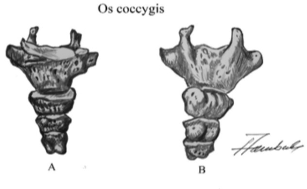
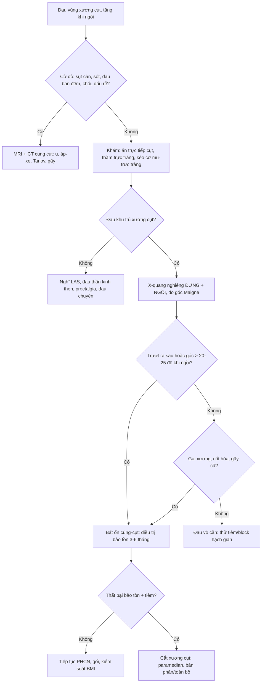
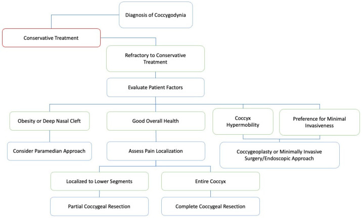
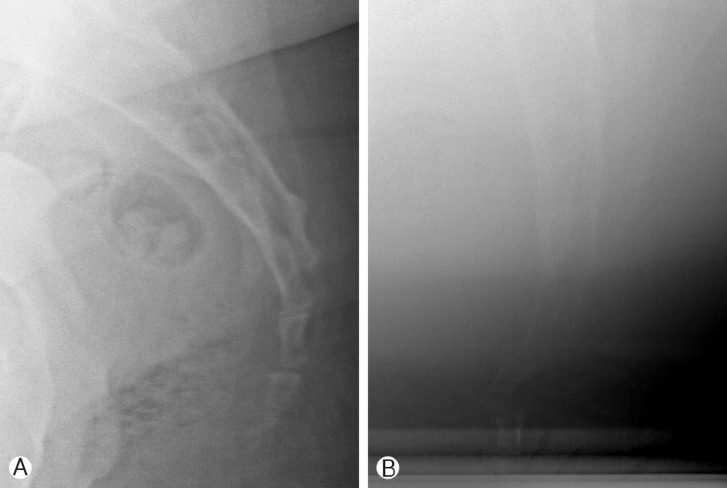
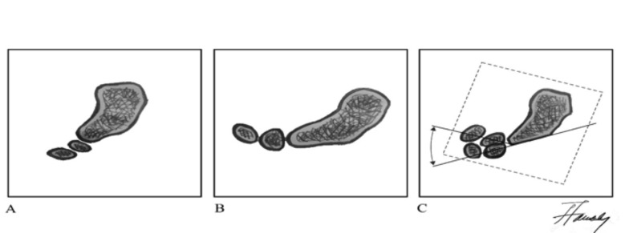

# 305 — Đau xương cụt (coccygodynia): phim động học, bất ổn khớp cùng–cụt & khi nào cắt xương cụt

**Tags:** `pattern:dau-xuong-cut` `vung:cung-cut` `vung:tieu-khung` `score:Postacchini-Massobrio` `score:Maigne` `protocol:XQ-dong-hoc-cung-cut` `protocol:MRI-cung-cut`
**Mức chắc chắn (certainty):** tổng hợp y văn (literature synthesis) — ghép **một tổng quan kỹ thuật chẩn đoán** (Acta Clin Croat 2023, PMC12128795), **một phân tích gộp 742 bệnh nhân cắt xương cụt** (Korean J Spine 2012, PMC4430558), **một tổng quan kỹ thuật mổ 2025** (Brain Sci, PMC11853250) và **một ca sóng xung kích** (J Med Cases 2025, PMC12683930). Số liệu lấy từ bảng/chú thích bài gốc; chỗ hai bài gốc lệch nhau (ngưỡng bất ổn 20° vs 25°) bài giữ **cả hai** và ghi rõ nguồn.

## 1. Tổng quan bệnh học – cơ chế hình ảnh

- **Giải phẫu tối thiểu phải thuộc:** xương cụt gồm **3–5 đốt**, trong đó **4 đốt ở 76%** người; đốt **Co1 lớn nhất**, có **sừng cụt (cornua)** khớp với S5; các đốt nối bằng **dây chằng gian cụt (intracoccygeal ligament)**. Chuyển động sinh lý của cụt là **gấp–duỗi**, phụ thuộc khớp **cùng–cụt (SC)** và **1–2 khớp gian cụt đầu tiên**. Các khớp này **cốt hóa theo tuổi** → cụt mất chuyển động, đây là hiện tượng **bình thường**, không phải bệnh.
- **Vì sao đau khi ngồi — cơ chế cơ học:** khi ngồi, trọng lượng dồn ra sau và **ép trực tiếp xương cụt** đồng thời **kéo căng dây chằng cùng–gai/cùng–ủng và cơ nâng hậu môn** bám vào cụt. Cụt **gấp sinh lý khi ngồi**; nếu khớp bị **bất ổn, trượt ra sau (subluxation) hoặc quá di động**, mỗi lần ngồi là một lần vi chấn thương → đau. Đau giảm khi đứng/nằm nghiêng, **không thức giấc ban đêm** — đặc điểm phân biệt với đau thần kinh thẹn.
- **Hạch gian (ganglion impar, hạch Walther):** nằm **giữa khớp cùng–cụt và phần dưới Co1**, là nơi hợp nhất hai chuỗi giao cảm cùng; sợi đau từ **đáy chậu, trực tràng dưới, âm đạo, niệu đạo** đi qua đây → giải thích **block hạch gian** giảm đau cụt và đau vùng đáy chậu.
- **TẠI SAO phải chụp ĐỘNG HỌC mà không chỉ chụp tĩnh:** bất thường của cụt là **thay đổi theo tư thế**, không phải một hình thái cố định. Phim **nghiêng khi đứng** cho hình thể cụt; phim **nghiêng khi ngồi** tạo lực nén đúng như triệu chứng → so sánh hai phim (hoặc **chồng hình theo kỹ thuật Maigne**) mới thấy **góc gấp tăng, trượt ra sau**. Vì vậy **CT/MRI không trả lời được câu hỏi "cụt có bất ổn không"** — chúng chỉ trả lời câu hỏi **hình thái** (gãy, tiêu xương, u, viêm, vôi hóa).
- **Vật lý của "góc" trên phim:** góc được đo giữa **trục xương cùng** và **trục đốt cụt** trên phim nghiêng; chồng hình hai tư thế cho **góc thay đổi (delta)**. Đây là phép đo **2 chiều trên phim 2 chiều**, nên sai số do **xoay bệnh nhân, tư thế ngồi không chuẩn, phim ngồi thiếu nắng** là rất lớn — cạm bẫy số 1 của kỹ thuật này (xem mục 5).
- **Ngưỡng định lượng (bắt buộc nhớ):**
  - **Biên độ gấp bình thường ~13°**; **gấp > 25° = tăng di động (hypermobility)**, **> 30° = trượt/trật (luxation)**; **gấp < 5° = cụt cố định (fixed coccyx)** (PMC12128795).
  - Bài phân tích gộp dùng ngưỡng khác: **bất ổn = trượt ra sau + tăng di động > 20° góc cùng–cụt hoặc gian cụt**, gặp ở **~70%** bệnh nhân coccygodynia (PMC4430558). **Hai ngưỡng 20° và 25° cùng tồn tại trong y văn — không có ngưỡng nào được xác nhận bằng đồng thuận.**
  - **Dịch tễ:** nữ **83,9%** trong 706 ca có ghi giới (tỷ lệ nữ:nam **5,2:1**); **chấn thương trực tiếp 58,5%** (325/556), **vô căn/sinh đẻ/phẫu thuật 31,3%**; **1/3** trường hợp không rõ nguyên nhân.
  - **Yếu tố nguy cơ định lượng:** **BMI > 27,4 (nữ)** và **> 29,4 (nam)** làm tăng nguy cơ; **cốt hóa khớp cùng–cụt** gặp **51%** bệnh nhân coccygodynia so với **37%** người không đau.
  - **Chỉ được coi chấn thương là nguyên nhân** nếu xảy ra **trong vòng 1 tháng** trước khởi phát đau.

## 2. Mẫu hình + chẩn đoán phân biệt theo vị trí (gamut)

*Hình: bản vẽ giải phẫu xương cụt — cơ sở để định khu đau theo đốt và chọn mức cắt. Nguồn: Elezović N et al., *Acta Clin Croat* 2023, PMC12128795 Fig. 1, CC BY-NC-ND 4.0 (giữ nguyên bản).*

- **Theo vị trí giải phẫu (từ trên xuống):**
  - **Khớp cùng–cụt (SC):** bất ổn/trượt, cốt hóa khớp, gãy S5–Co1, **viêm khớp cùng–cụt** (hiếm), di căn/xâm lấn u.
  - **Thân và khớp gian cụt (Co1–Co4):** gãy, trượt gian cụt, **gai xương mặt lưng (bony spicule)** — gặp **14%** ca coccygodynia, **viêm bao hoạt dịch (bursitis)** trên gai xương, thoái hóa.
  - **Đầu cụt:** loét tì đè, **viêm bao hoạt dịch**, đau do ghế cứng.
  - **Mô mềm quanh cụt:** **nang/bệnh xoang lông (pilonidal sinus/abscess)**, áp-xe vùng rãnh hậu môn, sẹo sau mổ.
  - **Xương cùng & ống sống:** **nang Tarlov (nang quanh rễ)**, gãy xương cùng, **thoát vị đĩa đệm L5–S1** chuyển đau.
  - **Thần kinh:** **đau thần kinh thẹn** (chèn ép 4 mức), đau do **hạch gian**, hội chứng cơ hình lê.
  - **U:** **chordoma**, u tế bào khổng lồ (GCT) xương cùng, di căn, **u quái cùng cụt tái phát** ở người trẻ.
- **Theo cơ chế:** cơ học (bất ổn/subluxation, gai xương, chấn thương) — viêm (bursitis, áp-xe, viêm khớp) — thần kinh (thẹn, hạch gian, Tarlov) — ung thư (chordoma, GCT, di căn) — chuyển đau (cột sống thắt lưng, khớp háng).
- **Mẫu hình trong bệnh cảnh "đau khi ngồi" (đừng gộp):** coccygodynia (đau **khu trú xương cụt**) vs **hội chứng cơ nâng hậu môn (LAS)** (đau trực tràng sâu, đau khi **kéo cơ mu–trực tràng**) vs **đau thần kinh thẹn** (đau **theo phân bố thần kinh**, lan tới dương vật/âm vật) vs **proctalgia fugax** (cơn **giây–phút**). Đây là **tiêu chuẩn loại trừ chéo**: đau khu trú xương cụt **loại trừ** đau thần kinh thẹn và ngược lại.

## 3. Bảng so sánh phân biệt (ma trận đối chiếu)

| Thực thể (entity) | Hình ảnh / lâm sàng điển hình | Chốt vào (rule-in) | Chốt loại (rule-out) | Gợi ý xác nhận |
|---|---|---|---|---|
| **Coccygodynia do bất ổn (subluxation/hypermobility)** | Đau tăng khi ngồi và khi **đứng dậy**; phim nghiêng **đứng vs ngồi**: góc gấp tăng, **trượt ra sau** | **Trượt ra sau hoặc tăng góc > 20° (bài gộp) / > 25° (bài kỹ thuật) khi ngồi + đau khu trú tương ứng** | Cụt **cố định (< 5°)** hoặc không thay đổi giữa hai tư thế → tìm nguyên nhân khác | Phim động học 2 tư thế; chồng hình Maigne |
| **Gai xương mặt lưng / viêm bao hoạt dịch** | Đau ngay **đầu cụt** khi ấn; CT thấy **gai xương (spicule)**; mô mềm dày quanh gai | **Gai xương + đau khu trú đúng điểm gai** | Không có gai, đau lan theo dây thần kinh | CT xương cụt; siêu âm mô mềm |
| **Gãy xương cụt cấp** | Sau ngã đập mông **< 1 tháng**; đau dữ dội, không ngồi được; CT có đường gãy | **Đường gãy trên CT + chấn thương trong 1 tháng** | Chấn thương > 1 tháng, không đường gãy → bất ổn mạn | CT (không cần MRI nếu chỉ gãy) |
| **Đau thần kinh thẹn (PN)** | Đau từ hậu môn đến dương vật/âm vật, tăng khi ngồi, **không thức đêm**, không mất cảm giác; MRI DWI có thể tăng tín hiệu dây thần kinh | **5 tiêu chuẩn Nantes + block thần kinh thẹn giảm đau** | Đau **khu trú xương cụt**, đau khi đứng dậy, block hạch gian/khối cụt giảm đau | MRI sàn chậu có DWI; block chẩn đoán |
| **Hội chứng cơ nâng hậu môn (LAS)** | Đau trực tràng sâu **≥ 30 phút**, đau khi **kéo cơ mu–trực tràng**, Rome IV, ≥ 3 tháng | **Đau khi kéo cơ mu–trực tràng + Rome IV + không bất thường thần kinh** | Đau khu trú xương cụt khi ấn ngoài; hình ảnh xương cụt bất thường | Thăm khám; MRI để loại trừ |
| **Pilonidal sinus/áp-xe** | Khối/sẹo lỗ ở **rãnh liên mông trên** khớp cùng–cụt, chảy dịch, sốt | **Lỗ rò + dịch mủ + sưng nề mô mềm** | Da lành, không lỗ rò, đau sâu trong xương | Siêu âm mô mềm; MRI nếu nghi áp-xe sâu |
| **Nang Tarlov** | Nang dịch **quanh rễ cùng**, xóa lỗ rễ; đau vùng cùng cụt khi ho/ngồi lâu | **Nang quanh rễ + đau theo rễ S2–S4** | Không nang; đau chỉ khi ấn trực tiếp cụt | MRI cột sống cùng |
| **U xương (chordoma, GCT, di căn)** | Đau **liên tục, tăng dần, có thể ban đêm**; CT/MRI có **phá hủy xương, khối mô mềm trước cùng** | **Phá hủy xương + khối mô mềm + đau không liên quan tư thế** | Xương nguyên vẹn, đau thuần túy theo tư thế | MRI + CT có cản quang; sinh thiết |
| **Đau chuyển từ cột sống thắt lưng** | Đau lan xuống mông/cùng, có dấu hiệu rễ; **1/3** ca coccygodynia có kèm đau lưng | **Nghiệm pháp rễ dương tính + hình ảnh đĩa/hẹp ống sống tương ứng** | Không dấu rễ, đau chỉ khu trú cụt | MRI thắt lưng cùng |

## 4. Protocol chụp + phân tầng điều trị

### 4.1 Protocol X-quang động học (chuẩn Maigne)
- **Tư thế 1 — nghiêng khi ĐỨNG:** bộc lộ toàn bộ xương cùng–cụt, **trục phim song song mặt phẳng dọc giữa**, khoảng cách 100 cm.
- **Tư thế 2 — nghiêng khi NGỒI** trên ghế cứng, thân hơi ngả sau, **đúng tư thế gây đau**; bộc lộ cùng khung (đây là phim hay bị **thiếu nắng** — phải tăng mAs, xem mục 5).
- **Đo:** góc giữa **trục xương cùng** và **trục đốt cụt** trên từng phim; hoặc **chồng hình (superimposition)** hai phim theo kỹ thuật Maigne để thấy **delta góc** và **trượt**.
- **Ngưỡng:** bình thường **~13°**; **> 25° = tăng di động**, **> 30° = trượt/trật**, **< 5° = cố định**; bất ổn (trượt ra sau + > 20°) ở **~70%** bệnh nhân.
- **Khi nào thêm CT:** chấn thương cấp, nghi u, cần đánh giá **gai xương/khe khớp** — CT **tốt hơn MRI** cho chi tiết xương.
- **Khi nào MRI:** đau **không điển hình/tăng dần/ban đêm**, có cờ đỏ ung thư, nghi **áp-xe, nang Tarlov, xâm lấn tủy**; MRI **không** dùng để đánh giá độ di động.

### 4.2 Phân tầng điều trị (thang bậc)
1. **Cấp (< 2 tháng):** nghỉ, **NSAID 8 tuần**, làm mềm phân 8 tuần nếu đau khi đại tiện, **gối chữ U** giảm áp lực, ngồi nghiêng, chườm.
2. **Mạn — bậc 1:** vật lý trị liệu sàn chậu, **kéo giãn/manipulation trực tràng** khớp cùng–cụt, sóng xung kích ngoài cơ thể (protocol ca: **5 Hz, 1 bar, 2.500 xung/lần, 1 lần/tuần × 5 tuần**; VAS **7 → 1/10** ở 12 tháng, chỉ 1 ca).
3. **Bậc 2 — tiêm:** corticoid + lidocaine quanh đầu cụt/khớp cùng–cụt; nếu **2 lần tiêm tháng liên tiếp không đỡ** → phối hợp vật lý trị liệu. **Block hạch gian (ganglion impar)** hiệu quả tới **85%** trong một số nghiên cứu.
4. **Bậc 3 — nhiệt:** **đốt sóng cao tần (RFA)** đĩa cụt/hạch gian cho ca kháng trị.
5. **Bậc 4 — mổ:** **cắt xương cụt bán phần/toàn bộ** khi thất bại ≥ 3–6 tháng điều trị bảo tồn và có bằng chứng bất ổn; kết quả **tốt/rất tốt 84%** (623/742), nhưng **nhiễm trùng vết mổ 10%**, **biến chứng chung 13,3%**; chọn **đường mổ cạnh giữa (paramedian)**, đóng lệch trục/Z-plasty ở người **béo/rãnh mông sâu**; mới có **coccygeoplasty (bơm xi măng) và nội soi**.

*Hình: thuật toán chọn đường mổ và mức cắt — **béo/rãnh mông sâu → đường cạnh giữa**; **đau khu trú đốt dưới → cắt bán phần**; **đau toàn bộ cụt → cắt toàn bộ**; **tăng di động → coccygeoplasty/nội soi**. Nguồn: Obeng-Gyasi B et al., *Brain Sci* 2025, PMC11853250 Fig. 3, CC BY 4.0.*

## 5. Biến thể bình thường và cạm bẫy

- **Hình thể cụt là biến thể, không phải bệnh:** phân loại **Postacchini–Massobrio** (I–IV) và mở rộng **Nathan** (I–VI): **type I (cong nhẹ, nối tiếp xương cùng) gặp ~68% dân số**; type II **8–32%**, III **4–16%**, IV (trượt ra trước) **1–9%**, V (cong ra sau) **1–11%**, VI (vẹo bên) **1–6%**. **Type V–VI hay gặp ở nữ** — đừng đọc là dị tật.
- **Cốt hóa khớp cùng–cụt theo tuổi là bình thường.** Nó **gây cứng** (fixed coccyx) chứ không phải "viêm khớp"; chỉ khi cứng + đau khu trú mới có ý nghĩa.
- **Bất ổn trên phim không đồng nghĩa có bệnh:** bất ổn gặp ở **~70%** ca coccygodynia nhưng **không phải tiêu chuẩn bắt buộc** (không phải sine qua non) — vẫn có bệnh nhân đau với cụt "bình thường" và người không đau có cụt di động.
- **Cạm bẫy kỹ thuật số 1 — phim ngồi thiếu nắng:** phim nghiêng khi ngồi thường **tối, mờ** do bàn ngồi chắn và bệnh nhân không giữ được tư thế (xem ca 1: ảnh B tối hơn hẳn ảnh A). **Không được kết luận "không bất ổn"** trên một phim ngồi không đọc được — phải chụp lại.
- **Cạm bẫy số 2 — đo góc trên phim xoay:** nếu hai phim không cùng mặt phẳng (bệnh nhân xoay chậu), góc "tăng" là **giả**. Luôn kiểm tra **hai bờ lỗ bịt và cánh cùng đối xứng** trước khi đo.
- **Sai lầm "gộp đau":** đau **lan tới dương vật/âm vật**, **đau khi đại tiện kiểu co thắt**, **đau ban đêm** → nghi **thần kinh thẹn/u/Tarlov**, không phải coccygodynia đơn thuần. Ngược lại, đau **chỉ khu trú cụt** là **tiêu chuẩn loại trừ** của đau thần kinh thẹn (Nantes).
- **Đừng quên nguyên nhân ngoài xương:** **pilonidal sinus/áp-xe** ở rãnh liên mông, **loét tì đè** ở người nằm lâu, **bệnh trĩ/nứt hậu môn** — khám da và thăm trực tràng trước khi cho chụp cắt lớp.
- **Sau tiêm corticoid:** đau tăng + sốt sau tiêm phải loại trừ **nhiễm trùng** (mông/khớp cùng–cụt), không được tăng liều corticoid.
- **Sau cắt xương cụt:** đau dai dẳng có thể do **cụt còn sót/gai xương còn lại** (chỉ **0,6%** phải mổ lại trong bài gộp) — nhưng cũng có thể là **đau thần kinh thẹn mới** do sẹo; phân biệt bằng phân bố đau, không bằng phim.

## 6. Tự lượng giá — Blind Quiz

**Ca 1 — Nữ 34 tuổi, ngã ngồi trên bậc cầu thang 8 tháng trước, đau xương cụt tăng khi ngồi và khi đứng dậy, không đau ban đêm.**

- Câu hỏi: Hai phim khác nhau ở điểm nào? Dấu hiệu này gọi là gì? Bước tiếp theo?

<b>Bấm để hiện đáp án (findings + chẩn đoán)</b>

- **Phim A (đứng):** cụt thẳng hàng với xương cùng; **phim B (ngồi):** cụt **trượt ra sau** và **tăng góc gấp** so với A.
- Đây là **bất ổn cùng–cụt (coccygeal instability/subluxation)** — dấu hiệu kinh điển của coccygodynia do chấn thương; bất ổn trên phim động học gặp ở **~70%** bệnh nhân và **dự báo kết quả tốt sau cắt xương cụt tới 92%**.
- Bước tiếp theo: **điều trị bảo tồn** (NSAID, gối chữ U, vật lý trị liệu) ≥ 3–6 tháng; nếu thất bại → tiêm/block hạch gian → cân nhắc **cắt xương cụt**.
- Lưu ý kỹ thuật: ảnh B **tối hơn** — nếu không đọc được phải chụp lại, không kết luận "không bất ổn".
- Nguồn ảnh: Kwon HD et al., *Korean J Spine* 2012, PMC4430558 Fig. 2, CC BY-NC 4.0.

**Ca 2 — Nam 29 tuổi, đau cụt 6 tháng sau ngã xe đạp; phim nghiêng đứng và ngồi đã có, cần định lượng độ di động.**

- Câu hỏi: Kỹ thuật này đo cái gì? Ngưỡng nào là tăng di động, trượt và cố định?

<b>Bấm để hiện đáp án (findings + chẩn đoán)</b>

- **Kỹ thuật Maigne:** chụp nghiêng **đứng (A)** và **ngồi (B)**, rồi **chồng hình (C)** để đo **góc gấp của cụt so với xương cùng** và độ **trượt**.
- Ngưỡng: **bình thường ~13°**; **> 25° = tăng di động**; **> 30° = trượt/trật**; **< 5° = cụt cố định**. Bài phân tích gộp dùng ngưỡng **> 20°** cho bất ổn — hai ngưỡng cùng tồn tại, phải ghi rõ nguồn khi trích dẫn.
- Ý nghĩa: xác định **cơ chế cơ học** để chọn điều trị (bảo tồn → tiêm → mổ) và tiên lượng sau mổ.
- Nguồn ảnh: Elezović N et al., *Acta Clin Croat* 2023, PMC12128795 Fig. 2, CC BY-NC-ND 4.0 (giữ nguyên, không chỉnh sửa).

**Ca 3 — Nữ 46 tuổi, BMI 33, đau cụt 14 tháng đã thất bại NSAID, vật lý trị liệu và 2 lần tiêm; đau khu trú nửa dưới xương cụt.**

- Câu hỏi: Bệnh nhân này nên chọn đường mổ nào và cắt bao nhiêu? Vì sao?

<b>Bấm để hiện đáp án (findings + chẩn đoán)</b>

- **Đường mổ cạnh giữa (paramedian)** vì **BMI cao/rãnh mông sâu** — giảm nhiễm trùng và rách vết mổ so với đường giữa.
- **Cắt bán phần (partial coccygectomy)** vì đau **khu trú đốt dưới**; nếu đau toàn bộ cụt → cắt toàn bộ. Cắt toàn bộ làm giảm nguy cơ mổ lại do **cụt sót**, nhưng tăng biến chứng vết mổ.
- Tư vấn: kết quả tốt/rất tốt **84%**, **nhiễm trùng vết mổ 10%**, biến chứng chung **13,3%**; chuẩn bị đại tràng + kháng sinh trước mổ, không ngồi trực tiếp lên vết mổ.
- Nguồn ảnh: Obeng-Gyasi B et al., *Brain Sci* 2025, PMC11853250 Fig. 3, CC BY 4.0.

## Bài liên quan chéo
- [556 — Đau sàn chậu cơ–mạc & đau thần kinh thẹn](../556-dau-san-chau-co-mac-pudendal-neuralgia/lesson.md) — tiêu chuẩn Nantes, block thần kinh thẹn; đây là chẩn đoán **loại trừ chéo** quan trọng nhất.
- [309 — Loét tì đè & viêm xương tủy vùng khung chậu ở người lớn spina bifida](../309-loet-ti-de-viem-xuong-tuy-spina-bifida-nguoi-lon/lesson.md) — loét tì đè vùng cùng cụt ở người nằm lâu.
- [320 — Gãy xương & trật khớp cấp cứu](../320-gay-xuong-trat-khop-cap-cuu/lesson.md) — tiếp cận chấn thương xương cùng–cụt cấp.
- [341 — Viêm khớp cột sống huyết thanh âm tính](../341-khop-cot-song/lesson.md) — viêm khớp cùng–chậu và đau vùng cùng cụt chuyển từ khớp cùng–chậu.
- [370 — Nhiễm trùng cơ xương khớp](../370-nhiem-trung-msk/lesson.md) — áp-xe mô mềm, viêm xương tủy sau tiêm.

## Ảnh
- `images/305_xray-dong-hoc_PMC4430558-Fig2.jpg` — phim nghiêng đứng/ngồi, CC BY-NC 4.0 (Kwon HD et al., *Korean J Spine* 2012).
- `images/305_giai-phau-xuong-cut_PMC12128795-Fig1.jpg` — giải phẫu xương cụt nhìn trước/sau, CC BY-NC-ND 4.0 (Elezović N et al., *Acta Clin Croat* 2023) — **giữ nguyên bản**.
- `images/305_ky-thuat-maigne_PMC12128795-Fig2.jpg` — kỹ thuật Maigne, CC BY-NC-ND 4.0 (cùng bài) — **giữ nguyên bản**.
- `images/305_thuat-toan_PMC11853250-Fig3.jpg` — thuật toán quyết định mổ, CC BY 4.0 (Obeng-Gyasi B et al., *Brain Sci* 2025).
- Chi tiết nguồn/giấy phép từng file: `images/CREDITS.md`; link gốc: `sources.md`.

> Không dùng để chẩn đoán độc lập khi chưa có người hướng dẫn.
