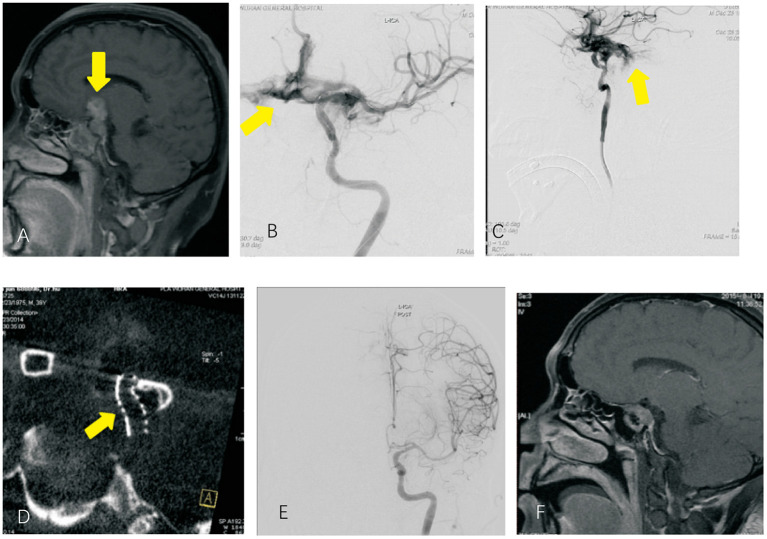
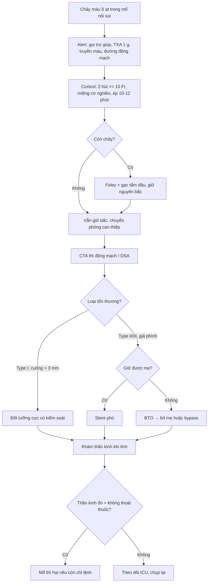
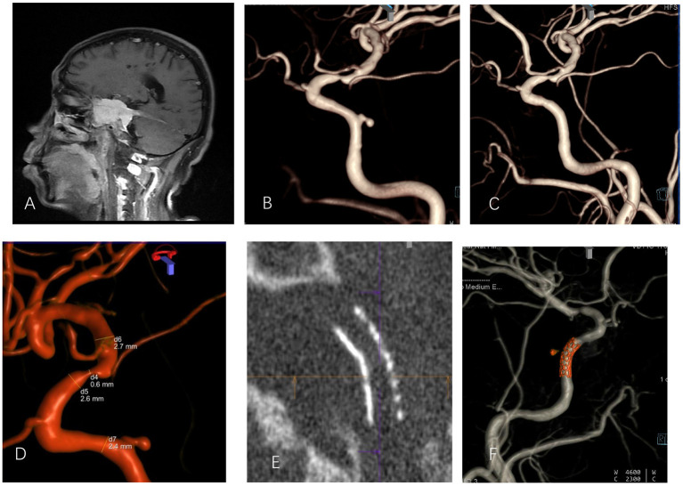
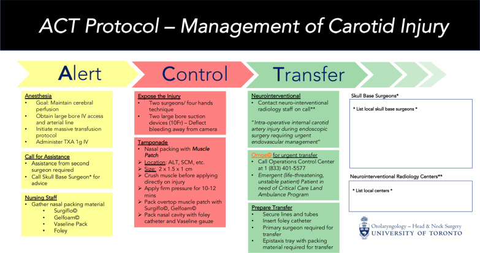

# 3050 — Tổn thương động mạch cảnh trong cấp trong mổ nội soi mũi xoang & nền sọ

**Tags:** `pattern:chay-mau-cam` `pattern:gia-phinh` `pattern:carotid-blowout` `pattern:khong-dong-bang` `vung:xang-buom` `vung:dau-co` `vung:mach-co` `protocol:CTA` `protocol:DSA` `protocol:bong-chen` `score:phan-loai-ICA-injury` `score:BTO`
**Mức chắc chắn (certainty):** tổng hợp y văn (literature synthesis) — ghép **ca vỡ động mạch cảnh trong trong mổ u tuyến yên xâm lấn, xử trí bằng stent phủ Willis** và **ca giả phình sau mổ u màng não, đặt stent qua đường nội mạch** (Frontiers in Neurology 2021, PMC8526539 — 15 bệnh nhân), **phân loại Type I–III dựa trên 68 ca trong y văn 1990–2020** (Surgical Neurology International 2020, PMC7656006), **quy trình Delphi Alert–Control–Transfer của 10 chuyên gia** (Journal of Otolaryngology – Head & Neck Surgery 2022, PMC9331087). Các bước **không có số liệu trực tiếp** được ghi rõ là **suy luận từ cơ chế** hoặc **kinh điển**, không gán nguồn.

> **Câu hỏi thực hành:** đang nội soi xoang bướm mở rộng để lấy u tuyến yên, **máy hút đột nhiên đầy máu đỏ tươi**, sàn xoang bướm ngập máu trong vài giây, huyết áp bắt đầu tụt. Kíp mổ có **1 máy hút**, không có bóng chèn, bệnh viện **không có can thiệp thần kinh tại chỗ**.
> Câu hỏi: **làm gì trong 10 phút đầu? nong bóng ở đâu, chèn bao lâu? có được rút bấc ra khỏi phòng mổ không? chụp gì để biết còn chảy hay đã tắc mạch? và khi nào được phép tiếp tục cuộc mổ?**
> Bài chốt **năm việc**: **(1) nhận diện ngay: chảy máu ồ ạt + huyết áp tụt + máu từ thành bên xoang bướm = tổn thương ICA cho tới khi chứng minh ngược lại; (2) cầm máu bằng chèn ép trực tiếp có kiểm soát (miếng cơ nghiền + Foley), áp lực 10–12 phút, không đốt mù; (3) gọi can thiệp thần kinh TRƯỚC khi chuyển, không rút bấc ngoài phòng mổ/phòng can thiệp; (4) CTA/DSA để phân loại tổn thương và chọn stent phủ (giữ mẹ) hay bít mẹ; (5) nguyên tắc chung là **dừng cuộc mổ**, chỉ tiếp tục khi đã kiểm soát và có bằng chứng tưới máu não ổn định.**

## 1. Tổng quan bệnh học – cơ chế hình ảnh: tại sao một lỗ nhỏ ở thành xoang bướm lại chết người trong vài phút

- **Giải phẫu là nguyên nhân:** động mạch cảnh trong đoạn hang và đoạn trên hang **chạy trong xoang hang, sát thành bên xoang bướm**, chỉ cách lòng xoang **vài mm xương** — đôi khi **xương mỏng hoặc khuyết (dehiscence)**. Khi dụng cụ (punch, curette, drill, microdebrider) hoặc lực kéo làm rách thành mạch, máu phun vào **một khoang kín, áp lực thấp** (xoang bướm) rồi tràn ra mũi/miệng.
- **TẠI SAO chảy nhanh và khó cầm:** ICA là mạch **áp lực cao (MAP ~70–90 mmHg), lưu lượng lớn**; thành mạch **không co thắt được như động mạch nhỏ**, và **không thể ép trực tiếp bằng tay lên chỗ rách** vì mạch nằm trong ống xương. Biện pháp duy nhất tại chỗ là **chèn ép gián tiếp qua xoang** (packing) để tạo **tamponade**, chứ không phải "kẹp mạch".
- **TẠI SAO lượng máu mất bị đánh giá thấp:** máu có thể **chảy ngược ra sau họng rồi bị nuốt**, không chảy ra ngoài mũi; bệnh nhân **nằm ngửa, đầu thấp** nên máu đọng ở vùng họng – dạ dày. Vì vậy **"không thấy máu ra ngoài" không có nghĩa là đã cầm máu** (suy luận từ giải phẫu; kinh điển).
- **TẠI SAO tụt huyết áp là dấu hiệu muộn và nguy hiểm:** mất máu ồ ạt + **giảm tưới máu não** tạo **nhồi máu vùng phân thủy (watershed infarct)** ở người vốn đã có bệnh mạch máu. Vì vậy mục tiêu huyết áp trong lúc xử trí là **duy trì tưới máu não**, không phải "hạ huyết áp để bớt chảy" — khác hoàn toàn với chấn thương ngoại vi.
- **TẠI SAO hình thành giả phình (pseudoaneurysm) sau đó:** khi máu được chèn tạm, **cục máu đông + niêm mạc xoang** bít lỗ rách tạo túi giả; túi này có thể **vỡ lại sau vài ngày đến vài tuần**, biểu hiện bằng **chảy máu cam ồ ạt tái phát** (đã mổ xong, bệnh nhân về nhà) — đây là bệnh cảnh của bài [3046](../3046-chay-mau-cam-do-vo-gia-phinh-dong-mach-canh-trong-xoang-buom/lesson.md). Trong loạt 15 bệnh nhân giả phình ICA, **5 người biểu hiện bằng chảy máu cam ồ ạt tái phát, 6 người bằng xuất huyết nội sọ, 2 người bằng đột quỵ thiếu máu** (PMC8526539).
- **TẠI SAO vị trí tổn thương quyết định cách xử trí:** tổn thương ở **nhánh bên (Type I)** có thể cầm bằng đốt lưỡng cực nếu cuống **> 3 mm**; **xuyên một thành (Type II)** có thể tự cầm bằng chèn ép nhưng **dễ bỏ sót lỗ thứ hai**; **rách thành (Type III)** gần như luôn cần **can thiệp nội mạch hoặc mổ** (PMC7656006).
- **Ngưỡng định lượng phải thuộc:**
  - **Tần suất:** **0,2–1,4%** trong mổ nội soi nền sọ mở rộng (so với **3–8%** ở mổ nền sọ hở), dao động **0,4–3%** tùy loạt; trong nội soi xoang thường quy **cực hiếm, chủ yếu là ca lẻ** (PMC7656006; PMC9331087).
  - **Tử vong chu phẫu: 10%** (PMC9331087); trong 68 ca y văn **4 tử vong, 5 di chứng thần kinh (3 tạm thời)** (PMC7656006).
  - **Bối cảnh hay gặp:** **50,9%** tổn thương xảy ra trong **mổ u tuyến yên**, đoạn **cạnh yên (parasellar) chiếm 39%**; **20,6%** phẫu thuật viên nền sọ được khảo sát đã gặp ít nhất 1 ca trong **12 tháng** (PMC9331087).
  - **Chuẩn bị:** **64%** trung tâm **chưa có quy trình xử trí ICA** trước lần tai biến đầu tiên (PMC9331087).
  - **Bất thường đường đi ICA** gặp tới **40%** trường hợp → nguy cơ cao hơn ở những ca "giải phẫu trông bình thường" (PMC7656006).
  - **Bít mẹ (parent artery occlusion) khi test bít bóng âm (BTO âm):** nguy cơ **đột quỵ 26%, tử vong 12%** — đây là lý do **giữ mẹ bằng stent phủ** được ưu tiên khi khả thi (PMC7656006).
  - **Stent phủ Willis (loạt 15 ca):** **13/15 bít hoàn toàn ngay**, **2 rò nội stent (endoleak)**; theo dõi **5,8 ± 1,2 tháng** trên 14 ca: **không hẹp mẹ, không tái phát, không đột quỵ**, **13/14 mRS 0–1** (PMC8526539).

*U tuyến yên xâm lấn, **vỡ ICA trong mổ**. (A) MRI sagittal: u xâm lấn (mũi tên vàng). (B, C) DSA: **thuốc cản quang thoát từ đoạn mắt (ophthalmic segment) ra khoang dưới nhện** — không chỉ chảy vào xoang bướm. (D) MIP: stent phủ Willis áp sát thành. (E) Mạch được sửa kín sau đặt stent. (F) MRI sau mổ: u đã lấy. Nguồn: Frontiers in Neurology 2021 (PMC8526539), CC BY — nguyên bản.*

## 2. Mẫu hình + chẩn đoán phân biệt theo vị trí và cơ chế (gamut)

- **Phân loại theo cơ chế (PMC7656006) — dùng để quyết định cầm máu:**
  - **Type I — tổn thương nhánh bên (branch injury):** rách một nhánh nhỏ của ICA (động mạch màng não, động mạch hạ đồi…). Chia **Ia: cuống còn > 3 mm** (đốt lưỡng cực được), **Ib: cuống < 3 mm** (đốt dễ làm hẹp/tổn thương thân mẹ). Tiên lượng **tốt nhất**.
  - **Type II — tổn thương xuyên (penetration):** **IIa xuyên một thành**, **IIb xuyên hai thành (through-and-through)**. **IIb là bẫy**: chèn ép bít lỗ phía xoang nhưng máu vẫn chảy qua lỗ phía đối diện vào khoang dưới nhện → **"cầm máu giả"**.
  - **Type III — rách thành (laceration):** **IIIa rách một phần** (kể cả avulsion nhánh), **IIIb đứt hoàn toàn**. Đây là nhóm **được báo cáo nhiều nhất (27 ca)** và **tiên lượng xấu nhất**.
- **Gamut theo đoạn giải phẫu (quyết định can thiệp):**
  - **Đoạn hang (cavernous, C4):** tổn thương → **rò động mạch cảnh–xoang hang (CCF)** hoặc giả phình; xử trí stent phủ hoặc bít xoang hang.
  - **Đoạn trên hang/clinoid/đoạn mắt (C5–C6):** gần **động mạch mắt (ophthalmic artery)** và **động mạch thông sau** — đặt stent phủ phải **tránh che lỗ nhánh**; đây là nơi ca dưới đây bị vỡ (PMC8526539).
  - **Đoạn thông sau/đoạn trên clinoid:** nguy cơ **nhồi máu vùng phân thủy** cao nếu tụt huyết áp.
  - **Đoạn xương đá (petrous):** tổn thương thường do **drill** khi mở xương đá; chảy máu khó thấy vì nằm trong ống xương.
- **Gamut theo cơ chế chấn thương:** **dụng cụ cắt/kẹp** (punch, curette), **mũi khoan** (drill), **kéo rách nhánh** (avulsion), **nhiệt** (laser/đốt), **tăng áp lực đột ngột** khi bơm rửa.
- **Phân biệt với chảy máu KHÔNG phải ICA (vẫn phải loại trừ trước khi chèn bóng):** động mạch **sàng trước/sàng sau**, **bướm–khẩu cái (sphenopalatine)**, **động mạch vidian**, **tĩnh mạch xoang hang** (chảy máu tối, chậm), **máu từ u** (thường ngấm, không phun thành tia), **chảy máu niêm mạc lan tỏa** ở bệnh nhân rối loạn đông.
- **Mnemonic "3T" cho cấp cứu tại chỗ:** **T**amponade (chèn ép có kiểm soát) — **T**ransfer (chuyển tới can thiệp) — **T**est (CTA/DSA + BTO trước khi quyết định bít mẹ).

## 3. Bảng so sánh phân biệt (ma trận đối chiếu)

| Thực thể | Hình ảnh điển hình | Chốt vào (rule-in) | Chốt loại (rule-out) | Gợi ý xác nhận |
|---|---|---|---|---|
| **Type I — nhánh bên** | Máu phun **khu trú** cạnh thân ICA; DSA thấy **nhánh cụt** hoặc giả phình nhỏ cạnh mạch | **DSA: cuống nhánh rõ, thân ICA nguyên**; cầm được bằng đốt lưỡng cực khi cuống **> 3 mm** | **Mất tín hiệu/thuốc cản quang trong lòng ICA** → không phải Type I | DSA, CTA mỏng; đốt có kiểm soát |
| **Type IIa — xuyên một thành** | Lỗ nhỏ trên thành, máu chảy thành tia; chèn ép **có** cầm | **Chèn ép 10–12 phút → hết chảy**, CTA không thấy thoát mạch | **Vẫn chảy khi bỏ chèn** hoặc **thoát cản quang ra khoang dưới nhện** | CTA/DSA sau chèn; **không rút bấc để thử** |
| **Type IIb — xuyên hai thành** | **Hai lỗ** đối diện; chèn một bên làm máu chảy sang **khoang dưới nhện** | **DSA/CTA thấy hai điểm thoát** hoặc **máu dưới nhện mới** sau khi đã "cầm" | Chỉ một lỗ và không có máu dưới nhện | DSA xoay nhiều hướng, CTA mỏng **1 mm** |
| **Type III — rách/đứt thành** | **Mất liên tục thành mạch**, giả phình lớn, thuốc tràn tự do | **DSA: thuốc thoát tự do hoặc giả phình cổ rộng**; chèn ép **không** cầm | **Lòng mạch liên tục, không thoát thuốc** | DSA + stent phủ / mổ |
| **Giả phình muộn (sau "cầm máu thành công")** | Túi cản quang cạnh ICA, có thể **vôi hóa viền**; MRI **vòng hemosiderin** | **Chảy máu cam tái phát sau mổ + túi cạnh ICA trên CTA/DSA** | Không có túi, không chảy máu tái phát | CTA/DSA lặp lại; xem bài 3046 |
| **Rò động mạch cảnh–xoang hang (CCF)** | Giãn xoang hang, **đảo ngược dòng tĩnh mạch mắt**, lồi mắt, ù tai | **DSA: thuốc từ ICA vào xoang hang thì động mạch** | Không có shunt, xoang hang bình thường | DSA 6 mạch, nút mạch/stent |
| **Tắc/huyết khối ICA do can thiệp** | **Mất tín hiệu lòng mạch** trên CTA, **nhồi máu theo lãnh thổ** | **Thiếu hụt thần kinh mới + mất dòng ICA** | Dòng chảy bình thường, không thiếu hụt | CTA/DSA tức thì, **đánh giá BTO** |

- **Ảnh ghép đối chiếu:** **không ghép** — ba ảnh thuộc **ba bối cảnh khác nhau** (vỡ trong mổ, giả phình sau mổ, sơ đồ quy trình), ghép sẽ gây hiểu nhầm cùng một ca (ghi trong `images/CREDITS.md`).

## 4. Protocol xử trí tại chỗ + can thiệp nội mạch

- **Trước mổ (phòng ngừa — rẻ hơn mọi can thiệp):**
  - **CTA xoang bướm – nền sọ** cho mọi ca mổ nền sọ mở rộng: đánh giá **đường đi ICA, chỗ xương mỏng/khuyết, u bọc mạch**; đưa vào **neuronavigation**.
  - **Chuẩn bị sẵn trong phòng mổ:** **2 máy hút ≥ 10 Fr**, **miếng cơ nghiền** (cơ đùi trước ngoài hoặc cơ ức đòn chũm), **gạc tẩm dầu, Foley, Gelfoam, Surgiflo, fibrin glue**, **sẵn máu + test phản ứng**, **tranexamic acid 1 g IV**, đường truyền lớn + động mạch.
  - **Gọi trước** can thiệp thần kinh: biết **trung tâm nào nhận can thiệp 24/7** và **thời gian di chuyển**; in **thẻ quy trình 1 trang** dán tường phòng mổ (mô hình Delphi, PMC9331087).
- **Khi máu ồ ạt (0–10 phút đầu) — "Alert – Control – Transfer":**
  - **Alert:** hô to **"vỡ động mạch cảnh"**, gọi thêm phẫu thuật viên, gây mê **giữ tưới máu não**, bật **truyền máu khối lượng lớn**, **TXA 1 g**, đặt **đường động mạch**.
  - **Control:** **hai máy hút ≥ 10 Fr** để nhìn thấy điểm chảy; **chèn miếng cơ nghiền** trực tiếp vào lỗ, **ép 10–12 phút** (đồng hồ); nếu vẫn chảy: **bóng Foley** bơm nhẹ trong xoang bướm + **gạc tẩm dầu**; **không đốt mù**, **không thăm dò bằng đầu hút**.
  - **Transfer:** giữ **nguyên bấc**, giữ **nội khí quản**, chuyển **thẳng tới phòng can thiệp** (không dừng ở phòng CT nếu bệnh nhân không ổn định); **không rút bấc** ngoài phòng mổ/phòng can thiệp.
- **Đánh giá hình ảnh:** **CTA thì động mạch** (nhanh, có mặt ở mọi bệnh viện) → tìm **thoát cản quang, giả phình, tắc mạch, máu dưới nhện**; **DSA** là chuẩn vàng và là **bước điều trị**.
- **Chọn can thiệp nội mạch:**
  - **Stent phủ (covered stent)** để **giữ mẹ**: lựa chọn đầu tay khi tổn thương **khu trú, cổ hẹp** và **giải phẫu cho phép đưa stent qua**; loạt 15 ca cho **13/15 bít ngay**, **2 endoleak**, theo dõi **5,8 tháng** không hẹp mẹ (PMC8526539).
  - **Bít mẹ (coil + parent artery occlusion)** chỉ đặt ra khi **không giữ được mẹ** (rách lan rộng, mạch quá gập, stent không qua được); khi đó **BTO** giúp chọn giữa bít mẹ và **bắc cầu**. Nhớ **BTO âm + bít mẹ đột ngột vẫn có 26% đột quỵ, 12% tử vong** (PMC7656006) → **BTO không phải giấy bảo đảm**.
  - **Bắc cầu mạch (bypass)** khi BTO dương và cần bít mẹ nhưng bàng hệ không đủ.
- **Sau can thiệp:** **kháng kết tập tiểu cầu** (aspirin + clopidogrel) để giữ stent hở; **theo dõi thần kinh**; **CTA/DSA lặp lại** để loại **endoleak, hẹp trong stent, giả phình mới**; nếu ban đầu đã chèn bấc, **chỉ rút trong phòng can thiệp** và **rút từng lớp, có sẵn bóng** để chèn lại ngay.
- **Khi nào được tiếp tục cuộc mổ?** Nguyên tắc chung (suy luận từ cơ chế + kinh điển): **không tiếp tục trong cùng thì** khi chưa có **kiểm soát chảy máu bằng hình ảnh** và **đánh giá thần kinh**. Trình tự an toàn: **cầm máu → chuyển can thiệp → chụp kiểm tra → để bệnh nhân tỉnh, khám thần kinh → mổ thì hai** (nếu u còn lấy được). Chỉ tiếp tục ngay khi **tổn thương Type I đã cầm chắc bằng đốt, không có giả phình, không có máu dưới nhện** và kíp có **phẫu thuật viên thứ hai** — đây là ngoại lệ, không phải mặc định.

## 5. Biến thể bình thường và cạm bẫy

- **"Đã cầm máu" sau chèn bấc có thể là giả:** Type IIb xuyên hai thành — chèn bít lỗ phía xoang, máu vẫn chảy qua lỗ phía khoang dưới nhện. Luôn **chụp lại** trước khi tin.
- **Rút bấc để "thử xem còn chảy không"** là sai lầm chết người: có thể bật lại ồ ạt trong 2–3 giây, mất toàn bộ lượng máu dự trữ. **Chỉ rút trong phòng can thiệp**, có **bóng chèn sẵn** và **dòng máu dự phòng**.
- **Đốt mù bằng lưỡng cực trong hố mổ ngập máu** làm **rách rộng thêm** và **hẹp/tắc ICA**; chỉ đốt khi **nhìn thấy điểm chảy** và tổn thương là **nhánh nhỏ có cuống**.
- **Hạ huyết áp để giảm chảy** là phản tác dụng ở não: tụt áp gây **nhồi máu vùng phân thủy**; mục tiêu là **giữ MAP** và **cầm máu cơ học**.
- **Xương bướm "trông dày" không loại trừ ICA sát thành:** **40%** trường hợp có bất thường đường đi/độ dày thành; dựa vào **neuronavigation + CTA**, không dựa vào cảm giác.
- **Chảy máu tĩnh mạch xoang hang** (máu sẫm, chảy đều) dễ bị nhầm với ICA; nếu **không có tia phun, huyết áp không tụt** → xử trí khác (chèn nhẹ, nâng đầu), **không đặt stent**.
- **Sau "thành công" vẫn phải theo dõi:** giả phình có thể vỡ lại **sau 2 tuần** (ca 38 tuổi trong loạt: mổ u màng não, **2 tuần sau** nhập viện vì chảy máu cam tái phát, DSA thấy giả phình đoạn hang) — hẹn **CTA/DSA kiểm tra** và dặn bệnh nhân **quay lại ngay nếu chảy máu cam tái phát**.
- **Satisfaction of search:** thấy một lỗ chảy máu rồi dừng — **luôn xoay DSA đủ hướng** để tìm lỗ thứ hai và **kiểm tra nhánh bị avulsion**.
- **Kháng đông/kháng kết tập tiểu cầu:** bệnh nhân đang dùng thuốc làm chảy máu khó cầm hơn; nhưng **stent phủ lại cần kháng kết tập** — quyết định phải bàn với can thiệp, **không tự ngừng thuốc** sau khi đặt stent.

## 6. Tự lượng giá — Blind Quiz

**Ca 1 — Nam 51 tuổi, mổ u màng não xoang bướm–clivus; sau mổ chảy máu cam tái phát.**

- Gợi ý: trong mổ có **tổn thương ICA** đã xử trí; **vài ngày sau** chảy máu cam.
- Câu hỏi: (1) Tổn thương là gì? (2) Vì sao không thấy ngay sau mổ? (3) Xử trí?

<b>Bấm để hiện đáp án</b>

- **(A)** MRI: u **bọc động mạch cảnh trong phải**. **(B)** DSA 3D nghiêng: **giả phình thành sau đoạn hang ICA phải** — tổn thương Type III được "bít" tạm bằng cục máu/niêm mạc, vỡ lại muộn.
- **(C)** Sau stent phủ: **giả phình biến mất**. **(D)** Đo đường kính mẹ. **(E)** MIP: stent mở hoàn toàn. **(F)** Dual-volume: stent áp sát, mạch thông.
- Bài học: **chảy máu cam tái phát sau mổ nền sọ = giả phình ICA cho tới khi chứng minh ngược lại**; không chèn bấc mù rồi cho về.
- Nguồn: Frontiers in Neurology 2021 (PMC8526539), CC BY.

**Ca 2 — Nội soi xoang bướm lấy u tuyến yên: máy hút đầy máu đỏ tươi, huyết áp tụt.**

- Gợi ý: kíp có 1 máy hút, chưa gọi can thiệp.
- Câu hỏi: (1) Ba việc phải làm trong 2 phút đầu? (2) Chụp gì, tìm gì? (3) Vì sao không rút bấc tại phòng mổ?

<b>Bấm để hiện đáp án</b>

- **(A)** MRI: u tuyến yên xâm lấn. **(B, C)** DSA: **thuốc thoát từ đoạn mắt ICA ra khoang dưới nhện** — không chỉ vào xoang bướm, tức tổn thương **thông với khoang dưới nhện** (nguy cơ co thắt/giả phình).
- **(D)** MIP: stent phủ Willis áp sát; **(E)** mạch kín sau stent; **(F)** MRI sau mổ u đã lấy.
- **2 phút đầu:** gọi trợ giúp + **hút thứ hai ≥ 10 Fr**, **TXA 1 g**, **ép miếng cơ nghiền 10–12 phút**, **giữ MAP**, chuẩn bị máu; **không đốt mù**, **không rút bấc**.
- **Chụp:** CTA thì động mạch ngay; DSA để **phân loại + điều trị** (stent phủ ưu tiên nếu BTO âm).
- **Không rút bấc tại phòng mổ** vì có thể bật lại ồ ạt; chỉ rút trong phòng can thiệp, có bóng và máu sẵn.
- Nguồn: Frontiers in Neurology 2021 (PMC8526539), CC BY.

**Ca 3 — Quy trình dán tường phòng mổ.**

- Gợi ý: bảng 3 cột **Alert – Control – Transfer**.
- Câu hỏi: (1) Vì sao phải gọi can thiệp **trước** khi chuyển? (2) Liệt kê 3 vật dụng phải có sẵn? (3) Điều gì **không** nên làm khi đang chảy máu?

<b>Bấm để hiện đáp án</b>

- **Gọi trước** để rút ngắn thời gian **"door-to-stent"**, chuẩn bị **phòng can thiệp + kíp + stent phủ**, và để kíp mổ biết **chuyển đi đâu** thay vì tranh luận giữa lúc chảy máu.
- **Ba vật dụng:** **2 máy hút ≥ 10 Fr**, **miếng cơ nghiền (đùi trước ngoài/ức đòn chũm)**, **Foley + gạc tẩm dầu**; kèm **TXA**, **đường truyền lớn**, **máu**.
- **Không nên:** **đốt mù**, **thăm dò bằng đầu hút**, **rút bấc để thử**, **hạ huyết áp**, **cho đi CT một mình khi chưa cầm máu**.
- Nguồn: Journal of Otolaryngology – Head & Neck Surgery 2022 (PMC9331087), CC BY 4.0.

## Bài liên quan chéo
- [3046 – Chảy máu cam ồ ạt do vỡ giả phình động mạch cảnh trong vào xoang bướm](../3046-chay-mau-cam-do-vo-gia-phinh-dong-mach-canh-trong-xoang-buom/lesson.md) (thể vỡ muộn)
- [249 – Rò động mạch cảnh–xoang hang chấn thương](../249-ro-dong-mach-canh-xoang-hang-chan-thuong/lesson.md)
- [741 – Dị dạng mạch máu đầu cổ ở trẻ](../741-di-dang-mach-mau-dau-co-o-tre/lesson.md)
- [743 – Chảy máu cam nặng ở trẻ](../743-chay-mau-cam-nang-o-tre/lesson.md)
- [700 – Tổng quan đầu cổ](../700-head-neck-overview/lesson.md)

## Ảnh
- `images/3050_ton-thuong-ica_DSA_PMC8526539-F3.jpg` — vỡ ICA trong mổ u tuyến yên + stent phủ (PMC8526539, CC BY).
- `images/3050_ton-thuong-ica_DSA_PMC8526539-F2.jpg` — giả phình sau mổ u màng não, trước/sau stent (PMC8526539, CC BY).
- `images/3050_ton-thuong-ica_SoDo_PMC9331087-F3.jpg` — sơ đồ quy trình Alert–Control–Transfer (PMC9331087, CC BY 4.0).
- Nguồn + giấy phép từng ảnh: `images/CREDITS.md`.

> Không dùng để chẩn đoán độc lập khi chưa có người hướng dẫn.
