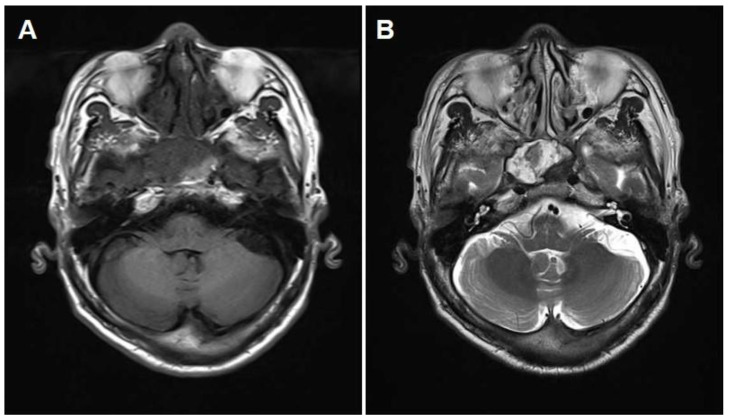
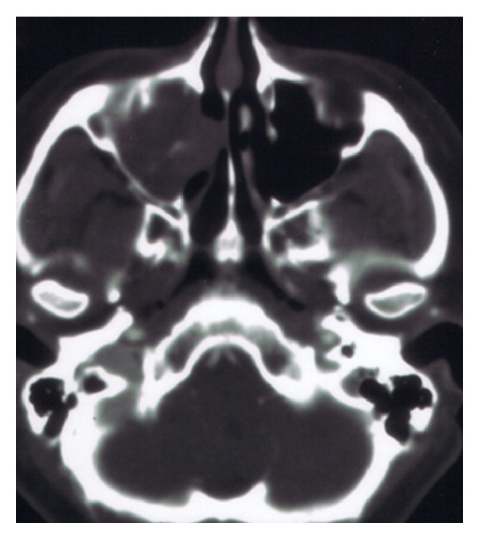
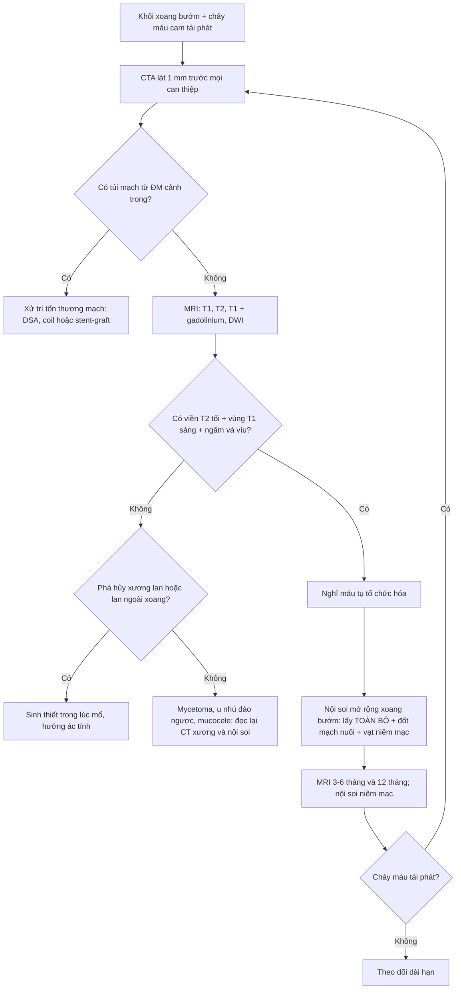
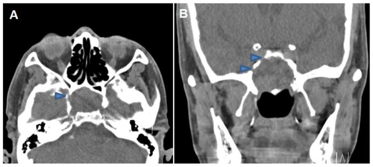
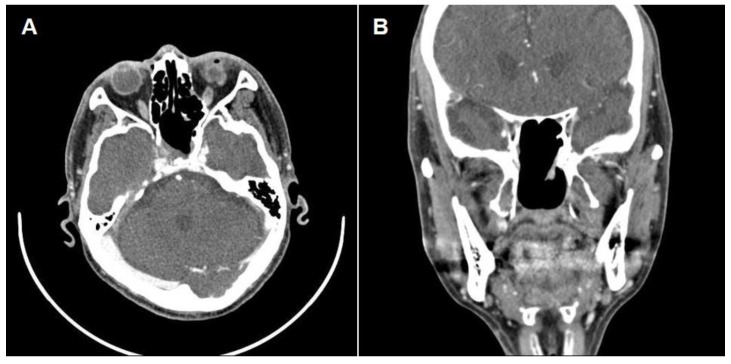

# 3051 — Máu tụ tổ chức hóa trong xoang bướm: khối lành tính hay bị mổ như ung thư

**Tags:** `pattern:khoi-xoang` `pattern:mau-tu-to-chuc-hoa` `pattern:chay-mau-cam` `pattern:mo-xuong` `vung:xang-buom` `vung:dau-co` `anatomy:thanh-xoang-buom` `protocol:MRI-xoang` `protocol:CTA`
**Mức chắc chắn (certainty):** tổng hợp y văn (literature synthesis) — ghép **ca xoang bướm có mất thị lực hồi phục sau mổ** (Medicina 2023, PMC10608076), **ca xoang bướm 24 tuổi chảy máu cam 1 tháng** (Radiol Case Rep 2024, PMC10801137), **ca xoang hàm 82 tuổi** (Radiol Case Rep 2023, PMC10597775), **loạt 5 ca có mô bệnh – hóa mô miễn dịch** (Int J Otolaryngol 2013, PMC3606777) và **ca xoang bướm có liệt dây sọ** (Oncol Lett 2016, PMC4887761 — chỉ dẫn link, ảnh CC BY-NC-ND). Không có ca do nhóm tự chụp.

> **Câu hỏi thực hành:** nam **69 tuổi**, **mờ mắt phải từng cơn**, nội soi – CT thấy **khối mô mềm dãn rộng xoang bướm phải, mòn thành xương**; đã **mổ mở xoang bướm một lần trước đó** mà khối vẫn to thêm. Câu hỏi: **khối này là ung thư hay lành tính, có được sinh thiết/hút một phần không, và vì sao phải chụp mạch trước khi đụng vào?**
> Bài chốt **ba quyết định**: **(1) nhận ra "khối xoang bướm mòn xương + chảy máu cam tái phát" có thể là máu tụ tổ chức hóa — lành tính; (2) loại túi mạch (giả phình động mạch cảnh trong) TRƯỚC mọi can thiệp; (3) điều trị đúng là lấy TOÀN BỘ + đốt mạch nuôi, không phải hút hay sinh thiết một phần.** Nối [3046 – Chảy máu cam ồ ạt do vỡ giả phình ĐM cảnh trong vào xoang bướm](../3046-chay-mau-cam-do-vo-gia-phinh-dong-mach-canh-trong-xoang-buom/lesson.md), [3050 – Tổn thương ĐM cảnh trong cấp trong mổ nội soi](../3050-ton-thuong-dong-mach-canh-trong-trong-mo-noi-soi/lesson.md), [235 – Xương thái dương – xoang](../235-xuong-thai-duong-xoang/lesson.md).

## 1. Tổng quan bệnh học – cơ chế hình ảnh: vì sao một cục máu lại "mọc" và ăn mòn xương

- **Bản chất mô bệnh (không phải u):** máu tụ tổ chức hóa (organized hematoma, OH) là tổn thương **không tân sinh**, cấu tạo bởi **hồng cầu ở nhiều giai đoạn thoái hóa + fibrin + tổ chức hạt + xơ hóa/hyalin + mạng tân mạch giãn**. Loạt **5 ca** có mô bệnh – hóa mô miễn dịch cho thấy **mạch giãn CD31/CD34 dương** và **periostin** biểu hiện trong khối, **không có tế bào u** (Int J Otolaryngol 2013, PMC3606777). Chính mạng tân mạch mỏng, dễ vỡ này là động cơ tự duy trì của bệnh.
- **Vòng xoắn sinh bệnh học (giải thích TẠI SAO khối to dần):** xuất huyết vi thể lặp lại → fibrin lắng đọng → tổ chức hóa và xơ hóa → tân mạch mới **càng dễ chảy máu** → thêm máu và fibrin. Mỗi vòng **tăng thể tích** trong một xoang kín, nên khối **dãn xoang và làm mòn/vát xương** như một khối u — nhưng **không xâm lấn mô** và **không di căn**. Vì vậy "mòn xương" trên CT **không đồng nghĩa ác tính**.
- **TẠI SAO viền T2 tối (dấu hiệu chốt):** hemosiderin (sắt 3+) **thuận từ** rút ngắn T2 và T2\* → viền **tối đen sát niêm mạc xoang** trên T2W, tương ứng **nhiều đợt vi xuất huyết**. Đây là dấu hiệu của **máu cũ**, không phải vỏ bao u.
- **TẠI SAO có vùng T1 sáng:** methemoglobin **nội bào** của máu bán cấp rút ngắn T1 → đốm/dải **tăng tín hiệu T1 không cản quang**, xen kẽ vùng fibrin (T1 trung tính) và huyết thanh (T1 tối). Hỗn hợp này tạo hình ảnh **"hỗn hợp tín hiệu" (heterogeneous)** rất đặc trưng, khác khối u đặc thường đồng nhất hơn.
- **TẠI SAO gần như không ngấm thuốc ở trung tâm:** lòng khối là **cục máu đông + xơ không có mao mạch**; chỉ **tổ chức hạt ở ngoại vi** ngấm thuốc → **ngấm vá víu, ngoại vi (patchy peripheral enhancement)**, đúng như ca 69 tuổi: "khối dãn rộng, ngấm vá víu từng ổ" (Medicina 2023, PMC10608076).
- **Dịch tễ – ngưỡng định lượng phải thuộc:**
  - **Hiếm, ưu thế xoang hàm:** các loạt gộp báo **15/17 (88,2%)**, **82/84 (97,6%)** và **15/23 (65,2%)** ca OH đến từ **xoang hàm**; xoang trán và xoang sàng mỗi nơi **chỉ 1 ca** (Radiol Case Rep 2024, PMC10801137).
  - **Xoang bướm: chỉ 5 ca** được báo cáo trong y văn tính tới 2023; **3/5 ca có tổn thương thị lực** và **cả 3 đều không hồi phục hoàn toàn** sau mổ — ca 69 tuổi trong bài là ca đầu tiên **hồi phục thị lực** (theo dõi **1 năm**) (PMC10608076).
  - **Kích thước:** ca xoang hàm điển hình **36 × 24 mm**; loạt 5 ca có tuổi **14–56** (PMC3606777). Ca xoang bướm: **24 tuổi, chảy máu cam 1 tháng** (PMC10801137); **69 tuổi, mờ mắt từng cơn < 1 phút** (PMC10608076); **82 tuổi, chảy máu cam tái phát** (PMC10597775).
  - **CT:** khối **tăng tỷ trọng nhẹ so với mô mềm thường**, gây **mòn/vát thành xoang**, **không có vôi hóa thô**; các bài gốc **không báo HU định lượng** — nếu cần HU, đo trên ảnh của mình và ghi rõ là số đo nội bộ, không trích nguồn.

## 2. Mẫu hình + chẩn đoán phân biệt theo vị trí (gamut)

- **Mẫu hình chốt:** khối **một bên, trong lòng xoang bướm**, **dãn xoang**, **mòn xương kiểu tái tạo (remodeling)** chứ không phá hủy lan tỏa, **không có túi mạch**, **không vôi hóa thô**, MRI **T1 có vùng sáng + T2 hỗn hợp + viền tối ngoại vi + ngấm vá víu**.
- **Gamut khối xoang bướm đơn độc (theo hình thái):**

| Nhóm | Thực thể | Vì sao vào gamut |
|---|---|---|
| Máu / mạch | **Máu tụ tổ chức hóa**, **giả phình ĐM cảnh trong**, **u mạch (angiofibroma)** | Cùng gây **chảy máu cam tái phát** + khối dãn xoang; hai thực thể sau **nguy hiểm nếu sinh thiết mù** |
| Nhiễm | **Mycetoma (bóng nấm)**, **viêm nấm xâm lấn**, lao, giang mai | Mycetoma **rất tối trên T2**, có **vôi hóa mịn**; viêm nấm xâm lấn **mòn xương tiến triển nhanh** ở người suy giảm miễn dịch |
| U lành | **U nhú đảo ngược**, u tuyến đa hình, schwannoma, meningioma lạc chỗ | U nhú đảo ngược **ngấm thuốc mạnh kiểu "cuộn não"**, có **tăng xương khu trú** |
| U ác | **Ung thư biểu mô vảy**, adenocarcinoma, lymphoma, melanoma niêm mạc, chordoma/chondrosarcoma (từ clivus) | Phá hủy xương **xâm lấn**, lan màng não, liệt dây sọ tiến triển |
| Khác | **Mucocele**, thoát vị màng não – não, túi phình đã tắc | Mucocele **T2 rất sáng, không có thành phần đặc**; thoát vị có **cuống qua khuyết xương** |

- **Gamut theo triệu chứng (dùng để hỏi bệnh):**
  - **Chảy máu cam tái phát đơn thuần:** OH, angiofibroma (nam vị thành niên), mycetoma, ung thư biểu mô vảy, giả phình ĐM cảnh trong.
  - **Mất thị lực / khiếm khuyết thị trường:** OH (3/5 ca xoang bướm), mucocele, u xoang bướm chèn thị thần kinh, viêm nấm xâm lấn.
  - **Liệt dây sọ (III–VI) + đau đầu:** OH lan ra thành bên xoang hang, u ác, nấm xâm lấn (ca Oncol Lett 2016 giả u ác — xem `sources.md`).
- **Mnemonic "MÁU – NẤM – U – MỦ":** **M**áu tụ tổ chức hóa · **Ấ** (nấm) mycetoma/xâm lấn · **U** (u nhú đảo ngược, SCC) · **M**ucocele. Bốn nhóm này phủ gần hết khối xoang bướm đơn độc.

## 3. Bảng so sánh phân biệt (ma trận đối chiếu)

| Thực thể (entity) | Hình ảnh điển hình | Chốt vào (rule-in) | Chốt loại (rule-out) | Gợi ý xác nhận |
|---|---|---|---|---|
| **Máu tụ tổ chức hóa (OH)** | Khối dãn xoang, **mòn/vát xương**, CT **tăng tỷ trọng nhẹ**, **không vôi hóa thô**; MRI **T1 có vùng sáng**, **T2 hỗn hợp + viền tối ngoại vi**, **ngấm vá víu** | **Viền T2 tối + vùng T1 sáng trong khối + không có túi mạch trên CTA** | Có **túi cản quang lồi từ ĐM cảnh trong** → loại; ngấm **đồng nhất mạnh** → nghĩ u | **MRI + CTA**; chẩn đoán xác nhận bằng **mô bệnh sau lấy toàn bộ** (không sinh thiết mù) |
| **Mycetoma (bóng nấm)** | Khối trong xoang, **vôi hóa mịn trung tâm**, **T2 rất tối toàn khối**, **không dãn xoang**, thành xoang dày | **T2 tối đồng nhất + vôi hóa điểm + không dãn xoang** | **T1 sáng từng vùng + viền tối chỉ ở ngoại vi** → nghi OH | CT xương lát mỏng; mô bệnh/nấm học sau nội soi |
| **U nhú đảo ngược** | Khối **"cuộn não"**, ngấm thuốc mạnh không đều, **tăng xương khu trú (focal hyperostosis)** ở chân bám | **Hình cuộn não + tăng xương tại chỗ bám** | **Không dãn xoang, không có máu nhiều thời kỳ** → loại OH | MRI + nội soi sinh thiết **có kiểm soát**; CT đánh giá chân bám |
| **Ung thư biểu mô vảy xoang bướm** | Phá hủy xương **xâm lấn**, bờ không đều, lan màng não/ổ mắt, hạch | **Phá hủy xương tiến triển + lan ngoài xoang + hạch** | **Xương còn vỏ liên tục, chỉ mòn/vát** → nghi lành | Sinh thiết trong lúc mổ; PET/CT giai đoạn |
| **Angiofibroma (nam trẻ)** | Khối **ngấm rất mạnh**, **khoảng trống dòng chảy (flow void)**, dãn xoang bướm + lỗ bướm khẩu cái | **Nam vị thành niên + flow void + ngấm mạnh đồng nhất** | **Không có flow void, ngấm vá víu** → loại | **CTA/MRA trước**, cân nhắc nút mạch trước mổ; **không sinh thiết** |
| **Giả phình ĐM cảnh trong** | **Túi cản quang có cổ** lồi từ ICA vào xoang; thành xoang mòn | **Túi có lòng, ngấm đồng thì với ĐM cảnh trong** | **Không có túi máu** trên CTA lát 1 mm → loại | **CTA 1 mm → DSA**; xử trí như [3046](../3046-chay-mau-cam-do-vo-gia-phinh-dong-mach-canh-trong-xoang-buom/lesson.md) |
| **Mucocele xoang bướm** | Xoang dãn, **T2 rất sáng đồng nhất**, **không ngấm**, thành xoang mỏng đều | **T2 sáng đồng nhất + không có thành phần đặc** | **T2 hỗn hợp + viền tối + vùng T1 sáng** → loại | MRI; nội soi mở rộng xoang |
| **Melanoma niêm mạc** | Khối **T1 sáng do melanin**, ngấm thuốc, phá hủy xương | **T1 sáng + ngấm mạnh + phá hủy xương** | **T1 sáng chỉ từng ổ kèm viền T2 tối** → nghi OH | Mô bệnh + hóa mô miễn dịch |

*Cùng bệnh nhân 69 tuổi (Medicina 2023, PMC10608076): **(A)** T1W — khối lấp xoang bướm phải với **tín hiệu hỗn hợp**; **(B)** T2W — **tín hiệu rất hỗn hợp** và **viền ngoại vi tối** (hypointense peripheral rim). Viền tối này là **hemosiderin** của nhiều đợt xuất huyết, không phải vỏ bao u — và là dấu hiệu giúp nghĩ tới máu tụ tổ chức hóa thay vì ung thư. Nguồn: CC BY 4.0, nguyên bản.*

### Dấu hiệu đọc nhanh trên từng chuỗi xung
- **CT không cản quang:** khối **tăng tỷ trọng nhẹ**, **mòn xương kiểu tái tạo**; nếu thấy **vôi hóa mịn** → nghĩ mycetoma.
- **T1W:** vùng **tăng tín hiệu** (methemoglobin) xen kẽ vùng tối (fibrin/xơ) — **không gặp ở u đặc thông thường**.
- **T2W:** **viền tối sát niêm mạc** + trung tâm hỗn hợp; mycetoma thì **tối gần như toàn khối**.
- **T1W + gadolinium:** **ngấm vá víu ngoại vi**, không ngấm trung tâm; u nhú đảo ngược/u ác **ngấm mạnh và đồng nhất hơn**.
- **CTA:** bắt buộc khi có chảy máu cam — **loại túi mạch** trước khi sinh thiết/hút.

*Loạt 5 ca (Int J Otolaryngol 2013, PMC3606777): nữ 36 tuổi, chảy máu cam tái phát 2 tháng, CT vành có cản quang — khối **36 × 24 mm** ngấm thuốc không đều trong xoang hàm. Hình này minh họa **cùng một bệnh học ở vị trí hay gặp nhất (xoang hàm)**; ở xoang bướm, hậu quả nặng hơn vì sát **thị thần kinh và động mạch cảnh trong**. Nguồn: CC BY 3.0, nguyên bản.*

## 4. Protocol chụp + ngưỡng xử trí

- **Bước 0 — trước mọi can thiệp:** khối xoang bướm + **chảy máu cam** → **KHÔNG sinh thiết mù, KHÔNG hút một phần**. Thứ tự bắt buộc: **CTA** (loại giả phình/angiofibroma) → **MRI** (đặc điểm máu) → **nội soi lấy toàn bộ** trong cùng một thì có kiểm soát.
- **CT xoang:** lát **≤ 1 mm**, cửa sổ xương + mô mềm, không cản quang; thêm **CTA** thì động mạch khi có chảy máu. Đọc: **thành xoang bướm, ống cảnh, sàn xoang bướm, chân bướm, hố tuyến yên**.
- **MRI xoang – chuẩn để chẩn đoán "máu":** **T1W không cản quang**, **T2W**, **T1W fat-sat + gadolinium**, **DWI**; đo **3 chiều (mm)** + đánh giá **thị thần kinh, màng não, xoang hang**.
- **Không có hệ phân độ (RADS) riêng cho OH**; thay vào đó dùng **3 ngưỡng quyết định**:
  1. **Có túi mạch trên CTA** → xử trí như tổn thương mạch (bài 3046), **không** cắt "như u".
  2. **Viền T2 tối + T1 sáng + không túi mạch** → **nghĩ OH**, mổ lấy toàn bộ + **đốt động mạch nuôi** + **vá niêm mạc bằng vạt vách mũi (nasoseptal flap)** khi vào xoang hang/nền sọ.
  3. **Phá hủy xương lan + hạch + lan màng não** → hướng ác tính, **sinh thiết trong lúc mổ**, không sinh thiết qua mũi mù.
- **Kỹ thuật mổ (theo ca 69 tuổi):** **mở rộng xoang bướm qua nội soi**, **lấy toàn bộ khối**, **đốt động mạch nuôi**, **vá bằng vạt vách mũi**; thị lực hồi phục và **không tái phát trong 1 năm** (PMC10608076).
- **Theo dõi:** MRI **3–6 tháng** và **12 tháng** sau mổ; **nội soi** kiểm tra niêm mạc; **chụp lại ngay** nếu chảy máu tái phát (phân biệt tái phát với **máu tụ mới** sau mổ).

## 5. Biến thể bình thường và cạm bẫy

- **Bẫy số 1 — "mòn xương = ung thư":** OH **dãn và mòn xương** rất rõ nhưng **không xâm lấn**; ca 69 tuổi có **mòn thành xương** trên CT mà vẫn là tổn thương lành tính. Đọc thêm **bờ xương còn vỏ, không có phản ứng màng xương, không có khối ngoài xoang**.
- **Bẫy số 2 — sinh thiết hoặc hút một phần:** chỉ lấy một phần → **chảy máu nhiều** và **tái phát** (khối vẫn còn mạch nuôi). Ca 69 tuổi đã **mổ mở xoang bướm trước đó** mà khối **vẫn dãn rộng thêm** (PMC10608076) — bằng chứng cho việc **hút/mở một phần không đủ**.
- **Bẫy số 3 — bỏ qua mạch:** khối + chảy máu cam ở xoang bướm phải coi là **tổn thương mạch cho tới khi CTA loại trừ** (bài 3046); **lồi ICA vào xoang bướm gặp 26,3%** người bình thường nên "thấy mạch cảnh sát khối" không loại trừ được giả phình.
- **Bẫy số 4 — nhầm với mycetoma:** cùng **T2 tối**; khác ở chỗ mycetoma **tối toàn khối + vôi hóa mịn + không dãn xoang**, còn OH có **vùng T1 sáng + viền tối chỉ ở ngoại vi + dãn xoang**.
- **Bẫy số 5 — nhầm với mucocele:** mucocele **T2 sáng đồng nhất, không ngấm**; nếu báo "mucocele" mà bệnh nhân **chảy máu cam tái phát**, đọc lại **T1/T2** để tìm thành phần máu.
- **Bẫy số 6 — "satisfaction of search":** đã thấy khối xoang bướm vẫn phải đọc **xoang hàm/sàng, hốc mũi, họng mũi, hố tuyến yên** — OH có thể kèm **viêm xoang tắc nghẽn** do khối chặn lỗ thông.
- **Cạm bẫy mặt cắt:** trên **lát cắt ngang qua trần xoang bướm**, niêm mạc xoang **tăng tín hiệu T2** có thể bị đọc là "dịch trong khối"; luôn so **lát vành** và đặt viền tối vào **đúng mặt trong niêm mạc**.

## 6. Tự lượng giá — Blind Quiz

**Ca 1 — Khối xoang bướm + mờ mắt từng cơn, CT không cản quang.**

- Gợi ý lâm sàng: nam 69 tuổi, **mờ mắt phải 2 đợt ngắn < 1 phút**, đã từng mổ mở xoang bướm.
- Câu hỏi: Mô tả khối và **hai dấu hiệu xương**. Có được sinh thiết ngay không, và bước hình ảnh nào bắt buộc trước?

<b>Bấm để hiện đáp án (findings + chẩn đoán)</b>

- Dấu hiệu (findings): **(A)** lát ngang — khối mô mềm lấp **xoang bướm phải**, **mòn thành xương** (đầu mũi tên); **(B)** lát vành — khối **dãn rộng** xoang, **mòn thành trên và thành bên**; không thấy vôi hóa thô.
- Chẩn đoán (diagnosis): hướng **máu tụ tổ chức hóa xoang bướm**. **Không sinh thiết mù**: bước bắt buộc là **MRI** (tìm viền T2 tối + vùng T1 sáng) và **CTA** (loại giả phình ĐM cảnh trong) trước khi nội soi.
- Vì sao: **mòn xương do dãn áp lực**, không phải xâm lấn; tổn thương nằm sát **ĐM cảnh trong** nên can thiệp mù có nguy cơ chảy máu không cầm.
- Nguồn ảnh: Medicina 2023 (PMC10608076), CC BY 4.0.

**Ca 2 — MRI của cùng bệnh nhân: đọc viền tối.**

- Gợi ý lâm sàng: vẫn bệnh nhân Ca 1.
- Câu hỏi: Viền tối trên T2 nằm ở đâu, bản chất là gì? Vì sao nó giúp **loại u đặc**?

<b>Bấm để hiện đáp án</b>

- Dấu hiệu (findings): **T2W** — viền **giảm tín hiệu rõ** sát mặt trong niêm mạc xoang, bao quanh vùng **tín hiệu hỗn hợp**; **T1W** — vùng **tăng tín hiệu** xen kẽ trong khối.
- Chẩn đoán (diagnosis): **máu tụ tổ chức hóa**; viền tối = **hemosiderin** của nhiều đợt xuất huyết, cộng **xơ/hyalin** (collagen rút ngắn T2).
- Vì sao loại u: u đặc thường **ngấm thuốc đồng nhất** và **không có vùng T1 sáng do methemoglobin**; ở đây trung tâm **không ngấm** vì là cục máu đông – xơ không mao mạch.
- Nguồn ảnh: Medicina 2023 (PMC10608076), CC BY 4.0.

**Ca 3 — Sau mổ, kiểm tra kết quả.**

- Gợi ý lâm sàng: 1 năm sau mổ nội soi, **không còn triệu chứng thị giác**.
- Câu hỏi: Hai lát cắt chứng minh điều gì? Nếu 6 tháng sau có lại khối trong xoang, phân biệt **tái phát** với **máu tụ mới** bằng gì?

<b>Bấm để hiện đáp án</b>

- Dấu hiệu (findings): **(A)** ngang và **(B)** vành — xoang bướm **trống**, **không còn khối**, thành xoang **còn nguyên vỏ**; không có biến chứng màng não.
- Chẩn đoán (diagnosis): **lấy toàn bộ khối thành công**; đây là tiêu chuẩn "điều trị triệt để" của OH (khác hút một phần).
- Phân biệt sau mổ: **máu tụ mới** thường **thay đổi tín hiệu theo thời gian** (T1 sáng dần, T2 tối dần) và **không có mạch nuôi** trên CTA; **tái phát** có **mạch nuôi phục hồi** và **dãn xoang tiến triển** — cần **MRI có cản quang + CTA**, không chỉ CT.
- Nguồn ảnh: Medicina 2023 (PMC10608076), CC BY 4.0.

## Bài liên quan chéo
- [200 – Tổng quan hệ Thần kinh](../200-tong-quan-he-than-kinh/lesson.md)
- [3046 – Chảy máu cam ồ ạt do vỡ giả phình ĐM cảnh trong vào xoang bướm](../3046-chay-mau-cam-do-vo-gia-phinh-dong-mach-canh-trong-xoang-buom/lesson.md)
- [3050 – Tổn thương ĐM cảnh trong cấp trong mổ nội soi mũi xoang/nền sọ](../3050-ton-thuong-dong-mach-canh-trong-trong-mo-noi-soi/lesson.md)
- [235 – Xương thái dương – xoang](../235-xuong-thai-duong-xoang/lesson.md)
- [3023 – Ù tai mạch đập: tiếp cận hướng mạch](../3023-u-tai-mach-dap/lesson.md)
- [700 – Tổng quan Đầu Mặt Cổ](../700-head-neck-overview/lesson.md)

## Ảnh
- 4 ảnh: **3 ảnh CC BY 4.0** (Medicina 2023, PMC10608076) + **1 ảnh CC BY 3.0** (Int J Otolaryngol 2013, PMC3606777) — **nguyên bản**, không crop/ghép; chi tiết trong `images/CREDITS.md`.
- **Không dùng ảnh** của Radiol Case Rep 2024 (PMC10801137), Radiol Case Rep 2023 (PMC10597775) và Oncol Lett 2016 (PMC4887761): license **CC BY-NC-ND** — chỉ dẫn link trong `sources.md`.

> Không dùng để chẩn đoán độc lập khi chưa có người hướng dẫn.
