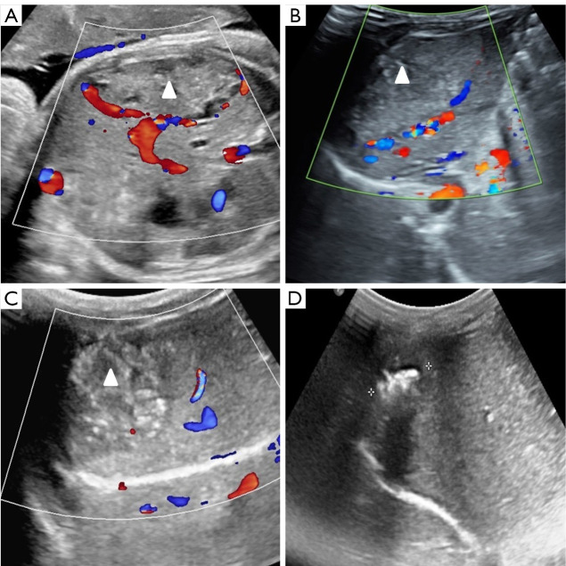
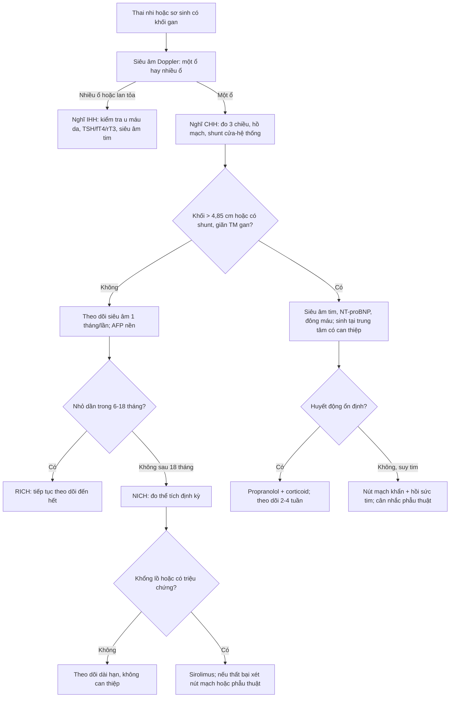
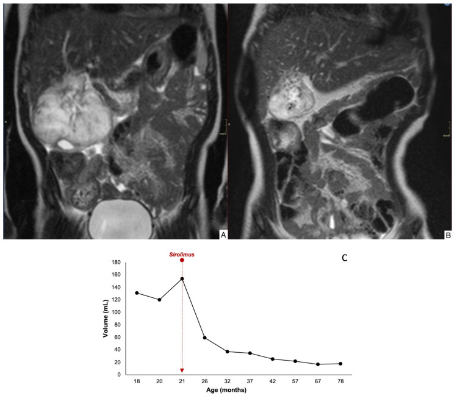
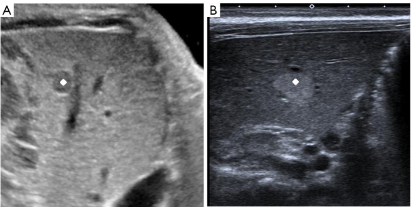
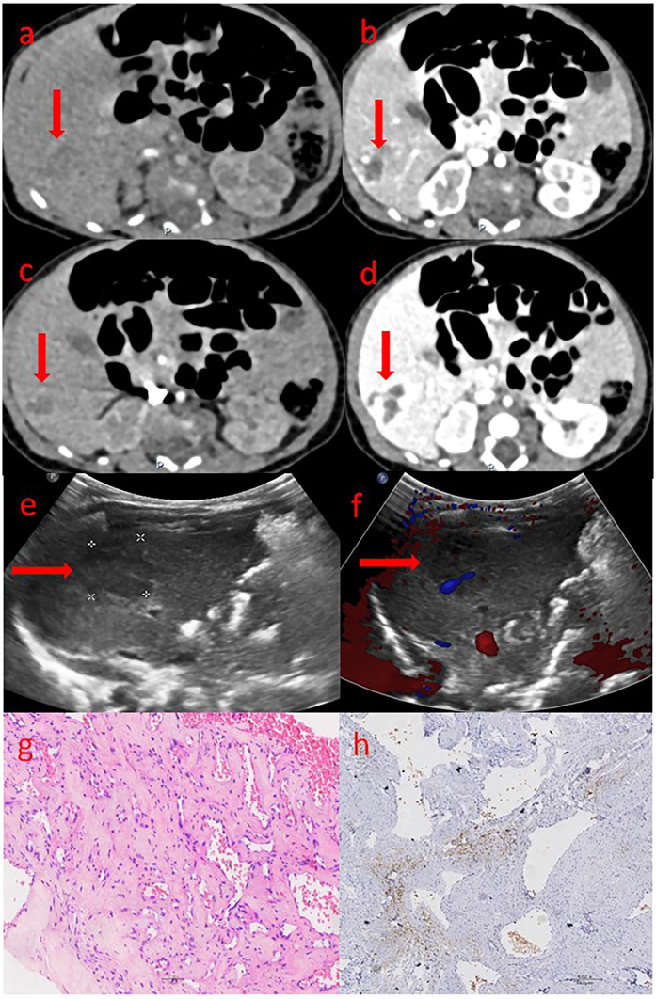

# 3052 — U mạch máu gan bẩm sinh (RICH/NICH) & thể một ổ ở trẻ: phân biệt IHH, khi nào theo dõi, khi nào can thiệp

**Tags:** `pattern:u-mau-gan` `pattern:o-don-doc-gan` `pattern:shunt-dong-tinh-mach` `vung:gan` `anatomy:gan` `protocol:Sieu-am-Doppler` `protocol:MRI-gan` `protocol:propranolol` `protocol:sirolimus` `incidentaloma:u-mau-gan`
**Mức chắc chắn (certainty):** tổng hợp y văn (literature synthesis) — ghép **12 sơ sinh u mạch máu gan bẩm sinh + tổng quan** (Front Pediatr 2025, PMC12066750), **7 ca NICH gan theo dõi tới 191 tháng** (Children (Basel) 2025, PMC12293984), **54 thai nhi có siêu âm trước sinh dự báo suy tim** (Quant Imaging Med Surg 2026, PMC12780712) và bài nền [3048 – U máu gan ở nhũ nhi](../3048-u-mau-gan-o-nhu-nhi/lesson.md) (J Clin Med 2024, PMC11122465). Không có ca do nhóm tự chụp.

> **Câu hỏi thực hành:** bé gái **1 tháng tuổi**, siêu âm trước sinh lúc **34 tuần** thấy khối **giảm âm 0,7 × 0,8 cm** ở gan phải; nay khối **tăng âm 1,4 × 1,1 cm**, trẻ **hoàn toàn khỏe**, không u máu da, AFP bình thường. Câu hỏi: **đây là u mạch máu nhũ nhi (IHH) hay u mạch máu bẩm sinh (CHH), có cần propranolol, và theo dõi bao lâu trước khi kết luận “không thoái triển”?**
> Bài chốt **ba quyết định**: **(1) tổn thương MỘT Ổ đã có kích thước tối đa lúc sinh = u mạch máu bẩm sinh (CHH), không phải IHH — đừng mặc định “u máu gan là cho propranolol”; (2) phân biệt RICH (thoái triển nhanh, ~80% thể tích trong 12 tháng) với NICH (không thoái triển, có thể lớn theo trẻ) cần theo dõi tối thiểu 18 tháng; (3) nguy cơ thật là shunt → suy tim, dự báo được từ trước sinh bằng đường kính > 4,85 cm.** Nối [3048 – U máu gan ở nhũ nhi](../3048-u-mau-gan-o-nhu-nhi/lesson.md), [3005 – U máu dưới thanh môn](../3005-u-mau-duoi-thanh-mon-nhu-nhi/lesson.md), [1804 – Suy giáp tiêu thụ do D3](../1804-suy-giap-tieu-thu-do-u-mach-mau-ngoai-gan/lesson.md), [630 – Khối u đặc ổ bụng trẻ](../630-u-bung-nhi-neuroblastoma-vs-wilms/lesson.md), [674 – U quái gan](../674-u-quai-te-bao-mam-gan-o-tre/lesson.md).

## 1. Tổng quan bệnh học – cơ chế hình ảnh: vì sao “một ổ” là một bệnh khác

- **Phân loại trước khi chẩn đoán (ISSVA 2018):** u mạch máu gan (hepatic hemangioma) chia **hai nhóm hoàn toàn khác nhau**:
  - **U mạch máu bẩm sinh (congenital hemangioma, CHH)** — **đã phát triển đầy đủ trong tử cung**, **không có pha tăng sinh sau sinh**, **GLUT1 âm**. Gồm **RICH** (thoái triển nhanh), **PICH** (thoái triển một phần), **NICH** (không thoái triển). Có báo cáo thêm **thể thứ tư**: tăng sinh ngắn ngay sau sinh rồi thoái triển (PMC12066750).
  - **U mạch máu nhũ nhi (infantile hepatic hemangioma, IHH)** — xuất hiện **sau sinh 1–4 tuần**, có **pha tăng sinh 3–9 tháng** rồi thoái triển, **GLUT1 dương**. Thường **đa ổ hoặc lan tỏa**, hay kèm **u máu da**.
- **Quy tắc vàng về số lượng ổ:** **tổn thương MỘT Ổ (focal) trong gan ở trẻ sơ sinh chính là CHH** — đây là kết luận được **Liver Hemangioma Registry (Boston Children's Hospital)** xác nhận và được nhắc lại trong loạt NICH (PMC12293984). Ngược lại, **nhiều ổ/lan tỏa** gợi **IHH**. Vì vậy câu hỏi đầu tiên trên siêu âm không phải “kích thước bao nhiêu” mà là **“một ổ hay nhiều ổ”**.
- **TẠI SAO GLUT1 là chốt mô bệnh:** GLUT1 (glucose transporter 1) được biểu hiện ở **nội mô u mạch máu nhũ nhi** (kiểu “nhau thai”) nhưng **không có ở CHH**. Trong loạt 12 sơ sinh, ảnh hóa mô miễn dịch cho thấy **tế bào nội mô không biểu hiện GLUT-1**, trong khi **hồng cầu dương tính nội chứng** — đúng kiểu CHH (PMC12066750). Vì vậy một mẫu mô nhỏ **GLUT1 âm** đủ để loại IHH.
- **TẠI SAO MRI T2 rất sáng:** CHH là **tổn thương mạch máu lưu lượng cao** với **hồ mạch (venous lakes) giãn, chậm dòng** chứa nhiều huyết tương → **T2 tăng tín hiệu mạnh**, gần bằng dịch não tủy. Sau tiêm, tổn thương **ngấm mạnh thì động mạch** và **tiếp tục ngấm/ứ ở thì muộn** (pooling), **không thải thuốc** như HCC. Đây là lý do “T2 sáng + ngấm mạnh kéo dài” **gợi ý mạch máu, không gợi ác tính**.
- **TẠI SAO siêu âm đổi âm sắc theo thời gian — điều dễ đọc sai nhất:** trong ca NICH kinh điển của loạt 54 thai nhi, khối **giảm âm trước sinh** (34 tuần, 0,7 × 0,8 cm) nhưng **tăng âm sau sinh** (1,4 × 1,1 cm) (PMC12780712). Cơ chế được cho là **thay đổi thành phần mô đệm/xơ hóa và mạng mạch** trong quá trình “chín” của tổn thương, **không phải xuất huyết**. Vì vậy **tăng âm sau sinh không loại trừ CHH**, và **không được gọi là “di căn/u ác mới xuất hiện”**.
- **TẦN SUẤT và định nghĩa “khổng lồ”:** CHH **khổng lồ** được định nghĩa **> 4 cm**, tần suất **0,64/10.000** trẻ sinh sống; thể khổng lồ có biến chứng có **tử vong 30–100%** nếu không điều trị (PMC12066750 dẫn lại). Trong 12 sơ sinh của loạt, **tất cả đều là thai đủ tháng (37 tuần 1 ngày – 40 tuần 1 ngày)**, cân nặng **2.650–3.900 g**, và **tất cả đều được phát hiện trước sinh** bằng siêu âm thai (**1 ngày – 14 tuần trước sinh**).
- **Diễn tiến tự nhiên – con số dùng để tư vấn:** **RICH giảm khoảng 80% thể tích quanh 12 tháng tuổi**; **NICH không thoái triển sau sinh và có thể lớn theo tỷ lệ cơ thể**; **PICH ở giữa** (PMC12780712). Vì vậy **kết luận “NICH” chỉ được đặt sau khi theo dõi ≥ 18 tháng không có dấu hiệu thoái triển** — đúng tiêu chuẩn của loạt 7 ca (PMC12293984).
- **NICH gan — bằng chứng dài hạn:** 7 bệnh nhân (**5 nữ/2 nam**), tuổi chẩn đoán trung vị **42 ngày** (0–1.440), **5/7 không triệu chứng**, chủ yếu **thùy phải**; theo dõi trung vị **75 tháng** (35–191). Trong 4 ca không điều trị, diễn tiến **rất khác nhau**: có ca **thoái triển muộn**, có ca **lớn muộn (tardive growth)**. Ba ca NICH khổng lồ được điều trị **sirolimus**: **2 ca đáp ứng một phần, 1 ca ổn định** (PMC12293984). Một ca có **đột biến GNAQ** — gợi ý NICH thuộc nhóm dị dạng mạch do đột biến **GNAQ/GNA11**, không phải u tân sinh thật.
- **Nguy cơ thật: shunt → suy tim.** Trong 12 sơ sinh, **11 ca** có tiểu cầu và đông máu bình thường; **1 ca (số 12)** có **giảm tiểu cầu + rối loạn đông máu + suy tim phải lúc sinh**: tiểu cầu **92 → 89 × 10⁹/L**, fibrinogen **1,34 → 0,91 g/L**, **NT-proBNP 45.759 → 54.867 pg/mL**, khối **7,5 × 6,1 cm → 7,0 × 6,2 cm**. Ca này **thất bại propranolol + methylprednisolone**, được **nút mạch qua da ngày thứ 9** và **tử vong ngày thứ 2 sau nút** (PMC12066750). Bài học: **suy tim do shunt là biến chứng quyết định tử vong, và “thuốc uống” không đủ nhanh ở thể này**.
- **Dự báo suy tim từ TRƯỚC SINH — bộ số liệu mạnh nhất:** trong **54 thai nhi** có CHH, nhóm suy tim sau sinh khác biệt rõ:
  - **Đường kính khối 6,5 cm vs 3,8 cm** (p = 0,001); **ngưỡng > 4,85 cm** dự báo suy tim với **AUC 0,859, độ nhạy 100%, độ đặc hiệu 70,2%**.
  - **Tỷ lệ tim/ngực (cardiothoracic ratio) 0,40 vs 0,27** (p < 0,0001).
  - **Shunt cửa–hệ thống: 100% vs 19,1%**; **hồ mạch (venous lakes): 100% vs 10,6%**; **giãn tĩnh mạch gan: 100% vs 48,9%**; **giãn động mạch gan: 100% vs 36,2%**; **nguồn cấp kép (tĩnh mạch cửa + động mạch gan): 57,1% vs 12,8%** (PMC12780712).
- **TẠI SAO các dấu hiệu trên lại dự báo suy tim:** suy tim ở CHH là **suy tim cung lượng cao** do **shunt trong u**. Ba biến số sinh lý quyết định: **(1) thể tích shunt** (khối lớn, nhiều hồ mạch), **(2) đường thoát** (giãn tĩnh mạch gan → máu về tim phải nhiều), **(3) khả năng bù** của tim sơ sinh. Vì vậy **kích thước khối** và **shunt cửa–hệ thống** dự báo mạnh hơn “vị trí thùy gan”.

## 2. Mẫu hình + chẩn đoán phân biệt theo tuổi và hành vi (Gamut)

- **Theo thời điểm phát hiện:**
  - **Trước sinh / ngay sau sinh, một ổ, không lớn thêm** → **CHH (RICH/PICH/NICH)**.
  - **2 tuần–3 tháng, nhiều ổ/lan tỏa, kèm u máu da** → **IHH**.
  - **6 tháng–3 tuổi, khối đặc không đồng nhất, AFP tăng** → **hepatoblastoma** (bài 3048).
- **Theo hành vi sau sinh — trục phân loại CHH:**
  - **Nhỏ dần nhanh, hết sau 6–18 tháng** → **RICH** (giảm ~80% thể tích quanh 12 tháng).
  - **Giảm một phần rồi dừng** → **PICH**.
  - **Không giảm sau 18 tháng, có thể lớn theo trẻ** → **NICH**.
  - **Lớn nhanh trong vài tháng đầu rồi thoái triển** → **thể thứ tư** (postnatal proliferation) — dễ bị gọi nhầm là IHH.
- **Theo hình thái trên siêu âm/MRI:**
  - **Một ổ đặc, bờ rõ, có hồ mạch** → CHH.
  - **Nhiều ổ nhỏ rải rác** → IHH đa ổ.
  - **“Vô số ổ” thay gần toàn bộ gan** → IHH lan tỏa (nặng nhất, bài 3048).
  - **Khối đa nang vách mỏng** → mesenchymal hamartoma.
  - **Khối đặc có vôi hóa thô** → hepatoblastoma.
- **Gamut chính cần loại trừ:** **IHH** · **hepatoblastoma** · **mesenchymal hamartoma** · **sarcoma phôi chưa biệt hóa** (undifferentiated embryonal sarcoma, thường 6–10 tuổi, dạng nang giả) · **KHE/kaposiform hemangioendothelioma** (Kasabach–Merritt) · **di căn neuroblastoma** · **áp-xe gan** · **nang gan đơn thuần**.
- **Bảng “một câu chốt”:** **một ổ + có từ trong tử cung + GLUT1 âm = CHH**; **nhiều ổ + xuất hiện sau sinh + GLUT1 dương = IHH**; **AFP tăng dần + vôi hóa = hepatoblastoma**; **giảm tiểu cầu nặng = KHE**.

## 3. Bảng so sánh phân biệt (ma trận đối chiếu)

| Thực thể (entity) | Hình ảnh điển hình | Chốt vào (rule-in) | Chốt loại (rule-out) | Gợi ý xác nhận |
|---|---|---|---|---|
| **CHH – RICH** | **Một ổ**, bờ rõ, siêu âm **hỗn hợp âm**, Doppler có mạch; MRI **T2 rất sáng**, ngấm mạnh thì động mạch + ứ thì muộn | **Đã tối đa lúc sinh + nhỏ dần ~80% trong 12 tháng + GLUT1 âm** | Nhiều ổ, lớn dần sau sinh, có u máu da → IHH | Siêu âm Doppler cách 4–8 tuần; MRI nếu không rõ |
| **CHH – NICH** | **Một ổ**, trước sinh **giảm âm**, sau sinh **tăng âm**; có thể có **hồ mạch, vôi hóa, xơ trung tâm** | **Không thoái triển ≥ 18 tháng + GLUT1 âm (± GNAQ)** | Nhỏ dần rõ trong 6–12 tháng → RICH | Theo dõi thể tích định kỳ; sinh thiết khi nghi ác |
| **CHH – thể tăng sinh sau sinh** | Một ổ, **lớn nhanh vài tháng đầu** rồi thoái triển; có từ trong tử cung | **Có trước sinh + lớn ngắn rồi giảm** | Lớn liên tục, nhiều ổ, u máu da → IHH | Chuỗi siêu âm; GLUT1 âm |
| **IHH đa ổ/lan tỏa** | Nhiều ổ **giảm âm**, **T2 sáng đều**, gan to, Doppler tăng lưu lượng; kèm **u máu da ≥ 5** | **Xuất hiện sau sinh + nhiều ổ + u máu da + GLUT1 dương** | Một ổ có từ trong tử cung → CHH | Siêu âm + MRI; TSH/fT4/rT3; siêu âm tim |
| **Hepatoblastoma** | Khối **đặc không đồng nhất**, **vôi hóa 40–50%**, có thể xâm lấn tĩnh mạch cửa | **AFP tăng dần + vôi hóa + tuổi 6 tháng–3 tuổi** | AFP giảm dần, nhiều ổ T2 sáng đều → mạch máu | AFP + MRI/CT; sinh thiết trước hóa trị |
| **Mesenchymal hamartoma** | Khối **đa nang**, vách mỏng, dịch; có thể chiếm cả thùy | **Khối nang nhiều vách + AFP bình thường + < 2 tuổi** | Khối đặc ngấm mạnh → CHH | MRI/CT; sinh thiết nếu không rõ |
| **KHE (Kasabach–Merritt)** | Khối **mờ, xâm lấn**, mô mềm quanh gan, có thể tràn dịch | **Giảm tiểu cầu nặng + rối loạn đông máu** | Tiểu cầu bình thường, một ổ rõ → CHH | Công thức máu, đông máu, MRI |
| **Di căn neuroblastoma** | Nhiều nốt gan + **khối thượng thận** nguyên phát, di căn xương/tủy | **Khối thượng thận + catecholamine/metanephrine tăng** | Không có u nguyên phát, AFP giảm → CHH | CT/MRI bụng–ngực, MIBG |
| **Áp-xe gan** | Ổ **dịch hoại tử**, viền ngấm, có thể khí trong ổ | **Sốt + đau + bạch cầu tăng + ổ viền ngấm** | Không sốt, khối mạch máu đặc → CHH | Siêu âm/CT, cấy máu |

*RICH gan phải phát hiện **37 tuần 2 ngày**: khối **6,5 × 3,3 × 5,2 cm**, echo hỗn hợp, **viền tăng âm rõ**, có mạch ngoại vi. **(A–C)** chuỗi siêu âm sau sinh cho thấy khối **nhỏ dần**; **(D)** còn lại **ổ tăng âm nhỏ có caliper** — di chứng xơ/hóa vôi. Đây là mô hình “RICH: giảm ~80% thể tích quanh 12 tháng”. Nguồn: Quant Imaging Med Surg 2026 (PMC12780712), **CC BY-NC-ND 4.0**, nguyên bản.*

## 4. Protocol chẩn đoán – theo dõi – điều trị

- **Bước 1 — siêu âm Doppler là đầu tay, làm sớm trong 24–48 giờ sau sinh** ở mọi khối gan phát hiện trước sinh: xác định **số ổ**, **kích thước 3 chiều**, **âm sắc**, **hồ mạch**, **shunt cửa–hệ thống**, **giãn tĩnh mạch gan/động mạch gan**. Đây cũng là các biến số dự báo suy tim.
- **Bước 2 — MRI gan (T2 + DCE) khi:** không rõ số ổ, nghi tổn thương ác, cần đo thể tích để theo dõi NICH, hoặc chuẩn bị can thiệp. **CT** chỉ khi MRI không khả dụng hoặc cần đánh giá mạch chi tiết — hạn chế xạ (ALARA).
- **Bước 3 — xét nghiệm bắt buộc:**

| Xét nghiệm | Vì sao | Ngưỡng / lưu ý |
|---|---|---|
| **AFP** | Loại hepatoblastoma | Theo **xu hướng**: giảm dần ủng hộ CHH; **tăng dần** = báo động |
| **Công thức máu + đông máu** | Loại KHE/Kasabach–Merritt | Tiểu cầu **92 → 89 × 10⁹/L**, fibrinogen **1,34 → 0,91 g/L** trong ca suy tim (PMC12066750) |
| **NT-proBNP / BNP + siêu âm tim** | Phát hiện suy tim cung lượng cao | NT-proBNP **45.759 → 54.867 pg/mL** ở ca tử vong; đo **chỉ số tim/ngực** trên X-quang |
| **TSH, fT4, rT3** | Suy giáp tiêu thụ do D3 (chủ yếu IHH lan tỏa) | TSH cao + rT3 cao + fT4 thấp/bình thường (bài 3048) |
| **GLUT1 (nếu có mô)** | Phân biệt CHH với IHH | **CHH: âm** (hồng cầu dương nội chứng); IHH: dương |

- **Bước 4 — quyết định điều trị theo “có triệu chứng hay không”, không theo nhãn “hemangioma”:**

| Tình huống | Lựa chọn | Số liệu / lưu ý |
|---|---|---|
| **Một ổ, không triệu chứng, < 4 cm, không shunt** | **Theo dõi**: siêu âm **1 tháng/lần** đến khi ổn định, sau đó **3 tháng/lần** | Phần lớn RICH tự thoái triển; **không cần propranolol** |
| **Nghi NICH (không nhỏ sau 18 tháng)** | **Tiếp tục theo dõi**; đo thể tích định kỳ | 4 ca không điều trị có **thoái triển muộn hoặc lớn muộn** — không vội mổ (PMC12293984) |
| **NICH khổng lồ, không mổ được** | **Sirolimus** | 3 ca: **2 đáp ứng một phần, 1 ổn định**; ca minh họa **giảm 84% thể tích** sau 18 tháng |
| **CHH có triệu chứng nhưng huyết động ổn định** | **Propranolol** (± corticoid) | Loạt 12 ca: 3 ca propranolol **nhỏ dần và mất hoàn toàn**; nhưng **khởi phát tác dụng chậm** |
| **Suy tim sung huyết / huyết động không ổn định** | **Nút mạch qua da** (coil + hạt + iodized oil) ± hồi sức tim | Ca 12: nút mạch **ngày 9**, **tử vong ngày 2 sau nút** → cần chọn ca và hỗ trợ tim mạch đầy đủ |
| **Khối lớn, huyết động ổn định, cắt được** | **Phẫu thuật cắt u** | 12 ca: **8 ca mổ**, hậu phẫu tốt, mô bệnh xác nhận CHH |
| **Tổn thương lan tỏa, không cắt được, thất bại mọi biện pháp** | **Ghép gan** | Ca lan tỏa nặng (bài 3048: **18,75%** trong 64 ca suy giáp cần mổ/ghép) |

- **Bước 5 — tầm soát trước sinh là nơi can thiệp sớm nhất:** thai nhi có khối **> 4,85 cm** (AUC **0,859**, độ nhạy **100%**, độ đặc hiệu **70,2%**), **shunt cửa–hệ thống**, **hồ mạch**, **giãn tĩnh mạch gan** hoặc **chỉ số tim/ngực ≥ 0,40** cần **sinh tại cơ sở có hồi sức sơ sinh + can thiệp mạch**, không chuyển tuyến muộn (PMC12780712).
- **Bước 6 — theo dõi dài hạn:** đo **cân nặng, vòng bụng, gan to, NT-proBNP**, siêu âm thể tích; với NICH theo dõi **≥ 18 tháng** trước khi kết luận, và tiếp tục đến khi trẻ lớn vì NICH có thể **lớn theo cơ thể**.

*Bé gái **1 tuổi**, NICH khổng lồ gan: **(A)** MRI T2 vành trước điều trị — khối **tăng tín hiệu mạnh, lồi ra ngoài gan**; **(B)** sau **18 tháng sirolimus** — khối nhỏ rõ, **giảm 84% thể tích**; **(C)** đường cong thể tích: **132 mL (18 tháng) → 110 → 153 mL (21 tháng, bắt đầu sirolimus) → 60 → 37 → 32 → 26 → 20 → 16 mL**, tăng nhẹ lại **20 mL** ở 78 tháng. Chú ý **đỉnh 153 mL ngay trước điều trị** — đây là kiểu **“lớn muộn” (tardive growth)** đặc trưng của NICH. Nguồn: Children (Basel) 2025 (PMC12293984), **CC BY 4.0**, nguyên bản.*

## 5. Biến thể bình thường và cạm bẫy

- **Bẫy 1 — gọi mọi “hemangioma gan” là IHH rồi cho propranolol:** tổn thương **một ổ có từ trong tử cung** là **CHH**; phần lớn **tự thoái triển**, và propranolol có **khởi phát chậm**, không phù hợp khi đã suy tim (PMC12066750). Điều trị “cho chắc” làm trẻ **nhập viện, theo dõi hạ đường huyết, nhịp chậm** mà không thay đổi diễn tiến.
- **Bẫy 2 — kết luận NICH quá sớm:** tiêu chuẩn là **không thoái triển ≥ 18 tháng**; trước mốc đó, một khối “không nhỏ” có thể chỉ là **thoái triển chậm**. Ngược lại, NICH có thể **lớn muộn ở 21 tháng** (đường cong 110 → 153 mL), nên **đừng gọi là IHH khi thấy lớn**.
- **Bẫy 3 — đổi âm sắc = “xuất huyết” hoặc “u ác”:** **giảm âm trước sinh → tăng âm sau sinh** là diễn tiến đã ghi nhận của NICH, do **thay đổi mô đệm/xơ**, không phải biến chứng (PMC12780712).
- **Bẫy 4 — sinh thiết khối điển hình:** CHH là **tổn thương mạch máu lưu lượng cao**; sinh thiết có thể **chảy máu nặng**. Chẩn đoán dựa vào **bối cảnh trước sinh + số ổ + AFP/tiểu cầu + diễn tiến**; chỉ sinh thiết khi **không điển hình** hoặc nghi ác.
- **Bẫy 5 — AFP cao = hepatoblastoma:** AFP có thể rất cao trong u mạch máu (bài 3048: trung vị **76.818 ng/mL**) và **giảm dần**; **xu hướng** quan trọng hơn giá trị tuyệt đối.
- **Bẫy 6 — bỏ sót suy tim vì trẻ “vẫn bú được”:** suy tim cung lượng cao bù tốt ở sơ sinh; dấu hiệu sớm là **nhịp thở nhanh, gan to, tăng cân kém, NT-proBNP tăng**. Ca 12 chỉ lộ rõ khi **NT-proBNP tăng và X-quang có phù phổi** — muộn hơn nhiều so với lúc còn can thiệp được.
- **Bẫy 7 — gán Kasabach–Merritt cho CHH:** **giảm tiểu cầu + rối loạn đông máu nặng** thuộc **KHE**, không thuộc CHH; trong 12 ca CHH chỉ **1 ca** có giảm tiểu cầu và ca đó là **khối khổng lồ có suy tim** (PMC12066750).
- **Bẫy 8 — nút mạch như “thủ thuật nhẹ”:** ca 12 **tử vong ngày 2 sau nút**; nút mạch ở sơ sinh suy tim là **can thiệp nguy cơ cao**, cần đội đa chuyên khoa và hỗ trợ tim mạch.
- **Bẫy 9 — đánh giá “khỏi” bằng một lần siêu âm:** CHH/NICH cần **chuỗi** đo thể tích; một lần “nhỏ hơn” không chứng minh thoái triển, một lần “to hơn” không chứng minh ác tính.
- **Bẫy 10 — quên tầm soát trước sinh:** khối **> 4,85 cm** hoặc có **shunt cửa–hệ thống** là tín hiệu cần **chuẩn bị hồi sức ngay sau sinh**; bỏ qua dẫn tới **suy tim tiến triển trước khi có chẩn đoán** (PMC12780712).

## 6. Tự lượng giá — Blind Quiz

**Ca 1 — Bé gái 1 tháng tuổi, khối gan phải phát hiện lúc 34 tuần thai, nay tăng âm và lớn hơn.**

- Câu hỏi 1: Mô tả (A) và (B). Vì sao **giảm âm → tăng âm** mà không phải xuất huyết? Đây là IHH hay CHH, và theo dõi bao lâu?

<b>Bấm để hiện đáp án (findings + chẩn đoán)</b>

- Dấu hiệu (findings): **(A)** trước sinh **34 tuần**: khối **giảm âm 0,7 × 0,8 cm** so với nhu mô gan; **(B)** sau sinh: khối **tăng âm 1,4 × 1,1 cm**.
- Chẩn đoán (diagnosis): **NICH (non-involuting congenital hemangioma)** — một ổ, có từ trong tử cung, **không thoái triển**; đổi âm sắc do **thay đổi mô đệm/xơ hóa**, không phải xuất huyết.
- Vì sao không phải IHH: IHH **xuất hiện sau sinh**, thường **nhiều ổ**, có **pha tăng sinh**, **GLUT1 dương**; đây là **một ổ đã có trước sinh**.
- Theo dõi: **≥ 18 tháng** không thoái triển mới kết luận NICH; sau đó đo thể tích định kỳ vì có thể **lớn muộn**.
- Nguồn ảnh: Quant Imaging Med Surg 2026 (PMC12780712), CC BY-NC-ND 4.0.

**Ca 2 — Bé gái 1 tuổi, NICH khổng lồ, điều trị sirolimus.**

- Câu hỏi 2: Đường cong (C) có giai đoạn nào **không** phù hợp với “u lành tự thoái triển”? Vì sao chọn sirolimus thay vì propranolol?

<b>Bấm để hiện đáp án</b>

- Dấu hiệu: thể tích **132 → 110 → 153 mL** (tăng **43 mL** trong 1 tháng, ngay trước sirolimus), sau đó giảm liên tục **60 → 37 → 32 → 26 → 20 → 16 mL**, cuối cùng **20 mL** ở 78 tháng → **giảm 84%**.
- Chẩn đoán: **NICH khổng lồ có “lớn muộn” (tardive growth)** — đặc trưng của NICH, không phải IHH.
- Vì sao sirolimus: NICH **không thoái triển**, 1 ca có **đột biến GNAQ** (gợi ý con đường PI3K/mTOR như các dị dạng mạch khác); loạt 7 ca: **2/3 đáp ứng một phần, 1/3 ổn định**; propranolol không phải điều trị chuẩn cho NICH.
- Nguồn ảnh: Children (Basel) 2025 (PMC12293984), CC BY 4.0.

**Ca 3 — Sơ sinh đủ tháng, khối gan 7,5 × 6,1 cm, suy tim, giảm tiểu cầu.**

- Câu hỏi 3: Mô tả kiểu ngấm thuốc trên CT (a–d) và ý nghĩa của (h). Vì sao propranolol **thất bại** ở ca này?

<b>Bấm để hiện đáp án</b>

- Dấu hiệu: **(a–d)** khối gan phải **giảm tỷ trọng** trước tiêm, **ngấm dần** ở thì động mạch/tĩnh mạch/cửa/muộn, **không thải thuốc**; **(e)** siêu âm 2D: khối **giảm âm** có caliper; **(f)** Doppler: **dòng chảy thưa** trong khối; **(g)** H&E: **tăng sinh, giãn và ứ máu mạch**, xơ quanh mạch; **(h)** **nội mô GLUT-1 âm**, hồng cầu dương nội chứng → **CHH, không phải IHH**.
- Chẩn đoán: **CHH khổng lồ có shunt → suy tim cung lượng cao + giảm tiểu cầu/giảm fibrinogen**.
- Vì sao propranolol thất bại: tác dụng **khởi phát chậm**, trong khi suy tim do shunt tiến triển **theo ngày**; ca này **NT-proBNP 45.759 → 54.867 pg/mL**, phải **nút mạch ngày 9** và **tử vong ngày 2 sau nút**.
- Nguồn ảnh: Front Pediatr 2025 (PMC12066750), CC BY 4.0.

## Bài liên quan chéo

- [3048 – U máu gan ở nhũ nhi: suy tim do shunt, suy giáp tiêu thụ & propranolol](../3048-u-mau-gan-o-nhu-nhi/lesson.md)
- [3005 – U máu dưới thanh môn ở nhũ nhi](../3005-u-mau-duoi-thanh-mon-nhu-nhi/lesson.md)
- [1804 – Suy giáp tiêu thụ do D3 lạc vị](../1804-suy-giap-tieu-thu-do-u-mach-mau-ngoai-gan/lesson.md)
- [630 – Khối u đặc ổ bụng trẻ em: neuroblastoma vs Wilms](../630-u-bung-nhi-neuroblastoma-vs-wilms/lesson.md)
- [674 – U quái gan ở trẻ](../674-u-quai-te-bao-mam-gan-o-tre/lesson.md)
- [600 – Tổng quan Hệ Nhi khoa](../600-tong-quan-nhi-khoa/lesson.md)

> Không dùng để chẩn đoán độc lập khi chưa có người hướng dẫn.
