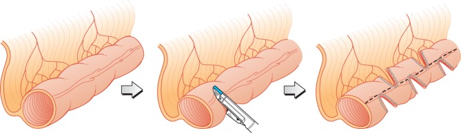
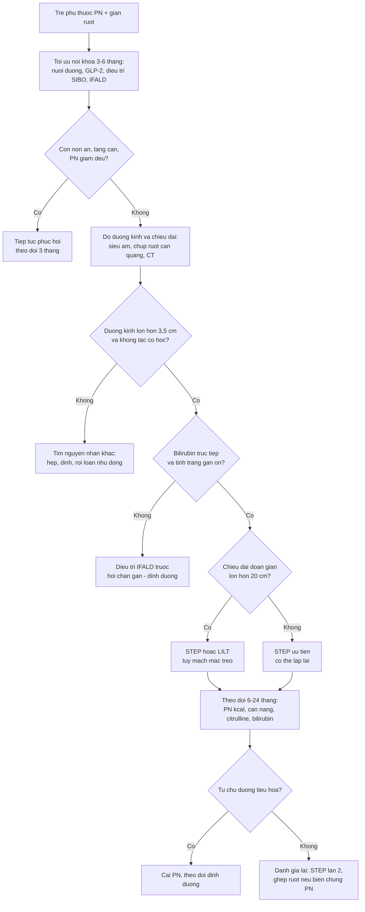
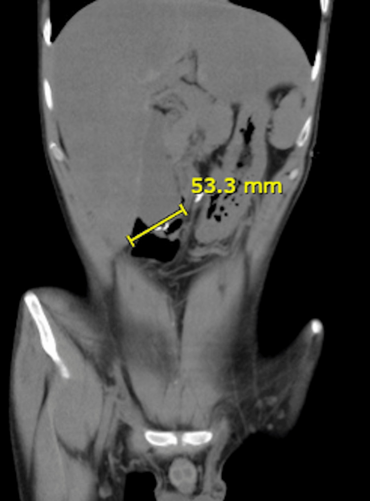
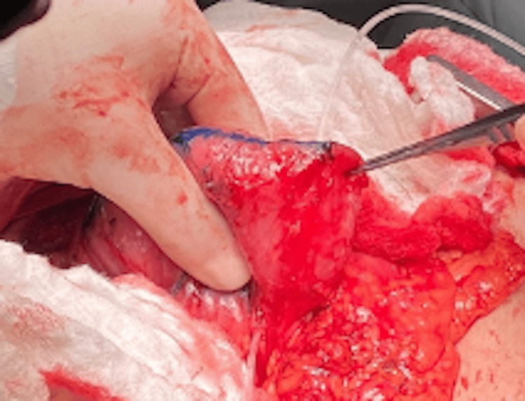
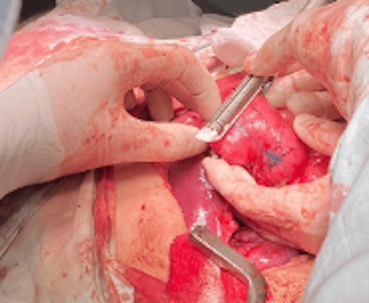

# 3053 — Phẫu thuật kéo dài ruột (STEP/LILT) & cai nuôi dưỡng tĩnh mạch ở trẻ hội chứng ruột ngắn

**Tags:** `pattern:gian-long-ruot` `pattern:phu-thuoc-pn` `pattern:cham-dung-nap` `vung:bung` `vung:ruot-non` `anatomy:ta-trang-hong-trang` `protocol:chup-ruot-can-quang` `protocol:CT-bung` `protocol:noi-soi-o-bung` `incidentaloma:khong`
**Mức chắc chắn (certainty):** tổng hợp y văn (literature synthesis) — ghép **tổng quan có hệ thống 27 bài 2021–2025** (Children 2025, PMC12110667), **tổng quan 2026 về SBS nhi** (J Clin Med 2026, PMC13607937), **so sánh ba kỹ thuật kéo dài ruột** (Curr Opin Organ Transplant 2022, PMC8900888), **sổ bộ STEP quốc tế 111 bệnh nhân** (J Am Coll Surg 2013, PMC4887155), **đoàn hệ 36 trẻ Pháp** (Children 2025, PMC12110667 dẫn), **64 người lớn STEP** (Ann Surg 2026, PMC13258089), **12 trẻ Thụy Điển** (Br J Surg 2014, PMC4282069), **20 trẻ sinh non theo phác đồ BEAR** (Pediatr Surg Int 2025, PMC12103355), **đoàn hệ Queensland** (Intest Fail 2025, PMC12851332) và **ca loạt STEP tá tràng ở người lớn** (Cureus 2025, PMC12119115). Không có ca do nhóm tự chụp.

> **Câu hỏi thực hành:** bé trai **8 tháng**, hoại tử ruột non do viêm ruột hoại tử sơ sinh, còn **25 cm hỗng tràng** nối đại tràng, phụ thuộc **nuôi dưỡng tĩnh mạch (parenteral nutrition — PN)** 6 tháng. Siêu âm/CT: **tá tràng–hỗng tràng giãn 4,5 cm**, thành mỏng, không thấy chỗ tắc; bé **nôn dịch mật, chướng bụng, nhiều đợt nhiễm khuẩn huyết** do vi khuẩn mọc quá mức. Câu hỏi: **đã đủ chỉ định mổ kéo dài ruột chưa, chọn STEP hay LILT, và dấu hiệu nào dự báo cai được PN?**
> Bài chốt **ba quyết định**: **(1) giãn ruột đơn thuần không phải chỉ định — phải có giãn + chậm dung nạp/SIBO sau tối ưu nội khoa; (2) STEP là lựa chọn đầu tay ở đa số trung tâm, LILT cho ruột giãn đều và mạch mạc treo thuận lợi; (3) cai PN phụ thuộc chiều dài ruột trước mổ, bilirubin trực tiếp và mức tăng chiều dài sau mổ, không phụ thuộc một ngưỡng chiều dài cố định.**

## 1. Tổng quan bệnh học – cơ chế hình ảnh: vì sao phải vừa thu nhỏ vừa kéo dài

- **Định nghĩa SBS nhi (không thống nhất giữa các trung tâm):** Hiệp hội Phẫu thuật Nhi Canada định nghĩa **SBS = cần PN > 6 tuần sau cắt ruột lớn, HOẶC chiều dài ruột còn lại < 25% chiều dài dự kiến theo tuổi thai** (Children 2025, PMC12110667). Ruột non đủ tháng dài **150–250 cm** (Nutrients 2023, PMC10221592 — dẫn trong bài 3006).
- **Ba kiểu giải phẫu quyết định tiên lượng** (Children 2025): **type 1** — hỗng tràng/ileostomy tận; **type 2** — nối hỗng tràng–đại tràng; **type 3** — nối hỗng tràng–hồi tràng, còn đại tràng và **van hồi manh tràng (ileocecal valve — ICV)**. Còn đại tràng và ICV làm tăng hấp thu nước/điện giải và làm chậm vận chuyển.
- **Dịch tễ thật:** tại Queensland, **IF 13,7/100.000 trẻ sinh sống** và **SBS–IF 10,51/100.000**; **71% (15/21) IF** và **81% (13/16) SBS** đạt tự chủ đường tiêu hóa, không tử vong (Intest Fail 2025, PMC12851332). Trẻ đạt tự chủ có ruột còn lại **47,5 cm (IQR 33)** so với **26 cm** ở trẻ còn PN (**p = 0,04**); mỗi cm ruột còn lại **OR 0,73 (0,57–0,93)**, mất đại tràng **OR 0,84 (0,69–0,92)** cho nguy cơ IF.
- **TẠI SAO giãn ruột vừa là phản ứng thích nghi vừa là vấn đề:** sau cắt ruột, đoạn còn lại **giãn để tăng diện tích hấp thu**, nhưng theo **định luật Laplace (thành ruột: sức căng ∝ áp lực × bán kính)**, bán kính tăng làm **sức căng thành tăng**, co bóp không hiệu quả → **ứ trệ, vi khuẩn mọc quá mức (small intestinal bacterial overgrowth — SIBO), nôn dịch mật, kém dung nạp**. Vì vậy phẫu thuật có hai mục tiêu đối lập bổ sung: **thu nhỏ đường kính (tapering)** để co bóp hiệu quả và **tăng chiều dài** để tăng diện tích hấp thu.
- **STEP hoạt động thế nào:** dùng stapler tuyến tính bắn **vuông góc với trục ruột, xen kẽ hai bên** như “khóa kéo”, tạo hình chữ chi; khoảng cách mỗi lần bắn **2–2,5 cm** để giữ **đường kính lòng 2 cm**; **đường kính lòng tối thiểu 3,5–4 cm** mới làm được (Curr Opin Organ Transplant 2022, PMC8900888). Không cần chia mạc treo, không mở ruột, **có thể lặp lại** và **dùng được cho tá tràng**.
- **Vì sao giữ lòng 2 cm:** lòng quá nhỏ gây **hẹp/tắc đường khâu**, lòng quá lớn không cải thiện vận chuyển; 2 cm là mốc thực hành được dùng trong các loạt STEP (PMC8900888).
- **Hiệu quả định lượng:** STEP làm dài thêm **50–70%** chiều dài ruột (Children 2025), trung bình **75%** trong phân tích 19 nghiên cứu (PMC8900888); đoàn hệ Pháp 36 trẻ: **+50%**, trung vị **+16 cm**, **42% cai PN**, nhóm còn lại giảm nhu cầu PN **19%**; tuổi mổ trung vị **10,8 tháng**, ruột còn lại trung vị **47 cm** (PMC12110667).
- **Ai cai được PN — con số cụ thể:** sổ bộ STEP quốc tế **111 bệnh nhân**, 97 đủ theo dõi: **47% (37/78)** đạt tự chủ hoàn toàn sau STEP lần 1, **trung vị 21 tháng (KTC 95% 12–30)**, **tử vong 11%**, **5 ca ghép ruột**; **chiều dài ruột trước STEP dài hơn** dự báo tự chủ (**p = 0,002**), còn **bilirubin trực tiếp cao** và **ruột trước mổ ngắn hơn** dự báo ghép/tử vong (**p = 0,05** và **p < 0,001**) (J Am Coll Surg 2013, PMC4887155).
- **Người lớn cũng làm được:** **64 bệnh nhân** (81 lần STEP), ruột còn lại **79 ± 47 cm**, citrulline **22 ± 12 µmol/L**; theo dõi **35 ± 24 tháng**, sống đặc hiệu bệnh **91% sau 5 năm**, **80% đạt tự chủ đường tiêu hóa**; STEP tích hợp trong phẫu thuật tái tạo ruột khả thi ở **44%** ứng viên; **ASA IV** là yếu tố nguy cơ tử vong duy nhất (**p = 0,05**) (Ann Surg 2026, PMC13258089).
- **Dấu hiệu dự báo cai PN bằng xét nghiệm:** trong đoàn hệ dùng teduglutide, **citrulline ≥ 14 µmol/L** và **nhu cầu PN < 35 kcal/kg/ngày** dự báo cai hoàn toàn; ruột còn lại dài hơn, Z-score cân nặng cao hơn và men gan bình thường dự báo đáp ứng (EClinicalMedicine 2025, PMC12274882).
- **Vai trò của thuốc:** teduglutide (đồng vận GLP-2) **0,05 mg/kg/ngày** giúp **69% trẻ giảm ≥ 20% PN sau 24 tuần**, nhưng chỉ **10% đạt tự chủ** — thuốc làm chậm/giảm PN, không thay thế phẫu thuật khi ruột đã giãn mất bù (Children 2025, PMC12110667).

## 2. Mẫu hình + chẩn đoán phân biệt theo hình thái – vận chuyển (Gamut)

- **Mẫu hình 1 — “giãn + chậm dung nạp + SIBO”:** ruột giãn **≥ 3,5–4 cm**, nôn dịch mật, chướng, cấy dịch ruột dương tính, kém tăng cân → **ứng viên STEP/LILT** sau khi tối ưu nội khoa.
- **Mẫu hình 2 — “giãn nhưng dung nạp tốt”:** giãn là **thích nghi sinh lý**, trẻ vẫn tăng cân và giảm dần PN → **không mổ**; mổ lúc này làm mất diện tích hấp thu.
- **Mẫu hình 3 — “giãn + mức dịch/mức khí + tắc hoàn toàn”:** hẹp đường khâu cũ, dính, xoắn, thoát vị nội → **tắc cơ học**, cần **mổ giải quyết nguyên nhân**, không phải kéo dài.
- **Mẫu hình 4 — “ruột ngắn, không giãn, tăng nhu động”:** mất đoạn ruột nhưng lòng không giãn → **không có “vật liệu” để kéo dài**; cân nhắc phẫu thuật làm chậm vận chuyển (van, đoạn ruột ngược dòng) — **chống chỉ định nếu có rối loạn nhu động** (Children 2025).
- **Mẫu hình 5 — “giãn + vàng da tăng bilirubin trực tiếp”:** ưu tiên **điều trị IFALD** trước; bilirubin trực tiếp cao dự báo ghép/tử vong sau STEP (PMC4887155).
- **Mẫu hình 6 — “thất bại phục hồi + biến chứng PN đe dọa tính mạng”:** nhiễm khuẩn huyết tái diễn, mất đường vào tĩnh mạch, IFALD tiến triển → **ghép ruột**, không tiếp tục kéo dài vô hạn.
- **Gamut theo vị trí:** **tá tràng giãn** → STEP tá tràng (chỉ có ca loạt nhỏ ở người lớn); **hỗng tràng giãn đều** → STEP hoặc LILT; **hồi tràng + ICV còn** → ưu tiên bảo tồn ICV, STEP; **đại tràng mất** → tiên lượng cai PN kém hơn (OR 0,84).

## 3. Bảng so sánh phân biệt (ma trận đối chiếu)

| Thực thể / chiến lược (entity) | Hình ảnh – giải phẫu điển hình | Chốt vào (rule-in) | Chốt loại (rule-out) | Gợi ý xác nhận |
|---|---|---|---|---|
| **STEP (serial transverse enteroplasty)** | Ruột giãn **≥ 3,5–4 cm**, thành mỏng, không tắc; stapler xen kẽ giữ lòng **2 cm**, cách **2–2,5 cm** | **Giãn + chậm dung nạp/SIBO + còn đủ chiều dài để bắn stapler** | **Lòng < 3,5 cm** hoặc **ruột không giãn** → không có chỉ định | Chụp ruột cản quang/CT đo đường kính; mổ đánh giá trực tiếp |
| **LILT (Bianchi)** | Ruột giãn **đều**, mạch mạc treo thuận lợi; chia dọc ruột thành hai ống song song → **gấp đôi chiều dài** | **Đoạn giãn dài > 20 cm**, mạch mạc treo cho phép chia dọc | **Đoạn < 20 cm** (biến chứng tăng) hoặc **mạch mạc treo đã tổn thương** | Chụp mạch/CT mạch mạc treo; đánh giá trong mổ |
| **SILT (spiral intestinal lengthening and tailoring)** | Cắt xoắn ốc, kéo dài; dùng được khi giãn **≤ 4 cm**; giữ hướng sợi cơ | **Giãn nhẹ – vừa, không đủ cho STEP**, cần thu nhỏ + kéo dài | **Nhiễm bẩn ổ bụng nặng** (phải mở ruột) hoặc **thiếu kinh nghiệm** | Kinh nghiệm trung tâm; ca loạt nhỏ |
| **Tiếp tục phục hồi nội khoa** | Ruột giãn nhưng **dung nạp tăng dần**, bilirubin giảm, tăng cân | **PN giảm đều, không biến chứng, còn dư địa thích nghi** | **SIBO tái diễn + không tăng cân + giãn tiến triển** | Theo dõi 3–6 tháng: cân nặng, PN kcal, bilirubin, citrulline |
| **Ghép ruột** | Không có tổn thương hình ảnh đặc hiệu; bệnh cảnh suy ruột + biến chứng PN | **IFALD tiến triển, mất đường vào tĩnh mạch, nhiễm khuẩn huyết tái diễn, thất bại phục hồi** | **Chỉ ruột rất ngắn mà vẫn ổn định trên PN** → chưa ghép (không dùng ngưỡng chiều dài cố định) | Hội chẩn đa chuyên khoa; đánh giá gan, mạch máu, miễn dịch |

*Ba thì của STEP: ruột giãn (trái) → bắn stapler vuông góc với trục ruột (giữa) → ruột dài và hẹp hơn theo hình chữ chi (phải). Nguồn: Br J Surg 2014, PMCID **PMC4282069**, **CC BY-NC-ND** — nguyên bản, không crop, không ghép.*

### Đọc đúng “giãn ruột” trên hình ảnh
- **Đo đường kính tại chỗ giãn nhất, vuông góc với trục ruột**, ghi mm; so với chiều cao đốt sống thắt lưng để hiệu chỉnh nếu phim không chuẩn.
- **Chiều dài ruột non KHÔNG đo chính xác trên CT** — CT/VLCT đánh giá **đường kính, thành, mức dịch, vị trí chuyển tiếp**; chiều dài thật đo **dọc bờ chống mạc treo trong mổ**. Đừng dùng chiều dài ước tính trên CT để quyết định mổ.
- **Chụp ruột cản quang (upper GI + follow-through)** là cách kinh điển để đo **chiều dài, đường kính, thời gian vận chuyển** và phát hiện hẹp/tắc; ở trẻ nặng, **siêu âm tại giường** đủ để theo dõi đường kính và mức dịch.

## 4. Protocol chụp + ngưỡng & thuật toán điều trị

- **Đánh giá trước mổ (bắt buộc đủ bộ):**
  - **Hình ảnh:** siêu âm bụng (đường kính, thành, mức dịch, nhu động); **chụp ruột cản quang** khi cần bản đồ chiều dài/đường kính/vận chuyển; **CT bụng liều thấp** khi nghi tắc, áp-xe, thiếu máu ruột hoặc cần mô tả giải phẫu trước mổ.
  - **Xét nghiệm:** **citrulline** (mốc ≥ 14 µmol/L hỗ trợ khả năng cai PN), **bilirubin trực tiếp**, AST/ALT, albumin, CRP, điện giải, **B12 và vitamin tan trong mỡ**, khí máu khi toan lactic.
  - **Dinh dưỡng:** nhu cầu PN tính **kcal/kg/ngày** (ngưỡng < 35 kcal/kg/ngày hỗ trợ cai), theo dõi cân nặng/chiều cao, lượng dịch, số đợt nhiễm khuẩn huyết và đường vào tĩnh mạch.
- **Ngưỡng và thời điểm mổ:**
  - **Giãn ≥ 3,5–4 cm** + **thất bại tối ưu nội khoa ≥ 6 tháng** (tiêu chuẩn LILT kinh điển: phụ thuộc PN và **không đạt ≥ 50% nhu cầu calo đường tiêu hóa sau 6 tháng điều trị bảo tồn đầy đủ**) (PMC12110667).
  - **Tuổi mổ thực tế:** trung vị **10,8 tháng** (Pháp), **5,8 tháng** (Thụy Điển) — không có ngưỡng tuổi tuyệt đối.
  - **Chống chỉ định tương đối:** nhiễm trùng ổ bụng đang hoạt động, suy gan nặng chưa tối ưu, rối loạn đông máu, ruột không giãn.
- **Chọn kỹ thuật:**
  - **STEP** khi ruột giãn **≥ 3,5–4 cm**, cần thu nhỏ + kéo dài, **không muốn chia mạc treo**, có thể lặp lại; **LILT** khi đoạn giãn **dài > 20 cm** và mạch mạc treo cho phép; **SILT** khi giãn **≤ 4 cm** hoặc muốn giữ hướng sợi cơ, nhưng ít kinh nghiệm toàn cầu.
- **Thuật toán một lượt:**

- **Kết quả – biến chứng cần nhớ:**
  - **STEP:** dài thêm **50–75%**; cai PN **42–73%**; sổ bộ **47%** sau STEP 1, trung vị **21 tháng**; **tử vong 11%**; biến chứng **rò đường khâu, chảy máu/loét tại đường khâu, hẹp, tắc, áp-xe**, **giãn lại** cần STEP lần 2 (PMC4887155; PMC12110667).
  - **LILT:** gấp đôi chiều dài; cai PN **55,5–100% trong 2 năm** (tổng quan cũ) nhưng **32–52%** trong các loạt gần đây và **tử vong cao hơn STEP** (PMC8900888; PMC12110667).
  - **SILT:** dài thêm trung vị **56%**, giảm **50%** đường kính, PN từ **7 → 4 đêm/tuần** trong loạt 5 trẻ (PMC8900888).
  - **Ghép ruột:** 19 ca tại Úc (2010–2026), sống **1 năm 93% bệnh nhân/87% mảnh ghép**, **5 năm 75%/67%**; tự chủ sau ghép **trung vị 21 ngày (17–30)**; **40%** có thải ghép (Intern Med J 2026, PMC13409190).

## 5. Biến thể bình thường và cạm bẫy

- **Giãn ruột thích nghi không triệu chứng:** trẻ vẫn ăn tăng, tăng cân, PN giảm — **không mổ**. Tổng quan 2026 nói rõ: giãn ruột **“không tự nó là chỉ định”** phẫu thuật tái tạo (PMC13607937).
- **Không dùng một ngưỡng chiều dài cố định để chỉ định ghép:** cùng tổng quan 2026 ghi nhận trẻ **ruột cực ngắn vẫn đạt tự chủ**, nên quyết định dựa trên **diễn tiến đa chuyên khoa**, không dựa riêng số cm.
- **Đo chiều dài trên CT là bẫy:** ruột gấp khúc, thành mỏng, chồng lớp → **ước tính thấp hơn thực tế**; chiều dài quyết định trong mổ dọc **bờ chống mạc treo**, không kéo căng.
- **SIBO giả tắc:** nôn + giãn + mức dịch có thể do **vi khuẩn mọc quá mức**, không phải tắc cơ học; mổ lại khi chưa điều trị SIBO dễ **cắt nhầm ruột còn hấp thu được**.
- **Loét/chảy máu tại đường khâu:** biến chứng đã báo cáo của STEP; thiếu máu sau mổ cần nội soi, không mặc định do “loét dạ dày”.
- **Giãn lại sau STEP:** STEP làm thay đổi hướng sợi cơ, ruột có thể **giãn lại**; SILT giữ hướng sợi cơ nên ít giãn lại hơn về lý thuyết, nhưng **kinh nghiệm còn ít** (PMC8900888).
- **Tá tràng:** STEP tá tràng chỉ có **ca loạt nhỏ**, chủ yếu ở người lớn; không mặc định kết quả như STEP hỗng tràng (PMC12119115).
- **IFALD nặng:** bilirubin trực tiếp cao làm tăng nguy cơ ghép/tử vong sau STEP — **tối ưu gan trước, đừng mổ vì “đã đủ tháng chờ”**.

## 6. Tự lượng giá — Blind Quiz

**Ca 1 — Nam 27 tuổi, ruột cực ngắn sau thiếu máu mạc treo; CT bụng có đường đo vàng.**

- Gợi ý lâm sàng: phụ thuộc PN, không còn ruột non thấy được trên CT.
- Câu hỏi: đường đo vàng đo gì, giá trị bao nhiêu? Ngưỡng nào cho phép làm STEP? Có phải chỉ định mổ ngay không?

<b>Bấm để hiện đáp án (findings + chẩn đoán)</b>

- **Findings:** đường đo vàng đo **đường kính tá tràng giãn = 53,3 mm** (bài gốc mô tả “tới 6 cm”), không thấy ruột non; không có mức khí–dịch hay dấu tắc cơ học.
- **Ngưỡng:** STEP cần lòng **≥ 3,5–4 cm** và giữ lòng đích **2 cm**; **53,3 mm** vượt ngưỡng về mặt kỹ thuật, nhưng **chỉ mổ khi có chậm dung nạp/SIBO sau tối ưu nội khoa**, không chỉ vì giãn.
- **Chẩn đoán:** hội chứng ruột cực ngắn (ultra-short bowel) — ứng viên **STEP tá tràng**; trong loạt 3 ca, **1 ca đạt tự chủ**, 2 ca giảm PN **33% và 20%**.
- **Nguồn ảnh:** Cureus 2025, PMCID **PMC12119115**, **CC BY 4.0** — nguyên bản, giữ nguyên đường đo của tác giả.

**Ca 2 — Nữ 42 tuổi, trong mổ STEP: lần bắn stapler đầu tiên.**

- Câu hỏi: stapler được bắn theo hướng nào so với trục ruột? Vì sao lần sau phải bắn **ngược chiều**? Khoảng cách giữa hai lần bắn?

<b>Bấm để hiện đáp án (findings + chẩn đoán)</b>

- **Findings:** thì đầu **bắn từ bờ tự do về phía tụy**, **vuông góc với trục ruột**, trên tá tràng giãn; đường khâu màu xanh lam ở bờ trước.
- **Vì sao xen kẽ:** các lần bắn **đối diện nhau** tạo hình chữ chi, mỗi đoạn ruột vẫn được nuôi bởi mạc treo; nếu bắn cùng một phía sẽ chỉ **gấp ruột** mà không kéo dài.
- **Khoảng cách:** **2–2,5 cm** giữa các lần bắn để lòng còn **2 cm**; bắn quá sát → hẹp/tắc đường khâu.
- **Nguồn ảnh:** Cureus 2025, PMCID **PMC12119115**, **CC BY 4.0**.

**Ca 3 — Cùng bệnh nhân, lần bắn thứ ba: đường kính tá tràng còn 2,5 cm.**

- Câu hỏi: vì sao không thu nhỏ tiếp xuống 1,5 cm? Sau thì này cần kiểm tra gì trước khi đóng bụng?

<b>Bấm để hiện đáp án (findings + chẩn đoán)</b>

- **Findings:** lần bắn thứ ba làm **đường kính còn 2,5 cm**; ruột đã dài và thẳng hơn, đường khâu xếp song song.
- **Vì sao dừng ở ~2 cm:** lòng **< 2 cm** làm tăng **hẹp và tắc đường khâu**, đặc biệt ở trẻ nhỏ; mục tiêu là **vừa đủ hẹp để co bóp, vừa đủ rộng để lưu thông**.
- **Kiểm tra trước đóng:** **tưới máu đoạn ruột** (màu, nhu động, chảy máu bờ cắt), **kín đường khâu** (bơm xanh methylene/nghiệm pháp khí), **không xoắn mạc treo**, và **đo chiều dài mới** dọc bờ chống mạc treo.
- **Nguồn ảnh:** Cureus 2025, PMCID **PMC12119115**, **CC BY 4.0**.

## Bài liên quan chéo
- [3006 – Hội chứng ruột ngắn & IFALD ở trẻ](../3006-ruot-ngan-ifald-o-tre/lesson.md)
- [646 – Hội chứng khoang bụng ở trẻ](../646-hoi-chung-khoang-bung-o-tre/lesson.md)
- [630 – U bụng nhi: neuroblastoma vs Wilms](../630-u-bung-nhi-neuroblastoma-vs-wilms/lesson.md)
- [693 – Theo dõi sau cắt u gan ở trẻ](../693-theo-doi-sau-cat-u-gan-o-tre/lesson.md)
- [300 – Tổng quan hệ Cơ – Xương – Khớp](../300-tong-quan-he-co-xuong-khop/lesson.md)

## Ảnh
- `3053_step_so-do_PMC4282069-F1.jpg` — sơ đồ ba thì STEP (CC BY-NC-ND, nguyên bản).
- `3053_step_CT-bung_PMC12119115-F1.jpg` — CT coronal: tá tràng giãn **53,3 mm**, không thấy ruột non.
- `3053_step_mo-lan1_PMC12119115-F4.jpg` — lần bắn stapler đầu tiên, vuông góc trục ruột.
- `3053_step_mo-lan3_PMC12119115-F11.jpg` — lần bắn thứ ba, đường kính còn **2,5 cm**.
- Nguồn, giấy phép từng ảnh: `images/CREDITS.md`; link bài gốc: `sources.md`.

> Không dùng để chẩn đoán độc lập khi chưa có người hướng dẫn.
