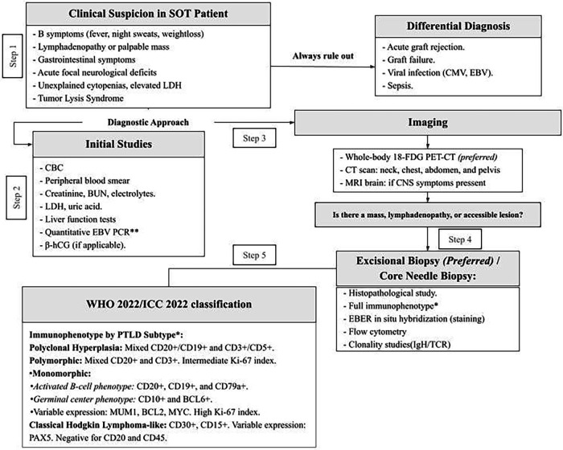
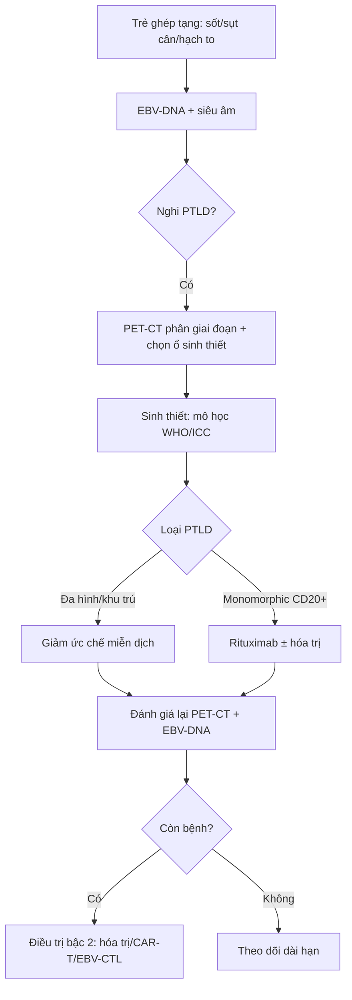
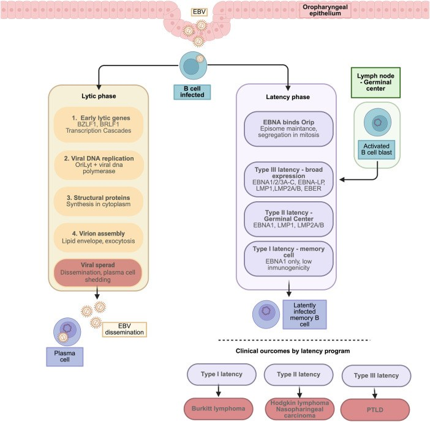
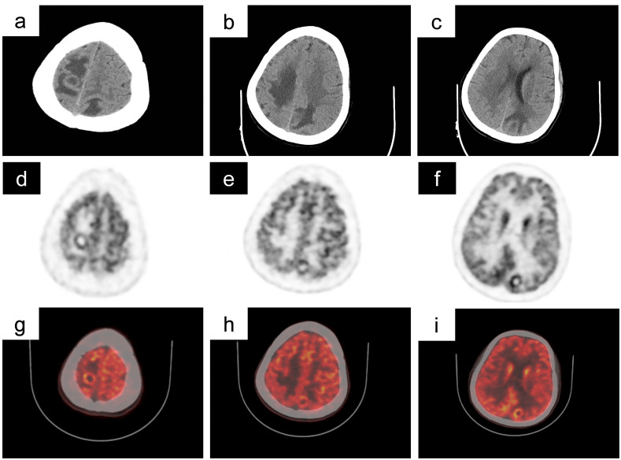

# 3054 — PTLD ở trẻ sau ghép tạng: EBV-DNA, hình ảnh đa cơ quan và khi nào sinh thiết

**Tags:** `pattern:hach-to` `pattern:khoi-manh-ghep` `pattern:ton-thuong-nao` `vung:hach` `vung:than-ghep` `protocol:PET-CT` `protocol:EBV-DNA`
**Mức chắc chắn (certainty):** tổng hợp y văn — đồng thuận IPTA (nhi khoa) + tổng quan; bằng chứng chủ yếu từ đoàn hệ và ca lâm sàng.

## 1. Tổng quan — vì sao trẻ ghép tạng dễ PTLD

**Cơ chế:** thuốc ức chế miễn dịch làm mất kiểm soát **EBV** → tế bào B nhiễm EBV tăng sinh. Ở PTLD, EBV tồn tại **latency type III**, biểu hiện **LMP1** và **EBNA2** — hai protein thúc đẩy tăng sinh và chống apoptosis (PMC13385102).

**Dịch tễ:** PTLD sau ghép tạng **1–20%** tùy tạng; cao nhất ở **ghép ruột/đa tạng**, nhiều ca nhất ở **ghép thận** (vì số lượng lớn). Phân bố **hai đỉnh**: sớm **12–24 tháng** (EBV dương, liên quan ức chế miễn dịch mạnh) và muộn **5–10 năm** (nhiều ca **EBV âm**) (PMC13385102).

**TẠI SAO trẻ khác người lớn:** trẻ thường **EBV âm trước ghép** → nhiễm EBV sơ phát sau ghép trong bối cảnh ức chế miễn dịch = nguy cơ cao nhất; ngược lại, PTLD **EBV âm** vẫn xảy ra (ca ghép thận 8 tuổi, EBV-DNA âm — PMC12973549).

**Vì sao hình ảnh quan trọng:** PTLD có thể **chỉ ở mảnh ghép**, **chỉ ở hạch**, hoặc **đa cơ quan** (dạ dày–ruột, phổi, não); triệu chứng mơ hồ (sốt, sụt cân, khối). Chẩn đoán **không thể chỉ bằng EBV-DNA** — cần **hình ảnh + mô học**.

## 2. Mẫu hình hình ảnh

- **Hạch:** to, nhiều ổ, có thể hoại tử; hay gặp **hạch cổ/trung thất/bụng**; phân biệt với hạch phản ứng sau ghép.
- **Mảnh ghép:** khối/thâm nhiễm trong thận–gan–tim ghép; **không phân biệt được với thải ghép cấp** trên hình thái → cần sinh thiết (ca thận ghép: PTLD khu trú mảnh ghép — PMC12973549).
- **Ống tiêu hóa:** dày thành, loét, khối ruột — dễ nhầm bệnh Crohn/viêm ruột.
- **Thần kinh trung ương:** tổn thương **đa ổ, ngấm thuốc, phù quanh ổ**, có thể giống u/áp-xe/viêm; PTLD TKTW **5–15%** ca PTLD, tiên lượng xấu (PMC13297823, PMC13283889).
- **Phổi:** nốt/khối, thâm nhiễm; **không đặc hiệu**.

## 3. Ma trận đối chiếu

| Thực thể | Hình ảnh điển hình | Chốt vào (rule-in) | Chốt loại (rule-out) | Xác nhận |
|---|---|---|---|---|
| **PTLD** | Hạch to nhiều ổ/ khối mảnh ghép/ đa ổ TKTW; PET dương mạnh | **EBV-DNA tăng + hạch/khối mới**, PET ngấm mạnh; khối trong mảnh ghép | EBV-DNA âm **không loại trừ** (thể EBV âm); hạch nhỏ đơn độc không loại trừ | **Sinh thiết** mô học (WHO/ICC) |
| **Thải ghép cấp** | Mảnh ghép to, phù, giảm tưới máu; không hạch to | Tăng creatinine, mảnh ghép to, đáp ứng corticoid | Không có hạch/khối ngoài mảnh ghép | Sinh thiết mảnh ghép |
| **Nhiễm trùng cơ hội** | Hạch to, áp-xe, tổn thương não | Sốt, CRP, tác nhân trong máu/DNT | PET dương **có thể do viêm** — không đặc hiệu | Cấy/PCR + mô học |
| **U lympho sau ghép khác/ tăng sinh lành tính** | Hạch phản ứng, EBV-DNA thấp | Bối cảnh, theo dõi | Không có mô học | Sinh thiết khi nghi |

## 4. Protocol & ngưỡng

**Theo dõi – chẩn đoán (trẻ ghép tạng):**

1. **EBV-DNA định lượng** theo lịch của trung tâm (thường 1–3 tháng/lần năm đầu, sau đó thưa dần); **xu hướng tăng** quan trọng hơn một giá trị đơn lẻ.
2. **Siêu âm** bụng/mảnh ghép khi có triệu chứng hoặc EBV tăng; **CT/MRI** khi nghi thâm nhiễm/khối.
3. **18F-FDG PET/CT**: ưu tiên cho **phân giai đoạn ban đầu** — độ nhạy **95–100%**, độ đặc hiệu **80–95%**; chọn **ổ ngấm mạnh nhất để sinh thiết**, và làm **mốc đáp ứng theo Lugano** (PMC13385102). Dương tính giả do **nhiễm/viêm**.
4. **Sinh thiết sớm**, kể cả khi khám lâm sàng không sờ thấy hạch: PET/CT giúp chọn vị trí.
5. **TKTW**: MRI sọ có gadolinium + DWI; nếu tổn thương não đơn độc → cân nhắc sinh thiết não (không chẩn đoán bằng EBV-DNA).

**Điều trị (khung):**

- **Giảm ức chế miễn dịch (RIS)** là bước đầu, đặc biệt PTLD khu trú/đa hình.
- **Rituximab** (CD20+) ± hóa trị (CPR: cyclophosphamide–prednisolone–rituximab) cho thể monomorphic; ca thận ghép khu trú mảnh ghép đạt **lui bệnh hoàn toàn trên PET-CT**, giữ chức năng ghép **5 năm** (PMC12973549).
- **PTLD TKTW**: không có chuẩn; phối hợp RIS + rituximab/hóa trị ± xạ; tiên lượng xấu (PMC13071681).
- **Theo dõi**: PET-CT/Lugano sau điều trị; EBV-DNA; chức năng mảnh ghép.

## 5. Biến thể & cạm bẫy

- **EBV-DNA âm không loại trừ PTLD**: ca điển hình thận ghép 8 tuổi, PTLD monomorphic khu trú mảnh ghép, **EBV-DNA âm** (PMC12973549). Đừng bỏ sinh thiết chỉ vì EBV âm.
- **Khối trong mảnh ghép ≠ thải ghép**: hình thái chồng lấp; sinh thiết quyết định, và điều trị khác hẳn (RIS/rituximab vs tăng ức chế miễn dịch).
- **PET dương tính giả** sau ghép: nhiễm trùng, viêm, sau phẫu thuật — luôn đối chiếu lâm sàng và mô học.
- **PTLD muộn EBV âm** (5–10 năm) đang tăng — đừng chỉ tầm soát EBV ở giai đoạn sớm.
- **Tổn thương não đa ổ**: chẩn đoán phân biệt rộng (áp-xe, toxo, PML, u) — PTLD TKTW hiếm nhưng tiên lượng xấu; sinh thiết não khi nghi.
- **Trẻ nhỏ EBV âm trước ghép**: nguy cơ cao nhất; theo dõi EBV sát sau ghép.
- **Đừng chẩn đoán bằng hình ảnh đơn thuần**: PTLD là chẩn đoán **mô học**.

## 6. Tự lượng giá

**Câu 1.** Trẻ 8 tuổi ghép thận 1 năm, sốt nhẹ, creatinine tăng, siêu âm thấy mảnh ghép to; EBV-DNA âm. Bước tiếp theo?

Đáp án

**Sinh thiết mảnh ghép** (không loại trừ PTLD vì EBV âm; cũng cần loại thải ghép cấp). Kèm PET/CT nếu nghi bệnh ngoài mảnh ghép. Hình thái đơn thuần không phân biệt PTLD vs thải ghép.

**Câu 2.** PET/CT có hạch ngấm mạnh nhất ở trung thất, các hạch khác ngấm nhẹ. Chọn gì để sinh thiết?

Đáp án

**Ổ ngấm mạnh nhất** (khả năng mô học đại diện cao nhất), không chọn hạch nhỏ dễ lấy. PET/CT dùng để **chọn vị trí sinh thiết** và làm mốc Lugano; dương tính giả do viêm vẫn có.

**Câu 3.** Vì sao không thể theo dõi PTLD chỉ bằng EBV-DNA?

Đáp án

Vì **PTLD EBV âm tồn tại** (đặc biệt thể muộn 5–10 năm) và EBV-DNA có thể tăng do nhiễm EBV không có PTLD. Cần **hình ảnh + mô học**, EBV-DNA chỉ là một thành phần theo dõi.

## Bài liên quan chéo

- **116** — Nhiễm trùng nang gan ở người ghép thận: chẩn đoán phân biệt khối/mảnh ghép sau ghép tạng.
- **1906** — Hẹp dòng ra tĩnh mạch gan sau ghép gan: biến chứng mạch máu mảnh ghép, khác PTLD.
- **496** — U lympho T/NK nội nhãn — điều trị và ghép: nhóm bệnh lympho và bối cảnh ghép tế bào gốc.

---

*Không dùng để chẩn đoán độc lập khi chưa có người hướng dẫn. PTLD là chẩn đoán mô học; bài tổng hợp từ đồng thuận nhi và ca lâm sàng.*
