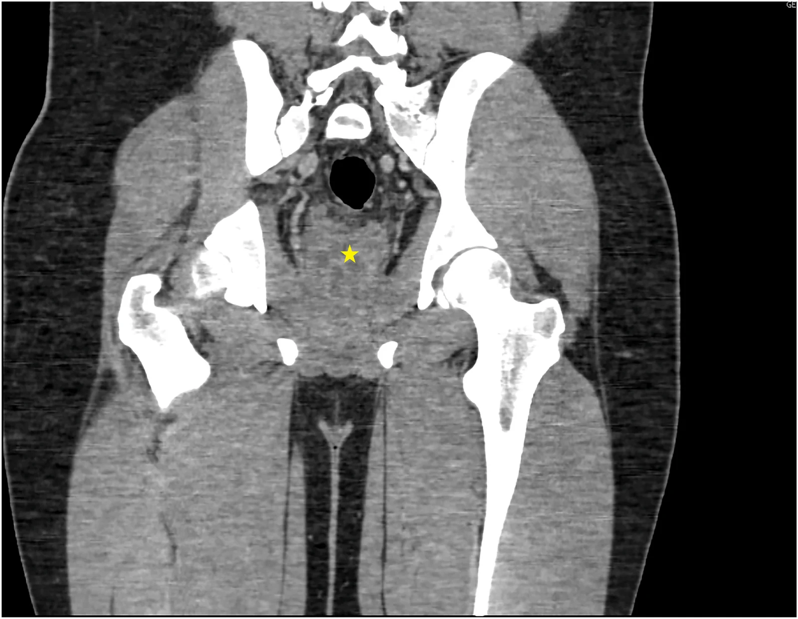
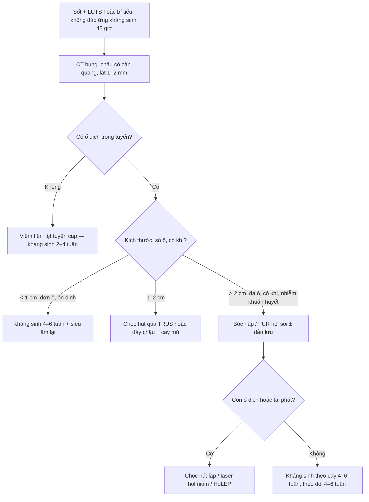
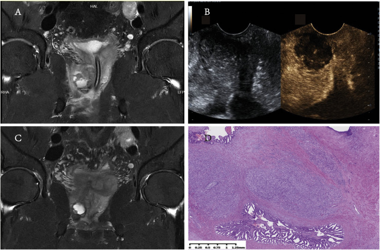
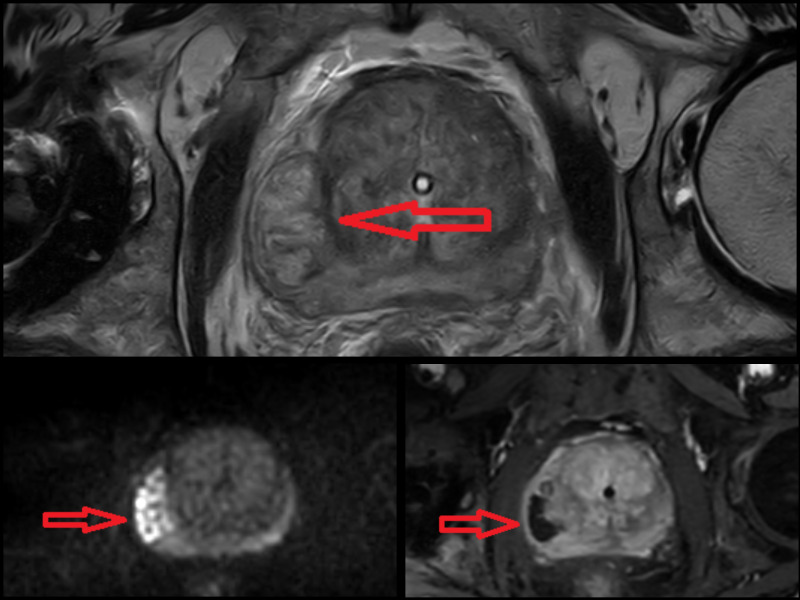
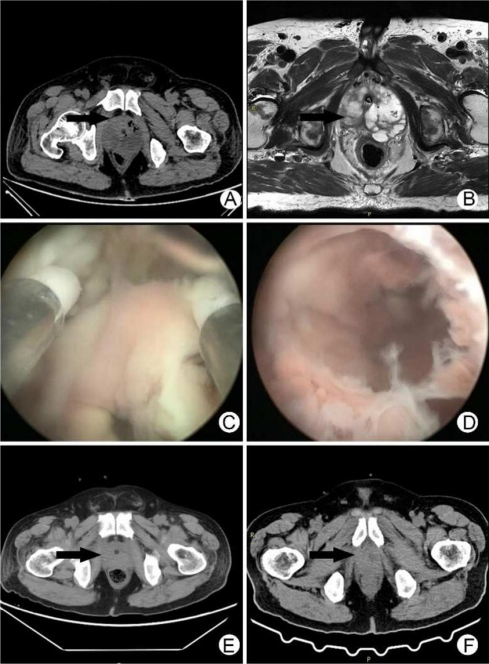

# 3055 — Áp-xe tuyến tiền liệt / Prostatic abscess

**Tags:** `pattern:ap-xe` `pattern:o-dich` `vung:tien-liet-tuyen` `protocol:CT-bung-co-can-quang` `protocol:MRI-tien-liet` `protocol:TRUS`
**Mức chắc chắn (certainty):** tổng hợp y văn (literature synthesis) — gộp 4 ca nguyên văn có ảnh (đối chiếu PMCID) với 1 đoàn hệ 102 ca và 3 tổng quan; số liệu lấy từ toàn văn, không lấy từ abstract.

## 1. Tổng quan — vì sao ổ mủ "né" thuốc và vì sao DWI tối hơn cả ung thư

- **Bệnh học:** áp-xe tuyến tiền liệt (prostatic abscess, PA) là ổ mủ khu trú trong tuyến, hình thành khi viêm tiền liệt tuyến cấp (acute bacterial prostatitis) không được kiểm soát: phù nề + tắc ống tuyến → vi áp-xe trong nang tuyến → hòa thành ổ lớn. Chiếm khoảng **0,5%** các nhiễm khuẩn đường niệu; trong **822** ca viêm tiền liệt tuyến cấp nhập viện có **102 ca (12,4%)** là áp-xe (Đài Loan 2007–2021); các loạt khác báo **6%** và **21,8%**, đoàn hệ Mỹ **5,4%** — tức tỉ lệ phụ thuộc cách chọn bệnh và mức dùng kháng sinh.
- **Yếu tố nguy cơ (số liệu gộp 210 ca):** đái tháo đường **50,9%**, tắc đường ra bàng quang **5,7%**, xơ gan **1,4%**, suy thận **0,95%**; **40,4%** không có yếu tố nguy cơ nào. Thủ thuật niệu khoa (đặt catheter, sinh thiết tuyến, nội soi) là cửa vào; ca 78 tuổi dưới đây khởi phát sau **bóng catheter bơm sai vị trí trong niệu đạo tuyến**.
- **TẠI SAO CT thấy ổ dịch:** mủ là nước + tế bào chết + protein, **0–20 HU**, không ngấm thuốc → nổi bật trên nhu mô tuyến ngấm thuốc; vách và vỏ dày ngấm thuốc vì tăng sinh mạch viêm. Khí trong ổ (áp-xe khí thũng) là **−1.000 HU** và là dấu hiệu nặng, gần như đặc hiệu.
- **TẠI SAO MRI T2 sáng – DWI sáng – ADC rất tối:** mủ giàu nước tự do nhưng đặc, quánh, nhiều tế bào viêm và mảnh hoại tử làm **hạn chế khuếch tán mạnh**. Số đo thực tế: **ADC 0,61–0,63 × 10⁻³ mm²/s**, chồng lấp hoàn toàn với **ung thư tuyến (0,93–1,43 ở loạt 2011)** và **thấp hơn ngưỡng nghi ung thư hiện đại (< 600 µm²/s ≈ 0,60 × 10⁻³)**; vùng ngoại vi lành **1,57–1,82**. Đây là cạm bẫy cốt lõi: **ADC không phân biệt được áp-xe với ung thư** — phải dựa vào bối cảnh (sốt, khởi phát nhanh, PSA, đáp ứng kháng sinh) và **MRI lặp sau 4 tháng** (ổ áp-xe mất hạn chế khuếch tán, ung thư thì không).
- **Ngưỡng thời gian:** hình ảnh hóa khi **không đáp ứng kháng sinh sau 48 giờ** (hoặc xấu đi sau khi đỡ) — đây là mốc được cả 3 nguồn nhắc lại; chờ lâu hơn làm tăng nguy cơ nhiễm khuẩn huyết.
- **Triệu chứng (gộp 210 ca):** triệu chứng đường niệu dưới **67,1%**, sốt **61%**, bí tiểu cấp **33,3%**, đau vùng đáy chậu/đau khi đại tiện **16,6%**, đái máu **6,1%**. Thăm trực tràng: **dao động (fluctuance) chỉ 16–88%** — không có dao động **không loại trừ**.
- **Xét nghiệm:** cấy nước tiểu dương **68,6%**, cấy máu dương **39,2%**; tác nhân gây bệnh chỉ mọc được khoảng **50%** mẫu nước tiểu. Loạt 102 ca: bạch cầu **15.778/µL**, CRP **15,4 mg/dL**, thể tích tuyến **54,7 mL**, ổ áp-xe **3,1 cm**.

## 2. Mẫu hình + chẩn đoán phân biệt theo vị trí và độ lan (Gamut)

- **Mẫu hình chung:** ổ dịch **không ngấm thuốc, bờ/vách dày ngấm thuốc**, thường ở vùng ngoại vi (peripheral zone) hoặc vùng chuyển tiếp có BPH; có thể **đa ổ/đa vách**, có thể **có khí**.
- **Theo vị trí:** một thùy ngoại vi · trung tâm/chuyển tiếp (nền BPH) · **hai thùy/đa ổ** · **lan ra ngoài vỏ** (túi tinh, mô quanh tuyến, trực tràng, bàng quang, đáy chậu) · **có khí**.
- **Gợi nhớ PUS:** **P**rostatitis cấp không đáp ứng thuốc · **U**rinary obstruction/catheter/thủ thuật · **S**epsis + đái tháo đường/xơ gan/suy giảm miễn dịch.
- **Ổ dịch ngoài tuyến gặp ở 13,7%:** gan **50%**, thận **28,5%**, còn lại cạnh sống, túi tinh, cơ mông, thành chậu, Fournier — luôn quét gan–thận khi thấy PA để không bỏ ổ nguyên phát/di căn.
- **Gamut theo hình ảnh:** (1) ổ dịch đơn thuần → áp-xe, nang tuyến, nang ống utricle; (2) ổ dịch có vách/kích thước lớn → áp-xe đa ổ, nhũ hóa ung thư; (3) đám đặc giảm tín hiệu không có ổ dịch → viêm tiền liệt tuyến cấp, u hạt, ung thư; (4) có khí → áp-xe khí thũng, khí sau can thiệp.

## 3. Bảng so sánh phân biệt (ma trận đối chiếu)

*CT có cản quang, mặt cắt trục–đứng: ổ dịch đa vách (ngôi sao vàng) ở trung tâm tuyến, bờ dày, không ngấm thuốc; bóng tròn đen phía trên là bóng catheter trong bàng quang. Nguồn: Urology Case Reports 2026, Fig. 2 (PMC13670931), CC BY-NC-ND 4.0 — giữ nguyên bản, không cắt/ghép.*

| Thực thể (entity) | Hình ảnh điển hình (CT/MRI/US) | Chốt vào (rule-in) | Chốt loại (rule-out) | Gợi ý xác nhận |
|---|---|---|---|---|
| **Áp-xe tuyến tiền liệt** | Ổ **0–20 HU** không ngấm thuốc, vỏ/vách dày ngấm thuốc; T2 sáng, DWI sáng, **ADC 0,61–0,63** (chồng lấp ung thư); TRUS: vùng giảm âm, có vách, có thể có echo trong | **Sốt + LUTS/bí tiểu + ổ dịch trong tuyến + không đáp ứng kháng sinh 48 giờ** | **Không có ổ dịch** (chỉ phù nề lan tỏa) → viêm cấp; **không sốt, PSA tăng nhanh, tổn thương đặc** → ung thư | CT có cản quang; MRI đa tham số; chọc hút lấy mủ + cấy |
| **Áp-xe khí thũng (emphysematous PA)** | Ổ dịch + **khí trong tuyến (−1.000 HU)**, tuyến to, có thể khí lan mô quanh tuyến | **Khí trong tuyến trên người đái tháo đường + sốc nhiễm khuẩn** | Khí **sau TURP/nội soi < 24–48 giờ** là khí thủ thuật | CT lát mỏng; cấy máu + mủ; dẫn lưu cấp cứu |
| **Viêm tiền liệt tuyến cấp** | Tuyến to, phù nề, ngấm thuốc **lan tỏa/không đều**, **không có ổ dịch**; TRUS giảm âm rải rác | **Sốt + đau + tuyến căng đau, không ổ dịch** | **Có ổ dịch bờ rõ** → đã thành áp-xe | Theo dõi 48 giờ; siêu âm/CT lại nếu không đỡ |
| **Ung thư tuyến hoại tử / giả áp-xe** | Ổ hoại tử trung tâm, bờ đặc ngấm thuốc không đều; **ADC cũng rất thấp**, có thể **thấp hơn áp-xe** | **Không sốt, PSA tăng dần, tổn thương không thu nhỏ sau 4–6 tuần kháng sinh** | **Sốt + giảm nhanh sau dẫn lưu** → áp-xe | Sinh thiết (đặc biệt dịch hút **máu** thay vì mủ); MRI lặp 4–6 tuần |
| **Nang ống utricle / nang Müllerian** | Nang **đường giữa**, thành mỏng, **dịch theo nước (không hạn chế khuếch tán)**, không ngấm thuốc, không vách dày | **Vị trí đường giữa + thành mỏng + không viêm** | **Thành dày + vách + sốt** → áp-xe | MRI T2/DWI; không cần dẫn lưu nếu không triệu chứng |
| **Áp-xe túi tinh** | Ổ dịch trong túi tinh, thường **kèm áp-xe tuyến**; túi tinh to, vách | **Đau vùng chậu + ổ dịch ở túi tinh** | Ổ dịch **chỉ trong tuyến** → PA đơn thuần | MRI; cấy dịch |
| **Viêm u hạt / xanthogranulomatous** | Đám đặc/nốt giảm tín hiệu, **không ổ dịch điển hình**, có thể đa ổ; tiền sử BCG hoặc GPA | **Tiền sử BCG bàng quang/GPA + tổn thương đặc** | **Có ổ mủ + cấy dương** → áp-xe nhiễm khuẩn | Sinh thiết; ANCA/BCG; đừng dẫn lưu mù |

## 4. Protocol chụp + phân độ và ngưỡng can thiệp

- **CT bụng–chậu có cản quang (thì tĩnh mạch cửa 70–90 giây), lát 1–2 mm:** đo ổ ở 3 bình diện (cm), đo thể tích tuyến, tìm **khí**, vách, lan ra mô quanh tuyến/túi tinh/trực tràng, và **quét gan–thận**; 96,1% ca trong đoàn hệ được chẩn đoán bằng CT.
- **MRI đa tham số (3T):** T2 3 mm + **DWI b ≥ 1.400 + ADC** + DCE; chỉ định khi CT không rõ, nghi ung thư, hoặc cần đánh giá lan ra ngoài vỏ; **tránh gadolinium khi eGFR thấp** (ca 78 tuổi đã cắt một thận).
- **TRUS:** đầu dò linear **7,5 MHz**, đo 3 bình diện, dùng để **dẫn đường chọc hút**; độ chính xác chẩn đoán **80–100%**, nhưng giai đoạn sớm có thể không thấy ổ.
- **Phân độ siêu âm – lâm sàng (Dell'Atti):** **I** ổ khu trú một thùy **≤ 10 mm**; **II** ổ **> 10 mm** và/hoặc vượt đường giữa; **III** đa ổ hai thùy, mỗi ổ **≤ 10 mm**; **IV** đa ổ hai thùy, **> 10 mm**; **V** lan vào bàng quang/niệu đạo/túi tinh/vỏ tuyến.
- **Ngưỡng điều trị (bằng chứng hiện có):** **< 1 cm, đơn ổ, bệnh nhân ổn định** → kháng sinh **4–6 tuần**; **1–2 cm** → cân nhắc chọc hút; **> 2 cm, đa ổ/đa vách, có khí, nhiễm khuẩn huyết** → **bóc nắp/đối quang nội soi (TUR/deroofing)**.
- **Vì sao ưu tiên đường niệu đạo ở ổ lớn:** loạt 44 ca: thành công lần đầu **96% (TUR) vs 68,4% (chọc hút)**, **tái phát 1/25 (4%) vs 6/19 (31,6%), p < 0,03**, nằm viện **6,1 vs 12,5 ngày**; chọc hút vẫn đạt **89,4%** sau nhiều lần (trung bình **4,1 lần**, 1–7 lần). Laser holmium bóc nắp 8 ca đa ổ: **0 tái phát**, **3/8** són tiểu tạm thời.
- **Kháng sinh:** theo cấy, **4–6 tuần** (đường tĩnh mạch trước, thuốc thấm tuyến tốt như fluoroquinolone/TMP-SMX khi ra viện); thêm metronidazole khi nghi kỵ khí; **dẫn lưu ổ mủ là điều trị quyết định**, không có kháng sinh nào thay được.
- **Áp-xe khí thũng:** tử vong tới **25%** nếu chậm; dẫn lưu cấp cứu + kiểm soát đường huyết + kháng sinh phổ rộng.

## 5. Biến thể bình thường và cạm bẫy

- **ADC rất thấp, chồng lấp với ung thư:** đừng dùng DWI để "loại" ung thư. Ổ áp-xe có ADC **0,61–0,63**, ung thư **0,93–1,43** ở loạt 2011 và ngưỡng hiện đại **< 600 µm²/s** cũng nằm trong vùng này; vùng ngoại vi lành **1,57–1,82 × 10⁻³ mm²/s**. Chốt bằng bối cảnh + **MRI lặp sau 4 tháng** (áp-xe mất hạn chế khuếch tán).
- **Dịch hút ra MÁU = cờ đỏ:** ca 36 tuổi ghép thận, PSA **1,65 → 4,53 → 7,3 ng/mL** trong 4 tháng, MRI/CEUS gọi "áp-xe tuyến"; chọc hút ra máu → sinh thiết ngay → **ung thư tuyến pT3bN1** (ổ "áp-xe" 4 cm là u hoại tử). Quy tắc: **dịch máu → sinh thiết, không theo dõi kháng sinh**.
- **Không có dao động khi thăm trực tràng:** chỉ gặp **16–88%**, nên thăm trực tràng bình thường không loại trừ; ngược lại thăm mạnh có thể gây nhiễm khuẩn huyết.
- **Ổ < 2 cm vẫn có thể khỏi bằng kháng sinh:** ca 16 tuổi có ổ **3,5 × 2,1 cm** đa vách khỏi hoàn toàn với levofloxacin **4 tuần** (không can thiệp) — nhưng phải theo dõi sát; ổ lớn + sốc thì không chờ.
- **Khí trong tuyến:** sau nội soi/TURP < 24–48 giờ có thể là khí thủ thuật; khí + sốt + đái tháo đường ở bệnh nhân chưa can thiệp là **áp-xe khí thũng**.
- **Bỏ sót ổ thứ hai:** 13,7% có ổ ngoài tuyến (gan 50%, thận 28,5%) — đọc lại gan, thận, túi tinh trên cùng phim.
- **Hình ảnh sau dẫn lưu:** ổ dịch tồn dư nhỏ trong 4–6 tuần là bình thường; chỉ chọc lại khi sốt dai dẳng/tăng kích thước.

*Cạm bẫy ung thư giả áp-xe: (A) T2 coronal lần đầu — ổ tăng tín hiệu ở đỉnh tuyến, viêm quanh tuyến; (B) siêu âm cản quang — vùng "không hóa lỏng"; (C) T2 lần hai sau 4 tháng — tổn thương TO RA; (D) mô bệnh — ung thư tuyến kém biệt hóa. Dịch hút ra máu, không phải mủ. Nguồn: Current Therapeutic Research 2026, Fig. 1 (PMC13453567), CC BY-NC 4.0.*

## 6. Tự lượng giá — Blind Quiz

**Ca 1 — Nam 16 tuổi, đau dương vật–đáy chậu 3 tuần, tiểu buốt, không sốt; đã dùng 2 đợt kháng sinh không đỡ.**

- Hỏi: ổ dịch nằm ở đâu, có vách không? Ba chẩn đoán phân biệt? Vì sao bệnh nhân không sốt mà vẫn là áp-xe?

<b>Bấm để hiện đáp án (findings + chẩn đoán)</b>

- **Dấu hiệu:** tuyến tiền liệt to, chứa ổ dịch **đa vách** lớn nhất **3,5 × 2,1 cm** (ngôi sao vàng), bờ dày, không ngấm thuốc; bóng catheter trong bàng quang.
- **Chẩn đoán:** **áp-xe tuyến tiền liệt** sau khi bơm **15 mL nước hoa sen** vào niệu đạo dưới áp lực (dịch trào ngược vào ống tuyến). Nước tiểu **> 182 bạch cầu/HPF** nhưng bạch cầu máu **8,0** và không sốt — **không sốt/không tăng bạch cầu không loại trừ**.
- **Điều trị:** kháng sinh tĩnh mạch rồi uống **levofloxacin 4 tuần**, khỏi triệu chứng sau 2 tuần (ổ > 2 cm vẫn có thể điều trị nội khoa ở người trẻ ổn định).
- **Nguồn:** Urology Case Reports 2026, Fig. 2 (PMC13670931), CC BY-NC-ND 4.0.

**Ca 2 — Nam 78 tuổi, sau mổ thay khớp háng: bí tiểu, sốt cao, CRP 213 mg/L, procalcitonin 2,79 ng/mL; cấy máu và nước tiểu *Pseudomonas aeruginosa*.**

- Hỏi: mô tả tín hiệu trên 3 chuỗi? Vì sao chọn MRI thay vì CT ở bệnh nhân có khớp nhân tạo? Ngưỡng can thiệp?

<b>Bấm để hiện đáp án (findings + chẩn đoán)</b>

- **Dấu hiệu:** tuyến **170 mL**; hai ổ ở vùng ngoại vi và nhiều vi áp-xe vùng chuyển tiếp — **T2 tăng tín hiệu**, **DWI b cao sáng**, **ADC tối** ở cùng vị trí (mũi tên đỏ); bờ ngấm thuốc.
- **Chẩn đoán:** **áp-xe tuyến tiền liệt** do *Pseudomonas*, sau bóng catheter bơm sai trong niệu đạo + BPH tắc đường ra. MRI được chọn vì **dị ứng/không dùng được cản quang** (đã cắt một thận) và **tránh giả ảnh kim loại khớp háng** trên CT.
- **Điều trị:** bóc nắp hai ổ bằng **laser thulium:YAG 100 W (2 J, 50 Hz)**, lấy thêm 112 g mô; hết sốt ngày hậu phẫu 2, rút catheter ngày 5, ra viện ngày 10.
- **Nguồn:** Croatian Medical Journal 2026, Fig. 1 (PMC13014293), CC BY 2.5.

**Ca 3 — Nam 57 tuổi, đái tháo đường không điều trị, sốt 39,4 °C, lú lẫn, đường huyết vượt ngưỡng đo, procalcitonin > 100 ng/mL.**

- Hỏi: dấu hiệu nào trên CT khẳng định chẩn đoán nặng? Hai ổ dịch khác cần tìm ở đâu? Xử trí đầu tay?

<b>Bấm để hiện đáp án (findings + chẩn đoán)</b>

- **Dấu hiệu:** (A) CT trục — tuyến to, giảm tỷ trọng, **khí trong thùy trái**; (B) T2 trục — ổ tăng tín hiệu đa vách; (C–D) nội soi — mủ hồng trong ổ; (E–F) CT sau mổ — ổ và khí tiêu biến.
- **Chẩn đoán:** **áp-xe tuyến tiền liệt khí thũng (emphysematous prostatic abscess)** do *Klebsiella pneumoniae* (cấy máu + mủ), trên nền đái tháo đường mất kiểm soát; khí + sốc nhiễm khuẩn = **tử vong tới 25% nếu chậm**.
- **Xử trí:** kháng sinh phổ rộng + kiểm soát đường huyết + **bóc nắp nội soi cấp cứu** (ngày 5); hết sốt ngày 1 sau mổ, ra viện ngày 3.
- **Bẫy:** khí cũng có thể là khí thủ thuật sau đặt catheter/nội soi — ở ca này khí xuất hiện **trước mọi can thiệp tuyến**, kèm sốc.
- **Nguồn:** Clinical Case Reports 2025, Fig. 1 (PMC12137182), CC BY 4.0.

## Bài liên quan chéo
- [158 – Tiền liệt tuyến & PI-RADS v2.1](../158-tien-liet-tuyen-PIRADS/lesson.md) (đọc DWI/ADC vùng ngoại vi; áp-xe là "kẻ bắt chước" PI-RADS 4–5)
- [100 – Tổng quan hệ Bụng](../100-tong-quan-he-bung/lesson.md) (bảng DDx + định hướng hệ)
- [103 – Áp-xe gan sinh mủ do *Klebsiella* & hvKP](../103-ap-xe-gan-klebsiella/lesson.md) (ổ thứ hai hay gặp: gan 50%)
- [148 – Nhiễm trùng mảnh ghép nội mạch ĐMC](../148-nhiem-trung-manh-ghep-noi-mach-dmc/lesson.md) (cùng nguyên lý: ổ mủ quanh vật liệu nhân tạo)
- [1660 – Stent niệu quản lưu quên & kết vôi](../1660-stent-nieu-quan-luu-quen/lesson.md) (nhiễm khuẩn đường niệu trên dụng cụ)

> Không dùng để chẩn đoán độc lập khi chưa có người hướng dẫn.
