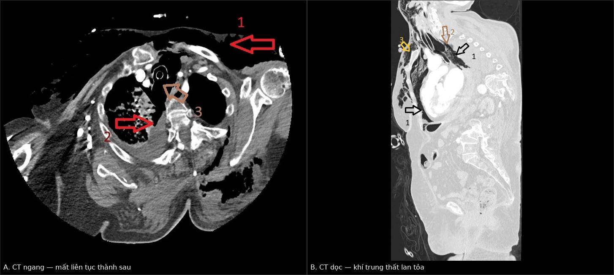
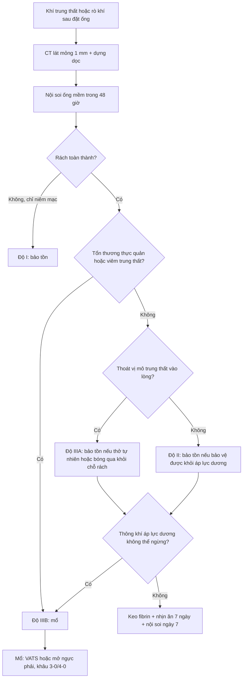
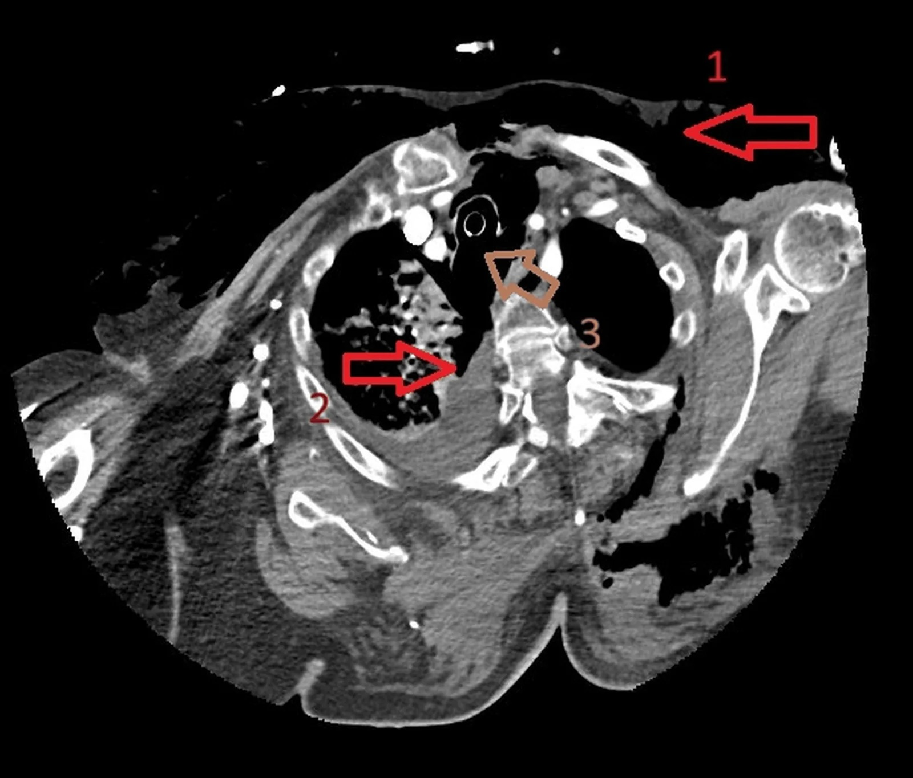
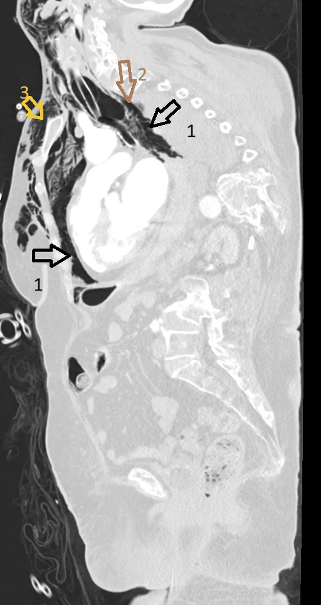
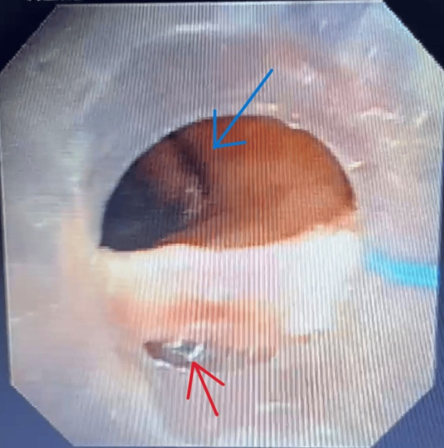
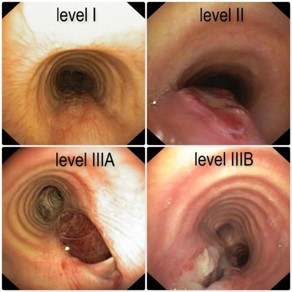

# 3057 — Vỡ khí quản – phế quản lớn sau đặt nội khí quản: khí trung thất "không có tràn khí màng phổi", phân độ Cardillo và ngưỡng mổ

**Tags:** `pattern:tran-khi-trung-that` `pattern:hep-duong-tho` `vung:khi-quan` `vung:phe-quan` `vung:trung-that` `vung:duong-tho` `anatomy:khi-quan` `score:Cardillo` `protocol:CT-lat-mong` `protocol:noi-soi-ong-mem`
**Mức chắc chắn (certainty):** tổng hợp y văn (literature synthesis) — ghép **loạt 62 ca vỡ khí quản sau đặt ống** có phân độ Cardillo cải tiến (Front Surg 2022, PMC9727090), **ca 4 cm lan tới eo ngực, mổ mở nhưng tử vong** (Cureus 2026, PMC13570639), **ca rách thành sau 1–1,5 cm sau đổi ống mở khí quản qua da** (Cureus 2025, PMC12752804), **ca rách toàn thành 3 cm điều trị bảo tồn** (J Med Case Rep 2025, PMC12482526), **ca biểu hiện muộn ngày 2 với tràn khí hai bên** (Lung India 2020, PMC8066937), **ca ống hai nòng** (Int Med Case Rep J 2026, PMC13633767) và **ca rách 7 cm vá hai đường** (J Cardiothorac Surg 2026, PMC13508291). Không có ca do nhóm tự chụp.

> **Câu hỏi thực hành:** nữ bệnh nhân **đầu 70 tuổi** được đặt nội khí quản cấp cứu vì hôn mê; 6 giờ sau **cổ – mặt sưng, sờ có tiếng lép bép**, máy thở báo **rò khí dai dẳng dù đã bơm căng bóng**, X-quang **không có tràn khí màng phổi**. Câu hỏi: **khí trung thất này do vỡ phế nang hay vỡ thành khí quản, chụp gì để thấy chỗ vỡ, và bệnh nhân phải mổ hay có thể theo dõi?**
> Bài chốt **ba quyết định**: **(1) rò khí quanh ống + bơm căng bóng không kín = khiếm khuyết thành khí quản, không phải "bóng hỏng"; (2) CT lát mỏng 1 mm + dựng ảnh dọc tìm mất liên tục thành sau, rồi nội soi ống mềm trong 48 giờ để đo độ sâu – độ dài; (3) phân độ Cardillo: I–IIIA điều trị bảo tồn (keo fibrin) khi bệnh nhân không cần thông khí áp lực dương; IIIB–IV mổ.** Nối [3047 – Hẹp khí quản sau đặt nội khí quản](../3047-hep-khi-quan-sau-dat-noi-khi-quan-o-tre/lesson.md), [098 – Barotrauma & tràn khí do thông khí áp lực](../098-barotrauma-tran-khi-ap-luc-tho-may/lesson.md), [612 – Cấp cứu đường thở trên ở trẻ](../612-cap-cuu-duong-tho-tren-tre-em/lesson.md).

## 1. Tổng quan bệnh học – cơ chế hình ảnh: vì sao rách lại ở thành SAU và vì sao khí đi vào trung thất

- **Tần suất – con số quyết định mức nghi ngờ:** vỡ khí quản sau đặt ống nội khí quản đường miệng khoảng **0,005%** (1/20.000 ca đặt ống điện quy), ước tính **0,005–0,19%** ở các loạt gần đây (PMC13508291, PMC9727090). Ống **hai nòng** làm tăng mạnh: **0,5–1%** (PMC9727090); loạt gộp **187 ca vỡ đường thở do ống hai nòng** có **tử vong 8,8%** (PMC13633767). Mở khí quản qua da (PDT) gây rách khí quản **0,1–1%** (PMC12752804).
- **Vì sao thành sau (pars membranacea):** 2/3 chu vi khí quản là các vòng sụn chữ C; **thành sau chỉ có cơ trơn và sợi chun, không có sụn đỡ**. Bóng chèn tì vào đúng đoạn yếu này. Khi áp lực bóng vượt **áp lực mao mạch niêm mạc (~25–30 mmHg ≈ 33–40 cmH₂O)**, niêm mạc thiếu máu, hoại tử, rồi rách **dọc** theo hướng sợi chun — vì vậy tổn thương điển hình là **đường rách dọc ở thành sau, 1–3 cm trên carina** (PMC13570639, PMC12752804).
- **Vì sao khí vào trung thất mà không vào màng phổi:** khí thoát ra khoang quanh khí quản, lan theo mô liên kết dọc **trung thất** trước khi tới màng phổi. Do đó **khí trung thất đơn thuần + tràn khí dưới da là biểu hiện sớm nhất**, còn **tràn khí màng phổi chỉ xuất hiện khi màng phổi tạng/trung thất bị rách kèm** — trong ca PMC13570639 khí trung thất lan tỏa **không kèm tràn khí màng phổi**.
- **Vì sao khí trung thất KHÔNG đặc hiệu:** cơ chế Macklin (vỡ phế nang → khí đi theo bao mạch – phế quản vào trung thất) cho **cùng hình ảnh**. Trong một tổng quan hệ thống ở bệnh nhân ARDS do COVID-19 thở máy, **barotrauma gặp ở khoảng 1/6 và khí trung thất ở khoảng 1/9** (PMC13570639) — nghĩa là khí trung thất **một mình không chứng minh được vỡ khí quản**.
- **Vật lý đường thở nhỏ (áp dụng cho trẻ):** theo Hagen–Poiseuille, trở lực tỉ lệ nghịch với **bán kính lũy thừa 4**. Ở khí quản trẻ đường kính **4 mm**, phù nề làm hẹp 1 mm (bán kính 2 mm → 1,5 mm) tăng trở lực khoảng **3,2 lần**; hẹp còn 1 mm tăng hơn **250 lần**. Vì vậy cùng một vết rách, trẻ mất bù nhanh hơn người lớn và **mọi can thiệp làm giảm 1 mm lòng khí quản đều là biến cố**.
- **Yếu tố nguy cơ đã được định lượng:** trong **62 ca**, **83,9% (52/62) là nữ**, tuổi trung bình **58,2** (12–82), **82,2% mổ phiên**, BMI trung bình **29,9** (21–43); nhóm tổn thương nặng (IIIA–IV) **lớn tuổi hơn có ý nghĩa** (64,6 vs 55,7 tuổi; p = 0,03) (PMC9727090). Các yếu tố thủ thuật: **đặt ống nhiều lần, người đặt ít kinh nghiệm, nòng dẫn (bougie) thò ra ngoài đầu ống, dùng stylet không đúng**, ống quá cỡ, bơm bóng quá căng (PMC9727090, PMC13633767); **corticoid hít dài hạn** làm yếu thành màng (PMC13570639).

## 2. Mẫu hình + chẩn đoán phân biệt theo cơ chế và vị trí (Gamut)

- **Theo cơ chế — 4 nhóm, mỗi nhóm một hướng xử trí:**
  1. **Chấn thương cơ học trực tiếp:** đặt ống (nhất là ống hai nòng), đổi ống, hút đờm, nội soi phế quản cứng, dị vật, chấn thương ngực kín.
  2. **Áp lực (barotrauma):** vỡ phế nang → Macklin; không có lỗ thủng thành khí quản, điều trị giảm áp lực.
  3. **Hoại tử – nhiễm trùng:** sau bóng chèn lâu ngày, sau xạ, u xâm lấn — thành khí quản mỏng, vỡ tự phát.
  4. **Rò miệng nối:** sau cắt nối khí quản hoặc sau mổ khí quản — khí thoát qua đường khâu.
- **Theo vị trí — quyết định đường mổ:**
  - **Khí quản cổ (trên eo):** sưng cổ, thay đổi giọng; đường vào **cổ**.
  - **Khí quản ngực (dưới eo tới carina):** khí trung thất, tràn khí màng phổi; đường vào **ngực phải** (PMC13508291).
  - **Phế quản gốc:** gặp khi bóng ống hai nòng nằm trong phế quản trái; khí trung thất + xẹp phổi bên đối diện.
- **Gợi nhớ 5 chữ "TUBES":** **T**ube (đặt/đổi ống), **U**nder-sized or oversized (cỡ ống), **B**arotrauma (vỡ phế nang), **E**sophagus (thủng thực quản), **S**urgical anastomosis (rò miệng nối).
- **Phân biệt theo hình ảnh — 5 dấu hiệu trên CT, mỗi dấu có giá trị khác nhau:**

| Dấu hiệu trên CT | Cơ chế | Giá trị thực hành |
|---|---|---|
| **Mất liên tục thành sau khí quản** trên mặt cắt ngang/dọc | Lỗ rách toàn thành | **Chốt vào mạnh nhất**, nhưng cần cửa sổ mô mềm + dựng ảnh dọc |
| **Khí bao quanh ống** ("air around the tube") | Khí lọt giữa ống và thành khí quản | Rất gợi ý khi **kèm rò khí**; đơn độc có thể do bóng chưa kín |
| **Khí trung thất lan tỏa** | Khí thoát theo mô liên kết | Nhạy nhưng **không đặc hiệu** (Macklin, ARDS) |
| **Tràn khí dưới da cổ – ngực** | Khí lan ra mô dưới da | Dấu **sớm nhất**, thường thấy trước tràn khí màng phổi |
| **Tràn khí màng phổi / tràn khí bụng** | Rách màng phổi trung thất / khí xuống qua lỗ hoành | Tràn khí bụng dễ bị đọc nhầm là **thủng tạng rỗng** |

## 3. Bảng so sánh phân biệt (ma trận đối chiếu)

| Thực thể | Hình ảnh điển hình | Chốt vào (rule-in) | Chốt loại (rule-out) | Gợi ý xác nhận |
|---|---|---|---|---|
| **Vỡ thành sau khí quản do đặt ống (PITL)** | Rách **dọc** thành sau, **1–3 cm trên carina**, khí trung thất ± tràn khí dưới da; CT dọc thấy mất liên tục thành sau | **Rò khí dai dẳng dù bơm căng bóng + khí trung thất mới sau đặt ống**; nội soi thấy lỗ rách | Không có khí trung thất, không rò khí, nội soi bình thường → loại | Nội soi ống mềm **trong 48 giờ** + CT lát mỏng dựng dọc |
| **Vỡ phế quản gốc do ống hai nòng** | Rách thành phế quản trái, xẹp phổi bên đối diện, khí trung thất | **Bóng ống nằm trong phế quản + rò khí ngay khi đặt** | Tổn thương chỉ ở khí quản, phế quản nguyên → loại | Nội soi xác định vị trí bóng; rút ống hai nòng |
| **Rách khí quản sau mở khí quản qua da (PDT)** | Rách thành sau **1–2 cm trên carina**, khí trung thất sau **đổi/thay ống mở khí quản** | **Sự kiện thay ống + rò khí + khí trung thất trong 24 giờ** | Không có thao tác trên lỗ mở, khí trung thất có từ trước → loại | Nội soi qua lỗ mở; đặt ống dài qua khỏi chỗ rách |
| **Thủng thực quản (Boerhaave)** | Khí trung thất + **dịch/khí quanh thực quản**, tràn dịch màng phổi trái, mức khí – dịch | **Đau ngực sau nôn + tràn dịch trái + khí quanh thực quản** | Không có khí/dịch quanh thực quản, không tràn dịch → loại | CT cản quang uống thuốc; nội soi **khi còn nghi ngờ** (nguy cơ làm rộng chỗ rách) |
| **Khí trung thất do vỡ phế nang (Macklin)** | Khí trung thất **không có mất liên tục thành**, phổi có đông đặc/bệnh nền, thở máy áp lực cao | **Bệnh nhu mô phổi + thông khí áp lực cao + không rò khí** | Có rò khí quanh ống hoặc mất liên tục thành → loại | Theo dõi, giảm áp lực; nội soi nếu không giải thích được |
| **Rò miệng nối sau cắt nối khí quản** | Khí/dịch quanh miệng nối, hẹp lòng, sụp thành | **Mổ trong 7–10 ngày trước + sốt + rò khí** | Miệng nối liền, không khí ngoài lòng → loại | Nội soi; CT dựng dọc |

*Trái (A): mặt cắt ngang ngang eo ngực — khí trung thất và mất liên tục thành sau (mũi tên). Phải (B): dựng ảnh dọc — khí trung thất lan tỏa, thành sau khí quản gián đoạn. Nguồn: Cureus 2026, PMC13570639, CC BY 4.0. Ảnh ghép letterbox, không crop.*

### Đọc đúng "khí trung thất không có tràn khí màng phổi"

- **Trong vỡ khí quản, khí trung thất có thể là dấu hiệu DUY NHẤT** trên hình ảnh — ca PMC13570639 vào viện với khí trung thất lan tỏa **không có tràn khí màng phổi**, và ca PMC8066937 chỉ có **sưng cổ – mặt** ở ngày hậu phẫu 2.
- **Bẫy ngược:** khí trung thất đơn thuần ở bệnh nhân thở máy **không chứng minh vỡ khí quản**; phải tìm **rò khí, mất liên tục thành, khí quanh ống**. Trong ca PMC13570639, khí trung thất do **vỡ phế nang** không loại trừ được về mặt hình ảnh — tác giả phải dựa vào **nội soi thấy lỗ rách toàn thành**.
- **Tràn khí bụng** trong vỡ khí quản ngực là khí đi xuống qua lỗ hoành, **không phải thủng dạ dày – ruột**: đừng mổ bụng trước khi loại trừ tổn thương đường thở (PMC13570639).

## 4. Protocol chụp – phân độ Cardillo – quy trình điều trị

### 4.1 Chụp và nội soi: thứ tự và ngưỡng thời gian

- **CT ngực cản quang, lát mỏng 1,0–1,5 mm**, dựng **axial + coronal + sagittal**, đọc cả **cửa sổ mô mềm và cửa sổ phổi**; đánh giá: mất liên tục thành sau, khí quanh ống, khí trung thất, tràn khí màng phổi, tràn khí bụng, khí/dịch quanh thực quản.
- **Nội soi phế quản ống mềm là chuẩn chẩn đoán**, làm **trong 48 giờ** khi nghi ngờ: đo **vị trí (cách dây thanh và carina), độ dài, độ sâu (niêm mạc / toàn thành), có thoát vị mô trung thất không** (PMC9727090).
- **Giới hạn của nội soi:** không nhìn được **đoạn bị ống và bóng che** — ca PMC13570639 ước lượng **4 cm** qua nội soi nhưng khi mổ tổn thương **lan từ 1 cm trên carina tới eo ngực**; vì vậy **không dùng con số ước lượng để quyết định bảo tồn**.
- **CT không thay nội soi:** CT định vị và phát hiện biến chứng (trung thất, màng phổi, thực quản), nhưng độ dài và độ sâu phải do nội soi xác định.

### 4.2 Phân độ Cardillo cải tiến (2010, cập nhật 2022) — phân độ theo ĐỘ SÂU, không theo độ dài

| Độ | Mô tả giải phẫu | Xử trí trong loạt 62 ca | Tỷ lệ |
|---|---|---|---|
| **I** | Rách niêm mạc/dưới niêm (không toàn thành), **không** khí dưới da – trung thất | Bảo tồn: keo fibrin | 8 ca (12,9%) |
| **II** | Rách **toàn thành** + khí dưới da/trung thất, **không** tổn thương thực quản, **không** viêm trung thất | Bảo tồn: keo fibrin | 36 ca (58%) |
| **IIIA** | Toàn thành + **thoát vị mô trung thất/thực quản** vào lòng, chưa tổn thương thực quản, chưa viêm trung thất | Bảo tồn: keo fibrin | 11 ca (17,8%) |
| **IIIB** | Toàn thành + **tổn thương thực quản hoặc viêm trung thất** | **Mổ** | 6 ca (9,7%) |
| **IV** | **Mất chất nhiều/ gãy vòng sụn khí quản** | **Mổ cắt 2 vòng + nối** | 1 ca (1,6%) |

- **Con số then chốt:** độ dài trung bình **2,9 cm (1–6 cm)** và **gần như bằng nhau giữa các độ** (2,9 / 2,9 / 2,8 / 2,1 / 2,0 cm) → **độ dài không phân biệt được độ nặng**; yếu tố quyết định là **độ sâu và biến chứng trung thất** (PMC9727090). Ngược lại, trong ca đơn lẻ, **độ dài > 4,5 cm** là ngưỡng dự báo tử vong do mọi nguyên nhân (PMC13570639).
- **Bảo tồn có điều kiện:** 55/62 ca (88,7%) độ I–IIIA được bôi **1–2 mL keo fibrin (Tisseel)** qua nội soi, **nhịn ăn – nuôi dưỡng tĩnh mạch ≥ 7 ngày**, kháng sinh, giảm ho; nội soi kiểm tra **ngày 7**, rồi **28 – 90 – 180 – 270 ngày**; **không ca nào viêm trung thất**, tổn thương liền trong **30 ngày**, nằm viện **10–11,5 ngày** (PMC9727090).
- **Điều kiện tiên quyết bị bỏ qua nhiều nhất:** bảo tồn chỉ được khi **bảo vệ chỗ rách khỏi áp lực dương** — bệnh nhân **thở tự nhiên**, hoặc **bóng đặt qua khỏi chỗ rách** (không bơm bóng tại chỗ rách vì sẽ làm rộng thêm), hoặc thông khí **không mất thể tích khí lưu thông**. Ca PMC13570639 **hôn mê phải thở máy** → dù là độ II vẫn phải mổ, và **đặt lại nội khí quản cấp cứu sau khi đã vỡ làm tăng tử vong khoảng 3 lần**.

### 4.3 Mổ: khi nào và đường vào nào

- **Chỉ định:** độ **IIIB và IV**; hoặc độ thấp hơn nhưng **không thể ngừng thông khí áp lực dương**, **rò khí không kiểm soát**, **mất chất/gãy sụn**.
- **Đường vào theo vị trí:** khí quản **cổ** → đường cổ; khí quản **ngực** → **mở ngực sau bên phải** hoặc **VATS**; tổn thương lan cả hai đoạn → **phối hợp cổ – ngực** (ca 7 cm, PMC13508291).
- **Kỹ thuật:** thành màng khâu **mũi vắt**, phần sụn khâu **mũi rời**; độ IV cần **cắt 2 vòng + nối tận – tận** và **chen vạt cơ ức đòn chũm** giữa khí quản và thực quản (PMC9727090). Trong loạt 62 ca, 7 ca mổ **không tử vong trong 30 ngày**, nằm viện trung bình **20,9 ngày** (12–40).

## 5. Biến thể bình thường và cạm bẫy

- **"Bóng hỏng" không phải chẩn đoán:** rò khí **vẫn còn sau khi đổi ống mới** = khiếm khuyết thành khí quản (PMC13570639). Bơm thêm bóng chỉ làm **rách rộng thêm**.
- **Khí trung thất đơn thuần không loại trừ và không chứng minh** vỡ khí quản — phải tìm **rò khí + mất liên tục thành + nội soi**.
- **Nội soi đánh giá thấp độ dài** vì ống và bóng che đoạn tổn thương; đừng lấy "4 cm" làm mốc bảo tồn.
- **Biểu hiện muộn:** ca PMC8066937 chỉ có **sưng cổ – mặt ngày hậu phẫu 2**, không khó thở, SpO₂ **97–99%** — vỡ khí quản **không nhất thiết suy hô hấp ngay**.
- **Tràn khí bụng** do khí từ trung thất xuống: **đừng mổ bụng** khi chưa loại trừ vỡ đường thở.
- **Ống hai nòng:** bóng khí quản bơm quá căng hoặc ống quá cỡ (37 Fr) ở bệnh nhân **thấp, nữ, lớn tuổi** là tổ hợp nguy cơ; kiểm tra **áp lực bóng < 30 cmH₂O** và xác nhận vị trí bằng nội soi sau khi đặt và sau khi đổi tư thế (PMC13633767).
- **Đừng nhầm với thủng thực quản:** khí quanh thực quản + tràn dịch trái + đau sau nôn → CT cản quang uống thuốc; nội soi thực quản **chỉ khi còn nghi ngờ** vì có thể làm rộng chỗ rách (PMC13570639).

## 6. Tự lượng giá — Blind Quiz

**Ca 1 — Nữ đầu 70 tuổi, đặt ống cấp cứu vì hôn mê; sau vài giờ cổ sưng, máy thở báo rò khí, đổi ống vẫn rò. Nhìn CT ngang, mô tả trước khi đọc đáp án.**

- Hỏi: khí nằm ở khoang nào? Thành nào của khí quản bất thường? Hai chẩn đoán phân biệt chính và một câu hỏi tiếp theo?

<b>Bấm để hiện đáp án</b>

- Khí trung thất lan tỏa + khí dưới da thành ngực; **thành sau khí quản mất liên tục** (mũi tên).
- **Chốt vào:** rò khí dai dẳng dù đã đổi ống → **vỡ thành sau khí quản (PITL)**. Phân biệt: **khí trung thất do vỡ phế nang** (Macklin) và **thủng thực quản**.
- Bước tiếp: **nội soi ống mềm trong 48 giờ** đo độ sâu – độ dài; nếu toàn thành và không có tổn thương thực quản/viêm trung thất → **độ II, bảo tồn nếu ngừng được áp lực dương**.
- Đối chiếu dựng ảnh dọc:

- Nguồn: Cureus 2026, PMC13570639, CC BY 4.0.

**Ca 2 — Bệnh nhân mở khí quản qua da, 8 ngày sau thay ống thì khó thở, khí trung thất. Nội soi thấy gì và xử trí ra sao?**

<b>Bấm để hiện đáp án</b>

- **Rách dọc thành sau màng, 1–2 cm trên carina** (mũi tên đỏ); bóng và ống vừa thay là nguyên nhân.
- Xử trí: **đặt ống dài qua khỏi chỗ rách** để bảo vệ, dẫn lưu khí, rồi **đặt stent nội lòng** hoặc mổ nếu rò không kiểm soát — trong ca này stent đã ổn định thành sau.
- Cạm bẫy: bơm bóng tại chỗ rách làm rộng thêm; nội soi qua lỗ mở phải **nhìn được cả đoạn trên và dưới** tổn thương.
- Nguồn: Cureus 2025, PMC12752804, CC BY 4.0.

**Ca 3 — Bốn mức độ nội soi dưới đây khác nhau ở điểm nào, và mức nào phải mổ?**

<b>Bấm để hiện đáp án</b>

- Khác nhau ở **độ sâu và biến chứng trung thất**, không ở độ dài: **I** chỉ niêm mạc; **II** toàn thành + khí trung thất; **IIIA** toàn thành + **thoát vị mô trung thất** vào lòng; **IIIB** có **tổn thương thực quản hoặc viêm trung thất**.
- **Phải mổ: IIIB và IV** (IV = mất chất/gãy vòng sụn); I–IIIA có thể **keo fibrin + bảo tồn** nếu bảo vệ được khỏi áp lực dương.
- Trong loạt 62 ca: **88,7% (55/62) điều trị bảo tồn**, **không viêm trung thất**, liền trong **30 ngày**.
- Nguồn: Front Surg 2022, PMC9727090, CC BY 4.0.

## Bài liên quan chéo
- [3047 – Hẹp khí quản mắc phải sau đặt nội khí quản ở trẻ](../3047-hep-khi-quan-sau-dat-noi-khi-quan-o-tre/lesson.md) (di chứng muộn của cùng tổn thương)
- [098 – Barotrauma & tràn khí do thông khí áp lực dương](../098-barotrauma-tran-khi-ap-luc-tho-may/lesson.md) (khí trung thất do vỡ phế nang)
- [612 – Cấp cứu đường thở trên ở trẻ](../612-cap-cuu-duong-tho-tren-tre-em/lesson.md) (đặt ống cấp cứu, đường thở khó)
- [3046 – Chảy máu cam do vỡ giả phình động mạch cảnh trong xoang bướm](../3046-chay-mau-cam-do-vo-gia-phinh-dong-mach-canh-trong-xoang-buom/lesson.md) (biến chứng chảy máu sau thủ thuật đường thở – mũi)

> Không dùng để chẩn đoán độc lập khi chưa có người hướng dẫn.
