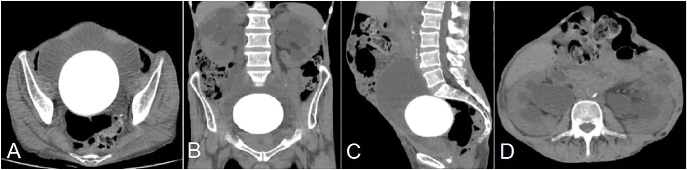
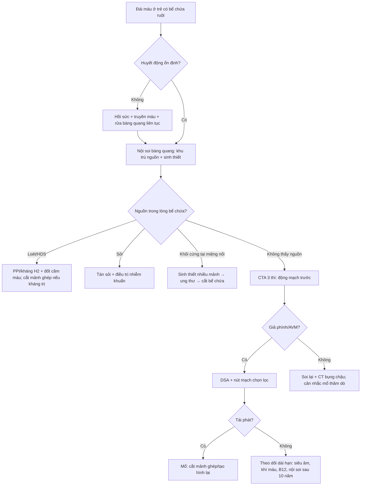
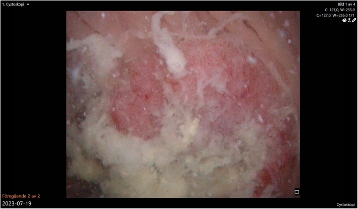
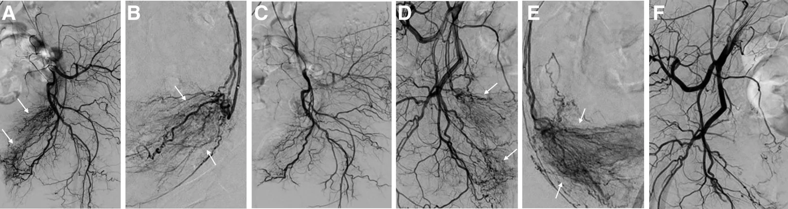

# 3058 — Xuất huyết từ mảnh ghép ruột/dạ dày sau tăng dung tích bàng quang ở trẻ / Bleeding from the enteric patch after augmentation cystoplasty

**Tags:** `pattern:xuat-huyet` `pattern:dai-mau` `pattern:loet-manh-ghep` `pattern:soi` `pattern:u-mien-noi` `vung:tiet-nieu` `vung:bang-quang` `anatomy:bang-quang-thanh-kinh` `protocol:CT-cystogram` `protocol:CTA` `protocol:noi-soi-bang-quang` `protocol:DSA` `protocol:nut-mach`
**Mức chắc chắn (certainty):** tổng hợp y văn (literature synthesis) — ghép **ca hội chứng đái máu–khó tiểu sau tạo hình bàng quang bằng dạ dày (hematuria-dysuria syndrome, HDS)** kèm tổng quan y văn (Urol Case Rep 2015, PMC4714289), **hướng dẫn EAU-ESPU-ERN 2025 về spinal dysraphism** (Eur Urol Open Sci 2026, PMC13136771), **loạt 91 bể chứa dạ dày** (Int Braz J Urol 2018, PMC6237526), **loạt 22 trẻ tăng dung tích bàng quang** (Sci Rep 2024, PMC10879155), **ca sỏi bàng quang khổng lồ 610 g sau ileocystoplasty** (2026, PMC13577874), **ca ung thư biểu mô tuyến thứ phát trong bể chứa** (2026, PMC13122120) và **hai loạt nút mạch động mạch bàng quang chọn lọc** (Cureus 2024, PMC11087881; Medicine 2026, PMC13632971). Không có ca do nhóm tự chụp.

> **Câu hỏi thực hành:** bé gái **14 tuổi**, bàng quang thần kinh do thoát vị tủy–màng tủy, đã **tăng dung tích bàng quang bằng hồi trang + Mitrofanoff** cách đây **6 năm**, vào cấp cứu vì **đái máu đỏ tươi ồ ạt** trong 6 giờ, **mạch 128**, **huyết áp 88/52 mmHg**, **Hb 6,8 g/dL**; không sốt, không đau bụng. Câu hỏi: **máu từ đâu — mảnh ghép ruột, sỏi cọ xát, hay mạch máu mạc treo — và chụp gì trước khi mổ?**
> Bài chốt **ba quyết định**: **(1) đái máu sau tăng dung tích bàng quang không phải "nhiễm trùng tiểu" cho tới khi soi bàng quang loại trừ loét mảnh ghép/sỏi/u; (2) đái máu ồ ạt kèm tụt huyết áp phải chụp CTA thì ĐỘNG MẠCH trước, vì nguồn chảy có thể là giả phình/AVM mạc treo mảnh ghép mà nội soi không thấy; (3) nút mạch chọn lọc là bước cầm máu ít xâm lấn hiệu quả, nhưng tổn thương loét/hoại tử mảnh ghép thì vẫn phải mổ.** Nối [672 – Biến chứng muộn sau tái tạo bàng quang bằng ruột](../672-bien-chung-muon-sau-tai-tao-bang-quang/lesson.md), [3009 – Dò bàng quang–ruột và dò bàng quang–da](../3009-do-bang-quang-ruot-sau-tang-dung-tich-bang-quang-o-tre/lesson.md), [691 – Sỏi bàng quang & sỏi quanh catheter](../691-soi-bang-quang-va-soi-quanh-catheter-o-tre/lesson.md), [3010 – Hẹp miệng nối niệu quản–bàng quang](../3010-hep-mien-noi-nieu-quan-bang-quang-o-tre/lesson.md).

## 1. Tổng quan bệnh học – cơ chế hình ảnh: vì sao mảnh ghép chảy máu

- **Bốn nguồn chảy máu khác nhau về cơ chế, nên khác nhau về hình ảnh và cách xử trí:** **(a) loét do acid** — chỉ có ở **mảnh ghép dạ dày** (gastrocystoplasty), gây **hội chứng đái máu–khó tiểu (HDS)**; **(b) loét/thiếu máu tại miệng nối** — ở **mảnh ghép hồi tràng/đại tràng**, nơi mép khâu là vùng phân thủy mạch; **(c) cọ xát do sỏi** — sỏi hình thành trong bể chứa ruột vì chất nhầy ứ + vi khuẩn sinh urease; **(d) mạch máu** — **giả phình/AVM** của nhánh mạc treo mảnh ghép hoặc động mạch bàng quang, và **ung thư biểu mô tuyến** tại miệng nối xuất hiện sau **hàng chục năm**.
- **Tần suất HDS (số liệu thật, không phải ước lượng):** theo **tiêu chuẩn Nguyen**, HDS gồm **co thắt bàng quang, đau trên xương mu/dương vật/niệu đạo, đái máu đại thể màu nâu cà phê KHÔNG có nhiễm trùng, loét da vùng đáy chậu, khó tiểu không nhiễm trùng**. Tỷ lệ rất dao động: **24%** (78 trẻ, theo dõi **8,1 năm**, Plaire), **36%** (57 trẻ mổ 1989–1992), **70%** (23 bệnh nhân, theo dõi trung bình **45 tháng**), và **18%** (DeFoor 2003) (PMC4714289). Khoảng dao động này phản ánh **tiêu chuẩn chẩn đoán khác nhau**, không phải khác biệt chủng tộc.
- **TẠI SAO acid gây đái máu:** niêm mạc dạ dày trong bể chứa **vẫn tiết HCl** và **vẫn đáp ứng gastrin**; nước tiểu không đủ đệm nên **pH lòng bể chứa giảm**, acid **ăn mòn niêm mạc chuyển tiếp của cổ bàng quang – niệu đạo** và vùng **miệng nối** (không có hàng rào nhầy dạ dày) → **viêm, loét, chảy máu mao mạch**. Máu tiếp xúc acid → **hemoglobin bị oxy hóa/chuyển màu** → nước tiểu **nâu cà phê**, khác máu đỏ tươi của nguồn động mạch. Vì đau và co thắt do acid, HDS **giảm dần theo thời gian** ở đa số bệnh nhân nhưng **có thể tái phát từng đợt**.
- **Điều trị HDS — bằng chứng cụ thể:** **13%** ca **nhẹ, tự giới hạn, không cần điều trị**; **6%** dùng **kháng H2** để kiểm soát triệu chứng nhẹ; **4%** dùng **kháng H2 liên tục**; nhưng **tới 70%** bệnh nhân trong các loạt khác **cần kháng H2 và/hoặc ức chế bơm proton** (PMC4714289). **Thuốc kháng muscarinic liều cao KHÔNG có lợi** về niệu động học hay lâm sàng (29 bệnh nhân, Castellan) — đây là điểm hay bị làm sai vì triệu chứng giống bàng quang co thắt.
- **TẠI SAO mảnh ghép ruột cũng chảy máu:** đoạn ruột **detubular hóa** được khâu vào vòm bàng quang; **bờ khâu là vùng phân thủy mạch** giữa mạc treo ruột và thành bàng quang. **Căng mạc treo, xoắn mảnh ghép, hẹp cuống mạch, thiếu máu mép khâu** → **loét thiếu máu** → chảy máu mạn hoặc thủng. Đây là lý do **cùng một vị trí** vừa gây **dò/thủng** (bài 3009) vừa gây **xuất huyết** — hai mặt của một tổn thương thành.
- **TẠI SAO sỏi là nguồn chảy máu phổ biến:** bể chứa ruột **tiết chất nhầy**, **không có lớp niêm mạc chống dính**, **ứ nước tiểu** và **vi khuẩn sinh urease** → sỏi. Y văn ghi **10,5–52%**, cohort 22 trẻ có **36,4%** (PMC10879155). Sỏi lớn **cọ xát niêm mạc** khi CIC và gây **đái máu đại thể từng đợt**; ca **sỏi 610 g** sau ileocystoplasty **15 năm** còn gây **ứ nước–niệu quản hai bên và suy thận** (PMC13577874) — tức sỏi không chỉ gây máu mà còn gây **tắc**.
- **TẠI SAO phải nghĩ tới ung thư ở người đã tăng dung tích > 10 năm:** nguy cơ **7–8 lần** (mảnh ghép hồi tràng) và **14–15 lần** (đại tràng/dạ dày), **trung vị 19 năm** sau mổ (PMC10879155). Hướng dẫn EAU-ESPU 2025 khuyến cáo **theo dõi suốt đời** bằng khám, siêu âm, chức năng thận, **khí máu** và **vitamin B12**, và **nội soi có thể xem xét sau 10 năm** dù chi phí–hiệu quả còn bàn cãi (PMC13136771). Vì vậy **đái máu ở bệnh nhân > 10 năm sau tăng dung tích = phải soi và sinh thiết tổn thương**, không được gọi là "viêm bàng quang".
- **TẠI SAO CTA thì động mạch lại quyết định:** giả phình/AVM **chỉ hiện ở thì động mạch** (25–35 giây) vì nó **đổ đầy và rửa nhanh**; ở thì tĩnh mạch–bài tiết, cản quang đã pha loãng nên **ổ giả phình biến mất** hoặc chỉ còn "ổ tăng đậm độ mờ". Ngược lại, **sỏi** thấy rõ trên **thì không cản quang**, còn **u tại miệng nối** thấy rõ ở **thì tĩnh mạch cửa** (ngấm thuốc mô mềm). Vì vậy protocol đúng là **3 thì: không cản quang → động mạch → tĩnh mạch cửa**, không phải "CT bụng có cản quang".

## 2. Mẫu hình + chẩn đoán phân biệt theo NHỊP chảy máu và NGUỒN (Gamut)

- **Theo nhịp chảy máu (quyết định thứ tự xử trí):**
  - **Mạn/từng đợt, máu nâu cà phê, kèm đau–co thắt, không sốt** → **HDS** (mảnh ghép dạ dày).
  - **Từng đợt, liên quan CIC, có sỏi trên phim cũ** → **sỏi cọ xát**.
  - **Ồ ạt, đỏ tươi, tụt huyết áp, không đau** → **nguồn động mạch**: giả phình/AVM mạc treo, loét ăn mòn mạch, u chảy máu.
  - **Rỉ rả kéo dài + thiếu máu + sụt cân + > 10 năm sau mổ** → **ung thư biểu mô tuyến tại miệng nối**.
- **Theo vị trí nguồn (quyết định đường can thiệp):**
  - **Trong lòng bể chứa** (niêm mạc mảnh ghép, cổ bàng quang): **nội soi** thấy và đốt/chiếu laser được.
  - **Thành/miệng nối** (loét thiếu máu, u): **nội soi + sinh thiết**, xử trí bằng **cắt mảnh ghép**.
  - **Ngoài lòng bể chứa** (mạc treo mảnh ghép, động mạch bàng quang): **nội soi âm tính**, phải **CTA/DSA**.
- **Mnemonic "PATCH":** **P**seudoaneurysm/AVM (mạch máu), **A**cid — HDS (dạ dày), **T**umour (ung thư tại miệng nối), **C**alculus (sỏi), **H**emorrhage từ loét/thiếu máu mép khâu.
- **Bẫy dịch tễ quan trọng:** ở trẻ có bể chứa ruột, **"nhiễm trùng tiểu" là chẩn đoán mặc định** vì **bacteriuria không triệu chứng gần như 100%** (PMC10879155) — nên **cấy nước tiểu dương không giải thích được đái máu đại thể**, và **không được dừng ở đó**.

## 3. Bảng so sánh phân biệt (ma trận đối chiếu)

| Thực thể (entity) | Hình ảnh điển hình | Chốt vào (rule-in) | Chốt loại (rule-out) | Gợi ý xác nhận |
|---|---|---|---|---|
| **HDS do mảnh ghép dạ dày** | Nội soi: **niêm mạc dạ dày đỏ, phù, loét nông** ở mảnh ghép và **cổ bàng quang**; bể chứa thành mỏng, không khối | **Mảnh ghép dạ dày + đau/co thắt + nước tiểu nâu cà phê không nhiễm trùng + đáp ứng kháng H2/PPI** | Máu đỏ tươi ồ ạt, có giả phình trên CTA → **không phải HDS** | Nội soi + pH nước tiểu; thử PPI 2–4 tuần |
| **Sỏi trong bể chứa** | CT không cản quang: **cấu trúc cản quang trong lòng bể chứa**, có thể **610 g / 7×7×7 cm**; **ứ nước–niệu quản** nếu sỏi bít cổ | **Sỏi thấy trên CT + đái máu liên quan CIC + tiền sử sỏi** | Không sỏi trên CT → tìm nguồn khác; **sỏi nhỏ không loại trừ loét** | CT không cản quang; soi bàng quang; tán sỏi |
| **Loét thiếu máu tại miệng nối** | Nội soi: **ổ loét đơn độc đúng đường khâu**, bờ trắng, có thể lộ mạch; CT: **dày khu trú thành bể chứa, không khối** | **Loét đúng miệng nối + tiền sử tăng dung tích + đái máu tái phát** | Loét lan tỏa toàn bể chứa → nghĩ **HDS/viêm** hơn là thiếu máu khu trú | Nội soi + sinh thiết bờ loét (loại u) |
| **Giả phình/AVM mạch mạc treo hoặc động mạch bàng quang** | CTA thì động mạch: **ổ đậm độ bằng mạch máu**, **rửa song hành với động mạch**; DSA: **blush mạch** đổ đầy thì động mạch, **mất ở thì muộn** | **Đái máu ồ ạt + CTA/DSA thấy ổ mạch + nội soi không thấy nguồn trong lòng** | Nội soi thấy máu rỉ từ niêm mạc, CTA âm tính → **nguồn niêm mạc** | CTA 3 thì → DSA + nút mạch chọn lọc |
| **Ung thư biểu mô tuyến tại miệng nối** | Nội soi: **khối nhô/loét cứng tại miệng nối**, dễ chảy máu khi chạm; CT: **dày thành khu trú ± hạch** | **> 10 năm sau tăng dung tích + khối tại miệng nối + thiếu máu/sụt cân** | Niêm mạc đều, không khối, sinh thiết âm → **loét lành** | Nội soi sinh thiết nhiều mảnh; CT bụng–chậu có cản quang |
| **Viêm bàng quang xuất huyết do vi khuẩn** | Thành bể chứa **dày lan tỏa**, niêm mạc sung huyết, **không khối, không sỏi**; cấy dương | **Sốt + cấy dương + đái máu + thành dày lan tỏa** | **Bacteriuria không triệu chứng gần như 100%** ở bể chứa ruột → cấy dương **không** chứng minh nguyên nhân | Cấy + nội soi loại trừ loét/u |
| **Chảy máu do CIC chấn thương** | Máu rỉ từ **lỗ thông/cổ bàng quang**, nội soi thấy **vết xước niêm mạc**, tự cầm | **Chảy máu ngay sau đặt catheter + nội soi thấy vết xước + tự cầm < 24 giờ** | Chảy máu ồ ạt, Hb giảm nhanh, không tự cầm → **không phải chấn thương CIC** | Theo dõi Hb; nội soi nếu kéo dài |

*Bệnh nhân **15 năm sau ileocystoplasty**, vào viện vì suy thận và đái máu. **(A)** trục ngang: **sỏi khổng lồ** chiếm gần toàn bộ lòng bể chứa (cấu trúc cản quang tròn, đậm độ cao); **(B)** vành; **(C)** đứng: sỏi **610 g**, kích thước **7×7×7 cm** sau khi lấy; **(D)** trục ngang thận: **ứ nước–niệu quản hai bên**. Bài học: sỏi không chỉ gây máu mà còn **gây tắc và suy thận**, và **đái máu ở bể chứa ruột phải chụp CT không cản quang để tìm sỏi trước khi soi**. Nguồn: 2026 (PMC13577874), **CC BY 4.0**, nguyên bản.*

## 4. Protocol chụp + phân tầng xử trí

- **Bước 0 — hồi sức song song với chẩn đoán:** đặt 2 đường truyền lớn, **truyền hồng cầu khối** (mục tiêu Hb **7–8 g/dL** ở trẻ ổn định, **8–10 g/dL** nếu đang chảy), bù đông máu theo xét nghiệm, **bàng quang rửa liên tục bằng dung dịch muối ấm** để tránh cục máu đông bít lỗ thông. **Không đặt catheter cứng qua niệu đạo** ở trẻ có bể chứa + cổ bàng quang đã tái tạo — dùng **lỗ thông Mitrofanoff**.
- **Bước 1 — nội soi bàng quang (cystoscopy) là bắt buộc, làm sớm:** mục tiêu **khu trú nguồn** (mảnh ghép? miệng nối? cổ bàng quang?), **hút cục máu**, và **sinh thiết mọi tổn thương nhô/loét cứng**. Nội soi **âm tính không loại trừ nguồn ngoài lòng bể chứa** — đây là lý do phải làm CTA.
- **Bước 2 — CT 3 thì (không cản quang → động mạch → tĩnh mạch cửa), lát ≤ 1–2 mm, dựng vành/đứng:** tìm **sỏi**, **khối tại miệng nối**, **dày thành khu trú**, **ổ giả phình/AVM**, **máu tụ trong lòng bể chứa**, và **ứ nước thận**. Với đái máu ồ ạt, **thì động mạch đặt trước** (bắt đầu bơm thuốc khi đầu dòng tới ngang mào chậu) để không bỏ sót **giả phình nhỏ**.
- **Bước 3 — DSA + nút mạch chọn lọc (transarterial embolization, TAE) khi CTA gợi ý nguồn mạch:** **thành công kỹ thuật 100% (20/20)**, **thành công lâm sàng 85% (17/20)**, **Hb trung bình 7,57 → 11,30 g/dL** (p < 0,001), **độ đái máu giảm từ 4 → 2** (p < 0,001); **biến chứng nhẹ 40%** (chủ yếu **hội chứng sau nút mạch**, điều trị bảo tồn), **không có biến chứng nặng**; nhóm **viêm bàng quang do xạ 90%** so với **nhóm u chảy máu 77%** (PMC13632971). Loạt Cureus 2024 với **hạt PVA 300–500 µm** cũng cho **giảm nhu cầu truyền máu** và **tái phát ở 4 ca sau trung bình 4 tháng** (PMC11087881).
- **Bước 4 — chỉ định mổ:** **loét/hoại tử mảnh ghép có mất liên tục thành** (nguy cơ thủng — xem bài 3009), **u tại miệng nối đã xác nhận**, **chảy máu tái phát sau 2 lần nút mạch**, hoặc **bể chứa mất chức năng**. Kỹ thuật: **cắt mảnh ghép + tạo hình lại** hoặc **cắt bể chứa + chuyển lưu**; với mảnh ghép dạ dày gây HDS kháng trị, **cắt bỏ mảnh ghép dạ dày** là biện pháp triệt để.
- **Theo dõi dài hạn (EAU-ESPU 2025):** khám + **siêu âm thận–bàng quang định kỳ**, **chức năng thận**, **khí máu** (toan chuyển hóa do mảnh ghép ruột), **vitamin B12** (mảnh ghép hồi tràng), **nội soi sau 10 năm** có thể xem xét (PMC13136771).

## 5. Biến thể bình thường và cạm bẫy

- **"Nước tiểu nâu cà phê" không đồng nghĩa HDS:** mảnh ghép hồi tràng cũng làm nước tiểu **đục, có nhầy** và **sẫm màu** khi ứ lâu; phân biệt bằng **pH, nội soi, đáp ứng PPI**.
- **Bacteriuria không triệu chứng gần như 100%** ở bể chứa ruột (PMC10879155) — **cấy dương là nền, không phải nguyên nhân**; đừng dừng chẩn đoán ở "nhiễm trùng tiểu" khi bệnh nhân **đái máu đại thể + Hb giảm**.
- **Cục máu đông trong bể chứa giả "khối u" trên CT** — luôn đối chiếu **thì không cản quang** (máu tụ **60–80 HU**, không ngấm) và **nội soi**.
- **Giả phình chỉ thấy ở thì động mạch:** CT "bụng–chậu có cản quang" một thì tĩnh mạch sẽ **bỏ sót**; nếu CTA âm tính mà vẫn nghi, **DSA** là chuẩn.
- **Nút mạch không chữa được loét/hoại tử:** nút mạch cầm máu nhưng **không loại bỏ ổ loét**; nếu nội soi thấy **mảnh ghép thiếu máu/hoại tử**, phải **mổ** dù máu đã tạm cầm — nếu không sẽ **thủng** (bài 3009).
- **Sỏi nhỏ trên CT vẫn có thể là nguồn chảy:** sỏi **< 5 mm** có thể không gây tắc nhưng **cọ xát niêm mạc** khi CIC; đừng loại trừ chỉ vì không ứ nước.
- **Sai lầm "huyết động ổn định thì chờ":** đái máu ồ ạt có thể **tái phát đột ngột** sau khi cục máu đông tan; theo dõi **Hb + mạch + nước tiểu** mỗi 2–4 giờ trong 24 giờ đầu.

## 6. Tự lượng giá — Blind Quiz

**Ca 1 — Bé gái 15 năm sau ileocystoplasty, suy thận + đái máu.**

- Gợi ý lâm sàng: **15 năm sau tăng dung tích bàng quang bằng hồi tràng**, creatinin tăng, đái máu từng đợt.
- Câu hỏi: Cấu trúc lớn trong lòng bể chứa là gì? Vì sao có ứ nước hai bên? Cần làm gì trước khi soi?

<b>Bấm để hiện đáp án (findings + chẩn đoán)</b>

- Dấu hiệu: **sỏi khổng lồ** (cấu trúc cản quang tròn, đậm độ cao) chiếm gần toàn bộ lòng bể chứa trên cả 3 bình diện; **ứ nước–niệu quản hai bên** (D).
- Chẩn đoán: **sỏi bàng quang 610 g sau ileocystoplasty** — sỏi lớn gây **cọ xát → đái máu** và **bít cổ bàng quang/niệu quản → ứ nước, suy thận**.
- Vì sao: bể chứa ruột tiết nhầy + ứ nước tiểu + vi khuẩn sinh urease → kết tinh; sỏi phát triển **nhiều năm không triệu chứng**.
- Nguồn ảnh: 2026 (PMC13577874), **CC BY 4.0**, nguyên bản.

**Ca 2 — Bệnh nhân 12 năm sau tăng dung tích bàng quang, đái máu rỉ rả + thiếu máu.**

- Gợi ý lâm sàng: **> 10 năm sau chuyển lưu**, sụt cân nhẹ, đái máu không đau, không sốt.
- Câu hỏi: Mô tả tổn thương? Vì sao phải sinh thiết? Chẩn đoán phân biệt chính?

<b>Bấm để hiện đáp án (findings + chẩn đoán)</b>

- Dấu hiệu: **khối nhô ngoại sinh (exophytic), bề mặt loét, dễ chảy máu** tại bể chứa trên nội soi mềm.
- Chẩn đoán: **ung thư biểu mô tuyến thứ phát trong bể chứa** — nguy cơ **7–8 lần** (hồi tràng) / **14–15 lần** (đại tràng, dạ dày), **trung vị 19 năm** sau mổ.
- Vì sao: niêm mạc ruột tiếp xúc nước tiểu + viêm mạn → loạn sản → ung thư; **đái máu là dấu hiệu sớm nhất**, và **không thể phân biệt đại thể với loét lành**.
- Phản biện: đây là ca **người lớn** trong bài gốc; ở trẻ, tổn thương tương tự **phải sinh thiết** vì cùng cơ chế.
- Nguồn ảnh: 2026 (PMC13122120), **CC BY 4.0**, nguyên bản.

**Ca 3 — Đái máu ồ ạt, tụt huyết áp, nội soi không thấy nguồn.**

- Gợi ý lâm sàng: **choáng nhẹ**, Hb 7,0 g/dL, nội soi bàng quang **không xác định được điểm chảy**, CT có cản quang **không thấy sỏi/khối**.
- Câu hỏi: Vì sao nội soi âm tính mà vẫn phải chụp mạch? Hình nào chứng minh cầm máu?

<b>Bấm để hiện đáp án (findings + chẩn đoán)</b>

- Dấu hiệu: các panel **A–E** là **chụp mạch chọn lọc động mạch bàng quang**: **blush tăng sinh mạch (mũi tên)** đổ đầy ở thì động mạch; panel **F** sau nút mạch: **mất blush, dòng chảy giảm**.
- Chẩn đoán: **đái máu khó cầm do nguồn mạch trong thành/mạc treo**, được kiểm soát bằng **TAE siêu chọn lọc**.
- Vì sao: nguồn chảy **ngoài lòng bể chứa** nên nội soi không thấy; **chỉ thì động mạch** mới bắt được blush.
- Số liệu: **thành công kỹ thuật 100%**, **lâm sàng 85%**, **Hb 7,57 → 11,30 g/dL**, **biến chứng nhẹ 40%** (PMC13632971).
- Phản biện: bằng chứng TAE hiện có là **người lớn (viêm bàng quang xạ, ung thư)**; ở trẻ, chỉ định phải **hội chẩn đa chuyên khoa** và **không thay thế mổ** khi có loét/hoại tử.
- Nguồn ảnh: Medicine 2026 (PMC13632971), **CC BY-NC 4.0**, nguyên bản, không crop/ghép.

## Bài liên quan chéo
- [672 – Biến chứng muộn sau tái tạo bàng quang bằng ruột](../672-bien-chung-muon-sau-tai-tao-bang-quang/lesson.md)
- [3009 – Dò bàng quang–ruột và dò bàng quang–da sau tăng dung tích bàng quang](../3009-do-bang-quang-ruot-sau-tang-dung-tich-bang-quang-o-tre/lesson.md)
- [691 – Sỏi bàng quang & sỏi quanh catheter ở trẻ](../691-soi-bang-quang-va-soi-quanh-catheter-o-tre/lesson.md)
- [3010 – Hẹp miệng nối niệu quản–bàng quang](../3010-hep-mien-noi-nieu-quan-bang-quang-o-tre/lesson.md)
- [942 – Rò động mạch chủ–niệu quản](../942-ro-dong-mach-chu-nieu-quan/lesson.md) (đái máu ồ ạt do nguồn mạch — nguyên lý CTA/DSA tương tự)

## Ảnh
- `images/3058_xuat-huyet_CT_PMC13577874-F1.webp` — sỏi 610 g sau ileocystoplasty, CC BY 4.0.
- `images/3058_xuat-huyet_noi-soi_PMC13122120-F1.jpg` — u tuyến thứ phát trong bể chứa, CC BY 4.0.
- `images/3058_xuat-huyet_DSA_PMC13632971-F1.webp` — DSA + nút mạch động mạch bàng quang, CC BY-NC 4.0.
- Chi tiết nguồn + giấy phép từng ảnh: `images/CREDITS.md`; danh sách bài gốc: `sources.md`.

> Không dùng để chẩn đoán độc lập khi chưa có người hướng dẫn.
