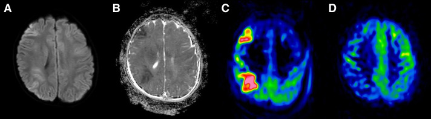
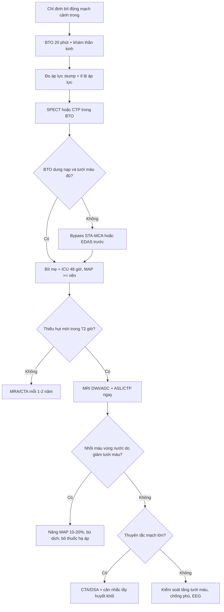
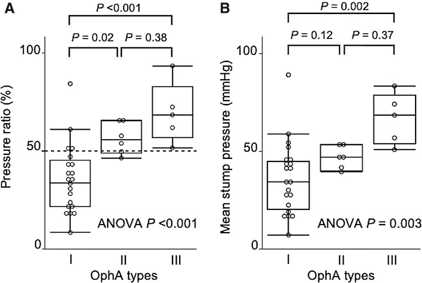
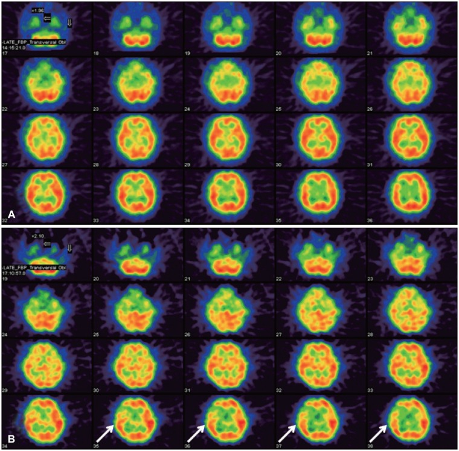
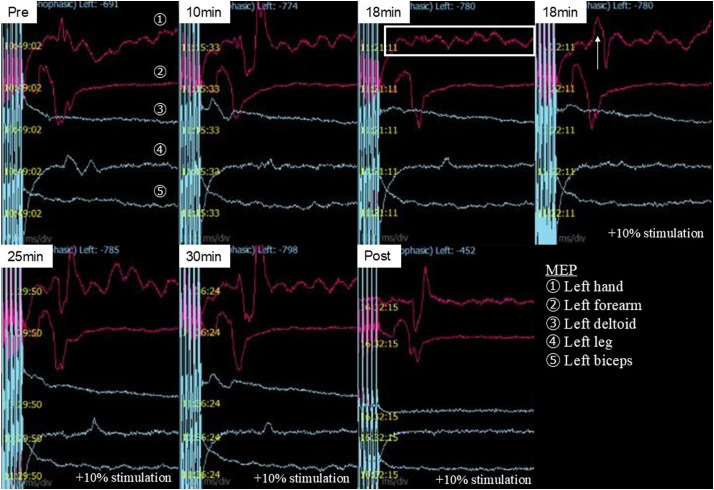

# 3059 — Thiếu máu não sau bít động mạch cảnh trong: BTO âm vẫn đột quỵ, hội chứng thiếu máu bán cầu và khi nào mở bypass

**Tags:** `pattern:thieu-mau-nao` `pattern:nhoi-mau-vung-nuoc` `pattern:hep-mach-canh` `pattern:luxury-perfusion` `pattern:gia-phinh` `vung:dong-mach-canh-trong` `vung:ban-cau-dai-nao` `vung:o-mach-nao` `protocol:BTO` `protocol:SPECT` `protocol:CT-tuoi-mau` `protocol:DSA` `protocol:MRI-ASL` `score:BTO-stump-pressure`
**Mức chắc chắn (certainty):** tổng hợp y văn (literature synthesis) — ghép **ca bé trai 9 tuổi phình động mạch cảnh trong hình rắn khổng lồ 39 mm, bít mẹ sau BTO có theo dõi MEP/SEP, nhồi máu vùng nước ngày 1 dù MEP ổn định** (Journal of Neuroendovascular Therapy 2026, PMC12983365), **32 lần BTO với phân tích dòng động mạch mắt và áp lực stump** (Neurologia Medico-Chirurgica 2021, PMC8280328), **ca nam 23 tuổi giả phình động mạch cảnh trong đoạn đá, SPECT trong BTO bất đối xứng 21% → STA–MCA rồi bít mẹ, 8 năm không triệu chứng** (Korean Journal of Neurotrauma 2015, PMC4847521), **tổng quan 31 bài về tổn thương ICA trong mổ nội soi qua xoang bướm, dẫn số liệu Linskey** (Surgical Neurology International 2020, PMC7656006), **7 ca bắc cầu STA–MCA hai nhánh + bít mẹ nội mạch** (Acta Neurochirurgica 2026, PMC12996001), **ca bít mẹ động mạch não sau có PCoA thể thai nhi gây nhồi máu đồi thị–thái dương–chẩm** (Cureus 2026, PMC13229448) và **21 ca mô phỏng BTO bằng động học dòng chảy (CFD)** (Surgical Neurology International 2021, PMC8422534). Số liệu không lấy từ một ca đơn lẻ; chỗ nào là suy luận sinh lý đều ghi rõ.

> **Câu hỏi thực hành:** bé trai **9 tuổi**, giảm thị lực mắt phải (0,15 so với 1,2 mắt trái), chụp mạch thấy **phình hình rắn khổng lồ 39 mm** từ đoạn hang đến tận cùng động mạch cảnh trong phải; các nhánh mắt và mạch mạc trước **không còn thấy** trên chụp mạch.
> Câu hỏi: **có dám bít mẹ không? BTO âm (dung nạp) có đủ bảo đảm? nếu sau bít trẻ yếu tay thì xử trí thế nào — nâng huyết áp, chờ, hay mở bypass? và tại sao MEP vẫn ổn định mà vẫn có nhồi máu?**
> Bài chốt **năm việc**: **(1) BTO là phép thử ngắn hạn, không phải giấy bảo đảm — bít mẹ đột ngột sau BTO âm vẫn có tới 26% đột quỵ và 12% tử vong; (2) phải đo cả áp lực stump và hình thái tuần hoàn bàng hệ (dòng động mạch mắt type I–III) chứ không chỉ hỏi "bệnh nhân có yếu không"; (3) thiếu máu sau bít thường là giảm tưới máu, không phải huyết khối — điều trị là nâng huyết áp và bù thể tích, không phải tiêu sợi huyết; (4) nhồi máu vùng nước có thể xuất hiện dù theo dõi điện sinh lý ổn định; (5) sau bít phải theo dõi dài hạn vì phình mới hình thành tới 20%.**

## 1. Tổng quan bệnh học – cơ chế hình ảnh: tại sao "bít mẹ thành công" vẫn thiếu máu

- **Sinh lý nền:** lưu lượng máu não **CBF = CPP / CVR** (áp lực tưới máu chia sức cản mạch não). Sau khi bít một động mạch cảnh trong, bán cầu cùng bên sống nhờ **tuần hoàn bàng hệ**: **động mạch thông trước (ACom)** cho vùng động mạch não trước, **động mạch thông sau (PCom)** và **tuần hoàn màng mềm (leptomeningeal)** cho vùng động mạch não giữa. Khi bàng hệ chỉ **vừa đủ ở huyết áp nghỉ**, bán cầu trở nên **phụ thuộc áp lực (pressure-passive)**: tụt huyết áp nhẹ, mất nước, thiếu máu, thở máy làm giảm CO₂, hoặc ngồi dậy đầu cao đều đủ gây nhồi máu.
- **TẠI SAO vùng nước là nơi chết trước:** vùng nước (watershed) là **bãi tưới xa nhất** của hai lãnh thổ mạch — áp lực tưới ở đó thấp nhất ngay cả khi bình thường. Vì vậy khi cả hệ thống tụt áp lực, tổn thương xuất hiện **dải hình nêm giữa hai lãnh thổ** (ACA–MCA hoặc MCA–PCA), không theo một lãnh thổ duy nhất — đây là dấu hiệu hình ảnh phân biệt với **nhồi máu do huyết khối/tắc mạch**.
- **TẠI SAO BTO âm vẫn đột quỵ — bằng chứng định lượng:** trong tổng quan về tổn thương ICA, **bít ICA đột ngột sau BTO âm có đột quỵ tới 26% và tử vong 12%** (số liệu Linskey dẫn trong PMC7656006); ngay cả khi đã chọn bệnh nhân bằng BTO, **đột quỵ muộn sau BTO là 5–10%** và **4,7% để lại di chứng vĩnh viễn**. Lý do: BTO chỉ thử **10–30 phút, ở huyết áp nghỉ, khi bệnh nhân nằm yên** — nó không thử được **đêm tụt áp, mất nước, thiếu máu, nhiễm trùng, hay tắc một nhánh xuyên nhỏ**.
- **TẠI SAO BTO có thể dương tính giả/dương tính thật khó phân định:** BTO kéo dài chính là yếu tố nguy cơ **thuyên tắc do ống thông/bóng**, với biến chứng **0,8–6,0%** (PMC8280328). Một "yếu tay thoáng qua" trong BTO có thể là **thuyên tắc nhỏ**, không phải "không dung nạp" — và ngược lại, bệnh nhân dung nạp BTO vẫn có thể có **nhánh xuyên bị bít** khi thả coil vào túi phình.
- **TẠI SAO dòng động mạch mắt (OphA) lại là dấu hiệu bàng hệ:** khi kẹp ICA, nếu **OphA chảy ngược tới tận động mạch não giữa (type I)** thì bàng hệ kém; nếu **không có dòng ngược (type III)** thì bàng hệ đã đủ tốt. Trong 32 lần BTO (PMC8280328): **dung nạp chỉ 19,0% (4/21) ở type I, 66,7% (4/6) ở type II và 100% (5/5) ở type III**; **áp lực stump trung bình 36,2 ± 3,6 / 46,6 ± 6,7 / 66,6 ± 7,3 mmHg**; **tỉ lệ áp lực 35,6% / 56,4% / 69,4%** (p < 0,001). Đây là các con số dùng để **đọc BTO có định lượng**, thay vì chỉ nghe bệnh nhân nói.
- **TẠI SAO SPECT/CT tưới máu bổ sung cho BTO:** BTO chỉ nói "có chịu được 20 phút không"; tưới máu nói "mức dự trữ còn bao nhiêu". Ca 23 tuổi (PMC4847521): SPECT với **99mTc-ECD liều kép trong lúc BTO** cho **bất đối xứng 21% ở vỏ trán phải** → **mở STA–MCA trước rồi mới bít mẹ**, 8 năm không triệu chứng. Mô phỏng CFD trên 21 ca (PMC8422534) cho thấy **lưu lượng MCA < 126,2 mL/phút** và **ứng suất trượt thành mạch (WSS) < 4,54 Pa** tương ứng nhóm bàng hệ kém — hướng tới ngưỡng định lượng không xâm lấn trong tương lai.
- **TẠI SAO MEP ổn định mà vẫn nhồi máu:** theo dõi **MEP/SEP** chỉ phản ánh **đường vận động–cảm giác chính**, không phản ánh **vùng nước phía trước** hay **nhánh xuyên đồi thị**. Ca 9 tuổi (PMC12983365): MEP giảm thoáng qua ở **phút 18**, hồi phục khi **tăng cường độ kích thích 10%**, ổn định đến hết 30 phút và sau bít; **ngày 1 sau bít trẻ yếu nhẹ tay trái**, MRI có **nhồi máu vùng nước trán–đỉnh phải** với **ADC giảm**, và **ASL ngày 1 tăng tưới máu (luxury perfusion)** rồi hết ở **ngày 8**. Kết luận: **theo dõi điện sinh lý không thay thế được khám tỉnh**.
- **Ngưỡng và con số phải thuộc:**
  - **BTO âm + bít đột ngột:** đột quỵ **tới 26%**, tử vong **12%** (PMC7656006).
  - **Đột quỵ muộn sau BTO:** **5–10%**; di chứng vĩnh viễn **4,7%** (PMC7656006).
  - **Biến chứng của chính BTO:** **0,8–6,0%** (PMC8280328).
  - **Áp lực stump:** **36,2 / 46,6 / 66,6 mmHg** theo OphA type I/II/III; **tỉ lệ áp lực 35,6% / 56,4% / 69,4%** (PMC8280328).
  - **SPECT bất đối xứng 21%** = ngưỡng đã đủ để mở bypass trước khi bít (PMC4847521).
  - **CFD:** lưu lượng MCA **126,2 mL/phút**, WSS **4,54 Pa** (PMC8422534).
  - **Phình mới sau bít mẹ: tới 20%** do thay đổi ứng suất thành mạch (PMC7656006).
  - **Bắc cầu STA–MCA hai nhánh + bít mẹ:** 7 ca, **kín túi phình 100%**, **cầu nối thông 100%**, không di chứng vĩnh viễn, **1 ca yếu nửa người thoáng qua** (PMC12996001).

*Bé trai 9 tuổi, phình hình rắn khổng lồ 39 mm của động mạch cảnh trong phải, bít mẹ sau BTO có MEP/SEP. Ngày 1 sau bít: **(A)** DWI có **ổ tăng tín hiệu dạng dải ở vùng nước trán–đỉnh phải** (giữa lãnh thổ động mạch não trước và giữa); **(B)** ADC giảm — nhồi máu thật, không phải phù; **(C)** ASL ngày 1 **tăng tưới máu phản ứng (luxury perfusion)**; **(D)** ASL ngày 8 đã về bình thường. Trẻ yếu nhẹ tay trái ngày 1 rồi hồi phục, ra viện ngày 10 không di chứng mới. Nguồn: Journal of Neuroendovascular Therapy 2026 (PMC12983365), **CC BY-NC 4.0** — nguyên bản.*

## 2. Mẫu hình + chẩn đoán phân biệt theo vị trí và theo thời điểm (gamut)

- **Nguyên tắc:** sau bít mẹ, mọi thiếu hụt thần kinh mới phải được phân loại theo **hai trục**: **thời điểm** (trong thủ thuật / 24–72 giờ / 1–4 tuần) và **vị trí** (vùng nước / lãnh thổ / nhánh xuyên / mắt).
- **Theo thời điểm:**
  - **Trong thủ thuật:** thuyên tắc do coil/ống thông, bít nhánh xuyên, bóc tách do bóng, co thắt mạch; thường **không hồi phục khi rút dụng cụ**.
  - **24–72 giờ:** **giảm tưới máu** (tụt áp, mất nước, thiếu máu, đau, thuốc an thần), **tăng tưới máu (luxury/hyperperfusion)**, cơn động kinh, đau nửa đầu.
  - **1–4 tuần:** giảm tưới máu muộn do hạ huyết áp kéo dài; huyết khối muộn ở túi phình đã bít; **phình mới** (muộn hơn, nhiều tháng–năm).
- **Theo vị trí:**
  - **Vùng nước (watershed):** dải hình nêm giữa ACA–MCA (mặt ngoài bán cầu) hoặc MCA–PCA (chẩm–thái dương); **nguyên nhân giảm tưới máu**.
  - **Lãnh thổ:** một vùng trọn vẹn của MCA/ACA → nghĩ **thuyên tắc** (coil trôi, huyết khối từ túi phình, mảng xơ).
  - **Nhánh xuyên:** đồi thị, nhân bèo, bao trong, mạch mạc trước → **bít nhánh** hoặc bệnh mạch nhỏ; đây là nơi BTO **không dò tới**.
  - **Mắt:** giảm thị lực do **bít động mạch mắt/mạch mạc trước** — trong phình ICA lớn, nhánh này có thể đã bị túi phình "nuốt" trước khi bít.
- **Theo cơ chế (mnemonic "H-I-P"):**
  - **H**ypoperfusion — giảm tưới máu, đáp ứng với nâng huyết áp.
  - **I**nfarct embolic — tắc mạch, cần chụp mạch và có thể lấy huyết khối (nếu trong cửa sổ).
  - **P**erfusion excess — luxury perfusion/hyperperfusion, đáp ứng với kiểm soát huyết áp, không dùng vận mạch.

## 3. Bảng so sánh phân biệt (ma trận đối chiếu)

| Thực thể | Hình ảnh điển hình | Chốt vào (rule-in) | Chốt loại (rule-out) | Gợi ý xác nhận |
|---|---|---|---|---|
| **Giảm tưới máu sau bít mẹ (hypoperfusion)** | DWI **dải vùng nước** giữa hai lãnh thổ; ADC giảm; CTP **MTT/Tmax tăng, CBF giảm** đối xứng vùng nước | **Thiếu hụt xuất hiện khi huyết áp tụt/mất nước + hình ảnh vùng nước + hồi phục một phần khi nâng huyết áp** | **Tắc một thân mạch lớn** trên CTA/DSA, ổ nhồi máu trọn lãnh thổ | CTP/ASL, theo dõi huyết áp liên tục |
| **Thuyên tắc (coil/huyết khối)** | Ổ nhồi máu **trọn lãnh thổ** hoặc nhiều ổ rải rác; CTA thấy **mất đoạn mạch** | **Khuyết mạch trên CTA/DSA** + thiếu hụt đột ngột ngay trong/ sau thủ thuật | Hình ảnh vùng nước + mạch thông + huyết áp thấp | DSA cấp cứu; cân nhắc lấy huyết khối |
| **Luxury perfusion (tăng tưới máu phản ứng)** | **ASL/CTP tăng CBF** ở vùng vừa thiếu máu, **không có ổ nhồi máu mới**, thường không triệu chứng hoặc triệu chứng nhẹ | **Tăng tưới máu trên ASL ngày 1–3 sau bít + không có DWI mới** | DWI mới tương ứng vùng tăng tưới máu → nghĩ nhồi máu/tái thông | ASL, CTP, theo dõi lâm sàng |
| **Hội chứng tăng tưới máu (hyperperfusion syndrome)** | Phù não khu trú, **xuất huyết** trong vùng tái thông, đau đầu dữ dội, co giật, huyết áp rất cao | **Huyết áp tăng > 20–25% so với nền + đau đầu/co giật/phù/xuất huyết** | ASL tăng nhưng không phù/xuất huyết, không triệu chứng | MRI + theo dõi huyết áp |
| **Cơn động kinh / liệt Todd sau bít** | Không có ổ nhồi máu mới trên DWI; EEG có hoạt động động kinh | **EEG có cơn + hồi phục hoàn toàn sau kiểm soát cơn** | DWI có ổ nhồi máu mới → không phải Todd đơn thuần | EEG, MRI lặp lại |
| **Bít nhánh xuyên / nhồi máu đồi thị–bao trong** | Ổ nhồi máu **nhỏ, sâu** ở đồi thị/nhân bèo/bao trong, có thể **không thấy trên CT** | **Thiếu hụt vận động–cảm giác thuần túy sâu + DWI ổ nhỏ** | Vùng nước vỏ não, không có tổn thương sâu | MRI DWI lát mỏng, đối chiếu giải phẫu nhánh |
| **Phình mới (de novo) sau bít mẹ** | Phình mới ở **tuần hoàn bàng hệ** (ACom, PCom, tuần hoàn trước), thường sau nhiều tháng–năm | **Phình mới trên MRA/CTA theo dõi + tăng ứng suất dòng chảy** | Không có phình mới, mạch bàng hệ ổn định | MRA/CTA mỗi 1–2 năm |

- **Ảnh ghép đối chiếu:** bài dùng **4 ảnh rời của 3 bối cảnh khác nhau** (MRI sau bít mẹ ở trẻ; SPECT trong BTO ở người lớn; biểu đồ áp lực stump theo type OphA; theo dõi MEP trong BTO) — **không ghép** vì ghép sẽ khiến người đọc tưởng cùng một ca (lý do ghi trong `images/CREDITS.md`).

## 4. Protocol: BTO có định lượng, theo dõi sau bít, ngưỡng mở bypass

- **Trước bít mẹ — BTO phải trả lời 3 câu, không chỉ 1:**
  1. **Lâm sàng:** khám thần kinh **mỗi 5 phút** trong **20 phút** kẹp bóng (ý thức, lời nói, sức cầm nắm, gấp–duỗi cổ chân); nếu bệnh nhân không hợp tác/đang mê → **EEG, MEP/SEP** thay thế, nhưng phải hiểu **giới hạn** (ca 9 tuổi).
  2. **Huyết động:** đo **áp lực stump** và **tỉ lệ áp lực** (áp lực đầu xa / áp lực hệ thống). Đối chiếu: type OphA I–III cho **36,2 / 46,6 / 66,6 mmHg** và **35,6% / 56,4% / 69,4%** (PMC8280328). Ngưỡng thường dùng để coi là "dung nạp" là **áp lực stump > 50 mmHg hoặc tỉ lệ > 60%**, nhưng **không có ngưỡng nào thay thế được đánh giá tổng hợp** (suy luận từ phân bố số liệu).
  3. **Tưới máu:** **SPECT/CT tưới máu trong BTO** (liều kép, cùng ngày) hoặc **CTP**; bất đối xứng **≥ 20%** là dấu hiệu dự trữ kém — ca 23 tuổi với **21%** đã được **mở STA–MCA trước** (PMC4847521). CTP/CFD: **MTT/Tmax tăng**, **lưu lượng MCA < 126,2 mL/phút** gợi ý bàng hệ kém (PMC8422534).
- **Quyết định:**
  - **BTO dung nạp + tưới máu đủ + bệnh nhân tỉnh, hợp tác** → có thể **bít mẹ** (coil, bóng, plug) và theo dõi sát.
  - **BTO không dung nạp, hoặc tưới máu giảm đáng kể** → **mở bypass trước** (STA–MCA một hoặc hai nhánh; EDAS ở trẻ/moyamoya) rồi mới bít; không bít "thử rồi tính".
  - **BTO không làm được (trẻ nhỏ, mê, không hợp tác)** → dựa vào **đa phương thức**: áp lực stump, chụp bàng hệ, CTP/SPECT, MEP/SEP; nếu còn nghi ngờ → **mở bypass** thay vì liều.
- **Sau bít mẹ — "giờ vàng" 72 giờ:**
  - **ICU 24–48 giờ**, khám thần kinh **mỗi 1–2 giờ**; **đích huyết áp trung bình ≥ mức nền**, tránh tụt **> 10–20%**; **không dùng thuốc hạ áp mạnh** trong 72 giờ đầu.
  - **Bù đủ thể tích**, điều chỉnh thiếu máu (Hb), tránh **giảm CO₂** (thở máy), tránh **đầu cao > 30°** khi đang nghi giảm tưới máu; kiểm soát đau, sốt, đường huyết.
  - **Nếu thiếu hụt mới:** **MRI DWI/ADC + ASL/CTP** ngay; nếu là **giảm tưới máu** → **nâng huyết áp có kiểm soát** (vận mạch + bù dịch, đích MAP cao hơn nền **10–20%**), **không tiêu sợi huyết**; nếu là **thuyên tắc** → CTA/DSA và cân nhắc lấy huyết khối.
  - **Hội chứng tăng tưới máu:** đau đầu dữ dội, co giật, huyết áp tăng cao, phù/xuất huyết trên MRI → **kiểm soát huyết áp chặt**, chống phù não, theo dõi sát.
- **Theo dõi dài hạn:** MRA/CTA **mỗi 1–2 năm** (phình mới tới **20%**); khám thần kinh + mạch máu mỗi năm; **không lái xe/vận động mạnh** theo quy định sau can thiệp mạch não.

*32 lần BTO động mạch cảnh trong. **(A)** Tỉ lệ áp lực (áp lực đầu xa / áp lực hệ thống): type I **35,6%**, type II **56,4%**, type III **69,4%** (ANOVA p < 0,001). **(B)** Áp lực stump: **36,2 / 46,6 / 66,6 mmHg** (p = 0,003). Dung nạp BTO: **19,0% / 66,7% / 100%**. Đường đứt nét 50% trên hình A là mốc tham chiếu hay dùng. Nguồn: Neurologia Medico-Chirurgica 2021 (PMC8280328), **CC BY-NC-ND 4.0** — nguyên bản.*

## 5. Biến thể bình thường và cạm bẫy

- **Tụt huyết áp trên giường bệnh là nguyên nhân số 1:** bệnh nhân "ổn" ở phòng hồi tỉnh, rồi **ngủ dậy đi vệ sinh, ăn uống kém, dùng thuốc hạ áp cũ** → nhồi máu vùng nước. Mọi thiếu hụt mới sau bít phải **đo huyết áp trước khi gọi "tai biến không rõ nguyên nhân"**.
- **MEP/SEP ổn định không loại trừ nhồi máu:** ca 9 tuổi có MEP hồi phục hoàn toàn nhưng vẫn nhồi máu vùng nước (PMC12983365). Theo dõi điện sinh lý là **bổ trợ**, không phải chốt an toàn.
- **ASL tăng tưới máu không phải "tái thông tốt":** đó là **luxury perfusion** phản ứng sau thiếu máu; đừng nhầm với hội chứng tăng tưới máu (có phù/xuất huyết, đau đầu, co giật) và đừng cắt thuốc/đổi hướng điều trị chỉ vì ASL đỏ.
- **"Thiếu máu sau bít = huyết khối" là bẫy chết người:** nếu không có tắc mạch trên CTA/DSA, **tiêu sợi huyết không giúp** mà còn gây chảy máu trong ổ vừa can thiệp. Điều trị đúng là **nâng áp lực tưới**.
- **Không khám được trong BTO:** trẻ nhỏ/mê → BTO dưới gây mê chỉ là **một phần** của quyết định; ca 9 tuổi cho thấy **BTO dưới gây mê với MEP nên được coi là bổ trợ, chỉ dùng khi không có cách khác** (kết luận của chính bài).
- **Nhánh xuyên bị "nuốt":** trong phình ICA lớn/hình rắn, các nhánh như **mạch mạc trước, động mạch mắt** có thể đã mất tưới máu từ trước; bít mẹ không tạo thêm tổn thương nhưng **không phục hồi được thị lực** — cần giải thích trước can thiệp.
- **BTO một lần không đại diện cho tương lai:** bàng hệ có thể thay đổi theo tuổi, xơ vữa, huyết áp; bệnh nhân bít mẹ cần **theo dõi mạch dài hạn**, đặc biệt khi có **tăng huyết áp mới** hoặc **đau đầu thay đổi**.
- **Satisfaction of search:** thấy ổ nhồi máu vùng nước rồi dừng → bỏ sót **bít nhánh xuyên đồi thị** (thiếu hụt sâu, ổ nhỏ) và **phình mới** ở tuần hoàn bàng hệ.

## 6. Tự lượng giá — Blind Quiz

**Ca 1 — Bé trai 9 tuổi, phình ICA phải 39 mm, bít mẹ sau BTO. Ngày 1 yếu nhẹ tay trái.**

- Gợi ý: MEP giảm thoáng qua phút 18 của BTO rồi hồi phục khi tăng 10% cường độ; sau bít MEP/SEP không đổi.
- Câu hỏi: (1) Ổ tổn thương ở đâu, có phải nhồi máu thật? (2) Vì sao MEP ổn định mà vẫn yếu? (3) ASL ngày 1 đỏ nghĩa là gì?

<b>Bấm để hiện đáp án</b>

- **(A)** DWI dải tăng tín hiệu **vùng nước trán–đỉnh phải**; **(B)** ADC giảm → **nhồi máu thật**, không phải phù.
- **(C)** ASL ngày 1 **tăng tưới máu phản ứng (luxury perfusion)**; **(D)** ngày 8 về bình thường. Trẻ hồi phục, ra viện ngày 10.
- MEP chỉ theo dõi đường vận động chính, **không phủ vùng nước** — đây là **giới hạn của theo dõi điện sinh lý**, không phải "BTO sai".
- Bài học: sau bít mẹ, **khám thần kinh + huyết áp** quan trọng hơn màn hình MEP.
- Nguồn: Journal of Neuroendovascular Therapy 2026 (PMC12983365), CC BY-NC 4.0.

**Ca 2 — Nam 23 tuổi, giả phình động mạch cảnh trong đoạn đá sau chấn thương, đang hôn mê. Làm sao chọn bít mẹ hay bypass?**

- Gợi ý: bệnh nhân **GCS 5T**, không khám thần kinh được; túi giả phình **10 × 6 mm** tăng kích thước sau 3 ngày.
- Câu hỏi: (1) SPECT trong BTO cho thấy gì? (2) Ngưỡng nào khiến phải mở bypass? (3) Thứ tự can thiệp?

<b>Bấm để hiện đáp án</b>

- **(A)** SPECT trước kẹp bóng; **(B)** SPECT trong BTO: **bất đối xứng 21% ở vỏ trán phải** (mũi tên) — dự trữ tưới máu không đủ.
- Vì **không khám được** (hôn mê), quyết định dựa vào **tưới máu**: mở **STA–MCA trước**, sau đó **bít mẹ (trapping)**.
- Bệnh nhân hồi phục ý thức, trở lại sinh hoạt bình thường; **8 năm không triệu chứng mới**.
- Bài học: khi không thể khám tỉnh, **SPECT/CTP trong BTO là "mắt" thay thế** — và ngưỡng thực hành là **bất đối xứng ≥ 20%**.
- Nguồn: Korean Journal of Neurotrauma 2015 (PMC4847521), CC BY-NC.

**Ca 3 — Bệnh nhân 60 tuổi, bít ICA phải vì phình hang; BTO "dung nạp". Đêm thứ hai tụt huyết áp còn 85/50, sáng ra yếu nửa người trái.**

- Gợi ý: không sốt, không đau ngực, mạch đều; CTA không thấy tắc thân mạch lớn.
- Câu hỏi: (1) Cơ chế thiếu máu khả năng nhất? (2) Điều trị đầu tay? (3) Vì sao "BTO dung nạp" vẫn xảy ra?

<b>Bấm để hiện đáp án</b>

- Hình ảnh điển hình sẽ là **dải nhồi máu vùng nước** giữa ACA–MCA; CTA không tắc thân mạch → **giảm tưới máu**, không phải thuyên tắc.
- Điều trị: **nâng MAP 10–20% so với nền** bằng dịch + vận mạch, **bỏ thuốc hạ áp**, sửa thiếu máu/mất nước; **không tiêu sợi huyết**; MRI DWI/ADC + ASL/CTP để xác nhận.
- BTO chỉ thử **20 phút ở huyết áp nghỉ**; đêm tụt áp là điều kiện **chưa từng được thử**. Đây là lý do **đột quỵ muộn sau BTO vẫn 5–10%** và **bít sau BTO âm vẫn tới 26% đột quỵ** (PMC7656006).
- Hình minh họa: **type OphA I** có tỉ lệ áp lực **35,6%** và chỉ **19% dung nạp** — nếu bệnh nhân này thuộc type I, nguy cơ càng cao dù "khám thấy ổn" trong 20 phút.
- Bài học: **theo dõi huyết áp sau bít là một phần của can thiệp**, không phải việc của điều dưỡng.

**Ca 4 — Trong BTO, MEP giảm ở phút 18 rồi hồi phục khi tăng cường độ kích thích 10%. Có được coi là "dung nạp" không?**

- Gợi ý: 5 kênh MEP (bàn tay, cẳng tay, cơ delta, chân, cơ nhị đầu trái); SEP ổn định.
- Câu hỏi: (1) MEP giảm thoáng qua nghĩa là gì? (2) Có nên tiếp tục bít? (3) Cần bổ sung gì?

<b>Bấm để hiện đáp án</b>

- MEP giảm ở **phút 18** nhưng **hồi phục hoàn toàn khi tăng cường độ 10%**, không giảm lại ở phút 25–30 → **không đủ để kết luận không dung nạp**, nhưng cũng **không phải "bình thường"**.
- Trong ca thật, bít mẹ vẫn được thực hiện và trẻ có **nhồi máu vùng nước ngày 1** — chứng tỏ **MEP không phủ vùng nước**.
- Cần bổ sung: **SPECT/CTP trong BTO**, **áp lực stump**, và nếu còn nghi ngờ → **mở bypass trước** thay vì bít.
- Bài học: **một tín hiệu điện sinh lý hồi phục không thay thế được đánh giá tưới máu**.
- Nguồn: Journal of Neuroendovascular Therapy 2026 (PMC12983365), CC BY-NC 4.0.

## Bài liên quan chéo
- [3050 – Tổn thương động mạch cảnh trong trong mổ nội soi](../3050-ton-thuong-dong-mach-canh-trong-trong-mo-noi-soi/lesson.md) (bít mẹ khi không giữ được mẹ; BTO âm không phải giấy bảo đảm)
- [249 – Rò động mạch cảnh–xoang hang chấn thương](../249-ro-dong-mach-canh-xoang-hang-chan-thuong/lesson.md) (bít mẹ/bóng trong chấn thương mạch cảnh)
- [211 – Đột quỵ não](../211-dot-quy-nao/lesson.md) (nhồi máu vùng nước vs lãnh thổ)
- [262 – Bệnh mạch máu lớn do xạ trị (moyamoya)](../262-benh-mach-mau-lon-do-xa-tri-moyamoya/lesson.md) (hẹp ICA–MCA mạn, bypass/EDAS)
- [200 – Tổng quan hệ Thần kinh](../200-tong-quan-he-than-kinh/lesson.md)

## Ảnh
- `images/3059_thieu-mau-sau-bit-ICA_MRI_PMC12983365-F4.jpg` — DWI/ADC/ASL sau bít mẹ (PMC12983365, CC BY-NC 4.0).
- `images/3059_thieu-mau-sau-bit-ICA_SPECT_PMC4847521-F3.jpg` — SPECT trước/trong BTO (PMC4847521, CC BY-NC).
- `images/3059_thieu-mau-sau-bit-ICA_BieuDo_PMC8280328-F2.jpg` — áp lực stump và tỉ lệ áp lực theo type OphA (PMC8280328, CC BY-NC-ND 4.0).
- `images/3059_thieu-mau-sau-bit-ICA_MEP_PMC12983365-F3.jpg` — diễn tiến MEP trong BTO (PMC12983365, CC BY-NC 4.0).
- Nguồn + giấy phép từng ảnh: `images/CREDITS.md`.

> Không dùng để chẩn đoán độc lập khi chưa có người hướng dẫn.
