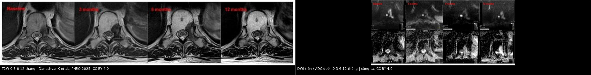
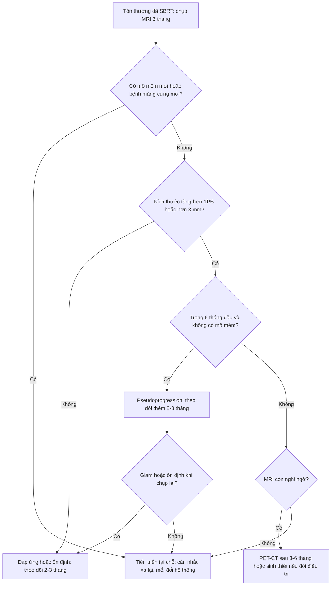
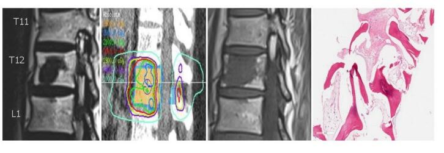
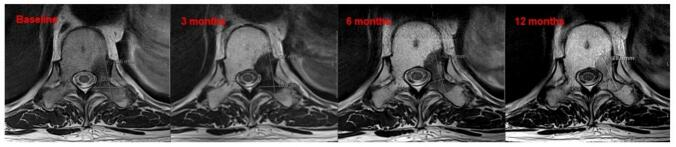
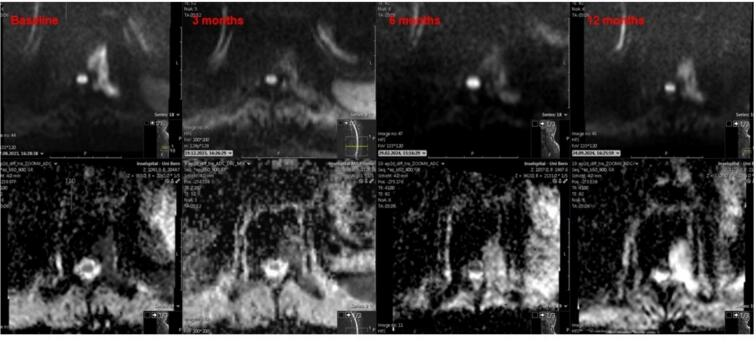
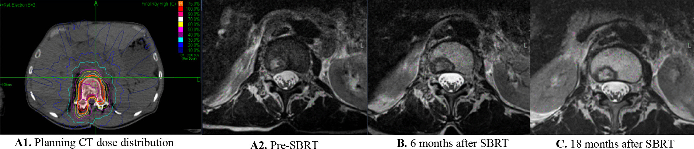

# 306 — Theo dõi sau SBRT & separation surgery di căn xương RCC: lành hóa xương vs tái phát / Post-SBRT imaging of RCC bone metastases: osteoblastic healing versus local progression

**Tags:** `pattern:di-can-xuong` `pattern:lanh-hoa-xuong` `pattern:pseudoprogression` `pattern:chen-ep-tuy` `vung:xuong` `vung:cot-song` `score:SPINO` `score:SINS` `score:Bilsky` `score:RECIST` `protocol:MRI-cot-song` `protocol:CT-xuong` `protocol:SBRT` `incidentaloma:di-can-xuong`
**Mức chắc chắn (certainty):** tổng hợp y văn (literature synthesis) — tổng quan có hệ thống về MRI sau SBRT cột sống (Daneshvar K et al., PHRO 2025, PMC12517103), nghiên cứu response assessment (Correia D et al., Radiat Oncol 2022, PMC8862557) và tổng quan điều trị di căn cột sống 2025 (PMC12565418); số liệu pseudoprogression lấy từ các nghiên cứu được trích trong tổng quan, không phải ca nguyên văn của nhóm.

> **Câu chốt của bài:** sau SBRT, **đặc xương/Canxi hóa mới trong tổn thương là lành hóa (healing), KHÔNG phải tiến triển**, và **tăng tín hiệu T2 thoáng qua có thể là pseudoprogression** — đặc biệt ở RCC, khung pseudoprogression kéo dài tới **106–504 ngày**. Chỉ gọi tiến triển khi có **tăng thể tích thật (≥ 11% hoặc > 3 mm), mô mềm mới, hoặc bệnh màng cứng mới/tiến triển**. Điều trị sai hướng ở đây là **xạ lại một tổn thương đang lành** hoặc **bỏ sót tái phát màng cứng**.

## 1. Tổng quan bệnh học – cơ chế hình ảnh

- **Vì sao RCC hay di căn xương và hay tiêu xương:** RCC tăng sinh mạch, tiết yếu tố hoạt hóa hủy cốt bào (RANKL, PTHrP) → ổ tiêu xương (lytic), giàu máu, dễ chảy máu khi sinh thiết/mổ. Đây là lý do RCC được xếp vào nhóm **"kháng xạ" (radioresistant)** trong khung NOMS, cùng melanoma và sarcoma; với tổn thương chèn ép tủy, chiến lược là **separation surgery + SBRT** chứ không chỉ xạ thường quy.
- **Vật lý tín hiệu — vì sao phải đọc T1 trước tiên:**
  - Tủy vàng trưởng thành chứa **~80% mỡ**, nên **T1W luôn sáng hơn cơ và đĩa đệm**. Tế bào u thay thế tủy → **T1W tối**, bờ tổn thương nổi trên nền tủy sáng.
  - Sau xạ, mô u hoại tử → **phù/viêm (T2 tăng, T1 giảm)** rồi **xơ hóa (T2 giảm)** và **tái tạo xương (đặc xương trên CT)**. Mỡ lành thay thế u tạo **PIFAT (post-treatment intralesional fatty content)** — vùng **T1 tăng tín hiệu** trong tổn thương đã xạ, là dấu hiệu **đáp ứng tốt**, không phải u mỡ.
  - Trên CT, lành hóa xương = **tăng đậm độ/xơ đặc, dày vỏ, bờ xơ hóa**; mô u sống = **vùng tiêu xương mới, phá vỏ, mô mềm**.
- **DWI/ADC:** u đặc bào → **DWI sáng, ADC thấp**. Sau xạ hiệu quả, hạn chế khuếch tán **giảm sau ~3 tháng**, ADC tăng. Tuy nhiên sau **12 tháng** có thể xuất hiện **"shine-through"** trên DWI (tín hiệu sáng do hiệu ứng T2, không phải u) — **luôn đối chiếu ADC**, không đọc DWI đơn độc.
- **Ngưỡng định lượng cốt lõi:**
  - Thể tích: **MDD (minimum detectable difference) ~11%** (chính xác 10,9%) trên MRI T1 sagittal; tổn thương nhỏ cần ngưỡng lớn hơn **37,2–71,3%** mới phát hiện được thay đổi thật.
  - Tăng **> 3 mm** hoặc **diện tích tăng 1,67 lần** gợi ý tiến triển, độ nhạy/độ đặc hiệu **> 89%**.
  - **Pseudoprogression (PP):** gặp **14%** tổn thương sau SBRT (đặc biệt sau **một phân liều**, Amini), **37%** ở di căn cột sống, nhiều hơn ở tổn thương **tiêu xương**; khởi phát **9,7–24,4 tuần**, tự thoái triển. Riêng **RCC: 106–504 ngày**; prostate: **183–296 ngày**.
  - **Phân bố tín hiệu T2 sau SBRT (Correia):** không đổi **2,3%**, tăng đồng nhất **7%**, **tăng lẫn vùng tối 60,5%**, **tối hoàn toàn 30,2%** — hai kiểu sau (tăng lẫn tối, hoặc tối hoàn toàn) đi với **kiểm soát tại chỗ tốt**.
  - **Thời điểm chụp:** MRI lần đầu **3 tháng**, sau đó **mỗi 2–3 tháng trong 12–18 tháng**, rồi **mỗi 3–6 tháng**.
- **Sau separation surgery:** mục tiêu là tạo **khoảng đệm 360° quanh màng cứng** để SBRT đủ liều mà không vượt ngưỡng tủy. SBRT được đưa vào **2–4 tuần sau mổ** (với MISS, có thể **7–21 ngày**) khi vết mổ đủ lành; **trì hoãn > 6 tuần** làm giảm kiểm soát tại chỗ do u tái phát triển. Kiểm soát tại chỗ 1 năm của mô hình hybrid **85–95%**.

## 2. Mẫu hình + chẩn đoán phân biệt theo bối cảnh (Gamut)

- **Khuôn 1 — tổn thương đã xạ "đặc lên" trên CT:** **lành hóa xương** (đặc xương lan tỏa/viền, không mô mềm, kích thước giảm/ổn định) vs **di căn xương đặc (blastic metastasis)** của ung thư tuyến tiền liệt/vú (không phải RCC) vs **xơ hóa sau xạ** (T2 tối, ngấm chậm/ít) vs **giả tổn thương do xi măng/bơm xương** (bờ nhẵn, không phá vỏ).
- **Khuôn 2 — tổn thương "to lên" trong 6 tháng đầu:** **pseudoprogression** (tăng T2 lẫn tối, phù, không mô mềm mới, tự giảm) vs **tiến triển thật** (tăng > 3 mm/11%, mô mềm, phá vỏ) vs **gãy xẹp đốt sống (VCF)** (mất chiều cao, dòng gãy, không khối) vs **nhiễm trùng mổ/dụng cụ** (tụ dịch, ngấm viền, khí).
- **Khuôn 3 — tổn thương mới ở đốt khác:** **di căn mới** (ngoài trường xạ, T1 tối, DWI sáng) vs **di căn trong trường xạ chưa đủ liều** (bờ trường xạ) vs **tủy đỏ tái tạo** (T1 ≥ cơ, không phá xương) vs **đảo tín hiệu mỡ sau xạ**.
- **Khuôn 4 — đau tăng sau điều trị:** **gãy xẹp/không vững (SINS ≥ 13)** vs **tái phát màng cứng** (yếu chi, MRI thấy bệnh màng cứng) vs **bệnh thần kinh do xạ (radiation myelopathy)** (dải T2 sáng trong tủy, không khối) vs **đau cơ–khớp cơ học**.
- **Mnemonic "SINTER":** **S**clerosis (đặc xương = lành) — **I**ntralesional fat (mỡ trong tổn thương = lành) — **N**ew soft tissue (mô mềm mới = tiến triển) — **T**ransient T2 rise (tăng T2 thoáng qua = PP) — **E**pidural growth (bệnh màng cứng mới = tiến triển) — **R**ecalcify/respond (canxi hóa lại = đáp ứng).

## 3. Bảng so sánh phân biệt (ma trận đối chiếu)

| Thực thể (entity) | Hình ảnh điển hình (CT/MRI) | Chốt vào (rule-in) | Chốt loại (rule-out) | Gợi ý xác nhận |
|---|---|---|---|---|
| **Lành hóa xương sau SBRT** | Đặc xương/Canxi hóa mới trong tổn thương, dày vỏ, không mô mềm; T2 tối dần, T1 có thể tăng do mỡ | **Đặc xương mới + kích thước giảm/ổn định + không mô mềm** | **Tiêu xương mới, phá vỏ, mô mềm** → không phải lành hóa | CT xương + MRI T1/T2 cùng ngày; so phim trước xạ |
| **Pseudoprogression** | Tăng T2 lẫn vùng tối hoặc tối hoàn toàn; kích thước tăng nhẹ thoáng qua; phù quanh; không mô mềm ngoài xương | **Tăng trong 9,7–24,4 tuần (RCC tới 504 ngày) rồi giảm; không mô mềm; DWI/ADC không xấu đi** | **Tăng liên tục > 6 tháng + mô mềm mới** → tiến triển | MRI 2–3 tháng/lần; PET/CT hoặc sinh thiết nếu còn nghi |
| **Tiến triển tại chỗ** | Tăng thể tích > 11% hoặc > 3 mm; mô mềm mới; bệnh màng cứng mới/tiến triển; phá vỏ | **Mô mềm mới hoặc bệnh màng cứng mới + tăng kích thước** | Chỉ tăng tín hiệu T2 đơn thuần, không tăng kích thước/mô mềm | MRI T1 sagittal + T2 + DWI; PET/CT; sinh thiết có hướng dẫn |
| **Gãy xẹp đốt sống sau SBRT (VCF)** | Mất chiều cao đốt, dòng gãy ngang, phù tủy; không khối mô mềm; có thể hẹp ống sống do xẹp | **Mất chiều cao + dòng gãy + không mô mềm** | **Khối mô mềm sau thân đốt + phá vỏ** → tái phát | CT xương, MRI STIR; đo SINS |
| **Di căn mới ngoài trường xạ** | Tổn thương T1 tối mới ở đốt khác, DWI sáng/ADC thấp, phá xương | **Tổn thương mới ngoài vùng xạ + đặc điểm u** | Tủy đỏ tái tạo (T1 ≥ cơ, không phá xương) | MRI toàn cột sống; PET/CT |
| **Nhiễm trùng sau mổ/dụng cụ** | Tụ dịch quanh dụng cụ, khí, ngấm viền, phù mô mềm; sốt/CRP tăng | **Khí/tụ dịch + ngấm viền + hội chứng nhiễm** | Tụ dịch đơn thuần không ngấm, không sốt → seroma | CT cản quang, cấy, CRP; PET/CT có thể dương giả |
| **Bệnh tủy do xạ** | Dải T2 sáng trong tủy, khu trú trong trường xạ, không khối; yếu chi/liệt tiến triển sau nhiều tháng | **Dải T2 trong tủy + đúng trường xạ + không chèn ép** | **Khối ngoài tủy chèn ép** → tái phát | MRI tủy T2/STIR; loại trừ tái phát và di căn màng não |

*Trái: T2W các mốc 0–3–6–12 tháng — tín hiệu thay đổi dạng **tăng lẫn vùng tối**, kích thước giảm dần. Phải: DWI (trên)/ADC (dưới) cùng ca — hạn chế khuếch tán giảm rõ ở 3 tháng, sau đó xuất hiện **shine-through** ở 12 tháng. Đây là **đáp ứng điều trị**, không phải tiến triển. Nguồn: Daneshvar K et al., Phys Imaging Radiat Oncol 2025 (PMC12517103), CC BY 4.0; ảnh ghép letterbox.*

## 4. Protocol chụp + hệ phân độ/điểm chuẩn hóa

- **Trước điều trị (baseline):**
  - **MRI cột sống toàn bộ** (nếu nghi đa ổ): T1W sagittal, T2W sagittal, STIR/T2 fat-sat, **DWI + ADC**, T1W sau tiêm + fat-sat. Đo **thể tích GTV** trên T1 sagittal, ghi mm ở 3 chiều.
  - **CT cột sống dựng hình** (bone window + soft tissue): đánh giá tiêu xương, phá vỏ, xi măng/dụng cụ, **SINS**.
  - **Phân tầng:** **Bilsky** cho bệnh màng cứng; **SINS** cho vững cột sống; **NOMS** cho quyết định mổ/xạ/hệ thống.
- **Sau SBRT:**
  - **MRI lần 1 lúc 3 tháng**, sau đó **mỗi 2–3 tháng đến 12–18 tháng**, rồi **mỗi 3–6 tháng**. Bắt buộc **cùng chuỗi xung, cùng từ thế, cùng máy nếu có thể**.
  - **CT xương** cùng lịch (hoặc 3–6 tháng/lần) để theo dõi **đặc xương, VCF, dụng cụ**.
  - **PET/CT (FDG)** khi MRI không kết luận: làm **sau 3–6 tháng** để tránh viêm do xạ; RCC có thể **FDG thấp**, nên PET âm không loại trừ — khi đó dựa vào MRI/CT và bệnh cảnh.
  - **Sinh thiết** chỉ khi kết quả sẽ **đổi điều trị** (mổ lại, xạ lại, đổi hệ thống) và đường vào an toàn.
- **Tiêu chuẩn đáp ứng (SPINO — đồng thuận):**
  - **Tiến triển tại chỗ:** tăng rõ thể tích hoặc kích thước một chiều, **bệnh màng cứng mới/tiến triển**, hoặc **suy giảm thần kinh** kèm thay đổi MRI tương ứng.
  - **Không kết luận (equivocal):** theo dõi thêm; nếu xác nhận tiến triển thì **lùi ngày thất bại** về mốc nghi ngờ đầu tiên.
  - **Đáp ứng:** giảm thể tích, T2 chuyển dần sang **tăng lẫn tối** hoặc **tối hoàn toàn**, ADC tăng, mỡ trong tổn thương xuất hiện.
- **Ngưỡng thực hành:** tăng **< 11%** hoặc **< 3 mm** nằm trong sai số đo — **không gọi tiến triển**; với tổn thương nhỏ, cần **37,2–71,3%** mới đáng tin.
- **Xạ lại (re-irradiation):** chỉ khi tiến triển thật; tính **liều tích lũy EQD2** cho tủy, giảm liều một phân liều hoặc dùng phân liều; tôn trọng ngưỡng tủy đã nhận trước đó (ESTRO 2024).
- **Sơ đồ quyết định:**

## 5. Biến thể bình thường và cạm bẫy

- **Đặc xương/Canxi hóa sau xạ là lành hóa**, không phải "di căn đặc mới". Đừng xạ lại chỉ vì tổn thương "trắng hơn" trên CT.
- **Pseudoprogression ở RCC kéo dài tới 504 ngày** — cửa sổ theo dõi phải dài hơn 6 tháng; gọi tiến triển sớm dẫn tới xạ lại không cần thiết và tăng liều tủy.
- **T2 tăng đơn thuần không phải tiến triển:** kiểu **tăng lẫn vùng tối** và **tối hoàn toàn** là dấu hiệu kiểm soát tốt; chỉ **tăng đồng nhất** hoặc **không đổi** mới đáng lo.
- **Shine-through trên DWI ở 12 tháng:** DWI sáng giả do hiệu ứng T2; **ADC không thấp** thì không phải u.
- **VCF sau SBRT** có thể giống tái phát: tìm **dòng gãy, mất chiều cao, không khối mô mềm**; đánh giá **SINS** và cân nhắc bơm xi măng/cố định.
- **Dụng cụ kim loại** gây giả ảnh trên MRI/CT: dùng chuỗi **STIR/T2 fat-sat**, giảm artifact, so sánh với CT.
- **Tủy đỏ tái tạo** sau hóa trị/xạ: T1 **≥ cơ**, không phá xương, không mô mềm — không gọi di căn.
- **Bỏ sót bệnh màng cứng** vì chỉ nhìn thân đốt: luôn đọc **ống sống, lỗ ghép, mô mềm sau thân đốt** trên T1 sau tiêm.

## 6. Tự lượng giá — Blind Quiz

**Ca 1 — Nam 60 tuổi, RCC di căn T10 đã SBRT 24 Gy/2 phân liều. 10 năm sau, MRI thấy vùng tăng tín hiệu T1 mới trong thân đốt đã xạ, bệnh nhân không đau, không dấu thần kinh.**

- Câu hỏi: Mô tả dấu hiệu? Đây là tái phát, nhiễm trùng hay thay đổi sau xạ? Bước tiếp theo?

<b>Bấm để hiện đáp án</b>

- Hình: **vùng tăng tín hiệu T1** trong thân đốt đã xạ, không có khối mô mềm, không phá vỏ; bệnh nhân không triệu chứng.
- Chẩn đoán: **thay đổi tín hiệu T1 muộn sau xạ** (xơ hóa/mỡ trong tổn thương), **không phải u sống**. Trong bài tổng quan, ca tương tự được **sinh thiết**: chỉ thấy **xơ hóa, không có tế bào u**.
- Vì sao: mô u hoại tử được thay bằng **xơ và mỡ**, nên T1 tăng; đây là **PIFAT**, dấu hiệu đáp ứng.
- Bước tiếp theo: **so phim cũ, chụp CT xương cùng ngày** (tìm đặc xương/không phá vỏ) và **theo dõi**, không xạ lại. Chỉ sinh thiết nếu có mô mềm/tăng kích thước thật.
- Nguồn ảnh: Daneshvar K et al., Phys Imaging Radiat Oncol 2025 (PMC12517103), Fig. 1, CC BY 4.0.

**Ca 2 — Nữ 58 tuổi, di căn T10 sau SBRT. Ảnh T2W lúc 0, 3, 6, 12 tháng.**

- Câu hỏi: Tín hiệu T2 thay đổi thế nào? Kích thước? Kết luận?

<b>Bấm để hiện đáp án</b>

- Hình: từ tổn thương **T2 tăng đồng nhất** trước xạ → sau xạ chuyển thành **tăng lẫn vùng tối**, rồi **tối dần**; kích thước **giảm** ở 12 tháng.
- Chẩn đoán: **đáp ứng điều trị, kiểm soát tại chỗ**. Kiểu "tăng lẫn tối" gặp ở **60,5%** và "tối hoàn toàn" ở **30,2%** các tổn thương đáp ứng.
- Không gọi tiến triển: không có mô mềm mới, không bệnh màng cứng, kích thước giảm.
- Nguồn ảnh: Daneshvar K et al., PHRO 2025 (PMC12517103), Fig. 3, CC BY 4.0.

**Ca 3 — Cùng bệnh nhân, ảnh DWI/ADC lúc 0, 3, 6, 12 tháng.**

- Câu hỏi: DWI sáng ở 12 tháng có phải tái phát? Cần đọc thêm chuỗi nào?

<b>Bấm để hiện đáp án</b>

- Hình: hạn chế khuếch tán **giảm rõ ở 3 tháng**, ADC tăng; ở **12 tháng** DWI có thể sáng trở lại do **shine-through** (hiệu ứng T2), nhưng **ADC không thấp**.
- Chẩn đoán: **thay đổi sau xạ**, không phải tái phát. Luôn đọc **ADC map** song song; nếu ADC thấp khu trú mới là u đặc.
- Cạm bẫy: chỉ nhìn DWI sẽ gọi sai tái phát và xạ lại oan.
- Nguồn ảnh: Daneshvar K et al., PHRO 2025 (PMC12517103), Fig. 4, CC BY 4.0.

**Ca 4 — Bệnh nhân đau tăng 4 tháng sau SBRT, MRI thấy tổn thương "to hơn" nhưng không có mô mềm mới.**

- Câu hỏi: Chẩn đoán phân biệt? Khi nào mới gọi tiến triển?

<b>Bấm để hiện đáp án</b>

- Hình: tổn thương **tăng kích thước/tín hiệu thoáng qua** sau SBRT rồi **ổn định** trên các lần chụp sau; không có mô mềm ngoài xương.
- Chẩn đoán: **pseudoprogression** — phản ứng viêm/hoại tử do xạ, gặp **14–37%**, khởi phát **9,7–24,4 tuần**, RCC có thể tới **504 ngày**.
- Gọi tiến triển khi: tăng **> 3 mm/11%** liên tục, **mô mềm mới**, **bệnh màng cứng mới**, hoặc suy thần kinh tương ứng.
- Nguồn ảnh: Correia D et al., Radiat Oncol 2022 (PMC8862557), Fig. 3, CC BY 4.0.

## Bài liên quan chéo
- [178 – Di căn xương RCC: chèn ép tủy & gãy xương bệnh lý](../178-di-can-xuong-RCC-bien-chung-co-hoc/lesson.md)
- [581 – Di căn não–xương ung thư phụ khoa](../581-di-can-nao-xuong-ung-thu-phu-khoa/lesson.md)
- [154 – RCC di căn & theo dõi sau cắt thận](../154-rcc-di-can-va-theo-doi-sau-cat-than/lesson.md)
- [171 – Bóc tách ĐMC bụng & IMH](../171-boc-tach-dong-mach-chu-bung-va-IMH/lesson.md)
- [249 – Rò động mạch cảnh–xoang hang sau chấn thương](../249-ro-dong-mach-canh-xoang-hang-chan-thuong/lesson.md)

> Không dùng để chẩn đoán độc lập khi chưa có người hướng dẫn.
