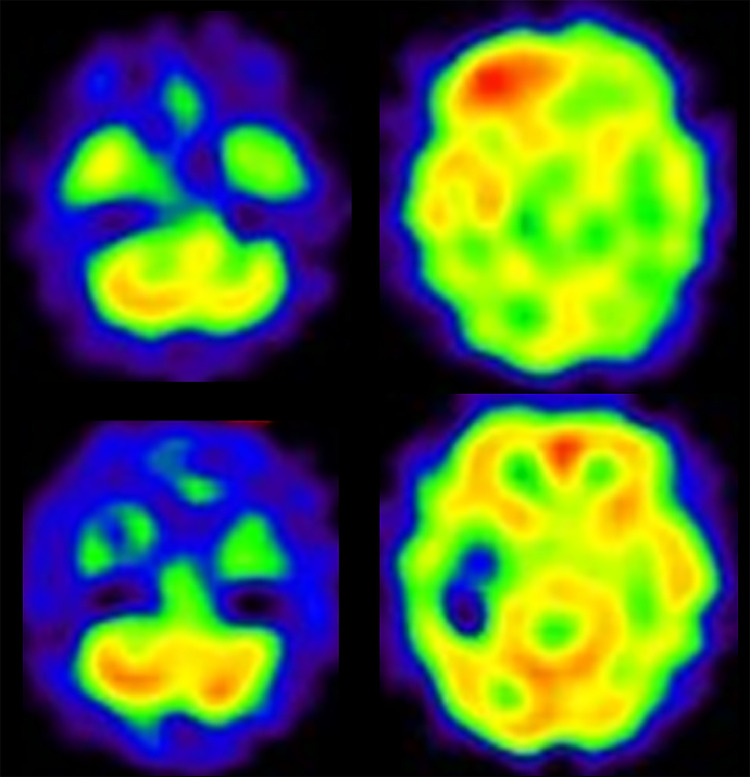
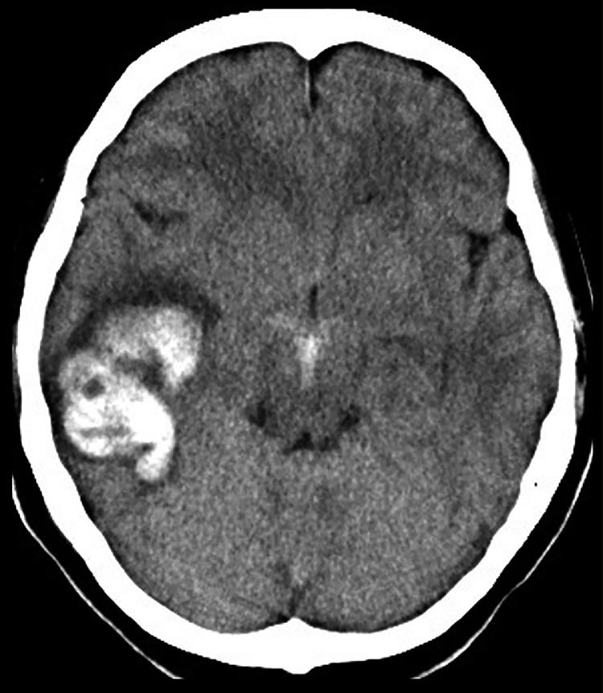
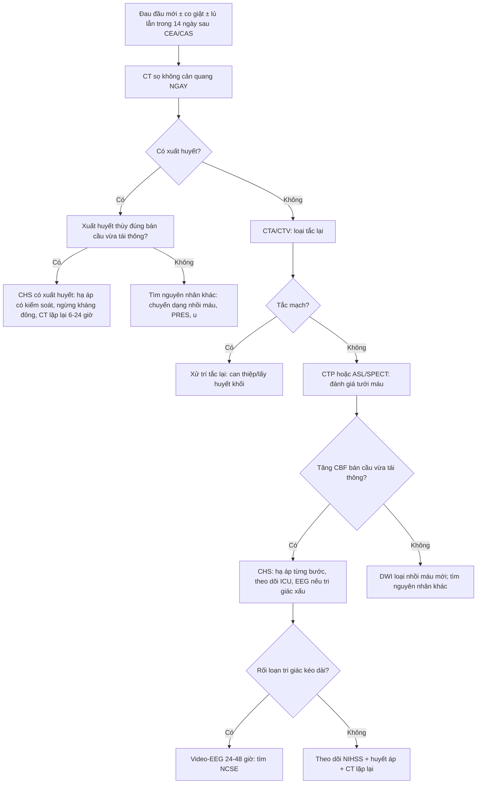
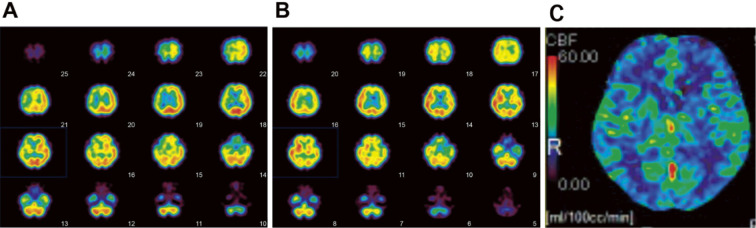

# 3060 — Hội chứng tăng tưới máu não sau tái thông mạch cảnh / Cerebral hyperperfusion syndrome (CHS) after carotid revascularization

**Tags:** `pattern:dau-dau-sau-mo` `pattern:co-giat` `pattern:xuat-huyet-nao-thuy` `pattern:tang-tuoi-mau` `pattern:phu-nao` `vung:nao` `vung:mach-mau-nao` `protocol:CT-khong-can-quang` `protocol:CTP` `protocol:ASL` `protocol:SPECT` `protocol:DSA` `score:NIHSS`
**Mức chắc chắn (certainty):** tổng hợp y văn (literature synthesis) — 2 ca nguyên văn có ảnh và số liệu (1 ca **CAS cấp cứu** cho bóc tách động mạch cảnh, 1 ca **CEA** có **trạng thái động kinh không co giật**) + số liệu dịch tễ/tử vong trích trong chính 2 bài đó. Không có RCT; ngưỡng tưới máu **chưa được 2 nguồn này nêu bằng số** nên bài ghi rõ "chưa rõ — cần tra" thay vì bịa.

> **Vì sao bài này quan trọng:** đây là **mặt ngược lại** của bài [3059](../3059-thieu-mau-nao-sau-bit-dong-mach-canh-trong/lesson.md) — cùng bệnh nhân hẹp cảnh nặng, cùng ngày hậu phẫu, nhưng **thiếu máu** thì phải **nâng huyết áp**, còn **tăng tưới máu** thì phải **hạ huyết áp khẩn**. Chọn sai hướng điều trị trong 30 phút đầu là đủ để bệnh nhân **xuất huyết não thùy** — biến cố **~1% nhưng tử vong 26%**. CT lúc đau đầu thường **bình thường**, nên bác sĩ CĐHA là người đầu tiên phải nghĩ tới chẩn đoán này khi đọc phim "sạch" ở bệnh nhân vừa tái thông cảnh.

## 1. Tổng quan bệnh học – cơ chế hình ảnh

- **Vì sao xảy ra — mất tự điều hòa (autoregulation failure):** khi cảnh hẹp nặng **mạn tính**, tiểu động mạch não phía sau chỗ hẹp **giãn tối đa** để giữ lưu lượng (hạ áp suất tưới máu); đường cong tự điều hòa **bị đẩy sang trái**. Khi hẹp được giải quyết (CEA/CAS/bypass), **áp lực tưới máu tăng vọt** trong khi giường mạch **không còn khả năng co lại** → **CBF tăng quá mức** trong 0–14 ngày (đa số **0–7 ngày**, đỉnh hay gặp **ngày 1–3**).
- **Vì sao tăng áp lực gây PHÙ rồi XUẤT HUYẾT:** áp lực mao mạch tăng → **phá hàng rào máu–não** → **phù mạch (vasogenic edema)**; nếu áp lực vượt sức chịu thành mạch nhỏ (đặc biệt ở **chất trắng sâu và vùng chuyển tiếp**) → **vỡ mạch**, thường **xuất huyết thùy** (lobar) chứ không phải hạch nền — vì tổn thương là **giường mao mạch vỏ–dưới vỏ** của bán cầu vừa tái thông.
- **Vì sao CT ban đầu có thể BÌNH THƯỜNG:** giai đoạn đầu là **rối loạn chức năng tưới máu**, chưa có phù đủ để đổi đậm độ. Trong ca CAS (PMC10475400), **CT ngay sau can thiệp không thấy xuất huyết hay ổ nhồi máu**, nhưng **SPECT tưới máu đã tăng** ở bán cầu phải; **ngày hôm sau CT mới có máu** ở thùy thái dương phải. Đây là lý do **"CT âm" không loại trừ CHS**.
- **Vì sao SPECT/CTP/ASL thấy được:** CHS là **bệnh của LƯU LƯỢNG**, nên hình ảnh chức năng là chìa khóa:
  - **SPECT tưới máu (¹²³I-IMP):** vùng **tăng tín hiệu lan tỏa** ở bán cầu vừa tái thông; có thể kèm **giảm tưới máu tiểu não đối bên** ("crossed cerebellar diaschisis" — thấy rõ trong ca CAS).
  - **CT perfusion (CTP):** tăng **CBF** và giảm **MTT** ở bán cầu đó; dùng được khi bệnh nhân đã nằm máy CT.
  - **ASL (arterial spin labeling, MRI):** tín hiệu **cao bất thường ở vỏ/dưới vỏ** bán cầu vừa tái thông, không cần thuốc cản quang — hữu ích khi phải theo dõi lặp lại.
- **Số liệu định lượng cốt lõi (từ 2 nguồn của bài):**
  - **Tần suất CHS < 3%** sau CEA; **xuất huyết não nặng ~1%** ở bệnh nhân hẹp cảnh được CEA/CAS, **tử vong 26%**.
  - **Co giật sau CEA: 0,5%**; **trạng thái động kinh không co giật (NCSE) tử vong tới 52%**, và **90% NCSE phát hiện được trong 24–48 giờ đầu** nếu theo dõi EEG liên tục.
  - **Ngưỡng huyết áp trong 2 ca:** ca CEA giữ **huyết áp tâm thu ≤ 120 mmHg** mà **vẫn** bị CHS (đau đầu + nôn **trưa ngày 1**, huyết áp **144/68 mmHg**); ca CAS giữ **< 110 mmHg** và **vẫn** xuất huyết thùy thái dương **ngày 1**. Kết luận thực hành: **hạ áp là cần nhưng KHÔNG đủ**.
  - **Hẹp cảnh trong ca CEA: 80%** theo tiêu chuẩn NASCET.
  - **Ngưỡng tưới máu định lượng** (ví dụ "CBF tăng ≥ 100% so với trước can thiệp") **không có trong 2 nguồn này** — **chưa rõ, cần tra** trước khi dùng làm tiêu chuẩn.

## 2. Mẫu hình + chẩn đoán phân biệt theo vị trí (Gamut)

**Mẫu hình chốt:** *bệnh nhân hẹp cảnh nặng vừa **CEA/CAS/bypass**, trong **0–14 ngày** (thường **ngày 1–3**) xuất hiện **đau đầu dữ dội kiểu mới**, **nôn**, **huyết áp tăng**, **lú lẫn/rối loạn tri giác**, **co giật** hoặc **khiếm khuyết thần kinh khu trú**; **CT không cản quang có thể bình thường**; tổn thương khi có trên CT là **xuất huyết/phù ở bán cầu VỪA TÁI THÔNG**.*

- **Gamut theo thời điểm sau can thiệp:**
  - **0–24 giờ:** CHS sớm (đau đầu, tăng huyết áp, co giật); **huyết khối/tắc lại** (khiếm khuyết mới, CT sạch, CTA thấy tắc); **chảy máu vết mổ cổ**; **tăng huyết áp do đau**.
  - **1–7 ngày:** CHS đỉnh điểm — **xuất huyết não thùy**, **phù**, **co giật/NCSE**; **chuyển dạng xuất huyết của ổ nhồi máu** tái tưới.
  - **7–14 ngày:** CHS muộn (ít hơn); **tái hẹp**, **nhiễm trùng**, **huyết khối tĩnh mạch**.
- **Gamut theo hình ảnh "tăng đậm độ / phù ở bán cầu vừa can thiệp":** xuất huyết do CHS; chuyển dạng xuất huyết của nhồi máu; **ngấm cản quang tồn lưu (contrast staining)** sau CTA/CTP; **PRES** (nếu tăng huyết áp nặng, phù đối xứng vùng chẩm–đỉnh); **nhồi máu tĩnh mạch**; **di căn/chảy máu u** (nếu có u chưa biết).
- **Ba câu hỏi lâm sàng (thay mnemonic):** (1) Vừa **tái thông mạch cảnh trong 14 ngày**? (2) **Đau đầu mới dữ dội ± co giật ± tri giác thay đổi** ở bán cầu vừa can thiệp? (3) **Huyết áp đang cao hơn mục tiêu** và **CT sạch**? — "có" cả 3 → **điều trị như CHS trước, chứng minh sau**.

- Ảnh: SPECT tưới máu sau CAS — **tăng tưới máu thùy trán–thái dương phải** và **giảm tưới máu tiểu não trái** (crossed cerebellar diaschisis); hàng dưới là SPECT **ngày 7** đã **hết chênh lệch**. Nguồn *Radiol Case Rep* 2023 (PMC10475400), **CC BY-NC-ND 4.0**, nguyên bản.

## 3. Bảng so sánh phân biệt (ma trận đối chiếu)

| Thực thể (entity) | Hình ảnh điển hình | Chốt vào (rule-in) | Chốt loại (rule-out) | Gợi ý xác nhận |
|---|---|---|---|---|
| **CHS có xuất huyết** | **Xuất huyết THÙY** ở bán cầu vừa tái thông, ± phù quanh ổ máu; **CT trước đó sạch** | **Đau đầu mới + huyết áp tăng trong 0–14 ngày sau CEA/CAS** + **máu trong thùy não thuộc lãnh thổ vừa tái thông** | **Máu ở hạch nền/thân não ngoài lãnh thổ** hoặc **ổ nhồi máu có sẵn** → nghĩ nguyên nhân khác | CT không cản quang ngay; **SPECT/CTP/ASL** xác nhận tăng tưới máu; theo dõi CT 24 giờ |
| **CHS chưa xuất huyết (giai đoạn chức năng)** | **CT sạch**, có thể **phù nhẹ vỏ–dưới vỏ**; **ASL/SPECT tăng** ở bán cầu vừa can thiệp | **Đau đầu + nôn + tăng huyết áp + CT sạch** đúng thời điểm; **tăng CBF** trên SPECT/CTP/ASL | **CTA thấy tắc mạch** hoặc **DWI có ổ nhồi máu mới** → loại CHS | CTA/CTV loại tắc; **DWI** loại nhồi máu; SPECT/ASL |
| **Chuyển dạng xuất huyết của nhồi máu** | Máu **trong vùng nhồi máu đã có** (thường hạch nền/vỏ), đậm độ **lấm chấm** rồi tụ | **DWI/CT trước đã có ổ nhồi máu** cùng vị trí | **Không có ổ nhồi máu trước** + **máu ở thùy khác lãnh thổ nhồi máu** → loại | So sánh với DWI/CT trước can thiệp |
| **Ngấm cản quang tồn lưu (contrast staining)** | **Tăng đậm độ vỏ/vùng đã chụp cản quang**, **không có khối choán chỗ**, tự mất sau 24 giờ | **Vừa CTA/CTP < 24 giờ**, bệnh nhân **không xấu đi tương ứng** | **Đậm độ tăng thêm trên CT lặp lại** hoặc **có hiệu ứng khối** → loại | **CT lặp lại 24 giờ** hoặc **MRI (SWI/T2*)** phân biệt máu với cản quang |
| **PRES** | Phù **đối xứng** vùng **chẩm–đỉnh** (và có thể thân não), **không theo lãnh thổ mạch** | **Tăng huyết áp nặng**, phù **hai bên đối xứng**, hồi phục khi hạ áp | **Phù MỘT bán cầu đúng lãnh thổ vừa tái thông** → loại | MRI T2/FLAIR; đáp ứng hạ áp |
| **Tắc lại/ huyết khối cấp mạch vừa can thiệp** | CT sạch sớm, **DWI có ổ nhồi máu mới**, **CTA/ DSA thấy tắc** | **Khiếm khuyết khu trú theo lãnh thổ**, **tụt huyết áp**, CTA tắc | **Tưới máu TĂNG trên SPECT/ASL** → loại | **CTA khẩn**; so DWI |
| **Co giật do nguyên nhân khác (hạ natri, ngừng thuốc, nhiễm trùng)** | CT sạch, không tăng tưới máu | **Điện giải bất thường**, **EEG ổ động kinh ngoài vùng can thiệp** | **Tăng CBF đúng bán cầu vừa tái thông** → loại | Điện giải, **EEG/video-EEG**, SPECT |

- **Ảnh then chốt — CT ngày hôm sau CAS:** xuất huyết **thùy thái dương phải** ở bệnh nhân mà **CT ngay sau can thiệp hoàn toàn bình thường**; đây là diễn tiến điển hình "sạch → máu trong 24 giờ".

- Ảnh: *Radiol Case Rep* 2023 (PMC10475400), **CC BY-NC-ND 4.0**, nguyên bản.

## 4. Protocol chụp + hệ phân độ/điểm chuẩn hóa

**Thứ tự hình ảnh khi nghi CHS (không được đảo):**
1. **CT sọ không cản quang, lát ≤ 1 mm, ngay tại giường/khẩn** — mục tiêu **loại xuất huyết** và **loại nhồi máu lớn**. Không chờ cản quang, không chờ MRI.
2. **CTA (hoặc CTV) mạch cảnh–não** — loại **tắc lại/huyết khối** và **giả phình** ở chỗ can thiệp; làm **cùng lần chụp** nếu bệnh nhân hợp tác.
3. **CTP** (nếu có) — tìm **tăng CBF/giảm MTT** ở bán cầu vừa tái thông; hoặc **MRI: DWI + ASL + SWI** — DWI loại nhồi máu mới, **ASL** xác nhận tăng tưới máu, **SWI** phân biệt máu với ngấm cản quang.
4. **SPECT tưới máu (¹²³I-IMP)** — khi CTP/ASL không sẵn có; đây là phương thức được dùng trong cả 2 ca của bài.
5. **DSA** — chỉ khi cần can thiệp (tắc lại, giả phình, lỗ rò), không dùng để "chẩn đoán CHS".
6. **EEG / video-EEG liên tục 24–48 giờ** khi có **rối loạn tri giác không giải thích** — vì **NCSE** là biến chứng của CHS (ca CEA: điện cực đồ có **phóng lực chu kỳ toàn thể 1,6 Hz**, chuyển thành **động kinh điện học > 2,5 Hz**).

**Ngưỡng & xử trí (theo số liệu của 2 ca, không phải guideline):**
- **Huyết áp:** mục tiêu trong 2 ca là **huyết áp tâm thu ≤ 120 mmHg** (CEA) và **< 110 mmHg** (CAS); **cả hai vẫn bị CHS** → cần **theo dõi sát hơn là chỉ đặt con số**, và **hạ áp ngay khi đau đầu + tăng áp**.
- **Thuốc:** **nicardipine/labetalol** đường tĩnh mạch để hạ áp **từng bước, có kiểm soát** (tránh tụt sâu gây thiếu máu vùng chuyển tiếp); **không dùng thuốc tăng áp/dịch trong nghi CHS**.
- **Co giật/NCSE:** **benzodiazepine + thuốc kháng động kinh** (ca CEA dùng **levetiracetam**, cuối cùng **2.000 mg/ngày**); **an thần propofol + thở máy** khi NCSE khó kiểm soát; **ngừng an thần khi CBF đã cân bằng** (ca CEA ngừng ngày 7).
- **Xuất huyết não:** ngừng **kháng kết tập tiểu cầu/kháng đông** theo cân nhắc, kiểm soát huyết áp, **CT lặp lại 6–24 giờ**, hội chẩn ngoại thần kinh nếu ổ máu lớn/chèn ép.
- **Không có thang điểm riêng cho CHS.** Dùng **NIHSS** để theo dõi khiếm khuyết và **GCS** cho tri giác; phân tầng theo **có/không xuất huyết** là yếu tố tiên lượng chính (tử vong **26%** khi có xuất huyết nặng).

## 5. Biến thể bình thường và cạm bẫy

- **"CT sạch" là bẫy số 1:** ca CAS có **CT ngay sau can thiệp bình thường** nhưng **SPECT đã tăng tưới máu**, và **máu xuất hiện ngày hôm sau**. Không được nói "không có gì" — phải nêu **nguy cơ CHS** và đề nghị **theo dõi/CT lặp lại**.
- **Bẫy hướng điều trị NGƯỢC:** bệnh nhân tụt tri giác sau tái thông dễ bị nghĩ là **tắc lại/giảm tưới máu** → truyền dịch, nâng huyết áp → **đẩy nhanh xuất huyết**. Trước khi nâng áp, **phải loại CHS** bằng CTA (loại tắc) + đánh giá tưới máu.
- **Đau đầu sau mổ cảnh không phải lúc nào cũng là đau đầu thường:** đau đầu **dữ dội, kiểu mới, kèm nôn và tăng huyết áp** trong **14 ngày** là **cờ đỏ**.
- **Co giật có thể KHÔNG co giật:** ca CEA là **trạng thái động kinh không co giật** — chỉ có **lú lẫn và mắt đảo (roving eye movements)**; **không có EEG thì không thấy**. **90% NCSE phát hiện trong 24–48 giờ đầu** bằng EEG liên tục.
- **Ngấm cản quang ≠ máu:** sau CTA/CTP, vỏ não có thể **tăng đậm độ** do cản quang còn lại; phân biệt bằng **CT lặp lại sau 24 giờ** hoặc **MRI SWI/T2***.
- **Crossed cerebellar diaschisis dễ bị đọc là "nhồi máu tiểu não":** giảm tưới máu tiểu não **đối bên** là **hệ quả chức năng** của tăng tưới máu bán cầu, không phải ổ nhồi máu — đừng mô tả thành "nhồi máu tiểu não mới".
- **Hạ áp quá tay cũng nguy hiểm:** giường mạch đã mất tự điều hòa; tụt áp sâu gây **thiếu máu vùng chuyển tiếp** — hạ áp **từng bước, có theo dõi thần kinh**.
- **Đừng quên nguyên nhân khác cùng lúc:** huyết khối tĩnh mạch sâu, hạ natri do thuốc, nhiễm trùng — nhất là khi **tăng tưới máu đã hết** mà tri giác vẫn xấu.

## 6. Tự lượng giá — Blind Quiz ngay trên trang tĩnh

**Ca 1 — nữ 37 tuổi, bóc tách động mạch cảnh trong phải, CAS cấp cứu**

- **Bối cảnh:** đau cổ, mờ mắt phải, tê nửa người trái 3 ngày; DWI không ổ nhồi máu, MRA giảm tín hiệu ICA–MCA phải, CTA thấy **hẹp teo (tapering) nặng đoạn cổ ICA** → **bóc tách**. CAS cấp cứu; **CT ngay sau can thiệp không có máu, không có ổ nhồi máu**; **SPECT tưới máu tăng ở bán cầu phải**. Huyết áp giữ **< 110 mmHg**.
- **Câu hỏi:** (1) Vì sao CT bình thường mà vẫn phải lo? (2) Hình ảnh SPECT gợi ý gì, và "giảm tưới máu tiểu não trái" nghĩa là gì? (3) Ngày hôm sau bệnh nhân đau đầu nhiều — làm gì trước?

<b>Bấm để hiện đáp án (findings + chẩn đoán)</b>

- **Diễn tiến:** **CT ngày 1 sau CAS có xuất huyết thùy thái dương phải** (ảnh CT của bài) — đúng bệnh cảnh **CHS có xuất huyết**.
- **Vì sao CT sạch vẫn lo:** CHS là rối loạn **lưu lượng** trước khi có tổn thương cấu trúc; **SPECT tăng tưới máu** là bằng chứng sớm.
- **Crossed cerebellar diaschisis:** giảm tưới máu **tiểu não đối bên** do mất hoạt hóa chức năng từ bán cầu vừa tái thông — **không** phải ổ nhồi máu.
- **Việc làm trước:** **CT không cản quang khẩn** (tìm máu) + **hạ huyết áp có kiểm soát**; không truyền dịch/nâng áp.
- **Nguồn ảnh:** *Radiol Case Rep* 2023 (PMC10475400), **CC BY-NC-ND 4.0**, nguyên bản.

**Ca 2 — nam 73 tuổi, CEA vì hẹp cảnh 80%, ngày 1 đau đầu và nôn**

- **Bối cảnh:** huyết áp hậu phẫu giữ **≤ 120 mmHg**; **trưa ngày 1: đau đầu toàn thể, nôn, huyết áp 144/68 mmHg**; MRI ngày 1 **không nhồi máu, không xuất huyết**; SPECT thấy **tăng CBF lan tỏa bán cầu phải**. Được dùng **hạ áp + kháng động kinh**, an thần **propofol**, thở máy. **Ngày 3 CTP không còn chênh lệch CBF**, ngừng an thần **ngày 4** — nhưng bệnh nhân **vẫn lú lẫn, mắt đảo**.
- **Câu hỏi:** (1) Chẩn đoán? (2) Vì sao **không** ngừng an thần rồi chờ? (3) Xét nghiệm nào trả lời?

<b>Bấm để hiện đáp án (findings + chẩn đoán)</b>

- **Chẩn đoán:** **CHS sau CEA** + **trạng thái động kinh không co giật (NCSE)**.
- **Dấu hiệu chốt:** **video-EEG ngày 4** — **phóng lực chu kỳ toàn thể 1,6 Hz** chuyển thành **động kinh điện học > 2,5 Hz ≥ 10 giây**; hình ảnh cấu trúc **âm tính** (MRI ngày 1, FLAIR ngày 90 không tổn thương mới).
- **Vì sao không chờ:** tri giác xấu **sau khi tưới máu đã cân bằng** không giải thích được bằng CHS; **NCSE tử vong tới 52%** nếu bỏ sót, và **90% phát hiện trong 24–48 giờ** bằng EEG liên tục.
- **Xử trí:** **propofol trở lại + tăng liều kháng động kinh (levetiracetam tới 2.000 mg/ngày)**; ngừng an thần **ngày 7** khi tưới máu và EEG cải thiện.
- **Nguồn ảnh:** *NMC Case Rep J* 2023 (PMC10351957), **CC BY-NC-ND**, nguyên bản.

**Ca 3 — câu hỏi quyết định (không cần ảnh)**

- **Bối cảnh:** bệnh nhân **ngày 2 sau CAS**, **đau đầu + lú lẫn nhẹ**, **huyết áp 165/90 mmHg**, **CT không cản quang sạch**. Đồng nghiệp đề nghị **truyền 500 mL NaCl 0,9% + nâng huyết áp** vì "sợ tụt áp gây thiếu máu não".
- **Câu hỏi:** Đồng ý hay không? Nêu thứ tự ba việc phải làm.

<b>Bấm để hiện đáp án</b>

- **Không đồng ý.** Bệnh cảnh này là **CHS cho tới khi loại trừ**: đau đầu mới + tăng huyết áp + ngày 2 sau tái thông + CT sạch. **Nâng áp/truyền dịch** có thể đẩy tới **xuất huyết não thùy** (tử vong **26%** khi có xuất huyết nặng).
- **Ba việc theo thứ tự:** (1) **Hạ huyết áp từng bước** bằng nicardipine/labetalol TM, theo dõi thần kinh; (2) **CTA/CTV** loại **tắc lại** (và **DWI** nếu làm MRI); (3) **đánh giá tưới máu** (CTP/ASL/SPECT) — nếu **tăng CBF** ở bán cầu vừa tái thông thì xác nhận CHS và theo dõi ICU, **EEG** nếu tri giác không cải thiện.
- **Phản biện:** nếu CTA thấy **tắc lại** và DWI có **ổ nhồi máu mới**, thì hướng điều trị đổi hoàn toàn (bài 3059) — vì vậy **không được điều trị mù trước khi có CTA**.

## Bài liên quan chéo
- [3059 – Thiếu máu não sau bít động mạch cảnh trong](../3059-thieu-mau-nao-sau-bit-dong-mach-canh-trong/lesson.md) — **mặt ngược lại**: giảm tưới máu, phải **nâng áp**; đọc cạnh bài này để không điều trị ngược.
- [262 – Bệnh mạch máu lớn do xạ trị não](../262-benh-mach-mau-lon-do-xa-tri-moyamoya/lesson.md) — hẹp cảnh **mạn** do xạ, nguồn bệnh nhân cho tái thông.
- [249 – Rò động mạch cảnh–xoang hang](../249-ro-dong-mach-canh-xoang-hang-chan-thuong/lesson.md) — biến chứng mạch cảnh **khác** sau chấn thương/can thiệp, cũng đọc trên CTA/DSA.
- [171 – Bóc tách động mạch chủ](../171-boc-tach-dong-mach-chu-bung-va-IMH/lesson.md) — nguyên lý **tăng áp lực thành mạch** gây vỡ/bóc tách, đối chiếu với giường mạch não.

## Ảnh
- `images/3060_tang-tuoi-mau-nao_SPECT_PMC10475400-Fig4-CCBYNCND.jpg` — SPECT tăng tưới máu + diaschisis tiểu não, **CC BY-NC-ND 4.0**.
- `images/3060_tang-tuoi-mau-nao_CT_PMC10475400-Fig5-CCBYNCND.jpg` — CT xuất huyết thùy thái dương ngày 1 sau CAS, **CC BY-NC-ND 4.0**.
- `images/3060_tang-tuoi-mau-nao_SPECT_PMC10351957-Fig2-CCBYNCND.jpg` — SPECT trước/ sau CEA, **CC BY-NC-ND**.
- `images/3060_tang-tuoi-mau-nao_DSA_PMC10351957-Fig1-CCBYNCND.jpg` — DSA hẹp cảnh, **CC BY-NC-ND**.
- Chi tiết nguồn/giấy phép từng ảnh: `images/CREDITS.md`.

> Không dùng để chẩn đoán độc lập khi chưa có người hướng dẫn.
