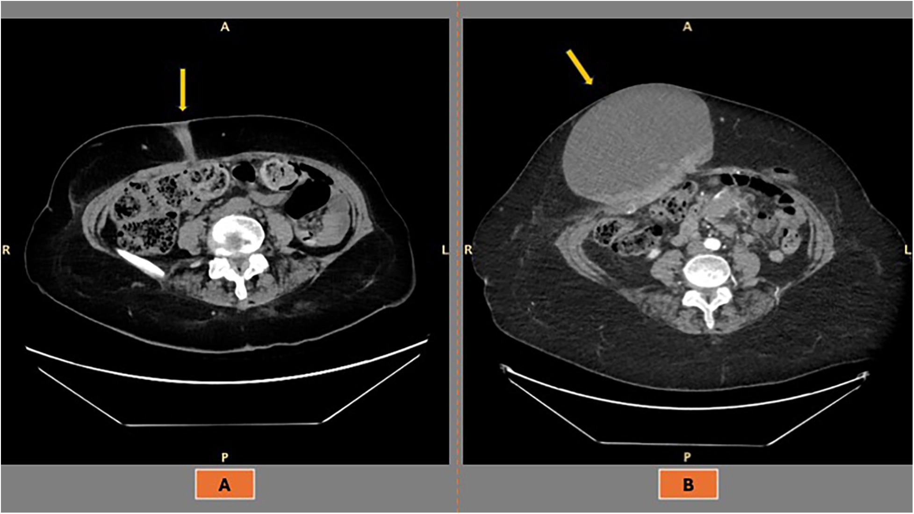
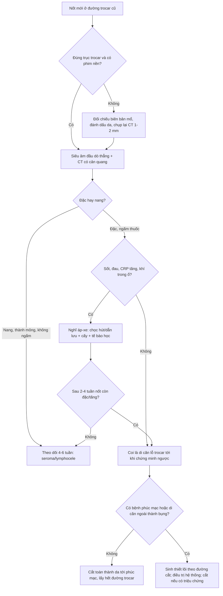
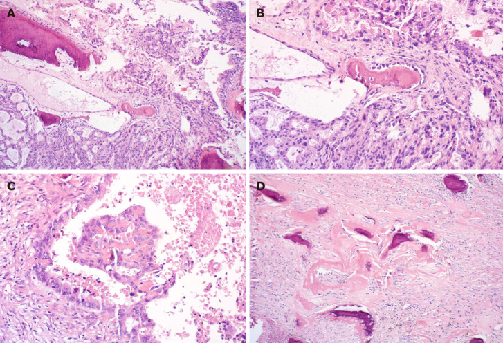
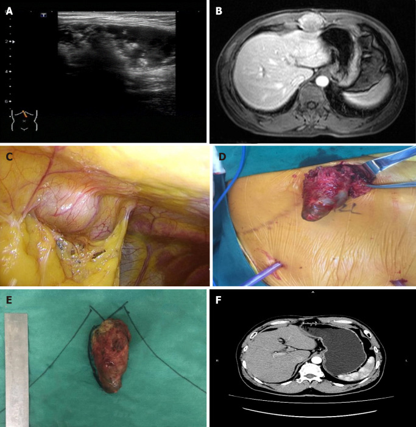

# 3061 — Di căn lỗ trocar sau PIPAC và phẫu thuật nội soi: nốt thành bụng mới là áp-xe hay di căn, và khi nào phải cắt toàn thành

**Tags:** `pattern:di-can` `pattern:not` `pattern:ap-xe-sau-mo` `vung:thanh-bung` `vung:phuc-mac` `vung:o-bung` `anatomy:thanh-bung` `protocol:PIPAC` `protocol:CT-bung-co-can-quang` `protocol:sieu-am-tai-cho` `protocol:MRI-bung` `incidentaloma:not-thanh-bung`
**Mức chắc chắn (certainty):** tổng hợp y văn (literature synthesis) — ghép **tổng quan hệ thống 5 nghiên cứu về di căn lỗ trocar sau nội soi chẩn đoán ở ung thư buồng trứng** (Front Surg 2026, DOI 10.3389/fsurg.2026.1777548), **tổng quan 36 bài về sinh bệnh học – tiên lượng** (Cancer Manag Res 2025, CC BY-NC 4.0), **registry PIPAC 2.456 thủ thuật** (Pleura Peritoneum 2023, PMC10739278) và **ca di căn lỗ trocar vôi hóa 10 năm sau cắt túi mật nội soi** (World J Clin Cases 2020, PMC7716338). Không có ca do nhóm tự chụp.

> **Câu hỏi thực hành:** nữ **62 tuổi**, ung thư buồng trứng tái phát phúc mạc, đang **PIPAC chu kỳ 3**. Ngày 10 sau PIPAC: **sốt 37,8 °C**, đau nhẹ, **sờ thấy nốt 12 mm ở lỗ trocar cũ cạnh rốn**. Siêu âm: nốt **giảm âm, có tín hiệu mạch**. Câu hỏi: **đây là áp-xe lỗ trocar — biến chứng đã biết của PIPAC — hay di căn lỗ trocar? Chọc hút ngay hay chụp thêm, và nếu là di căn thì cắt hay theo dõi?**
> Bài chốt **ba quyết định**: **(1) nốt đặc ngấm thuốc nằm đúng đường trocar ở bệnh nhân ung thư phúc mạc phải coi là di căn cho tới khi chứng minh ngược — kể cả khi có sốt, vì áp-xe và di căn hoại tử chồng hình ảnh; (2) siêu âm đầu dò thẳng + CT 1–2 mm có so phim nền là bộ đôi đầu tay, MRI/DWI khi cần phân biệt u hạt – lạc nội mạc – xơ cơ, PET/CT chỉ để phân giai đoạn; (3) di căn lỗ trocar đơn độc → cắt toàn thành từ da tới phúc mạc; đã có bệnh phúc mạc/di căn xa (95% ca) → điều trị hệ thống, cắt tại chỗ chỉ khi chảy máu/đau/nhiễm.** Nối [1905 – Biến chứng & an toàn PIPAC](../1905-bien-chung-va-an-toan-thu-thuat-pipac/lesson.md), [1903 – Theo dõi sau CRS/HIPEC & PIPAC](../1903-theo-doi-sau-crs-hipec-va-pipac/lesson.md), [141 – Phúc mạc: cổ trướng & carcinomatosis](../141-phuc-mac/lesson.md), [910 – Dẫn lưu áp-xe qua da](../910-abscess-biliary-nephrostomy/lesson.md).

## 1. Tổng quan bệnh học – cơ chế hình ảnh: vì sao tế bào phúc mạc lại "mọc" ở thành bụng

- **Định nghĩa – vị trí chính xác:** di căn lỗ trocar (port-site metastasis, PSM) là **u thứ phát nằm trong đường trocar**, từ **da → mô dưới da → cân/cơ → phúc mạc**, do tế bào u gieo rắc trong lúc nội soi rồi cấy vào vết thương. Vì là **kênh xuyên toàn thành**, nốt có thể nằm ở **bất kỳ độ sâu nào**, không chỉ dưới da — ca WJCC 2020 mô tả khối **nằm giữa các cơ thành bụng** (PMC7716338).
- **Tần suất – con số quyết định mức nghi ngờ:** ở ung thư phụ khoa, PSM gặp **0,16–2,3%** các ca nội soi (tổng quan 36 bài, CMAR 2025). Ở ung thư buồng trứng, con số **phụ thuộc cách phát hiện**: **1,18%** trên **2.251 thủ thuật** (2,10% ở nhóm u phần phụ) khi chẩn đoán bằng lâm sàng/hình ảnh; **17%** khi khám **mô học** mảnh cắt lỗ trocar; **46,7% (100/214 ca)** và **49% các lỗ trocar được cắt** khi **cắt lỗ trocar hàng loạt** rồi xét nghiệm (Front Surg 2026). Khác biệt **40 lần** này là bài học đầu tiên: **"hiếm trên lâm sàng" không có nghĩa "hiếm trên mô học"**.
- **Ung thư túi mật phát hiện tình cờ:** PSM gặp **10,3%** sau cắt túi mật nội soi (World J Clin Cases 2020, PMC7716338); đây là nhóm **nguy cơ cao thứ hai** sau ung thư buồng trứng, và là lý do phải theo dõi **vết mổ + lỗ trocar**, không chỉ gan.
- **Sau PIPAC – khoảng trống bằng chứng phải nói rõ:** registry **2.456 thủ thuật** ghi **14 sự kiện ở nhóm lỗ trocar (0,57%)**, trong đó **12 ca chảy máu/tụ máu/thoát vị** và **2 ca phân loại nhầm** — **không có dòng "di căn lỗ trocar"** (Pleura Peritoneum 2023, PMC10739278); tổng quan 10 năm PIPAC cũng không báo tỷ lệ PSM (Cancers 2023, PMC9954579). Vậy **chưa có tỷ lệ PSM sau PIPAC được định lượng** — không được trích một con số không tồn tại, nhưng cũng **không được coi nốt mới ở lỗ trocar sau PIPAC là "phản ứng thuốc" mặc định**.
- **TẠI SAO tế bào bám được vào đường trocar — 4 cơ chế, cùng một đích hình ảnh:**
  1. **Cấy trực tiếp:** dụng cụ, trocar, túi lấy bệnh phẩm hoặc dịch u tràn qua vết thương khi rút.
  2. **Hiệu ứng ống khói (chimney effect):** khí CO₂ **rò vi lượng dọc thân trocar** trong suốt cuộc mổ, mang tế bào lên thành bụng.
  3. **Áp lực ổ bụng kích thích tăng sinh:** nghiên cứu in vivo cho thấy u phát triển tăng dần khi áp lực bơm **5 → 10 → 15 mmHg** (CMAR 2025) — đúng dải PIPAC **12 mmHg/30 phút**.
  4. **Aerosol hóa:** PIPAC phun thuốc dạng hạt lơ lửng; cùng nguyên lý, tế bào có thể bị aerosol hóa và lắng ở lỗ trocar — giả thuyết hợp lý nhưng **chưa định lượng được ở người**.
- **TẠI SAO ung thư buồng trứng và cổ trướng là nhóm nguy cơ cao nhất:** tế bào biểu mô buồng trứng **bong tự nhiên vào dịch báng**; **cổ trướng ≥ 500 mL** tăng nguy cơ **OR 3,9 (KTC 95% 1,5–10,0; p = 0,005)**; xâm lấn **pT3 OR 13,5 (2,93–62,0)** và **hạch dương pN1 OR 2,97 (1,31–6,72)** (Front Surg 2026; CMAR 2025). Nói cách khác: **bệnh càng lan trong phúc mạc, đường trocar càng "bị phơi nhiễm"**.
- **TẠI SAO thời điểm rất khác nhau:** PSM có thể lộ **rất sớm** — trung vị **17 ngày (4–730)** trong loạt Ramirez — hoặc **muộn** — trung vị **7 tháng (0,1–26,2 tháng)** trong loạt Zivanovic (Front Surg 2026). Ca WJCC xuất hiện **10 năm** sau cắt túi mật. Vì vậy **"đã mổ 5 năm, không thể là di căn"** là một câu sai.
- **TẠI SAO hình ảnh có thể phân biệt được — vật lý đơn giản:**
  - **CT:** mô u đặc **30–50 HU** trước cản quang, **tăng 20–40 HU** sau tiêm; ổ hoại tử trung tâm **0–20 HU**; **máu tụ cấp 50–80 HU** và **không ngấm thuốc**; mỡ **−40 đến −120 HU**; **vôi hóa/xương > 200 HU**. Đây là nền tảng để tách "đặc – máu – mỡ – vôi".
  - **Siêu âm:** u đặc **giảm âm**, bờ không đều, **có mạch trong u**; áp-xe có **viền dày, trung tâm trống, tăng âm mô mỡ quanh**; tụ máu **không có mạch**, thay đổi theo thời gian (tăng âm → giảm âm).
  - **MRI:** u tế bào cao → **hạn chế khuếch tán (DWI sáng, ADC thấp)**, T2 tăng nhẹ, ngấm thuốc; **mô xơ** T2 rất thấp và ngấm chậm; **máu cũ/lạc nội mạc** T1 **sáng**. Cạm bẫy: **mủ cũng hạn chế khuếch tán**, nên DWI **một mình không loại được áp-xe** — phải đọc viền, khí và bối cảnh lâm sàng.

## 2. Mẫu hình + chẩn đoán phân biệt theo vị trí (Gamut)

- **Mẫu hình cốt lõi:** **nốt đặc, ngấm thuốc, nằm trên trục đường trocar cũ**, đơn độc hoặc nhiều ổ, thường **không đau** ở giai đoạn sớm.
- **Theo độ sâu — quyết định đường mổ:**
  - **Dưới da:** nốt sờ thấy, dễ chọc hút nhầm; cắt cùng da và mô dưới da.
  - **Trong cơ (thẳng bụng):** hay bị bỏ sót vì nằm sau cân; cần cắt cả bao cơ, có thể cần vá cân.
  - **Trước phúc mạc/ổ bụng:** dính vào mặt sau thành bụng; phải cắt **toàn thành** và kiểm tra phúc mạc.
- **Theo thành phần — quyết định chẩn đoán phân biệt:**
  - **Đặc ngấm thuốc:** di căn, u hạt, xơ cơ (desmoid), u mô mềm.
  - **Nang/hoại tử:** áp-xe, seroma, lymphocele, di căn hoại tử.
  - **Vôi hóa/xương:** di căn vôi hóa (như ca túi mật), u hạt chỉ khâu, dị vật — **vôi hóa không loại trừ ác tính**.
- **Theo vị trí giải phẫu đặc thù:**
  - **Rốn:** trocar camera 10–12 mm, nơi hay gặp PSM nhất sau cắt túi mật; cũng là vị trí **nốt chị em Joseph (Sister Mary Joseph)** do u dạ dày – buồng trứng – đại tràng.
  - **Hố chậu phải/trái:** trocar thao tác 5 mm; PSM nhỏ, dễ bị cho là hạch bẹn.
  - **Sẹo mổ dọc, chân dẫn lưu, đường sinh thiết:** cùng cơ chế cấy tế bào, cùng cách xử trí.
- **Gamut theo bối cảnh:** ung thư buồng trứng/đại tràng/túi mật/dạ dày đã nội soi; **PIPAC nhiều chu kỳ**; **CRS/HIPEC** trước đó; nội soi chẩn đoán rồi mổ mở ngay sau (nguy cơ cao hơn nếu chờ lâu).

## 3. Bảng so sánh phân biệt (ma trận đối chiếu)

| Thực thể | Hình ảnh điển hình | Chốt vào (rule-in) | Chốt loại (rule-out) | Gợi ý xác nhận |
|---|---|---|---|---|
| **Di căn lỗ trocar (PSM)** | Nốt đặc **30–50 HU**, ngấm thuốc, nằm đúng trục trocar, có thể xâm lấn da/cân; đa ổ; tiến triển theo thời gian | **Nốt mới/tăng kích thước đúng đường trocar ở bệnh nhân ung thư phúc mạc**; 95% có bệnh phúc mạc/di căn ngoài thành bụng đi kèm | Không nằm trên đường trocar, không ngấm thuốc, ổn định ≥ 12 tháng → ít nghĩ PSM | Sinh thiết lõi 14–16 G theo đường sẽ cắt; mô học + IHC |
| **Áp-xe lỗ trocar** | Ổ dịch **0–20 HU**, viền dày ngấm thuốc, **khí trong ổ**, phù mỡ quanh; sốt, đau, CRP tăng | **Sốt + đau + viền ngấm thuốc + khí**, xuất hiện trong **ngày 2–14** sau thủ thuật | Nốt đặc không có ổ dịch, không khí, không phản ứng viêm → loại | Chọc hút/dẫn lưu: **cấy + tế bào học** (không chỉ cấy) |
| **Tụ máu thành bụng** | Cấp: **50–80 HU**, không ngấm; bán cấp giảm dần; siêu âm tăng âm → giảm âm; không có mạch trong ổ | **Khởi phát ngay sau thủ thuật, đau khu trú, Hct giảm, không sốt** | Có mạch trong u, ngấm thuốc, không thoái triển sau 4–6 tuần → loại | Siêu âm lặp 2–4 tuần; MRI nếu còn nghi |
| **U hạt chỉ khâu** | Siêu âm: khối **giảm âm 100%**, **sợi chỉ tăng âm tuyến tính trong 91%**; CT chỉ là mô mềm không đặc hiệu | **Tiền sử mổ đúng vị trí + sợi tăng âm + không tăng kích thước** | Không thấy sợi chỉ, tăng nhanh, xâm lấn cân → loại | Siêu âm bổ sung; sinh thiết nếu còn nghi |
| **Xơ cơ (desmoid)** | Khối trong cơ thẳng, **dải T2 rất thấp**, ngấm thuốc, bờ xâm lấn; DWI không hạn chế mạnh | **Sẹo mổ cũ + dải xơ T2 + tăng chậm** | Hạn chế khuếch tán mạnh, hoại tử, xâm lấn da → loại | MRI; sinh thiết nếu tăng nhanh |
| **Lạc nội mạc thành bụng** | Nốt trong sẹo, **T1 sáng**, T2 shading, đau theo chu kỳ; siêu âm giảm âm | **Đau theo kinh + T1 sáng + vị trí sẹo** | T1 không sáng, không liên quan chu kỳ → loại | MRI; sinh thiết |
| **Thoát vị lỗ trocar** | Khiếm khuyết cân, chứa mỡ/ruột, thay đổi theo Valsalva | **Thấy cổ túi + nội dung thoát qua cân** | Không có khiếm khuyết cân, khối đặc trong cơ → loại | Siêu âm Valsalva; CT |
| **Nang thanh dịch/lymphocele** | Nang **0–20 HU**, thành mỏng, không ngấm, bờ đều | **Nang đơn thuần, không vách, không khí, không mạch** | Thành dày, vách, mạch trong u → loại | Siêu âm; chọc hút nếu có triệu chứng |

*Cùng một bệnh nhân ung thư buồng trứng FIGO IIIC sau nội soi chẩn đoán: (A) tái phát **nhỏ, xuyên từ da tới cơ** ở đường trocar; (B) tiến triển thành **khối 15 × 18 cm** dù đã hóa trị. Đây là lý do nốt nhỏ ở đường trocar **không được theo dõi thụ động**. Nguồn: Front Surg 2026, DOI 10.3389/fsurg.2026.1777548, CC BY 4.0.*

## 4. Protocol chụp – không có RADS riêng – quy trình quyết định

### 4.1 Chụp gì, đo gì

- **Siêu âm đầu dò thẳng 7–15 MHz là bước đầu tiên tại giường:** xác định **đặc hay nang**, bờ, **mạch trong u**, liên hệ với **cân cơ và phúc mạc**, đo **3 chiều**, đánh dấu vị trí bằng ga-rô/da. Siêu âm **phân biệt tốt nang – đặc – máu tụ**, nhưng **không phân biệt được u hạt với di căn nhỏ**.
- **CT bụng–chậu có cản quang, lát 1–2 mm, thì tĩnh mạch cửa**, là chuẩn để **đo và so sánh**: đọc **toàn bộ thành bụng từ da tới phúc mạc** (không chỉ nhìn phúc mạc), ghi **số ổ, vị trí theo 4 cung, độ sâu (dưới da/cơ/trước phúc mạc), kích thước 3 chiều, mức ngấm thuốc, xâm lấn da**. Luôn **so phim nền cùng mức cắt** — tăng ≥ 20% đường kính hoặc nốt mới là dữ kiện quan trọng hơn kích thước tuyệt đối.
- **MRI khi CT/siêu âm không kết luận:** T1, T2 fat-sat, **DWI b = 800–1000 + ADC**, T1 sau tiêm. Chỉ định rõ: **nghi lạc nội mạc/xơ cơ**, nốt **dính cơ – cân** cần hoạch định cắt, hoặc **dị ứng cản quang**.
- **PET/CT không phải công cụ chẩn đoán nốt tại chỗ:** dùng để **phân giai đoạn** khi định cắt. **SUVmax không phân biệt được** áp-xe/u hạt với di căn; **âm giả** gặp ở u nhầy, ổ hoại tử nhỏ < 5–8 mm.
- **Sinh thiết lõi 14–16 G dưới siêu âm/CT** khi nốt **không điển hình** hoặc cần chứng minh trước điều trị hệ thống. **Đi theo đúng đường sẽ cắt** để lấy luôn đường kim; **không chọc hút kim nhỏ đơn thuần** nếu nghĩ di căn (ít mô, không đủ hóa mô miễn dịch). Nếu là **áp-xe**: chọc hút/dẫn lưu là điều trị, nhưng **vẫn gửi tế bào học** vì áp-xe có thể che di căn.

### 4.2 Không có hệ phân độ RADS — phân tầng bằng 3 biến

| Tầng | Tiêu chí | Hướng xử trí |
|---|---|---|
| **PSM đơn độc** | 1 ổ, không có bệnh phúc mạc/di căn ngoài thành bụng, cắt được | **Cắt toàn thành da → phúc mạc, lấy hết đường trocar kèm bờ mô lành**, vá cân/mạc nếu khuyết lớn; theo dõi sát |
| **PSM + bệnh trong ổ bụng** | 95% ca có bệnh phúc mạc/di căn đi kèm | **Điều trị hệ thống theo bệnh nền**; cắt tại chỗ **chọn lọc** khi đau, chảy máu, nhiễm, hoặc để giảm thể tích |
| **PSM lan tỏa** | Nhiều ổ thành bụng ± di căn xa, không cắt được | **Giảm nhẹ**: xạ tại chỗ để cầm máu/giảm đau, chăm sóc hỗ trợ |

- **Điều trị tại chỗ:** cắt **toàn thành** (da, mô dưới da, cân, cơ, phúc mạc) — không "bóc nốt" vì còn lại đường trocar là nguồn tái phát. Khuyết lớn dùng **vá cân/lưới**; trong bệnh phúc mạc tiến triển, ưu tiên **vá mô tự thân** để giảm nhiễm lưới.
- **Cắt lỗ trocar hàng loạt lúc CRS không phải "miễn phí":** kiểm soát tại chỗ tốt (không tái phát sau cắt trong loạt Ataseven), nhưng **biến chứng Clavien–Dindo 3–5 tăng 41,0% so với 14,9%** (p < 0,001) và **biến chứng vết thương 34% so với 17%** (RR 2,42; KTC 95% 1,09–5,35; p = 0,029) (Front Surg 2026). Vì vậy **cắt chọn lọc**, không cắt mù.
- **Tiên lượng:** PSM **không làm tăng tử vong độc lập** sau khi hiệu chỉnh giai đoạn/hạch/cổ trướng (HR 0,87; p = 0,642; một loạt khác p = 0,92). Nó là **dấu hiệu của bệnh phúc mạc lan**, không phải bệnh riêng — nhưng **vẫn phải chẩn đoán đúng** để không mổ oan và không bỏ sót nhiễm.

### 4.3 Phòng ngừa — áp dụng cho cả PIPAC

- **Xả hết CO₂ trước khi rút trocar**, rút trocar **dưới quan sát**, tránh để khí phụt ra mang tế bào.
- **Đóng cân mọi lỗ > 5 mm**, đặc biệt khi có cổ trướng; dùng **dụng cụ lấy bệnh phẩm kín** (túi) thay vì kéo trực tiếp.
- **Hạn chế sinh thiết u trực tiếp** khi có thể lấy phúc mạc; **rửa dụng cụ và lỗ trocar** (chưa có bằng chứng mạnh nhưng hợp lý).
- **PIPAC:** giữ hệ kín, hút khí qua bộ lọc trước khi rút, **kiểm tra và đóng lại tất cả lỗ trocar** cuối thủ thuật; ghi **vị trí trocar** vào hồ sơ để lần sau đối chiếu (nối 1905).
- **Không có biện pháp nào loại trừ hoàn toàn PSM** — ca vẫn xảy ra dù kỹ thuật chuẩn (Vergote 17% trên mô học).

## 5. Biến thể bình thường và cạm bẫy

- **"Nốt nhỏ = lành":** ca WJCC 2020 có khối **5 × 3 × 3 cm**, **vôi hóa/xương hóa**, xuất hiện **10 năm** sau cắt túi mật; ban đầu có thể bị coi là u hạt/dị vật. **Thời gian dài và vôi hóa không loại trừ di căn.**
- **"PET âm = lành":** u nhầy, ổ hoại tử nhỏ, nốt < 5–8 mm có thể **không tăng FDG**; quyết định dựa vào **CT + mô học**, không dựa PET.
- **"Có sốt thì là áp-xe":** di căn hoại tử cũng sốt; ngược lại áp-xe sau PIPAC có thể **không sốt** ở người dùng corticoid. **Hình thái + khí + viền** quan trọng hơn triệu chứng đơn thuần.
- **Chọc hút "áp-xe" mà không chụp:** nốt đặc bị chọc sẽ **gieo rắc đường kim** và **làm chậm chẩn đoán ung thư**. Chỉ dẫn lưu khi có **ổ dịch xác định**; nốt đặc → **sinh thiết lõi**.
- **U hạt chỉ khâu không phải lúc nào cũng đứng yên:** ca trong y văn **2 cm, to dần qua 2 lần CT** rồi mới được chẩn đoán lành tính (RadioGraphics 2020) — **tăng kích thước không đủ để khẳng định ác**, nhưng **đủ để sinh thiết**.
- **Bỏ sót do chỉ nhìn phúc mạc:** PSM nằm **trong thành bụng**, ngoài cửa sổ đọc thông thường; phải **cuộn hết thành bụng** và **đối chiếu vị trí trocar**.
- **Trocar ngoài tầm chụp:** CT bụng–chậu thường cắt từ đỉnh chậu; lỗ trocar **dưới rốn hoặc ở hạ vị** có thể nằm ngoài; đảm bảo **FOV từ cơ hoành tới giao hợp mu**.
- **Lạc nội mạc thành bụng:** nữ trẻ, đau theo chu kỳ, **T1 sáng** — đừng sinh thiết mù trước MRI.

*H&E: (A, B) tuyến ác tính xâm nhập mô xơ; (C) tế bào u trong lòng mạch/ổ hoại tử; (D) **xương dị sản/vôi hóa** quanh ổ u — phản ứng của mô đệm, **không phải dấu hiệu lành tính**. Nguồn: World J Clin Cases 2020, PMC7716338, CC BY-NC 4.0.*

## 6. Tự lượng giá — Blind Quiz

**Ca 1 — Nữ 79 tuổi, ung thư buồng trứng FIGO IIIC, 1 năm sau nội soi chẩn đoán. CT thấy nốt nhỏ ở thành bụng trước; 1 năm sau cùng vị trí là khối 15 × 18 cm. Nhìn hai ảnh, mô tả độ sâu và bờ trước khi đọc đáp án.**

- Hỏi: nốt ở **lớp nào của thành bụng**? Dấu hiệu nào cho thấy đây là **đường trocar** chứ không phải hạch? Hai chẩn đoán phân biệt chính và một câu hỏi tiếp theo?

<b>Bấm để hiện đáp án</b>

- (A) Nốt **nhỏ, xuyên từ da vào cơ**, nằm đúng trục lỗ trocar; (B) khối **lớn, bờ đa cung, xâm lấn toàn thành bụng**, đè ruột.
- **Chốt vào:** vị trí **đúng đường trocar cũ** + bệnh phúc mạc nền + **tăng kích thước nhanh** → **di căn lỗ trocar**. Phân biệt: **áp-xe/tụ máu sau thủ thuật** (thường có viền/khí, khởi phát sớm) và **u hạt/xơ cơ** (ổn định, T2 thấp).
- Bước tiếp: **so phim nền, siêu âm + CT 1–2 mm**; nếu đặc và không có ổ dịch → **sinh thiết lõi theo đường sẽ cắt**. Bệnh đã lan phúc mạc → **điều trị hệ thống**, cắt tại chỗ chỉ khi có triệu chứng.
- Nguồn: Front Surg 2026, DOI 10.3389/fsurg.2026.1777548, CC BY 4.0.

**Ca 2 — Nam 55 tuổi, 10 năm trước cắt túi mật nội soi vì viêm túi mật cấp; giải phẫu bệnh khi đó là ung thư biểu mô tuyến túi mật pT1b. Nay khối vùng thượng vị. Siêu âm, MRI và mổ cho thấy gì?**

- Hỏi: khối nằm **ngoài hay trong phúc mạc**? Vì sao **vôi hóa/xương hóa** trong bệnh phẩm không làm thay đổi chẩn đoán? Kế hoạch điều trị?

<b>Bấm để hiện đáp án</b>

- Siêu âm: khối **hỗn hợp, giảm âm không đồng nhất**; MRI: khối dưới mũi ức; nội soi: khối **ngoài phúc mạc**, nằm **giữa các cơ thành bụng**; bệnh phẩm **5 × 3 × 3 cm**.
- **Vôi hóa/xương dị sản** là phản ứng mô đệm quanh u (xương dị sản), **không phải canxi hóa lành tính**; chẩn đoán là **di căn/ xâm lấn ung thư biểu mô tuyến túi mật**.
- Điều trị: **cắt toàn thành bụng** (đã làm), theo dõi **31 tháng không tái phát**. Bài học: PSM có thể xuất hiện **10 năm** sau mổ và **cắt được** khi còn đơn độc.
- Nguồn: World J Clin Cases 2020, PMC7716338, CC BY-NC 4.0.

**Ca 3 — Nữ 62 tuổi đang PIPAC, ngày 10 sau chu kỳ 3: sốt 37,8 °C, nốt 12 mm ở lỗ trocar, siêu âm giảm âm có mạch. Chưa có phim nền tại đúng vị trí. Bạn làm gì trong 24 giờ tới?**

<b>Bấm để hiện đáp án</b>

- **Không chọc hút ngay** chỉ vì có sốt: nốt **đặc, có mạch** không phải ổ dịch; chọc sẽ **gieo rắc đường kim** và trì hoãn chẩn đoán.
- Việc cần làm: **đánh dấu da + siêu âm Doppler lặp**, **CT bụng–chậu 1–2 mm có cản quang** (FOV tới giao hợp mu), **so phim trước PIPAC**; xét nghiệm **CRP, bạch cầu**; hỏi **vị trí trocar trong biên bản**.
- Nếu **không có ổ dịch/khí** và nốt **đặc ngấm thuốc** → **coi là PSM**, **sinh thiết lõi 14–16 G theo đường sẽ cắt**. Nếu có **ổ dịch + khí + viền** → **dẫn lưu + cấy + tế bào học**, chụp lại sau 2–4 tuần; nốt còn đặc thì vẫn phải sinh thiết.
- Cạm bẫy: **PIPAC không miễn trừ PSM**; registry chỉ ghi 14 sự kiện nhóm lỗ trocar (0,57%; 12 ca chảy máu/tụ máu/thoát vị, 2 ca phân loại nhầm), **không có nghĩa PSM không xảy ra**.
- Nguồn: Pleura Peritoneum 2023, PMC10739278 (số liệu registry); Front Surg 2026 (nguyên lý chẩn đoán).

## Bài liên quan chéo
- [1905 – Biến chứng & an toàn thủ thuật PIPAC](../1905-bien-chung-va-an-toan-thu-thuat-pipac/lesson.md) (áp-xe lỗ trocar, thủng ruột, khí tồn dư)
- [1903 – Theo dõi sau CRS/HIPEC & PIPAC](../1903-theo-doi-sau-crs-hipec-va-pipac/lesson.md) (PRGS, phân biệt xơ hóa với tái phát)
- [141 – Phúc mạc: cổ trướng, carcinomatosis vs lao](../141-phuc-mac/lesson.md) (bệnh nền phúc mạc)
- [910 – Dẫn lưu áp-xe, PTBD & thận qua da](../910-abscess-biliary-nephrostomy/lesson.md) (kỹ thuật dẫn lưu khi là áp-xe)
- [162 – Tắc ruột non/già & thiếu máu mạc treo](../162-tac-ruot/lesson.md) (biến chứng ổ bụng sau mổ cần phân biệt)

> Không dùng để chẩn đoán độc lập khi chưa có người hướng dẫn.
