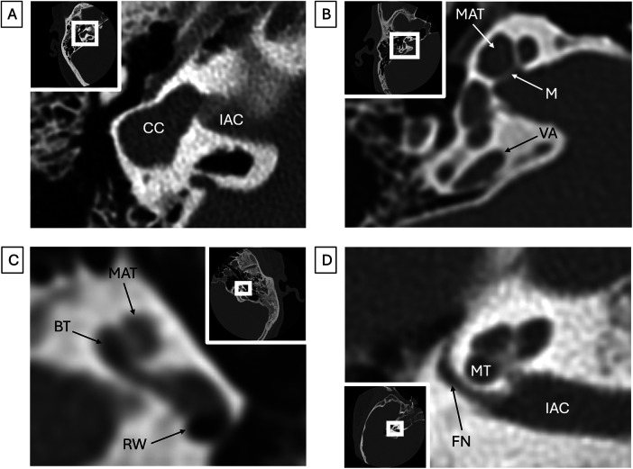
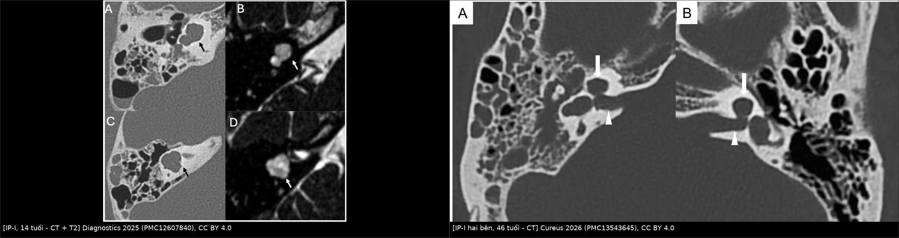
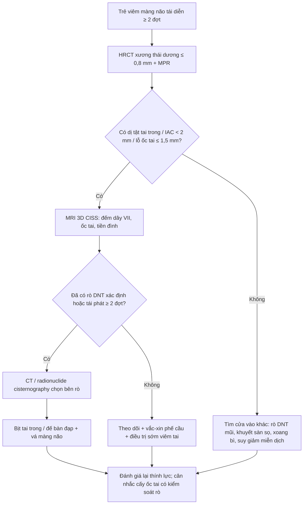
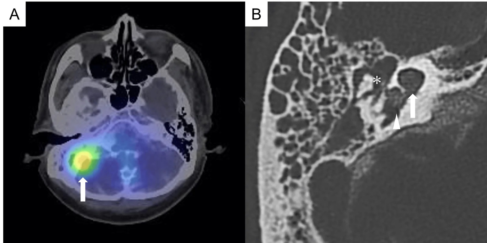
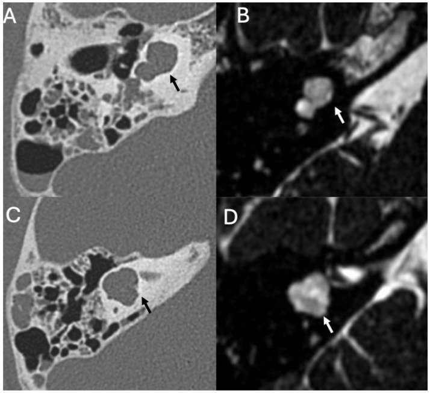
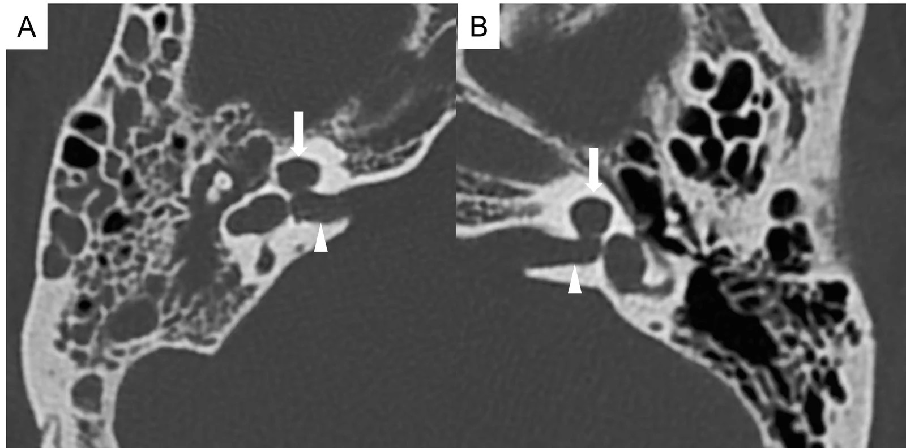
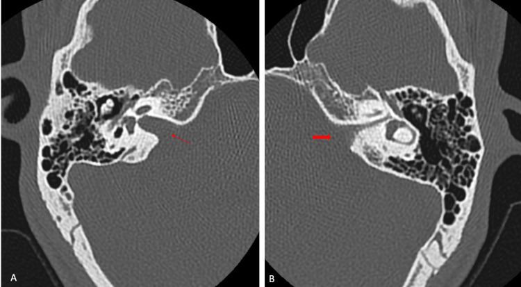

# 3062 — Viêm màng não tái diễn ở trẻ có dị tật tai trong & ốc tai hẹp (recurrent meningitis in inner ear malformation)

**Tags:** `pattern:di-tat-tai-trong` `pattern:ro-dnt` `pattern:viem-mang-nao-tai-dien` `pattern:oc-tai-hep` `pattern:u-nuoc` `vung:tai-trong` `vung:xuong-thai-duong` `vung:ong-tai-trong` `vung:nao` `anatomy:tai-trong` `protocol:HRCT-xuong-thai-duong` `protocol:MRI-3D-CISS` `protocol:CT-cisternography` `score:Sennaroglu`

**Mức chắc chắn (certainty):** tổng hợp y văn (literature synthesis) — ghép **bài tổng quan hình ảnh tai–viêm màng não** (Diagnostics 2025, PMC12607840, CC BY 4.0), **ca người lớn 46 tuổi IP-I hai bên có chụp bơm thuốc cản quang khoang dưới nhện** (Cureus 2026, PMC13543645, CC BY 4.0), **ca trẻ 7 tuổi tái phát 17 năm** (Ibrain 2024, PMC11193859, CC BY 4.0), **loạt 155 tai dị tật/94 bệnh nhi** (European Radiology 2025, PMC12559043, CC BY 4.0), **phân tích gộp 38 nghiên cứu/1.300 tai** (Otology & Neurotology 2023, PMC10348644, CC BY 4.0), **10 trẻ viêm màng não tái diễn** (Comput Math Methods Med 2022, PMC8930234, CC BY 4.0), cùng các bài về tiêu chuẩn đo và ống tai trong hẹp. Không có ca do nhóm tự chụp; số nào chỉ là suy luận của người viết đều ghi rõ.

> **Câu hỏi thực hành:** bé gái **7 tuổi** vào viện vì **đau đầu – sốt – cứng gáy lần thứ tư trong 3 năm**, lần này cấy dịch não tủy ra *Streptococcus pneumoniae*. Bé **nghe kém tai trái từ nhỏ**, không chảy tai, màng nhĩ bình thường. Câu hỏi: **vì sao một đứa trẻ lại viêm màng não tái diễn nhiều lần, chụp gì để tìm "cửa vào", đọc gì trên HRCT, và khi nào phải mổ bịt tai trong thay vì chỉ điều trị kháng sinh?**
> Bài chốt **bốn quyết định**: **(1) viêm màng não tái diễn (≥ 2 đợt, đặc biệt do phế cầu) ở trẻ phải coi là có "cửa vào" — dị tật tai trong là nguyên nhân hàng đầu, chiếm 6/10 ca trong một loạt trẻ;** **(2) HRCT xương thái dương lát ≤ 0,6–0,8 mm + MRI 3D CISS là bộ đôi bắt buộc, không đọc trên CT sọ 5 mm;** **(3) phân loại theo Sennaroglu (IP-I, IP-II/Mondini, IP-III, common cavity, ốc tai hẹp, ống tai trong hẹp) vì mỗi thể có nguy cơ rò dịch não tủy và cách mổ khác nhau;** **(4) rò đã xác định hoặc tái phát nhiều lần = bịt tai trong/miệng bàn đạp, không chờ đợt tiếp theo.** Nối [600 – Tổng quan Hệ Nhi khoa](../600-tong-quan-nhi-khoa/lesson.md), [3008 – Trật chuỗi xương con sau chấn thương](../3008-trat-chuoi-xuong-con-sau-vo-xuong-thai-duong-o-tre/lesson.md), [208 – Rò dịch não tủy qua xương đá](../208-ro-dich-nao-tuy-xuong-da/lesson.md), [497 – Theo dõi sau cấy ốc tai ở trẻ](../497-theo-doi-sau-cay-oc-tai-tre/lesson.md).

## 1. Tổng quan bệnh học – cơ chế hình ảnh

### 1.1 Vì sao dị tật tai trong lại gây viêm màng não

- **Tai trong bình thường là khoang kín.** Dịch não tủy (DNT) chỉ đến **ống tai trong (internal auditory canal, IAC)** rồi dừng ở **tấm sàng (lamina cribrosa)** — nơi dây thần kinh VII–VIII xuyên qua. Khoang dưới nhện **không thông** với khoang dịch mê đạo (perilymph/endolymph).
- **Dị tật tai trong phá vỡ hàng rào đó theo 2 kiểu:**
  1. **Mất vách xương giữa IAC và ốc tai/tiền đình** — gặp trong **incomplete partition type I (IP-I)**, **IP-III**, **common cavity**, **hẹp IAC có giãn ống**. Khi đó **DNT đi thẳng từ khoang dưới nhện → ốc tai/tiền đình → qua **đế bàn đạp khiếm khuyết** (defective stapes footplate) → tai giữa → vòi nhĩ → vòm mũi họng**. Đây là **đường rò dịch não tủy (CSF fistula)** thật sự, và là đường vi khuẩn đi ngược lên màng não.
  2. **Giãn ống tiền đình (enlarged vestibular aqueduct, EVA)** — ống nội dịch rộng bất thường, thành ống mỏng, **dễ rách màng não quanh ống** khi va đập nhẹ hoặc khi áp lực DNT dao động; EVA là **dị tật bẩm sinh hay gặp nhất kèm điếc tiếp nhận** và là nguyên nhân rò DNT ít được nghĩ tới.
- **Vì sao phế cầu:** *S. pneumoniae* cư trú vòm mũi họng; khi có **đường thông giữa vòm và khoang dưới nhện**, mỗi đợt viêm mũi họng đều có thể thành viêm màng não. Đây là lý do **cấy DNT thường ra phế cầu** và **tái phát đúng chủng** nếu không bịt đường rò.

### 1.2 Ngưỡng định lượng: bao nhiêu ca, bao nhiêu mm

- **Viêm màng não tái diễn ở trẻ và dị tật tai trong:** trong **10 trẻ** viêm màng não tái diễn, **6/10 (60%)** có dị tật tai trong hoặc dị tật sọ–mặt: **Mondini 2 ca**, **IP-I kèm giãn tiền đình 2 ca**, **common cavity 1 ca**, **Mondini + suy giảm miễn dịch dịch thể 1 ca**; các ca còn lại là rò DNT mũi, khuyết sàn sọ, xoang bì cùng cụt (PMC8930234).
- **Dị tật tai trong ở trẻ nghe kém:** **155 tai dị tật/94 bệnh nhi** trong 10 năm; **bất thường dây thần kinh ốc tai 66%**, **dây thần kinh tiền đình–ốc tai 54%**; **hẹp/tịt lỗ ốc tai (cochlear aperture atresia) làm tăng nguy cơ điếc nặng OR 2,562 (p = 0,015)**, **tịt dây ốc tai OR 2,599 (p = 0,014)** (PMC12559043).
- **Ống tai trong hẹp (narrow IAC):** định nghĩa **đường kính < 2 mm** trên HRCT (đường kính trung bình bình thường **4 mm**); chiếm khoảng **12%** các dị tật xương thái dương bẩm sinh; thường kèm **thiểu sản/tịt dây thần kinh tiền đình–ốc tai** cùng bên (PMC11461357).
- **Hẹp lỗ ốc tai (cochlear aperture stenosis):** đường kính tại **modiolus ≤ 1,5 mm** — gợi ý thiểu sản dây ốc tai, là yếu tố tiên lượng kém sau cấy ốc tai (PMC13230221).
- **EVA — hai bộ tiêu chuẩn hay dùng:** **Cincinnati: điểm giữa ống tiền đình > 0,9 mm và lỗ operculum > 1,9 mm**; **Valvassori–Clemis: điểm giữa ≥ 1,5 mm**. Bài tổng quan Frontiers in Radiology 2026 in ngưỡng Valvassori–Clemis là **0,5 mm** — chênh lệch này là **cạm bẫy đọc guideline**, vì vậy mọi báo cáo phải **ghi rõ đang dùng bộ tiêu chuẩn nào** (PMC13230221).
- **Rò DNT khi cấy ốc tai (CSF gusher):** **21/1.050 ca (2%)**, trong đó **43% có bất thường cấu trúc trên CT**; giãn tiền đình, giãn ống tiền đình và **Mondini** là các bất thường hay gặp nhất ở nhóm gusher (PMC12628539).
- **Viêm màng não sau cấy ốc tai ở tai dị tật:** **10/1.300 tai = 0,12% (95% CI 0,006–0,380%)**, gặp ở **IP 5 ca, Mondini 2, common cavity 2, giãn IAC 1**; **6/10 ca có rò DNT trong mổ** (PMC10348644) — nghĩa là **rò DNT là yếu tố quyết định**, không phải bản thân cấy ốc tai.

### 1.3 TẠI SAO hình ảnh trông như vậy (vật lý + mô bệnh)

- **CT xương thái dương (HRCT):** xương đặc **HU rất cao**, dịch/khí **HU thấp** → trên cửa sổ xương, **vỏ ốc tai và vách liên vòng (interscalar septa) hiện thành đường trắng**. Khi **vách bị mất**, vùng đáng lẽ là "nan hoa bánh xe" trở thành **một khoang dịch đen đồng nhất** — đó là dấu hiệu **"empty cyst"** của IP-I (PMC12607840).
- **Vì sao IP-I nguy hiểm:** ốc tai **kích thước bình thường nhưng không có modiolus và không có vách liên vòng**, tiền đình **giãn và biến dạng**, và **vách xương giữa IAC và ốc tai mất** → DNT vào thẳng ốc tai; chỉ cần **đế bàn đạp mỏng/khiếm khuyết** là thành đường rò ra tai giữa. Trong ca 46 tuổi, **vách xương giữa IAC và ốc tai mất hoàn toàn** và **đáy IAC giãn** (PMC13543645).
- **MRI 3D CISS/FIESTA T2:** chuỗi **T2 nặng, lát mỏng 0,5–0,8 mm**, làm nổi **dịch não tủy sáng** trong khoang dưới nhện và **dây thần kinh tối** trong IAC. Vì vậy MRI là **chuẩn để đếm dây thần kinh** (ốc tai, tiền đình, mặt) và phát hiện **tịt/thiểu sản dây ốc tai** — điều CT không làm được (PMC12559043; PMC11461357).
- **Vì sao CT bơm thuốc cản quang khoang dưới nhện (CT cisternography) tìm được chỗ rò:** bơm thuốc cản quang tan trong nước vào khoang dưới nhện; nếu có đường thông, thuốc **đi theo dòng DNT** vào ốc tai/tiền đình rồi **ra tai giữa** — trên CT thấy **thuốc tăng đậm độ trong ốc tai/tiền đình và trong sào bào**. Ca 46 tuổi: **¹¹¹In-DTPA cisternography** thấy **tích tụ bất thường ở sào bào phải**, **CT cisternography** thấy **thuốc từ IAC qua ốc tai – tiền đình vào tai giữa**, mổ xác nhận **rò tại đế bàn đạp** (PMC13543645).
- **Giới hạn vật lý:** CT **không phân biệt được dịch với mô mềm** trong khoang dịch (đều xám), nên **không thể nói "ốc tai có dịch hay tổ chức xơ"**; và **lát cắt dày 5 mm** làm **hiệu ứng một phần thể tích** xóa mất vách 1–2 mm → **dị tật bị đọc thành bình thường**. Đây là lý do **lát ≤ 0,6–0,8 mm và tái tạo đa bình diện là bắt buộc**.

### 1.4 Bệnh cảnh lâm sàng — vì sao dễ bỏ sót

- **Trẻ có thể không có triệu chứng tai:** không chảy tai, màng nhĩ bình thường, chỉ **nghe kém** — và nghe kém ở trẻ nhỏ thường bị bỏ qua. Trong loạt 10 trẻ viêm màng não tái diễn, **6 ca có dị tật tai trong** — nghĩa là **đa số nguyên nhân nằm ở tai trong**, không phải ở mũi/xoang (PMC8930234).
- **Ca trẻ 7 tuổi (PMC11193859):** đau đầu tái phát từ 7 tuổi, **17 năm** nhiều đợt viêm màng não, mỗi đợt đáp ứng kháng sinh rồi tái phát; HRCT cuối cùng cho thấy **IAC trái hẹp hơn phải**, mổ thấy **DNT rỉ quanh bàn đạp** và **bục DNT khi lấy bàn đạp** — nghĩa là **chẩn đoán đến muộn 17 năm** vì không ai chụp HRCT xương thái dương.
- **Ca người lớn 46 tuổi (PMC13543645):** **IP-I hai bên**, điếc nặng từ nhỏ, nhiều đợt viêm màng não kèm **viêm tai giữa cấp phải**; sau khi bịt tai trong phải **không tái phát** trong thời gian theo dõi.

## 2. Mẫu hình + chẩn đoán phân biệt theo vị trí (gamut)

**Mẫu hình chính:** **trẻ viêm màng não tái diễn + HRCT có bất thường cấu trúc tai trong** — một trong các kiểu: **khoang dịch đơn độc thay cho ốc tai** (IP-I/common cavity), **mất vách liên vòng + giãn ống tiền đình** (IP-II), **IAC hẹp < 2 mm**, **lỗ ốc tai ≤ 1,5 mm**, hoặc **ống tiền đình giãn**.

| Vị trí / kiểu dị tật | Hình ảnh chốt trên HRCT / MRI | Gamut cần loại trừ |
|---|---|---|
| **Ốc tai — IP-I** | Ốc tai **kích thước bình thường, KHÔNG modiolus, KHÔNG vách liên vòng** → "empty cyst"; tiền đình giãn; **mất vách IAC–ốc tai** | IP-III (có vách liên vòng nhưng mất modiolus + IAC giãn), common cavity, ốc tai xơ hóa sau viêm màng não |
| **Ốc tai — IP-II (Mondini)** | **Hợp nhất vòng giữa–đỉnh**, modiolus khiếm khuyết, **EVA kèm theo**; vòng đáy còn nhận diện | IP-I, cochlear hypoplasia (ốc tai nhỏ), EVA đơn thuần |
| **Ốc tai — IP-III** | **Mất modiolus, còn vách liên vòng, đáy IAC giãn**; điếc tiếp nhận, di truyền liên kết X (DFNX2) | IP-I, giãn IAC đơn thuần, dị tật mạch |
| **Common cavity** | **Một khoang duy nhất** thay cho ốc tai + tiền đình, **thông rộng với IAC giãn** | IP-I nặng, ốc tai thiểu sản nặng, nang màng nhện xương |
| **Ống tai trong (IAC)** | **Đường kính < 2 mm** (bình thường ~4 mm); có thể kèm **vách xương chia đôi** hoặc **dây thần kinh không thấy trên 3D CISS** | Hẹp do loạn sản xương, u IAC nhỏ, IAC giãn (ngược lại) |
| **Lỗ ốc tai (cochlear aperture)** | **Đường kính tại modiolus ≤ 1,5 mm**; dây ốc tai thiểu sản/tịt trên MRI | Hẹp do xơ hóa sau viêm màng não, dây ốc tai bình thường nhưng mảnh |
| **Ống tiền đình (EVA)** | **Điểm giữa > 0,9 mm (Cincinnati) hoặc ≥ 1,5 mm (Valvassori–Clemis)**, operculum > 1,9 mm; **thường hai bên** | Giãn ống bán khuyên sau (đường kính tương đương EVA không giãn), ống nội dịch to nhưng không giãn xương |

*Nguồn: Frontiers in Radiology 2026 (PMC13230221), CC BY 4.0.*

- **Gamut theo cơ chế "cửa vào" của viêm màng não tái diễn ở trẻ:** **(a) dị tật tai trong** (bài này), **(b) rò DNT qua xương đá/mũi** (bài 208), **(c) khuyết sàn sọ bẩm sinh**, **(d) xoang bì cùng cụt/da**, **(e) suy giảm miễn dịch** — trong loạt 10 trẻ, **6 ca là (a)**, 4 ca còn lại chia đều (b)–(e) (PMC8930234).
- **Mẹo nhớ 4 câu hỏi khi đọc HRCT trẻ viêm màng não tái diễn:** **(1) ốc tai có modiolus/vách không? (2) tiền đình và ống tiền đình có giãn không? (3) IAC có < 2 mm không? (4) lỗ ốc tai có ≤ 1,5 mm không?** — trả lời 4 câu này là đủ để không bỏ sót thể gây rò.

## 3. Bảng so sánh phân biệt (ma trận đối chiếu)

| Thực thể (entity) | Hình ảnh điển hình (HRCT / MRI 3D CISS) | Chốt vào (rule-in) | Chốt loại (rule-out) | Gợi ý xác nhận |
|---|---|---|---|---|
| **IP-I (incomplete partition type I)** | Ốc tai **"empty cyst"**: không modiolus, không vách liên vòng; tiền đình giãn; **mất vách IAC–ốc tai** | **Mất cả modiolus VÀ vách liên vòng + mất vách IAC–ốc tai** trên lát ≤ 0,6 mm | Còn vách liên vòng → IP-III; ốc tai nhỏ → cochlear hypoplasia | HRCT đa bình diện + MRI T2 thấy dịch vào ốc tai; đối chiếu bệnh sử viêm màng não |
| **IP-II (Mondini)** | **Hợp nhất vòng giữa–đỉnh**, modiolus khiếm khuyết, **EVA** | **Hợp nhất vòng giữa–đỉnh + EVA** | Vòng giữa–đỉnh tách rời → ốc tai bình thường; mất cả vách → IP-I | HRCT thì ngang + MRI; đo ống tiền đình |
| **IP-III** | **Mất modiolus, CÒN vách liên vòng, đáy IAC giãn**; thường nam, điếc tiến triển | **Đáy IAC giãn + mất modiolus + còn vách** | Mất vách liên vòng → IP-I; IAC bình thường → dị tật khác | MRI + tư vấn di truyền (DFNX2) |
| **Common cavity** | **Một khoang duy nhất** ốc tai + tiền đình, thông với **IAC giãn** | **Không phân biệt được ốc tai và tiền đình trên mọi bình diện** | Còn vòng ốc tai → IP-I/CH | HRCT + MRI; đánh giá dây thần kinh trước cấy ốc tai |
| **Hẹp IAC (narrow IAC)** | **Đường kính < 2 mm**, thường một bên; **dây thần kinh không thấy/teo trên 3D CISS** | **< 2 mm đo tại đáy IAC** + thiểu sản dây VII–VIII | IAC 2–4 mm với dây mảnh → thiểu sản dây đơn thuần | MRI 3D CISS bắt buộc trước khi kết luận |
| **Hẹp lỗ ốc tai** | **≤ 1,5 mm tại modiolus**; dây ốc tai nhỏ/tịt | **≤ 1,5 mm + dây ốc tai không thấy** | Lỗ ốc tai bình thường nhưng dây mảnh → thiểu sản dây | MRI 3D CISS; tiên lượng cấy ốc tai |
| **EVA đơn thuần** | **Điểm giữa > 0,9 mm (Cincinnati) / ≥ 1,5 mm (Valvassori)**, **hai bên**; ốc tai bình thường | **Giãn ống tiền đình + ốc tai bình thường** | Giãn ống bán khuyên sau → không phải EVA | Đo trên HRCT; so sánh ống bán khuyên sau |
| **Rò DNT không do dị tật (sau chấn thương/viêm)** | Đường vỡ xương đá, **pneumolabyrinth**, mất liên tục tegmen; ốc tai bình thường | **Tiền sử chấn thương/viêm + đường vỡ + khí trong mê đạo** | Cấu trúc tai trong bẩm sinh bất thường → dị tật | HRCT + CT cisternography; nối bài 208 |

- **Ảnh ghép đối chiếu:**  — trái: **IP-I ở trẻ 14 tuổi** (CT: ốc tai dạng nang không modiolus/vách; T2: dịch vào ốc tai và tiền đình giãn); phải: **IP-I hai bên ở người 46 tuổi** (CT: mất vách IAC–ốc tai, đáy IAC giãn). Tạo bằng `tools/make_composite.py` (letterbox, giữ tỉ lệ).

## 4. Protocol chụp + hệ phân độ/điểm chuẩn hóa

### 4.1 Protocol

- **Bước 1 — HRCT xương thái dương:** lát **≤ 0,6–0,8 mm**, **không cản quang**, cửa sổ xương; tái tạo **thì ngang, thì vành và MPR theo trục IAC**. Đây là **bước sàng lọc đầu tay** vì phát hiện được mất vách, giãn tiền đình, hẹp IAC, hẹp lỗ ốc tai (PMC12607840; PMC13230221).
- **Bước 2 — MRI 3D CISS/FIESTA T2** (lát 0,5–0,8 mm): **đếm và đo dây thần kinh VII, ốc tai, tiền đình**; phát hiện **tịt/thiểu sản dây ốc tai** — quyết định **có cấy ốc tai được không**. MRI **không thay** HRCT để đánh giá vách xương, và HRCT **không thay** MRI để đánh giá dây thần kinh (PMC12559043; PMC11461357).
- **Bước 3 — xác định chỗ rò khi đã có dị tật + viêm màng não tái diễn:**
  - **CT cisternography:** bơm thuốc cản quang tan nước vào khoang dưới nhện (qua chọc dò tủy sống), chụp **lát mỏng qua xương thái dương**; tìm **thuốc trong ốc tai/tiền đình/tai giữa**. Ca 46 tuổi: thuốc đi từ **IAC → ốc tai → tiền đình → tai giữa**, xác nhận rò (PMC13543645).
  - **Radionuclide cisternography (¹¹¹In-DTPA):** nhạy với **rò lưu lượng thấp**, thấy **tích tụ bất thường ở sào bào** sau 6 giờ; bổ trợ cho CT cisternography (PMC13543645).
  - **Lưu ý thực hành:** cisternography **chỉ nên làm khi kết quả sẽ thay đổi phẫu thuật** (chọn bên mổ khi dị tật hai bên, hoặc nghi rò ngoài tai trong).
- **Bước 4 — trước khi cấy ốc tai:** đánh giá **kích thước IAC, lỗ ốc tai, sự hiện diện dây ốc tai, bất thường dây mặt** để lên kế hoạch **đường vào và dự phòng gusher**; ghi rõ **nguy cơ rò DNT** trong báo cáo (PMC13230221; PMC12628539).
- **Bước 5 — dự phòng:** **vắc-xin phế cầu đầy đủ**, điều trị sớm viêm tai giữa, và **tư vấn tránh va đập đầu** (EVA) — không thay thế được phẫu thuật khi đã rò.

### 4.2 Phân loại Sennaroglu (bản rút gọn dùng trong báo cáo)

| Thể | Đặc điểm xương | Nguy cơ rò DNT / gusher | Ghi chú |
|---|---|---|---|
| **Michel** | Không có cấu trúc tai trong | Không mổ được | Hiếm; điếc sâu |
| **Rudimentary otocyst** | Túi nhỏ không ốc tai | Trung bình | Không cấy ốc tai thường quy |
| **Cochlear aplasia** | Không có ốc tai, có tiền đình | Trung bình | — |
| **Common cavity** | Một khoang chung, thông IAC | **Cao** | Gusher hay gặp; cần bịt ống |
| **Cochlear hypoplasia I–IV** | Ốc tai nhỏ, thiếu vòng | Trung bình–cao (CH-II) | Đánh giá dây trước mổ |
| **Incomplete partition I** | Mất modiolus + vách liên vòng, mất vách IAC–ốc tai | **Cao nhất** | Điển hình của viêm màng não tái diễn |
| **Incomplete partition II (Mondini)** | Hợp nhất vòng giữa–đỉnh + EVA | Trung bình | Hay gặp nhất trong loạt 155 tai |
| **Incomplete partition III** | Mất modiolus, còn vách, IAC giãn | **Cao** | Di truyền liên kết X |
| **EVA** | Ống tiền đình giãn, ốc tai bình thường | Trung bình (rò lưu lượng thấp) | Hay bị bỏ qua |
| **Dị tật dây thần kinh** | IAC/lỗ ốc tai hẹp, dây thiểu sản | Không tăng rò nhưng **tiên lượng cấy kém** | MRI là chìa khóa |

### 4.3 Thuật toán xử trí

*Nguồn: Cureus 2026 (PMC13543645), CC BY 4.0.*

- **Nguyên tắc vàng:** **không được coi "viêm màng não đã khỏi" là "đã xử lý xong"** — nếu còn đường rò, đợt sau có thể tử vong hoặc để lại di chứng thần kinh. Trong loạt 10 trẻ, **6 ca được điều trị đích theo nguyên nhân** (gồm **mổ bịt rò** ở các ca dị tật tai trong) và hết tái phát (PMC8930234).
- **Khi nào mổ:** (1) **rò DNT đã xác định trên cisternography/lâm sàng**; (2) **≥ 2 đợt viêm màng não** dù chưa thấy rò rõ, khi đã có dị tật nguy cơ cao (IP-I, IP-III, common cavity); (3) **gusher lượng lớn khi đang cấy ốc tai** — phải bịt ngay trong cùng thì (PMC12628539).
- **Kỹ thuật:** bịt **cửa sổ bầu dục/đế bàn đạp** bằng mô tự thân (cân/mỡ), **bịt tai trong (inner ear obliteration)** khi ốc tai không còn chức năng, hoặc **vá màng não qua đường hố sọ giữa** khi rò ở trần hốc. Ca 46 tuổi được **bịt tai trong phải** và **hết tái phát** (PMC13543645).
- **Cấy ốc tai ở tai dị tật:** **không phải chống chỉ định tuyệt đối**, nhưng phải **đánh giá dây ốc tai trước**, **dự phòng gusher**, và **tư vấn nguy cơ viêm màng não 0,12%** (PMC10348644; PMC12628539).

## 5. Biến thể bình thường và cạm bẫy

- **"Ốc tai chỉ có 2 vòng" trên lát cắt ngang** có thể là **lát cắt không qua trục ốc tai**, không phải dị tật — luôn tái tạo **MPR theo trục ốc tai** trước khi kết luận.
- **EVA hai bên ở người lớn không triệu chứng:** giãn ống tiền đình có thể **không gây viêm màng não**; chỉ theo dõi. **Không mổ dựa trên hình ảnh đơn thuần** — cần bệnh sử tái phát hoặc rò xác định.
- **Nhầm IAC hẹp với "IAC bình thường nhưng dây mảnh":** đo **đường kính xương**, không đo dây; và **luôn đọc 3D CISS** để xem dây có thật sự thiểu sản không (PMC11461357).
- **Hẹp lỗ ốc tai ≠ chống chỉ định cấy ốc tai tuyệt đối:** một số trẻ vẫn đạt hiểu lời nói tốt; nhưng **phải tư vấn tiên lượng** và **không hứa kết quả** (PMC13230221).
- **Bỏ sót dị tật vì chỉ đọc CT sọ:** viêm màng não tái diễn thường được chụp **CT sọ 5 mm**; xương thái dương trên lát dày **bị nhiễu một phần thể tích** → **dị tật nhỏ biến mất**. Bắt buộc **HRCT xương thái dương riêng**.
- **"Không có dịch trong tai giữa" không loại trừ rò:** rò có thể **ngắt quãng**, và DNT có thể thoát qua vòi nhĩ mà không ứ đọng tai giữa.
- **Sau cấy ốc tai, viêm màng não có thể do chính điện cực/đường vào** — phân biệt với rò bẩm sinh bằng **thời điểm** (sớm sau mổ) và **hình ảnh đường hầm điện cực** (PMC10348644).
- **Đừng quên nguyên nhân ngoài tai:** trong 10 trẻ, **4 ca không phải dị tật tai trong** (rò mũi, khuyết sàn sọ, xoang bì, suy giảm miễn dịch) — **"satisfaction of search"** khi thấy một dị tật nhẹ có thể bỏ sót ổ rò thật (PMC8930234).

## 6. Tự lượng giá — Blind Quiz

**Ca 1 — Trẻ 14 tuổi, viêm màng não do phế cầu tái diễn, nghe kém hai bên**

- Gợi ý lâm sàng: nhiều đợt viêm màng não do *S. pneumoniae*; không chảy tai.
- Câu hỏi: (1) Ốc tai thiếu cấu trúc gì? (2) Tiền đình có bất thường không? (3) Vì sao dị tật này gây viêm màng não tái diễn?

<b>Bấm để hiện đáp án (findings + chẩn đoán)</b>

- Dấu hiệu: **(A, C) HRCT** — ốc tai là **một khoang dịch đơn độc, không thấy modiolus và vách liên vòng** (mũi tên); **tiền đình giãn, biến dạng**. **(B, D) T2 nặng** — dịch lấp đầy ốc tai và tiền đình.
- Chẩn đoán: **incomplete partition type I (IP-I)** hai bên — mất modiolus + mất vách liên vòng + mất vách xương IAC–ốc tai.
- Vì sao: DNT đi thẳng từ khoang dưới nhện vào ốc tai/tiền đình, rồi qua **đế bàn đạp khiếm khuyết** ra tai giữa → đường vào của phế cầu.
- Nguồn ảnh: *Diagnostics* 2025, Figure 3 — **PMC12607840**, CC BY 4.0 (nguyên bản, không crop).

**Ca 2 — Nam 46 tuổi, điếc nặng hai bên từ nhỏ, viêm màng não tái diễn kèm viêm tai giữa phải**

- Gợi ý lâm sàng: nhiều đợt viêm màng não; đợt gần nhất kèm viêm tai giữa cấp phải; đã loại trừ suy giảm miễn dịch.
- Câu hỏi: (1) Mô tả bất thường ở vách IAC–ốc tai hai bên. (2) Làm gì để chọn bên mổ? (3) Nếu bơm thuốc cản quang vào khoang dưới nhện, bạn kỳ vọng thấy gì?

<b>Bấm để hiện đáp án (findings + chẩn đoán)</b>

- Dấu hiệu: **vách xương giữa IAC và ốc tai mất hai bên**, **đáy IAC giãn**, ốc tai mất vách liên vòng; tai phải có **dịch trong sào bào/tai giữa**.
- Chẩn đoán: **IP-I hai bên**, rò DNT **bên phải** (bên có viêm tai giữa cấp).
- Xử trí: **radionuclide cisternography + CT cisternography** — thấy **tích tụ ¹¹¹In ở sào bào phải** và **thuốc từ IAC → ốc tai → tiền đình → tai giữa**; mổ **bịt tai trong phải**, xác nhận **rò tại đế bàn đạp**; không tái phát.
- Vì sao: dị tật hai bên nhưng **triệu chứng bên phải** quyết định bên mổ — không mổ "bên xấu hơn trên hình".
- Nguồn ảnh: *Cureus* 2026, Figure 2 — **PMC13543645**, CC BY 4.0 (nguyên bản, không crop).

**Ca 3 — Nam 29 tuổi, nghe kém trái + liệt mặt trái, HRCT đo IAC**

- Gợi ý lâm sàng: nghe kém tiếp nhận trái tiến triển, liệt mặt trái; không chấn thương.
- Câu hỏi: (1) Đo đường kính IAC hai bên. (2) Dị tật này gợi ý gì về dây thần kinh? (3) Có cấy ốc tai được không?

<b>Bấm để hiện đáp án (findings + chẩn đoán)</b>

- Dấu hiệu: **IAC phải 4,0 mm (bình thường)**, **IAC trái 1,4 mm** — **hẹp IAC** (< 2 mm), kèm một **ống xương nhỏ phía trước trên** (bất thường kèm theo).
- Chẩn đoán: **hẹp ống tai trong trái** — thường kèm **thiểu sản/tịt dây thần kinh tiền đình–ốc tai**; giải thích **nghe kém tiếp nhận + liệt mặt** cùng bên.
- Cấy ốc tai: **phải có MRI 3D CISS**; nếu **không thấy dây ốc tai** → **không phải ứng viên tốt**, cân nhắc **cấy thân não thính giác (ABI)**; nếu còn dây → cấy được nhưng tiên lượng thận trọng.
- Vì sao: **xương hẹp chèn dây** trong quá trình phát triển → dây teo; **đo xương, đọc dây**.
- Nguồn ảnh: *Cureus* 2024, Figure 2 — **PMC11461357**, CC BY 4.0 (nguyên bản, không crop).

## Bài liên quan chéo
- [600 – Tổng quan Hệ Nhi khoa](../600-tong-quan-nhi-khoa/lesson.md)
- [3008 – Trật/gián đoạn chuỗi xương con sau chấn thương xương thái dương ở trẻ](../3008-trat-chuoi-xuong-con-sau-vo-xuong-thai-duong-o-tre/lesson.md)
- [208 – Rò dịch não tủy qua xương đá ở trẻ](../208-ro-dich-nao-tuy-xuong-da/lesson.md)
- [497 – Theo dõi sau cấy ốc tai ở trẻ](../497-theo-doi-sau-cay-oc-tai-tre/lesson.md)
- [1704 – Viêm tai giữa mạn/cholesteatoma ở trẻ](../1704-vtg-man-cholesteatoma-tre-cay-oc-tai/lesson.md)
- [1713 – Cholesteatoma xương đá ở trẻ](../1713-cholesteatoma-xuong-da-o-tre/lesson.md)

## Ảnh
- `images/3062_vmd-tai-trong_CT_PMC12607840-F3.jpg` — IP-I ở trẻ 14 tuổi, HRCT + T2 nặng; *Diagnostics* 2025 (PMC12607840), CC BY 4.0.
- `images/3062_vmd-tai-trong_CT_PMC13543645-F2.jpg` — IP-I hai bên ở người 46 tuổi; *Cureus* 2026 (PMC13543645), CC BY 4.0.
- `images/3062_vmd-tai-trong_CT_PMC13230221-F5.jpg` — 4 kiểu dị tật tai trong (common cavity, IP-II, cochlear hypoplasia, dây mặt lạc); *Frontiers in Radiology* 2026 (PMC13230221), CC BY 4.0.
- `images/3062_iac-hep_CT_PMC11461357-F2.jpg` — IAC phải 4,0 mm vs trái 1,4 mm; *Cureus* 2024 (PMC11461357), CC BY 4.0.
- `images/3062_cisternography_CT_PMC13543645-F3.jpg` — radionuclide + CT cisternography xác định rò; *Cureus* 2026 (PMC13543645), CC BY 4.0.
- `images/composite_vmd-tai-trong-IP1_CT.jpg` — ảnh ghép 2 ô IP-I (14 tuổi và 46 tuổi), tạo bằng `tools/make_composite.py`.
- Ghi công đầy đủ + giấy phép từng file: `images/CREDITS.md`.

> Không dùng để chẩn đoán độc lập khi chưa có người hướng dẫn.
