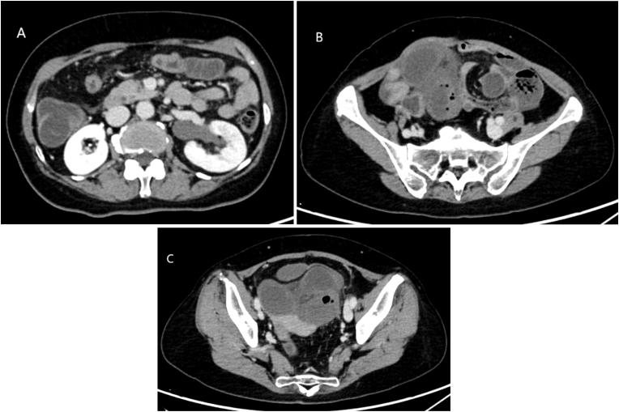
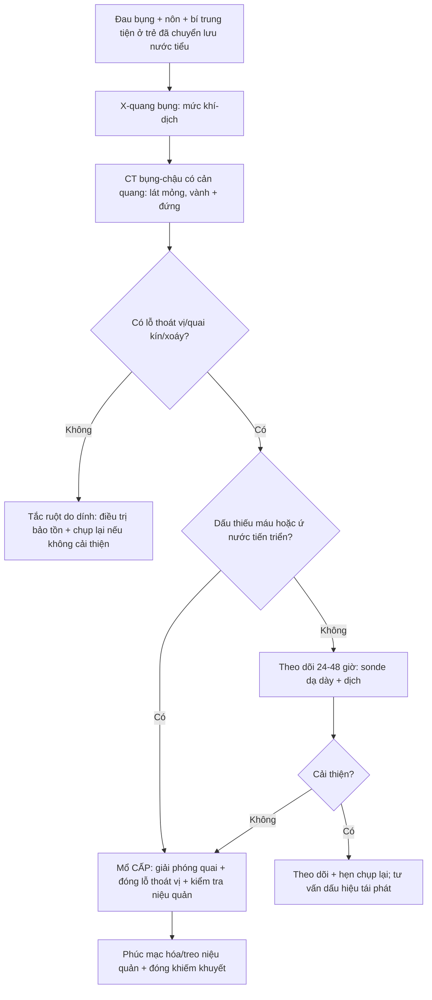
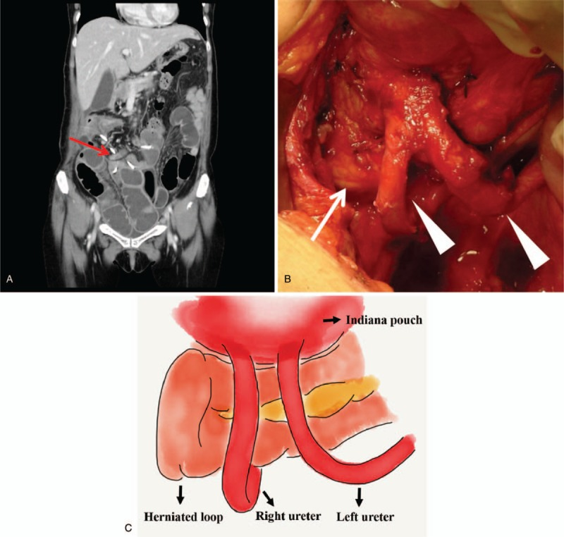
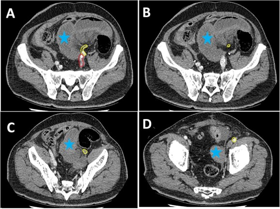

# 3063 — Thoát vị nội và thoát vị cạnh lỗ thông sau chuyển lưu nước tiểu ở trẻ / Internal and parastomal hernia after urinary diversion in children

**Tags:** `pattern:thoat-vi-noi` `pattern:thoat-vi-canh-lo-thong` `pattern:tac-ruot-non` `pattern:xoan-ruot` `pattern:u-nuoc-than` `vung:tiet-nieu` `vung:tieu-khung` `vung:o-bung` `anatomy:phuc-mac-tieu-khung` `protocol:CT-bung-chau` `protocol:noi-soi-o-bung` `protocol:phau-thuat`
**Mức chắc chắn (certainty):** tổng hợp y văn (literature synthesis) — ghép **ca thoát vị nội quanh niệu quản sau cấy ghép lại niệu quản + tổng quan 15 ca từ 1981** (Urol Case Rep 2026, PMC13400766), **2 ca thoát vị nội khoảng giữa hai niệu quản sau chuyển lưu** (Medicine 2019, PMC6799691), **ca thoát vị nội dưới động mạch chậu ngoài** (J Surg Case Rep 2023, PMC10024612), **ca thoát vị nội giữa niệu quản và cân ngang** (J Surg Case Rep 2024, PMC10958610), **loạt 31 trẻ có kênh tiểu tự CIC (Mitrofanoff)** (Pediatr Surg Int 2025, PMC12474596), **tổng quan hệ thống thoát vị cạnh lỗ thông sau cắt bàng quang robot** (J Robot Surg 2026, PMC13269518) và **tổng quan về thoát vị cạnh lỗ thông sau ileal conduit** (Urol Clin North Am 2026, PMID 42823049). Không có ca do nhóm tự chụp.

> **Câu hỏi thực hành:** bé trai **9 tuổi**, bàng quang thần kinh, đã **tăng dung tích bàng quang + Mitrofanoff** cách đây **4 năm**, vào viện vì **đau bụng từng cơn + nôn + bí trung tiện 18 giờ**; bụng chướng, **không sốt**, siêu âm thấy **ứ nước thận trái nhẹ**. Câu hỏi: **đây là tắc ruột do dính, hay thoát vị nội — và có phải mổ ngay không?**
> Bài chốt **ba quyết định**: **(1) ở trẻ đã chuyển lưu nước tiểu, tắc ruột non phải được đọc là "thoát vị nội cho tới khi chứng minh ngược" — dính chỉ là chẩn đoán loại trừ; (2) CT bụng–chậu có cản quang là chuẩn, tìm lỗ thoát vị + quai kín + dấu xoáy, và luôn đo niệu quản/thận vì thoát vị có thể chèn niệu quản; (3) dấu hoại tử ruột hoặc chèn niệu quản = mổ cấp, không chờ; thoát vị cạnh lỗ thông không biến chứng thì theo dõi.** Nối [3009 – Dò bàng quang–ruột sau tăng dung tích bàng quang](../3009-do-bang-quang-ruot-sau-tang-dung-tich-bang-quang-o-tre/lesson.md), [3001 – Hẹp lỗ thông Mitrofanoff](../3001-hep-lo-thong-mitrofanoff-o-tre/lesson.md), [3010 – Hẹp miệng nối niệu quản–bàng quang](../3010-hep-mien-noi-nieu-quan-bang-quang-o-tre/lesson.md), [672 – Biến chứng muộn sau tái tạo bàng quang bằng ruột](../672-bien-chung-muon-sau-tai-tao-bang-quang/lesson.md).

## 1. Tổng quan bệnh học – cơ chế hình ảnh: vì sao chuyển lưu nước tiểu tạo ra lỗ thoát vị

- **Định nghĩa:** **thoát vị nội (internal hernia)** là quai ruột chui qua **lỗ bẩm sinh hoặc mắc phải** trong phúc mạc/mạc treo vào **một khoang giải phẫu bất thường**, gây **tắc và/hoặc thiếu máu ruột**. **Thoát vị cạnh lỗ thông (parastomal hernia)** là quai ruột chui qua **khiếm khuyết cân quanh lỗ thông da** (Mitrofanoff, ileal conduit, ureterocutaneostomy).
- **Vì sao phẫu thuật tiết niệu tạo lỗ thoát vị:** khi niệu quản được **đưa vào ổ phúc mạc** (cấy ghép lại xuyên phúc mạc, chuyển lưu qua ổ bụng), niệu quản trở thành **một "dây" bắc qua tiểu khung**; khoảng giữa **niệu quản – bàng quang – phúc mạc bên – cơ thắt lưng** trở thành **lỗ thoát vị thật** (paraureteral space). Tương tự, **mạc treo ống dẫn lưu** và **lỗ mở cân** cho lỗ thông da tạo ra **khiếm khuyết cố định** mà ruột có thể chui qua.
- **Tần suất và mức nguy hiểm (số liệu định lượng):** thoát vị nội gặp **0,2–0,5%** dân số và chiếm **1–3%** các ca tắc ruột cơ học; **hơn 50%** thoát vị nội hiện nay là **mắc phải sau mổ**, chủ yếu sau mổ tiểu khung và sau phúc mạc. **Tỷ lệ hoại tử ruột 30–50%**, và **can thiệp muộn làm tử vong vượt 20%** (PMC13400766).
- **Bằng chứng sau cấy ghép lại niệu quản:** từ **1981** y văn ghi **15 ca** tắc ruột do thoát vị nội sau cấy ghép lại niệu quản; **12 ca được chụp CT trước mổ**, trong đó **8 ca (67%)** CT thấy **giãn bể thận/niệu quản** — tức **chèn niệu quản là dấu hiệu đi kèm thường gặp**, không phải biến chứng hiếm (PMC13400766).
- **TẠI SAO CT là chuẩn vàng:** lỗ thoát vị là **khiếm khuyết cân/mạc treo** — chỉ thấy khi **bơm cản quang đủ** và **cắt lớp mỏng đa bình diện**. Ba dấu hiệu cốt lõi: **(a) quai kín (closed loop)** — hai điểm tắc trên cùng một quai; **(b) dấu xoáy (whirl sign)** — mạc treo và mạch xoắn quanh trục; **(c) dấu mỏ chim (beak sign)** — quai ruột vuốt nhọn tại lỗ thoát vị. Kèm **giảm ngấm thành ruột, phù mạc treo, dịch tự do** = dấu **thiếu máu**, chỉ định mổ cấp.
- **TẠI SAO thoát vị nội lại chèn niệu quản:** niệu quản là **cấu trúc cố định** chạy trong tiểu khung; khi quai ruột chui vào khoang quanh niệu quản và **căng lên**, niệu quản bị **kéo/gập** → **ứ nước trên chỗ gập**. Vì vậy **ứ nước một bên ở trẻ đã cấy ghép lại niệu quản + đau bụng cấp** phải đọc là **thoát vị nội**, không phải "hẹp miệng nối" (bài 3010).
- **TẠI SAO trẻ khác người lớn:** thành bụng mỏng, **áp lực ổ bụng tăng do táo bón mạn và co cứng cơ** ở bệnh nhi bàng quang thần kinh, **suy dinh dưỡng** (thiếu mỡ che lỗ thoát vị), và **nhiều lần mổ bụng** — tất cả làm **lỗ thoát vị dễ mở và khó chẩn đoán** vì **lượng mỡ ít, dấu hiệu trên CT kém rõ**.
- **Tần suất thoát vị cạnh lỗ thông:** sau **ileal conduit**, thoát vị cạnh lỗ thông gặp **tới 30%**, **1/3 có triệu chứng**, và **15% phải mổ** (Urol Clin North Am 2026, PMID 42823049). Ở trẻ có **kênh tiểu tự CIC (Mitrofanoff)**, loạt **31 trẻ** ghi **7 rối loạn kênh ở 6 trẻ** (từ **1 tháng đến 9 năm**), trong đó **1 thoát vị cạnh lỗ thông**; xử trí **2 bảo tồn, 2 nội soi, 3 mổ mở** (PMC12474596) — tức **biến cố hiếm nhưng có thật**, và **không phải mọi thoát vị cạnh lỗ thông đều phải mổ**.

## 2. Mẫu hình + chẩn đoán phân biệt theo VỊ TRÍ lỗ thoát vị (Gamut)

- **Theo vị trí (quyết định đường mổ và nguy cơ chèn niệu quản):**
  - **Quanh niệu quản (paraureteral):** giữa **niệu quản – bàng quang – phúc mạc bên/cơ thắt lưng**; hay sau **cấy ghép lại niệu quản xuyên phúc mạc**; **chèn niệu quản → ứ nước**.
  - **Giữa hai niệu quản (interureteric):** sau **chuyển lưu** khi hai niệu quản bắt chéo tạo **hình chữ U**; quai ruột chui vào giữa.
  - **Dưới động mạch chậu ngoài (beneath EIA):** sau **vét hạch tiểu khung/chuyển lưu**; nguy cơ **xoắn và hoại tử cao** vì lỗ hẹp.
  - **Qua mạc treo ống dẫn lưu / lỗ mở cân:** thoát vị **cạnh lỗ thông** hoặc **qua khiếm khuyết mạc treo** của đoạn ruột làm ống dẫn lưu.
  - **Khoang Petersen và các khoang sau mổ khác:** sau mổ tiểu khung rộng.
- **Theo thời điểm:** **sớm ≤ 30 ngày** (phù nề, chưa dính — lỗ thoát vị còn mở), **muộn > 30 ngày** (dính co kéo tạo lỗ cố định; thường **tháng đến năm** sau mổ).
- **Mnemonic "HERNIA":** **H**ernia qua lỗ mạc treo/ổ phúc mạc, **E**xtra-ureteric (quanh niệu quản), **R**etro-ureteric (sau niệu quản), **N**arrow orifice (nguy cơ hoại tử), **I**nterureteric (giữa hai niệu quản), **A**cquired post-op (> 50%).
- **Phân biệt với "tắc ruột do dính" — nguyên tắc:** dính **không có lỗ thoát vị** trên CT; nếu thấy **quai kín + lỗ thoát vị + dấu xoáy**, chẩn đoán là **thoát vị nội** và **mổ sớm hơn**, vì dính ít khi gây hoại tử nhanh như thoát vị nội.

## 3. Bảng so sánh phân biệt (ma trận đối chiếu)

| Thực thể (entity) | Hình ảnh điển hình | Chốt vào (rule-in) | Chốt loại (rule-out) | Gợi ý xác nhận |
|---|---|---|---|---|
| **Thoát vị nội quanh niệu quản** | CT: **quai ruột chui qua khoảng giữa niệu quản và thành chậu**, **dấu xoáy**, **quai kín**, **ứ nước–niệu quản cùng bên** | **Lỗ thoát vị thấy được + quai kín + ứ nước một bên** | Chỉ có giãn ruột lan tỏa, không lỗ thoát vị → **dính/liệt ruột** | CT bụng–chậu có cản quang, vành + đứng |
| **Thoát vị nội giữa hai niệu quản** | CT vành: **quai ruột nằm giữa hai niệu quản** hình chữ U, hai niệu quản bắt chéo phía trên | **Hai niệu quản tạo thành vòng + quai ruột nằm trong vòng** | Một niệu quản đơn thuần bị đẩy lệch → **không phải** | CT vành; dựng 3D đường niệu quản |
| **Thoát vị nội dưới động mạch chậu ngoài** | CT trục: **quai ruột kẹt giữa ĐM chậu ngoài và thành chậu**, mạch **bị đè**, ruột **giảm ngấm** | **ĐM chậu ngoài là bờ trên của lỗ thoát vị + dấu thiếu máu** | Ruột nằm cạnh mạch nhưng **không kẹt** → không phải | CTA/CT có cản quang; mổ nội soi thăm dò |
| **Thoát vị cạnh lỗ thông (Mitrofanoff/ileal conduit)** | CT: **khiếm khuyết cân quanh lỗ thông**, quai ruột **dưới da cạnh lỗ thông**, có thể **hẹp lòng ống dẫn lưu** | **Lỗ thông + khối dưới da cạnh lỗ + khiếm khuyết cân đo được** | Chỉ **sa niêm mạc/hẹp lỗ thông** không có quai ruột → **không phải thoát vị** | Khám + CT; siêu âm khi mang thai/trẻ nhỏ |
| **Hẹp lỗ thông Mitrofanoff (bài 3001)** | Không có quai ruột; **lỗ thông hẹp, đặt catheter khó**, bể chứa căng | **Đặt catheter thất bại + không có khối cạnh lỗ** | Có **khối cạnh lỗ thông + quai ruột** → thoát vị | Soi lỗ thông; CT nếu nghi |
| **Tắc ruột do dính** | Nhiều **dải dính**, **chuyển tiếp** rõ, **không lỗ thoát vị**, không quai kín | **Tiền sử mổ + chuyển tiếp + không lỗ thoát vị** | Có **lỗ thoát vị/quai kín/xoáy** → thoát vị nội | CT; theo dõi đáp ứng điều trị bảo tồn |
| **Ứ nước do hẹp miệng nối niệu quản (bài 3010)** | **Hẹp khu trú tại miệng nối**, niệu quản trên giãn, **không quai ruột bất thường** | **Hẹp tại chỗ nối + không có lỗ thoát vị** | **Ứ nước + đau bụng cấp + lỗ thoát vị** → thoát vị nội | CT/MR urography; Whitaker nếu cần |

*Bệnh nhân **64 tuổi** (bối cảnh người lớn), **15 giờ đau bụng + bí trung tiện**, sau cấy ghép lại niệu quản trái. **(A)** **ứ nước–niệu quản trái**; **(B)** **lỗ thoát vị (hernia orifice)** với quai ruột chui qua; **(C)** **quai ruột bị tắc, giãn** trong tiểu khung, bàng quang bị chèn. Bài học áp dụng cho trẻ: **ứ nước một bên + đau bụng cấp sau cấy ghép lại niệu quản = đọc lỗ thoát vị, không đọc "hẹp miệng nối"**. Nguồn: Urol Case Rep 2026 (PMC13400766), **CC BY-NC-ND 4.0**, nguyên bản, không crop/ghép.*

## 4. Protocol chụp + phân tầng xử trí

- **CT bụng–chậu có cản quang tĩnh mạch (portal venous), lát ≤ 1–2 mm, dựng vành + đứng:** đây là **chuẩn**; chụp **không cản quang trước** để loại trừ sỏi/máu tụ. Cửa sổ mềm + cửa sổ mạch. **Không dùng X-quang bụng đứng** để loại trừ thoát vị nội (chỉ thấy mức khí–dịch, không thấy lỗ thoát vị).
- **Đọc theo 5 bước:** (1) **tìm lỗ thoát vị** (khiếm khuyết cân/mạc treo); (2) **quai kín** — hai điểm tắc; (3) **dấu xoáy + mạch mạc treo căng**; (4) **dấu thiếu máu** — thành ruột **giảm ngấm**, **phù mạc treo**, **dịch tự do**, **khí trong thành (pneumatosis)**; (5) **đường niệu quản/thận** — ứ nước, vị trí niệu quản bị chèn.
- **Phân tầng xử trí:**
  - **Có dấu thiếu máu/hoại tử, hoặc chèn niệu quản có ứ nước tiến triển** → **mổ cấp** (nội soi ổ bụng nếu không chướng quá mức; mở bụng nếu nghi hoại tử diện rộng). Kinh nghiệm y văn: **12 ca được chẩn đoán trước mổ bằng CT**, nhưng **vẫn có ca niệu quản bị cắt nhầm vì tưởng là dải dính** (PMC13400766) — **phải xác định niệu quản trước khi cắt bất kỳ "dải" nào**.
  - **Không có dấu thiếu máu, tắc không hoàn toàn** → có thể **theo dõi 24–48 giờ** với sonde dạ dày + dịch truyền, nhưng **phải chụp lại nếu không cải thiện**.
  - **Sau khi giải phóng:** **đóng lỗ thoát vị/khiếm khuyết phúc mạc**, **phúc mạc hóa đường đi niệu quản** hoặc **treo niệu quản vào thành chậu**; có ca dùng **mạc nối phủ lên niệu quản** để chặn tái phát (PMC13400766).
- **Thoát vị cạnh lỗ thông:** **không biến chứng → theo dõi** (đo kích thước, hướng dẫn CIC đúng); **có tắc/hẹp lỗ thông/tắc ruột → mổ**: **sửa lỗ thông + đóng cân**, có thể **đặt lưới** (bằng chứng ở trẻ còn yếu); **dự phòng bằng lưới** sau cắt bàng quang còn **tranh cãi** (PMC13269518).
- **Theo dõi sau mổ:** đánh giá **dung tích bể chứa, đặt catheter, siêu âm thận** và **tầm soát tắc ruột tái phát** — tái phát thoát vị nội **có thể xảy ra** nếu không đóng lỗ thoát vị.

## 5. Biến thể bình thường và cạm bẫy

- **Cạm bẫy chết người: cắt nhầm niệu quản vì tưởng là "dải dính".** Niệu quản sau cấy ghép **đi trong ổ phúc mạc** và **trông giống dải xơ** khi bị quai ruột chèn; y văn ghi nhận **nhiều ca niệu quản bị cắt** rồi phải nối lại (PMC13400766). **Luôn xác định niệu quản bằng stent/ICG/đường đi giải phẫu trước khi cắt.**
- **"Thoát vị tự hồi phục" trên CT:** nếu CT chụp lúc quai ruột đã tự tụt, **không thấy lỗ thoát vị** → **âm tính giả**. Nếu lâm sàng điển hình, **chụp lại** hoặc **nội soi thăm dò**.
- **Dấu hiệu kém rõ ở trẻ gầy:** **ít mỡ** làm mất các mốc mỡ trên CT; **giảm ngấm thành ruột** khó đánh giá vì trẻ nhỏ có **thể tích tuần hoàn nhỏ** — đối chiếu **lactate, toan chuyển hóa, đau khu trú**.
- **Ứ nước sau cấy ghép lại niệu quản có thể do trào ngược, không chỉ do tắc** — đừng quy mọi ứ nước cho hẹp miệng nối (bài 3010); nếu **ứ nước + đau bụng cấp**, nghĩ **chèn niệu quản do thoát vị**.
- **Hẹp lỗ thông ≠ thoát vị cạnh lỗ thông:** cả hai gây **đặt catheter khó**, nhưng hẹp lỗ thông **không có khối cạnh lỗ** và **không có quai ruột**; điều trị khác nhau (nong/mổ tạo hình lỗ thông vs sửa cân).
- **Satisfaction of search:** thấy **sỏi/sỏi thận** hoặc **nhiễm trùng tiểu** rồi dừng — ở trẻ chuyển lưu, **tắc ruột là nguyên nhân đau bụng riêng**, phải đọc ruột trên cùng CT.
- **Thoát vị cạnh lỗ thông "không triệu chứng" không cần mổ** — mổ dự phòng ở trẻ có **nguy cơ nhiễm mảnh ghép/lưới** và **chưa có bằng chứng** (PMC13269518).

## 6. Tự lượng giá — Blind Quiz

**Ca 1 — Trẻ 4 năm sau tăng dung tích bàng quang + Mitrofanoff, đau bụng + nôn.**

- Gợi ý lâm sàng: **đau bụng 15 giờ, bí trung tiện**, tiền sử cấy ghép lại niệu quản; siêu âm **ứ nước một bên**.
- Câu hỏi: Tìm lỗ thoát vị ở đâu? Vì sao có ứ nước? Có phải mổ ngay không?

<b>Bấm để hiện đáp án (findings + chẩn đoán)</b>

- Dấu hiệu: **(A) ứ nước–niệu quản trái**; **(B) lỗ thoát vị** với quai ruột chui qua; **(C) quai ruột tắc, giãn** trong tiểu khung, chèn bàng quang.
- Chẩn đoán: **thoát vị nội quanh niệu quản sau cấy ghép lại niệu quản** — niệu quản bị chèn → ứ nước; ruột bị quai kín → tắc.
- Vì sao: niệu quản đi trong ổ phúc mạc tạo **lỗ thoát vị thật** giữa niệu quản, bàng quang và thành chậu.
- Xử trí: **mổ cấp** giải phóng quai + **đóng lỗ thoát vị/phúc mạc hóa niệu quản**; kiểm tra niệu quản trước khi cắt bất kỳ dải nào.
- Nguồn ảnh: Urol Case Rep 2026 (PMC13400766), **CC BY-NC-ND 4.0**, nguyên bản.

**Ca 2 — Bệnh nhân sau chuyển lưu có bể chứa, đau bụng tái diễn.**

- Gợi ý lâm sàng: **đau bụng từng cơn**, tiền sử **chuyển lưu nước tiểu**, không sốt.
- Câu hỏi: Quai ruột chui vào khoảng nào? Hai niệu quản tạo thành cấu trúc gì? Vì sao đây là "lỗ thoát vị" chứ không phải dính?

<b>Bấm để hiện đáp án (findings + chẩn đoán)</b>

- Dấu hiệu: **(A)** CT vành: **quai ruột thoát vị nằm giữa hai niệu quản** (mũi tên: quai thoát vị; đầu mũi tên: niệu quản); **(B)** mổ: quai ruột và dính giữa hai niệu quản; **(C)** sơ đồ: **Indiana pouch**, hai niệu quản hình chữ U, **quai ruột thoát vị** ở giữa.
- Chẩn đoán: **thoát vị nội khoảng giữa hai niệu quản (interureteric internal hernia)** sau chuyển lưu.
- Vì sao: hai niệu quản bắt chéo tạo **vòng kín**; khi lỗ mở cân phía trên cao, vòng này trở thành **lỗ thoát vị**.
- Nguồn ảnh: Medicine 2019 (PMC6799691), **CC BY 4.0**, nguyên bản.

**Ca 3 — Đau bụng sau cắt bàng quang + chuyển lưu, CT có quai ruột giảm ngấm.**

- Gợi ý lâm sàng: **đau bụng + nôn sau mổ tiểu khung**, **lactate tăng nhẹ**, không sốt.
- Câu hỏi: Bờ trên của lỗ thoát vị là gì? Dấu hiệu nào gợi ý thiếu máu ruột? Thái độ xử trí?

<b>Bấm để hiện đáp án (findings + chẩn đoán)</b>

- Dấu hiệu: chuỗi ảnh trục **(A→D)** cho thấy quai ruột **(sao xanh)** chui **dưới động mạch chậu ngoài (đánh dấu vàng)**; mạch bị đè, ruột **giãn, thành mỏng**; có dịch tự do.
- Chẩn đoán: **thoát vị nội dưới động mạch chậu ngoài** — lỗ hẹp nên **nguy cơ xoắn/hoại tử cao**.
- Vì sao: ĐM chậu ngoài là **bờ trên cố định** của lỗ thoát vị; quai ruột kẹt giữa mạch và thành chậu.
- Xử trí: **mổ cấp** (nội soi hoặc mở), giải phóng + đánh giá sống ruột + đóng lỗ.
- Nguồn ảnh: J Surg Case Rep 2023 (PMC10024612), **CC BY 4.0**, nguyên bản.

## Bài liên quan chéo
- [3009 – Dò bàng quang–ruột và dò bàng quang–da sau tăng dung tích bàng quang](../3009-do-bang-quang-ruot-sau-tang-dung-tich-bang-quang-o-tre/lesson.md)
- [3001 – Hẹp lỗ thông Mitrofanoff](../3001-hep-lo-thong-mitrofanoff-o-tre/lesson.md)
- [3010 – Hẹp miệng nối niệu quản–bàng quang](../3010-hep-mien-noi-nieu-quan-bang-quang-o-tre/lesson.md)
- [672 – Biến chứng muộn sau tái tạo bàng quang bằng ruột](../672-bien-chung-muon-sau-tai-tao-bang-quang/lesson.md)
- [635 – Dị tật hệ tiết niệu nhi](../635-di-tat-tiet-nieu-nhi-SFU-VUR-PUV/lesson.md)

## Ảnh
- `images/3063_thoat-vi_CT_PMC13400766-F1.jpg` — thoát vị nội sau cấy ghép lại niệu quản, CC BY-NC-ND 4.0.
- `images/3063_thoat-vi_CT_PMC6799691-F1.jpg` — thoát vị nội giữa hai niệu quản, CC BY 4.0.
- `images/3063_thoat-vi_CT_PMC10024612-F2.jpg` — thoát vị nội dưới ĐM chậu ngoài, CC BY 4.0.
- Chi tiết nguồn + giấy phép từng ảnh: `images/CREDITS.md`; danh sách bài gốc: `sources.md`.

> Không dùng để chẩn đoán độc lập khi chưa có người hướng dẫn.
