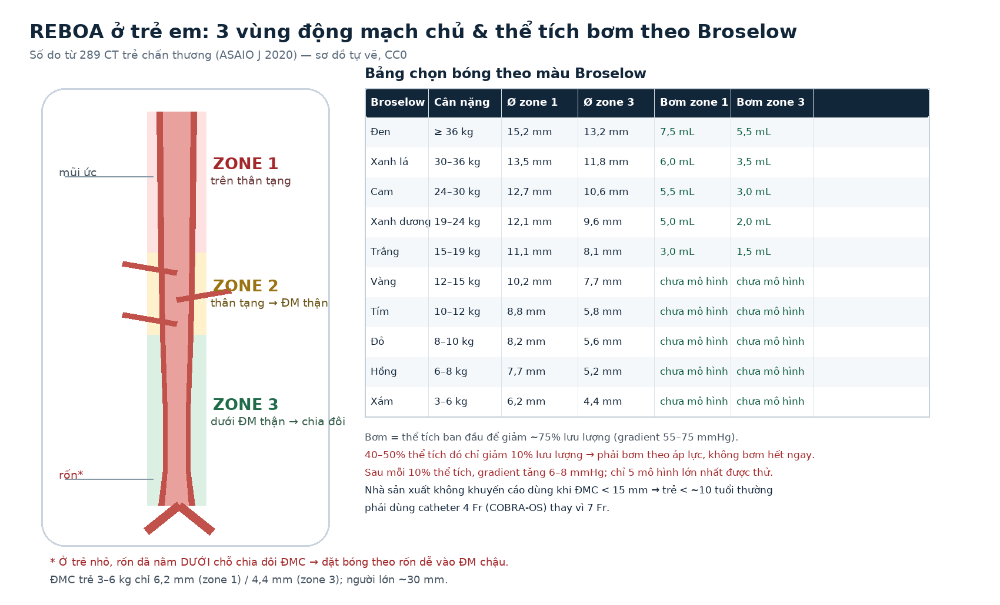
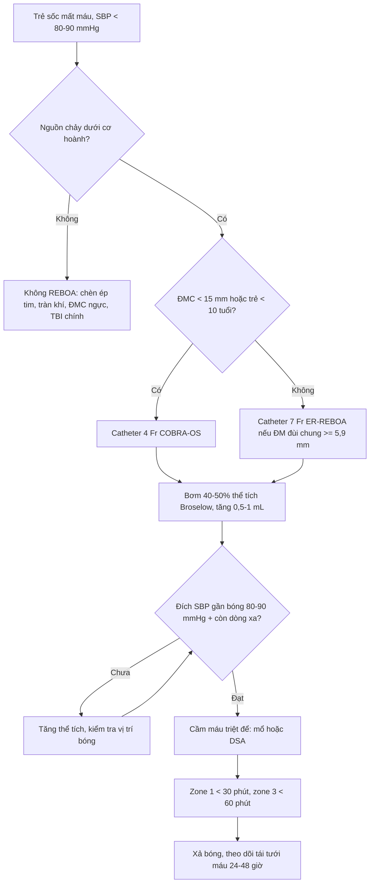
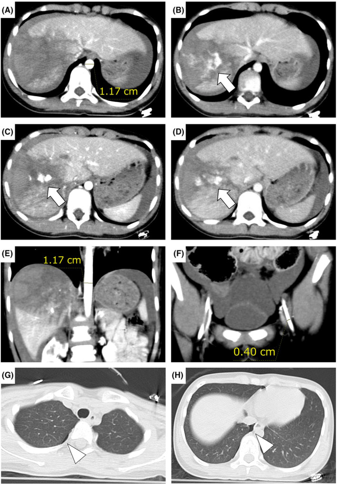

# 3064 — REBOA ở trẻ em: chọn cỡ bóng theo đường kính động mạch chủ, thể tích bơm và ngưỡng thời gian

**Tags:** `pattern:soc-mat-mau` `pattern:chay-mau` `pattern:thoat-can-quang` `vung:dong-mach-chu-bung` `vung:dong-mach-chu-nguc` `anatomy:dong-mach-chu` `protocol:REBOA` `protocol:CTA` `protocol:SA-Doppler` `score:Broselow` `incidentaloma:khong`
**Mức chắc chắn (certainty):** tổng hợp y văn (literature synthesis) — ghép **mô hình giải phẫu–huyết động trên 289 CT trẻ chấn thương** (ASAIO J 2020, PMC6856426), **11 ca REBOA < 18 tuổi trong AAST AORTA registry** (Injury 2020, PMC7609470), **phân tích khoảng trống 6.538 ca chấn thương nhi** (J Pediatr Surg 2021, PMC7982345), **ca nguyên văn 11 tuổi vỡ gan độ V được REBOA trên trực thăng** (Acute Med Surg 2024, PMC11036130) và **tổng quan REBOA 2026** (Chin J Traumatol, PMC12891851). Không có ca do nhóm tự chụp.

> **Câu hỏi thực hành:** bé gái **11 tuổi, 30 kg**, tai nạn giao thông, huyết áp **103 mmHg** lúc đầu rồi tụt, CT có **vỡ gan độ V + thoát cản quang ồ ạt**, bệnh viện tuyến trước **không mổ được**. Bác sĩ hỏi: **"Có đặt REBOA được không? Bóng cỡ nào, bơm bao nhiêu mL, giữ bao lâu?"**
> Bài chốt **năm quyết định**: **(1) ĐMC trẻ nhỏ hơn nhiều so với người lớn — zone 1 chỉ 6,2 mm ở trẻ 3–6 kg và 15,2 mm ở trẻ ≥ 36 kg, trong khi người lớn ~30 mm; (2) nhà sản xuất không khuyến cáo REBOA khi ĐMC < 15 mm, nên trẻ < ~10 tuổi phải dùng catheter 4 Fr thay vì 7 Fr; (3) thể tích bơm có sẵn theo màu Broselow — 3,0–7,5 mL cho zone 1 và 1,5–5,5 mL cho zone 3; (4) 40–50% thể tích đó chỉ làm giảm 10% lưu lượng, nên phải bơm tăng dần theo áp lực chứ không bơm hết một lần; (5) zone 1 chỉ giữ < 30 phút, zone 3 < 60 phút — quá ngưỡng này là thiếu máu tạng không hồi phục.**

## 1. Tổng quan bệnh học – cơ chế hình ảnh: vì sao REBOA ở trẻ là bài toán ĐƯỜNG KÍNH, không phải bài toán bóng

- **Định nghĩa:** REBOA (resuscitative endovascular balloon occlusion of the aorta — bóng chèn nội mạch động mạch chủ hồi sức) là đưa bóng qua **động mạch đùi chung** lên **ĐMC ngực dưới (zone 1)** hoặc **ĐMC bụng dưới ĐM thận (zone 3)** để tạm chặn dòng chảy về phía ổ chảy máu, giữ máu cho tim–não trong lúc chờ cầm máu triệt để.
- **Vì sao trẻ khác người lớn — con số định lượng:** trên **289 CT trẻ chấn thương** (0,26–12,3 tuổi), đường kính trong lòng ĐMC đo tại **mũi ức (zone 1)** và **rốn/chỗ chia đôi (zone 3)** là: **zone 1 từ 6,18 mm (nhóm xám, 3–6 kg) đến 15,21 mm (nhóm đen, ≥ 36 kg)**; **zone 3 từ 4,36 mm đến 13,22 mm**. Người lớn lấy **~30 mm** làm mốc trung bình (PMC6856426). Nghĩa là **ĐMC của một trẻ 10 kg chỉ bằng 1/3–1/2 người lớn** — cùng một quả bóng, cùng một thể tích bơm sẽ tạo ra lực căng thành khác hẳn.
- **TẠI SAO bơm bóng lại làm tăng huyết áp — vật lý:** bóng chèn làm **tăng trở kháng ngoại vi đột ngột**; theo **định luật Laplace (áp lực thành = áp suất × bán kính)**, với cùng áp suất bơm, **thành ĐMC trẻ mỏng và bán kính nhỏ** nên chịu lực căng thấp hơn — nhưng **dung tích bóng để đạt cùng đường kính lại giảm theo lũy thừa bậc ba (V ∝ r³)**. Vì vậy **thay đổi 0,5 mL ở trẻ có thể tương đương 5–10 mL ở người lớn**: bơm tay theo "cảm giác" ở trẻ là bơm quá tay.
- **TẠI SAO 40–50% thể tích mới chỉ giảm 10% lưu lượng:** giai đoạn đầu bóng chỉ **trải phẳng và áp sát thành**, chưa bịt kín lòng mạch; mô hình 3D cho thấy **40–50% thể tích bơm** mới làm giảm **10% lưu lượng**, sau đó lưu lượng giảm gần tuyến tính. Mỗi **10% thể tích bơm thêm** làm **gradient áp lực hai bên bóng tăng 6–8 mmHg**; đạt **~75% giảm lưu lượng** khi gradient **55–75 mmHg** (PMC6856426). Vì vậy phải **bơm theo đích huyết áp/đo Doppler**, không bơm theo mL tuyệt đối.
- **Vì sao trẻ mất máu nhanh:** thể tích máu trẻ **~70–80 mL/kg**; trẻ 30 kg có **~2,1–2,4 L**, nên **1.000 mL máu trong ổ bụng đã là 42–48% thể tích tuần hoàn** (ca nguyên văn PMC11036130 hút ra **1.000 mL** khi mở bụng). Trẻ bù trừ bằng **mạch nhanh và co mạch**, nên **huyết áp có thể còn bình thường cho đến khi sụp** — đây là lý do chỉ số **SIPA (shock index, pediatric age-adjusted)** hữu ích hơn huyết áp đơn thuần.
- **Bằng chứng lâm sàng — rất mỏng và không đồng nhất:**
  - **AAST AORTA registry (2013–2020):** **11 bệnh nhi < 18 tuổi**, trung vị **17 tuổi** (chỉ 1 ca 16 tuổi), **ISS trung vị 29**, REBOA làm **huyết áp tâm thu tăng từ 53 → 110 mmHg (p = 0,0007)**, **sống 30%**, **không ghi nhận biến chứng tại chỗ chọc** (PMC7609470).
  - **Nhật Bản, 54 ca < 18 tuổi:** sống **53,3% ở nhóm < 16 tuổi** so với **38,5% ở nhóm 16–18 tuổi** (dẫn trong PMC6856426).
  - **Phân tích khoảng trống 6.538 ca chấn thương nhi:** **38 ca (0,6%)** có tổn thương "có thể hưởng lợi từ REBOA" (chấn thương tạng đặc phải can thiệp, mạch trong ổ bụng, chảy máu sau phúc mạc/khung chậu), chiếm **15,9% ca nặng** và **10,2% tổng tử vong chấn thương nhi**; tử vong nhóm này **34,2%**; **26,3% < 9 tuổi** (PMC7982345). Đây là con số để **chọn bệnh nhân**, không phải để đặt REBOA cho mọi ca sốc.
- **TẠI SAO hình ảnh quyết định:** CT cản quang là nơi **đo đường kính ĐMC và ĐM đùi**, xác định **nguồn chảy máu trên/dưới cơ hoành**, và phát hiện **thoát cản quang hoạt tính** (đổi hình, lan thì muộn) — nhưng **không đo được ĐMC thật khi trẻ đang sốc**, vì co mạch làm ĐMC nhỏ hơn (mô hình lợn mất 40% máu: ĐMC ngực giảm **32%** đường kính; dẫn trong PMC6856426).
- **Giới hạn pháp lý – kỹ thuật:** REBOA **chưa được FDA chấp thuận cho trẻ em**; đa số catheter thiết kế cho người lớn, nhà sản xuất **không khuyến cáo dùng khi ĐMC < 15 mm** (PMC11036130). Đây là thủ thuật **cứu mạng có điều kiện**, phải có **quy trình nội bộ, huấn luyện và kiểm soát ca**.

## 2. Mẫu hình + chẩn đoán phân biệt theo vị trí (Gamut)

- **Theo VỊ TRÍ nguồn chảy so với cơ hoành (đây là trục quyết định zone):**
  - **Dưới cơ hoành, trong ổ bụng** (gan, lách, thận, mạch mạc treo): **zone 1** — bóng đặt trên thân tạng, chặn toàn bộ ĐMC bụng.
  - **Sau phúc mạc / khung chậu** (vỡ khung chậu, chảy máu sau phúc mạc): **zone 3** — bóng dưới ĐM thận, giữ tưới máu tạng.
  - **Trong lồng ngực** (ĐMC ngực, tim): **KHÔNG dùng zone 1** — bóng có thể làm nặng thêm tổn thương ĐMC hoặc cản trở cầm máu; ưu tiên **TEVAR/mở ngực**.
  - **Zone 2 (thân tạng → ĐM thận)** là vùng **tránh đặt bóng** vì che lấp các nhánh tạng và dễ di trú khi bơm.
- **Theo CƠ CHẾ chấn thương:**
  - **Chấn thương kín, vận tốc cao (ô tô, xe máy, ngã cao):** vỡ tạng đặc + vỡ khung chậu; REBOA như **cầu nối** trong lúc chờ mổ/embolization.
  - **Chấn thương xuyên (đạn, dao):** mạch máu trong ổ bụng; REBOA có thể giữ được huyết áp nhưng **không thay thế mổ**.
  - **Chấn thương do sóng nổ:** phối hợp dập phổi, tràn khí, thủng màng nhĩ; **REBOA không điều trị được thành phần lồng ngực**.
- **Theo BỆNH CẢNH SỐC ở trẻ (gamut "sốc không rõ nguyên nhân"):**
  - **Mất máu:** chấn thương, chảy máu tiêu hóa, vỡ khối u, chảy máu sau mổ.
  - **Chèn ép tim:** tràn dịch màng tim, tràn khí màng phổi áp lực — **kim giải áp/mở ngực**, không phải REBOA.
  - **Sốc tim:** bệnh cơ tim, loạn nhịp, tim bẩm sinh.
  - **Sốc nhiễm khuẩn:** giãn mạch, không phải nguyên nhân "không nén được".
  - **Sốc thần kinh/tủy:** mất trương lực giao cảm, không có nguồn chảy.
  - **Suy thượng thận cấp:** hiếm, đáp ứng với hydrocortisone.
- **Dấu hiệu định hướng trên hình ảnh:**
  - **Thoát cản quang hoạt tính** (blush) trong gan/lách/thận trên thì động mạch, **vẫn còn ở thì tĩnh mạch** = đang chảy máu → nguồn cần can thiệp.
  - **Máu tự do lượng lớn + tạng đặc vỡ độ cao** (AAST độ IV–V) → nguy cơ sốc nhanh.
  - **Vỡ khung chậu + tụ máu sau phúc mạc** trên CT → zone 3 nếu chảy máu không tự cầm.
  - **Dấu hiệu "gần như bình thường" trên CT nhưng huyết áp tụt** → nghĩ chảy máu đang tiếp diễn, không chờ CT lặp.

## 3. Bảng so sánh phân biệt (ma trận đối chiếu)

| Thực thể / lựa chọn (entity) | Hình ảnh – lâm sàng điển hình | Chốt vào (rule-in) | Chốt loại (rule-out) | Gợi ý xác nhận |
|---|---|---|---|---|
| **REBOA zone 1** (chảy máu trong ổ bụng) | Vỡ gan/lách/thận độ IV–V, thoát cản quang hoạt tính, huyết áp không đáp ứng hồi sức | **Nguồn dưới cơ hoành + không có chấn thương ĐMC ngực + có kế hoạch cầm máu < 30 phút** | **Chấn thương ĐMC ngực, chèn ép tim, TBI nặng chưa kiểm soát** | CTA bụng–chậu; siêu âm FAST; đặt bóng dưới mũi ức, xác nhận X-quang |
| **REBOA zone 3** (chảy máu khung chậu/sau phúc mạc) | Vỡ khung chậu, tụ máu sau phúc mạc, huyết áp tụt | **Nguồn dưới ĐM thận + không có chỉ định zone 1** | **Chảy máu trong ổ bụng chưa loại trừ** (bóng zone 3 không chặn được) | CT chậu có cản quang; đặt bóng trên chỗ chia đôi, không theo rốn ở trẻ nhỏ |
| **Không dùng REBOA — chấn thương ĐMC ngực** | Giả phình/đứt ĐMC eo, trung thất rộng, tràn máu màng phổi | **Tổn thương ĐMC trên CTA** | **ĐMC nguyên vẹn** | TEVAR hoặc mổ; REBOA có thể làm vỡ thêm |
| **Không dùng REBOA — chèn ép tim** | Tràn dịch màng tim, phổi phẳng, TM cổ nổi | **Siêu âm có dịch màng tim + shock** | **Không có dịch** | Chọc dẫn lưu/mở ngực |
| **Không dùng REBOA — tràn khí áp lực** | Lồng ngực căng, mất dấu phổi, lệch trung thất | **Khí màng phổi áp lực trên X-quang/siêu âm** | **Không tràn khí** | Kim giải áp ngay, không chờ CT |
| **Không dùng REBOA — TBI nặng** | Tụ máu nội sọ, GCS thấp, đồng tử giãn | **TBI là nguyên nhân chính gây tử vong** | **TBI đã kiểm soát, nguồn chảy dưới cơ hoành là chính** | CT sọ; theo dõi ICP — bóng làm tăng áp lực gần |
| **Thay thế: cầm máu phẫu thuật** | Mở bụng/chậu, packing, kẹp mạch | **Mổ được trong < 30 phút** | **Không có ê-kíp mổ** | Mổ ngay; REBOA chỉ là cầu nối |
| **Thay thế: nút mạch (angioembolization)** | Chảy máu tạng đặc, khung chậu | **Huyết động ổn định tương đối, có phòng DSA** | **Đang sụp huyết áp** | DSA; REBOA giữ thời gian cho DSA |

*Sơ đồ tự vẽ (CC0): trái — 3 vùng ĐMC, mốc mũi ức và rốn; phải — đường kính ĐMC và thể tích bơm ban đầu theo màu Broselow, từ 289 CT trẻ chấn thương (PMC6856426). Ở trẻ nhỏ, rốn đã nằm dưới chỗ chia đôi nên đặt bóng theo rốn dễ vào động mạch chậu.*

## 4. Protocol chụp + hệ phân độ/điểm chuẩn hóa

- **Chỉ định (phải đủ cả 4):**
  1. **Sốc mất máu** với **SBP < 80–90 mmHg** hoặc **SIPA tăng** không đáp ứng hồi sức dịch/máu.
  2. **Nguồn chảy dưới cơ hoành** đã xác định hoặc rất nghi ngờ (FAST/CT).
  3. **Có kế hoạch cầm máu triệt để trong 30–60 phút** (mổ hoặc DSA).
  4. **Không có chống chỉ định** (chấn thương ĐMC ngực, chèn ép tim, tràn khí áp lực chưa giải áp).
- **Chọn catheter theo đường kính — bảng quyết định:**
  - **ĐMC < 15 mm** (thường trẻ **< ~10 tuổi**, < 30 kg): dùng **4 Fr** (COBRA-OS) — đường vào nhỏ, nguy cơ tổn thương mạch tại chỗ **< 2%** so với 7 Fr (PMC12891851).
  - **ĐMC ≥ 15 mm, ĐM đùi chung ≥ 5,9 mm**: có thể dùng **7 Fr** (ER-REBOA) — đường kính ngoài catheter phải **< 50% lòng mạch**, nếu không nguy cơ **mất mạch chi cùng bên** (PMC11036130).
  - **Trẻ < 3 tuổi hoặc cân nặng < 10 kg:** thường **không đủ chỗ cho bất kỳ catheter REBOA nào**; cân nhắc **mở ngực/mở bụng** hoặc **bóng qua đường khác** theo ê-kíp.
- **Kỹ thuật đặt:**
  - **Siêu âm định vị ĐM đùi chung** (không chọc mù): giảm biến chứng mạch từ **~10% xuống < 3%** (PMC12891851).
  - **Zone 1:** bóng ngay **dưới mũi ức**; **zone 3:** **trên chỗ chia đôi ĐMC**, không dùng rốn làm mốc ở trẻ nhỏ.
  - **Xác nhận vị trí bằng X-quang tại giường/fluoroscopy** trước khi bơm — trẻ có biến thiên giải phẫu lớn (PMC6856426).
- **Bơm bóng — nguyên tắc:**
  - **Bắt đầu bằng 40–50% thể tích bảng**, tăng từng **0,5–1 mL**, theo dõi **huyết áp gần bóng** và **Doppler/tưới máu xa**.
  - **Đích partial REBOA:** huyết áp tâm thu gần bóng **80–90 mmHg**, vẫn còn **dòng chảy xa bóng** (PMC11036130; PMC12891851).
  - **Không bơm hết ngay** — 40–50% thể tích chỉ giảm 10% lưu lượng; bơm quá nhanh gây **tăng huyết áp gần bóng đột ngột** (nguy cơ chảy máu não ở trẻ có TBI).
- **Ngưỡng thời gian (bắt buộc ghi giờ):**
  - **Zone 1: < 30 phút.** Mô hình lợn nhi chịu được **30 phút** chèn hoàn toàn nhưng **60 phút gây tổn thương tạng không hồi phục và tử vong** (PMC11036130; PMC12891851).
  - **Zone 3: < 60 phút** — quá 60 phút nguy cơ thiếu máu chi/suy thận cao (PMC12891851).
  - **Xả bóng ngắt quãng** mỗi **10–15 phút** nếu tình trạng cho phép; **partial REBOA** có thể kéo dài tới **123 phút** trong báo cáo người lớn (PMC12891851) nhưng **chưa có dữ liệu nhi**.
- **Theo dõi sau xả bóng:** toan chuyển hóa, **kali máu**, **CK**, **myoglobin nước tiểu**, **creatinin**, **áp lực khoang**, mạch mu chân bằng Doppler; **theo dõi 24–48 giờ** vì **hội chứng tái tưới máu** có thể xuất hiện muộn.
- **Biến chứng cần nhớ (số liệu người lớn, dùng để tư vấn):** biến chứng tại chỗ **7–13%**; thiếu máu chi **4–10%** (tới **52,6%** ở nhóm nặng); **hội chứng khoang 5,4%**; **cắt cụt 3,4%** trong nhóm chấn thương mạch xuyên; **AKI 8,5%** (PMC12891851).
- **Sơ đồ quyết định:**

## 5. Biến thể bình thường và cạm bẫy

- **ĐMC trẻ "nhỏ hơn trên phim" khi đang sốc:** co mạch và giảm thể tích làm ĐMC nhỏ hơn **tới 32%** trong mô hình lợn mất 40% máu (PMC6856426). Đo trên CT lúc huyết áp thấp **không đại diện** cho ĐMC khi đã hồi sức — luôn **chọn bóng nhỏ hơn** và bơm tăng dần.
- **Mốc rốn ở trẻ nhỏ:** ở người lớn rốn tương ứng zone 3; ở trẻ nhỏ **rốn đã ở dưới chỗ chia đôi ĐMC**, đặt bóng theo rốn có thể **vào động mạch chậu** và gây **vỡ/tắc mạch chậu** (PMC6856426). Luôn xác nhận bằng X-quang.
- **Bơm quá tay:** quan hệ **thể tích–đường kính là bậc ba**; **0,5 mL** thừa ở trẻ 6 kg có thể làm **quá căng thành ĐMC**. Bơm theo **áp lực đích**, không theo "bơm cho căng".
- **TBI đi kèm:** **29%** ca có tổn thương "có thể REBOA" đồng thời có TBI (PMC7982345). Bóng làm **tăng huyết áp gần bóng** → có thể làm **nặng thêm xuất huyết nội sọ**; nếu TBI là nguyên nhân tử vong chính thì **không được ưu tiên REBOA**.
- **REBOA không phải điều trị:** trong UK-REBOA (người lớn), REBOA **không giảm tử vong** và có tín hiệu **tăng tử vong** ở nhóm chọn sai; ở Nhật, **thời gian từ cửa đến mổ 97 phút** làm mất tác dụng của bóng (PMC12891851). **Chậm cầm máu = bóng vô ích + thiếu máu tạng**.
- **"Có thoát cản quang là phải REBOA" — SAI:** nhiều ổ thoát cản quang **tự cầm** hoặc **kiểm soát được bằng nút mạch**; REBOA chỉ dành cho **sốc không đáp ứng** và **nguồn chảy không nén được**.
- **Chọc mạch khi trẻ đang sốc:** ĐM đùi **xẹp, khó chọc**, dễ chọc vào tĩnh mạch hoặc nhiều lần → **bóc tách/máu tụ**. Siêu âm là bắt buộc; nếu **3 lần chọc thất bại**, chuyển sang **mở mạch** hoặc phương án khác.
- **Ảo ảnh do bóng:** bóng bơm một phần có thể **di trú lên/xuống** khi vận chuyển (trực thăng, cáng) — ca nguyên văn phải **xả bớt từ 20 mL xuống 15 mL** vì huyết áp tăng lên **~160 mmHg** (PMC11036130). Luôn có **bảng theo dõi thể tích + áp lực** trên đường vận chuyển.

## 6. Tự lượng giá — Blind Quiz

**Ca 1 — Bé gái 11 tuổi, 30 kg, tai nạn giao thông. CT cản quang tại tuyến trước:**

- Gợi ý lâm sàng: huyết áp ban đầu 103 mmHg, mạch 113/phút; bụng chướng; tuyến trước **không có ê-kíp mổ chấn thương**.
- Câu hỏi: (1) Tổn thương chính là gì, độ mấy? (2) Đo đường kính ĐMC và ĐM đùi trên ảnh — có đủ chỗ cho catheter 7 Fr không? (3) Nếu đặt REBOA, chọn zone nào và bơm bao nhiêu mL? (4) Giữ bóng bao lâu?

<b>Bấm để hiện đáp án (findings + chẩn đoán)</b>

- **Findings:** (A–D) vỡ gan độ V (AAST) với **thoát cản quang ồ ạt** từ thì động mạch đến thì cân bằng (mũi tên trắng); (A, E) **ĐMC ngực xuống 1,17 cm = 11,7 mm**; (F) **ĐM đùi chung trái 0,40 cm = 4,0 mm**; (G–H) tràn khí màng phổi phải nhẹ.
- **Chẩn đoán:** chấn thương gan độ V đang chảy máu, sốc mất máu; **ĐMC 11,7 mm < 15 mm** và **ĐM đùi 4,0 mm < 5,9 mm** → **không đủ chỗ cho 7 Fr**, phải dùng **4 Fr** nếu có.
- **Zone:** nguồn chảy trong ổ bụng → **zone 1** (dưới mũi ức).
- **Thể tích:** theo Broselow **xanh dương/xanh lá** (30 kg), bảng gợi ý **5,0–6,0 mL** cho zone 1; ca thật bơm **20 mL** làm SBP tăng **~160 mmHg** rồi phải **xả còn 15 mL** — cho thấy bơm theo mL tuyệt đối ở trẻ là **quá tay**; đích đúng là **SBP gần bóng 80–90 mmHg**.
- **Thời gian:** **zone 1 < 30 phút**; ca thật được đưa đi bằng trực thăng và mổ ngay khi đến — bóng chỉ là **cầu nối**.
- **Nguồn ảnh:** Acute Med Surg 2024, PMCID **PMC11036130**, CC BY-NC 4.0 — nguyên bản, không cắt/ghép.

**Ca 2 — Trẻ 6 kg, vỡ khung chậu sau tai nạn, huyết áp 70/40 mmHg:**

- Câu hỏi: Đặt zone nào? Đường kính ĐMC dự kiến? Có catheter phù hợp không? Ngưỡng thời gian?

<b>Bấm để hiện đáp án</b>

- **Zone 3** (dưới ĐM thận) vì nguồn chảy ở khung chậu.
- Theo bảng: trẻ 6 kg (nhóm **hồng/xám**) có **ĐMC zone 3 ~4,4–5,2 mm**, **zone 1 ~6,2–7,7 mm** — **nhỏ hơn nhiều so với catheter 7 Fr** (cần ĐM đùi ≥ 5,9 mm và ĐMC ≥ 15 mm).
- **Không có catheter REBOA chuẩn cho trẻ 6 kg**; ưu tiên **packing/preperitoneal packing + mổ hoặc nút mạch**, chỉ dùng 4 Fr nếu có và nếu ĐM đùi cho phép.
- Nếu đặt: **zone 3 < 60 phút**, theo dõi tái tưới máu và áp lực khoang.
- **Nguồn số:** PMC6856426 (bảng Broselow); sơ đồ CC0 do bài tự vẽ.

**Ca 3 — Trẻ 14 tuổi, TBI nặng (GCS 5), đồng thời vỡ lách độ IV, huyết áp 80/50:**

- Câu hỏi: Có nên đặt REBOA zone 1 ngay không? Vì sao?

<b>Bấm để hiện đáp án</b>

- **Không đặt ngay.** TBI là nguyên nhân tử vong chính; bóng làm **tăng huyết áp gần bóng**, có thể làm **nặng thêm xuất huyết nội sọ** và **tăng ICP**.
- Nếu nguồn chảy dưới cơ hoành là **nguyên nhân chính** và TBI đã được kiểm soát/đè nén, có thể **cân nhắc partial REBOA** với đích **SBP 80–90 mmHg**, đồng thời theo dõi ICP.
- Ưu tiên: **kiểm soát đường thở, giải áp nếu có tràn khí, mổ lách + hồi sức máu**, không dùng bóng như "biện pháp đầu tay".
- **Nguồn:** PMC7982345 (29% ca có TBI), PMC12891851 (nguy cơ tăng áp lực gần bóng).

## Bài liên quan chéo
- [1816 – REBOA ở người lớn: bóng chèn nội mạch chủ](../1816-reboa-bong-chen-noi-mach-chu/lesson.md)
- [645 – Vỡ khung chậu ở trẻ](../645-vo-khung-chau-o-tre/lesson.md)
- [6113 – Huyết khối động mạch chủ sơ sinh (UAC)](../6113-huyet-khoi-dong-mach-chu-so-sinh-uac/lesson.md)
- [320 – Gãy xương, trật khớp cấp cứu](../320-gay-xuong-trat-khop-cap-cuu/lesson.md)
- [321 – Gãy xương ở trẻ em](../321-gay-tre-em/lesson.md)
- [090 – Bỏng hít đường thở ở trẻ](../090-bong-hit-duong-tho-o-tre/lesson.md)

## Ảnh
- `images/3064_reboa_CT-PMC11036130-F1.jpg` — CT cản quang vỡ gan độ V, ĐMC 11,7 mm, ĐM đùi 4,0 mm (Acute Med Surg 2024, PMCID PMC11036130, **CC BY-NC 4.0**, nguyên bản).
- `images/3064_reboa_So-do-vung-va-Broselow_CC0.png` — sơ đồ tự vẽ, **CC0**, số liệu từ PMC6856426.
- Chi tiết giấy phép: `images/CREDITS.md`; nguồn đầy đủ: `sources.md`.

> Không dùng để chẩn đoán độc lập khi chưa có người hướng dẫn.
