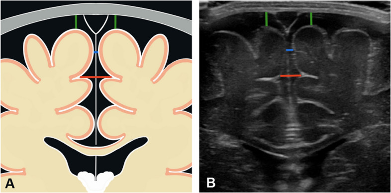
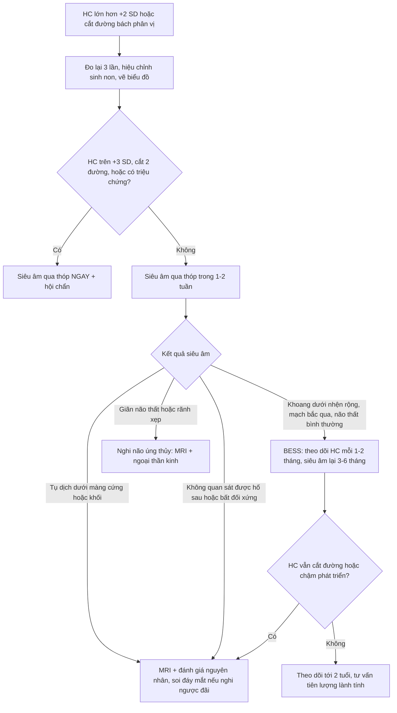
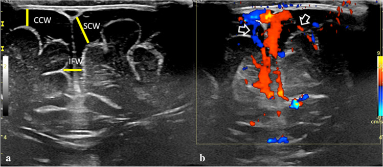
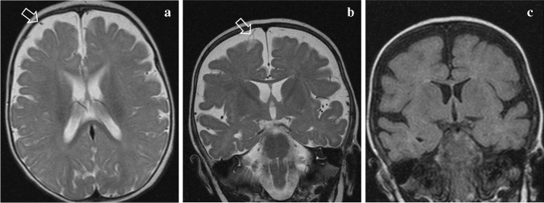
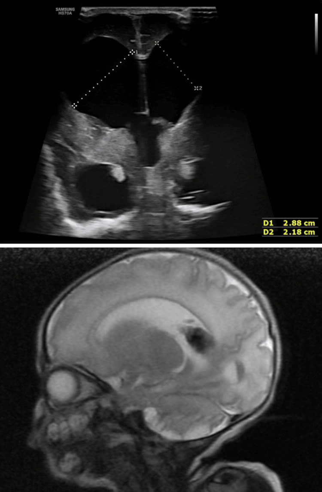

# 3065 — Đầu to ở nhũ nhi: đo chu vi đầu, siêu âm qua thóp và ngưỡng chuyển MRI / Macrocephaly in infants: head circumference, cranial ultrasound and when to MRI

**Tags:** `pattern:dau-to` `pattern:gian-nao-thuy` `pattern:rong-khoang-duoi-nhen` `pattern:tu-dich-ngoai-truc` `vung:nao` `score:percentile` `protocol:sieu-am-qua-thop` `protocol:MRI`

**Mức chắc chắn (certainty):** tổng hợp y văn (literature synthesis) — số liệu lấy từ các bài **open access đã đọc toàn văn**: Accogli et al., *Front Pediatr* 2021 (PMC8795981, CC BY 4.0 — định nghĩa, **thuật toán chẩn đoán**, BESS); Raissaki et al., *Pediatr Radiol* 2023 (PMC10027800, CC BY 4.0 — **BESS vs tụ dịch dưới màng cứng**, dấu hiệu mạch máu bắc qua); Fandak et al., *BMC Pediatr* 2024 (PMC11075241, CC BY 4.0 — **359 trẻ lành**, bảng bách phân vị khoang dưới nhện 0–19 tháng); Xu et al., *Pediatr Radiol* 2026 (PMC13430205, CC BY 4.0 — tổng quan hệ thống **24 nghiên cứu, 2.731 trẻ** về cách đo khoang dưới nhện); Jain et al., *Cureus* 2026 (PMC13333149, CC BY 4.0 — hình não úng thủy trên siêu âm đối chiếu MRI). Bài **không** có ca nguyên văn riêng; ca 1–3 dùng hình minh họa nguyên văn của các nguồn, ghi rõ Fig.

> **Câu hỏi gốc của bài:** bé trai **7 tháng**, sinh đủ tháng, phát triển vận động bình thường, mẹ đưa đi khám vì "đầu to hơn các bạn". **Chu vi đầu (HC) 47,5 cm** — **+2,6 SD**, đã **vượt 2 đường bách phân vị trong 3 tháng**. Khám: thóp trước mềm, không căng, không nôn, không lác, không co giật; bố mẹ **đầu to tương tự**. Vậy: **siêu âm qua thóp đủ để kết luận "đầu to lành tính" chưa**, cần đo những gì, và **khi nào phải chụp MRI**?

## 1. Tổng quan — "đầu to" là triệu chứng, không phải chẩn đoán

**A. Định nghĩa và ngưỡng (cửa 1 Argon):**

- **Đầu to (macrocephaly)** = chu vi đầu (occipitofrontal circumference, OFC) **> +2 SD** (tương đương **> bách phân vị 97**) so với tuổi và giới. Macrocephaly gặp ở **tới 5% trẻ em**; khoảng **2–3% trẻ khỏe mạnh** có OFC trong khoảng **+2 đến +3 SD**, nên **"đáng lo" được định nghĩa là OFC > +3 SD** (PMC8795981).
- **Đầu to ≠ não to:** **megalencephaly** là **não quá to** (thường > +3 SD), gặp trong **hơn 200 bệnh di truyền**; macrocephaly còn do **dịch não tủy (DNT)**, **tụ dịch ngoài trục**, **khối**, hoặc **xương sọ** (loạn sản xương). Vì vậy **cùng một số đo HC** có thể là bệnh lành tính hoặc bệnh di truyền nặng — **hình ảnh quyết định**.
- **Đầu to tương đối (relative macrocephaly):** HC **< +2 SD** nhưng **không cân xứng với chiều cao/cân nặng** (cao và nặng cũng < +2 SD) — vẫn cần đánh giá nếu kèm chậm phát triển.
- **Cách đo chuẩn:** thước dây **qua ụ trán (glabella) và điểm xa nhất của ụ chẩm**, **3 lần** lấy trị số lớn nhất, cùng một người đo nếu theo dõi; **hiệu chỉnh tuổi sinh non** tới 24 tháng; **vẽ lên biểu đồ WHO/CDC** — điều quan trọng không chỉ là **vị trí** mà là **độ dốc** (cắt đường bách phân vị).

**B. TẠI SAO siêu âm qua thóp là bước đầu, và TẠI SAO nó nhìn được "dịch":**

- **Vật lý:** thóp trước mở tới **12–18 tháng** là **cửa sổ âm học**; DNT **không có giao diện phản hồi** nên **trống âm (anechoic)**, nhu mô não **có hồi âm**, mạch máu trong khoang dưới nhện **hiện màu** trên Doppler. Vì vậy siêu âm phân biệt được **dịch – mô – mạch** ngay tại giường, **không bức xạ, không an thần**.
- **TẠI SAO BESS gây đầu to:** nhung mao màng nhện chưa trưởng thành → **hấp thu DNT chậm** → DNT ứ trong **khoang dưới nhện vùng trán và rãnh liên bán cầu trước**; đầu lớn nhanh trong **3–12 tháng** (đỉnh ~**7 tháng**), khoang dưới nhện **thu nhỏ dần sau 1–2 tuổi**, còn HC **ổn định trên đường 95–98** (PMC10027800). Đây là lý do **không can thiệp** mà chỉ theo dõi.
- **TẠI SAO phân biệt với tụ dịch dưới màng cứng lại quan trọng:** dịch dưới màng cứng **đè lên não**, **không có mạch bắc qua**, và có thể là **máu tụ do ngược đãi**. Trong BESS, **tĩnh mạch cầu bắc ngang toàn bộ khoảng rộng** và **không có màng nhện nhìn thấy**; trong tụ dịch dưới màng cứng xuất hiện **đường song song với xương sọ** (màng nhện, bình thường không thấy) và **mạch bị đẩy sát bề mặt não** (PMC10027800).
- **TẠI SAO giãn não thủy khác BESS:** tắc nghẽn lưu thông → **áp lực tăng** → **giãn não thất + xẹp rãnh vỏ**; BESS thì **não thất bình thường hoặc chỉ hơi to**, **rãnh vỏ rộng**. Cùng "đầu to" nhưng **một bên cần mổ, một bên chỉ theo dõi**.

**C. Ngưỡng định lượng của khoang dưới nhện (quan trọng nhất khi đọc siêu âm):**

| Đại lượng | Ngưỡng / số liệu | Nguồn |
|---|---|---|
| Giới hạn trên **bề rộng vỏ–sọ (craniocortical width, CCW)** ở trẻ < 1 tuổi | **4–10 mm** (trẻ sơ sinh **3,3–5 mm**); **> 5 mm = rộng**, **> 10 mm = rộng đáng kể** | PMC10027800 |
| Giới hạn trên **rãnh liên bán cầu (interhemispheric width, IHW)** | **6–8,5 mm**; BESS có thể **8–17 mm**, khoang dưới nhện trán **6–23 mm** | PMC13430205 (tổng hợp Prassopoulos) |
| Nguyên tắc chung | **> bách phân vị 95 theo tuổi** = bất thường (bảng 0–19 tháng, **359 trẻ lành**) | PMC11075241, PMC10027800 |
| BESS — tuổi khởi phát/đỉnh | **3–12 tháng**, đỉnh ~**7 tháng**; khoang dưới nhện **thu nhỏ sau 1–2 tuổi** | PMC10027800 |
| BESS — phát triển | **> 30%** có chậm phát triển khi test tâm lý–thần kinh; chậm vận động thô **hồi phục ~22 tháng** | PMC13430205 |
| BESS + tụ dịch dưới màng cứng | **191 trẻ** trong 16 nghiên cứu; **83** được sàng lọc đầy đủ; **28/83 (33,7%)** có tổn thương kèm theo (xuất huyết võng mạc/gãy xương) | PMC10027800 |
| Megalencephaly | **> +3 SD** não; **> 200 bệnh di truyền** | PMC8795981 |

## 2. Mẫu hình + chẩn đoán phân biệt theo hình thái (Gamut)

- **Giãn não thất + rãnh vỏ XẸP (não thất chiếm ưu thế):** **não úng thủy tắc nghẽn** (hẹp cống Sylvius, Dandy–Walker, Chiari II, sau xuất huyết não thất, khối trong não thất) · **não úng thủy thông thương** (sau viêm màng não/xuất huyết) · **u đám rối mạch mạc** (đầu to nhanh + "mắt lặn") · **dị dạng tĩnh mạch Galen** (đầu to + suy tim cung lượng cao ở sơ sinh).
- **Khoang dưới nhện RỘNG + não thất bình thường/hơi to, không đè ép:** **BESS** (lành tính, tự giới hạn) · **teo não** (não úng thủy ex vacuo — rãnh và não thất cùng rộng, không tăng áp lực) · **nang màng nhện** (khu trú, một ổ, đẩy não) · **thiếu sản hành não/vỏ** (hiếm).
- **Tụ dịch ngoài trục có hiệu ứng choán chỗ:** **tụ dịch dưới màng cứng** (hygroma, máu tụ bán cấp/mạn) · **mủ màng não** · **tụ máu ngoài màng cứng** (thường do chấn thương, hình thấu kính).
- **Nhu mô não TO, cấu trúc bình thường hoặc bất thường:** **NF1** (u thần kinh đệm thị giác, FASI) · **Sotos, PTEN/Bannayan–Riley–Ruvalcaba, Fragile X** · **bệnh chất trắng/loạn dưỡng chất trắng** (Alexander, Canavan, megalencephalic leukoencephalopathy) · **rối loạn chuyển hóa** (glutaric aciduria type 1, mucopolysaccharidosis) · **hemimegalencephaly** (một bán cầu to, lệch trục).
- **Xương sọ to nhưng não bình thường:** **achondroplasia** (trán dô, ngắn chi) · **còi xương** · **loạn sản xương thành xương** · **thalassemia** (giãn tủy xương) · **bệnh Paget ở trẻ** (hiếm).
- **"Đầu to" giả:** **đầu to gia đình** (bố/mẹ cũng to, không triệu chứng) · **tóc dày/đo sai** · **phù đầu** · **nang da đầu**.

**Mnemonic "BIG HEAD":** **B**ESS/Benign · **I**ncreased CSF pressure (hydrocephalus) · **G**enetic overgrowth (NF1/PTEN/Sotos) · **H**emorrhage/subdural · **E**xtra-axial cyst · **A**chondroplasia/bone · **D**ata error (đo sai/gia đình).

## 3. Bảng so sánh phân biệt (ma trận đối chiếu)

| Thực thể (entity) | Hình ảnh điển hình (US / CT / MRI) | Chốt vào (rule-in) | Chốt loại (rule-out) | Gợi ý xác nhận |
|---|---|---|---|---|
| **BESS (khoang dưới nhện rộng lành tính)** | Khoang dưới nhện **trán + rãnh liên bán cầu trước rộng**, **CCW > 5 mm**, não thất bình thường/hơi to, **mạch bắc qua**, không màng nhện | **Mạch máu bắc ngang khoảng rộng + không hiệu ứng choán chỗ + HC theo đường 95–98** | Có đường màng nhện + mạch bị đẩy sát não + đè ép → tụ dịch dưới màng cứng | US + Doppler màu; theo dõi HC 1–2 tháng/lần; MRI nếu bất thường |
| **Não úng thủy tắc nghẽn** | **Giãn não thất** (sừng trước, sừng thái dương), **rãnh vỏ xẹp**, có thể thấy **mức tắc** (cống Sylvius, não thất IV) | **Giãn não thất + xẹp rãnh + đầu to nhanh/tăng áp lực** | Khoang dưới nhện rộng + não thất bình thường → BESS | US đo não thất; **MRI** tìm mức tắc; hội chẩn ngoại thần kinh |
| **Tụ dịch dưới màng cứng** | Dịch **dưới màng nhện**, **đường màng nhện song song xương**, **mạch bị đẩy sát não**, có thể có **vách/tỷ trọng khác nhau** | **Màng nhện nhìn thấy + đè ép não + mạch không bắc qua** | Mạch bắc qua toàn bộ + không đè ép → BESS | MRI (T1/T2/FLAIR/T2*) nếu nghi; **soi đáy mắt + X-quang xương** nếu nghi ngược đãi |
| **Megalencephaly do NF1/PTEN/Sotos** | Não to, có thể **FASI** trên T2/FLAIR (NF1), **dị dạng mạch**; sọ to tương xứng | **Da: café-au-lait, u mạch, dày mô mềm + HC > +3 SD** | HC +2 đến +3 SD đơn độc, da bình thường → đầu to gia đình/BESS | MRI não; khám da, mắt, di truyền |
| **Achondroplasia/loạn sản xương** | **Trán dô, sọ to, ngắn chi**, hẹp lỗ chẩm; não bình thường | **Hình dạng xương + chi ngắn + tiền sử gia đình** | Tỉ lệ cơ thể bình thường → không phải loạn sản xương | X-quang toàn thân, MRI cổ–chẩm nếu có triệu chứng |
| **Nang màng nhện** | **Một ổ dịch khu trú**, đẩy não, **không có mạch bắc qua**, bờ nhẵn | **Ổ khu trú + hiệu ứng choán chỗ + không thông với khoang dưới nhện** | Rộng lan tỏa hai bên → BESS | MRI; theo dõi hoặc mổ nếu có triệu chứng |

*Sơ đồ (A) và ảnh siêu âm tương ứng (B): **CCW** = bề rộng vỏ–sọ (xanh lá), **IHW** = bề rộng rãnh liên bán cầu (xanh dương/đỏ). Đây là ba số đo cần ghi trong mọi ca đầu to. Nguồn: Fandak J et al., BMC Pediatr 2024 (PMC11075241), Fig. 1, CC BY 4.0.*

## 4. Protocol siêu âm + chỉ định MRI + theo dõi

**A. Siêu âm qua thóp (làm ngay, 10–15 phút):**

- **Đầu dò:** convex **5–8 MHz** cho toàn não, **linear 7,5–12 MHz** (hoặc hockey-stick) cho **vùng đỉnh–khoang dưới nhện**; **thóp trước** là cửa sổ chính, thêm **thóp sau/mastoid** cho hố sau (PMC13333149).
- **Mặt cắt tối thiểu:** **coronal 6 mức** (từ trước ra sau: trước sừng trán → lỗ Monro → thể chai → não thất III → trigone → sau cùng) + **sagittal đường giữa** (thể chai, não thất III/IV, tiểu não) + **parasagittal hai bên**; **đo** chiều rộng não thất bên, **sừng trước**, **khoang dưới nhện CCW/IHW**.
- **Doppler màu vùng đỉnh:** xác nhận **tĩnh mạch bắc qua** khoang dưới nhện (**dấu hiệu phân biệt BESS với tụ dịch dưới màng cứng**).
- **Đo HC ngay trong buổi khám**, vẽ biểu đồ, ghi **SD/z-score** và **tốc độ tăng** (cm/tháng).

**B. Khi nào chuyển MRI (không chờ):**

- **HC > +3 SD**, hoặc **cắt ≥ 2 đường bách phân vị**, hoặc **tăng nhanh bất thường**.
- **Bất kỳ dấu hiệu thần kinh:** chậm phát triển/regression, co giật, lác/lồi mắt, nôn, thóp căng, "mắt lặn" (setting sun), đau đầu.
- **Siêu âm bất thường:** giãn não thất, khối, bất đối xứng, tụ dịch dưới màng cứng, hố sau không quan sát được.
- **Nghi megalencephaly/di truyền:** da (café-au-lait, u mạch), dị hình mặt, tiền sử gia đình > 2 người đầu to + chậm phát triển.
- **Nghi ngược đãi:** tụ dịch dưới màng cứng không rõ nguyên nhân → **soi đáy mắt + X-quang xương** theo quy trình.

**C. Thuật toán một trang:**

**D. Theo dõi và tư vấn:**

- **BESS:** HC tăng nhanh trong **3–12 tháng**, **khoang dưới nhện giảm sau 1–2 tuổi**, HC **ổn định song song đường 95–98**; giải thích cho gia đình **không cần mổ**, nhưng **vẫn theo dõi phát triển** vì **> 30%** có chậm phát triển nhẹ và chậm vận động thô có thể kéo tới **~22 tháng** (PMC13430205).
- **Đầu to gia đình:** nếu **bố/mẹ cũng đầu to, không triệu chứng, phát triển bình thường, siêu âm bình thường** → nguy cơ bệnh lý thấp; vẫn **đo lại sau 2–3 tháng** để xác nhận đường cong.
- **Không đo HC một lần rồi kết luận:** giá trị tuyệt đối ít ý nghĩa hơn **độ dốc** và **tốc độ**.

## 5. Biến thể bình thường và cạm bẫy

- **Đo sai là "nguyên nhân" hay gặp nhất:** thước lỏng/qua tóc, lệch glabella, hai người đo khác nhau → chênh **0,5–1 cm** đủ đổi 1–2 SD ở nhũ nhi. **Đo lại trước khi chụp.**
- **Đầu to do gia đình và BESS có thể cùng tồn tại:** siêu âm bình thường không loại trừ bệnh di truyền — nếu **HC > +3 SD** hoặc **da/dị hình** thì vẫn cần MRI/đánh giá di truyền.
- **BESS không phải lúc nào cũng "lành":** **> 30%** chậm phát triển; **33,7%** trẻ BESS có tụ dịch dưới màng cứng được sàng lọc đầy đủ có **tổn thương kèm theo** (PMC10027800) — **không được bỏ qua soi đáy mắt/X-quang xương** khi có tụ dịch.
- **Tụ dịch dưới màng cứng có thể xảy ra tự phát trong BESS** (do căng giãn tĩnh mạch cầu), nhưng **không được mặc định là lành**: hình thái **đồng nhất, không có cục máu đông đỉnh, tĩnh mạch cầu liên tục, không tổn thương kèm theo** mới nghiêng về lành (PMC10027800).
- **"Giãn não thất" trên siêu âm có thể là giả:** đầu dò đè mạnh, mặt cắt chếch, hoặc **não thất hơi to sinh lý** ở trẻ sinh non; luôn đo **hai bình diện** và so bảng theo tuổi.
- **Không mổ "não úng thủy" khi thực ra là teo não (ex vacuo):** rãnh vỏ **rộng** cùng não thất, không tăng áp lực → **shunt sẽ làm bệnh nặng hơn**.
- **Hố sau và vùng đỉnh là điểm mù của siêu âm thóp trước:** u hố sau, máu tụ dưới màng cứng đỉnh, dị dạng vỏ **có thể bỏ sót** — **MRI** khi có triệu chứng hoặc không quan sát được.
- **HC lớn nhưng hình dạng bất thường:** nghĩ **craniosynostosis** (đầu dài/hẹp, trán dô) — siêu âm không đủ, cần **CT xương sọ 3D** và khám ngoại thần kinh.

## 6. Tự lượng giá — Blind Quiz

**Ca 1 — Bé trai 6 tháng, đầu to, phát triển bình thường, bố mẹ cũng đầu to. Siêu âm qua thóp: mặt cắt coronal, có đo khoang dưới nhện.**

- Gợi ý: không nôn, không co giật, thóp mềm; HC +2,5 SD, theo đường 97.
- Câu hỏi: Khoảng trống âm rộng ở đâu? Đo CCW/SCW/IHW thế nào? Dấu hiệu nào trên Doppler giúp loại trừ tụ dịch dưới màng cứng?

<b>Bấm để hiện đáp án (findings + chẩn đoán)</b>

- Dấu hiệu: **khoang dưới nhện trán và rãnh liên bán cầu trước rộng** (CCW, SCW, IFW), não thất bình thường; **Doppler màu thấy tĩnh mạch bắc ngang** khoảng rộng (mũi tên) và **không có đường màng nhện**.
- Chẩn đoán: **BESS (khoang dưới nhện rộng lành tính)** — vì mạch bắc qua, không đè ép não, HC theo đường 95–98; theo dõi, không can thiệp.
- Nguồn ảnh: Raissaki M et al., Pediatr Radiol 2023 (PMC10027800), Fig. 1, CC BY 4.0.

**Ca 2 — Bé trai 7 tháng, HC +2,8 SD, có 2 cơn co giật ngắn. MRI T2 axial (a), coronal (b) và T1 coronal (c).**

- Gợi ý: da bình thường, không chấn thương; soi đáy mắt không xuất huyết.
- Câu hỏi: Dịch nằm trong khoang nào? Mạch máu đi qua hay bị đẩy sát não? Có cần mổ không?

<b>Bấm để hiện đáp án (findings + chẩn đoán)</b>

- Dấu hiệu: **khoang dưới nhện trán và rãnh liên bán cầu rộng**, **mạch máu bắc ngang** (mũi tên), không có màng nhện, không đè ép não; T1 (c) không thấy tụ máu.
- Chẩn đoán: **BESS** — dịch là DNT trong khoảng dưới nhện, **không phải tụ dịch dưới màng cứng**; co giật ngắn đơn độc không đủ kết luận bệnh lý, nhưng **cần theo dõi phát triển và MRI/EEG nếu tái diễn**.
- Nguồn ảnh: Raissaki M et al., Pediatr Radiol 2023 (PMC10027800), Fig. 3, CC BY 4.0.

**Ca 3 — Bé gái sinh non 34 tuần, 2 tháng tuổi, đầu to nhanh, thóp căng, "mắt lặn". Siêu âm coronal (trên) và MRI T2 sagittal (dưới).**

- Gợi ý: HC vượt +3 SD trong 3 tuần; nôn, lơ mơ.
- Câu hỏi: Não thất có giãn không? Rãnh vỏ xẹp hay rộng? Đây là BESS hay não úng thủy — và bước xử trí?

<b>Bấm để hiện đáp án (findings + chẩn đoán)</b>

- Dấu hiệu: **giãn não thất bên rõ** (siêu âm đo **2,88 × 2,18 cm**), **vỏ não mỏng, rãnh xẹp**, MRI sagittal xác nhận **não thất giãn + mỏng nhu mô**.
- Chẩn đoán: **não úng thủy** (nghi tắc nghẽn) — **không phải BESS**; cần **MRI đầy đủ tìm mức tắc + hội chẩn ngoại thần kinh** (dẫn lưu/shunt hoặc nội soi), không chờ.
- Nguồn ảnh: Jain K et al., Cureus 2026 (PMC13333149), Fig. 10, CC BY 4.0.

## Bài liên quan chéo

- [600 – Tổng quan Nhi khoa](../600-tong-quan-nhi-khoa/lesson.md)
- [200 – Tổng quan Thần kinh](../200-tong-quan-he-than-kinh/lesson.md)
- [218 – Thoát vị não úng thủy](../218-thoat-vi-nao-ung-thuy/lesson.md)
- [3007 – ETV/ETV-CPC ở trẻ](../3007-etv-etv-cpc-o-tre/lesson.md)
- [605 – Siêu âm phổi điểm sơ sinh](../605-sieu-am-phoi-diem-so-sinh/lesson.md) (kỹ thuật siêu âm tại giường ở trẻ)

> Không dùng để chẩn đoán độc lập khi chưa có người hướng dẫn.
