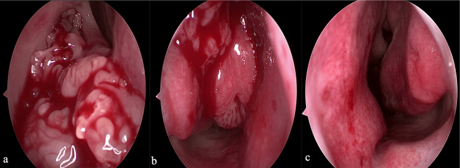
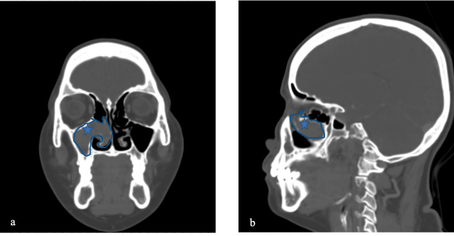
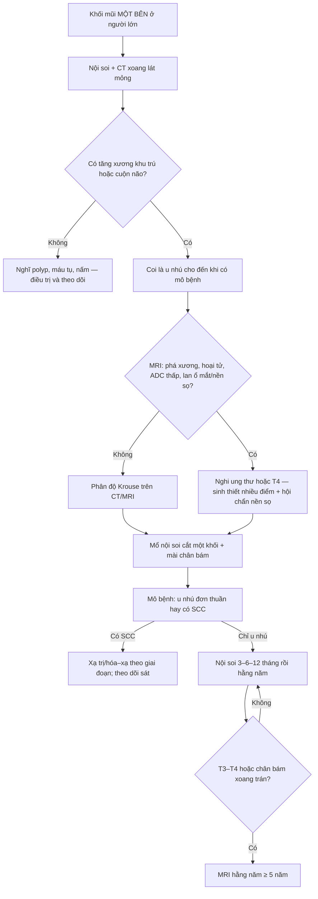
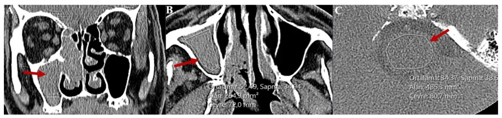
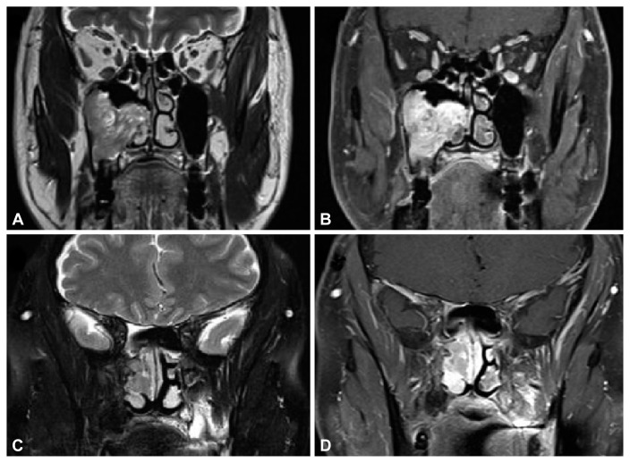

# 3066 — U nhú đảo ngược mũi xoang (sinonasal inverted papilloma): "cuộn não", tăng xương tại chân bám và ngưỡng nghi ung thư

**Tags:** `pattern:khoi-mot-ben` `pattern:tang-xuong-khu-tru` `pattern:cuon-nao` `pattern:mon-xuong` `pattern:calci-hoa` `pattern:ngam-thuoc-khong-deu` `vung:mui` `vung:xoang` `vung:mat-co` `score:Krouse` `protocol:CT-xoang` `protocol:MRI-xoang` `protocol:noi-soi` `incidentaloma:khong`
**Mức chắc chắn (certainty):** tổng hợp y văn (literature synthesis) — **đoàn hệ 73 ca có phân độ Krouse + tái phát + biến đổi ác tính** (Life 2026, PMC13027472), **loạt 71 tổn thương mổ nội soi định hướng chân bám** (Eur Arch Otorhinolaryngol 2026, PMC13615142), **92 ca đo tỉ số HU trên CT không cản quang** (Tomography 2026, PMC13709540), **30 ca so sánh u nhú với ung thư biểu mô vảy trên u nhú** (J Rhinol 2026, PMC13065420) và **ca nguyên văn có ảnh nội soi + CT chân bám** (Cureus 2026, PMC13476601). Không có ca do nhóm tự chụp.

> **Câu hỏi thực hành:** nam **70 tuổi**, tắc mũi **phải** tăng dần **18 tháng**, chảy mũi một bên, **không đau**, nội soi thấy khối **sần, đỏ, dễ chảy máu** ở thành bên hốc mũi. CT xoang: khối đặc **một bên** lấp xoang hàm phải, **dày xương khu trú** ở thành trong xoang hàm. Bác sĩ hỏi: **"Đây là polyp hay u? Có phải ung thư không? Cần mổ bao rộng và theo dõi thế nào?"**
> Bài chốt **năm quyết định**: **(1)** khối mũi **một bên ở người lớn** là **u cho đến khi chứng minh ngược** — không gọi "polyp"; **(2)** **tăng xương khu trú (focal hyperostosis)** không phải xâm lấn xương mà là **dấu chỉ chân bám** — phải **cắt hết chân bám** thì mới giảm tái phát; **(3)** **"cuộn não" (convoluted cerebriform pattern)** là dấu hiệu điển hình nhưng **CŨNG gặp ở ung thư biểu mô vảy** — không dùng để loại ác tính; **(4)** biến đổi ác tính **5–15%**, trong đoàn hệ 73 ca là **12% (9/73)**, **6 ca xuất hiện 1–5 năm sau mổ** → phải theo dõi dài; **(5)** **HU và tỉ số HU không phân biệt được u nhú với ung thư** (AUC 0,667) — cần **MRI + DWI/ADC + mô bệnh**.

## 1. Tổng quan bệnh học – cơ chế hình ảnh (TẠI SAO)

- **Bản chất:** u nhú đảo ngược (sinonasal inverted papilloma — IP) là u **biểu mô lành tính nhưng xâm lấn tại chỗ**, xuất phát từ **niêm mạc Schneiderian** phủ mũi và xoang; tế bào biểu mô **phát triển đảo ngược vào lớp đệm** thay vì lồi ra ngoài (khác u nhú ngoài — exophytic). **HPV 6/11** và **EGFR** được coi là yếu tố thúc đẩy; **p16 mất/giảm** liên quan tái phát (p = 0,006) (PMC13027472).
- **Dịch tễ định lượng (đoàn hệ 73 ca, PMC13027472):** **75% nam**; tuổi trung bình **44,6 ± 13,3**; thời gian triệu chứng trung vị **18 tháng** (IQR 6–36); **93% tắc mũi**, **69% chảy mũi**, **27% đau đầu**, **16% chảy máu cam**, **10% mất mùi**; **7% không triệu chứng**, phát hiện tình cờ. Vị trí: **xoang hàm 49%**, **sàng 25%**, **thành bên hốc mũi 18%**, **xoang trán 4 ca**, **xoang bướm 2 ca**.
- **TẠI SAO có "cuộn não":** tổn thương gồm **dải biểu mô dày xen kẽ dải mô đệm xơ mỏng**, uốn lượn như **các cuộn não**. Trên **T2** và **T1 sau tiêm**, các dải biểu mô (nhiều tế bào, ít nước tự do) tạo **đường thẳng/đường cong tăng tín hiệu hoặc ngấm thuốc**, xen **dải mô đệm tối**. Vì vậy "cuộn não" là **mô tả cấu trúc mô học**, không phải dấu hiệu của lành tính.
- **TẠI SAO T2 của u nhú chỉ trung gian:** u nhú **giàu tế bào, ít nước tự do**, nên T2 **trung gian** — tối hơn hẳn **polyp** (polyp phù nề, nhiều dịch → T2 **rất sáng**). Đây là lý do T2 giúp **tách u khỏi dịch/niêm mạc viêm**, nhưng **không** tách u nhú khỏi ung thư.
- **TẠI SAO có tăng xương khu trú:** tại chỗ bám, màng xương bị kéo căng lâu ngày → **phản ứng tạo xương (osteoblastic reaction)**, xương **dày lên khu trú** chứ **không bị u xâm lấn**. Vì thế tăng xương là **bản đồ chỉ chân bám**: cắt bỏ chân bám + mài xương tại đó là **yếu tố quyết định không tái phát**. Trong đoàn hệ 73 ca, **100% ca có tăng xương khu trú khớp với vị trí bám dự kiến** trên CT (PMC13027472).
- **TẠI SAO vẫn có mòn xương:** u lớn gây **áp lực** làm mỏng/tiêu xương ( remodeling), khác **xâm lấn kiểu ác tính** (bờ nham nhở, phá vỡ liên tục vỏ xương). Vì vậy **mòn xương không đồng nghĩa ung thư**, và **không có mòn xương cũng không loại ung thư**.
- **TẠI SAO HU không phân biệt được u nhú với ung thư:** cả hai đều là **mô đặc giàu tế bào**, đậm độ chồng lấp. Nghiên cứu 92 ca: **tỉ số HU (tổn thương/chân cầu)** phân biệt **polyp với u nhú** tốt (**AUC 0,815**; ngưỡng **1,302**, **Se 62,5%, Sp 85,7%**) nhưng phân biệt **u nhú với ung thư** kém (**AUC 0,667**, KTC 95% 0,498–0,826) (PMC13709540). Đậm độ thực tế: u nhú **52,49 HU** so với chân cầu **34,37 HU** (tỉ số **1,52**); polyp **21,43 HU** so với chân cầu **21,93 HU** (tỉ số **0,97**).
- **TẠI SAO ADC giúp ích:** ung thư **giàu tế bào hơn, nhân lớn hơn** → **hạn chế khuếch tán** → ADC thấp. Trong 30 ca: **ADC 0,99 so với 1,20 × 10⁻³ mm²/s** (u nhú + ung thư so với u nhú đơn thuần, p = 0,026); tín hiệu **trung gian trên T2 và T1 sau tiêm** cũng gặp nhiều hơn ở nhóm ác tính (p = 0,025 và p = 0,029) (PMC13065420).
- **TẠI SAO phải theo dõi lâu:** biến đổi ác tính **5–15%** (PMC13065420); trong 73 ca là **12% (9/73)** — **3 ca có ngay lần mổ đầu**, **6 ca xuất hiện 1–5 năm sau** (PMC13027472). Yếu tố liên quan: **hút thuốc** (100% ca ác tính so với 52%, p = 0,01).
- **TẠI SAO tái phát phụ thuộc chân bám:** tái phát **19% (14/73)**, xuất hiện **8 tháng–4 năm** (trung bình 2,1 năm); yếu tố nguy cơ: **triệu chứng kéo dài** (30 so với 12 tháng, p = 0,003), **hút thuốc** (86% so với 51%, p = 0,03), **Krouse III–IV** (86% so với 34%, p < 0,001), **gốc xoang trán** (21% so với 2%, p = 0,02), **HPV+** (50% so với 22%, p = 0,048) (PMC13027472). Ngược lại, loạt **71 tổn thương mổ nội soi định hướng chân bám** chỉ tái phát **4,2% (3/71)**, tất cả ở **T3–T4**, biến chứng **5,6%** (3 ca chảy máu động mạch, 1 ca rò dịch não tủy), theo dõi trung vị **46 tháng** (PMC13615142).

## 2. Mẫu hình + chẩn đoán phân biệt theo vị trí (Gamut)

- **Theo vị trí khối một bên:**
  - **Thành bên hốc mũi / xoang hàm** → u nhú đảo ngược (hay gặp nhất, **49%** xoang hàm), polyp mũi–xoang, ung thư biểu mô vảy, u nhú ngoài.
  - **Xoang sàng / mũi trên** → u nhú, ung thư sàng, u nguyên bào khứu giác (esthesioneuroblastoma), u hắc tố niêm mạc.
  - **Xoang bướm** → u nhú, **máu tụ tổ chức hóa** (bài 3051), nấm xoang, di căn.
  - **Vách mũi** → u nhú đảo ngược thể vách, u nhú ngoài, schwannoma, u mạch.
- **Theo hình thái trên CT:**
  - **Khối đặc + tăng xương khu trú + mòn xương áp lực** → u nhú.
  - **Khối + vôi hóa trong tổn thương** → u nhú (dystrophic), nấm xoang, u sụn, u xơ–xương.
  - **Khối + phá xương bờ nham nhở + xâm lấn mô mềm** → ung thư.
  - **Khối + dịch ứ sau lỗ thông** → bất kỳ u nào chặn lỗ thông; đừng nhầm dịch ứ là phần của u.
- **Mnemonic cho khối mũi một bên ở người lớn:** **SINUS** — **S**chneiderian papilloma (IP), **I**nflammatory polyp (một bên là bất thường), **N**eoplasm (SCC, adenocarcinoma, lymphoma), **U**nusual (máu tụ tổ chức hóa, nấm, REAH), **S**econdary (di căn, u lan từ nền sọ).

*(a) Hốc mũi phải: khối **dạng múi, sần**, lấp hốc mũi. (b) Khối **dạng polyp** xuất phát từ **thành bên** hốc mũi — đây là hướng gợi ý chân bám. (c) Hốc mũi trái **bình thường**, không tổn thương. Nguồn: Cureus 2026 (PMC13476601), Fig. 1, CC BY 4.0.*

## 3. Bảng so sánh phân biệt (ma trận đối chiếu)

| Thực thể (entity) | Hình ảnh điển hình (CT/MRI) | Chốt vào (rule-in) | Chốt loại (rule-out) | Gợi ý xác nhận |
|---|---|---|---|---|
| **U nhú đảo ngược (IP)** | Khối một bên; **tăng xương khu trú tại chân bám**; mòn xương áp lực; MRI **cuộn não**, T2 trung gian, ngấm không đều | **Tăng xương khu trú + cuộn não + khối một bên ở người lớn** | **Không có dấu hiệu nào loại trừ ung thư** | Nội soi + sinh thiết bờ tổn thương; CT/MRI trước mổ; mô bệnh |
| **Polyp mũi–xoang (một bên)** | Khối **nhẵn**, T2 **rất sáng**, **không ngấm** (chỉ niêm mạc mỏng ngấm); **không tăng xương**; tỉ số HU **~1,0** | **T2 rất sáng + không ngấm + tỉ số HU thấp (ngưỡng 1,302)** | **Tăng xương khu trú + cuộn não + HU cao (52 HU)** → u nhú | Mô bệnh; đáp ứng corticoid tại chỗ |
| **Ung thư biểu mô vảy (SCC) / IP + SCC** | Phá xương **bờ nham nhở**, xâm lấn mô mềm, **hoại tử**; T2/T1 sau tiêm **trung gian**, **ADC thấp (0,99)** | **ADC thấp + hoại tử + phá xương không bờ** | **ADC cao (1,20) + không hoại tử + bờ xương nhẵn** → chưa chắc ác, nhưng **không loại trừ** | Sinh thiết nhiều điểm; MRI DWI/ADC; mô bệnh sau mổ |
| **Máu tụ tổ chức hóa (organized hematoma)** | Khối xoang, **viền ngấm thuốc**, bên trong **không ngấm**, T1/T2 **hỗn hợp do hemoglobin**, có thể **vôi hóa** | **Tiền sử chấn thương/chảy máu + viền ngấm + lõi không ngấm** | **Cuộn não + tăng xương khu trú** → u nhú | MRI không cản quang + theo dõi; mô bệnh nếu không thoái triển |
| **Nấm xoang (fungal ball)** | Khối **đậm, vôi hóa trung tâm**, xoang **mờ một bên**, **không ngấm**, **không tăng xương**; niêm mạc kề dày | **Vôi hóa trong khối + không ngấm + xoang một bên** | **Ngấm không đều + tăng xương + cuộn não** → u | Mô bệnh/nhuộm nấm; nội soi |
| **REAH (hamartoma tuyến biểu mô hô hấp)** | Khối **hai bên** hoặc một bên, **khe hẹp giữa vách mũi và khối** ("clefting"), T2 trung gian, ngấm đều | **Dấu khe (clefting) + vị trí mũi trên** | **Tăng xương khu trú + cuộn não** → u nhú | Mô bệnh |
| **U nguyên bào khứu giác** | Khối **mũi trên/sàng**, **vòi não**, **nang trong u**, **vôi hóa ngoại vi**, lan qua tấm sàng | **Vị trí mũi trên + nang trong u + vôi hóa ngoại vi** | **Cuộn não + tăng xương tại thành bên** → u nhú | MRI nền sọ; mô bệnh + IHC |

*CT có cản quang, cửa sổ xương. **(a) Coronal** và **(b) Sagittal**: khối lấp xoang hàm phải; **ngôi sao xanh** đánh dấu **chân bám (pedicle)** — nơi phải cắt hết và mài xương. Nguồn: Cureus 2026 (PMC13476601), Fig. 2, CC BY 4.0.*

## 4. Protocol chụp + phân độ và chiến lược mổ

- **CT xoang không cản quang, lát mỏng 0,5–0,75 mm**, tái tạo **axial + coronal + sagittal**, đọc **cửa sổ xương và cửa sổ mô mềm**. Ghi rõ: **vị trí chân bám dự kiến**, **tăng xương khu trú**, **mòn/phá xương**, **vôi hóa trong u**, **lỗ thông xoang bị chặn**, **khoảng cách tới ổ mắt, tấm sàng, ống lệ mũi, động mạch sàng trước**.
- **Đo tỉ số HU** (tổn thương/chân cầu) trên **CT không cản quang** nếu cần phân biệt với polyp: ngưỡng tham khảo **1,302** (Se 62,5%, Sp 85,7%) — **chỉ dùng để gợi ý, không dùng để loại ung thư** (PMC13709540).
- **MRI khi:** u chạm ổ mắt/nền sọ, nghi xâm lấn, nghi ung thư, hoặc cần phân biệt u với **dịch ứ/niêm mạc viêm**. Chuỗi tối thiểu: **T1, T2, T1 sau gadolinium fat-sat, DWI + ADC**, lát ≤ 3 mm, gồm cả **nền sọ và ổ mắt**. Tìm **cuộn não**, **hoại tử**, **ADC thấp**, **lan qua tấm sàng**.
- **Nội soi + sinh thiết**: lấy **bờ tổn thương**, tránh vùng hoại tử trung tâm; sinh thiết **âm** không loại trừ u nhú (tổn thương có thể nằm dưới niêm mạc viêm).
- **Phân độ Krouse (theo mức lan):** **T1** khu trú hốc mũi; **T2** lan xoang sàng hoặc thành trong xoang hàm; **T3** lan xoang hàm, trán, bướm hoặc thành bên hốc mũi; **T4** lan ra ngoài xoang (ổ mắt, nền sọ, nội sọ) **hoặc có biến đổi ác tính**. Trong 73 ca: **T1 19%, T2 34%, T3 32%, T4 15%** (PMC13027472).
- **Nguyên tắc mổ:** **cắt u một khối + cắt/mài hết chân bám** (attachment-site oriented), không chỉ "bóc khối". Đường vào: nội soi qua mũi; **EMMM** (endoscopic modified medial maxillectomy) cho u thành trong xoang hàm lan ra trước; **Draf IIB/III** cho xoang trán; **mở nắp sọ–mặt** cho T4/nền sọ.
- **Theo dõi:** nội soi **3, 6, 12 tháng** rồi **hằng năm**; **MRI hằng năm** cho **T3–T4** hoặc u có chân bám ở xoang trán/sàng (PMC13615142). Tái phát hay gặp **8 tháng–4 năm** → không được "theo dõi 1 năm rồi thôi".

## 5. Biến thể bình thường và cạm bẫy

- **Cạm bẫy 1 — tưởng tăng xương là "xâm lấn nên không mổ được".** Ngược lại, tăng xương là **bản đồ chân bám**; bỏ chân bám là **nguyên nhân tái phát số 1**. Phải **mài xương tại chỗ bám** và gửi bờ xương để kiểm tra.
- **Cạm bẫy 2 — dùng "cuộn não" để loại ung thư.** Cuộn não **có ở cả IP và IP + SCC**; hình trong bài (PMC13065420) cho thấy **cùng một u ác tính vẫn có cuộn não điển hình ở A/B** và **mất cuộn não ở C/D**. Vậy **mất cuộn não gợi ý ác hơn**, nhưng **có cuộn não không loại ác**.
- **Cạm bẫy 3 — dựa vào HU.** Tỉ số HU tách **polyp** khỏi u (AUC 0,815) nhưng **không tách** u nhú khỏi ung thư (AUC 0,667); **đừng** kết luận lành vì "HU thấp".
- **Cạm bẫy 4 — gọi "polyp một bên".** Polyp viêm **gần như luôn hai bên**; một bên ở người lớn phải **nội soi + sinh thiết**. Trong 73 ca, chỉ **1 ca hai bên** — hai bên **không loại trừ** u nhú nhưng rất hiếm.
- **Cạm bẫy 5 — nang nhầy che tái phát.** U tái phát có thể bị **nang nhầy (mucocele)** che lấp trên hình ảnh; nang nhầy xuất hiện **sau mổ** ở vùng đã mổ phải gợi ý **tái phát ẩn** (PMC13349747).
- **Cạm bẫy 6 — viêm thứ phát làm "to" tổn thương.** Niêm mạc viêm và dịch ứ quanh u **ngấm thuốc và dày** trên MRI; dùng **T2 rất sáng + không ngấm** để tách **dịch/viêm** khỏi **phần u thật**, tránh mổ rộng quá mức hoặc đọc sai giai đoạn.
- **Biến thể bình thường dễ nhầm:** **bóng khí trong xoang**; **vách xoang dày không đều** do viêm mạn; **cuốn mũi dưới phì đại một bên**; **mào xương vách mũi** — tất cả **không có chân bám tăng xương** và **không ngấm như khối**.

## 6. Tự lượng giá — Blind Quiz (ảnh ngoài, đáp án trong `
`)

**Ca 1 — Nam 70 tuổi, khối xoang hàm phải, CT không cản quang.**

- Câu hỏi: khối nằm ở đâu? Đậm độ trung bình của khối và của chân cầu là bao nhiêu? Tỉ số HU bằng mấy, và **tỉ số này có loại được ung thư không**?

<b>Bấm để hiện đáp án (findings + chẩn đoán)</b>

- Dấu hiệu: khối đặc lấp **xoang hàm phải** (A); đậm độ trung bình **52,49 HU** (B); chân cầu **34,37 HU** (C) → **tỉ số HU = 52,49 / 34,37 = 1,52**.
- Chẩn đoán trong bài gốc: **u nhú đảo ngược** — vì mô đặc giàu tế bào cho HU cao hơn polyp (polyp trong cùng nghiên cứu: **21,43 / 21,93 = 0,97**).
- **Không**, tỉ số HU **không loại được ung thư: AUC chỉ 0,667** cho u nhú so với ung thư; cần **MRI + ADC + mô bệnh**.
- Nguồn ảnh: Tomography 2026 (PMC13709540), Fig. 3, CC BY 4.0.

**Ca 2 — Bệnh nhân có khối xoang hàm, MRI T2 và T1 sau tiêm.**

- Câu hỏi: mô tả **mẫu cuộn não** ở A/B; so với C/D. **Có cuộn não thì có loại được ung thư không?**

<b>Bấm để hiện đáp án (findings + chẩn đoán)</b>

- Dấu hiệu: **A (T2)** và **B (T1 sau tiêm)** — các **dải đường cong tăng tín hiệu/ngấm thuốc xen dải tối**, tức **cuộn não điển hình**. **C/D** — mất cấu trúc cuộn, khối **đồng nhất hơn**.
- Chẩn đoán trong bài gốc: **ung thư biểu mô vảy phát sinh trên u nhú (IP + SCC)** ở **cả hai** kiểu hình. Nghĩa là **cuộn não không phải dấu hiệu của lành tính**; **mất cuộn não** chỉ **gợi ý** ác hơn nhưng khác biệt **không có ý nghĩa thống kê** trong 30 ca (PMC13065420).
- Dấu hiệu ác tính đáng tin hơn trên MRI: **hoại tử**, **tín hiệu trung gian trên T2 và T1 sau tiêm**, **ADC thấp (0,99 so với 1,20 × 10⁻³ mm²/s)**.
- Nguồn ảnh: J Rhinol 2026 (PMC13065420), Fig. 5, **CC BY-NC 4.0** — nguyên bản, không cắt/ghép.

## Bài liên quan chéo

- [700 – Tổng quan Đầu Mặt Cổ & bản đồ mạc cổ sâu](../700-head-neck-overview/lesson.md)
- [710 – Giải phẫu CT mũi xoang & phức hợp lỗ ngách](../710-sinonasal-ct-anatomy/lesson.md)
- [715 – Viêm mũi xoang & nấm xoang (xâm lấn vs không xâm lấn)](../715-rhinosinusitis-fungal/lesson.md)
- [235 – Xương thái dương & xoang bướm](../235-xuong-thai-duong-xoang/lesson.md)
- [3051 – Máu tụ tổ chức hóa xoang bướm](../3051-mau-tu-to-chuc-hoa-xoang-buom/lesson.md)
- [3046 – Chảy máu cam do vỡ giả phình động mạch cảnh trong xoang bướm](../3046-chay-mau-cam-do-vo-gia-phinh-dong-mach-canh-trong-xoang-buom/lesson.md)

## Ảnh

- `3066_u-nhu-dao-nguoc_Noi-soi_Cureus-2026-F1.jpg` — Cureus 2026 (PMC13476601), Fig. 1, **CC BY 4.0**.
- `3066_u-nhu-dao-nguoc_CT_Cureus-2026-F2.jpg` — Cureus 2026 (PMC13476601), Fig. 2, **CC BY 4.0**.
- `3066_u-nhu-dao-nguoc_CT_Tomography-2026-F3.jpg` — Tomography 2026 (PMC13709540), Fig. 3, **CC BY 4.0** (chuyển từ WEBP sang JPG, không đổi nội dung).
- `3066_u-nhu-dao-nguoc_MRI_JRadiol-2026-F5.jpg` — J Rhinol 2026 (PMC13065420), Fig. 5, **CC BY-NC 4.0** (nguyên bản).
- Nguồn + giấy phép từng ảnh: `images/CREDITS.md`.

> Không dùng để chẩn đoán độc lập khi chưa có người hướng dẫn.
