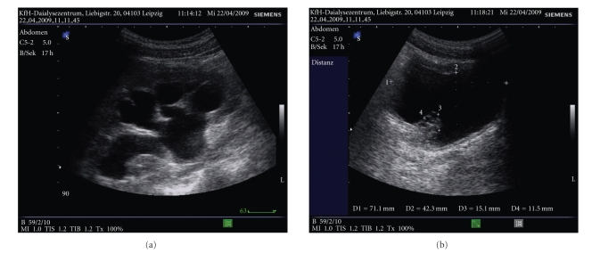
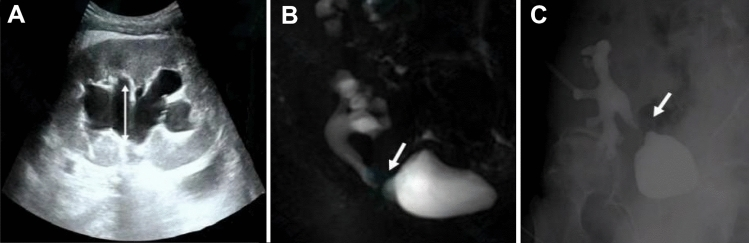
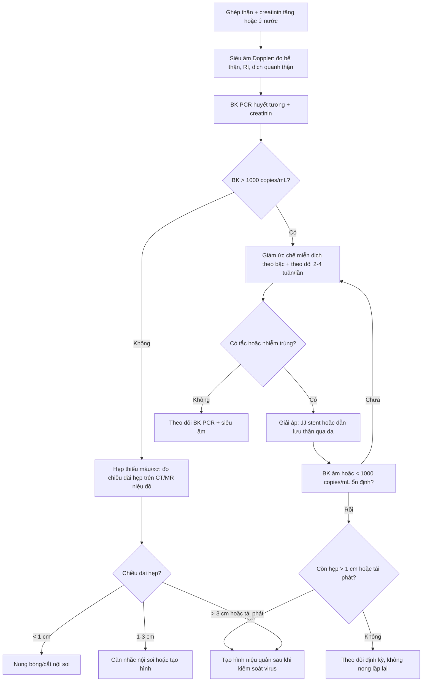

# 3067 — Hẹp niệu quản do BK polyomavirus sau ghép thận: hẹp đoạn dài, khi nào giảm miễn dịch thay vì nong

**Tags:** `pattern:hep-nieu-quan` `pattern:hep-dai-doan` `pattern:gian-dai-he-nieu` `pattern:day-thanh-nieu-quan` `vung:than-ghep` `vung:he-nieu` `vung:tieu-khung` `protocol:sieu-am-Doppler` `protocol:CT-urography` `protocol:MR-urography` `score:BK-viral-load`
**Mức chắc chắn (certainty):** tổng hợp y văn (literature synthesis) — ghép **đoàn hệ 471 ca ghép thận** về hẹp niệu quản (Front Nephrol 2026, PMC13645714), **đồng thuận quốc tế lần 2 về BKPyV** (Transplantation 2024, PMC11335089), **44 ca hẹp niệu quản được điều trị nội soi** (World J Urol 2023, PMID 37340277), **đoàn hệ 1.058 ca** về tiên lượng BK viremia (Clin Transplant 2025, PMID 41055587) và các ca báo cáo có ảnh (PMC2948899, PMC10406706). Không có ca do nhóm tự chụp.

> **Câu hỏi thực hành:** nam **58 tuổi**, ghép thận **8 tháng**, creatinin **1,4 → 2,1 mg/dL**, siêu âm thấy **ứ nước độ II**, **BK PCR huyết tương 18.000 copies/mL**. Đây là **hẹp do thiếu máu miệng nối** hay **hẹp do BK**, và **nong bóng lần nữa có ích không**?
> Bài chốt **ba quyết định**: **(1) hẹp muộn > 3 tháng + đoạn dài + có BK trong máu → nghĩ BK, không phải hẹp thiếu máu đơn thuần; (2) giảm ức chế miễn dịch là điều trị nền, giải áp bằng stent/dẫn lưu chỉ để cứu thận; (3) nong lặp lại ở hẹp muộn ít hiệu quả — sau khi virus được kiểm soát mới tạo hình.** Nối [3011 – Biến chứng niệu quản sau ghép thận](../3011-bien-chung-nieu-quan-sau-ghep-than/lesson.md), [190 – Sỏi đường niệu trên & sỏi thận ghép](../190-soi-nieu-quan-than-ghep-bang-quang-than-kinh/lesson.md), [1750 – UTUC ở thận ghép](../1750-utuc-than-ghep/lesson.md).

## 1. Tổng quan bệnh học – cơ chế hình ảnh: vì sao BK chọn đúng niệu quản mảnh ghép

- **Virus học:** BK polyomavirus (BKPyV) là virus ADN vòng, không vỏ; **80–90% người trưởng thành có huyết thanh dương** và virus tồn tại tiềm tàng trong **tế bào biểu mô niệu (urothelium)**. Ghép thận + ức chế miễn dịch làm virus **tái hoạt**, đi từ **tiểu máu virus (viruria) → nhiễm virus huyết (viremia) → bệnh thận do BK (BKPyV-nephropathy)**.
- **Vì sao tổn thương lại ở niệu quản:** BK sinh sản trong tế bào biểu mô niệu quản → **phù nề, bong tróc, viêm rồi xơ hóa thành niệu quản**. Niệu quản mảnh ghép chỉ còn **một nguồn máu duy nhất từ động mạch thận** (đoạn xa sát bàng quang là nơi tưới máu kém nhất) → **thiếu máu + viêm do virus = hai đòn đánh vào cùng một đoạn**, nên hẹp thường **muộn, dài và tái phát** hơn hẹp thiếu máu đơn thuần.
- **TẠI SAO hẹp do BK "đoạn dài":** viêm do virus lan theo **chiều dọc niệu quản** chứ không khu trú đúng miệng nối; xơ hóa tiến triển từng đợt → thành niệu quản **dày, cứng, lòng hẹp đều**. Hẹp thiếu máu kinh điển thì **ngắn, đúng miệng nối**, vì tổn thương khu trú tại chỗ mạch nuôi tận cùng.
- **TẠI SAO ứ nước xuất hiện muộn:** hẹp tiến triển chậm, bể thận giãn dần; **creatinin chỉ tăng khi hẹp đã đáng kể hoặc khi có đợt nhiễm trùng**. Vì vậy **siêu âm định kỳ** phát hiện trước khi có triệu chứng.
- **Ngưỡng định lượng phải thuộc:**

| Biến số | Số liệu | Nguồn |
|---|---|---|
| Hẹp niệu quản sau ghép thận | **6,37%** (30/471 ca); y văn **0,5% đến > 20%** | Front Nephrol 2026, PMC13645714 |
| BK niệu / BK máu ở nhóm hẹp so với không hẹp | **26,7% vs 7,0%** (p = 0,002) / **26,7% vs 8,6%** (p = 0,005) | PMC13645714 |
| Sống còn mảnh ghép (death-censored) 3 năm | **79,7% vs 93,3%** (p = 0,01) | PMC13645714 |
| Bệnh thận do BK ở người ghép thận | **5–10%**; **50–80%** trong số đó mất mảnh ghép | Nephrol Dial Transplant 2021, PMID 31891401 |
| BK máu: "có thể" / "giả định" bệnh thận do BK | **> 1.000 copies/mL kéo dài > 2 tuần** / **> 10.000 copies/mL** | Transplantation 2024, PMC11335089 |
| Thời điểm hẹp (trung vị) và chiều dài hẹp | **3,5 tháng** (IQR 1,9–10,8) / **10 mm** (IQR 7–20) | World J Urol 2023, PMID 37340277 |
| Hẹp khởi phát muộn > 3 tháng → thất bại nội soi | **RR 2,00** (95% CI 1,01–3,95) | PMID 37340277 |
| Nong/nội soi thành công chung | **61%** ở theo dõi trung vị **44,6 tháng** | PMID 37340277 |

- **Phản biện quan trọng:** một đoàn hệ **1.058 ca** theo dõi trung vị **9,7 năm** **không** thấy BK viremia làm tăng hẹp niệu quản (**0,8% vs 0,4%, p = 0,63**), dù BK máu **> 10.000 copies/mL** làm tăng **kháng thể kháng mảnh ghép de novo (HR 1,71)** và **thải ghép cấp có sinh thiết (HR 2,11)** (Clin Transplant 2025, PMID 41055587). Diễn giải đúng: **BK là dấu chỉ của ức chế miễn dịch mạnh và viêm niệu quản, không chắc là nguyên nhân độc lập** — vì vậy không quy mọi hẹp muộn cho BK khi chưa có PCR; nhưng khi **hẹp + BK máu dương**, phải xử lý cả hai.

## 2. Mẫu hình + chẩn đoán phân biệt theo thời điểm và vị trí (gamut)

- **Gamut theo thời điểm — hỏi "bao lâu sau ghép" trước khi đọc ảnh:**

| Thời điểm | Nguyên nhân hay gặp | Vì sao |
|---|---|---|
| **< 90 ngày** | Hẹp **thiếu máu tại miệng nối**, rò nước tiểu, lymphocele chèn ép, cục máu/stent lệch | Miệng nối chưa lành, đầu xa niệu quản thiếu máu |
| **90 ngày – 2 năm** | **Hẹp do BK**, xơ hóa thiếu máu muộn, lymphocele, sỏi, nhiễm trùng niệu quản | Virus tái hoạt mạnh nhất trong năm đầu; xơ hóa tiến triển |
| **> 2 năm** | Hẹp xơ muộn, **ung thư biểu mô niệu quản (UTUC) liên quan BK**, sỏi, hẹp tái phát sau can thiệp | BK có tính sinh ung thư; tổn thương mạn |

- **Gamut theo hình thái — "hẹp ngắn hay dài" quyết định thái độ:**
  - **Ngắn (< 1 cm), đúng miệng nối, bờ nhẵn:** thiếu máu/xơ miệng nối; nong bóng có vai trò.
  - **Dài (> 1–3 cm), lan tỏa, thành dày, có thể đa ổ:** nghĩ **BK**, xơ hóa sau viêm, hoặc **UTUC lan theo niệu quản**.
  - **Hẹp do chèn ép từ ngoài:** lymphocele/khối dịch — niệu quản **di lệch trục, hẹp mềm**, có khối dịch bên cạnh.
  - **Hẹp + khối trong lòng:** sỏi cản quang, UTUC (khuyết lòng), cục máu.

- **Gamut "ứ nước + hẹp niệu quản mảnh ghép" (5 nhóm chính):** BK/xơ hóa sau viêm · thiếu máu miệng nối · lymphocele/khối dịch chèn · sỏi/stent vôi hóa · UTUC hoặc tái phát bệnh nền.

## 3. Bảng so sánh phân biệt (ma trận đối chiếu)

| Thực thể (entity) | Hình ảnh điển hình (US/CT/MRU) | Chốt vào (rule-in) | Chốt loại (rule-out) | Gợi ý xác nhận |
|---|---|---|---|---|
| **Hẹp do BK** | Hẹp **đoạn dài/lan tỏa**, thành niệu quản **dày**, ứ nước trên chỗ hẹp; không có khối trong lòng | **BK PCR máu dương + hẹp muộn > 3 tháng + đoạn dài** | **Hẹp ngắn đúng miệng nối, PCR âm** → nghĩ thiếu máu | BK PCR huyết tương, US Doppler, CT/MR niệu đồ; sinh thiết niệu quản chỉ khi nghi UTUC |
| **Hẹp thiếu máu miệng nối** | Hẹp **ngắn (< 1 cm)**, đúng UVJ, bờ nhẵn, thường **< 90 ngày** | **Hẹp ngắn tại miệng nối + không có BK** | **Hẹp dài, đa ổ, khởi phát muộn** → loại | CT/MR niệu đồ; đo chiều dài hẹp; PCR BK |
| **Lymphocele chèn ép** | Khối dịch **không ngấm**, đè đẩy niệu quản; hẹp **mềm, dài, lệch trục** | **Khối dịch sát niệu quản + hẹp đúng đoạn bị đè** | **Không có khối dịch, hẹp cố định** → loại | US + CT; dẫn lưu/xơ hóa khối dịch rồi chụp lại |
| **UTUC mảnh ghép/niệu quản** | **Khuyết lòng** hoặc **dày thành khu trú**, ngấm thuốc; ứ nước; có thể **nhân BK+** | **Khối/dày thành khu trú + tế bào học dương** | **Hẹp đều, không khối, tế bào học âm** | CT niệu đồ, nội soi niệu quản + sinh thiết (không nong mù) |
| **Sỏi/stent vôi hóa** | **Cản quang trong lòng**, bóng sáng trên X-quang; stent lưu lâu bị vôi | **Hình cản quang di chuyển theo niệu quản** | **Không có hình cản quang rời** | CT liều thấp; soi niệu quản |
| **Giãn không tắc** | Giãn **toàn bộ** đài bể thận, không có chỗ chuyển tiếp; giảm sau khi bàng quang rỗng | **Giãn giảm sau đi tiểu + không chỗ hẹp** | **Có chỗ chuyển tiếp + chênh áp** → tắc thật | US sau đi tiểu, MAG3 có lợi tiểu |

*J Transplant 2010 (PMC2948899), CC BY 3.0: bệnh nhân **18 tuổi** sau ghép tế bào gốc đồng loài, suy thận, BK niệu/BK máu; **(a)** thận phải ứ nước **độ III–IV**, nhu mô giảm nhiều; **(b)** bàng quang có tổn thương dạng khối do viêm niệu mạc do BK. Đây là bằng chứng "BK gây hẹp niệu quản **hai bên**", không chỉ thận ghép.*

*Int Urol Nephrol 2023 (PMC10406706), CC BY 4.0: **(A)** siêu âm — ứ nước thận ghép, **bể thận tách khoảng 20 mm** (mũi tên trắng); **(B)** MR niệu đồ — hình 3D cho thấy **vị trí và hình thái đoạn hẹp** (mũi tên trắng); **(C)** chụp ngược dòng qua dẫn lưu — xác định **độ dài và mức độ hẹp** trước can thiệp (mũi tên trắng). Ba ảnh trả lời ba câu khác nhau: **có tắc không – hẹp ở đâu – hẹp dài bao nhiêu**.*

## 4. Protocol chụp + ngưỡng xử trí

- **Sàng lọc BK (theo đồng thuận TTS 2024, PMC11335089):** **BK PCR huyết tương hằng tháng đến tháng 9**, sau đó **mỗi 3 tháng đến 2 năm** sau ghép; nếu **1.000–10.000 copies/mL** → **xét nghiệm lại sau 2–3 tuần**; nếu **> 10.000 copies/mL** hoặc kéo dài **> 1.000 copies/mL > 2 tuần** → **giảm ức chế miễn dịch** và theo dõi **2–4 tuần/lần** đến khi âm tính.
- **Chẩn đoán hình ảnh khi có ứ nước hoặc creatinin tăng:**
  - **Bước 1 — siêu âm Doppler mảnh ghép:** đo **đường kính trước–sau bể thận (mm)**, độ dày nhu mô, **RI**, dịch quanh thận; cho bệnh nhân đi tiểu rồi đo lại để loại **giãn sinh lý**.
  - **Bước 2 — CT niệu đồ (CT urography) có cản quang, thì bài tiết 5–10 phút:** xác định **chỗ chuyển tiếp**, đo **chiều dài hẹp**, tìm sỏi/khối. Ở bệnh nhân suy thận hoặc trẻ → **MR niệu đồ (MRU)** thay thế.
  - **Bước 3 — chụp ngược dòng/thận đồ:** bơm qua dẫn lưu hoặc soi bàng quang để **đo chính xác đoạn hẹp** và đặt stent; **MAG3 có lợi tiểu** khi cần đánh giá chức năng.
- **Ngưỡng chọn can thiệp (theo EAU, trích trong bài 3011/PMC12169748):**
  - **< 1 cm:** nong bóng/cắt nội soi là lựa chọn đầu, thành công cao nhất.
  - **1–3 cm:** nội soi có thể thử nhưng **thành công < 50% khi > 1 cm** → cân nhắc tạo hình sớm.
  - **> 3 cm, tái phát, hoặc khởi phát muộn > 3 tháng:** **tạo hình niệu quản** (cấy lại niệu quản, Boari flap, psoas hitch, nối niệu quản gốc).
  - **BK đang hoạt động:** ưu tiên **giảm ức chế miễn dịch + giải áp** (JJ stent hoặc dẫn lưu thận qua da) để cứu thận; **tránh nong lặp lại** khi virus còn cao vì niêm mạc đang viêm, dễ hẹp lại và nhiễm trùng.
- **Giảm ức chế miễn dịch theo bậc (PMC11335089):** giảm **antimetabolite ≥ 50%** trước; nếu BK máu không giảm **10 lần sau 4 tuần** → **ngừng antimetabolite**, giảm corticoid còn **5–10 mg/ngày**; nếu vẫn cần → giảm **CNI** (tacrolimus đích **5 ng/mL**, cyclosporine **100 ng/mL**). Không có kháng virus được cấp phép; **leflunomide/cidofovir/fluoroquinolone không được khuyến cáo thường quy** (bằng chứng yếu).

## 5. Biến thể bình thường và cạm bẫy

- **Bẫy 1 — "ứ nước = tắc":** sau ghép, đài bể thận **mất trương lực** hoặc bàng quang đầy gây giãn giả; phải **đi tiểu/rút bóng rồi đo lại**, tìm **chỗ chuyển tiếp** và **chênh áp** trước khi đặt stent.
- **Bẫy 2 — hẹp muộn luôn bị gọi "xơ thiếu máu":** hẹp **> 3 tháng**, **đoạn dài**, **thành dày** phải **làm BK PCR**; bỏ sót BK thì nong bao nhiêu lần cũng hẹp lại và làm nặng thêm.
- **Bẫy 3 — UTUC trá hình hẹp:** BK có tính sinh ung thư; **dày thành khu trú/khối trong lòng** trên nền hẹp "lan tỏa" phải **nội soi + sinh thiết**, không nong mù (xem [1750](../1750-utuc-than-ghep/lesson.md), [1724](../1724-utuc-goblet-sign/lesson.md)).
- **Bẫy 4 — giảm ức chế miễn dịch gây thải ghép:** BK máu **> 10.000 copies/mL** làm tăng **thải ghép cấp HR 2,11** và **DSA de novo HR 1,71** (PMID 41055587); phải theo dõi creatinin, protein niệu và DSA sau mỗi lần giảm thuốc.
- **Bẫy 5 — nhiễm trùng niệu quản không chỉ do BK:** **CMV** cũng gây viêm niệu quản và hẹp (Korean J Intern Med 2012, PMC3529250); ở bệnh nhân ghép nên làm **PCR CMV/BK** song song khi tổn thương niệu mạc lan tỏa.
- **Bẫy mặt cắt:** dịch trong bể thận **đậm trên T2** dễ nhầm với nang cạnh bể thận; dùng **MRU/CT thì muộn** và tái tạo **vành/dọc** để thấy chỗ nối với niệu quản. Trên CT không cản quang, **stent JJ** tạo vệt tăng đậm giả "sỏi" — đọc trên cửa sổ xương và thì trước cản quang.

## 6. Tự lượng giá — Blind Quiz

**Ca 1 — 18 tuổi, suy thận sau ghép tế bào gốc, BK niệu dương.**

- Gợi ý lâm sàng: bệnh nhân T-ALL sau ghép tế bào gốc đồng loài, nhập viện vì suy thận; BK PCR trong máu và nước tiểu dương.
- Câu hỏi: (a) và (b) cho thấy gì? Vì sao BK có thể gây **hẹp niệu quản hai bên** dù bệnh nhân không ghép thận?

<b>Bấm để hiện đáp án (findings + chẩn đoán)</b>

- Dấu hiệu (findings): **(a)** thận phải **ứ nước độ III–IV**, các đài bể thận giãn, nhu mô mỏng; **(b)** bàng quang có **tổn thương dạng khối/niêm mạc dày** do viêm niệu mạc do BK.
- Chẩn đoán (diagnosis): **hẹp niệu quản hai bên do BK polyomavirus** (biến chứng niệu mạc của tái hoạt BK), không phải hẹp do thiếu máu miệng nối.
- Vì sao: BK tồn tại tiềm tàng trong **biểu mô niệu** toàn bộ đường niệu; ức chế miễn dịch sau ghép tế bào gốc đủ để gây **viêm – phù – xơ hóa niệu quản**, không cần có mảnh ghép thận.
- Nguồn ảnh: J Transplant 2010 (PMC2948899), CC BY 3.0.

**Ca 2 — Ứ nước thận ghép: chọn đúng phương thức để đo chiều dài hẹp.**

- Gợi ý lâm sàng: bệnh nhân ghép thận, creatinin tăng, siêu âm thấy ứ nước; cần quyết định nong hay tạo hình.
- Câu hỏi: Ba ảnh (A–C) trả lời ba câu hỏi nào? Muốn chọn giữa nong và tạo hình, số đo nào là quan trọng nhất?

<b>Bấm để hiện đáp án</b>

- Dấu hiệu (findings): **(A)** siêu âm — ứ nước, **bể thận tách ~20 mm**; **(B)** MR niệu đồ — hình 3D hiển thị **vị trí và hình thái đoạn hẹp**; **(C)** chụp ngược dòng — xác định **độ dài và mức độ hẹp**.
- Chẩn đoán (diagnosis): **hẹp niệu quản mảnh ghép**; quyết định dựa trên **chiều dài hẹp**: **< 1 cm** → nong; **1–3 cm** → cân nhắc; **> 3 cm/tái phát** → tạo hình.
- Vì sao: nong chỉ thắng khi tổn thương **ngắn, không thiếu máu**; hẹp dài do BK/xơ hóa có **thành niệu quản đã mất đàn hồi**, nong xong hẹp lại.
- Nguồn ảnh: Int Urol Nephrol 2023 (PMC10406706), CC BY 4.0.

**Ca 3 — Ca quyết định (không có ảnh): 58 tuổi, ghép thận 8 tháng, BK 18.000 copies/mL.**

- Gợi ý lâm sàng: creatinin **2,1 mg/dL**, siêu âm ứ nước độ II, CT niệu đồ thấy **hẹp lan tỏa 2,5 cm** đoạn giữa niệu quản ghép; không sốt.
- Câu hỏi: Ba việc cần làm theo thứ tự? Có nên nong bóng ngay không?

<b>Bấm để hiện đáp án</b>

- Bước 1: **giảm ức chế miễn dịch theo bậc** (antimetabolite ≥ 50%, theo dõi BK PCR 2–4 tuần/lần) — đây là điều trị nền, vì không có kháng virus đặc hiệu.
- Bước 2: **giải áp** bằng **JJ stent hoặc dẫn lưu thận qua da** nếu có tắc đáng kể/nhiễm trùng; theo dõi creatinin và nước tiểu.
- Bước 3: **chờ virus kiểm soát** (BK < 1.000 copies/mL ổn định hoặc âm) rồi **tạo hình niệu quản** nếu còn hẹp > 1 cm — không nong lặp lại vì hẹp **muộn, dài 2,5 cm** dự báo thất bại nội soi (RR 2,00 cho khởi phát muộn).
- Cạm bẫy: giảm thuốc có thể gây **thải ghép cấp** — phải theo dõi creatinin/DSA; và đừng quên **tầm soát UTUC** nếu thành niệu quản dày khu trú.

## Bài liên quan chéo
- [100 – Tổng quan hệ Bụng](../100-tong-quan-he-bung/lesson.md)
- [3011 – Biến chứng niệu quản sau ghép thận: hẹp miệng nối & rò nước tiểu](../3011-bien-chung-nieu-quan-sau-ghep-than/lesson.md)
- [190 – Sỏi đường niệu trên & sỏi thận ghép](../190-soi-nieu-quan-than-ghep-bang-quang-than-kinh/lesson.md)
- [189 – Đánh giá tiết niệu trước ghép thận](../189-danh-gia-truoc-ghep-than-bang-quang-than-kinh/lesson.md)
- [1750 – UTUC ở bệnh nhân thận ghép](../1750-utuc-than-ghep/lesson.md)
- [1724 – UTUC: dấu "goblet" & "stipple"](../1724-utuc-goblet-sign/lesson.md)

## Ảnh
- 2 ảnh: **1 ảnh CC BY 3.0** (J Transplant 2010, PMC2948899) + **1 ảnh CC BY 4.0** (Int Urol Nephrol 2023, PMC10406706) — **nguyên bản**, không crop/ghép; chi tiết trong `images/CREDITS.md`.
- Không tạo composite vì hai ảnh khác modality và khác license; không dùng ảnh từ bài CC BY-NC-ND.

> Không dùng để chẩn đoán độc lập khi chưa có người hướng dẫn.
