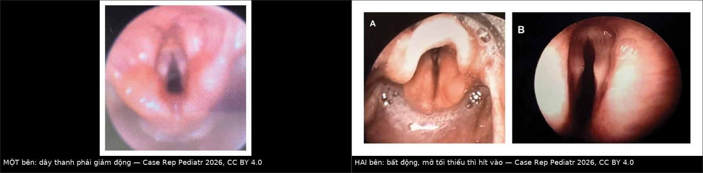
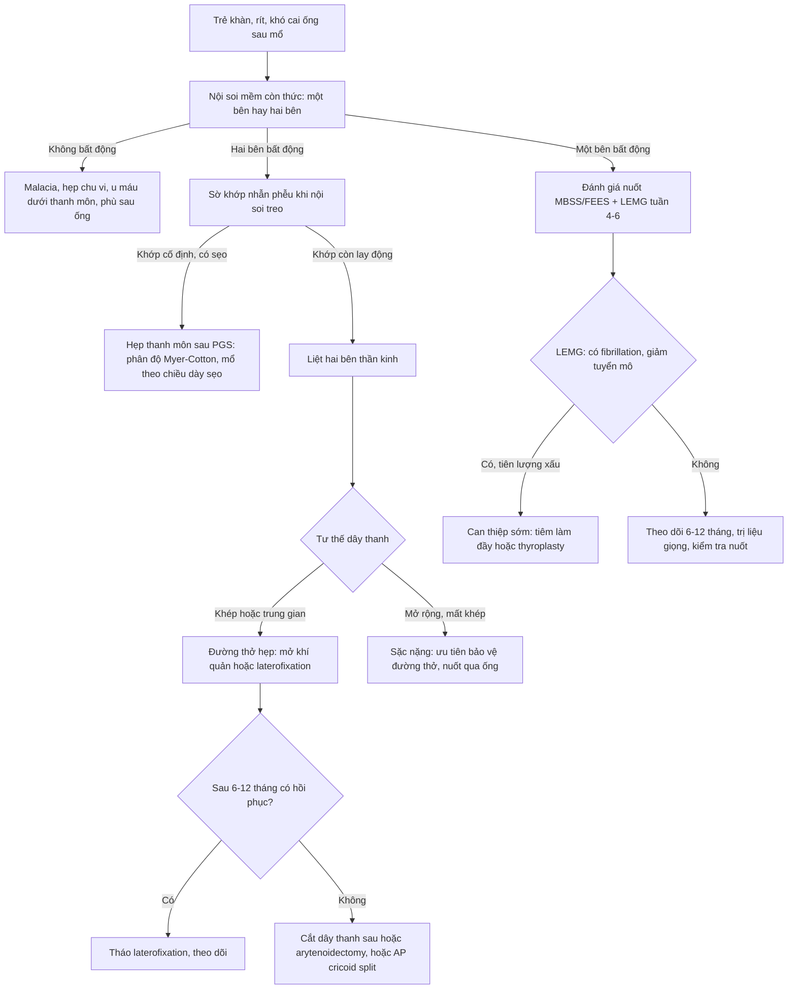
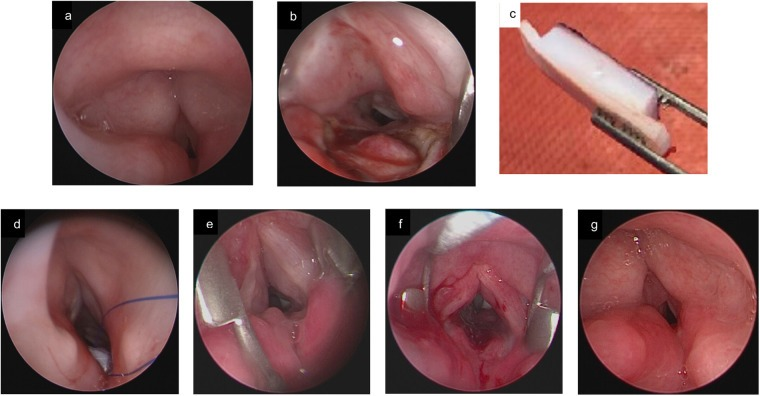
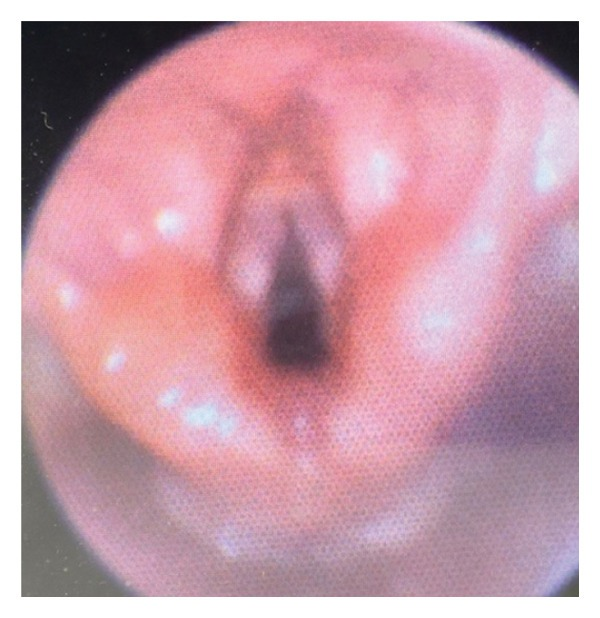
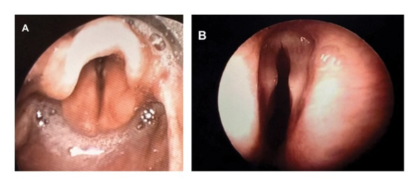
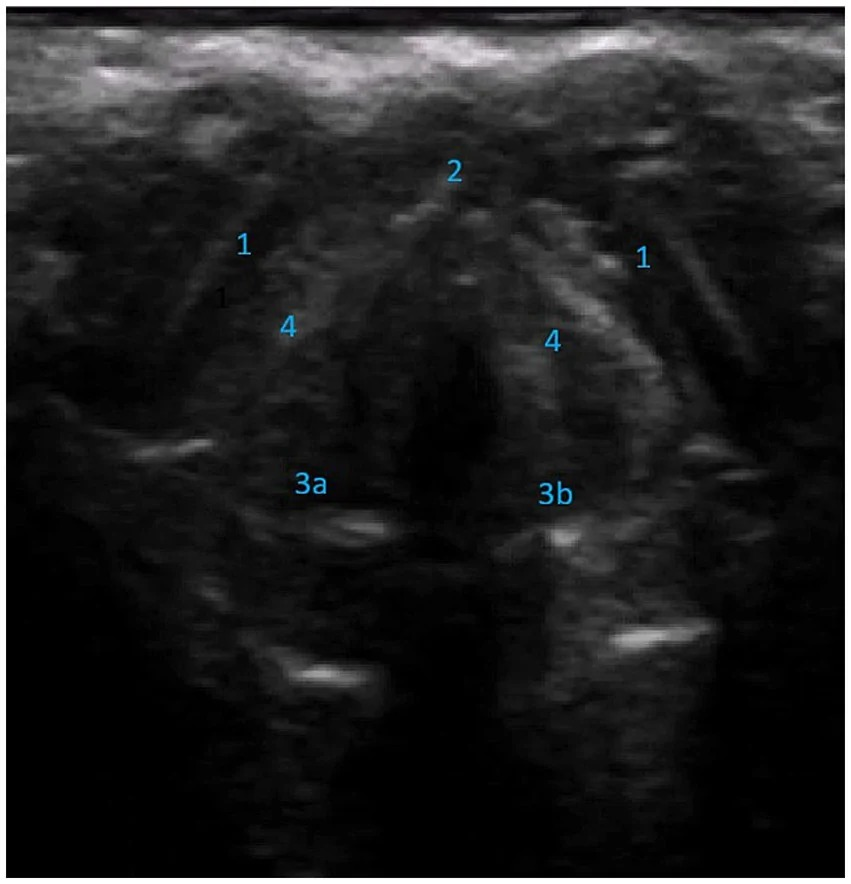

# 3068 — Liệt dây thanh sau phẫu thuật đường thở ở trẻ: một bên vs hai bên, cai ống và phân biệt hẹp thanh môn sau

**Tags:** `pattern:bat-dong-day-thanh` `pattern:khac-giong` `pattern:rit-thi-hit-vao` `vung:thanh-quan` `anatomy:thanh-quan` `protocol:noi-soi-thanh-quan` `protocol:sieu-am-thanh-quan` `protocol:LEMG` `score:Myer-Cotton`
**Mức chắc chắn (certainty):** tổng hợp y văn (literature synthesis) — ghép **tổng quan có hệ thống về liệt dây thanh hai bên ở trẻ** (Children (Basel) 2024, PMC11049505), **89 trẻ bất động dây thanh có nuốt cản quang** (Otolaryngol Head Neck Surg 2025, PMC12379859), **398 trẻ mổ tim bẩm sinh** (Pediatr Cardiol 2026, PMC12945929), **35 + 35 sơ sinh đóng PDA** (J Cardiovasc Dev Dis 2025, PMC12842332), **29 trẻ siêu âm thanh quản** (Clin Otolaryngol 2025, PMC11618319), **chuẩn tham chiếu góc trên siêu âm** (Front Neurol, PMC13635193), **tổng quan có hệ thống về LEMG** (2026, PMC13198761) và **2 ca nguyên văn Williams** (Case Rep Pediatr 2026, PMC13213710). Không có ca do nhóm tự chụp.

> **Câu hỏi thực hành:** bé trai **37 tuần**, nặng 3,2 kg, **khàn và hít sặc sau đặt nội khí quản 5 ngày**; nội soi mềm thấy **dây thanh phải giảm động**. Câu hỏi: **đây là liệt do chấn thương thần kinh quặt ngược hay chỉ là phù sau ống? Có cần mở khí quản không, và nếu sau này phải “mổ đường thở” thì mổ gì?**
> Bài chốt **ba quyết định**: **(1) bất động dây thanh (VFI) là chẩn đoán NỘI SOI, không phải chẩn đoán X-quang — và phải phân biệt với hẹp thanh môn sau (PGS) vì PGS không đáp ứng với phẫu thuật thần kinh; (2) một bên thường chỉ khàn ± hít sặc (55,2% vs 9,1%), hai bên là nguyên nhân THẤT BẠI CAI ỐNG độc lập và cần can thiệp đường thở; (3) hồi phục chỉ 8–82% và khả năng hồi phục đọc được bằng LEMG sau ≥ 3–4 tuần (PPV 90,9% cho “không hồi phục”) — đây là cơ sở để chọn “chờ” hay “mổ tạm”.** Nối [3049 – Hẹp thanh–khí quản tái phát sau tạo hình](../3049-hep-thanh-khi-quan-tai-phat-sau-tao-hinh-o-tre/lesson.md), [3047 – Hẹp khí quản sau đặt nội khí quản](../3047-hep-khi-quan-sau-dat-noi-khi-quan-o-tre/lesson.md), [6100 – Chăm sóc và cai ống mở khí quản](../6100-cham-soc-va-cai-ong-mo-khi-quan-tre/lesson.md), [3005 – U máu dưới thanh môn](../3005-u-mau-duoi-thanh-mon-nhu-nhi/lesson.md), [602 – Tracheobronchomalacia](../602-tracheobronchomalacia-o-tre-bpd/lesson.md).

## 1. Tổng quan bệnh học – cơ chế hình ảnh: vì sao “bất động” mới là chốt

- **Giải phẫu quyết định bên liệt:** thần kinh quặt ngược (recurrent laryngeal nerve, RLN) bên **trái** vòng qua **cung động mạch chủ – ống động mạch**, bên **phải** vòng qua **động mạch dưới đòn** → đường đi bên trái **dài hơn, nằm trong lồng ngực** nên dễ bị tổn thương khi mổ tim, ống động mạch, cung động mạch chủ. Đúng như vậy, trong 89 trẻ bất động dây thanh, **83,6% ở bên trái**, và **58,4% do phẫu thuật tim–lồng ngực** (PMC12379859).
- **TẠI SAO dây thanh liệt nằm ở tư thế trung gian (paramedian):** cơ nhẫn giáp sau (posterior cricoarytenoid) là cơ **DUY NHẤT mở dây thanh**, do RLN chi phối; khi mất chi phối, **cơ khép (cơ nhẫn giáp bên, cơ phễu) không đối kháng** → dây thanh bị kéo về **giữa**, nên **giọng khàn là triệu chứng chính, không khó thở**. Ngược lại, khi **cả hai dây thanh ở tư thế MỞ (abduction)** — gặp khi **cả hai thần kinh phế vị** tổn thương — thì **mất khép, sặc, mất tiếng, khó nuốt nặng**, và đây là thể **nguy hiểm vì viêm phổi hít sặc** (PMC11049505).
- **TẠI SAO hai bên gây suy hô hấp mà một bên thì không:** dây thanh hai bên đều khép/trung gian → khe thanh môn chỉ còn **vài mm**, kháng lực đường thở tỉ lệ nghịch với **lũy thừa 4 của bán kính** (định luật Poiseuille) → giảm nhẹ khẩu kính làm **tăng kháng lực rất nhiều**, nên trẻ **rít thì hít vào, co kéo, khó cai ống**. Vì vậy **liệt hai bên là biến số quyết định “có mở khí quản hay không”**, không phải mức khàn.
- **Con số nền (dùng để tư vấn):** liệt dây thanh hai bên là **dị tật thanh quản bẩm sinh phổ biến thứ hai** sau laryngomalacia, chiếm **10–20%** các bệnh thanh quản ở trẻ; ở sơ sinh chiếm **30–60%** các trường hợp rối loạn chức năng dây thanh. Tần suất được báo cáo **0,75 ca/1 triệu trẻ sinh sống/năm** (11/109 trẻ < 1 tuổi được nội soi vì khó thở trong dân số 750.000 trẻ). Căn nguyên (tổng quan hệ thống **320 ca**): **vô căn 42,2%**, **bẩm sinh 19,7%**, **thần kinh 16,9%**, **chấn thương 8,6%**, **do thầy thuốc 5,8%**; **60,8%** phải can thiệp đường thở (PMC11049505).
- **TẠI SAO mổ tim/đóng ống động mạch là nguyên nhân số một:** RLN trái chạy sát **ống động mạch và quai động mạch chủ**; kẹp, cắt, hoặc nhiệt khi ligation đều có thể làm đứt/nhiệt tổn thương thần kinh. Trong loạt **35 sơ sinh < 1500 g đóng ống động mạch bằng mổ**: **8 ca (24%) liệt dây thanh xác nhận bằng nội soi**, **0 ca** ở nhóm đóng bằng catheter (PMC12842332). Ở nhóm **398 trẻ mổ tim bẩm sinh**, nội soi được làm ở **167 trẻ (42%)** và **90 trẻ (53,9%) có bất động dây thanh** — tức **~22,6% toàn bộ nhóm mổ tim**; bất động dây thanh là yếu tố độc lập cho **phải nuôi ăn qua ống** (OR **5,6**, p = 0,002), bên cạnh **tim một buồng** (OR 5,1) và **lo ngại hít sặc** (OR 6,1) (PMC12945929).
- **TẠI SAO chẩn đoán hay bị muộn:** **tới 47%** trẻ có bất động dây thanh **không có triệu chứng kinh điển**, và ở trẻ **< 3 tuổi**, nội soi mềm **không đạt (non-diagnostic) tới 20%** do khó quan sát thanh quản (PMC11618319). Đây là lý do các trung tâm đang chuyển sang **sàng lọc bằng siêu âm thanh quản** sau mổ tim.
- **TẠI SAO không được nhầm với hẹp thanh môn sau (posterior glottic stenosis, PGS):** PGS là **dính/ankylosis khớp nhẫn phễu** — **thần kinh còn nguyên**, dây thanh **không di động nhưng KHÔNG liệt**. Phân biệt này quyết định: **PGS không đáp ứng với tái chi phối thần kinh (reinnervation)**, và **cắt dây thanh sau/arytenoidectomy không đủ** nếu không xử lý khớp; ngược lại, chẩn đoán PGS thành “liệt” dẫn tới **mổ thần kinh vô ích** (PMC11049505). Trên nội soi treo, **khớp nhẫn phễu cố định khi sờ = PGS**; còn trong liệt, khớp **còn lay động tương đối**.
- **TẠI SAO siêu âm thanh quản nhìn được dây thanh ở trẻ:** sụn giáp/sụn nhẫn **chưa cốt hóa** ở trẻ nhỏ → cửa sổ âm tốt; trên ảnh ngang, **sụn giáp giảm âm hình lưỡi liềm** phía trước, **sụn phễu giảm âm** phía sau, **mép trước tăng âm**, **dây thanh thật giảm âm** (cơ thanh âm mỏng) nằm **dưới dây thanh giả tăng âm** (do mỡ khoang cạnh thanh môn). Tỉ lệ nhìn thấy cấu trúc thanh quản ở người **< 18 tuổi là 100%**, giảm dần theo tuổi do cốt hóa (nam > 60 tuổi chỉ còn **38,1%**). Đây là cơ sở vật lý để dùng siêu âm thay nội soi ở nhũ nhi.

## 2. Mẫu hình + chẩn đoán phân biệt theo bên và theo cơ chế (Gamut)

- **Theo BÊN — trục quyết định xử trí:**
  - **Một bên (75,3% ca trẻ có VFI)** → khàn **55,2%**, hít sặc, yếu hơi; **vẫn bú được**, hiếm khi cần mở khí quản; nguy cơ chính là **hít sặc im lặng → viêm phổi tái diễn** (PMC12379859).
  - **Hai bên, tư thế khép/trung gian** → **rít thì hít vào, co kéo, khó cai ống**, giọng **tương đối bình thường** (dysphonia chỉ **9,1%**); đây là thể cần **can thiệp đường thở** (PMC11049505).
  - **Hai bên, tư thế MỞ** → **mất tiếng, sặc nặng, khó nuốt** do tổn thương **cả hai phế vị** (kèm mất chi phối cơ khép hầu) — **nguy cơ viêm phổi hít sặc cao nhất**.
- **Theo CƠ CHẾ (gamut của bất động dây thanh ở trẻ):**
  - **Do thầy thuốc:** **mổ tim/cung động mạch chủ/ống động mạch (58,4%)** · **đặt nội khí quản kéo dài/chấn thương (10,1%)** · **cắt tuyến giáp, cắt thực quản, phẫu thuật khí quản–thanh quản** · **mổ nang phế quản nguyên phát**.
  - **Thần kinh trung ương (9,0%):** **Arnold–Chiari** (thoát vị hành não–hạnh nhân tiểu não chèn nhân hoạt động của dây X), bất sản thân não, xuất huyết não, bại não.
  - **Bẩm sinh/hội chứng:** **hẹp khí quản nặng**, **hội chứng Duane**, sinh non, **hội chứng Williams (7q11.23, mất đoạn gen elastin)**, CHARGE.
  - **Chấn thương:** ngạt khi sinh, **nuốt pin cúc áo**, ngộ độc CO, chấn thương cổ.
  - **Chưa rõ nguyên nhân:** **42,2%** — nhưng phải loại trừ PGS và bất động do đau/co thắt trước khi gắn nhãn “vô căn”.
- **Theo hình ảnh nội soi (đọc đúng):** dây thanh **bất động + khớp còn lay động = liệt**; **bất động + khớp cố định + sẹo liên phễu = PGS**; **bất động + khối dưới thanh môn = u máu dưới thanh môn (bài 3005)**; **bất động + hẹp chu vi = hẹp dưới thanh môn (Myer–Cotton)**; **bất động khi hít vào nhưng di động khi khóc = malacia** (không phải liệt).
- **Mnemonic 4 câu hỏi tại giường:** **(1) một bên hay hai bên? (2) dây thanh ở tư thế nào (khép/mở)? (3) có sặc không? (4) đã mổ gì ở ngực/cổ trong 4 tuần qua?**

## 3. Bảng so sánh phân biệt (ma trận đối chiếu)

| Thực thể (entity) | Hình ảnh điển hình (nội soi / siêu âm) | Chốt vào (rule-in) | Chốt loại (rule-out) | Gợi ý xác nhận |
|---|---|---|---|---|
| **Liệt một bên (RLN)** | Dây thanh **bất động ở tư thế trung gian**, bên **trái 83,6%**, có **co bù bên đối diện** khi phát âm | **Khàn sau mổ ngực/cổ + một dây bất động + khớp còn lay động** | Hai dây bất động, khớp cố định → PGS; khối dưới thanh môn → u máu | Nội soi mềm thức; LEMG sau **≥ 3–4 tuần** |
| **Liệt hai bên (khép/trung gian)** | Hai dây **bất động sát nhau**, khe **vài mm**, **rít thì hít vào**, giọng gần bình thường | **Khó cai ống + rít thì hít vào + hai dây bất động + giọng ít đổi** | Malacia (di động khi khóc), hẹp chu vi | Nội soi mềm + nội soi treo sờ khớp; CT/MRI sọ nếu nghi Chiari |
| **Liệt hai bên tư thế MỞ (tổn thương phế vị hai bên)** | Hai dây **mở rộng**, **không khép khi phát âm**, hồ sơ khép mất | **Mất tiếng + sặc + khó nuốt nặng + hai dây mở** | Liệt khép (giọng khàn, không sặc nhiều) | Nội soi + đánh giá nuốt (VFSS/FEES) |
| **Hẹp thanh môn sau (PGS)** | **Sẹo liên phễu**, dây thanh **dính thành khối**, khe hình **chìa khóa**, không di động | **Tiền sử đặt ống lâu + sẹo sau + khớp CỐ ĐỊNH khi sờ** | Khớp lay động, không sẹo → liệt thần kinh | Nội soi treo sờ khớp; phân độ Myer–Cotton nếu lan dưới thanh môn |
| **Hẹp dưới thanh môn (SGS)** | Hẹp **chu vi** dưới dây thanh, thường **1–3 cm dưới dây thanh**, sẹo tròn | **Hẹp chu vi + tiền sử ống + dây thanh DI ĐỘNG** | Chỉ hẹp phía sau, dây bất động → PGS/liệt | Nội soi treo + nong bóng; đo đường kính ống lớn nhất qua được |
| **U máu dưới thanh môn** | Khối **một bên**, mềm, **đỏ xanh**, hẹp **bất đối xứng**; kèm u máu da vùng râu | **U máu da vùng râu/cổ + khối dưới thanh môn một bên + khởi phát 6 tuần–6 tháng** | Hẹp chu vi đối xứng, không u máu da | Nội soi; propranolol chẩn đoán – điều trị (bài 3005) |
| **Malacia thanh–khí quản** | **Sụp thành trước** khi hít vào, **hết khi khóc/thở ra**, dây thanh **di động bình thường** | **Sụp động theo thì thở + dây thanh di động** | Bất động cố định cả thì → liệt | Nội soi còn thức; CT động thì hít vào/thở ra |
| **Bất động do đau/co thắt sau ống** | Dây thanh **giảm động đối xứng**, hết sau vài ngày | **Hết trong 24–72 giờ + không có yếu tố thần kinh** | Không hồi phục sau 1 tuần → liệt thật | Nội soi lại sau **3–7 ngày** |

*Trái: **liệt MỘT bên** — dây thanh phải giảm động, dây trái co bù khi phát âm. Phải: **liệt HAI bên** — hai dây bất động, chỉ mở tối thiểu thì hít vào (panel B); panel A cùng bệnh nhân ở tư thế nghỉ. Nguồn: Case Rep Pediatr 2026 (PMC13213710), **CC BY 4.0**, ảnh ghép letterbox giữ nguyên tỷ lệ.*

### Dấu hiệu định lượng trên siêu âm thanh quản (khi không nội soi được)
- **Không đối xứng:** góc **dây thanh–sụn phễu (VF-AA) ≤ 120°** ở thì khép tối đa gợi ý **bất đối xứng/liệt**, độ nhạy **0,91**, độ đặc hiệu **0,68**.
- **Góc thanh môn trước (anterior glottic angle, AGA)** đo giữa hai đường từ **mép trước** tới **bờ trong hai sụn phễu**; độ tin cậy giữa 2 người đọc **ICC 0,92–0,97** cho cả VF-AA và AGA (PMC13635193). Giá trị tham chiếu tuyệt đối theo tuổi chưa thống nhất — **đọc xu hướng và so sánh hai bên**, không chốt bằng một con số tuyệt đối.

## 4. Protocol chẩn đoán – điều trị – cai ống

- **Bước 1 — nội soi mềm còn thức (awake flexible laryngoscopy) là tiêu chuẩn vàng**, làm **trước khi rút ống** ở mọi trẻ có yếu tố nguy cơ (mổ tim, đóng ống động mạch, cắt tuyến giáp, đặt ống > 7 ngày). Đánh giá **4 thì**: thở yên, phát âm/khóc, nuốt, và **nghiệm pháp Valsalva** (nếu hợp tác).
- **Bước 2 — siêu âm thanh quản (LUS) khi trẻ quá nhỏ/không hợp tác hoặc để sàng lọc:** đầu dò **linear tần số cao 5–10 MHz (hoặc 18–4 MHz)**, đặt **ngang cổ ngang mức sụn giáp**, B-mode, ghi **cine-loop** cả thì thở và khóc. Độ chính xác gộp (8 nghiên cứu, 290 trẻ): **Se 91% / Sp 97%**; trong loạt 29 trẻ: **Se 80,95%**, **riêng liệt MỘT bên Se 93,33%**, **liệt hai bên chỉ phát hiện 3/6**, đồng thuận chung **75,86%** (PMC11618319). **Kết luận: LUS tốt để loại/sàng lọc một bên; KHÔNG dùng LUS đơn thuần để loại liệt hai bên.**
- **Bước 3 — LEMG (điện cơ thanh quản) khi cần tiên lượng, làm sau ≥ 3–4 tuần:** điện thế **fibrillation/positive sharp wave** xuất hiện **1–4 tuần** sau đứt trục, nên làm sớm hơn sẽ **âm giả**. Giá trị: **PPV 90,9%** cho “không hồi phục”, nhưng **NPV chỉ 55,6%** (meta **503 ca**); cohort 84 bệnh nhân cho **PPV 93%**, độ chính xác **86,4%**; **synkinesis (đồng vận bất thường)** nâng NPV từ **53% → 100%**. Tức **LEMG giỏi báo “xấu”, kém báo “tốt”** (PMC13198761).
- **Bước 4 — đánh giá nuốt là bắt buộc, không phụ thuộc mức khàn:** trong 89 trẻ, **33 trẻ hít sặc trên MBSS ban đầu**, **48,5% hết sặc hoàn toàn** sau trung vị **10,5 tuần**, và **hồi phục nuốt KHÔNG song hành với hồi phục dây thanh** (PMC12379859). Trẻ giảm động (hypomobility) hồi phục **87,5%** so với **33,3%** ở trẻ bất động hoàn toàn (OR 14,0) — nên **ghi rõ “giảm động” hay “bất động”**, đừng gọi chung là “liệt”.
- **Bước 5 — chọn can thiệp theo bên và theo khả năng hồi phục:**

| Tình huống | Lựa chọn | Số liệu chốt |
|---|---|---|
| **Một bên, đường thở ổn** | **Theo dõi + liệu pháp giọng + đánh giá nuốt**; LEMG ở tuần 4–6 | Hồi phục chung **8–82%**, loạt lớn nhất **28%** (PMC12379859) |
| **Một bên, hít sặc nặng/suy dinh dưỡng** | **Tiêm chất làm đầy (injection laryngoplasty)** tạm thời; **thyroplasty type I** khi trẻ lớn | Mục tiêu: đóng khép để bảo vệ đường thở khi nuốt, không chờ hồi phục |
| **Hai bên, còn khả năng hồi phục** | **Mở khí quản** hoặc **laterofixation** (cố định một dây ra ngoài, **không mở khí quản**) | Laterofixation: **93%** (15 trẻ) và **100%** (2 loạt) cai được; biến chứng **sặc, áp-xe cổ, phù, lệch chỉ** (PMC11049505) |
| **Hai bên, ít khả năng hồi phục** | **Cắt dây thanh sau (posterior transverse cordotomy)** một/bên; **arytenoidectomy bán phần** | Cai ống **77–100%**; arytenoidectomy **95%** cải thiện chủ quan (33 trẻ); biến chứng chính **u hạt** |
| **Hai bên, thất bại các mổ trên** | **Rạch sụn nhẫn trước–sau (AP cricoid split)** ± ghép sụn | Cai ống **73%**, **40% phải mổ lại** (PMC11049505) |
| **Muốn giữ giọng, có chuyên gia** | **Tái chi phối thần kinh thanh quản chọn lọc hai bên** | Cai ống trung bình **63%** (50–100%) — thấp hơn các mổ phá hủy, nhưng giữ chức năng |
| **Đã mở khí quản** | **Cai ống** sau khi hết tắc trên, nuốt an toàn, nội soi xác nhận | Cai được **54–77%** trẻ mở khí quản vì liệt hai bên |

*Bé gái **2 tuổi**, hẹp thanh môn sau độ III sau đặt ống: **(a)** nội soi trước mổ — khe thanh môn hẹp, hai dây thanh **trông như bất động**; **(b)** sau rạch sụn nhẫn giữa phía sau, thấy **niêm mạc thực quản lồi lên**; **(c)** mảnh sụn sườn được tạo hình; **(d, e, f)** đặt mảnh ghép và nong bóng; **(g)** khe thanh môn thông sau 3,5 tháng, cai ống ngay hôm sau. Điểm cần nhớ: **cùng hình ảnh “dây thanh không mở”, nhưng đây KHÔNG phải liệt thần kinh** — tái chi phối thần kinh sẽ vô ích. Nguồn: Front Pediatr 2025 (PMC12417507), **CC BY 4.0**, nguyên bản.*

## 5. Biến thể bình thường và cạm bẫy

- **Bẫy 1 — quy mọi khàn sau mổ cho “phù ống”:**

| Dấu hiệu phân biệt | Phù/đau sau ống | Liệt thần kinh thật |
|---|---|---|
| Thời gian | Hết trong **24–72 giờ** | Không hết sau **1 tuần** |
| Đối xứng | **Hai bên, giảm động đều** | **Một bên rõ** hoặc hai bên không đều |
| Kèm theo | Đau, nuốt vướng, không sặc nhiều | **Hít sặc, yếu hơi, giọng hơi** |
| Diễn tiến | Tốt dần mỗi ngày | **Ổn định hoặc xấu khi ăn** |

- **Bẫy 2 — “giọng bình thường thì không phải liệt hai bên”:** liệt hai bên khép có **dysphonia chỉ 9,1%** (so với **55,2%** ở một bên); trẻ vẫn khóc to nhưng **không cai được ống**. Đây là lý do **phải nội soi trước khi quyết định rút ống**, không dựa vào tiếng khóc.
- **Bẫy 3 — bỏ qua hít sặc vì trẻ “không sặc khi ăn”:** sặc có thể **im lặng**; nhóm một bên vẫn hít sặc **~50%** trên MBSS. Không đánh giá nuốt = nguy cơ **viêm phổi tái diễn và xơ phổi**.
- **Bẫy 4 — dùng siêu âm để loại liệt hai bên:** LUS chỉ phát hiện **3/6** ca liệt hai bên trong loạt 29 trẻ — **âm giả cao**. Luôn xác nhận bằng nội soi khi lâm sàng nặng.
- **Bẫy 5 — làm LEMG quá sớm:** trước **3–4 tuần**, điện thế mất chi phối **chưa xuất hiện** → kết luận “còn chi phối” sai, trì hoãn can thiệp.
- **Bẫy 6 — tin LEMG “bình thường” là sẽ hồi phục:** **NPV chỉ 55,6%** — gần một nửa ca “dự báo tốt” vẫn không hồi phục. Chỉ **synkinesis** mới kéo NPV lên **100%**.
- **Bẫy 7 — chẩn đoán PGS thành liệt:** khớp **cố định** khi sờ + **sẹo liên phễu** = PGS. Mổ thần kinh (reinnervation) trên PGS **không có tác dụng**, còn arytenoidectomy bán phần **không đủ** nếu không xử lý khớp.
- **Bẫy 8 — bỏ sót nguyên nhân trung ương:** liệt hai bên + **giảm phản xạ hầu, yếu chi, thóp căng** → chụp **MRI sọ** tìm **Arnold–Chiari/bất sản thân não**; sửa nguyên nhân trung ương có thể cải thiện đường thở mà không cần mổ thanh quản.
- **Bẫy 9 — mở khí quản rồi coi là “xong”:** mở khí quản giải quyết **đường thở**, không giải quyết **nuốt** — vẫn phải **đánh giá nuốt và cho ăn qua ống** khi cần (ca 1 trong quiz phải đặt **Nissen + gastrostomy**).
- **Bẫy 10 — quên sàng lọc trẻ có hội chứng:** **Williams (7q11.23, elastin)**, CHARGE, Duane, Chiari — trẻ có **rít/sặc kéo dài** kèm dị tật tim (hẹp nhánh động mạch phổi, hẹp trên van động mạch phổi) nên **nội soi sớm**, vì liệt dây thanh trong Williams có thể **hai bên và cần mở khí quản** (PMC13213710).

## 6. Tự lượng giá — Blind Quiz

**Ca 1 — Sơ sinh nam 37 tuần, sau 3 lần hút chân không, suy hô thở phải CPAP rồi đặt ống; 3 tuần tuổi còn ho khi bú, nuốt cản quang có trào ngược mũi hầu. Nội soi mềm:**

- Hỏi: dây thanh bên nào bất động? Có cần mở khí quản không? Nguy cơ nào phải tìm dù trẻ “vẫn bú được”?

<b>Bấm để hiện đáp án</b>

- **Dây thanh PHẢI giảm động**, dây trái **co bù** khi phát âm → **liệt/hypomobility MỘT bên**.
- **Không mở khí quản**: trẻ giữ được đường thở nhờ dây trái bù; nhưng **vẫn phải đánh giá nuốt** vì ca gốc có **sặc im lặng thành sau khí quản** trên MBSS lặp lại, phải **đặt gastrostomy + Nissen** dù không mở khí quản.
- **Chẩn đoán nền:** bất thường tim (còn ống động mạch, **hẹp nhánh động mạch phổi hai bên**, hẹp trên van động mạch phổi) + nét mặt → **hội chứng Williams (mất đoạn 7q11.23)**; liệt dây thanh **không phải đặc điểm thường gặp** của Williams nhưng đã được báo cáo, liên quan **gen elastin**.
- Nguồn: Case Rep Pediatr 2026 (PMC13213710), **CC BY 4.0**.

**Ca 2 — Sơ sinh nữ 38 tuần, rít thì hít vào ngay sau sinh, co kéo; nội soi mềm:**

- Hỏi: vì sao trẻ **không cai được ống** dù đã dùng corticoid? Hai dây ở tư thế nào, và bước tiếp theo?

<b>Bấm để hiện đáp án</b>

- **(A, B)** hai dây thanh **bất động, chỉ mở tối thiểu thì hít vào** → **liệt HAI bên tư thế khép/trung gian**; đây là nguyên nhân **thất bại cai ống**, không phải phù thanh môn đơn thuần.
- Diễn tiến ca gốc: rút ống sang **NPPV** sau corticoid nhưng nội soi vẫn bất động → **mở khí quản + Nissen + gastrostomy**; sau đó có đợt **viêm khí quản do tụ cầu + Stenotrophomonas**.
- Bước tiếp theo đúng: **nội soi treo sờ khớp** (loại PGS), **MRI sọ** (loại Chiari), **đánh giá nuốt**, và **kế hoạch can thiệp đường thở** (laterofixation hoặc cắt dây thanh sau nếu không hồi phục sau 6–12 tháng).
- **Phản biện:** đây là ca **Williams** — nguyên nhân **không điển hình**; phần lớn liệt hai bên ở trẻ là **vô căn (42,2%)** hoặc **do thầy thuốc (5,8%)**; không được lấy ca này làm quy luật “liệt hai bên là bệnh di truyền”.
- Nguồn: Case Rep Pediatr 2026 (PMC13213710), **CC BY 4.0**.

**Ca 3 — Trẻ 4 tháng sau mổ đóng ống động mạch, khàn và hít sặc; siêu âm thanh quản:**

- Hỏi: kể tên 4 mốc giải phẫu (1–4) và nêu một ngưỡng góc dùng để phát hiện bất đối xứng.

<b>Bấm để hiện đáp án</b>

- **(1) sụn giáp** (giảm âm, hình lưỡi liềm, phía trước); **(2) mép trước** (tăng âm, ngay sau điểm giữa sụn giáp); **(3a/3b)** **sụn phễu phải/trái** (giảm âm, phía sau); **(4)** **dây thanh giả** (tăng âm hơn dây thanh thật vì phủ mỡ khoang cạnh thanh môn).
- Ngưỡng: **VF-AA ≤ 120° ở thì khép tối đa** gợi ý bất đối xứng (Se 0,91 / Sp 0,68); đo **AGA** giữa hai đường từ mép trước tới bờ trong hai sụn phễu (ICC 0,92–0,97).
- Giới hạn: siêu âm **bỏ sót liệt hai bên (3/6)** → vẫn cần **nội soi mềm** khi nghi ngờ.
- Nguồn: Front Neurol (PMC13635193), **CC BY 4.0**.

## Bài liên quan chéo
- [3049 – Hẹp thanh–khí quản tái phát sau tạo hình](../3049-hep-thanh-khi-quan-tai-phat-sau-tao-hinh-o-tre/lesson.md) (phân biệt hẹp tái phát với liệt)
- [3047 – Hẹp khí quản sau đặt nội khí quản](../3047-hep-khi-quan-sau-dat-noi-khi-quan-o-tre/lesson.md)
- [6100 – Chăm sóc và cai ống mở khí quản ở trẻ](../6100-cham-soc-va-cai-ong-mo-khi-quan-tre/lesson.md)
- [3005 – U máu dưới thanh môn ở nhũ nhi](../3005-u-mau-duoi-thanh-mon-nhu-nhi/lesson.md)
- [602 – Tracheobronchomalacia ở trẻ](../602-tracheobronchomalacia-o-tre-bpd/lesson.md)
- [606 – BPD ở trẻ sinh non](../606-bpd-tre-sinh-non/lesson.md)
- [617 – Hội chứng rò khí ở nhũ nhi](../617-hoi-chung-ro-khi-o-nhu-nhi/lesson.md)

> Không dùng để chẩn đoán độc lập khi chưa có người hướng dẫn.
