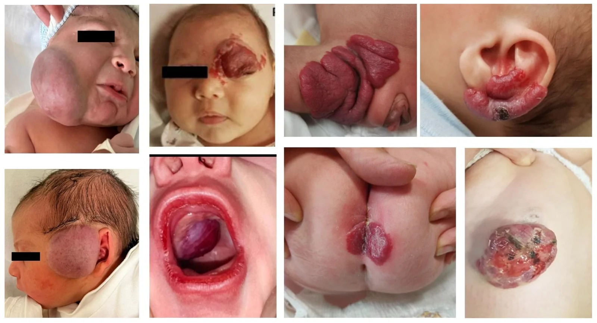
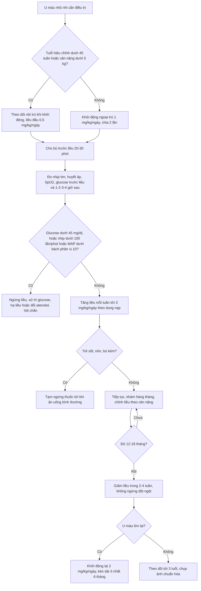
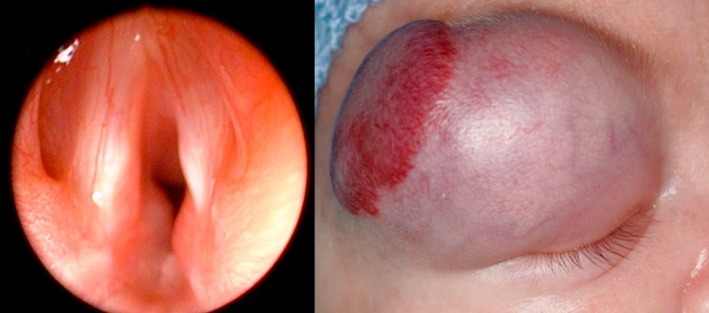

# 3069 — An toàn propranolol ở nhũ nhi: hạ đường huyết, nhịp chậm, tụt huyết áp và phác đồ khởi động – ngừng thuốc

**Tags:** `pattern:u-mau-nhu-nhi` `pattern:ha-duong-huyet` `pattern:nhip-cham` `vung:da-dau-mat-co` `anatomy:thanh-quan` `protocol:propranolol` `protocol:theo-doi-sinh-hieu` `protocol:ngung-thuoc`
**Mức chắc chắn (certainty):** tổng hợp y văn (literature synthesis) — ghép **khuyến cáo thực hành Nhật 2026 về u máu và dị dạng mạch** (J Dermatol 2026, PMC13150677), **nghiên cứu hồi cứu 75 nhũ nhi khởi động propranolol** (Children (Basel) 2026, PMC13702952), **dữ liệu an toàn 10 năm từ FAERS** (Orphanet J Rare Dis 2026, PMC13154883), **333 trẻ được sàng lọc ECG trước điều trị** (Int J Pediatr 2021, PMC7929670), **network meta-analysis 30 RCT** (Eur J Pediatr 2026, PMC13388786), **tổng quan PHACE 2025** (Orphanet J Rare Dis, PMC12232788) và **798 trẻ u máu có/không ở đường thở** (Acta Paediatr 2026, PMC13250966). Không có ca do nhóm tự chụp.

> **Câu hỏi thực hành:** bé gái **6 tuần tuổi (sinh 34 tuần, nặng 2,4 kg)**, u máu vùng râu lan xuống cổ, **thở rít tăng dần khi khóc**; nội soi thấy **khối dưới thanh môn một bên**. Câu hỏi: **khởi động propranolol thế nào cho an toàn — liều đầu bao nhiêu, theo dõi những gì, có cần nhập viện, và nếu mẹ cho bú kém 1 ngày thì xử trí ra sao?**
> Bài chốt **ba quyết định**: **(1) ngưỡng biến cố là con số, không phải cảm nhận — hạ đường huyết < 45 mg/dL (2,5 mmol/L), nhịp chậm < 100 lần/phút ở trẻ < 3 tháng (hoặc giảm > 20% so với nền), tụt huyết áp khi MAP dưới bách phân vị 10 theo tuổi; (2) hai yếu tố nguy cơ mạnh nhất là TUỔI < 90 NGÀY và CÂN NẶNG < 5 kg — nhóm này cần theo dõi có giám sát, và 73% biến cố không dung nạp xảy ra trong 30 ngày đầu; (3) không ngừng đột ngột (tái phát 17%) và không ngừng quá sớm (< 9 tháng) vì nguy cơ bùng phát lại cao nhất.** Nối [3005 – U máu dưới thanh môn](../3005-u-mau-duoi-thanh-mon-nhu-nhi/lesson.md), [3048 – U máu gan ở nhũ nhi](../3048-u-mau-gan-o-nhu-nhi/lesson.md), [3052 – U mạch máu gan bẩm sinh RICH/NICH](../3052-u-mach-mau-gan-bam-sinh-rich-nich-o-tre/lesson.md), [3068 – Liệt dây thanh sau mổ đường thở](../3068-liet-day-thanh-sau-mo-duong-tho-o-tre/lesson.md).

## 1. Tổng quan bệnh học – cơ chế hình ảnh: vì sao propranolol vừa cứu vừa hại

- **TẠI SAO chẹn beta không chọn lọc hạ đường huyết (vật lý – sinh lý, không phải “tác dụng phụ ngẫu nhiên”):** propranolol chẹn **β2** trên gan và cơ → **ức chế glycogenolysis và tân tạo glucose**, đồng thời chẹn **β2** trên tụy → **giảm tiết glucagon** và giảm cảnh báo adrenergic (mất **run rẩy, vã mồ hôi, nhịp nhanh**). Ở nhũ nhi, **dự trữ glycogen gan chỉ đủ cho vài giờ nhịn bú**, nên **bỏ một cữ bú do sốt/tiêu chảy** là đủ để đường huyết tụt mà **không có dấu hiệu cảnh báo** — đây chính là cơ chế của các ca **co giật hạ đường huyết** trong dữ liệu FAERS.
- **TẠI SAO nhịp chậm/tụt huyết áp:** chẹn **β1** ở nút xoang và cơ tim → **giảm nhịp, giảm co bóp**; chẹn β1 ở cầu thận → **giảm renin** → giảm aldosterone. Nhũ nhi có **cung lượng tim phụ thuộc tần số** hơn người lớn, nên **cùng mức nhịp chậm gây tụt cung lượng nhiều hơn**. Ngưỡng dùng trong nghiên cứu: **nhịp chậm = nhịp < 100 lần/phút ở trẻ < 3 tháng, hoặc giảm > 20% so với nền**; **tụt huyết áp = MAP dưới bách phân vị 10 theo tuổi** (PMC13702952).
- **TẠI SAO lại dùng thuốc có nguy cơ đó — vì lợi ích rất lớn:** u máu nhũ nhi gặp ở **4–5%** trẻ đủ tháng và tới **23–30%** trẻ sinh non; **10–15%** cần điều trị vì **loét, chảy máu, che trục thị giác, tắc đường thở, suy tim cung lượng cao hoặc biến dạng vĩnh viễn**. Propranolol là **điều trị bậc 1**; trong **1.264 bệnh nhân của 41 báo cáo**, **đáp ứng 98%**, kể cả vị trí khó (**đường thở 100%**, quanh mắt **98%**, mặt **100%**) (PMC13150677).
- **Đánh đổi bằng số:** trong cùng bộ dữ liệu, **tái phát 17%** và **biến cố bất lợi 371/1.189 (31,2%)**; biến cố nặng gồm **tụt huyết áp 44 ca**, **nhịp chậm 9 ca**, **hạ đường huyết 4 ca**. Meta 18 nghiên cứu/1.839 ca: **biến cố 24,52%**, và **3,6% ở liều ≤ 2 mg/kg/ngày so với 86,22% ở liều 3 mg/kg/ngày** — con số sau **rất có thể bị nhiễu** (nhóm liều cao thường là ca nặng/theo dõi sát hơn), nhưng đủ để **không mặc định 3 mg/kg/ngày cho mọi trẻ** (PMC13150677).
- **Dữ liệu thực tế hậu mại (FAERS 2015–2024, 1.615 báo cáo):** **tử vong 2,40%**, **đe dọa tính mạng 3,06%**, **nhập viện 31,66%**; **thời gian khởi phát trung vị 10 ngày** (IQR 1–82 ngày); tín hiệu mạnh nhất theo từng biến cố: **hạ đường huyết 62 ca (ROR 22,95)**, **nhịp chậm 48 ca (ROR 14,95)**, **lạnh đầu chi 87 ca (ROR 108,73)**, **rối loạn giấc ngủ 149 ca (ROR 32,67)**, kèm **co giật do hạ đường huyết** và **hôn mê hạ đường huyết** (PMC13154883). Đây là **báo cáo tự nguyện** (không có mẫu số) nên **không đọc thành tỷ lệ mắc** — chỉ đọc thành **danh sách biến cố có thật và thứ tự ưu tiên theo dõi**.
- **TẠI SAO trẻ < 90 ngày và < 5 kg nguy hiểm hơn:** dự trữ glycogen ít hơn, khối lượng phân bố thuốc nhỏ hơn (thể tích phân bố theo L/kg cao hơn), và **gan chưa trưởng thành chuyển hóa** → nồng độ đỉnh cao hơn. Trong **1.260 bệnh nhân dùng 2 mg/kg/ngày**, **73% biến cố không dung nạp xảy ra trong 30 ngày đầu**, và phân tích đa biến xác định **tuổi < 90 ngày** và **cân nặng < 5 kg** là yếu tố nguy cơ độc lập (PMC13150677).
- **TẠI SAO vẫn chưa có “xét nghiệm sàng lọc” nào chứng minh hiệu quả:** trong **333 trẻ** được làm **ECG trước điều trị**, **13,9%** có bất thường (chủ yếu **tiêu chuẩn điện thế dày thất 35 ca**), nhưng **KHÔNG ca nào bị loại khỏi điều trị** và chỉ **2,9%** cần hội chẩn tim mạch. Số trẻ cần sàng lọc để phát hiện **một** block nhẫn nhĩ bẩm sinh ước tính **20.000** (PMC7929670). Tương tự, khuyến cáo Nhật 2026 kết luận **không có bằng chứng** cho việc ECG/echo/đường huyết thường quy giúp tránh biến cố — nhưng **có bằng chứng** rằng **theo dõi và giáo dục phụ huynh** giúp tránh biến cố nặng.
- **TẠI SAO PHACE là ngoại lệ phải khác:** PHACE gặp ở **2,3%** u máu nhũ nhi nhưng tới **20–31%** u máu **dạng khoanh vùng ở đầu–mặt**; **bất thường động mạch 63,6–91,3%**, **bệnh động mạch tiến triển ~30%**, và **đột quỵ thiếu máu động mạch** đã ghi nhận ở **15/22** bệnh nhân trong một loạt. Vì vậy PHACE cần **MRA trong tháng đầu** và **theo dõi tới 2–3 năm**; khi có tắc nghẽn đường thở nặng, khuyến cáo **khởi động từ 0,5 mg/kg/ngày** rồi tăng dần (PMC12232788).

## 2. Mẫu hình + chẩn đoán phân biệt theo bối cảnh (Gamut)

- **Gamut 1 — “biến cố” trên lâm sàng (khi trẻ đang dùng propranolol mà đột ngột lừ đừ/co giật/tím):** **hạ đường huyết** (bỏ bú, nôn, sốt) · **nhiễm khuẩn huyết** · **nhịp chậm do thuốc hoặc block nhẫn nhĩ** · **tụt huyết áp do mất nước** · **co giật do động kinh/vôi hóa não** · **co giật do hạ calci/hạ natri** · **thiếu máu** · **tăng áp phổi do u máu gan lớn**.
- **Gamut 2 — “có nên dùng propranolol không” (chỉ định theo vị trí):** **đường thở (dưới thanh môn)** · **quanh mắt (che trục thị giác, loạn thị)** · **môi/miệng (loét, biến dạng)** · **vùng râu/cổ (nguy cơ đường thở)** · **vùng tã (loét, nhiễm)** · **gan (suy tim cung lượng cao, suy giáp tiêu thụ)** · **nhiều ổ/lan tỏa**.
- **Gamut 3 — “propranolol hay thuốc khác”:** **propranolol (chuẩn tham chiếu)** · **atenolol (chọn β1)** · **nadolol (tác dụng dài)** · **timolol tại chỗ** · **corticoid toàn thân (bậc 2)** · **sirolimus (u máu gan/KHE)** · **laser/xạ trị mạch**.
- **Bảng “một câu chốt”:** **u máu dạng khoanh vùng vùng râu + thở rít = u máu đường thở cho tới khi chứng minh ngược lại** (33,3% u máu dạng khoanh vùng vùng râu có u máu đường thở, PMC13250966); **trẻ < 90 ngày hoặc < 5 kg = nhóm cần theo dõi có giám sát**; **u máu đầu–mặt dạng khoanh vùng lớn = làm MRA trước khi tăng liều**.

## 3. Bảng so sánh phân biệt (ma trận đối chiếu)

| Thực thể (entity) | Hình ảnh/biểu hiện điển hình | Chốt vào (rule-in) | Chốt loại (rule-out) | Gợi ý xác nhận |
|---|---|---|---|---|
| **Hạ đường huyết do propranolol** | Trẻ **lừ đừ, vã mồ hôi, run, tím, co giật** sau **bỏ cữ bú** hoặc sau **tăng liều** | **Glucose < 45 mg/dL (2,5 mmol/L)** + hết triệu chứng sau tiêm/bú glucose | Glucose bình thường khi có triệu chứng → tìm nguyên nhân khác | Đo glucose **máu mao mạch ngay**; ghi lại giờ bú – giờ uống thuốc |
| **Nhịp chậm do chẹn beta** | Nhịp **đều, chậm**, trẻ vẫn tỉnh; có thể kèm lạnh đầu chi | **Nhịp < 100 lần/phút (< 3 tháng) hoặc giảm > 20% so với nền** | Nhịp chậm **kèm sốt/mất nước** → nguyên nhân khác; block bẩm sinh có **sóng bất thường trên ECG** | ECG 12 chuyển đạo; theo dõi **trước – 1 – 2 – 3 – 4 giờ** sau liều |
| **Tụt huyết áp do chẹn beta** | Trẻ **nhợt, chi lạnh, niệu ít**, chậm tăng cân | **MAP dưới bách phân vị 10 theo tuổi** + hồi phục khi giảm/ngừng liều | MAP bình thường mà chi lạnh đơn thuần → **co mạch ngoại vi** (lành tính, không cần ngừng) | Đo MAP; so cân nặng – nước tiểu – thời gian làm đầy mao mạch |
| **Co mạch ngoại vi (lạnh đầu chi)** | Đầu chi **lạnh, tím nhẹ**, trẻ vẫn ăn ngủ bình thường | **Lạnh đối xứng, không tụt huyết áp, không đổi màu toàn thân** | Tím trung tâm, SpO₂ giảm → **bệnh tim–phổi** | Quan sát + đo SpO₂; **không cần ngừng thuốc** |
| **Rối loạn giấc ngủ / ác mộng** | Trẻ **thức giấc nhiều, quấy, ác mộng**, tăng trong **tuần đầu** | **Xuất hiện sau khởi động, giảm dần, không ảnh hưởng bú – tăng cân** | Không liên quan thời điểm dùng thuốc → tìm trào ngược, đau, thiếu sắt | Nhật ký giấc ngủ; **đổi sang atenolol** nếu kéo dài (ít qua hàng rào máu não) |
| **Co thắt phế quản** | **Khò khè, ho, khó thở** ở trẻ có tiền sử **hen/sinh non/BPD** | **Khò khè tái diễn sau liều, đáp ứng thuốc giãn phế quản** | Khò khè chỉ khi nhiễm virus → **viêm tiểu phế quản** | Nghe phổi; thử **atenolol (β1 chọn)** nếu bắt buộc điều trị |
| **PHACE (chống chỉ định tương đối)** | U máu **dạng khoanh vùng S1/S3/S4**, **hẹp/tắc động mạch cảnh–não**, **hẹp eo động mạch chủ** | **≥ 1 bất thường động mạch não trên MRA + u máu đầu–mặt khoanh vùng** | MRA bình thường, u máu khu trú nhỏ → dùng propranolol thường quy | **MRA trong tháng đầu**, siêu âm tim; hội chẩn đa chuyên khoa trước khi tăng liều |
| **U máu đường thở** | **Thở rít tiến triển, khàn, ho**, nội soi: khối **dưới thanh môn một bên** | **U máu da vùng râu/cổ + thở rít + khối dưới thanh môn** | Nội soi bình thường + không u máu da → tìm nguyên nhân khác | Nội soi mềm; **propranolol là điều trị đầu tay, 80% đủ** (PMC13250966) |
| **Tái phát sau ngừng thuốc** | U máu **đỏ/lớn lại** sau khi giảm liều hoặc ngừng | **Lớn lại trong vòng vài tuần sau giảm/ngừng** | Lớn lại do **u máu mới ở vị trí khác** | Chụp ảnh chuẩn hóa; **khởi động lại 2 mg/kg/ngày** và kéo dài ≥ 6 tháng |

*Tám thể **biến chứng** tạo nên chỉ định dùng propranolol: khối lớn vùng mặt (**biến dạng**), ổ loét quanh mắt (**che trục thị giác + loét**), khối ở bàn tay và vành tai (**loét, chảy máu**), khối vùng thái dương, **khối dưới thanh môn (ảnh nội soi hàng dưới, thứ hai từ trái)**, vùng tã (**loét + nhiễm**). Đây là lý do **không được “chờ tự thoái triển”** ở các vị trí này. Nguồn: Children (Basel) 2026 (PMC13702952), **CC BY**, nguyên bản.*

## 4. Protocol khởi động – theo dõi – ngừng thuốc

- **Bước 0 — trước liều đầu tiên:**

| Việc | Ngưỡng / nội dung | Vì sao |
|---|---|---|
| **Tuổi – cân nặng** | **< 5 tuần tuổi (hoặc < 45 tuần tuổi hiệu chỉnh)** hoặc **< 5 kg** → cân nhắc **theo dõi nội trú** | Yếu tố nguy cơ độc lập; 73% biến cố trong **30 ngày đầu** |
| **Hỏi bệnh** | **Hen/khò khè tái diễn**, **block nhẫn nhĩ**, **nhịp chậm**, **suy tim**, **hẹp eo động mạch chủ**, **tiền sử gia đình đột tử/loạn nhịp**, **mẹ dùng thuốc chống loạn nhịp** | Chống chỉ định/nguy cơ |
| **Khám** | U máu **dạng khoanh vùng S1/S3/S4** → tìm PHACE: **chụp/MRA não trong tháng đầu**, siêu âm tim | PHACE: bệnh động mạch tiến triển ~30%, đột quỵ đã ghi nhận |
| **ECG** | **Không thường quy**; làm khi **nhịp chậm, loạn nhịp, bệnh tim, tiền sử gia đình** | 13,9% bất thường nhưng **0 ca bị loại khỏi điều trị**; NNS 20.000 (PMC7929670) |
| **Đường huyết** | **Không thường quy** trước liều ở trẻ khỏe; **bắt buộc đo** nếu trẻ bú kém/nôn/sinh non | Không có bằng chứng lợi ích sàng lọc, nhưng hạ đường huyết là biến cố chết người |

- **Bước 1 — liều và cách tăng:** khởi đầu **0,5–1 mg/kg/ngày**, chia **2 lần**, tăng **mỗi tuần** theo dung nạp tới đích **3 mg/kg/ngày** (hoặc **2 mg/kg/ngày** nếu dung nạp kém). Ở trẻ **< 45 tuần tuổi hiệu chỉnh** hoặc **u máu đường thở nặng**: bắt đầu **0,5 mg/kg/ngày** rồi tăng chậm (PMC13702952, PMC12232788).
- **Bước 2 — theo dõi mỗi lần khởi động/tăng liều (bắt buộc):**
  - **Cho bú trước liều 20–30 phút**, **không bao giờ cho thuốc lúc bụng đói**; khoảng cách giữa các cữ bú **không quá 4–6 giờ** ở trẻ nhỏ.
  - Đo **nhịp tim, huyết áp, SpO₂, glucose** trước liều và tại **1, 2, 3, 4 giờ** sau liều; **quan sát lâm sàng 4–6 giờ**.
  - Lặp lại quy trình này **mỗi tuần trong tháng đầu**, mỗi lần **tăng liều**, và **mỗi lần điều chỉnh theo cân nặng**; sau khi đạt liều đích: khám **hàng tháng**.
- **Bước 3 — “quy tắc ngày ốm” (quan trọng nhất để tránh hạ đường huyết):** khi trẻ **sốt, nôn, tiêu chảy, bú < 50% cữ bình thường** → **TẠM NGỪNG propranolol** cho tới khi ăn uống lại bình thường; nếu trẻ **lừ đừ/co giật** → **đo glucose mao mạch ngay**, xử trí glucose, và **ngừng thuốc**.
- **Bước 4 — thời điểm và cách ngừng:** điều trị tới **12–18 tháng tuổi**; **giảm liều từ từ trong 2–4 tuần** (không ngừng đột ngột). Nguy cơ **lớn lại cao nhất khi ngừng trong 9 tháng đầu**, **thấp nhất khi ngừng 12–18 tháng** (PMC13150677). Nếu **lớn lại**: khởi động lại **2 mg/kg/ngày** và kéo dài **≥ 6 tháng** (PMC7929670).
- **Bước 5 — phương án thay thế khi không dung nạp:** **atenolol** (chọn β1, ít qua hàng rào máu não → ít hạ đường huyết, ít rối loạn giấc ngủ; NMA: OR biến cố **0,56**, KTC 0,26–1,43) · **timolol tại chỗ** cho tổn thương **nông, khu trú** · **corticoid toàn thân** là bậc 2 nhưng **biến cố cao hơn nhiều** (OR **52,92**, KTC 3,12–2.874,40) · **nadolol** có báo cáo **tử vong do tích lũy** ở nhũ nhi → **không dùng thường quy** (PMC13388786).

*Trái: **u máu dưới thanh môn** gây hẹp nặng đường thở ở trẻ **sinh 27 tuần, 800 g** — đây là chỉ định **không thể chờ**; phải khởi động propranolol (kèm corticoid) và theo dõi đường thở. Phải: u máu **quanh mắt** — chỉ định vì **che trục thị giác/loét giác mạc**. Nguồn: Acta Paediatr 2026 (PMC13250966), **CC BY-NC-ND 4.0**, **nguyên bản** (không crop, không ghép).*

- **Số liệu để tư vấn phụ huynh (nói bằng lời, không đọc bảng):** đáp ứng **~98%**; **17%** lớn lại sau ngừng; **~25–31%** có ít nhất một biến cố (đa số **nhẹ**: rối loạn giấc ngủ, lạnh đầu chi, tiêu chảy); biến cố **nặng** (hạ đường huyết có triệu chứng, nhịp chậm, tụt huyết áp) **hiếm** nhưng **có thể xảy ra trong 30 ngày đầu**; **nguy cơ giảm mạnh** nếu cho bú đúng cữ, tạm ngừng khi ốm và theo dõi 4–6 giờ sau mỗi lần tăng liều.

## 5. Biến thể bình thường và cạm bẫy

- **Bẫy 1 — cho thuốc lúc bụng đói “cho dễ uống”:** đây là **cơ chế số một** của hạ đường huyết; luôn **bú trước 20–30 phút** và **không để trẻ nhịn > 4–6 giờ**.
- **Bẫy 2 — coi “hạ đường huyết không triệu chứng là vô hại”:** trong loạt 75 trẻ, **5 ca hạ đường huyết không triệu chứng**, tự hết khi cho bú (PMC13702952) — nhưng FAERS có **co giật** và **hôn mê hạ đường huyết**, và **di chứng thần kinh** là lý do phải dặn phụ huynh **ngừng thuốc khi bú kém**, không chờ xét nghiệm.
- **Bẫy 3 — giảm liều đột ngột khi trẻ “đã khỏi”:** **tái phát 17%**, và nguy cơ **cao nhất khi ngừng trong 9 tháng đầu**; giảm trong **2–4 tuần**, không cắt ngay.
- **Bẫy 4 — dùng 3 mg/kg/ngày cho mọi trẻ:** nhóm **≤ 2 mg/kg/ngày** có biến cố **3,6%** so với **86,22%** ở liều 3 mg/kg/ngày (dữ liệu có nhiễu, nhưng đủ để **bắt đầu thấp và tăng dần**).
- **Bẫy 5 — làm ECG cho mọi trẻ rồi trì hoãn điều trị:** 333 trẻ, **13,9% ECG bất thường** nhưng **0 ca bị loại**; trì hoãn ở u máu đường thở/quanh mắt **có hại thật** (mù, tắc đường thở) trong khi lợi ích ECG **chưa được chứng minh**.
- **Bẫy 6 — gắn nhãn “hen” rồi cấm propranolol vĩnh viễn:** khò khè sau nhiễm virus ở nhũ nhi **không đồng nghĩa hen**; nếu thật sự cần điều trị, **atenolol** là lựa chọn (ít co thắt phế quản do chọn β1).
- **Bẫy 7 — bỏ qua PHACE ở u máu đầu–mặt dạng khoanh vùng:** **20–31%** u máu khoanh vùng đầu–mặt có PHACE; **bệnh động mạch tiến triển ~30%**; phải **MRA trong tháng đầu** trước khi tăng liều.
- **Bẫy 8 — “u máu vùng râu chỉ là ngoài da”:** **33,3%** u máu dạng khoanh vùng vùng râu có **u máu đường thở**; **38,5%** ca u máu đường thở lại có tổn thương **khu trú** quanh môi/mũi — tức **không có u máu vùng râu vẫn có thể có u máu đường thở** (PMC13250966).
- **Bẫy 9 — cho rằng propranolol thay thế được mọi thứ:** **20%** u máu đường thở cần thêm **corticoid toàn thân**, và **1 ca phải mở khí quản**, cai ống sau **62 ngày** với **tiêm corticoid tại chỗ** (PMC13250966) — luôn có **kế hoạch đường thở** song song.
- **Bẫy 10 — nhầm “lạnh đầu chi” với sốc:** lạnh đầu chi đối xứng, trẻ tỉnh, **huyết áp bình thường** là **tác dụng dược lý lành tính** (ROR 108,73 — tín hiệu mạnh nhất trong FAERS nhưng không nguy hiểm); **không ngừng thuốc** chỉ vì bàn tay lạnh.

## 6. Tự lượng giá — Blind Quiz

**Ca 1 — Bé gái 6 tuần tuổi (sinh 34 tuần), u máu vùng râu lan cổ, thở rít tăng khi khóc. Nội soi và ảnh lâm sàng:**

- Hỏi: chẩn đoán? Có được “theo dõi tự thoái triển” không? Liều khởi đầu và nơi theo dõi?

<b>Bấm để hiện đáp án</b>

- **U máu dưới thanh môn** (kèm u máu da vùng râu) — chỉ định điều trị **ngay**, không chờ: nguy cơ **tắc đường thở cấp**.
- Trong loạt 798 trẻ: **u máu đường thở 1,6%**; **u máu dạng khoanh vùng vùng râu → 33,3%** có u máu đường thở; **80% đủ điều trị bằng propranolol**, **20%** cần thêm corticoid, **1 ca phải mở khí quản** (cai ống sau **62 ngày**).
- Vì trẻ **< 45 tuần tuổi hiệu chỉnh và < 5 kg**: khởi động **0,5 mg/kg/ngày**, **theo dõi nội trú** 4–6 giờ sau liều, đo **nhịp – huyết áp – SpO₂ – glucose** tại **1, 2, 3, 4 giờ**; bú trước liều **20–30 phút**.
- Nguồn: Acta Paediatr 2026 (PMC13250966) + Children (Basel) 2026 (PMC13702952), **CC BY / CC BY-NC-ND**.

**Ca 2 — Bé trai 3 tháng, u máu gan lớn đang dùng propranolol 3 mg/kg/ngày. Mẹ báo trẻ sốt 38,5 °C, bỏ 2 cữ bú, ngủ li bì.**
- Hỏi: xử trí trong 10 phút đầu? Sau đó chỉnh thuốc thế nào?

<b>Bấm để hiện đáp án</b>

- **Đo glucose mao mạch ngay**; nếu **< 45 mg/dL (2,5 mmol/L)** → glucose tĩnh mạch/uống, theo dõi lại; **tạm ngừng propranolol** trong đợt ốm.
- Đây là **“quy tắc ngày ốm”**: sốt + bỏ bú = **giảm dự trữ glycogen** + **ức chế tân tạo glucose do chẹn β2** → hạ đường huyết, và **mất dấu hiệu cảnh báo adrenergic** nên trẻ **không vã mồ hôi, không nhịp nhanh**, chỉ **li bì**.
- Sau khi hồi phục: **khởi động lại ở liều thấp hơn** (ví dụ **1–2 mg/kg/ngày**) rồi tăng chậm; cân nhắc **giảm liều đích** vì liều 3 mg/kg/ngày có tỷ lệ biến cố cao hơn rõ rệt trong dữ liệu gộp.
- **Phản biện:** dữ liệu FAERS **không có mẫu số** nên **không** được nói “3 mg/kg/ngày gây biến cố 86%”; con số 86,22% đến từ **một meta phân tích nhóm liều**, có nhiễu chỉ định — dùng để **cảnh giác**, không dùng để **kết tội liều**.
- Nguồn: Children (Basel) 2026 (PMC13702952); J Dermatol 2026 (PMC13150677); Orphanet J Rare Dis 2026 (PMC13154883).

**Ca 3 — Trẻ 2 tháng, u máu dạng khoanh vùng nửa mặt phải (S1), đang tăng liều propranolol. Trước đó chưa chụp mạch não.**
- Hỏi: vì sao phải dừng tăng liều để làm thêm xét nghiệm? Xét nghiệm gì, khi nào?

<b>Bấm để hiện đáp án</b>

- U máu **dạng khoanh vùng S1** là vùng nguy cơ cao của **PHACE**; **bất thường động mạch 63,6–91,3%**, **bệnh động mạch tiến triển ~30%**, **đột quỵ thiếu máu động mạch** đã ghi nhận (15/22 trong một loạt). Hạ huyết áp do propranolol trên nền **hẹp/tắc động mạch cảnh–não** là nguy cơ **đột quỵ**.
- Làm **MRI/MRA não trong tháng đầu** + **siêu âm tim** (tìm **hẹp eo động mạch chủ**, bất thường quai); theo dõi hình ảnh **tới 2–3 năm**; nếu nhóm nguy cơ cao, cân nhắc **aspirin 3–5 mg/kg/ngày** theo khuyến cáo chuyên khoa.
- Nếu có tắc nghẽn đường thở nặng phối hợp: vẫn có thể dùng propranolol nhưng **khởi động 0,5 mg/kg/ngày** và tăng rất chậm, có hội chẩn đa chuyên khoa.
- Nguồn: Orphanet J Rare Dis 2025 (PMC12232788), **CC BY 4.0**.

## Bài liên quan chéo
- [3005 – U máu dưới thanh môn ở nhũ nhi](../3005-u-mau-duoi-thanh-mon-nhu-nhi/lesson.md)
- [3048 – U máu gan ở nhũ nhi](../3048-u-mau-gan-o-nhu-nhi/lesson.md)
- [3052 – U mạch máu gan bẩm sinh (RICH/NICH)](../3052-u-mach-mau-gan-bam-sinh-rich-nich-o-tre/lesson.md)
- [3068 – Liệt dây thanh sau phẫu thuật đường thở ở trẻ](../3068-liet-day-thanh-sau-mo-duong-tho-o-tre/lesson.md)
- [1804 – Suy giáp tiêu thụ do D3](../1804-suy-giap-tieu-thu-do-u-mach-mau-ngoai-gan/lesson.md)
- [606 – BPD ở trẻ sinh non](../606-bpd-tre-sinh-non/lesson.md)

> Không dùng để chẩn đoán độc lập khi chưa có người hướng dẫn.
