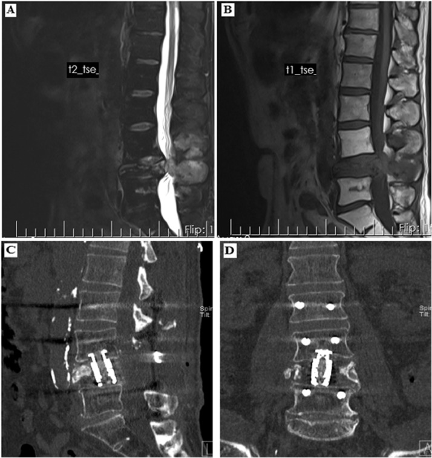
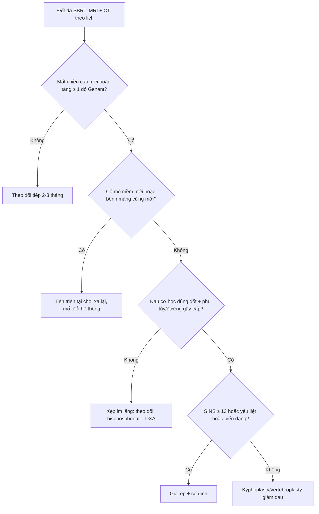
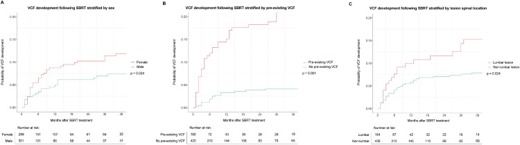

# 307 — Gãy xẹp đốt sống sau SBRT: dự đoán, phân biệt với tái phát & khi nào bơm xi măng / Post-SBRT vertebral compression fracture: prediction, differentiation from local progression, and when to augment

**Tags:** `pattern:gay-xep-dot-song` `pattern:di-can-xuong` `pattern:gia-tien-trien` `pattern:gia-lanh-hoa` `pattern:phu-tuy` `vung:cot-song` `vung:xuong` `score:SINS` `score:Genant` `score:SPINO` `score:Bilsky` `protocol:CT-xuong` `protocol:MRI-cot-song` `protocol:SBRT` `protocol:vertebroplasty` `incidentaloma:di-can-xuong`
**Mức chắc chắn (certainty):** tổng hợp y văn (literature synthesis) — đoàn hệ lớn nhất **600 lần SBRT/779 đốt sống** (Taori S et al., Adv Radiat Oncol 2026, PMC13140028), mô hình tiên lượng có nomogram **173 bệnh nhân** (Dibs K et al., Radiat Oncol 2025, PMC12076872), phân tích **SINS** trên **391 tổn thương** (Doyle P et al., Adv Radiat Oncol 2025, PMC12180991) và các đoàn hệ độc lập **779 đốt** (Ito K et al., J Clin Med 2023, PMC10253802). Số liệu là của các nghiên cứu được trích, không phải ca nguyên văn của nhóm.

> **Câu chốt của bài:** sau SBRT cột sống, **1 năm 11% và 3 năm 21%** đốt sống bị xẹp thêm, nhưng **chỉ 2,4% toàn bộ đốt được xạ là xẹp CÓ ĐAU** và **1,0% phải mổ** — nghĩa là **đa số gãy xẹp là im lặng, không điều trị theo phim**. Việc phải làm là **phân biệt xẹp do xạ với tiến triển u** (không có mô mềm mới, có đường gãy, không có bệnh màng cứng mới) và **phân tầng nguy cơ TRƯỚC xạ** để chọn phân liều, theo dõi sát, hoặc gia cố xương sớm.

## 1. Tổng quan bệnh học – cơ chế hình ảnh

- **Vì sao thân đốt dễ xẹp:** thân đốt là **vỏ xương mỏng (cortical shell ~1 mm) bọc lõi xốp (trabecular core)** chịu lực nén; khi u tiêu xương làm mất các bè xương chịu lực, vỏ trước và **mâm sụn (endplate)** là nơi chịu ứng suất lớn nhất → **sụp mâm (endplate fracture)** rồi **lún thân đốt**.
- **Vì sao xạ làm xương yếu thêm (TẠI SAO, không chỉ "do xạ"):** liều cao mỗi phân liều giết **tế bào xương (osteocyte)** trong xương đã trưởng thành — các tế bào này là "cảm biến cơ học" điều phối tạo xương/hủy xương; đồng thời tổn thương **nội mô mạch máu** gây **hoại tử xương do thiếu máu (avascular osteonecrosis)** và làm chậm tái tạo. Kết quả: **BED3 ≥ 104 Gy** (liều sinh học tương đương với α/β = 3 của xương) là yếu tố nguy cơ độc lập duy nhất trong một đoàn hệ 217 tổn thương; ví dụ **20 Gy × 1 = BED3 153 Gy**, **18 Gy × 1 = 126 Gy**, trong khi **24 Gy/3 phân liều = 88 Gy** — giải thích vì sao **một phân liều duy nhất** có nguy cơ xẹp cao hơn dù cùng kiểm soát u.
- **Vì sao đọc CT trước, MRI sau:** CT dựng hình sagittal ≤ 1 mm thấy **đường gãy vỏ, sụp mâm, mất chiều cao, mảnh xương bật ra sau (retropulsion)** — những thứ MRI dễ bỏ qua. MRI T1W/T2W/STIR thấy **phù tủy (marrow edema)** và **mô mềm/epidural**, nhưng phù tủy sau xạ **tồn tại 6–12 tháng** nên **không đủ để gọi tiến triển**.
- **Vì sao xẹp do xạ bắt chước tiến triển:** cả hai đều làm **mất chiều cao + T2 tăng + đau mới**. Khác biệt nằm ở **hình thái**: xẹp do xạ có **đường gãy ngang, mảnh vỏ trước, có thể "khe dịch" (fluid sign)** nhưng **không có khối mô mềm ngoài xương, không phá vỏ lan rộng, không bệnh màng cứng mới**; tiến triển có **mô mềm mới, bờ tổn thương nở ra, xâm lấn ống sống**.
- **Ngưỡng định lượng cốt lõi:**
  - **Tần suất:** **10%** (57/600 lần xạ; **5% xẹp mới + 5% xẹp thêm**), trung vị **6 tháng (1–83 tháng)**; tích lũy **11% (1 năm) và 21% (3 năm)** (Taori 2026). Đoàn hệ khác: **7,7%** (60/779 đốt), **2,4%** đau, **1,0%** phải mổ (Ito 2023); **17%** trong 173 bệnh nhân, trung vị **4,8 tháng** (Dibs 2025); **10%**, trung vị **2,4 tháng** (Issany 2024).
  - **Phân độ Genant:** độ 1 = mất chiều cao **0–25%**; độ 2 = **26–40%**; độ 3 = **> 40%** (Ozdemir 2019).
  - **Nguy cơ theo yếu tố:** **sụp mâm (endplate disruption) HR 4,16**; **corticoid ≥ 4 tuần HR 3,60**; **SINS ≥ 7 HR 3,63**; **mô học xấu (RCC, melanoma, sarcoma…) HR 2,98** → nomogram chia **nhóm nguy cơ 1 năm 2% / 21% / 58%** (Dibs 2025). **Vị trí L2–L4 HR 2,78**, **tổn thương hỗn hợp HR 3,87**, **tiêu xương HR 2,68** (Doyle 2025). **Nữ OR 1,06**, **thắt lưng OR 1,05**, **xẹp có sẵn OR 1,01** (Taori 2026).
  - **Yếu tố bảo vệ:** **bisphosphonate > 6 tháng** (p = 0,002; FFS 87,8% lúc 6 tháng → **23,5% lúc 48 tháng**); **11 đốt được kyphoplasty TRƯỚC SBRT: 0 ca xẹp sau đó** (Issany 2024 — cỡ mẫu nhỏ, chỉ là tín hiệu).

## 2. Mẫu hình + chẩn đoán phân biệt theo bối cảnh (Gamut)

- **Khuôn 1 — đốt đã xạ bị lún lần đầu:** **xẹp do xạ (de novo VCF)** vs **tiến triển u** vs **gãy loãng xương/do corticoid** vs **viêm đĩa–đốt (spondylodiscitis)** (hiếm nhưng có sốt/CRP).
- **Khuôn 2 — đốt đã xẹp từ trước, nay xẹp thêm:** **xẹp tiến triển (progressive VCF)** vs **tiến triển u trong đốt đã xẹp** vs **gãy mới ở đốt lân cận** (đốt ngoài trường xạ) vs **sụp do xi măng cũ di trú**.
- **Khuôn 3 — đau mới sau xạ:** **xẹp cấp (phù tủy, đau cơ học)** vs **tiến triển màng cứng** (yếu chi, Bilsky tăng) vs **bệnh tủy do xạ (radiation myelopathy)** (dải T2 trong tủy, không khối) vs **đau cơ–khớp cơ học**.
- **Khuôn 4 — sau bơm xi măng:** **đau do cement rò/thoát ra đĩa** vs **gãy đốt kế cận (adjacent-level fracture)** vs **tái phát quanh cement** (CT bị artifact, cần MRI) vs **nhiễm cement**.
- **Mnemonic "FRACTURE":** **F**emale (nữ) — **R**adiation BED3 ≥ 104 Gy — **A**lignment/deformity (biến dạng mới) — **C**ortical/endplate disruption (sụp mâm) — **T**umor lytic/mixed (tiêu/hỗn hợp) — **U**se steroids ≥ 4 tuần — **R**eduction pre-existing (đã xẹp sẵn) — **E**xtent (SINS ≥ 7).

## 3. Bảng so sánh phân biệt (ma trận đối chiếu)

| Thực thể (entity) | Hình ảnh điển hình (CT/MRI) | Chốt vào (rule-in) | Chốt loại (rule-out) | Gợi ý xác nhận |
|---|---|---|---|---|
| **Xẹp do xạ — mới (de novo VCF)** | Mất chiều cao thân đốt **mới**, đường gãy vỏ trước/ngang, sụp mâm, phù tủy STIR; **không** khối mô mềm | **Mất chiều cao mới ≥ 1 độ Genant + đường gãy + không mô mềm mới** | **Mô mềm ngoài xương / bệnh màng cứng mới** → nghĩ tiến triển | CT sagittal ≤ 1 mm + MRI T1/T2/STIR cùng ngày; so phim trước xạ |
| **Xẹp tiến triển (progressive VCF)** | Đốt đã xẹp sẵn, nay **mất thêm chiều cao**, có thể mới có phù tủy; bờ vỏ vẫn liên tục | **Giảm ≥ 1 độ Genant so với baseline + không có tổn thương mô mềm mới** | **Nở bờ sau + xâm lấn ống sống** → tiến triển | Đo chiều cao 3 điểm (trước/giữa/sau) trên cùng chuỗi |
| **Tiến triển tại chỗ** | Tăng thể tích, **mô mềm mới**, phá vỏ lan, bệnh màng cứng mới/tiến triển, xâm lấn ống sống | **Mô mềm mới hoặc bệnh màng cứng mới + tăng kích thước** | Chỉ mất chiều cao đơn thuần, không mô mềm | MRI T1+C + T2; SPINO; PET/CT nếu còn nghi |
| **Gãy loãng xương / do corticoid** | Xẹp đốt **ngoài trường xạ** hoặc trong trường nhưng không có u; vỏ mỏng, bè xương thưa, không phá vỏ | **Không có u tại đốt + mật độ xương thấp + dùng corticoid** | **Phá cuống/bờ sau lồi + khối cạnh sống** → u | DXA; so phim; MRI không thấy tổn thương thay thế tủy |
| **Viêm đĩa–đốt sống** | Hẹp đĩa, phù 2 đốt kề, **ngấm viền**, áp-xe mô mềm/epidural, khí trong đĩa | **Hẹp đĩa + phù 2 đốt kề + ngấm viền + sốt/CRP tăng** | **Chỉ một đốt, đĩa bình thường, không ngấm viền** → không phải viêm | CRP/ESR, cấy (sinh thiết nếu cần), MRI cản quang |
| **Sau bơm xi măng** | Cement đậm đặc trong thân đốt, có thể rò ra đĩa/tĩnh mạch; artifact CT | **Cement trong thân đốt đúng vị trí + hết đau cơ học** | **Cement rò vào ống sống/chèn ép** → biến chứng | CT + X-quang; MRI khi nghi tái phát (artifact) |

*Nam, ung thư tuyến tiền liệt, SBRT **18 Gy × 1** L3: (A) T2W và (B) T1W sagittal **16 tháng sau xạ** — L3 xẹp nặng, mảnh xương bật ra sau chèn ống sống, không có khối mô mềm; (C, D) CT sau **giải ép + cố định** — đây là **xẹp do xạ độ 3 Genant**, không phải tiến triển u. Nguồn: Ozdemir Y et al., J Bone Oncol 2019 (PMC6378905), CC BY-NC-ND; ảnh nguyên bản, không cắt/ghép.*

## 4. Protocol chụp + hệ phân độ/điểm chuẩn hóa

- **Trước SBRT (baseline — bắt buộc):**
  - **CT cột sống dựng hình ≤ 1 mm** (bone + soft tissue) tại đốt đích **và đốt kề**: đo chiều cao 3 điểm, ghi **Genant**, tìm **sụp mâm**, **phá vỏ**, **thành phần tiêu/hỗn hợp/đặc**.
  - **MRI cột sống**: T1W sagittal, T2W sagittal, STIR/T2 fat-sat, ± T1W sau tiêm; ghi **Bilsky** nếu có bệnh màng cứng, **SINS**.
  - **SINS (Spinal Instability Neoplastic Score, Fisher 2010, 0–18):** vị trí **chuyển tiếp 3 / di động 2 / bán cứng 1 / cứng 0**; đau **cơ học 3 / thỉnh thoảng 1 / không 0**; tổn thương **tiêu 2 / hỗn hợp 1 / đặc 0**; can thiệp trục **trượt 4 / biến dạng mới 2 / bình thường 0**; sụp thân đốt **> 50% 3 / < 50% 2 / không 0**; xâm lấn sau–bên **hai bên 3 / một bên 1 / không 0**. **0–6 ổn định · 7–12 chưa xác định · 13–18 không vững**.
- **Chọn phân liều theo nguy cơ (risk-adapted):** với đốt **nguy cơ cao** (sụp mâm, tiêu xương, xẹp có sẵn, SINS ≥ 7, corticoid), cân nhắc **đa phân liều** thay vì một phân liều lớn — nhưng phải cân bằng với **kiểm soát u** (BED3 cao cũng là yếu tố kiểm soát tại chỗ). Đây là quyết định của hội đồng u–xạ–phẫu thuật, không phải "hạ liều cho an toàn" máy móc.
- **Theo dõi sau SBRT:**
  - **MRI + CT lần 1 lúc 3 tháng**, sau đó **mỗi 2–3 tháng đến 12–18 tháng**, rồi **mỗi 3–6 tháng** (xem bài 306); **cùng chuỗi xung, cùng từ thế, cùng máy**.
  - **Đo chiều cao và Genant ở MỌI lần chụp**, kể cả khi bệnh nhân không đau — vì **đa số xẹp không đau**.
  - **Không chụp PET/CT trong 3 tháng đầu** để tránh viêm do xạ; PET chỉ khi MRI không kết luận.
- **Khi nào gia cố xương (cement augmentation):**
  - **Đau cơ học khu trú đúng đốt xẹp + phù tủy/đường gãy cấp** → **vertebroplasty/kyphoplasty** giảm đau, ổn định.
  - **Nguy cơ cao trước xẹp** (nomogram 58%, sụp mâm, tiêu xương, SINS 7–12): có thể **kyphoplasty dự phòng/trước SBRT** — dữ liệu hiện **hồi cứu, cỡ mẫu nhỏ** (11 đốt: 0 xẹp), **không phải khuyến cáo mức cao**; cần thảo luận nguy cơ rò cement (xem bài 3019).
  - **Không bơm xi măng chỉ vì "xẹp trên phim"** khi không đau.
- **Khi nào mổ:** **SINS ≥ 13**, **biến dạng/trượt mới**, **yếu liệt do chèn ép**, hoặc **xẹp > 50% kèm đau không kiểm soát** → **giải ép ± cố định**; nếu đã có tiến triển u thì cân nhắc **separation surgery + SBRT**.
- **Sơ đồ quyết định:**

## 5. Biến thể bình thường và cạm bẫy

- **Cạm bẫy 1 — điều trị con số thay vì bệnh nhân:** **60 VCF/779 đốt (7,7%) nhưng chỉ 19 ca đau (2,4%) và 8 ca phải mổ (1,0%)** — bơm xi măng hàng loạt cho xẹp im lặng là can thiệp không có chỉ định.
- **Cạm bẫy 2 — gọi tiến triển khi chỉ có phù tủy:** phù tủy sau xạ kéo dài **6–12 tháng**; **T2 sáng đơn thuần không phải tiến triển**. Chốt tiến triển bằng **mô mềm mới/bệnh màng cứng mới/tăng thể tích** (bài 306).
- **Cạm bẫy 3 — "khe dịch"/khe khí:** **fluid sign** và **khe khí trong thân đốt (Kümmell)** là dấu hiệu **hoại tử/thiếu máu lành tính**, không phải u; nhưng **khe khí + bờ xương bào mòn + CRP cao** phải loại trừ nhiễm trùng.
- **Cạm bẫy 4 — đo chiều cao không chuẩn:** đo trên **lát khác nhau, nghiêng khác nhau** tạo "xẹp giả"; luôn đo **3 điểm (trước/giữa/sau)** trên **cùng lát cắt sagittal**, cùng cửa sổ, và so **đốt kề**.
- **Cạm bẫy 5 — đốt đã xẹp từ trước:** nếu baseline đã xẹp, **không được gọi "xẹp mới"** khi chỉ giảm vài mm; phải phân **de novo vs progressive** và dùng ngưỡng **≥ 1 độ Genant**.
- **Cạm bẫy 6 — artifact cement che tái phát:** CT sau bơm xi măng bị **artifact cứng**; tái phát quanh cement phải đọc **MRI T1+C/T2** và **PET** nếu nghi, không kết luận từ CT.
- **Cạm bẫy 7 — bỏ sót tiến triển SAU xẹp:** thân đốt xẹp có thể che **khối mô mềm sau–bên**; luôn xem **axial T1+C** và **ống sống**, đặc biệt khi có **yếu chi mới**.

## 6. Tự lượng giá — Blind Quiz

**Ca 1 — Nam 68 tuổi, ung thư tuyến tiền liệt, đau lưng tăng dần 2 tuần, 16 tháng sau SBRT 18 Gy × 1 tại L3. Xem T2W/T1W sagittal (A, B).**

- Gợi ý lâm sàng: đau cơ học khi đứng/ngồi, không sốt; không yếu chi lúc khám.
- Câu hỏi: (1) Mô tả bất thường chính và phân độ Genant? (2) Ba chẩn đoán phân biệt? (3) Dấu hiệu nào **loại trừ tiến triển u**? (4) Xử trí?

<b>Bấm để hiện đáp án (findings + chẩn đoán)</b>

- **Dấu hiệu:** L3 **mất chiều cao > 40%** (Genant độ 3), **mảnh vỏ sau bật vào ống sống (retropulsion)**, tín hiệu tủy thay đổi; **không có khối mô mềm cạnh sống**, **không phá cuống**, đĩa L2–L3 và L3–L4 còn chiều cao.
- **Chẩn đoán:** **xẹp đốt sống do xạ (radiation-associated VCF)**, không phải tiến triển u — vì **không có mô mềm mới và không có bệnh màng cứng mới**, chỉ có **đường gãy/mất chiều cao**.
- **Xử trí:** đau + chèn ép → **giải ép + cố định** (C, D); nếu không có chèn ép thần kinh và đau kiểm soát được thì **kyphoplasty** là lựa chọn; **không xạ lại** vì không có tiến triển.
- **Phản biện:** tổn thương **độ 3 + retropulsion** là ca nặng; đa số VCF sau SBRT **không đau** (2,4%), nên ca này **không đại diện** cho toàn bộ phổ.
- **Nguồn ảnh:** Ozdemir Y et al., J Bone Oncol 2019 (PMC6378905), Fig. 4, CC BY-NC-ND.

**Ca 2 — Đọc biểu đồ tích lũy: 779 đốt sống sau SBRT, phân tầng theo giới, xẹp có sẵn và vị trí.**

- Câu hỏi: Nhóm nào có nguy cơ xẹp cao hơn? Vì sao **"xẹp có sẵn"** lại là yếu tố nguy cơ mạnh nhất về mặt cơ học? Điều này đổi cách chụp baseline thế nào?

<b>Bấm để hiện đáp án</b>

- **Nữ > nam** (p = 0,024); **có xẹp từ trước > không** (p = 0,001); **thắt lưng > ngực/khác** (p = 0,024).
- **Vì sao xẹp có sẵn nguy hiểm:** thân đốt đã mất chiều cao nghĩa là **mâm đã sụp và vỏ trước đã gãy** — khả năng chịu nén giảm, nên chỉ cần thêm mất xương do u/xạ là **sụp tiếp**. Về mặt cơ học, đây là **cấu trúc đã "hỏng một phần"**, không phải đốt nguyên vẹn.
- **Đổi thực hành:** baseline **bắt buộc đo và ghi Genant từng đốt**, không chỉ ghi "không có gãy"; nếu đã xẹp → **theo dõi sát hơn, cân nhắc đa phân liều/gia cố sớm**, và **không dùng "xẹp" làm tiêu chí tiến triển** ở lần chụp sau.
- **Nguồn ảnh:** Taori S et al., Adv Radiat Oncol 2026 (PMC13140028), Fig. 2, CC BY 4.0.

## Bài liên quan chéo
- [306 – Theo dõi sau SBRT & separation surgery di căn xương RCC: lành hóa xương vs pseudoprogression](../306-theo-doi-sau-sbrt-di-can-xuong-rcc/lesson.md) — đọc MRI sau xạ, SPINO, shine-through.
- [3017 – Gãy nén đốt sống do loãng xương: STIR cấp vs mạn, chỉ định bơm xi măng](../3017-gay-nen-dot-song-loang-xuong-vertebroplasty/lesson.md) — kỹ thuật và biến chứng cement.
- [3019 – Thuyên tắc phổi do xi măng sau bơm đốt sống](../3019-thuyen-tac-phoi-do-xi-mang-cement/lesson.md) — biến chứng của gia cố xương.
- [1615 – Di căn xương ở ung thư vú: đặc xương lành hóa vs tiến triển](../1615-di-can-xuong-ung-thu-vu-lanh-hoa-vs-tien-trien/lesson.md) — ngưỡng đáp ứng xương.
- [300 – Tổng quan Hệ Cơ – Xương – Khớp](../300-tong-quan-he-co-xuong-khop/lesson.md)

## Ảnh
- `images/307_gay-xep-dot-song_MRI-CT_PMC6378905.jpg` — Fig. 4, Ozdemir 2019, **CC BY-NC-ND** (nguyên bản).
- `images/307_tich-luy-VCF_PMC13140028.jpg` — Fig. 2, Taori 2026, **CC BY 4.0**.
- Nguồn + giấy phép từng ảnh: `images/CREDITS.md`.

> Không dùng để chẩn đoán độc lập khi chưa có người hướng dẫn.
