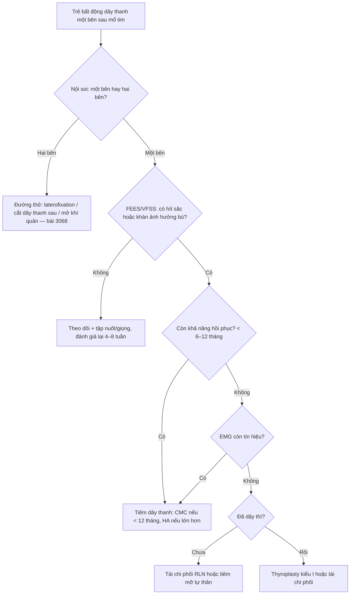
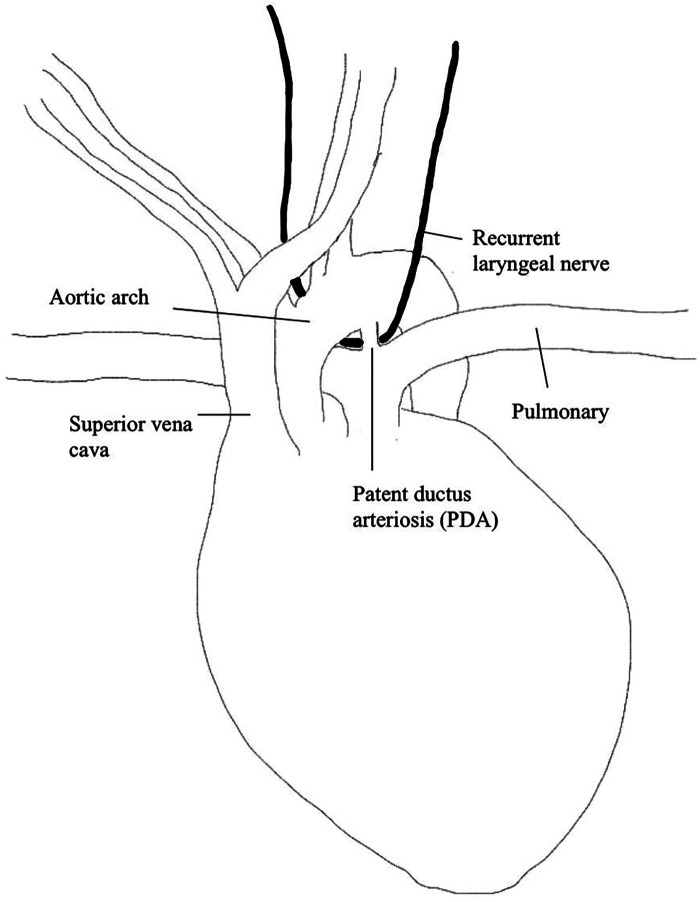
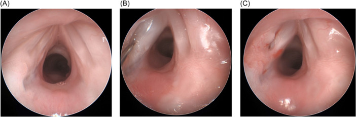
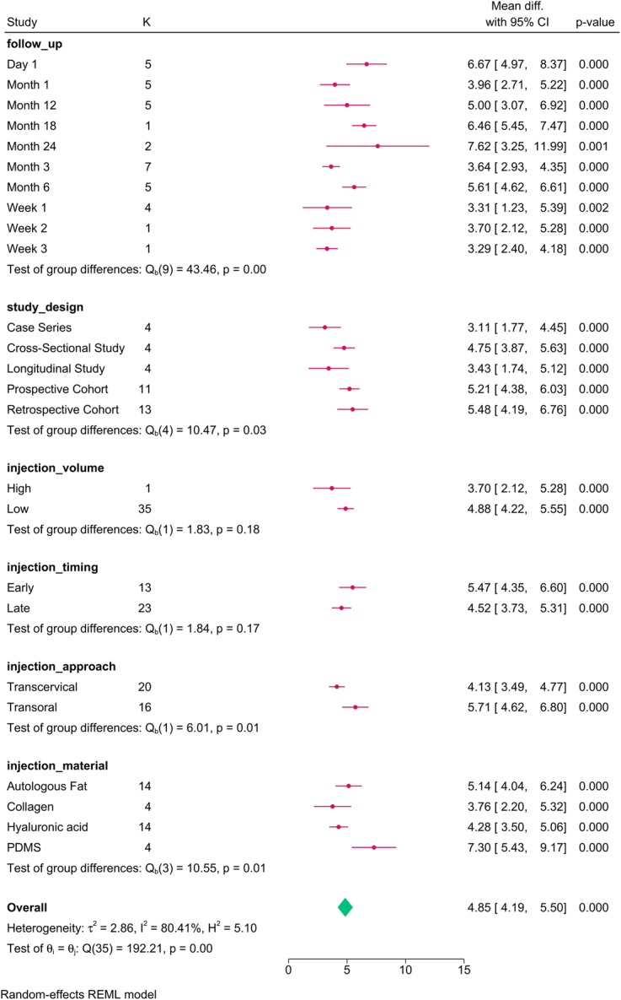
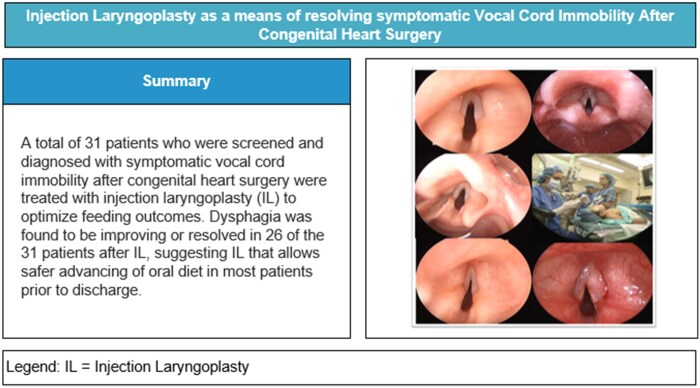

# 3070 — Tiêm chất làm đầy dây thanh & thyroplasty ở trẻ: chọn vật liệu, thể tích, thời điểm và khi nào chuyển phẫu thuật vĩnh viễn

**Tags:** `pattern:bat-dong-day-thanh` `pattern:ho-thanh-mon` `pattern:hit-sac` `pattern:khac-giong` `vung:thanh-quan` `anatomy:thanh-quan` `protocol:noi-soi-thanh-quan` `protocol:FEES` `protocol:tiem-day-thanh` `protocol:thyroplasty` `score:PAS` `score:FOIS`
**Mức chắc chắn (certainty):** tổng hợp y văn (literature synthesis) — ghép **đoàn hệ 31 trẻ tiêm dây thanh sau mổ tim** (Interdiscip Cardiovasc Thorac Surg 2026, PMC13215875), **nghiên cứu bệnh–chứng 32 trẻ có nhóm chứng** (OTO Open 2024, PMC11058695), **tổng quan 3 lựa chọn phẫu thuật ở trẻ** (Front Pediatr 2024, PMC11405229), **tổng quan thực hành nhi** (Otolaryngol Clin North Am 2026, PMC13546077), **phân tích gộp 76 nghiên cứu tiêm dây thanh** (Int J Surg 2024, PMC11573085) và **phân tích gộp axit hyaluronic 32 nghiên cứu/1.917 ca** (Cureus 2025, PMC12245398). Không có ca do nhóm tự chụp; **không bài nào là thử nghiệm ngẫu nhiên ở trẻ**.

> **Câu hỏi thực hành:** bé gái **4 tháng tuổi** (3,8 kg) mổ hẹp eo động mạch chủ, sau rút ống **khàn + ho khi bú + thở rít thì hít vào nhẹ**; nội soi mềm thấy **dây thanh trái bất động**. Câu hỏi: **có tiêm dây thanh ngay không, tiêm chất gì, bao nhiêu mL, và nếu 6–12 tháng không hồi phục thì làm gì tiếp?**
> Bài chốt **bốn quyết định**: **(1) tiêm dây thanh là can thiệp TẠM THỜI để đóng khe thanh môn — hiệu quả chắc nhất trên NUỐT, không chắc trên tránh hít sặc; (2) vật liệu chọn theo tuổi: carboxymethylcellulose cho nhũ nhi, hyaluronic acid cho trẻ lớn hơn, canxi hydroxylapatite phải tránh ở nhũ nhi, mỡ tự thân cho liệt vĩnh viễn; (3) thể tích ở trẻ chỉ 0,1–0,6 mL, tiêm từng bước 0,05–0,1 mL, vì quá tay làm cứng dây thanh; (4) thyroplasty kiểu I gần như chỉ dành cho trẻ sau dậy thì — trước dậy thì implant di trú theo thanh quản lớn lên.**

## 1. Tổng quan bệnh học – cơ chế hình ảnh: vì sao "đóng khe" là đích điều trị

- **Vì sao liệt dây thanh gây hít sặc:** đóng thanh môn là **van cuối cùng** bảo vệ đường thở trong thì nuốt. Khe hở làm mất lực cản, dịch đi qua **thanh môn** vào khí quản. Trong đoàn hệ trẻ sau mổ tim, **hít sặc tăng 2,5 lần** khi có bất động dây thanh; **87,5%** trẻ bất động dây thanh có rối loạn giọng–nuốt, và **68,5–80,5%** phải đổi độ đặc thức ăn hoặc nuôi ăn qua ống (PMC11058695).
- **Vì sao khàn chứ không khó thở khi liệt MỘT bên:** dây thanh liệt nằm **trung gian**, cơ nhẫn giáp sau (cơ DUY NHẤT mở dây thanh) mất chi phối, cơ khép không đối kháng → dây thanh bị kéo về giữa. Khe còn lại nhỏ nhưng **vẫn đủ thở**; cái mất là **khép kín khi phát âm và khi nuốt**. Vì vậy triệu chứng chính là **khàn/giọng yếu ± sặc**, không phải suy hô hấp (khác liệt HAI bên — xem bài 3068).
- **Vì sao tiêm có tác dụng — vật lý của "mass effect":** kim đưa vật liệu vào **khoảng cạnh thanh môn (paraglottic space)**, tức **phía ngoài lớp niêm mạc**, đẩy cả bó cơ–niêm mạc vào trong. Không có "sửa thần kinh", chỉ **thêm thể tích**. Do đó hiệu quả phụ thuộc **vị trí đặt** (quá nông → bọng niêm mạc cản rung; quá sâu → không đẩy được dây thanh) và **độ cứng của vật liệu** (vật liệu cứng làm mất sóng niêm mạc).
- **Vì sao vật liệu quyết định thời gian tác dụng:** carboxymethylcellulose (CMC) là **gel polysaccharide tan trong nước** → tiêu nhanh; hyaluronic acid (HA) là **glycosaminoglycan** → tiêu trong vài tháng; canxi hydroxylapatite (CaHA) là **hạt vi cầu** được thực bào chậm → tồn tại lâu, tài liệu ghi nhận **có thể > 5 năm**; mỡ tự thân sống một phần theo **"take" mạch máu** nên **bán vĩnh viễn** và không đồng đều. Đây là lý do **cùng một kỹ thuật** nhưng "tuổi thọ" khác nhau 100 lần (PMC13546077).
- **Vì sao thể tích phải nhỏ ở trẻ:** thanh quản nhũ nhi chỉ bằng ~1/3 người lớn; các loạt nhi dùng **0,1–0,55 mL** và **0,2–0,6 mL** (PMC13546077). Ở người lớn, phân tích gộp 76 nghiên cứu cho thể tích trung bình **1,18 mL**, **94,34%** nghiên cứu dùng **< 3 mL**; và **mỗi 1 mL tăng thêm làm thời gian phát âm tối đa (MPT) giảm 1,358 giây** (p = 0,028) — bằng chứng định lượng rằng **nhiều hơn không tốt hơn** (PMC11573085).
- **Vì sao trẻ khác người lớn về lựa chọn phẫu thuật:** thyroplasty ở người lớn làm **tỉnh** để chỉnh giọng theo phản hồi; trẻ nhỏ phải **mê toàn thân**, thanh quản nhỏ khó đặt implant, và **nam trước dậy thì** có nguy cơ **implant di trú khi thanh quản lớn lên** → thyroplasty bị coi là **kém phù hợp**, chỉ an toàn ở **nam sau dậy thì** (PMC13546077).
- **Con số nền:** bất động dây thanh chiếm **~10%** dị tật thanh quản bẩm sinh (đứng sau mềm sụn thanh quản); **27–78%** là một bên, **22–73%** hai bên; **36–47%** vô căn; sau mổ tim, tỉ lệ tổn thương thần kinh quặt ngược được báo cáo **8–59%**, và tới **77%** ở mổ quai động mạch chủ sơ sinh (PMC13546077, PMC13215875).
- **Vì sao bên TRÁI chiếm ưu thế:** thần kinh quặt ngược trái vòng qua **cung động mạch chủ – ống động mạch**, nên mọi can thiệp vào vùng này (cắt ống động mạch, sửa quai) đều đặt thần kinh vào nguy cơ. Trong 89 trẻ bất động dây thanh, **83,6% ở bên trái** (PMC12379859, dẫn qua bài 3068).

## 2. Mẫu hình + chẩn đoán phân biệt theo bên, theo thời gian và theo mục tiêu (Gamut)

- **Theo BÊN:**
  - **Một bên** → khàn, giọng yếu, sặc khi bú; **đích là đóng khe để nuốt an toàn và cải thiện giọng** → tiêm dây thanh là lựa chọn đầu tay.
  - **Hai bên** → rít thì hít vào, khó cai ống; **đích là MỞ đường thở**, không phải đóng khe → **tiêm dây thanh không phải điều trị chính** (làm hẹp thêm); xử trí theo bài 3068 (laterofixation, cắt dây thanh sau, mở khí quản).
- **Theo THỜI GIAN dự kiến hồi phục:** hồi phục tự nhiên **8–82%** (tổng quan 320 ca PMC11049505; loạt 89 trẻ lớn nhất **28%** — PMC12379859, cả hai dẫn qua bài 3068), trung vị vài tháng nhưng có ca > 12 tháng. Vì vậy **can thiệp tạm** hợp lý khi còn khả năng hồi phục; **can thiệp vĩnh viễn** chỉ đặt ra khi đã đủ thời gian theo dõi + điện cơ (EMG) không có tín hiệu.
- **Theo MỤC TIÊU lâm sàng:** (a) **nuốt/hít sặc** → ưu tiên đóng khe + phục hồi chức năng nuốt; (b) **giọng** → cân nhắc vật liệu bền hơn, tập giọng sau tiêm; (c) **đường thở** → không dùng tiêm đóng khe.
- **Theo VẬT LIỆU (gamut thực hành):**
  - **CMC gel (Prolaryn Gel)** — nhũ nhi, mũi tiêm đầu, tác dụng ngắn, an toàn.
  - **HA gel (Juvederm)** — trẻ lớn hơn hoặc mũi tiêm thứ hai trong năm đầu.
  - **CaHA (Prolaryn Plus)** — tác dụng dài; **tránh ở nhũ nhi**, thận trọng vì có thể tồn tại nhiều năm.
  - **Màng bì acellular (Cymetra)** — lựa chọn khác, tác dụng trung bình.
  - **Mỡ tự thân** — liệt **vĩnh viễn**, bán vĩnh viễn, không phí tổn vật liệu.
  - **Polydimethylsiloxane (PDMS)** và **Teflon** — **Teflon không còn dùng** ở trẻ (u hạt, không hồi phục); PDMS chủ yếu ở người lớn.
- **Theo CĂN NGUYÊN (gamut của bất động dây thanh trẻ):** sau mổ tim/quai động mạch chủ (hay gặp nhất) · sau đặt nội khí quản · thần kinh trung ương (Arnold–Chiari) · bẩm sinh/hội chứng · chấn thương · vô căn.

## 3. Bảng so sánh phân biệt (ma trận đối chiếu)

| Thực thể (entity) | Hình ảnh/nội soi điển hình | Chốt vào (rule-in) | Chốt loại (rule-out) | Gợi ý xác nhận |
|---|---|---|---|---|
| **Tiêm dây thanh tạm (CMC/HA)** | Nội soi: dây thanh **bất động + khe hở thì phát âm**; sau tiêm thấy **khối đẩy dây thanh vào giữa**, niêm mạc phủ trên | **Khe hở còn đóng được bằng đẩy thể tích + còn tiềm năng hồi phục** | **Liệt HAI bên có rít/tắc đường thở** → tiêm làm hẹp thêm, không dùng | Nội soi treo + tiêm, đánh giá đóng khe ngay trên bàn; FEES/VFSS trước–sau |
| **Thyroplasty kiểu I (Gore-Tex)** | Nội soi: dây thanh được đẩy vào **ở mức thanh môn**, không có bọng niêm mạc; CT có implant cạnh sụn giáp | **Trẻ sau dậy thì, liệt vĩnh viễn, không muốn vật liệu tiêu** | **Trước dậy thì / thanh quản còn lớn** → nguy cơ di trú implant | Nội soi tỉnh (nếu hợp tác) hoặc mê; CT thanh quản nếu nghi di trú |
| **Tái chi phối thần kinh quặt ngược (ansa cervicalis → RLN)** | Không có "khối" trên nội soi; dây thanh **teo cơ giảm dần**, căng dần sau 3–6 tháng | **EMG không có tín hiệu + liệt vĩnh viễn + thanh quản còn nguyên khung** | **Có tín hiệu EMG còn lại** → không cần tái chi phối | EMG thanh quản sau ≥ 3–4 tuần; theo dõi giọng 6–12 tháng |
| **Tiêm mỡ tự thân** | Khối mỡ **không đều**, có thể tiêu một phần; nội soi thấy đẩy vào nhưng bờ không nhẵn | **Liệt vĩnh viễn, cần bền, không có vật liệu tổng hợp** | **Cần chỉnh chính xác cao / mô mỏng** → dễ quá tay | Theo dõi 3–6 tháng; siêu âm/CT nếu cần |
| **Hẹp thanh môn sau (PGS) — bắt chước liệt** | Dây thanh **không di động nhưng KHÔNG liệt**; sờ khớp nhẫn phễu **cố định** khi nội soi treo | **Khớp cố định khi sờ + tiền sử đặt ống/mổ** | **Khớp còn lay động** → liệt thật | Nội soi treo sờ khớp; EMG (PGS có tín hiệu) |
| **U/mô mềm che khe (u máu dưới thanh môn, u nhú)** | Khối trong lòng, không phải bất động cơ; bất đối xứng, có mạch máu | **Khối choán chỗ thấy rõ, dây thanh còn di động** | **Dây thanh bất động đối xứng, không khối** | Nội soi ống mềm/treo; MRI nếu u máu lớn |

- **Ảnh đối chiếu:** Hình giải phẫu ống động mạch – thần kinh quặt ngược (PMC11405229-F1) và nội soi trước/trong/sau tiêm (PMC11058695-F1) được dùng ở mục 6 (quiz) để người đọc tự đọc trước khi mở đáp án.

## 4. Protocol chụp/đánh giá + hệ phân độ & quyết định điều trị

- **Đánh giá trước can thiệp (bắt buộc đủ 3 tầng):**
  1. **Nội soi ống mềm** (gold standard) xác định bên, tư thế, và **loại trừ PGS**; đánh giá niêm mạc, u, phù.
  2. **Siêu âm thanh quản** hỗ trợ sàng lọc/giường bệnh: gộp **Se 91%/Sp 97%** nhưng **phụ thuộc người làm** — trong 29 trẻ được làm cả hai, **21 ca khớp, 8 ca lệch (7 ca siêu âm bỏ sót)** (PMC13215875). Vì vậy **không dùng siêu âm để loại trừ** khi lâm sàng nghi.
  3. **Đánh giá nuốt bằng FEES hoặc VFSS**, ghi **PAS (Penetration–Aspiration Scale 1–8)** và **FOIS (1–7)**; đây là **thước đo kết cục**, không phải thủ tục hình thức.
- **Chỉ định tiêm dây thanh ở trẻ (đồng thuận thực hành từ các loạt trên):**
  - Liệt **một bên** + **hít sặc có bằng chứng trên FEES/VFSS** hoặc khàn ảnh hưởng bú/ăn, **trong giai đoạn còn khả năng hồi phục**.
  - **Không** dùng cho liệt hai bên có tắc đường thở; **không** thay thế mở khí quản khi có suy hô hấp.
- **Chọn vật liệu theo tuổi (bảng thực hành):**

| Nhóm tuổi / tình huống | Vật liệu ưu tiên | Thể tích khởi đầu | Ghi chú |
|---|---|---|---|
| Nhũ nhi (< 12 tháng), mũi đầu | **CMC gel** | **0,1–0,2 mL**, tăng 0,05–0,1 mL | Tan nhanh → an toàn nếu quá tay; không cần chỉnh sau |
| Trẻ 1–5 tuổi, cần dài hơn | **HA gel** | **0,2–0,4 mL** | Tránh tiêm quá nông gây bọng niêm mạc |
| Trẻ lớn, liệt kéo dài | **HA** hoặc **mỡ tự thân** | **0,3–0,6 mL** | Mỡ cần lấy ở đùi/bụng, lượng 0,5–1 mL để lọc |
| Liệt vĩnh viễn, sau dậy thì | **Thyroplasty I** hoặc **tái chi phối** | — | Thyroplasty ở trẻ **trước dậy thì**: tránh |
| Bất kỳ tuổi, **da/mô mỏng** | Tránh **CaHA** | — | Nguy cơ hạt, cứng, tồn tại > 5 năm |

- **Kỹ thuật:** nội soi treo + ống nội khí quản nhỏ (hoặc thông khí ống mềm), **tiêm qua đường miệng** vào **1/3 giữa dây thanh**, hướng kim **ra ngoài** để tránh vào lớp niêm; kiểm tra **đóng khe thì phát âm** ngay trên bàn; rút ống khi tỉnh, theo dõi **2–4 giờ** (stridor, co kéo, SpO₂).
- **Biến chứng đã báo cáo:** trong 31 trẻ, **22,6%** có biến cố nhưng **đều ngắn, tự khỏi**: thở rít (5), tăng công thở (2), suy tim (1), nhiễm khuẩn huyết (1); **không ca nào cần tiêm lại** trong theo dõi (PMC13215875). Trong 32 trẻ bệnh–chứng: **0 biến chứng**, không laryngospasm, không đặt lại ống trong 30 ngày (PMC11058695).
- **Kết cục định lượng để tư vấn:** đoàn hệ 31 trẻ — **83,9%** cải thiện nuốt (PAS/FOIS), **61,3%** xuất viện ăn hoàn toàn bằng miệng, **12,9%** cần mở dạ dày, **48,4%** hồi phục dây thanh hoàn toàn sau trung vị **119 ngày**, thời gian ăn hoàn toàn bằng miệng sau tiêm **8 ngày (5–16)** (PMC13215875).
- **Phản biện quan trọng:** nghiên cứu có **nhóm chứng** (17 tiêm vs 15 theo dõi) cho thấy hít sặc thanh thực quản hết ở **82% vs 60%** (p = 0,24 — **không có ý nghĩa**), thời gian hồi phục ghi nhận **47,4 vs 9,6 tháng** (p < 0,001, do lịch chụp khác nhau). Tức **tiêm không chứng minh được lợi ích vượt hồi phục tự nhiên** ở quần thể nhỏ này; chỉ định phải dựa trên **mức nặng của sặc + nguy cơ hít sặc tái diễn**, không phải "tiêm cho chắc" (PMC11058695).
- **Sơ đồ quyết định:**

## 5. Biến thể bình thường và cạm bẫy

- **Bất động do đau/co thắt sau ống** — không phải liệt thần kinh: nội soi thấy dây thanh **còn lay động khi gây mê sâu**, EMG có tín hiệu → **không tiêm**.
- **PGS (hẹp thanh môn sau) bị gọi là liệt:** dây thanh không di động nhưng **khớp nhẫn phễu cố định**; tiêm dây thanh **không sửa được PGS** và làm hẹp thêm đường thở.
- **Siêu âm bình thường không loại trừ:** 7/29 ca siêu âm **bỏ sót** so với nội soi (PMC13215875). Ở trẻ < 3 tuổi, nội soi mềm cũng có thể **không đạt tới 20%** (dẫn qua bài 3068) → cần nội soi treo khi nghi cao.
- **Tiêm quá tay:** khối quá lớn làm **cứng dây thanh**, mất sóng niêm mạc, giọng **xấu hơn** dù khe đã đóng; người lớn cho thấy **mỗi 1 mL thêm làm MPT giảm 1,358 giây** (PMC11573085). Ở trẻ, **0,05–0,1 mL** đã tạo khác biệt.
- **Tiêm quá nông:** tạo **bọng niêm mạc** cản rung, giọng rè; nhìn thấy trên nội soi ngay sau tiêm.
- **CaHA ở nhũ nhi:** hạt tồn tại lâu, có thể gây **hạt/cứng/di trú**, và không thể "rút lại" — tài liệu khuyến cáo **tránh ở trẻ nhỏ, chống chỉ định ở nhũ nhi** (PMC13546077).
- **Thyroplasty trước dậy thì:** implant **di trú theo thanh quản lớn lên**, có thể **ăn mòn sụn**; không làm ở nam trước dậy thì.
- **Sai lầm "tiêm để chống sặc" mà không đánh giá nuốt:** tiêm không thay thế **tập nuốt, đổi độ đặc, kiểm soát trào ngược**; và bằng chứng có nhóm chứng **không cho thấy giảm sặc rõ** (82% vs 60%, p = 0,24).
- **Bỏ sót liệt hai bên:** nếu chỉ thấy một bên trên ống mềm mà trẻ **rít nhiều, khó cai ống**, phải nội soi treo kiểm tra bên còn lại trước khi tiêm.

## 6. Tự lượng giá — Blind Quiz ngay trên trang tĩnh

**Ca 1 — Vì sao bên trái?**

- Gợi ý lâm sàng: sơ đồ giải phẫu dùng để giải thích vì sao mổ cắt ống động mạch hay gây liệt dây thanh **trái**.
- Câu hỏi: Thần kinh nào bị tổn thương? Vì sao bên trái gặp nhiều hơn bên phải? Cấu trúc nào là mốc nguy cơ?

<b>Bấm để hiện đáp án (findings + chẩn đoán)</b>

- Dấu hiệu: sơ đồ vẽ **cung động mạch chủ**, **ống động mạch (PDA)** và **thần kinh quặt ngược** vòng quanh vùng cung–PDA.
- Chẩn đoán: **liệt dây thanh trái do tổn thương thần kinh quặt ngược trái** trong mổ vùng cung động mạch chủ/PDA. Bên trái vòng qua **ống động mạch**, đường đi dài hơn và nằm trong lồng ngực → dễ bị kẹp/nhiệt/cắt.
- Nguồn ảnh: Front Pediatr 2024, PMCID PMC11405229, Figure 1 — CC BY 4.0.

**Ca 2 — Nội soi trước, trong và sau tiêm**

- Gợi ý lâm sàng: bé trai **6 tháng**, sau mổ hẹp eo động mạch chủ, khàn và sặc khi bú; hình (A)–(C) là nội soi thanh quản.
- Câu hỏi: Mô tả vị trí/khe hở ở (A). (B) đang làm gì? (C) đã đạt mục tiêu chưa, và dấu hiệu nào cho biết?

<b>Bấm để hiện đáp án (findings + chẩn đoán)</b>

- Dấu hiệu: (A) dây thanh **trái bất động, khe hở thì phát âm**; (B) kim đưa vật liệu vào **khoảng cạnh thanh môn**; (C) dây thanh trái **được đẩy vào giữa**, khe thu hẹp, niêm mạc phủ đều (không bọng nông).
- Chẩn đoán: **bất động dây thanh trái sau mổ tim**, điều trị bằng **tiêm CMC gel** để đóng khe — mục tiêu là **bảo vệ đường thở khi nuốt**, không phải sửa thần kinh.
- Nguồn ảnh: OTO Open 2024, PMCID PMC11058695, Figure 1 — CC BY-NC-ND 4.0 (nguyên bản).

**Ca 3 — Đọc biểu đồ quyết định vật liệu/thời điểm**

- Gợi ý lâm sàng: biểu đồ gộp 76 nghiên cứu tiêm dây thanh (chủ yếu người lớn), kết cục là **thời gian phát âm tối đa (MPT)**.
- Câu hỏi: Nhóm nào cải thiện MPT nhiều nhất? Thể tích **thấp (< 3 mL)** so với **cao (≥ 3 mL)** khác nhau thế nào? Điều này có ích gì khi chọn thể tích cho trẻ?

<b>Bấm để hiện đáp án (findings + chẩn đoán)</b>

- Dấu hiệu: **đường vào qua miệng (transoral)** và **PDMS** cải thiện MPT nhiều nhất; nhóm **thể tích thấp** có MD **4,88** so với **3,70** ở nhóm thể tích cao; khác biệt giữa hai nhóm **không có ý nghĩa** (p = 0,18).
- Chẩn đoán/ý nghĩa: không có lợi ích từ thể tích lớn; ngược lại **mỗi mL tăng thêm làm MPT giảm 1,358 giây**. Ở trẻ, nguyên tắc là **liều nhỏ, tăng dần, đánh giá lại sau mỗi 0,05–0,1 mL**.
- Nguồn ảnh: Int J Surg 2024, PMCID PMC11573085, Figure 2 — CC BY 4.0.

**Ca 4 — Kết cục thực tế của một chương trình tiêm ở trẻ**

- Gợi ý lâm sàng: 140 trẻ sau mổ tim được sàng lọc; 70 trẻ (50%) có bất động dây thanh; 31 trẻ được tiêm trước xuất viện.
- Câu hỏi: Bao nhiêu trẻ cải thiện nuốt? Bao nhiêu ăn hoàn toàn bằng miệng khi ra viện? Có ca nào phải tiêm lại không?

<b>Bấm để hiện đáp án (findings + chẩn đoán)</b>

- Dấu hiệu: **26/31 (83,9%)** cải thiện PAS/FOIS; **19 (61,3%)** ăn hoàn toàn bằng miệng khi ra viện; **4 (12,9%)** cần mở dạ dày; **không ca nào tiêm lại**; hồi phục dây thanh **48,4%** sau trung vị **119 ngày**.
- Chẩn đoán: tiêm dây thanh là **cầu nối nuốt an toàn**, hiệu quả rõ trên **chức năng nuốt**, không phải "chữa liệt".
- Nguồn ảnh: Interdiscip Cardiovasc Thorac Surg 2026, PMCID PMC13215875, Figure 1 — CC BY 4.0.

## Bài liên quan chéo
- [3068 – Liệt dây thanh sau mổ đường thở ở trẻ: một bên vs hai bên](../3068-liet-day-thanh-sau-mo-duong-tho-o-tre/lesson.md)
- [3047 – Hẹp khí quản sau đặt nội khí quản ở trẻ](../3047-hep-khi-quan-sau-dat-noi-khi-quan-o-tre/lesson.md)
- [3049 – Hẹp thanh–khí quản tái phát sau tạo hình](../3049-hep-thanh-khi-quan-tai-phat-sau-tao-hinh-o-tre/lesson.md)
- [6100 – Chăm sóc và cai ống mở khí quản ở trẻ](../6100-cham-soc-va-cai-ong-mo-khi-quan-tre/lesson.md)
- [3005 – U máu dưới thanh môn ở nhũ nhi](../3005-u-mau-duoi-thanh-mon-nhu-nhi/lesson.md)
- [602 – Tracheobronchomalacia ở trẻ](../602-tracheobronchomalacia-o-tre-bpd/lesson.md)

> Không dùng để chẩn đoán độc lập khi chưa có người hướng dẫn.
