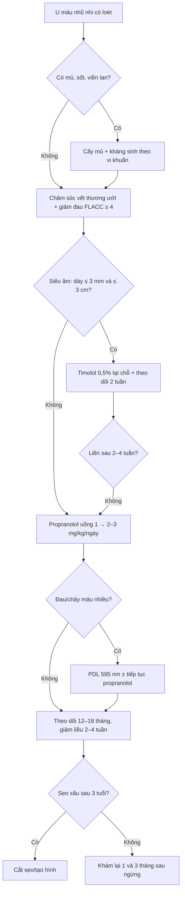
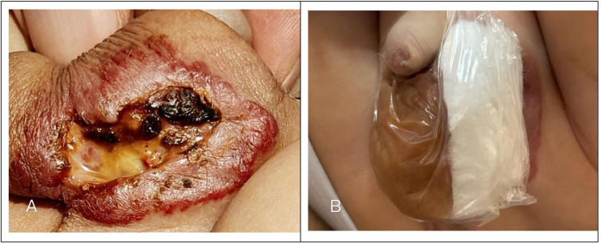
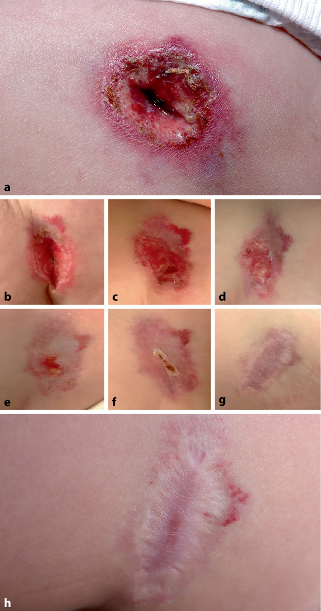
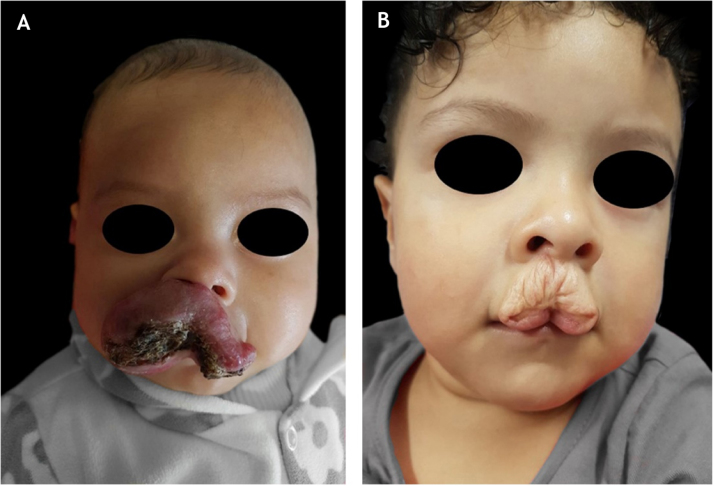
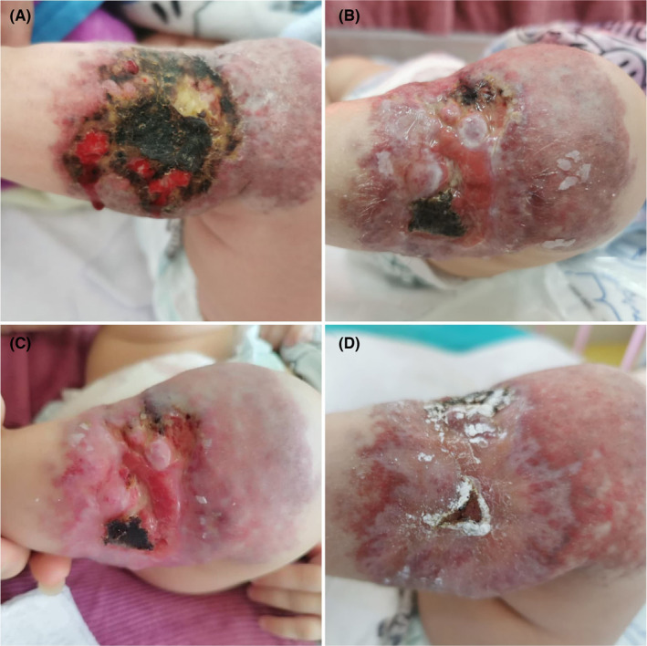

# 3071 — U máu nhũ nhi LOÉT: đau – nhiễm – chảy máu, khi nào propranolol + timolol + laser, và sẹo về sau

**Tags:** `pattern:u-mau-loet` `pattern:chay-mau` `pattern:dau` `pattern:nhiem-trung` `vung:da-dau-mat-co` `vung:sinh-duc` `anatomy:da` `protocol:sieu-am-Doppler` `protocol:propranolol` `protocol:timolol` `protocol:PDL` `score:FLACC`
**Mức chắc chắn (certainty):** tổng hợp y văn (literature synthesis) — ghép **hướng dẫn thực hành Nhật 2022 về u mạch máu/dị dạng mạch** (J Dermatol 2026, PMC13150677), **đoàn hệ 190 trẻ u máu nhũ nhi** (An Bras Dermatol 2022, PMC8799848), **nghiên cứu 87 tổn thương theo dõi sẹo** (J Dermatol 2026, PMC13555119), **2 ca nguyên văn u máu loét** (Front Pediatr 2026 PMC13180811; Wien Klin Wochenschr 2025 PMC12592269), **ca nhiễm Klebsiella** (Clin Case Rep 2024 PMC11222967), **loạt phẫu thuật 95 ca** (Int J Surg 2023 PMC10389552) và **ca timolol tại chỗ** (Cureus 2024 PMC11420686). Không có ca do nhóm tự chụp.

> **Câu hỏi thực hành:** bé gái **5 tháng tuổi**, u máu ở **môi dưới** đã loét 1 tuần, **quấy khóc khi bú, chảy máu lấm tấm**, không sốt. Câu hỏi: **có nhập viện không, có dùng kháng sinh không, dùng propranolol hay timolol, có cần laser, và sẹo về sau ra sao?**
> Bài chốt **năm quyết định**: **(1) loét là biến chứng hay gặp (~15,8%), đứng hàng đầu ở môi dưới (30%) và vùng hậu môn–sinh dục (50%); (2) propranolol uống là điều trị nền — rút ngắn thời gian loét liền và giảm đau; (3) timolol tại chỗ chỉ đủ cho tổn thương NÔNG (siêu âm ≤ 3 mm) và nhỏ (≤ 3 cm); (4) kháng sinh chỉ khi có dấu hiệu nhiễm, không dùng thường quy; (5) sẹo là quyết định — 31% có di chứng thẩm mỹ, thể nốt và tổn thương ≥ 3 cm² có nguy cơ sẹo nặng nhất.**

## 1. Tổng quan bệnh học – cơ chế hình ảnh: vì sao loét, vì sao đau, vì sao chảy máu

- **Bản chất u:** u máu nhũ nhi (infantile hemangioma, IH) là **tăng sinh tế bào nội mô mạch máu**, **GLUT-1 dương** (dấu hiệu của nhau thai — dùng để phân biệt với u mạch khác), gặp ở **4–5% trẻ sinh sống**; đa số tự thoái triển nhưng **10–15%** được xếp nguy cơ cao vì kích thước, vị trí, tốc độ phát triển hoặc biến chứng (PMC11420686, PMC13702952).
- **Vì sao loét:** u tăng sinh nhanh trong **3–5 tháng đầu** làm **lớp biểu bì bị căng, thiếu máu nuôi**; thêm **ma sát – ẩm – cọ xát** ở vị trí gấp (môi, cổ, hậu môn–sinh dục, nếp bẹn) → **hoại tử bề mặt và loét**. Đúng vậy, loét hay gặp ở **môi dưới 30% (21/71)**, **cổ 25% (25/100)**, **quanh hậu môn–sinh dục 50% (46/93)**, thấp nhất ở **mi trên** (p = 0,0140); **35%** tổn thương loét đang ở **pha tăng sinh**; thể **hỗn hợp/đoạn tính** loét nhiều hơn (PMC13150677).
- **Tần suất:** trong đoàn hệ đa trung tâm **1.096 trẻ**, loét gặp **173 ca (15,8%)**, tuổi trung vị **4,0 tháng**; các nghiên cứu khác báo **5–21%**, một đoàn hệ tiến cứu **16%** (PMC13150677, PMC8799848). Loét làm **tăng nhu cầu điều trị gấp 6,86 lần** (OR 6,86; KTC 3,70–12,71; p < 0,0001) (PMC13150677).
- **TẠI SAO đau:** loét mất lớp biểu bì che phủ → **đầu mút thần kinh cảm giác ở trung bì lộ ra**, kích thích bởi nước tiểu, phân, sữa và ma sát. Vì vậy trẻ **bú kém, quấy, sụt cân** — đau là lý do nhập viện và là chỉ định điều trị, không chỉ "thẩm mỹ".
- **TẠI SAO chảy máu:** bề mặt u là **mao mạch tăng sinh, thành mỏng**, không có lớp niêm mạc bảo vệ; chảy máu gặp ở **78/173 tổn thương loét (41%)** — **nhẹ 29%**, **trung bình 6%**, **nặng 2%**; **2 ca phải truyền máu** vì chảy máu nặng (PMC13150677). Chảy máu ồ ạt hiếm nhưng là biến cố cấp cứu.
- **TẠI SAO nhiễm:** hàng rào da mất, vết loét ẩm, vùng hậu môn–sinh dục bị phân/nước tiểu → **bội nhiễm**. Nhiễm là biến chứng **không thường gặp** nhưng có thể nặng: ca 6 tháng tuổi nhiễm **Klebsiella pneumoniae**, phải đổi từ cefepime sang **piperacillin/tazobactam**, tiếp tục propranolol ≥ 1 năm (PMC11222967). Vì vậy **không đồng nghĩa "loét = nhiễm"** — cần tiêu chuẩn lâm sàng/vi sinh.
- **TẠI SAO hình ảnh học lại quan trọng ở đây:** **độ dày và độ sâu** quyết định đường điều trị. Siêu âm đo **độ dày tổn thương**: nghiên cứu ngẫu nhiên 349 trẻ dùng **timolol tại chỗ** chỉ chọn tổn thương **dày ≤ 3 mm** trên siêu âm (u "nông"), còn tổn thương sâu/hỗn hợp cần **propranolol toàn thân** (PMC13150677). Siêu âm còn xác định **thành phần sâu**, **mạch nuôi**, và theo dõi đáp ứng.
- **TẠI SAO KHÔNG sinh thiết thường quy:** sinh thiết ở u đã loét **thường không chẩn đoán được** — ca u loét 5 cm ở đùi, sinh thiết chỉ thấy **mạch giãn + xơ nhẹ**, chẩn đoán cuối cùng dựa trên **lâm sàng + GLUT-1 dương** (PMC12592269). Sinh thiết còn làm **loét nặng thêm** và đau.
- **Hậu quả thẩm mỹ (để tư vấn từ đầu):** **31% (51/163)** trẻ điều trị có di chứng thẩm mỹ (anetoderma, da thừa, sẹo teo, giãn mạch) (PMC8799848). Trong 87 tổn thương theo dõi ≥ 1 năm: **48,3% không còn di chứng**, **27,6% nhẹ**, **11,5% trung bình**, **12,6% nặng**; thể **nốt** có sẹo nặng **52,9%**, và **đỉnh kích thước ≥ 3 cm²** là yếu tố dự báo độc lập (**OR 21,6; KTC 2,93–358; p = 0,0090**) (PMC13555119).

## 2. Mẫu hình + chẩn đoán phân biệt theo vị trí và hình thái (Gamut)

- **Theo VỊ TRÍ (quyết định nguy cơ loét và cách chăm sóc):**
  - **Môi dưới / quanh miệng** (30%): ma sát khi bú, nguy cơ sẹo co kéo và biến dạng môi.
  - **Hậu môn – sinh dục** (50%): ẩm, nhiễm phân/nước tiểu, dễ bội nhiễm, đau khi đi tiêu.
  - **Cổ / nếp cổ** (25%): cọ xát với quần áo, dễ loét lan.
  - **Mi trên**: ít loét nhất nhưng **nguy cơ che lấp trục thị giác** → ưu tiên điều trị sớm.
  - **Đoạn tính vùng đầu–mặt/cổ**: nguy cơ **PHACE**, loét nhiều, cần MRI/MRA (xem bài 3069).
  - **Đường giữa thắt lưng – cùng cụt**: nguy cơ **LUMBAR** (dị tật tủy sống) — khám lưng + siêu âm tủy trước 6 tháng.
- **Theo HÌNH THÁI loét:**
  - **Loét nông** (fibrin vàng, đáy hồng): đau, chảy máu nhẹ, đáp ứng chăm sóc + timolol/propranolol.
  - **Loét sâu** (hố lõm, hoại tử đen): nguy cơ nhiễm, chảy máu, sẹo xấu; cần propranolol + chăm sóc ướt, cân nhắc can thiệp sớm.
  - **Loét trên u đoạn tính nhiều ổ**: thường kèm biến chứng toàn thân/PHACE, cần đánh giá hệ thống.
  - **Loét nhiễm khuẩn**: mủ, mùi, viền đỏ lan, sốt → cấy + kháng sinh theo vi khuẩn.
- **CHẨN ĐOÁN PHÂN BIỆT theo vị trí (bắt buộc):**
  - **Viêm da tiếp xúc/viêm da tã (diaper dermatitis)** ở vùng hậu môn: đỏ lan, bờ không rõ, không có khối nổi; **không có u nền**.
  - **Chốc (impetigo)**: vảy vàng mật ong, lan nhanh, đáp ứng kháng sinh.
  - **Nhiễm HSV**: chùm mụn nước, đau, tái phát; **Tzanck/PCR**.
  - **Tăng sinh bạch cầu hạt (Langerhans cell histiocytosis, LCH)**: sẩn–vảy đỏ ở nếp gấp/da đầu, có thể loét; tổn thương **không có u mạch rõ**, kèm gan lách/hạch.
  - **Pyoderma gangrenosum**: loét **đau nhiều, bờ tím gồ**, tiến triển nhanh, **không có u mạch trước đó**; ca u máu loét 5 cm từng bị chẩn đoán nhầm là pyoderma gangrenosum (PMC12592269).
  - **U mạch dạng Kaposi (kaposiform hemangioendothelioma, KHE)**: tổn thương **cứng, tím, lan rộng**, kèm **giảm tiểu cầu + đông máu nội mạch (Kasabach–Merritt)** — **propranolol không hiệu quả**, cần sirolimus/vincristine.
  - **Sarcoma mô mềm ở trẻ** (fibrosarcoma nhũ nhi, rhabdomyosarcoma vùng đáy chậu): khối **phát triển nhanh, cứng, không đáp ứng propranolol** → sinh thiết/imaging.

## 3. Bảng so sánh phân biệt (ma trận đối chiếu)

| Thực thể (entity) | Hình ảnh lâm sàng/siêu âm điển hình | Chốt vào (rule-in) | Chốt loại (rule-out) | Gợi ý xác nhận |
|---|---|---|---|---|
| **U máu nhũ nhi loét (UIH)** | Khối đỏ/tím **có trước đó**, loét bề mặt, chảy máu lấm tấm; siêu âm: khối **giảm âm, giàu mạch, thùy múi** | **Có u mạch đi trước + loét đúng vị trí ma sát + GLUT-1 dương** | **Không có khối nền / không tăng sinh mạch** → không phải IH | Lâm sàng + siêu âm Doppler; **không sinh thiết thường quy** |
| **KHE / Kasabach–Merritt** | Mảng tím **cứng, lan rộng**, không tự thoái triển; siêu âm: tổn thương **dày, giảm tín hiệu, mạch nuôi lớn** | **Giảm tiểu cầu + fibrinogen thấp + D-dimer cao** | **Tiểu cầu bình thường + u nông** → nghĩ IH | CBC, đông máu, siêu âm; MRI nếu lan sâu |
| **Pyoderma gangrenosum** | Loét **đau dữ dội, bờ tím gồ, đáy mủ**, tiến triển nhanh, không có u trước | **Đau nhiều + bờ tím + không đáp ứng propranolol** | **Có u mạch từ trước + trẻ khỏe** → nghĩ UIH | Sinh thiết nếu nghi (loại trừ nhiễm); hội chẩn da liễu |
| **Viêm da tã / nhiễm Candida** | Đỏ **lan tỏa ở vùng tã**, bờ vệ tinh, **không có khối**; đáp ứng thuốc chống nấm | **Bờ vệ tinh + vùng bẹn + không khối** | **Có khối mạch + loét khu trú** → UIH | Soi nấm/KOH, thử điều trị |
| **Chốc / nhiễm khuẩn da** | Vảy vàng mật ong, trợt nông, lan nhanh | **Cấy mủ dương + đáp ứng kháng sinh** | **Không có khối mạch nền** | Cấy mủ (chỉ khi có mủ/sốt) |
| **LCH** | Sẩn đỏ–nâu ở nếp gấp/da đầu, có thể loét, kèm gan lách/hạch | **Tổn thương ngoài da đa ổ + gan lách/hạch + sinh thiết** | **U mạch đơn độc, GLUT-1 dương** | Sinh thiết da, xét nghiệm hệ thống |
| **Sarcoma mô mềm** | Khối **cứng, cố định, phát triển nhanh**, không đỏ kiểu u máu | **Không đáp ứng propranolol 4–8 tuần + MRI có xâm lấn** | **Mềm, đỏ, đáp ứng beta-blocker** | MRI + sinh thiết |

- **Ảnh đối chiếu** dùng trong quiz: u loét vùng bìu (PMC13180811-F1, F2), diễn tiến ổ loét 5 cm (PMC12592269-F1), sẹo môi sau loét (PMC8799848-F1), u loét bội nhiễm Klebsiella (PMC11222967-F1).

## 4. Protocol đánh giá – điều trị + phân độ

- **Đánh giá ban đầu (5 bước):**
  1. **Kích thước + bản đồ tổn thương**: đo 2 chiều, chụp ảnh có thước; đo lại mỗi 1–2 tuần trong pha tăng sinh.
  2. **Siêu âm Doppler** (đầu dò thẳng 12–15 MHz): đo **độ dày tối đa**, độ sâu, thành phần (nông/sâu/hỗn hợp), mạch nuôi, và **loại trừ KHE** (tổn thương rất dày, mạch lớn).
  3. **Xét nghiệm**: **CBC + đông máu** nếu nghi KHE/chảy máu; **CRP/cấy mủ** chỉ khi có mủ, mùi, sốt hoặc loét không lành; **không cấy thường quy**.
  4. **Đau**: **FLACC 0–10** (5 mục × 0–2); ngưỡng can thiệp thực hành **≥ 4** (phác đồ nhi dùng ngưỡng này để cho giảm đau, PMC13460471); đánh giá lại sau 30–60 phút.
  5. **Sàng lọc hội chứng**: đoạn tính + đầu–mặt/cổ → nghĩ **PHACE**; đường giữa thắt lưng → **LUMBAR** (siêu âm tủy < 6 tháng, MRI sau đó).
- **Bậc điều trị (theo hướng dẫn Nhật 2022, PMC13150677):**

| Bậc | Chỉ định | Điều trị | Bằng chứng / số liệu |
|---|---|---|---|
| 1 | Mọi u loét | **Chăm sóc vết thương ướt**: rửa nước muối, băng **hydrocolloid/alginate/polyurethane** giữ ẩm, băng chống dính; giảm ma sát, kiểm soát phân/nước tiểu | Băng làm tốt hơn ở **23/25 (92%)**; màng polyurethane giảm đau nhanh, liền 1–2 tháng |
| 2 | U loét có tăng sinh/đau/chảy máu | **Propranolol uống**: khởi đầu **1 mg/kg/ngày**, tăng tới **2–3 mg/kg/ngày**; theo dõi như bài 3069 | Tiwari RCT 64 ca: liền **17,93 ± 2,22 ngày** vs **27,71 ± 2,33 ngày** (ibuprofen + paracetamol), p < 0,001; Hermans: loét tồn tại **8,7 vs 22,4 tuần** (p = 0,012) |
| 3 | U **nông ≤ 3 mm**, nhỏ **≤ 3 cm** | **Timolol gel 0,5%** tại chỗ, **2–3 lần/ngày** | 39/46 ca liền (tổng quan); 30 ca u ≤ 3 cm: **21 ca** liền; nhưng **không đủ kiểm soát u sâu** (ca mũi: ngừng chảy máu nhưng u vẫn lan → phải propranolol) |
| 4 | Đau/ chảy máu nhiều, u nông | **Laser xung nhuộm (PDL 595 nm)**: 5–6,8 J/cm², 0,45 ms, spot 5–7 mm | 37 ca: liền sau **1 lần 68%**, **2 lần 21%**, trung bình **2,84 tuần**; 72/78 (92,3%) hiệu quả; **5/22 ca pha tăng sinh bị loét mới** sau chiếu |
| 5 | Có **dấu hiệu nhiễm** (mủ, mùi, viền lan, sốt) | **Kháng sinh** theo cấy; kháng sinh bôi (mupirocin/fusidate) ± toàn thân | Bôi: tốt **37/40 (92,5%)**; toàn thân **24/26 (92,3%)**; loạt 608 ca: lành trung bình **40,09 ± 19,41 ngày**, amoxicillin–clavulanate **20–40 mg/kg/ngày** khi loét **> 10 cm²** |
| 6 | U **nhỏ, khu trú, loét tái diễn/không lành**, sẹo xấu | **Cắt bỏ đơn giản** khi có thể mổ không cần tạo hình phức tạp | **95 ca (26%)** phẫu thuật; nhóm loét chiếm **< 4%** và có **thời gian từ khám tới mổ ngắn nhất** |
| 7 | Sẹo/di chứng sau thoái triển | **Cắt sẹo/ tạo hình** sau **3 tuổi**; theo dõi 6–12 tháng | 31% có di chứng thẩm mỹ; thể nốt sẹo nặng 52,9% |

- **Thời gian điều trị và ngừng:** propranolol thường **kéo dài 12–18 tháng**, giảm liều **2–4 tuần**; **tái phát (rebound) 17–25%** sau ngừng (17% trong Marqueling, tới **25%** trong loạt phẫu thuật PMC10389552) — khám lại **1 tháng, 3 tháng** sau ngừng (xem bài 3069).
- **Sơ đồ quyết định:**

## 5. Biến thể bình thường và cạm bẫy

- **"Loét = nhiễm" là cạm bẫy phổ biến nhất:** đa số loét **vô khuẩn/ít khuẩn**; kháng sinh thường quy không rút ngắn lành và có thể gây loạn khuẩn. Chỉ cấy/kháng sinh khi **mủ, mùi, viền đỏ lan, sốt, hoặc loét không lành > 2–4 tuần** (PMC13150677).
- **Sinh thiết ổ loét thường vô ích:** ca 5 cm sinh thiết chỉ thấy mạch giãn; chẩn đoán dựa vào **bối cảnh + GLUT-1**. Sinh thiết có thể **làm loét to thêm** (PMC12592269).
- **Bỏ sót KHE:** u **cứng, tím, lan rộng**, trẻ **chảy máu kéo dài** → phải **CBC + đông máu** trước khi yên tâm điều trị như IH; propranolol **không hiệu quả** trong KHE.
- **Bỏ sót PHACE/LUMBAR:** u **đoạn tính** ở mặt/cổ hoặc **đường giữa thắt lưng** — khám thần kinh, mắt, tim, tủy; không chỉ nhìn da.
- **Nhầm viêm da tã:** viêm da tã **không có khối mạch**, đáp ứng chống nấm/barrier; u máu loét có **khối nền đỏ tím** và lớn dần.
- **Timolol không đủ cho u sâu:** ca u mũi chỉ **ngừng chảy máu** nhưng u vẫn lan vào tiền đình miệng → phải thêm propranolol (PMC11420686). Đừng kéo dài timolol ở u dày > 3 mm.
- **PDL ở pha tăng sinh có thể gây loét mới:** 5/22 ca loét mới sau chiếu; chỉ định laser nên do người có kinh nghiệm, cân nhắc propranolol trước.
- **Ngừng propranolol quá sớm:** tái phát **17–25%**, thường trong vài tuần đầu; giảm liều từ từ **2–4 tuần** và hẹn khám lại.
- **Đau không được điều trị:** trẻ bú kém → mất nước, sụt cân; dùng **paracetamol/ibuprofen** theo cân nặng, đánh giá FLACC trước–sau.
- **Sẹo:** tư vấn **từ lần khám đầu** rằng thể nốt và tổn thương ≥ 3 cm² có nguy cơ sẹo nặng (OR 21,6) — đây là lý do **điều trị sớm**, không phải "chờ tự khỏi".

## 6. Tự lượng giá — Blind Quiz ngay trên trang tĩnh

**Ca 1 — U loét vùng bìu ở nhũ nhi**

- Gợi ý lâm sàng: bé trai **5 tháng**, u đỏ ở bìu từ sau sinh, 1 tháng trước nhập viện xuất hiện **loét + chảy máu từng đợt**, đã bôi thuốc tại chỗ nhưng nặng thêm.
- Câu hỏi: Mô tả tổn thương ở (A). Vì sao vùng này dễ loét và dễ nhiễm? (B) là gì?

<b>Bấm để hiện đáp án (findings + chẩn đoán)</b>

- Dấu hiệu: khối đỏ tím chiếm bìu, **ổ loét trung tâm ~2 × 3 cm, sâu 0,3 cm**, đáy có **dịch mủ + mô hoại tử**; (B) là **băng alginate + màng trong suốt** cố định để cách ly nước tiểu.
- Chẩn đoán: **u máu nhũ nhi loét bội nhiễm vùng bìu**. Vị trí ẩm + ma sát + phân/nước tiểu → loét và nhiễm; điều trị **propranolol 1 → 2 mg/kg/ngày + chăm sóc ướt**, mô hạt sau **3 ngày**, liền biểu mô sau **12 ngày**.
- Nguồn ảnh: Front Pediatr 2026, PMCID PMC13180811, Figure 1 — CC BY 4.0.

**Ca 2 — Diễn tiến ổ loét 5 cm**

- Gợi ý lâm sàng: bé **5 tháng**, loét **1,5 cm sâu × 5,0 cm** ở mặt trước ngoài đùi trái, đau, đã bị chẩn đoán nhầm là **pyoderma gangrenosum/sporotrichosis/nhiễm mycobacterium**.
- Câu hỏi: Vì sao chẩn đoán ban đầu sai? Dấu hiệu nào trên ảnh giúp nghĩ u máu? Điều trị gì và mất bao lâu?

<b>Bấm để hiện đáp án (findings + chẩn đoán)</b>

- Dấu hiệu: ổ loét **bờ cuộn, đáy fibrin, quầng đỏ**, không có mụn nước; bệnh sử có **"nốt đỏ" trước đó** tại đúng vị trí; sinh thiết **không đặc hiệu**, **GLUT-1 dương** xác nhận.
- Chẩn đoán: **u máu nhũ nhi loét hoàn toàn**. Propranolol **1 mg/kg × 2 lần/ngày** + chăm sóc vết thương; liền trong **3 tuần**, điều trị **18 tháng**, sẹo phẳng không tái phát sau 1 năm.
- Nguồn ảnh: Wien Klin Wochenschr 2025, PMCID PMC12592269, Figure 1 — CC BY 4.0.

**Ca 3 — Loét môi dưới và cái giá của sẹo**

- Gợi ý lâm sàng: (A) lúc **4 tháng**, u loét môi dưới; (B) cùng trẻ lúc **2 tuổi** sau thoái triển.
- Câu hỏi: Hai ảnh cho thấy hậu quả gì? Có phòng được không? Yếu tố nào dự báo sẹo nặng?

<b>Bấm để hiện đáp án (findings + chẩn đoán)</b>

- Dấu hiệu: (A) u loét **môi dưới** (vị trí loét hay gặp nhất ở môi: 30%); (B) **sẹo teo + da thừa, biến dạng viền môi** — di chứng thẩm mỹ.
- Chẩn đoán: **di chứng sau u máu loét môi dưới**. Phòng bằng **điều trị sớm**; thể **nốt** và **đỉnh ≥ 3 cm²** có nguy cơ sẹo nặng (OR 21,6); 31% trẻ điều trị có di chứng thẩm mỹ.
- Nguồn ảnh: An Bras Dermatol 2022, PMCID PMC8799848, Figure 1 — CC BY 4.0 (thanh đen che mắt là của tác giả).

**Ca 4 — Khi nào nghĩ đến bội nhiễm?**

- Gợi ý lâm sàng: bé gái **6 tháng**, u máu ở cẳng chân đã điều trị, nay loét lan nhanh, **hoại tử đen + mủ**, sốt nhẹ.
- Câu hỏi: Dấu hiệu nào phân biệt **loét đơn thuần** với **bội nhiễm**? Cấy gì, kháng sinh gì, có ngừng propranolol không?

<b>Bấm để hiện đáp án (findings + chẩn đoán)</b>

- Dấu hiệu: **mô hoại tử đen, dịch mủ, quầng đỏ lan, đau tăng** — khác loét vô khuẩn (đáy hồng, không mủ).
- Chẩn đoán: **u máu loét bội nhiễm Klebsiella pneumoniae**. Cấy mủ → đổi cefepime sang **piperacillin/tazobactam**, tiếp tục propranolol (không ngừng), điều trị ≥ 1 năm; ổ nhiễm là do **băng che kín gây yếm khí** trong ca này.
- Nguồn ảnh: Clin Case Rep 2024, PMCID PMC11222967, Figure 1 — CC BY-NC-ND 4.0 (nguyên bản).

## Bài liên quan chéo
- [3069 – An toàn propranolol ở nhũ nhi: liều đầu, theo dõi, ngừng thuốc](../3069-an-toan-propranolol-o-nhu-nhi/lesson.md)
- [3005 – U máu dưới thanh môn ở nhũ nhi](../3005-u-mau-duoi-thanh-mon-nhu-nhi/lesson.md)
- [3048 – U máu gan ở nhũ nhi](../3048-u-mau-gan-o-nhu-nhi/lesson.md)
- [3052 – U mạch máu gan bẩm sinh (RICH/NICH)](../3052-u-mach-mau-gan-bam-sinh-rich-nich-o-tre/lesson.md)
- [3070 – Tiêm chất làm đầy dây thanh & thyroplasty ở trẻ](../3070-tiem-chat-lam-day-day-thanh-va-thyroplasty-o-tre/lesson.md)

> Không dùng để chẩn đoán độc lập khi chưa có người hướng dẫn.
