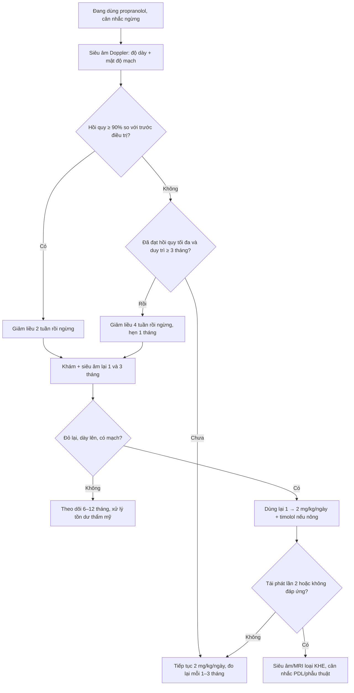
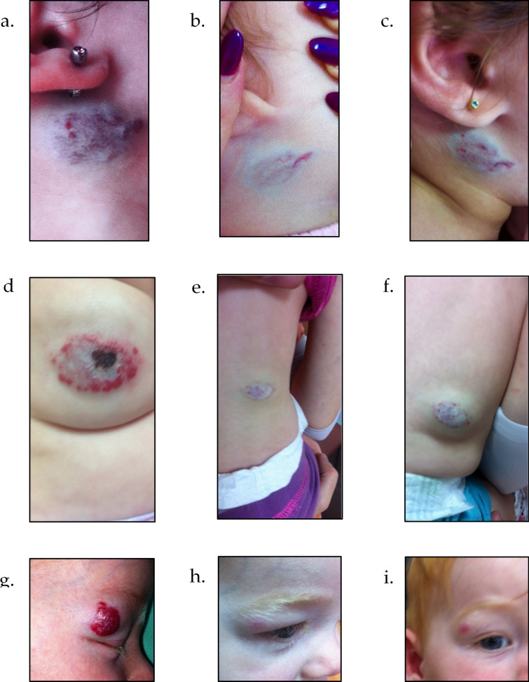
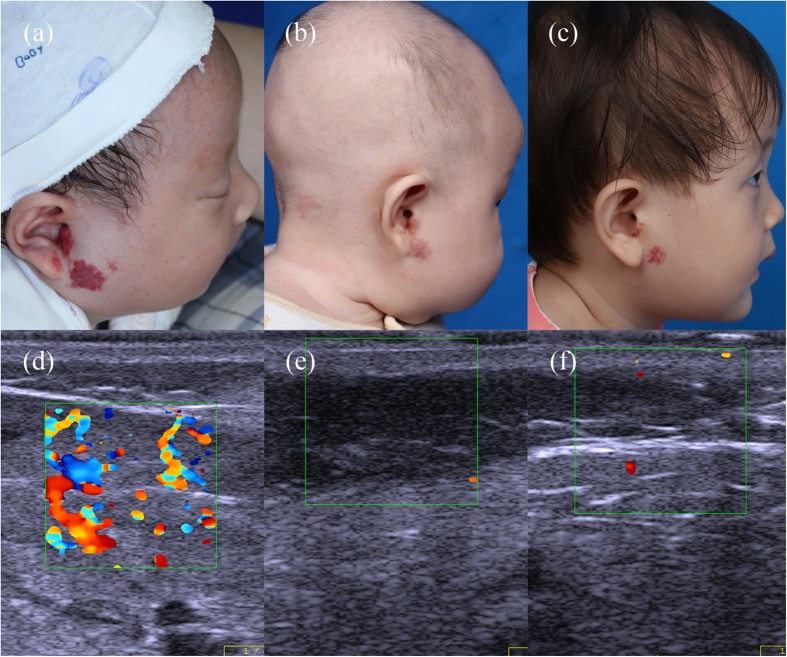
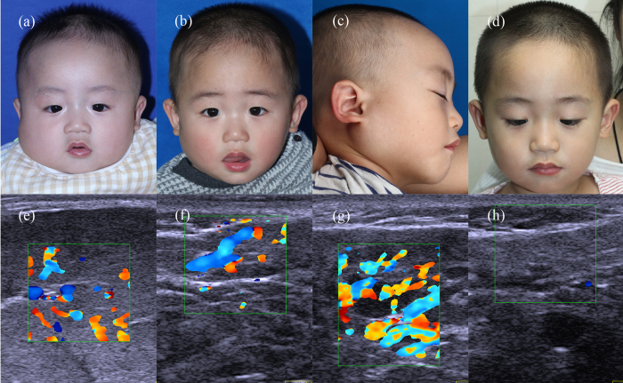

# 3072 — Tái phát u máu nhũ nhi sau ngừng propranolol: ai có nguy cơ, giảm liều thế nào, khi nào dùng lại

**Tags:** `pattern:tai-phat` `pattern:u-mau` `vung:da-dau-mat-co` `vung:than-minh` `anatomy:da` `protocol:propranolol` `protocol:sieu-am-Doppler` `score:rebound-risk`
**Mức chắc chắn (certainty):** tổng hợp y văn (literature synthesis) — ghép **phân tích gộp 10 nghiên cứu/1.662 trẻ** (J Clin Med 2025, PMC12607970), **đoàn hệ 301 trẻ điều trị ≥ 6 tháng** (Adv Ther 2025, PMC11782296), **nghiên cứu 149 trẻ ngừng thuốc theo mức hồi quy trên siêu âm Doppler** (Sci Rep 2017, PMC5320547) và **loạt 232 u máu** (Skin Res Technol 2023, PMC10234167). Không có ca do nhóm tự chụp.

> **Câu hỏi thực hành:** bé gái **10 tháng**, u máu đoạn tính vùng mang tai đã dùng propranolol **8 tháng**, nay u **phẳng, nhạt màu, còn ít mạch** trên siêu âm. Bố mẹ hỏi: **"Ngừng được chưa? Ngừng đột ngột hay giảm dần? Nếu mọc lại thì sao?"**
> Bài chốt **năm quyết định**: **(1) tái phát (rebound) là chuyện thường gặp — gộp 20% (15–24%), 11% phải dùng lại thuốc; (2) yếu tố dự báo mạnh nhất KHÔNG phải tuổi ngừng mà là MỨC HỒI QUY lúc ngừng — hết ≥ 90%: tái phát 5,3%, còn < 90%: 26,9%; (3) giảm liều 2–4 tuần, và duy trì thêm 3 tháng sau khi đạt mức hồi quy tối đa tốt hơn 1 tháng (OR 1,86); (4) nữ và u vùng đầu–cổ có nguy cơ cao hơn (OR 1,76 và 2,40), u ở chi ít tái phát; (5) tái phát hầu như xuất hiện trong 1–3 tháng đầu sau ngừng → hẹn khám lại đúng lúc, dùng lại thuốc vẫn hiệu quả.**

## 1. Tổng quan bệnh học – cơ chế hình ảnh: vì sao u mọc lại sau khi ngừng thuốc

- **Bản chất u và vì sao propranolol có tác dụng:** u máu nhũ nhi (infantile hemangioma, IH) là **tăng sinh tế bào nội mô mạch**, **GLUT-1 dương**, gặp ở **4–10%** trẻ. Propranolol chặn β-adrenergic → **co mạch, giảm VEGF/bFGF, tăng apoptosis tế bào nội mô và tế bào gốc u**. Thuốc **kiểm soát** chứ không **diệt hết**: sau khi ngừng, một lượng tế bào gốc u còn lại có thể **vào lại chu kỳ tăng sinh** → **rebound growth** (PMC11014660).
- **TẠI SAO "rebound" không phải "thất bại điều trị":** trong pha tăng sinh (0–5 tháng) u cần **renin–angiotensin** và yếu tố tăng trưởng tại chỗ; propranolol hạ renin và làm tế bào "ngủ". Khi thuốc rút, **trục renin hồi phục nhanh hơn tốc độ thoái triển tự nhiên** → u đỏ lại, dày lại, có khi vượt kích thước cũ. Vì vậy đáp ứng lại thuốc lần 2 **vẫn tốt ở phần lớn trẻ** (PMC12607970).
- **Tần suất — con số phải nhớ:** gộp **10 nghiên cứu, 1.662 trẻ**, tỉ lệ tái phát **20% (KTC 95%: 15–24%; I² = 85%)**; tái phát **nặng phải dùng lại propranolol 11% (9–14%)** (PMC12607970). Các loạt đơn lẻ báo **6–30%**, đoàn hệ 301 trẻ của Israel chỉ **12,6% (38/301)** nhờ phác đồ ngừng chặt (PMC11782296), đoàn hệ 679 trẻ Thượng Hải **13,5% (92/679)** (PMC5320547).
- **TẠI SAO mức hồi quy lúc ngừng là yếu tố mạnh nhất (vật lý của siêu âm):** mô u còn hoạt tính thì còn **mao mạch thành mỏng, tốc độ dòng thấp–trung bình**, biểu hiện trên **siêu âm Doppler màu** là còn mạch trong tổn thương; mô đã thoái triển thay bằng **mô xơ–mỡ không mạch**. Nghiên cứu 149 trẻ chia theo **mức hồi quy ≥ 90%** so với **< 90%** tại thời điểm ngừng:
  - **Tái phát 5,3% (2/38) vs 26,9% (24/111)** (PMC5320547).
  - Lúc ngừng: **độ dày 0,12 ± 0,07 cm vs 0,38 ± 0,12 cm**, **mật độ mạch 1,7 ± 0,8 vs 4,1 ± 1,3 mạch/cm²**.
  - Nhóm hồi quy hoàn toàn ngừng thuốc **sớm hơn** (tuổi 9,8 ± 3,6 vs 16,9 ± 4,1 tháng) mà vẫn **ít tái phát hơn** — bằng chứng rằng **thời gian dùng thuốc dài không thay được mức hồi quy**.
- **Loạt 232 u máu củng cố cùng quy luật:** sau 1 tháng ngừng thuốc, tái phát **5% (2/40)** ở nhóm hồi quy hoàn toàn và **22% (11/50)** ở nhóm hồi quy một phần (PMC10234167).
- **Yếu tố nguy cơ theo phân tích gộp (đã hiệu chỉnh/thô):** **nữ OR 1,76 (1,20–2,59)**; **đầu–cổ OR 2,40 (1,59–3,63)**; **vùng mặt OR 3,48 (1,65–7,36)**. Ngược lại **thể loại u, phân bố đoạn tính, thời gian điều trị và tuổi bắt đầu điều trị KHÔNG có ý nghĩa** trong gộp (PMC12607970).
- **U ở chi ít tái phát nhất:** trong 301 trẻ, chỉ **1 ca** tái phát ở nhóm u chi (**p < 0,001**); u ở chi cũng đáp ứng tốt hơn (PMC11782296). Cơ chế được giải thích bằng **nguồn gốc phôi khác nhau** và **mật độ mô đệm** — điểm này khớp với quan sát ở hội chứng PHACE/LUMBAR (bài 3073).
- **Loét không làm tăng tái phát:** 10,5% ở nhóm tái phát vs 13,3% ở nhóm không tái phát (**p = 0,079**) (PMC11782296) — đừng vì "đã loét" mà kéo dài thuốc vô hạn.
- **Thời điểm tái phát — quyết định lịch hẹn:** trong loạt 232 u máu, các ca tái phát được phát hiện **sau 1 tháng** ngừng thuốc (PMC10234167); theo các loạt, phần lớn tái phát xuất hiện trong **1–3 tháng đầu**. Vì vậy mốc khám **1 tháng** quan trọng hơn mốc 6 tháng.

## 2. Mẫu hình + chẩn đoán phân biệt của "tổn thương xuất hiện lại" sau ngừng propranolol (Gamut)

- **Mẫu hình 1 — rebound thật (u mọc lại):** đúng vị trí u cũ, **đỏ lại, ấm, dày lên**, có thể **lan ra ngoài bờ cũ**; siêu âm: **giảm âm, có mạch trong tổn thương**, độ dày tăng so với lúc ngừng. Thường trong **1–3 tháng đầu**.
- **Mẫu hình 2 — tồn dư xơ–mỡ (residual fibrofatty tissue):** vùng **nhạt màu, mềm, phẳng**, có thể **giãn mạch mảnh**; siêu âm **không có mạch đáng kể**, độ dày **không tăng** theo thời gian. Đây **không phải tái phát**; can thiệp là **laser/ phẫu thuật thẩm mỹ** (bài 3071).
- **Mẫu hình 3 — da teo/anetoderma, sẹo:** sau loét hoặc u lớn; **không đỏ, không ấm**, chỉ là di chứng.
- **Mẫu hình 4 — nhiễm/loét tái phát tại chỗ:** sưng, đau, chảy dịch; "to ra" do **phù–viêm** chứ không phải mô u; cần **cấy + chăm sóc ướt** (bài 3071).
- **Mẫu hình 5 — KHÔNG phải IH:** u mới **cứng, tím, lan rộng, không đáp ứng propranolol** → nghĩ **KHE (kaposiform hemangioendothelioma)** với **Kasabach–Merritt** (tiểu cầu thấp, fibrinogen thấp) hoặc **sarcoma mô mềm nhũ nhi**.
- **Gamut theo vị trí (ai dễ tái phát):**
  - **Đầu–cổ, đặc biệt vùng mặt/mang tai** — nguy cơ cao nhất (OR 2,40; mặt OR 3,48).
  - **Thân, nếp gấp, vùng hậu môn–sinh dục** — nguy cơ trung bình, thêm nguy cơ **loét**.
  - **Chi** — nguy cơ thấp nhất (1 ca/301).
  - **Đường giữa thắt lưng–cùng cụt** — ngoài nguy cơ tái phát, phải **sàng lọc LUMBAR** (bài 3073).
- **Gamut theo "vì sao tái phát" — dùng để chọn xử trí:**
  1. **Ngừng khi chưa hồi quy đủ** (nguyên nhân số 1) → dùng lại, kéo dài tới khi ≥ 90%.
  2. **Ngừng quá sớm theo tuổi** (u còn ở pha tăng sinh) → dùng lại tới **12–18 tháng tuổi**.
  3. **Giảm liều quá nhanh** → dùng lại và **giảm chậm 2–4 tuần**.
  4. **Liều chưa tối ưu** (dưới 2 mg/kg/ngày) → tăng tới **2 mg/kg/ngày**.
  5. **U đoạn tính/PHACE–LUMBAR** → tổn thương rộng, tồn dư nhiều, cần **theo dõi dài** (bài 3073).

## 3. Bảng so sánh phân biệt (ma trận đối chiếu)

| Thực thể (entity) | Hình ảnh lâm sàng / siêu âm điển hình | Chốt vào (rule-in) | Chốt loại (rule-out) | Gợi ý xác nhận |
|---|---|---|---|---|
| **Rebound IH** | Đúng vị trí cũ, **đỏ–dày lại trong 1–3 tháng**; siêu âm: giảm âm + **có mạch trong tổn thương**, độ dày tăng | **Độ dày/mật độ mạch tăng so với lúc ngừng thuốc** | **Không có mạch, không dày thêm sau 3 tháng** → không phải rebound | Siêu âm Doppler so với ảnh lúc ngừng |
| **Tồn dư xơ–mỡ** | Mảng nhạt, mềm, phẳng ± giãn mạch mảnh; siêu âm **tăng âm, không mạch** | **Kích thước ổn định ≥ 3 tháng** | **Đỏ lại + dày lên + có mạch** → rebound | Theo dõi 3 tháng; laser/thẩm mỹ nếu cần |
| **Di chứng loét/sẹo** | Da teo, trắng bóng, co kéo; không ấm, không đau | **Tiền sử loét + không thay đổi theo thời gian** | **Sưng nóng đỏ + chảy dịch** → nhiễm | Khám da; không cần siêu âm |
| **Nhiễm tại chỗ** | Đau, phù, mủ, viền đỏ lan, sốt | **Mủ/mùi + cấy dương** | **Không mủ, không sốt, chỉ đỏ đều** → rebound | Cấy mủ, CRP nếu nặng |
| **KHE (Kaposiform)** | Mảng **tím, cứng, lan rộng**, không tự thoái triển; siêu âm dày, mạch lớn | **Giảm tiểu cầu + fibrinogen thấp + D-dimer cao** | **Tiểu cầu bình thường + đáp ứng propranolol** | CBC, đông máu, MRI |
| **Sarcoma mô mềm nhũ nhi** | Khối **cứng, cố định, lớn nhanh**, không đỏ kiểu u máu | **Không đáp ứng propranolol 4–8 tuần + MRI xâm lấn** | **Mềm, đỏ, đáp ứng beta-blocker** | MRI + sinh thiết |
| **U máu mới (không liên quan)** | Vị trí **khác** u cũ, xuất hiện muộn | **Vị trí mới + GLUT-1 dương** | **Đúng vị trí cũ** → rebound | Lâm sàng; sinh thiết rất hiếm cần |

- **Ảnh đối chiếu** dùng trong quiz: chuỗi 9 panel tái phát (PMC11782296-F2), u hồi quy hoàn toàn ngừng 2 tuần ổn định 23 tháng (PMC5320547-F1), u hồi quy một phần tái phát sau 1 tháng (PMC5320547-F3).

## 4. Protocol ngừng thuốc – theo dõi – xử trí tái phát

- **Đo trước khi quyết định (bắt buộc):** **siêu âm Doppler màu** đầu dò thẳng **12–15 MHz** đo **độ dày tối đa (mm)**, **mật độ mạch (/cm²)**, so với ảnh trước điều trị; chụp ảnh có thước. Đây là "ngưỡng khách quan" thay cho cảm nhận bằng mắt.
- **Tiêu chuẩn ngừng (theo bằng chứng):**
  1. **Hồi quy ≥ 90%** so với trước điều trị (hoặc không còn tổn thương rõ trên siêu âm); **hoặc**
  2. Đã đạt **mức hồi quy tối đa và duy trì ≥ 3 tháng** (duy trì 3 tháng tốt hơn 1 tháng: tái phát **OR 1,86**; tái phát nặng **OR 2,57**).
  3. Thường **sau 12 tháng tuổi** với u đã hồi quy tốt; không cần chờ "hết hẳn" nếu siêu âm đã ≥ 90%.
- **Cách ngừng:** **giảm liều từ từ 2–4 tuần**; nhóm **hồi quy hoàn toàn giảm trong 2 tuần**, nhóm **còn một phần giảm trong 4 tuần** (PMC5320547). Giảm đột ngột không làm tăng tái phát trong nghiên cứu duy nhất so sánh trực tiếp, nhưng **không được khuyến cáo** vì nguy cơ bùng phát và tác dụng cường adrenergic khi cai (PMC12607970).
- **Lịch theo dõi sau ngừng:** khám + đo lại **1 tháng**, **3 tháng**, rồi **6–12 tháng**; chụp ảnh mỗi lần. **1 tháng là mốc bắt buộc** vì phần lớn tái phát xuất hiện trong tháng đầu.
- **Khi có tái phát:**
  - **Dùng lại propranolol** khởi đầu **1 mg/kg/ngày**, tăng tới **2 mg/kg/ngày** (liều 2 mg/kg cho đáp ứng xuất sắc **57,8%**, tốt hơn 3 mg/kg trong đoàn hệ 301 trẻ, **p = 0,007**; lưu ý nhiễu do ca nặng dùng liều cao).
  - **Timolol gel 0,5%** tại chỗ **2–3 lần/ngày** chỉ khi tổn thương **nông ≤ 3 mm** và **≤ 3 cm** (bài 3071).
  - **Tiếp tục tới 12–18 tháng tuổi**, giảm liều **2–4 tuần**, duy trì **3 tháng** sau mức hồi quy tối đa rồi mới ngừng lại.
  - Tái phát **nhiều lần / không đáp ứng** → siêu âm lại, cân nhắc **MRI** để loại KHE/u khác, và **laser PDL** cho tổn dư nông.
- **Sơ đồ quyết định:**

## 5. Biến thể bình thường và cạm bẫy

- **"Tái phát = điều trị thất bại"** — sai. Tái phát gặp ở **1/5 trẻ** và **đáp ứng lại thuốc ở đa số**; thông điệp này quyết định việc bố mẹ có tuân thủ lần 2 hay không (PMC12607970).
- **Đo bằng mắt thay vì siêu âm:** u phẳng, nhạt màu vẫn có thể **còn mạch 4,1/cm²**; ngừng theo cảm nhận là nguyên nhân tái phát phổ biến nhất. Luôn đo **độ dày + mật độ mạch**.
- **Nhầm tồn dư xơ–mỡ với tái phát:** tồn dư **không dày thêm, không có mạch**; điều trị bằng **laser/phẫu thuật**, không phải tăng propranolol.
- **Nhầm giãn mạch tồn tại (telangiectasia) với u sống:** giãn mạch mảnh, không tăng thể tích; theo dõi, không tăng liều.
- **Kéo dài thuốc vô hạn vì sợ tái phát:** propranolol có tác dụng phụ (hạ đường huyết, nhịp chậm, rối loạn giấc ngủ — bài 3069); ngừng đúng lúc theo **mức hồi quy ≥ 90% + duy trì 3 tháng**.
- **Tưởng liều 3 mg/kg phòng tái phát tốt hơn:** trong đoàn hệ 301 trẻ, **2 mg/kg** lại gắn với đáp ứng xuất sắc hơn; ca nặng thường được dùng 3 mg/kg nên có **nhiễu chỉ định**. Không tăng liều chỉ để "phòng".
- **Bỏ mốc khám 1 tháng:** tái phát sớm nhất đã thấy **sau 1 tháng**; hẹn 3–6 tháng là bỏ lỡ cửa sổ điều trị dễ nhất.
- **Không chụp ảnh có thước:** mất khả năng so sánh khách quan giữa các lần; đây là lỗi hồ sơ hay gặp.
- **Quên sàng lọc hội chứng:** u **đoạn tính đầu–mặt/cổ** → PHACE; u **đường giữa thắt lưng–cùng cụt** → **LUMBAR** (bài 3073); tái phát ở nhóm này thường dai dẳng vì tổn thương rộng.

## 6. Tự lượng giá — Blind Quiz ngay trên trang tĩnh

**Ca 1 — Ba kiểu "mọc lại" sau ngừng thuốc**

- Gợi ý lâm sàng: ba trẻ (a–c: vùng mang tai; d–f: thân; g–i: quanh mắt) đã dừng propranolol.
- Câu hỏi: Panel nào là **trước điều trị**, panel nào **sau khi ngừng**, panel nào **tái phát**? Dấu hiệu nào phân biệt tái phát với tồn dư?

<b>Bấm để hiện đáp án (findings + chẩn đoán)</b>

- Dấu hiệu: **a, d, g** = trước điều trị (u đỏ, dày); **b, e, h** = sau khi ngừng (phẳng, nhạt); **c, f, i** = **tái phát** — đỏ và dày trở lại đúng vị trí, ở (f) và (i) rõ nốt gồ.
- Chẩn đoán: **rebound growth** sau ngừng propranolol. Chốt: **đỏ lại + dày lên + có mạch trên Doppler**, khác tồn dư xơ–mỡ (phẳng, không mạch, không tiến triển).
- Xử trí: dùng lại **1 → 2 mg/kg/ngày**, hẹn khám lại 1 tháng; tổn dư nông có thể **timolol**.
- Nguồn ảnh: Adv Ther 2025, PMCID PMC11782296, Figure 2 — CC BY-NC 4.0.

**Ca 2 — Ngừng khi đã hết hoàn toàn**

- Gợi ý lâm sàng: bé gái **6 tuần**, u máu hỗn hợp vùng mang tai phải; dùng propranolol **3 tháng**.
- Câu hỏi: Vì sao ngừng được sớm như vậy? Giảm liều trong bao lâu? Kết quả sau 23 tháng nói lên điều gì?

<b>Bấm để hiện đáp án (findings + chẩn đoán)</b>

- Dấu hiệu: (b) **không còn tổn thương rõ** trên lâm sàng và siêu âm Doppler; (c) **phẳng, không tái phát** sau 23 tháng.
- Chẩn đoán: **hồi quy hoàn toàn (≥ 90%)** — nhóm này tái phát chỉ **5,3% (2/38)**. Giảm liều **2 tuần** rồi ngừng.
- Bài học: **quyết định ngừng dựa trên mức hồi quy**, không dựa vào tuổi hay thời gian dùng thuốc.
- Nguồn ảnh: Sci Rep 2017, PMCID PMC5320547, Figure 1 — CC BY 4.0.

**Ca 3 — Ngừng khi còn một phần: cái giá sau 1 tháng**

- Gợi ý lâm sàng: bé trai **4 tháng**, u máu sâu vùng mang tai phải; dùng propranolol **11 tháng**, đạt giảm tối đa > 3 tháng, giảm liều **4 tuần**.
- Câu hỏi: Ảnh (b) có đủ tiêu chuẩn ngừng không? Vì sao (c) xuất hiện? Lần này nên làm gì khác?

<b>Bấm để hiện đáp án (findings + chẩn đoán)</b>

- Dấu hiệu: (b) còn **tổ chức giảm âm, dày 0,38 cm, mạch 4,1/cm²** — hồi quy **< 90%**; (c) **đỏ và dày lại sau 1 tháng**.
- Chẩn đoán: **rebound growth** ở nhóm hồi quy một phần (tái phát **26,9%**). Xử trí: **dùng lại propranolol**, kéo dài tới khi **≥ 90%** và **duy trì 3 tháng** rồi mới ngừng.
- Nguồn ảnh: Sci Rep 2017, PMCID PMC5320547, Figure 3 — CC BY 4.0.

## Bài liên quan chéo
- [3069 – An toàn propranolol ở nhũ nhi: liều đầu, theo dõi, ngừng thuốc](../3069-an-toan-propranolol-o-nhu-nhi/lesson.md)
- [3071 – U máu nhũ nhi loét: propranolol + timolol + laser, sẹo về sau](../3071-u-mau-nhu-nhi-loet/lesson.md)
- [3073 – Hội chứng LUMBAR: u máu đường giữa + dị tật tủy sống](../3073-hoi-chung-lumbar-u-mau-duong-giua-di-tat-tuy/lesson.md)
- [3005 – U máu dưới thanh môn ở nhũ nhi](../3005-u-mau-duoi-thanh-mon-nhu-nhi/lesson.md)
- [3048 – U máu gan ở nhũ nhi](../3048-u-mau-gan-o-nhu-nhi/lesson.md)

> Không dùng để chẩn đoán độc lập khi chưa có người hướng dẫn.
