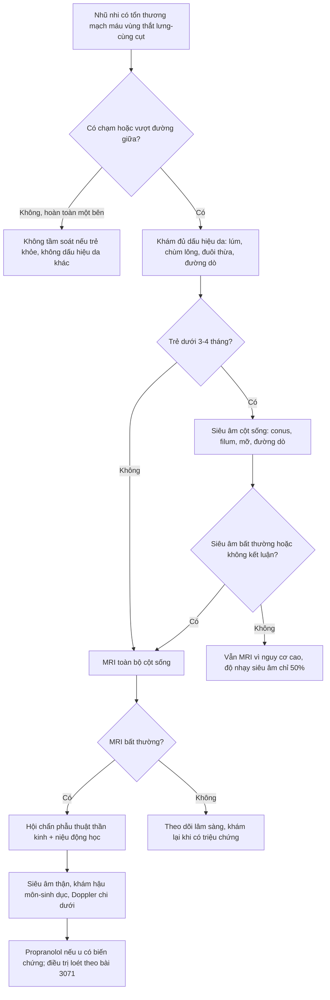
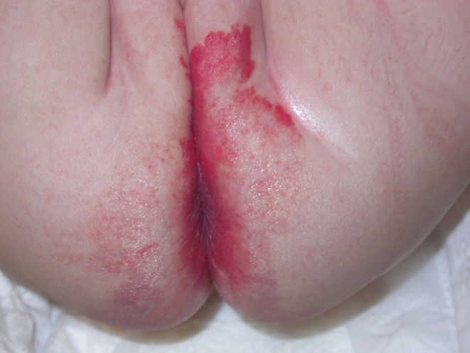
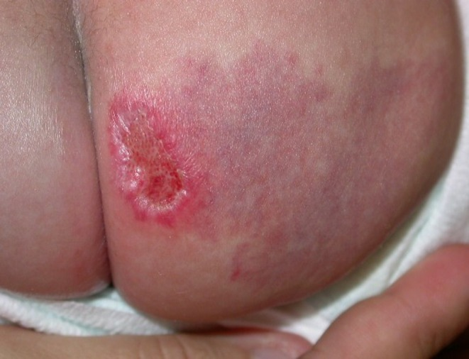
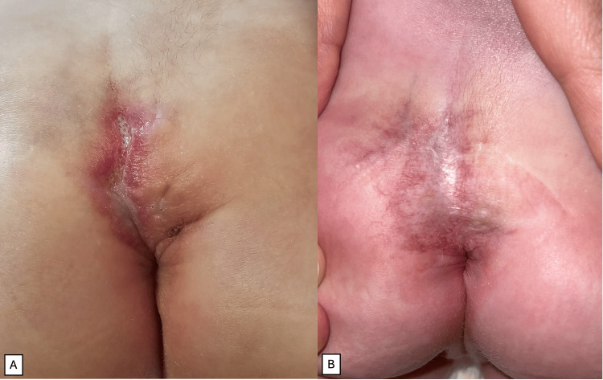
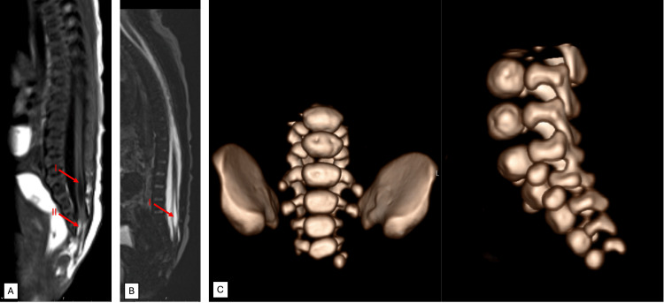

# 3073 — Hội chứng LUMBAR: u máu đường giữa thắt lưng–cùng cụt, khi nào siêu âm tủy và khi nào bắt buộc MRI

**Tags:** `pattern:u-mau-duong-giua` `pattern:di-tat-tuy` `pattern:tuy-neo` `vung:cot-song-cung-cut` `vung:da-lung-mong` `anatomy:tuy-song` `protocol:MRI-cot-song` `protocol:US-cot-song` `score:LUMBAR-Delphi`
**Mức chắc chắn (certainty):** tổng hợp y văn (literature synthesis) — ghép **nghiên cứu tiến cứu 41 trẻ u máu đường giữa thắt lưng–cùng cụt được MRI** (J Pediatr 2010, PMID 20828712), **phân tích 148 ca LUMBAR/91 ảnh đủ tiêu chuẩn** (Pediatr Dermatol 2026, PMC13423108), **đồng thuận Delphi 2024 về tiêu chuẩn chẩn đoán** (J Pediatr 2024, PMID 38759778), **đồng thuận quốc tế 2024 về chụp hình dị tật tủy** (AJNR 2024, PMID 38360788/PMC11288609), **ca nguyên văn LUMBAR** (Cureus 2025, PMC11970802) và **loạt 141 nhũ nhi có dấu hiệu da vùng thắt lưng–cùng cụt** (SAGE Open Med 2021, PMC8358506). Không có ca do nhóm tự chụp.

> **Câu hỏi thực hành:** bé gái **7 tuần**, mảng đỏ phẳng **vượt qua đường giữa** vùng cùng cụt–mông, từ lúc sinh, không loét; không yếu chi, đi tiêu tiểu bình thường. Bố mẹ hỏi: **"Có phải u máu không? Có cần chụp gì không? Siêu âm đã đủ chưa?"**
> Bài chốt **năm quyết định**: **(1) u máu vùng thắt lưng–cùng cụt ĐƯỜNG GIỮA là dấu hiệu da của dị tật tủy — 51,2% trẻ có u máu đường giữa được MRI đã có bất thường trong ống sống; (2) chỉ tổn thương ĐOẠN TÍNH VƯỢT ĐƯỜNG GIỮA mới mang nguy cơ — 91/91 ca LUMBAR đều vượt/áp đường giữa, không ca nào hoàn toàn một bên; (3) tổn thương hoàn toàn một bên, không chạm đường giữa KHÔNG cần tầm soát; (4) siêu âm tủy chỉ là bước sàng lọc — trong nhóm nguy cơ cao, độ nhạy chỉ 50%, nên MRI là tiêu chuẩn; (5) khám phải trọn bộ LUMBAR: thận–niệu, hậu môn–trực tràng, cột sống–tủy, mạch chi dưới.**

## 1. Tổng quan bệnh học – cơ chế hình ảnh: vì sao u máu da lại chỉ điểm dị tật tủy

- **Định nghĩa:** **LUMBAR** = **L**ower body hemangioma (u máu nửa dưới cơ thể) + các dị tật **U**rogenital (sinh dục–niệu), **U**lceration (loét), **M**yelopathy (bệnh tủy/dị tật tủy), **B**ony deformities (dị tật xương), **A**norectal malformations (dị tật hậu môn–trực tràng), **A**rterial anomalies (dị tật động mạch), **R**enal anomalies (dị tật thận). Đây là **bản thể "nửa dưới" của PHACE** (bài 3068/3071 đã nhắc).
- **Tiêu chuẩn chẩn đoán (đồng thuận Delphi 2024, 61 chuyên gia, đồng thuận ≥ 92% mỗi phát biểu):** cần **u máu nhũ nhi ĐOẠN TÍNH (segmental) hoặc có hình mẫu (patterned) ở vùng thắt lưng–cùng cụt, cùng cụt hoặc vùng chậu**, **cộng ít nhất 1 tiêu chuẩn** thuộc sinh dục–niệu, tủy sống, xương, hậu môn–trực tràng, động mạch hoặc thận (PMID 38759778).
- **TẠI SAO u da và dị tật tủy đi cùng nhau (giải thích bằng phôi thai, không phải "trùng hợp"):** da vùng thắt lưng–cùng cụt, tầng sinh môn và vùng chậu phát triển từ **notochord, trung bì cạnh trục (paraxial mesoderm) và màng nhớt (cloacal membrane)** — đều là **cấu trúc đường giữa**. Một **đột biến thể khảm (mosaic)** xảy ra sớm trong các dòng tế bào đường giữa sẽ tạo đồng thời **tăng sinh nội mô mạch ở da** và **khiếm khuyết đóng ống thần kinh/thân đốt**. Vì vậy tổn thương LUMBAR **luôn chạm đường giữa** (xem mục 5), còn PHACE — xuất phát từ **mào thần kinh và vùng chi phối mạch máu mặt** — có thể **khu trú một bên** (PMC13423108).
- **Tần suất dị tật tủy ẩn (occult spinal dysraphism, OSD):** **1–3/1.000** trẻ sinh sống theo đồng thuận chụp hình quốc tế (PMC11288609); loạt u–thần kinh báo **0,5–0,8/1.000** (PMC8358506). Dấu hiệu da vùng thắt lưng–cùng cụt gặp ở **51–100%** ca OSD — da là "cửa sổ" rẻ nhất để phát hiện.
- **Con số quyết định — nghiên cứu tiến cứu 41 trẻ:** tất cả trẻ có **u máu nhũ nhi ĐƯỜNG GIỮA vùng thắt lưng–cùng cụt** được chụp MRI tủy. **21/41 (51,2%)** có bất thường trong ống sống → **giá trị tiên đoán dương 51,2%**; **nguy cơ tương đối RR 640 (KTC 95%: 404–954)** so với trẻ không có u máu. Ở nhóm **u máu đơn độc, không kèm dấu hiệu da khác**, vẫn có **35% bất thường tủy, RR 438 (188–846)** (PMID 20828712).
- **Loét làm tăng nguy cơ:** trong cùng nghiên cứu, **u máu bị loét** và **có thêm dấu hiệu da khác** (lúm, chùm lông, mảng da, đuôi thừa) đi kèm **tỉ lệ bất thường tủy cao hơn** (PMID 20828712).
- **TẠI SAO siêu âm KHÔNG đủ để loại trừ:** siêu âm nhìn được tủy qua **sụn sau đốt sống chưa cốt hóa**, nên tốt ở nhũ nhi; nhưng trong đúng nhóm nguy cơ cao này, **độ nhạy chỉ 50% (18,7–81,3%)**, độ đặc hiệu **77,8% (40–97,2%)** (PMID 20828712). Nguyên nhân: **đếm sai đốt sống** (siêu âm không thấy toàn bộ trục), **cửa sổ bị hẹp khi trẻ quấy**, và **tổn thương kín đáo** (dò da, mỡ tủy nhỏ) không thay đổi đường viền ống sống.
- **TẠI SAO MRI là tiêu chuẩn:** MRI phân giải cao, thấy **vị trí conus, độ dày filum, mỡ trong ống sống, đường dò da, tủy treo, ống rỗng tủy (syringomyelia)** mà không cần cản quang, không bức xạ (PMC11288609).
- **Các loại dị tật hay gặp (20 ca u máu cùng cụt có dị tật, phân loại trên MRI):** **tủy treo (tethered cord) 60%**, **mỡ trong ống sống (spinal lipoma) 50%**, **u máu trong ống sống (intraspinal hemangioma) 45%**, **đường dò da (sinus tract) 40%** (Pediatr Radiol 2012, PMID 22138893).
- **Hình thái da đặc trưng — u máu nhũ nhi giảm/tạm dừng phát triển (IH-MAG):** nhiều ca LUMBAR không phải u máu "đỏ gồ" kinh điển mà là **mảng phẳng, giãn mạch mảnh, quanh có quầng nhạt**, có từ lúc sinh; **phần tăng sinh chỉ chiếm < 25% diện tích**; **ưa vùng nửa dưới** và **dễ loét** (PMC13423108). Vì phẳng nên rất dễ bị bỏ qua hoặc gọi nhầm là **bớt cá hồng (capillary malformation)**.

## 2. Mẫu hình + chẩn đoán phân biệt theo hình thái và vị trí (Gamut)

- **Theo HÌNH THÁI và QUAN HỆ VỚI ĐƯỜNG GIỮA (đây là điểm mới quyết định có chụp hay không):**
  - **Đoạn tính, vượt đường giữa (segmental, transmedian)** — **nguy cơ cao**: mảng lớn (thường **≥ 5 cm** khi còn nhũ nhi), hình địa lý, lan qua rãnh mông/đường giữa; **90/91 ca LUMBAR thuộc nhóm này**. → **Chụp MRI + siêu âm thận + khám hậu môn–sinh dục**.
  - **Đoạn tính một bên nhưng "áp" đường giữa (paramedian)** — **1/91 ca**; nguy cơ **thấp** nhưng chưa bằng 0 → **cân nhắc** dựa trên dấu hiệu da/triệu chứng khác.
  - **Hoàn toàn một bên, không chạm đường giữa (strictly lateral)** — **0/91 ca LUMBAR** → **không cần tầm soát** nếu trẻ khỏe, không có dấu hiệu da khác (PMC13423108).
  - **Bán đoạn tính (partial segmental), 3–5 cm, một bên** — nguy cơ **thấp**; không phải chỉ định tuyệt đối.
  - **Khu trú (localized) nhỏ, đường giữa** — vẫn **đáng lo** vì nghiên cứu tiến cứu tuyển theo **vị trí đường giữa**, không theo kích thước; khi có **thêm dấu hiệu da** thì nguy cơ càng cao.
- **Theo DẤU HIỆU DA ĐI KÈM (cộng thêm nguy cơ):** lúm cùng cụt (sacral dimple), **chùm lông (hypertrichosis)**, **đuôi thừa/mẩu da (skin tag)**, mảng da nhạt/mảng mỡ, **đường dò da (dermal sinus)**, **rãnh mông lệch/bất đối xứng**, **nứt đôi nếp mông**. Loạt 141 nhũ nhi: có **≥ 2 dấu hiệu da** thì siêu âm bất thường **53%** so với **21%** khi chỉ có 1 dấu hiệu (**p = 0,03**) (PMC8358506).
- **Chẩn đoán phân biệt của chính tổn thương da:**
  - **Bớt cá hồng (capillary malformation/port-wine stain):** đỏ phẳng từ lúc sinh, **không thoái triển**, không có pha tăng sinh; **không đáp ứng propranolol**; có thể gặp trong Sturge–Weber/Klippel–Trénaunay.
  - **Dị dạng tĩnh mạch (venous malformation):** mềm, xanh–tím, **giãn khi cúi đầu (Valsalva)**, đau khi đè; siêu âm **chậm dòng, có huyết khối trong lòng**.
  - **Bớt Mông Cổ (congenital dermal melanocytosis):** mảng xanh xám, **không đỏ, không ấm**, phẳng, vùng cùng cụt–mông; **không phải mạch máu**.
  - **U máu bẩm sinh (congenital hemangioma, RICH/NICH):** có **đủ lớn từ lúc sinh** (khác IH xuất hiện sau 1–2 tuần), **GLUT-1 âm**.
  - **U mỡ dưới da/ thoát vị mỡ (lipoma/lipomeningocele):** khối mềm, có thể thấy **khiếm khuyết cơ–cân** trên siêu âm.
  - **U mạch dạng Kaposi (KHE):** tím, cứng, **giảm tiểu cầu** — không thuộc LUMBAR nhưng là DDx của u mạch vùng cùng cụt.
- **Chẩn đoán phân biệt của HỘI CHỨNG (khi đã có dị tật tủy/xương):**
  - **Tam chứng Currarino:** **thiếu sản xương cùng + khối trước xương cùng (mỡ/teratoma) + dị tật hậu môn–trực tràng** — có thể **không có u máu da**; phân biệt bằng khối trước xương cùng trên MRI.
  - **VACTERL:** dị tật **đốt sống + hậu môn + tim + khí quản–thực quản + thận + chi**; không có u máu đường giữa đặc trưng.
  - **Thoái triển đuôi (caudal regression/sirenomelia):** thiếu sản xương cùng–cụt lan rộng, thường kèm **đái tháo đường mẹ**.
  - **PELVIS/SACRAL (tên cũ):** nay **gộp vào LUMBAR** — không dùng song song để tránh trùng lặp.

## 3. Bảng so sánh phân biệt (ma trận đối chiếu)

| Thực thể (entity) | Hình ảnh lâm sàng / chẩn đoán hình ảnh điển hình | Chốt vào (rule-in) | Chốt loại (rule-out) | Gợi ý xác nhận |
|---|---|---|---|---|
| **LUMBAR** | Mảng/u máu **đoạn tính đường giữa** vùng cùng cụt–mông, thường **IH-MAG phẳng**; kèm lúm/chùm lông/đuôi thừa | **Đoạn tính + vượt đường giữa + ≥ 1 dị tật trong LUMBAR** (Delphi 2024) | **Tổn thương hoàn toàn một bên, không chạm đường giữa** | MRI toàn bộ cột sống + siêu âm thận + khám hậu môn–sinh dục |
| **U máu đường giữa đơn độc (chưa có dị tật)** | U máu đoạn tính vượt đường giữa, trẻ khỏe | **MRI bất thường 35% dù đơn độc (RR 438)** | **Không chạm đường giữa + không dấu hiệu da khác** | MRI là bước quyết định, không dựa siêu âm |
| **Bớt cá hồng** | Đỏ phẳng từ sinh, **không mờ dần**, không ấm; không có mạch tăng sinh | **Không đáp ứng propranolol + ổn định nhiều năm** | **Có pha tăng sinh rồi thoái triển** → IH/IH-MAG | Theo dõi 3–6 tháng; Doppler |
| **Dị dạng tĩnh mạch** | Xanh–tím, mềm, **căng khi Valsalva**, có thể đau | **Chậm dòng + huyết khối trong lòng trên Doppler** | **Có mạch động mạch/tăng sinh** → u | MRI có cản quang |
| **Bớt Mông Cổ** | Xanh xám, phẳng, không đỏ/không ấm, vùng cùng cụt | **Màu xanh xám + không mạch** | **Đỏ + ấm + có mạch** → tổn thương mạch | Lâm sàng |
| **Currarino** | **Thiếu sản xương cùng + khối trước xương cùng + dị tật hậu môn** | **Đủ 3 thành tố trên MRI/CT** | **Không có khối trước xương cùng** | MRI chậu + CT xương cùng |
| **VACTERL** | Nhiều dị tật: đốt sống, hậu môn, tim, TQ–khí quản, thận, chi | **≥ 3 nhóm dị tật điển hình** | **U máu đường giữa đơn độc** | Siêu âm tim/thận, X-quang cột sống |
| **KHE (Kaposiform)** | Mảng tím cứng lan rộng, không thoái triển | **Tiểu cầu thấp + fibrinogen thấp + D-dimer cao** | **Tiểu cầu bình thường + đáp ứng propranolol** | CBC, đông máu, MRI |

- **Ảnh đối chiếu** dùng trong quiz: IH-MAG vượt đường giữa (PMC13423108-F1), tổn thương hoàn toàn một bên (PMC13423108-F3), u loét cùng cụt + MRI tủy treo (PMC11970802-F1/F2).

## 4. Protocol chẩn đoán – tầm soát – theo dõi

- **Bước 0 — khám da có hệ thống (mọi nhũ nhi):** lật trẻ nằm sấp, nhìn **toàn bộ đường giữa từ đỉnh đầu đến rãnh hậu môn**: u máu/mảng đỏ, lúm, chùm lông, đuôi thừa, mảng mỡ, đường dò, **đối xứng 2 nếp mông**. Ghi **kích thước 2 chiều (cm)**, **có vượt đường giữa không**, **có loét không**.
- **Bước 1 — quyết định có tầm soát:**
  - **CÓ** nếu: **u máu đoạn tính/hình mẫu chạm hoặc vượt đường giữa** ở thắt lưng–cùng cụt/cùng cụt/vùng chậu; **hoặc** có **≥ 1 dấu hiệu da nguy cơ** (chùm lông, đuôi thừa, đường dò, lúm > 5 mm hoặc > 2,5 cm từ rãnh hậu môn, mảng mỡ); **hoặc** có triệu chứng thần kinh–niệu (yếu chi, bàn chân khoèo, tiểu không tự chủ, táo bón mạn).
  - **KHÔNG** nếu: u **hoàn toàn một bên, không chạm đường giữa**, không có dấu hiệu da khác, trẻ khỏe (PMC13423108).
- **Bước 2 — siêu âm cột sống (bước sàng lọc, không phải chốt):**
  - **Cửa sổ tốt nhất: < 3–4 tháng tuổi**; sau đó **cung sau đốt sống cốt hóa** làm mất cửa sổ (PMC11288609).
  - Kỹ thuật: **cho bú rồi bọc ấm để trẻ ngủ**, nằm **sấp**, **đầu cao hơn chân** cho dịch lấp đầy khoang dưới nhện; đầu dò thẳng/linear tần số cao; khảo sát **từ T12 đến cùng cụt**, đếm đốt sống **từ xương sườn 12 hoặc từ S5**.
  - Đo: **vị trí conus** (bình thường **≥ đĩa L2–L3**, tức ngang hoặc trên đĩa L2–L3), **độ dày filum**, mỡ trong ống sống, đường dò, khối trong ống sống.
  - **Siêu âm bình thường KHÔNG loại trừ** ở nhóm nguy cơ cao (**độ nhạy 50%**).
- **Bước 3 — MRI toàn bộ cột sống (tiêu chuẩn vàng):**
  - Chỉ định: **mọi u máu đường giữa vùng thắt lưng–cùng cụt** (kể cả siêu âm bình thường), mọi ca siêu âm nghi ngờ, và mọi ca > 3–4 tháng tuổi cần đánh giá.
  - Kỹ thuật (đồng thuận quốc tế): **T1W và T2W TSE sagittal toàn trục, KHÔNG xóa mỡ** (để thấy mỡ tủy), **một chuỗi coronal T2 STIR/Dixon xóa mỡ toàn trục**, **axial T1W ≤ 3 mm** qua vùng conus–filum và vùng nghi ngờ; **không cần gadolinium thường quy**; trẻ nhỏ **feed-and-swaddle** để tránh an thần (PMC11288609).
  - Cần trả lời 6 câu: **(1) conus ở đâu? (2) filum dày > 2 mm? (3) có mỡ trong ống sống? (4) có tủy treo? (5) có ống rỗng tủy? (6) có đường dò da/bất thường thân đốt?**
- **Bước 4 — tầm soát phần còn lại của LUMBAR:**
  - **Siêu âm thận–đường niệu + bàng quang** (dị tật thận, ứ nước, bàng quang thần kinh).
  - **Khám hậu môn–trực tràng**, hỏi phân su, táo bón; cân nhắc **MRI chậu** nếu nghi.
  - **Siêu âm tim** nếu u lớn/đoạn tính rộng (suy tim do shunt) và **Doppler động mạch chi dưới** nếu chi lạnh/khác biệt mạch.
  - **X-quang/CT 3D xương cùng** khi nghi thiếu sản xương cùng.
- **Bước 5 — điều trị và theo dõi:**
  - **U máu có biến chứng/nguy cơ:** **propranolol 1 → 2–3 mg/kg/ngày** (bài 3069), theo dõi như mọi ca; **loét** xử trí theo bài 3071.
  - **Tủy treo (tethered cord):** hội chẩn **phẫu thuật thần kinh**; mổ **giải phóng tủy** khi có triệu chứng hoặc theo kế hoạch ở trẻ còn không triệu chứng (ca nguyên văn: mổ dự kiến **2 tuổi**) — không tự quyết trong bài này.
  - **Theo dõi:** khám thần kinh + **niệu động học (urodynamics)** khi có bất thường; theo dõi **dậy thì** (tủy treo có thể biểu hiện muộn khi cột sống dài nhanh).
- **Sơ đồ quyết định:**

## 5. Biến thể bình thường và cạm bẫy

- **Cạm bẫy số 1 — "siêu âm bình thường là yên tâm":** trong nhóm nguy cơ cao, **độ nhạy chỉ 50%**; **35% trẻ u máu đường giữa đơn độc vẫn có bất thường tủy**. Siêu âm bình thường **không thay thế MRI** (PMID 20828712).
- **Cạm bẫy số 2 — "u nhỏ/phẳng thì lành":** LUMBAR hay biểu hiện bằng **IH-MAG phẳng**, tăng sinh **< 25%** diện tích; bỏ qua vì "chỉ là mảng đỏ" là bỏ sót tủy treo (PMC13423108).
- **Cạm bẫy số 3 — quy kết mọi u máu một bên:** tổn thương **hoàn toàn một bên, không chạm đường giữa** không thuộc nhóm nguy cơ; tầm soát tràn lan gây **MRI/an thần không cần thiết**.
- **Cạm bẫy số 4 — nhầm IH-MAG với bớt cá hồng:** bớt cá hồng **không thoái triển, không đáp ứng propranolol**; nhưng **cũng có thể kèm dị tật** (Sturge–Weber) — phân biệt bằng bối cảnh, không bằng màu đỏ.
- **Cạm bẫy số 5 — đếm sai đốt sống trên siêu âm:** siêu âm coi đốt "giống thắt lưng" thấp nhất là L5 → **gọi nhầm conus thấp là bình thường** hoặc ngược lại; luôn đếm **từ T12/S5** hoặc đối chiếu **phim nghiêng có đánh dấu** (PMC11288609).
- **Cạm bẫy số 6 — chờ sau 6 tháng mới chụp:** cửa sổ siêu âm mất từ **3–4 tháng**; trì hoãn vừa mất siêu âm vừa **trì hoãn chẩn đoán tủy treo**.
- **Cạm bẫy số 7 — chỉ nhìn da:** LUMBAR là bệnh **đa hệ**; thiếu **siêu âm thận**, **khám hậu môn–sinh dục**, **đo huyết áp/động mạch chi** là bỏ phần lớn tiêu chuẩn chẩn đoán.
- **Cạm bẫy số 8 — loét cùng cụt chậm lành:** vùng cùng cụt ẩm, nhiễm phân; **loét ở u vùng này là yếu tố nguy cơ dị tật tủy cao hơn** và dễ nhiễm — xử trí theo bài 3071, không chờ.
- **Cạm bẫy số 9 — bỏ theo dõi sau nhũ nhi:** tủy treo **không triệu chứng** có thể biểu hiện khi trẻ **tăng trưởng nhanh/dậy thì**; hẹn khám lại có kế hoạch, ghi rõ trong hồ sơ.
- **Cạm bẫy số 10 — nhầm Currarino:** thiếu sản xương cùng + khối trước xương cùng + dị tật hậu môn, **có thể không có u máu**; nếu chỉ tìm u máu da sẽ bỏ sót.

## 6. Tự lượng giá — Blind Quiz ngay trên trang tĩnh

**Ca 1 — Mảng đỏ phẳng vượt đường giữa**

- Gợi ý lâm sàng: bé gái **6 tuần**, mảng đỏ phẳng từ lúc sinh, **vượt qua đường giữa** sang cả hai mông; không loét, không yếu chi.
- Câu hỏi: Đây là loại tổn thương gì? Có cần chụp không? Chụp gì trước, gì sau?

<b>Bấm để hiện đáp án (findings + chẩn đoán)</b>

- Dấu hiệu: **IH-MAG đoạn tính, vượt đường giữa (transmedian)** — mảng giãn mạch mảnh, không gồ, đúng vùng chi phối đường giữa.
- Chẩn đoán: **nghi LUMBAR** — cần **MRI toàn bộ cột sống** (siêu âm chỉ là sàng lọc, độ nhạy 50% ở nhóm này) + **siêu âm thận** + khám hậu môn–sinh dục.
- Vì sao: **91/91 ca LUMBAR có tổn thương chạm/vượt đường giữa**; **51,2%** trẻ u máu đường giữa được MRI có bất thường trong ống sống.
- Nguồn ảnh: Pediatr Dermatol 2026, PMCID PMC13423108, Figure 1 — CC BY 4.0.

**Ca 2 — Cũng là mảng đỏ, nhưng hoàn toàn một bên**

- Gợi ý lâm sàng: bé **5 tuần**, mảng đỏ phẳng ở **mông phải**, có **ổ loét nhỏ**, **không vượt đường giữa**; khám thần kinh, hậu môn–sinh dục bình thường.
- Câu hỏi: Có chỉ định MRI tủy không? Vì sao khác Ca 1? Cần làm gì cho ổ loét?

<b>Bấm để hiện đáp án (findings + chẩn đoán)</b>

- Dấu hiệu: tổn thương **đoạn tính nhưng hoàn toàn một bên (strictly lateral)**, không chạm đường giữa.
- Chẩn đoán: **không thuộc nhóm nguy cơ LUMBAR** — trong 91 ca LUMBAR không có ca nào hoàn toàn một bên; **không cần tầm soát tủy** nếu trẻ khỏe và không có dấu hiệu da khác.
- Xử trí: chăm sóc ổ loét (bài 3071), theo dõi tái phát (bài 3072).
- Nguồn ảnh: Pediatr Dermatol 2026, PMCID PMC13423108, Figure 3 — CC BY 4.0.

**Ca 3 — U loét cùng cụt + tủy treo**

- Gợi ý lâm sàng: bé gái **đủ tháng**, từ lúc sinh có mảng đỏ **3 cm** vùng cùng cụt lan vào rãnh mông, **loét trung tâm**; không yếu chi, đi tiêu tiểu bình thường.
- Câu hỏi: Vì sao phải chụp MRI dù trẻ **hoàn toàn không triệu chứng**? Cần khám/tầm soát thêm gì?

<b>Bấm để hiện đáp án (findings + chẩn đoán)</b>

- Dấu hiệu: (A) mảng đỏ **đoạn tính vượt đường giữa** + loét trung tâm; (B) sau **10 tuần propranolol** ổ loét **liền biểu mô**, mảng đỏ tồn tại (u đang thoái triển).
- Chẩn đoán: **LUMBAR** — MRI xác định **tủy treo (conus dưới L1–L2), mỡ trong ống sống, ống rỗng tủy, thiếu sản một phần S5**. Trẻ **không triệu chứng vẫn có dị tật** — đây là lý do MRI **không phụ thuộc triệu chứng**.
- Điều trị: **propranolol 1 → 2 mg/kg/ngày** (bắt đầu 5 tuần 5 ngày), mổ giải phóng tủy **dự kiến 2 tuổi**; tầm soát thận–niệu và hậu môn âm tính.
- Nguồn ảnh: Cureus 2025, PMCID PMC11970802, Figure 1 — CC BY 4.0.

**Ca 4 — Đọc MRI: 6 câu hỏi bắt buộc**

- Gợi ý lâm sàng: cùng bệnh nhi Ca 3.
- Câu hỏi: Trả lời 6 câu: conus ở đâu? filum? mỡ trong ống sống? tủy treo? ống rỗng tủy? bất thường xương?

<b>Bấm để hiện đáp án (findings + chẩn đoán)</b>

- Dấu hiệu: (A) **conus xuống dưới L1–L2** = tủy treo; **(I)** ống rỗng tủy (syringohydromyelia); **(II)** **mỡ cuối tủy liên tục với mỡ dưới da** (lipoma); (C) **thiếu sản một phần S5 và cụt**.
- Chẩn đoán: **dị tật tủy kín (closed spinal dysraphism) trong LUMBAR** — tủy treo + mỡ trong ống sống + ống rỗng tủy + thiếu sản xương cùng.
- Bài học: MRI **trả lời được cùng lúc 6 câu**; **không cần cản quang**; đây là lý do MRI là tiêu chuẩn, không phải siêu âm.
- Nguồn ảnh: Cureus 2025, PMCID PMC11970802, Figure 2 — CC BY 4.0.

## Bài liên quan chéo
- [3071 – U máu nhũ nhi loét: propranolol + timolol + laser, sẹo về sau](../3071-u-mau-nhu-nhi-loet/lesson.md)
- [3072 – Tái phát u máu nhũ nhi sau ngừng propranolol](../3072-tai-phat-u-mau-nhu-nhi-sau-ngung-propranolol/lesson.md)
- [3069 – An toàn propranolol ở nhũ nhi: liều đầu, theo dõi, ngừng thuốc](../3069-an-toan-propranolol-o-nhu-nhi/lesson.md)
- [3005 – U máu dưới thanh môn ở nhũ nhi](../3005-u-mau-duoi-thanh-mon-nhu-nhi/lesson.md)
- [3048 – U máu gan ở nhũ nhi](../3048-u-mau-gan-o-nhu-nhi/lesson.md)
- [202 – Quy tắc chụp cột sống cấp cứu (NEXUS Canada)](../202-quy-tac-chup-cot-song-co-cap-cuu-nexus-canadian/lesson.md)

> Không dùng để chẩn đoán độc lập khi chưa có người hướng dẫn.
