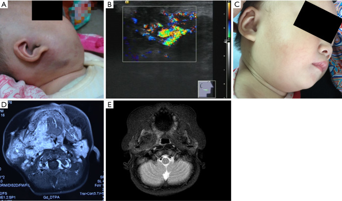
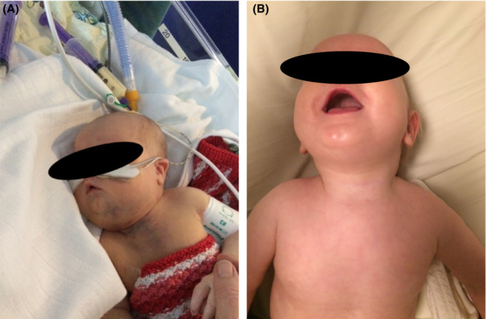
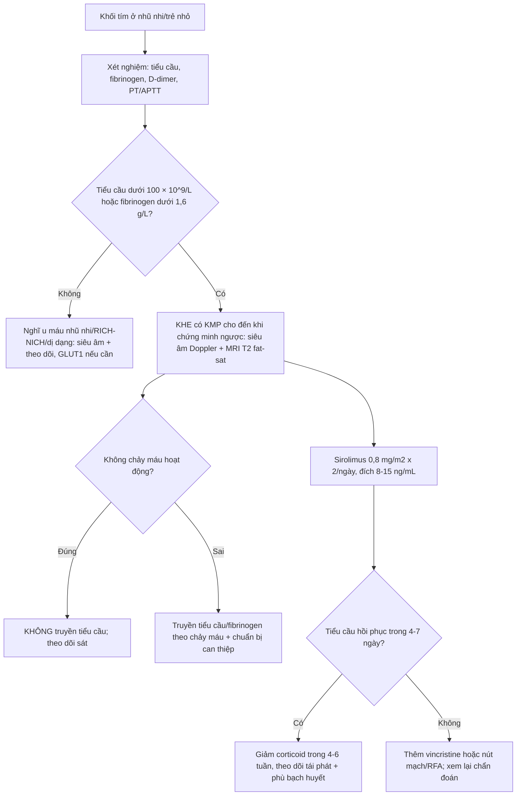
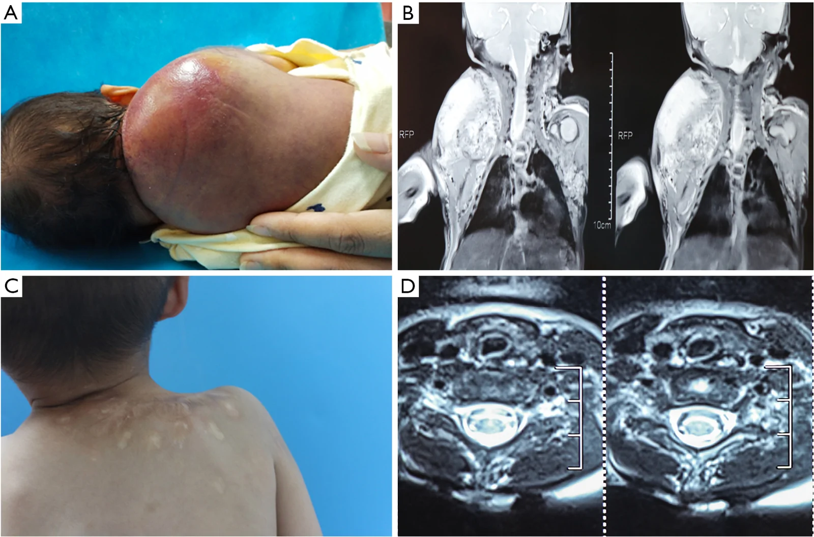

# 3074 — U mạch dạng Kaposi (KHE) & hội chứng Kasabach–Merritt: khối tím lan sâu + tiểu cầu tụt — vì sao truyền tiểu cầu là sai

**Tags:** `pattern:u-mach` `pattern:khoi-xam-lan` `pattern:giam-tieu-cau-tieu-thu` `pattern:roi-loan-dong-mau` `pattern:ngam-thuoc-khong-deu` `vung:da-mo-mem` `vung:co` `vung:trung-that` `protocol:MRI-T2-fatsat` `protocol:sieu-am-Doppler` `protocol:sinh-thiet` `score:sirolimus-trough` `score:CTCAE`
**Mức chắc chắn (certainty):** tổng hợp y văn (literature synthesis) — ghép **tổng quan chẩn đoán – điều trị KHE** (Pediatr Investig 2026, PMC13291430), **đường lối VASCERN-VASCA** (Eur J Pediatr 2026, PMC12701870), **loạt 9 nhũ nhi KHE–KMP điều trị corticoid → sirolimus** (Transl Pediatr 2025, PMC12552173), **ca KHE trung thất có KMP + tràn dịch màng tim** (Clin Case Rep 2023, PMC10500048) và **loạt 35 trẻ KMP điều trị RFA** (Transl Pediatr 2026, PMC13559082). Không có ca do nhóm tự chụp.

> **Câu hỏi thực hành:** bé gái **2 tháng**, khối **tím–đỏ, chắc, bờ không rõ** vùng mặt bên phải, da trên khối căng bóng; xét nghiệm **tiểu cầu 46 × 10⁹/L**; siêu âm thấy khối **giảm âm không đều, mạch máu rất phong phú**; MRI T2 fat-sat thấy khối **tăng tín hiệu lan vào cơ**. Đây là **u máu nhũ nhi** (theo dõi/propranolol) hay **KHE có KMP** (cấp cứu huyết học)?
> Bài chốt **ba quyết định**: **(1) khối mạch máu + tiểu cầu tụt + fibrinogen thấp = KHE/KMP cho đến khi chứng minh ngược — không phải "u máu to"; (2) KHÔNG truyền tiểu cầu theo con số, chỉ khi chảy máu hoạt động/cần mổ — truyền làm u to và tiểu cầu tụt sâu hơn; (3) sirolimus là điều trị bậc một, corticoid dùng ngắn để kiểm soát nhanh, propranolol không đủ khi có KMP.** Nối [3048 – U máu gan ở nhũ nhi](../3048-u-mau-gan-o-nhu-nhi/lesson.md), [3052 – U mạch máu gan bẩm sinh RICH/NICH](../3052-u-mach-mau-gan-bam-sinh-rich-nich-o-tre/lesson.md), [1808 – Sirolimus ở dị dạng bạch huyết](../1808-sirolymus-di-dang-bach-huyet-theo-doi-ngung-thuoc/lesson.md).

## 1. Tổng quan bệnh học – cơ chế hình ảnh: vì sao khối tím này "ăn" tiểu cầu

- **Bản chất:** KHE (kaposiform hemangioendothelioma) là **u mạch máu thể biên (borderline)** theo ISSVA, chiếm **~2%** các u mạch máu; **~50%** có từ lúc sinh, đa số xuất hiện trong năm đầu (PMC13291430). Mô học: tế bào nội mô hình thoi xếp thành khe hẹp, **xen kẽ mô xơ hyalin dày**, có thể có vi huyết khối và hemosiderin; miễn dịch: **CD31/CD34 dương**, **PROX1/D2-40/LYVE-1 dương từng ổ** (yếu tố bạch huyết), **GLUT1 âm** và **HHV8 âm** — hai dấu âm này là chốt để loại **u máu nhũ nhi** và **Kaposi sarcoma** (PMC13291430).
- **Vì sao có KMP:** mạng mạch bất thường trong u **giữ và hoạt hóa tiểu cầu**, tạo huyết khối vi mạch tại chỗ → **giảm tiểu cầu tiêu thụ**, tiêu hao fibrinogen, tăng D-dimer; khác **DIC** ở chỗ **PT/APTT thường bình thường hoặc chỉ kéo dài nhẹ** (PMC13291430). Đây là lý do **truyền tiểu cầu không nâng được số tiểu cầu bền** mà còn **làm u to nhanh** do tiểu cầu giải phóng yếu tố sinh mạch tại u.
- **TẠI SAO MRI có hình ảnh đó:**
  - **T2 tăng không đồng nhất** vì u gồm **khoang mạch máu + phù + mô bạch huyết**; các **ổ T2 thấp lấm tấm** là **hemosiderin và xơ hyalin** (không phải canxi).
  - **T1 đồng–giảm tín hiệu**, ngấm thuốc **lan tỏa, không đều** do mạch tân sinh xoắn vặn.
  - **Trống tín hiệu (signal voids)** trong u = **mạch tốc độ cao**, hay gặp hơn khi có KMP.
  - **Xâm lấn nhiều mặt phẳng** (da → mô dưới da → cơ → xương) và **dày da/phù dây mô mỡ quanh u** là dấu của thâm nhiễm + rối loạn bạch huyết tại chỗ.
- **Ngưỡng định lượng phải thuộc:**

| Biến số | Số liệu | Nguồn |
|---|---|---|
| Dịch tễ | **0,071/100.000** trẻ/năm; **0,91/100.000** hiện mắc; **~50%** bẩm sinh; thể **hỗn hợp ~60%** | PMC13291430 |
| KMP | **~40%** ca KHE; yếu tố nguy cơ: **khởi phát ≤ 1 tháng, u ≥ 6 cm, vị trí sâu/không ở chi** | PMC13291430 |
| Tử vong | KHE **10–30%** (lịch sử); KMP không điều trị **20–30%** | PMC13291430 |
| Xét nghiệm KMP | Tiểu cầu **< 30.000 – 100.000/mm³** (ngưỡng thay đổi giữa các nguồn); **fibrinogen < 1,6 g/L**; **D-dimer > 0,5 µg/mL**; PT/APTT bình thường hoặc kéo dài nhẹ | PMC13291430 |
| Siêu âm | Khối **giảm âm hỗn hợp, bờ không rõ**, mạch phong phú, **"branch-shape" trên Doppler 3D**; **tới 40%** xâm lấn cơ | PMC13291430 |
| Điều trị | Sirolimus đáp ứng **> 90%**, xét nghiệm máu cải thiện sau **4–7 ngày**; corticoid đơn thuần **30–50%**; vincristine **60–80%**, khởi phát chậm **4–5 tuần**, tái phát **10–20%** | PMC13291430 |
| Di chứng | Phù bạch huyết mạn **~10%** (u ≥ 10 cm, thể hỗn hợp, ở chi); hạn chế vận động **~70%** khi có phá xương trong 2 năm | PMC13291430 |

## 2. Mẫu hình + chẩn đoán phân biệt theo độ sâu và tuổi (gamut)

- **Theo độ sâu (phân loại lâm sàng):** **thể nông** — chỉ da/mô dưới da, mảng tím chắc, đau; **thể hỗn hợp** — nông + sâu, **~60%** ca; **thể sâu** — chỉ trong cơ/xương/khoang cơ thể, **không có tổn thương da** → dễ chẩn đoán muộn (PMC13291430).
- **Theo vị trí:** chi (hay nhất) → thân mình → đầu cổ; thể sâu: sau phúc mạc, trung thất, gan–lách, đường tiêu hóa, xương.
- **Gamut "khối tím ở nhũ nhi/trẻ nhỏ":**
  - **U máu nhũ nhi (infantile hemangioma):** GLUT1 **dương**, xuất hiện sau sinh vài tuần, **thoái triển**; **không gây KMP**.
  - **U mạch máu bẩm sinh (RICH/NICH):** có từ lúc sinh, GLUT1 âm; RICH thoái triển nhanh, NICH không; **không gây KMP** (khác KHE).
  - **U mạch dạng chùm (tufted angioma):** cùng phổ với KHE, **cũng gây KMP**, mô học "tuft" trong mô mỡ.
  - **Kaposi sarcoma:** HHV8 **dương**, bối cảnh suy giảm miễn dịch.
  - **Dị dạng bạch huyết (lymphatic malformation):** nang nhiều thùy, dịch, **ngấm thuốc rất ít**, không đặc.
  - **Dị dạng tĩnh mạch:** tăng tín hiệu T2, **ngấm thuốc từ từ**, có **sỏi tĩnh mạch** (tròn, trống tín hiệu).
  - **Rhabdomyosarcoma / sarcoma mô mềm:** khối đặc, xâm lấn, **không giảm tiểu cầu kiểu tiêu thụ**.
- **Ba câu hỏi chốt:** **(1) tiểu cầu/fibrinogen/D-dimer thế nào? (2) GLUT1 và HHV8 ra sao (nếu có mô học)? (3) khối có thoái triển tự nhiên không?**

## 3. Bảng so sánh phân biệt (ma trận đối chiếu)

| Thực thể (entity) | Hình ảnh điển hình (US/MRI) | Chốt vào (rule-in) | Chốt loại (rule-out) | Gợi ý xác nhận |
|---|---|---|---|---|
| **KHE có KMP** | Khối **bờ không rõ, thâm nhiễm nhiều lớp**, T2 tăng không đều + ổ T2 thấp (hemosiderin/xơ), ngấm thuốc lan tỏa, **trống tín hiệu mạch tốc độ cao** | **Khối mạch máu + tiểu cầu < 100 × 10⁹/L + fibrinogen < 1,6 g/L + D-dimer > 0,5 µg/mL** | **Tiểu cầu và fibrinogen bình thường + khối thoái triển** → không phải KMP | Labs + MRI; sinh thiết **chỉ khi không điển hình và không đang rối loạn đông** |
| **U máu nhũ nhi** | Khối nông, bờ rõ hơn, **GIẢM dần sau 12–18 tháng**, không xâm lấn cơ | **GLUT1 dương + xuất hiện sau sinh + thoái triển** | **GLUT1 âm + xâm lấn cơ + tiểu cầu tụt** → KHE | Lâm sàng theo dõi; GLUT1 nếu cần |
| **U mạch máu bẩm sinh (RICH/NICH)** | Có từ lúc sinh, GLUT1 âm; RICH giảm nhanh, NICH đứng yên | **Có từ lúc sinh + GLUT1 âm + không giảm tiểu cầu** | **Giảm tiểu cầu tiêu thụ** → KHE/KMP | Theo dõi thể tích; GLUT1 |
| **Tufted angioma** | Mảng tím nông, chắc; có thể cùng KMP | **Mô học "tuft" + KMP** | **Khối sâu xâm lấn cơ** → nghi KHE | Sinh thiết (khi an toàn) |
| **Kaposi sarcoma** | Nốt/mảng tím ở da, niêm mạc; có thể lan tạng | **HHV8 dương + bối cảnh suy giảm miễn dịch** | **HHV8 âm + trẻ nhỏ** → loại | HHV8, mô học |
| **Dị dạng bạch huyết** | Nang nhiều thùy, T2 rất cao, **vách mỏng**, ngấm thuốc tối thiểu | **Cấu trúc nang + không ngấm thuốc đặc** | **Thành phần đặc ngấm thuốc + giảm tiểu cầu** → KHE | MRI T2; không cần sinh thiết |
| **Dị dạng tĩnh mạch** | T2 cao, **ngấm thuốc từ từ**, **sỏi tĩnh mạch** | **Sỏi tĩnh mạch + ngấm thuốc muộn** | **Không có sỏi + xâm lấn cơ + KMP** → KHE | MRI có thuốc; X-quang/CT tìm sỏi |

*Transl Pediatr 2025 (PMC12552173), CC BY-NC-ND 4.0: **(A)** khối chắc vùng hàm mặt phải, da tím–đỏ, bờ không rõ; **(B)** siêu âm Doppler màu — khối giảm âm không đều, **mạch máu rất phong phú**; **(C)** sau điều trị; **(D)** MRI T2 fat-sat trục — khối **tăng tín hiệu, lan rộng nhiều lớp**; **(E)** T1 trục. Hình ảnh khớp với tiểu cầu **46 × 10⁹/L** lúc vào. Ảnh nguyên bản, không chỉnh sửa.*

*Clin Case Rep 2023 (PMC10500048), CC BY 4.0: **(A)** 1 tuần tuổi, đỉnh KMP — phù, da tím, khối chắc vùng cổ; **(B)** sau 1 năm sirolimus + prednisolone, tổn thương da hết. Ca này minh họa **KHE tạng sâu (trung thất)** không thấy rõ bằng mắt thường nhưng vẫn gây KMP nặng.*

## 4. Protocol chụp + xử trí theo ngưỡng

- **Xét nghiệm trước hình ảnh (bắt buộc, vì đây là bệnh huyết học):** công thức máu + tiểu cầu, **fibrinogen**, **D-dimer**, PT/APTT, nhóm máu; nếu tiểu cầu thấp: đánh giá chảy máu hoạt động, không truyền dự phòng theo con số.
- **Chẩn đoán hình ảnh:**
  - **Siêu âm Doppler (đầu tay):** khối **giảm âm hỗn hợp, bờ không rõ**, mạch phong phú, **"branch-shape"** trên Doppler 3D, độ cứng tăng trên elastography; đánh giá **xâm lấn cơ** (tới 40%) và theo dõi đáp ứng.
  - **MRI (chuẩn để đánh giá toàn bộ u):** T1, **T2 fat-sat**, sau gadolinium, ± MRA. Đo **3 chiều**, ghi độ sâu (da/mô dưới da/cơ/xương), tìm **ổ T2 thấp** (hemosiderin/xơ) và **trống tín hiệu** (mạch tốc độ cao), dày da/phù quanh u.
  - **CT:** khi nghi **phá xương** hoặc cần đánh giá tạng; **FDG-PET/CT** hỗ trợ hoạt tính bệnh trong ca phức tạp.
  - **Sinh thiết:** tiêu chuẩn vàng mô học nhưng **nguy cơ cao khi đang rối loạn đông** → **không thường quy**; chẩn đoán KMP dựa vào lâm sàng + xét nghiệm + hình ảnh.
- **Điều trị (theo bậc):**
  - **Sirolimus — bậc một:** **0,8 mg/m² uống 2 lần/ngày**, nồng độ đáy **8–15 ng/mL** (nhũ nhi **2–6 ng/mL** vì men CYP3A4 mới đạt 30–40% người lớn lúc sinh); đáp ứng **> 90%**, tiểu cầu cải thiện sau **4–7 ngày**.
  - **Corticoid — kiểm soát nhanh, dùng ngắn:** **prednisolone 2 mg/kg/ngày** hoặc **methylprednisolone TM 1,6 mg/kg/ngày**; giảm/ngừng trong **4–6 tuần** sau khi tiểu cầu **≥ 100 × 10⁹/L**.
  - **Vincristine:** **0,05 mg/kg/tuần × 4 tuần**, sau đó **hàng tháng × 6** (trẻ > 10 kg: **1,5 mg/m²**); đáp ứng **60–80%** nhưng **chậm 4–5 tuần**.
  - **Propranolol:** đáp ứng **80%** với liều cao **2 mg/kg/ngày** (so với **50%** ở 1,5 mg/kg/ngày) nhưng **kém hiệu quả khi có KMP**; u không có GLUT1 nên cơ chế đích không rõ.
  - **Can thiệp:** **nút mạch (TAE)** chỉ là biện pháp **tạm thời/cứu nguy** hoặc chuẩn bị mổ, tiểu cầu cải thiện **4–10 ngày**; **RFA** là lựa chọn ở trung tâm có kinh nghiệm (loạt 35 trẻ: tiểu cầu trung vị **26 → 277 × 10⁹/L** sau RFA); **phẫu thuật cắt hoàn toàn** hiếm khả thi, cắt không hết **tái phát ~15%**.
- **Nguyên tắc truyền máu:** **không truyền tiểu cầu** khi chỉ giảm tiểu cầu đơn thuần; chỉ truyền khi **chảy máu hoạt động** hoặc **chuẩn bị thủ thuật**; bù fibrinogen khi **< 2 g/L** (một số nguồn dùng ngưỡng này trong giai đoạn chu phẫu).

## 5. Biến thể bình thường và cạm bẫy

- **Bẫy 1 — gọi là "u máu" rồi theo dõi:** KHE **không thoái triển tự nhiên**; chờ đợi trong khi có KMP làm tăng tử vong. Dấu phân biệt rẻ nhất: **đếm tiểu cầu + fibrinogen** ngay lần khám đầu.
- **Bẫy 2 — truyền tiểu cầu "cho an toàn":** ca trung thất đã ghi nhận **truyền tiểu cầu → u to lên, tiểu cầu đáy 5 × 10⁹/L** (PMC10500048). Truyền tiểu cầu dự phòng **không** nâng được tiểu cầu bền và có thể **thúc đẩy u phát triển**.
- **Bẫy 3 — chẩn đoán KMP là DIC/nhiễm khuẩn huyết:** KMP có **PT/APTT gần bình thường**, chỉ giảm tiểu cầu + fibrinogen thấp + D-dimer cao; cấy máu âm, không có ổ nhiễm. Điều trị là **chống u**, không phải kháng sinh.
- **Bẫy 4 — sinh thiết khi đang chảy máu:** sinh thiết trong pha rối loạn đông có thể gây chảy máu không cầm; **không cần** nếu lâm sàng + xét nghiệm + hình ảnh điển hình.
- **Bẫy 5 — thể sâu không có tổn thương da:** KHE sau phúc mạc/trung thất biểu hiện bằng **chèn ép, đau, thiếu máu, giảm tiểu cầu**; không có "khối tím" để nhìn → dễ bỏ sót. Ở trẻ có KMP không rõ nguyên nhân, **MRI ngực–bụng** là bước tiếp theo.
- **Bẫy 6 — "hội chứng Kasabach–Merritt" bị dùng cho u máu gan khổng lồ:** KMP là thực thể **đặc hiệu của KHE/tufted angioma**; u máu gan khổng lồ ở người lớn có giảm tiểu cầu do bắt giữ trong u nhưng **không phải KMP** — điều trị và tiên lượng khác.
- **Bẫy 7 — ổ T2 thấp bị đọc là canxi:** đó là **hemosiderin/xơ**; CT không thấy canxi tương ứng. Đừng vì "có canxi" mà nghĩ u khác.
- **Cạm bẫy hình học:** khối ở chi dễ bị đọc nhỏ hơn thực tế trên siêu âm vì chỉ thấy phần nông; **MRI mới đo được độ sâu và xâm lấn cơ**, cần cho kế hoạch điều trị và theo dõi thể tích.

## 6. Tự lượng giá — Blind Quiz

**Ca 1 — Bé 2 tháng, khối tím vùng mặt, tiểu cầu 46 × 10⁹/L.**

- Gợi ý lâm sàng: khối chắc, da tím–đỏ, bờ không rõ, vùng hàm mặt phải; tiểu cầu **46 × 10⁹/L**; không sốt.
- Câu hỏi: (B) và (D) cho thấy đặc điểm gì của u? Vì sao không được truyền tiểu cầu dự phòng? Ba chẩn đoán phân biệt?

<b>Bấm để hiện đáp án</b>

- Dấu hiệu (findings): **(B)** siêu âm Doppler màu — khối giảm âm không đều, **mạch máu phong phú**; **(D)** MRI T2 fat-sat — khối **tăng tín hiệu, thâm nhiễm nhiều lớp**, không có bờ rõ.
- Chẩn đoán (diagnosis): **KHE có KMP** (tiểu cầu 46 × 10⁹/L).
- Phân biệt: **u máu nhũ nhi** (GLUT1 dương, thoái triển, không giảm tiểu cầu), **RICH/NICH** (có từ lúc sinh, GLUT1 âm), **dị dạng bạch huyết** (nang, ngấm thuốc ít).
- Điều trị: **methylprednisolone TM** để kiểm soát nhanh (ca này tiểu cầu lên **156 × 10⁹/L trong 4 ngày**), sau đó **sirolimus** duy trì; **không truyền tiểu cầu** khi không chảy máu.
- Nguồn ảnh: Transl Pediatr 2025 (PMC12552173), CC BY-NC-ND 4.0.

**Ca 2 — Nhũ nhi 1 tuần tuổi, khối cổ, phù và tím da, suy hô hấp nhẹ.**

- Gợi ý lâm sàng: tiểu cầu **26 × 10⁹/L** lúc sinh, giảm dần; fibrinogen giảm từ ngày 2; tràn dịch màng tim xuất hiện trong quá trình điều trị.
- Câu hỏi: Vì sao khối ở trung thất lại nguy hiểm hơn khối ở da? Truyền tiểu cầu trong ca này gây hậu quả gì?

<b>Bấm để hiện đáp án</b>

- Dấu hiệu (findings): **(A)** phù, da tím, khối chắc vùng cổ–ngực trên ở trẻ 1 tuần tuổi; **(B)** sau 1 năm điều trị, tổn thương da hết.
- Chẩn đoán (diagnosis): **KHE trung thất có KMP**, biến chứng **tràn dịch màng tim** và nhiễm trùng nặng.
- Vì sao: khối sâu không thấy bằng mắt, chèn ép đường thở/tim; KMP gây giảm tiểu cầu nặng. Trong ca này, **truyền tiểu cầu làm u to lên và tiểu cầu tụt sâu (đáy 5 × 10⁹/L)** → sau đó chỉ truyền khi chảy máu nặng.
- Điều trị: **prednisolone + vincristine + sirolimus**, kiểm soát KMP và u.
- Nguồn ảnh: Clin Case Rep 2023 (PMC10500048), CC BY 4.0.

**Ca 3 — Nhũ nhi 1 ngày tuổi, khối vùng lưng, tiểu cầu 15 × 10⁹/L.**

- Gợi ý lâm sàng: khối đỏ tím lớn vùng lưng từ lúc sinh; tiểu cầu **15 × 10⁹/L**, D-dimer tăng, fibrinogen giảm.
- Câu hỏi: MRI (B, D) cho thấy u lan tới đâu? Vì sao "khối ở da" lại có thể liên quan tủy/cột sống?

<b>Bấm để hiện đáp án</b>

- Dấu hiệu (findings): **(B)** MRI cột sống/mô mềm — khối lớn, tín hiệu hỗn hợp, lan **từ da → mô dưới da → cơ sâu**, **chạm mỏm gai/mỏm ngang**; **(D)** trục — khối xâm lấn cơ cạnh cột sống.
- Chẩn đoán (diagnosis): **KHE thể hỗn hợp/sâu vùng lưng có KMP**, xâm lấn cơ và cấu trúc cạnh cột sống.
- Vì sao: KHE phát triển **thâm nhiễm theo mặt phẳng** chứ không tạo vỏ; tổn thương sâu có thể chèn ép rễ/tủy và làm hạn chế vận động.
- Điều trị: ca này được **đốt nhiệt (RFA)** sau khi chuẩn bị huyết học; loạt 35 trẻ cho thấy tiểu cầu trung vị **26 → 277 × 10⁹/L** sau RFA.
- Nguồn ảnh: Transl Pediatr 2026 (PMC13559082), CC BY-NC-ND 4.0.

## Bài liên quan chéo
- [600 – Tổng quan Nhi khoa](../600-tong-quan-nhi-khoa/lesson.md)
- [3048 – U máu gan ở nhũ nhi](../3048-u-mau-gan-o-nhu-nhi/lesson.md)
- [3052 – U mạch máu gan bẩm sinh RICH/NICH](../3052-u-mach-mau-gan-bam-sinh-rich-nich-o-tre/lesson.md)
- [3069 – An toàn propranolol ở nhũ nhi: hạ đường huyết, nhịp chậm, theo dõi 1–2–3–4 giờ](../3069-an-toan-propranolol-o-nhu-nhi/lesson.md)
- [1808 – Sirolimus ở dị dạng bạch huyết](../1808-sirolymus-di-dang-bach-huyet-theo-doi-ngung-thuoc/lesson.md)

## Ảnh
- 3 ảnh: **CC BY 4.0** (Clin Case Rep 2023, PMC10500048) và **CC BY-NC-ND 4.0** (Transl Pediatr 2025, PMC12552173; Transl Pediatr 2026, PMC13559082) — cả ba dùng **nguyên bản, không crop/ghép/chỉnh sửa**; chi tiết trong `images/CREDITS.md`.

> Không dùng để chẩn đoán độc lập khi chưa có người hướng dẫn.
