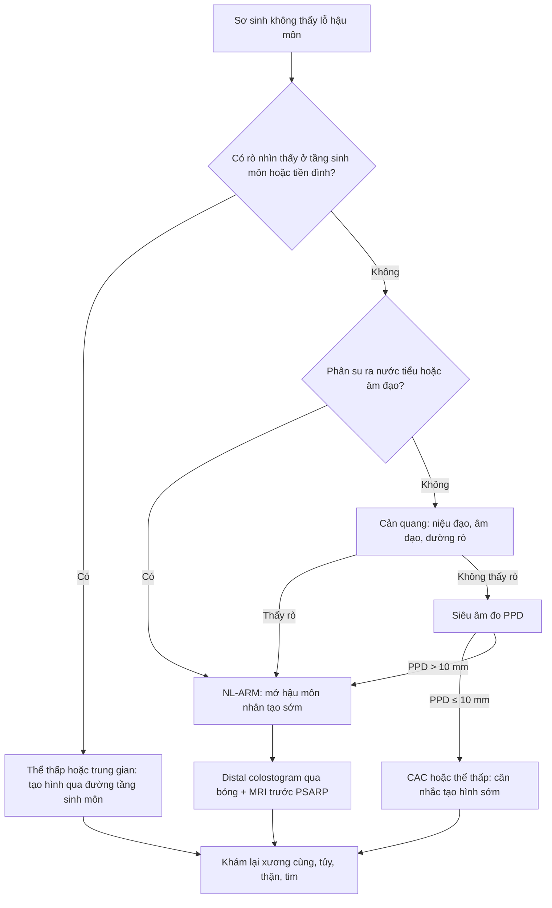
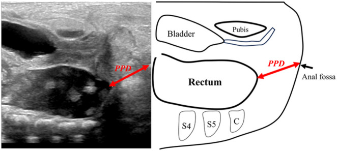
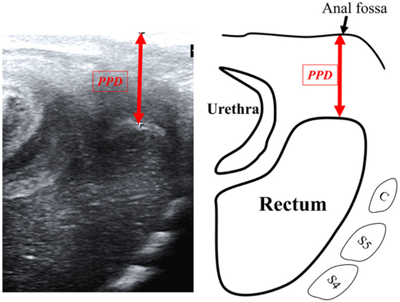
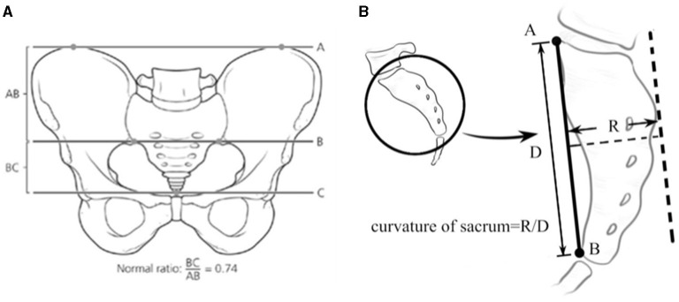
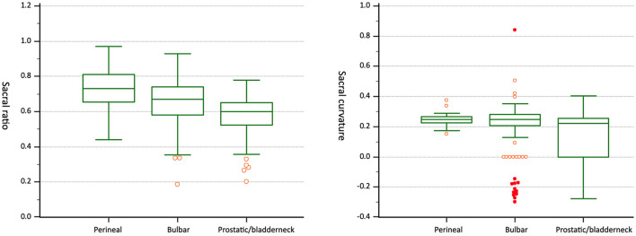

# 3075 — Dị tật hậu môn–trực tràng ở sơ sinh: phân loại thấp–cao, tìm đường rò, xương cùng và khi nào mở hậu môn nhân tạo

**Tags:** `pattern:bat-san-hau-mon` `pattern:duong-ro` `pattern:di-tat-tung-sinh` `vung:hau-mon-truc-trang` `vung:mong-cung-cut` `anatomy:xuong-cung` `protocol:US-tang-sinh-mon` `protocol:MRI-chau` `protocol:XR-chup-doi-quang` `score:Krickenbeck` `score:sacral-ratio`
**Mức chắc chắn (certainty):** tổng hợp y văn (literature synthesis) — ghép **nghiên cứu 2 trung tâm 156 ca ARM** với thuật toán 4 bước và siêu âm đo khoảng cách túi trực tràng–tầng sinh môn (Pediatr Surg Int 2026, PMCID **PMC13046640**), **316 bé trai đo tỉ lệ xương cùng** (Front Pediatr 2021, PMCID **PMC8519007**), **460 ca phân tích dị tật kèm theo** (J Korean Med Sci 2020, PMCID **PMC7152527**), và khung phân loại Krickenbeck (PMID **16226976**). Không có ca do nhóm tự chụp.

> **Câu hỏi thực hành:** bé trai **1 ngày tuổi**, không thấy lỗ hậu môn, bụng chướng, chưa đi phân su; mẹ nói "bé đái ra chất xanh đen". Siêu âm thấy túi trực tràng cách hố hậu môn **15 mm**. Bố mẹ hỏi: **"Bé có cần mổ ngay không? Mổ một lần hay phải mở hậu môn nhân tạo? Sau này có tự đi vệ sinh được không?"**
> Bài chốt **năm quyết định**: **(1) phân su ra nước tiểu = rò trực tràng–niệu đạo/cổ bàng quang, tức NL-ARM, phải mở hậu môn nhân tạo trước; (2) không thấy rò thì siêu âm đo PPD — cắt 10 mm phân biệt thấp với không thấp, AUC 0,97; (3) đo PPD ngày 0 dễ cao giả vì túi trực tràng chưa sa xuống — ca PPD 13 mm đã bị mở hậu môn nhân tạo oan; (4) xương cùng là bản đồ tiên lượng: SR 0,73 → 0,65 → 0,57 theo thể thấp → cao; (5) 65% có ít nhất một dị tật kèm, phải khám tim–thận–cột sống–thực quản trước khi mổ.**

## 1. Tổng quan bệnh học – cơ chế hình ảnh: vì sao "không có lỗ hậu môn" lại là một phổ bệnh

- **Phôi thai học (pathogenesis):** từ tuần **4–8**, vách niệu–trực tràng (urorectal septum) hạ xuống chia ống huyệt (cloaca) thành xoang niệu–sinh dục phía trước và trực tràng phía sau; đồng thời màng huyệt (cloacal membrane) thủng để tạo lỗ hậu môn. Ngừng/không hoàn toàn ở bất kỳ bước nào tạo ra **một phổ liên tục**: hẹp hậu môn (anal stenosis) → hậu môn che kín (covered anus) → rò tầng sinh môn → rò niệu đạo → rò cổ bàng quang; ở bé gái thêm rò tiền đình, rò âm đạo và **cloaca** (một lỗ chung cho niệu đạo–âm đạo–trực tràng).
- **Vì sao phân loại "thấp–cao" lại quan trọng:** độ cao của túi trực tràng quyết định **có đi qua được cơ thắt và sàn chậu hay không**. Thể thấp đi qua sàn chậu → có thể tạo hình hậu môn một thì qua đường tầng sinh môn; thể cao nằm trên cơ nâng hậu môn (levator ani) → cần **mở hậu môn nhân tạo** rồi kéo trực tràng qua đường sau trực tràng (PSARP) thì hai.
- **TẠI SAO siêu âm thấy được túi trực tràng:** phân su và dịch trong lòng túi trực tràng tạo **cửa sổ âm (anechoic)** trên siêu âm; thành ruột và mỡ quanh trực tràng tăng âm. Đo **khoảng cách túi–tầng sinh môn (pouch–perineum distance, PPD)** từ **mặt sau túi trực tràng tới hố hậu môn (anal dimple)**; đầu dò thẳng tần số cao đặt dọc tầng sinh môn cho hình ảnh rõ nhất ở trẻ sơ sinh.
- **TẠI SAO X-quang phải chờ 18–24 giờ:** khí chỉ đi tới túi trực tràng khi ruột đã có đủ hơi; chụp nghiêng tư thế nằm sấp (prone cross-table lateral) sớm sẽ thấy **khoảng cách khí–da giả tạo**. Ngay cả khi đúng thời điểm, độ nhạy dao động **70–95%**, độ đặc hiệu **67–100%** (tổng quan trong PMC13046640) — vì thế không còn là tiêu chuẩn duy nhất.
- **TẠI SAO MRI là bài toán giải phẫu, không phải bài toán "thấy hay không thấy":** T2W cho **dịch sáng** trong túi trực tràng và đường rò, **cơ thắt và cơ nâng hậu môn tối**, **mỡ sáng**; ba bình diện cho phép đo **độ dày cơ thắt, vị trí đường rò, khoảng cách tới cổ bàng quang** và đánh giá **xương cùng–tủy sống** — những thứ quyết định kiểu mổ và tiên lượng tự chủ đại tiện.
- **Dịch tễ và gánh nặng:** khoảng **1/5.000** trẻ sinh sống (tổng quan hệ thống 2026, PMC13083316). Trong **460 ca** của một trung tâm, **65% có ≥ 1 dị tật kèm** và **59,6% có dị tật lớn**; cơ quan hay gặp nhất là **sinh dục–niệu 28%**, **tim mạch 25%**, **cột sống–đốt sống 22,6%** (PMC7152527). Thể càng cao càng nặng: cloaca **93,9%**, rò trực tràng–âm đạo **85,7%**, rò trực tràng–cổ bàng quang **85%**.
- **Vì sao xương cùng là "bản đồ tiên lượng":** xương cùng phát triển cùng đơn vị thần kinh–cơ vùng chậu. Trên phim chậu thẳng, **tỉ lệ xương cùng (sacral ratio, SR) = BC/AB**, đo theo **ba đường ngang A–B–C**: A qua mào chậu, B qua mái ổ cối, C qua bờ dưới lỗ bịt; **AB = A→B**, **BC = B→C**; **SR bình thường 0,74** (PMC8519007). SR càng thấp thì thể càng cao và tiên lượng tự chủ càng kém.

## 2. Mẫu hình + chẩn đoán phân biệt theo giới và theo hình thái (Gamut)

- **Bé trai — theo vị trí đường rò (từ thấp đến cao):**
  - **Rò tầng sinh môn (perineal fistula):** lỗ nhỏ ở đường giữa tầng sinh môn, phân su ra khi ấn bụng; **thấp**, có thể tạo hình một thì.
  - **Hậu môn che kín (covered anus complete, CAC):** không thấy lỗ, nhưng có **dải da/gờ giữa** và phân su nằm ngay dưới da; siêu âm PPD **≤ 10 mm**; đây là thể "thấp nhưng không có lỗ".
  - **Rò niệu đạo hành (rectobulbar fistula):** phân su ra **nước tiểu** hoặc thấy khí trong niệu đạo; **trung gian**.
  - **Rò niệu đạo tiền liệt tuyến (rectoprostatic fistula):** túi trực tràng cao hơn, thường kèm **hẹp niệu đạo** và **dị tật xương cùng**; **cao**.
  - **Rò trực tràng–cổ bàng quang (rectovesical fistula):** phân su ra nước tiểu sớm, bàng quang có khí; **cao nhất**, gần như luôn cần mở hậu môn nhân tạo.
  - **Không rò (anorectal agenesis) và hẹp hậu môn (anal stenosis):** hẹp hậu môn có lỗ nhỏ đúng vị trí, đi phân dẹt; không rò là túi cụt, PPD lớn.
- **Bé gái — theo vị trí lỗ rò:**
  - **Rò tiền đình (rectovestibular fistula):** lỗ ở **tiền đình âm hộ**, ngay sau màng trinh; phân su ra âm hộ; Krickenbeck xếp **thể trung gian**, nhiều trung tâm tạo hình qua đường tầng sinh môn.
  - **Rò âm đạo thật (true rectovaginal fistula):** lỗ ở **thành sau âm đạo**, cao hơn màng trinh; ít gặp, cần cản quang/soi để phân biệt với rò tiền đình.
  - **Cloaca:** **một lỗ chung** cho niệu đạo, âm đạo và trực tràng; chiều dài ống chung quyết định mổ qua đường tầng sinh môn hay mở bụng; **không được tạo hình hậu môn qua đường tầng sinh môn đơn thuần**.
  - **Không rò/hẹp hậu môn:** như bé trai; hẹp hậu môn ở bé gái có thể bị bỏ sót vì vẫn đi phân được.
- **Theo hình ảnh (cách bác sĩ CĐHA phân nhóm):**
  - **Có rò nhìn thấy** (tầng sinh môn, tiền đình) → chẩn đoán chủ yếu bằng **khám + cản quang**, không cần chờ siêu âm.
  - **Không rò nhìn thấy, phân su ra nước tiểu/âm đạo** → **NL-ARM**, mở hậu môn nhân tạo sớm, không cần đo PPD để quyết định.
  - **Không rò, không thấy phân su bất thường** → **đo PPD**: **≤ 10 mm** nghi thể thấp/CAC; **> 10 mm** nghi thể không thấp.
  - **Xương cùng bất thường** (SR thấp, SC ≤ 0, thiếu đốt, nửa đốt) → nghi thể cao + dị tật tủy; **luôn tầm soát tủy**.
- **Chẩn đoán phân biệt của "không thấy lỗ hậu môn":** hậu môn lệch trước (anterior ectopic anus), hẹp hậu môn, màng hậu môn (anal membrane), u quái cùng cụt chèn ép (bài 680), ứ máu âm đạo ở bé gái (bài 1671), thoát vị cùng cụt–màng não trước cùng cụt; ở bé trai thêm **hẹp niệu đạo sau** và **xoắn tinh hoàn** (không phải nguyên nhân gây mất lỗ hậu môn nhưng hay đi cùng bệnh cảnh cấp cứu).
- **Ba nhóm "đừng bỏ sót" vì đổi hoàn toàn đường mổ:** **cloaca** (một lỗ chung), **rò trực tràng–cổ bàng quang** (phân su ra nước tiểu + bàng quang có khí), và **hội chứng Currarino** (nửa xương cùng + khối trước cùng + ARM — liên hệ bài 3073).

## 3. Bảng so sánh phân biệt (ma trận đối chiếu)

| Thực thể (entity) | Hình ảnh điển hình (US/XR/MRI) | Chốt vào (rule-in) | Chốt loại (rule-out) | Gợi ý xác nhận |
|---|---|---|---|---|
| Rò tầng sinh môn (L-ARM) | Lỗ nhỏ đường giữa tầng sinh môn; PPD **6,5 mm (IQR 3,5–7,6)**; không cần MRI | **Thấy lỗ rò + phân su ra khi ấn bụng + PPD ≤ 10 mm** | Phân su chỉ ra nước tiểu → không phải thể này | Khám dưới đèn, siêu âm PPD, không chờ X-quang |
| Hậu môn che kín (CAC) | Da liền, gờ giữa; túi trực tràng sát da; PPD **≤ 10 mm ở 21/22 ca CAC**, 1 ca **13 mm ngày 0** bị phân loại nhầm | **PPD ≤ 10 mm + không có lỗ rò + phân su ngay dưới da** | PPD **> 10 mm** → nghi thể cao (nhưng đo lại ngày 1 trước khi kết luận) | Siêu âm ngày 1 và trước mổ; đo lại nếu ngày 0 |
| Rò niệu đạo hành (trung gian) | Phân su ra nước tiểu; khí trong niệu đạo; PPD trung gian; MRI thấy rò vào niệu đạo hành | **Phân su ra nước tiểu + khí niệu đạo** | Không có phân su niệu + PPD ≤ 10 mm → thể thấp | Urethrocystography, MRI chậu |
| Rò niệu đạo tiền liệt tuyến/cổ bàng quang (cao) | Túi trực tràng cao; **SR 0,57 ± 0,12**; **SC ≤ 0**; PPD **15,0 mm (14,0–19,0)** | **SR ≤ 0,490 + SC ≤ 0 → ~91% thể tiền liệt tuyến/cổ bàng quang**; bàng quang có khí | SR ≥ 0,779 → 90% là thể tầng sinh môn | MRI chậu + distal colostogram qua bóng |
| Rò tiền đình (bé gái) | Lỗ ở tiền đình, sau màng trinh; phân su ra âm hộ; tử cung/âm đạo bình thường | **Thấy lỗ rò tiền đình + phân su ra âm hộ** | Lỗ ở thành sau âm đạo cao → rò âm đạo thật | Khám tách môi, genitography |
| Rò âm đạo thật (bé gái) | Lỗ cao trong thành sau âm đạo; có thể ứ dịch âm đạo; MRI thấy đường rò trên cơ nâng | **Lỗ rò trên màng trinh + ứ dịch âm đạo** | Lỗ ngay sau màng trinh → rò tiền đình | MRI chậu, genitography |
| Cloaca (bé gái) | **Một lỗ chung**; ứ máu/ứ dịch âm đạo; bàng quang và trực tràng đổ vào ống chung | **Chỉ một lỗ sinh dục–niệu–trực tràng** | Thấy hai lỗ riêng → không phải cloaca | MRI + nội soi, đo chiều dài ống chung |
| Hẹp hậu môn | Lỗ đúng vị trí nhưng nhỏ; phân dẹt; không có túi cụt | **Lỗ nhỏ đúng vị trí + đi phân được** | Không thấy lỗ → CAC/ARM | Khám, thăm dò bằng ống thông nhỏ |

- Ảnh minh họa cách đo PPD và tỉ lệ xương cùng: xem mục 4 và mục 6 (ảnh ngoài, đáp án trong thẻ details).

## 4. Protocol chụp + hệ phân loại/điểm chuẩn hóa

### 4.1 Khám và chẩn đoán trong 24 giờ đầu

- **Khám tầng sinh môn dưới đèn:** tìm lỗ rò, gờ giữa, hố hậu môn; ấn bụng xem phân su có ra không; **không bỏ qua việc tách môi âm hộ** ở bé gái.
- **Nhịn ăn, truyền dịch, sonde dạ dày**; nếu chướng nhiều hoặc nôn → **kháng sinh + đánh giá ngoại khoa ngay**. Không thụt trực tràng khi chưa loại trừ thủng.
- **Xét nghiệm:** công thức máu, điện giải, khí máu; **siêu âm bụng–chậu** tìm ứ nước thận, ứ dịch âm đạo, bàng quang căng.

### 4.2 Siêu âm đo PPD — ngưỡng 10 mm

- **Đường trên xương mu (suprapubic):** đầu dò đặt dọc trên xương mu, mặt cắt dọc giữa; thấy túi trực tràng và **đặt kẹp/đầu dò tại hố hậu môn** làm mốc; đo từ mặt sau túi tới hố.
- **Đường tầng sinh môn (perineal):** đầu dò thẳng tần số cao đặt dọc tầng sinh môn, **áp lực tối thiểu** để không làm biến dạng mô; dùng khi đường trên xương mu không thấy rõ túi.
- **Ngưỡng của thuật toán:** **PPD ≤ 10 mm → L-ARM/CAC; > 10 mm → NL-ARM**; trên **51 ca không thấy rò**, PPD **6,5 vs 15,0 mm**, **AUC 0,97**, **Se 95,5%**, **Sp 89,7%** (PMC13046640).
- **Bẫy thời điểm:** đo **ngày 0** có thể cao giả vì túi trực tràng chưa sa xuống; ca CAC có PPD **13 mm ngày 0** đã bị mở hậu môn nhân tạo oan, sau đó chẩn đoán lại bằng cản quang qua bóng. **Đo lại ngày 1 và ngay trước mổ** nếu còn do dự.
- **Giá trị của thuật toán 4 bước** (khám → phân su → cản quang → PPD): đúng **155/156 = 99,4%** so với chẩn đoán trong mổ.

### 4.3 Cản quang và MRI

- **Cản quang:** fistulography (bơm qua lỗ rò), **urethrocystography** (rò niệu đạo/cổ bàng quang), **genitography** (rò âm đạo/tiền đình); trước PSARP ở thể cao cần **distal colostogram qua bóng hậu môn nhân tạo** để xác định chính xác đường rò và độ dài đoạn cụt.
- **MRI chậu:** T2W sagittal–coronal–axial, lát **1–3 mm**, không cản quang thường quy; trẻ < 3 tháng có thể **feed-and-wrap** để tránh gây mê. Đánh giá **cơ nâng hậu môn, phức hợp cơ thắt, đường rò, cổ bàng quang, xương cùng, tủy sống**. MRI **không thay thế** distal colostogram trong việc đo đường rò, nhưng là công cụ tốt nhất để lập kế hoạch tạo hình cơ thắt.
- **Tầm soát dị tật kèm (bắt buộc trước mổ):** siêu âm thận–đường niệu, siêu âm tim, X-quang cột sống; **nội soi/kiểm tra thực quản–dạ dày** nếu nghi hẹp thực quản–rò khí–thực quản (trong loạt NL-ARM: **EA/TEF 34,5%** so với **6,0%** ở L-ARM, **p < 0,001**; **mỡ dây tận 20,7% vs 6,0%**, p = 0,025).

### 4.4 Phân loại Krickenbeck và thuật toán xử trí

- **Krickenbeck (2005):** thể thấp (rò tầng sinh môn, hẹp hậu môn, hậu môn che kín), trung gian (rò niệu đạo hành, rò tiền đình), cao (rò niệu đạo tiền liệt tuyến, rò cổ bàng quang, rò âm đạo thật, cloaca, không rò). Kết quả chức năng ghi theo **vận động ruột tự chủ / són / táo bón**.
- **Xử trí theo thuật toán của loạt 156 ca:** thể thấp có rò tầng sinh môn → **tạo hình hậu môn thì muộn trong giai đoạn sơ sinh**; CAC → **tạo hình sớm** tùy tình trạng; **NL-ARM → mở hậu môn nhân tạo sớm**, PSARP thì hai sau khi đánh giá đầy đủ.

### 4.5 Điểm chuẩn xương cùng

- **SR = BC/AB**, đo trên phim chậu thẳng; **bình thường 0,74**.
- **SR theo thể (316 bé trai):** rò tầng sinh môn **0,73 ± 0,12**; rò niệu đạo hành **0,65 ± 0,12**; rò niệu đạo tiền liệt tuyến/cổ bàng quang **0,57 ± 0,12**.
- **Ngưỡng định hướng:** **SR ≥ 0,779** → 90% là thể tầng sinh môn; **SR ≤ 0,490 + SC ≤ 0** → **~91%** là thể tiền liệt tuyến/cổ bàng quang (PMC8519007). **SC** (sacral curvature) = R/D trên phim nghiêng hoặc MRI; **SC ≤ 0** nghĩa là xương cùng mất cong bình thường.

## 5. Biến thể bình thường và cạm bẫy

- **Hố hậu môn nhỏ nhưng có lỗ:** hẹp hậu môn — vẫn đi phân được nên dễ cho về nhà; hỏi **phân dẹt, rặn nhiều, chậm tăng cân** và đo lại.
- **Rò tiền đình bị gọi nhầm là "rò tầng sinh môn":** ở bé gái, lỗ rò ở **tiền đình** nằm ngay sau màng trinh; nếu chỉ nhìn qua khe mông sẽ tưởng thể thấp. Luôn **tách môi âm hộ** và ghi rõ vị trí.
- **PPD ngày 0 cao giả:** túi trực tràng chưa sa xuống → mở hậu môn nhân tạo oan (ca 13 mm trong loạt). Đo lại **ngày 1** và **trước mổ**.
- **X-quang nghiêng sớm:** khí chưa tới túi → khoảng cách khí–da lớn giả; chỉ chụp sau **18–24 giờ** và không dùng một mình để quyết định.
- **"Không thấy rò" không bằng "không có rò":** rò niệu đạo/cổ bàng quang có thể kín; **phân su ra nước tiểu** là chốt, không cần thấy lỗ.
- **Cloaca bị mổ như ARM thường:** một lỗ chung mà tạo hình hậu môn đơn thuần sẽ làm hẹp niệu đạo/âm đạo; cần **MRI + đo chiều dài ống chung** trước.
- **Currarino bị bỏ sót:** nửa xương cùng + khối trước cùng + ARM; nếu chỉ sửa hậu môn mà bỏ khối/tủy sẽ để lại di chứng thần kinh — liên hệ bài 3073 (LUMBAR) và bài 680 (u quái cùng cụt).
- **SR thấp không đồng nghĩa "không tự chủ":** SR là yếu tố tiên lượng, không phải định mệnh; trẻ cần theo dõi chức năng ruột theo Krickenbeck và chương trình bowel management.
- **Dị tật kèm bị bỏ qua vì bận mổ hậu môn:** **65%** có ≥ 1 dị tật; tim mạch **25%** — khám tim và siêu âm tim trước gây mê, không chỉ nhìn tầng sinh môn.

## 6. Tự lượng giá — Blind Quiz

**Ca 1 — Bé trai 1 ngày tuổi, không thấy lỗ hậu môn, PPD 15 mm.**

- Gợi ý lâm sàng: bụng chướng, chưa đi phân su, không thấy phân su ở nước tiểu.
- Câu hỏi: PPD đo từ đâu tới đâu? 15 mm thuộc nhóm nào? Bước tiếp theo là gì?

<b>Bấm để hiện đáp án (findings + chẩn đoán)</b>

- Dấu hiệu: túi trực tràng (vùng âm) cách hố hậu môn **15 mm**, tương ứng nhóm **NL-ARM** (trung vị 15,0 mm; IQR 14,0–19,0).
- Chẩn đoán: **dị tật hậu môn–trực tràng thể không thấp**, cần **mở hậu môn nhân tạo sớm** rồi đánh giá đường rò bằng distal colostogram trước PSARP.
- Vì sao: PPD > 10 mm là ngưỡng của thuật toán (AUC 0,97; Se 95,5%; Sp 89,7%); nhưng phải đo lại ngày 1 nếu ngày 0 vì túi có thể chưa sa xuống.
- Nguồn ảnh: Pediatr Surg Int 2026, PMCID PMC13046640, CC BY 4.0.

**Ca 2 — Bé gái 2 ngày tuổi, không thấy lỗ hậu môn, siêu âm tầng sinh môn PPD 6,5 mm.**

- Gợi ý lâm sàng: không thấy phân su ra nước tiểu; ấn bụng thấy phân su ngay dưới da tầng sinh môn.
- Câu hỏi: Vì sao PPD nhỏ lại gợi ý thể thấp? Có cần mở hậu môn nhân tạo không? Theo dõi gì sau mổ?

<b>Bấm để hiện đáp án (findings + chẩn đoán)</b>

- Dấu hiệu: túi trực tràng sát tầng sinh môn, PPD **6,5 mm** — phù hợp **hậu môn che kín (CAC)/thể thấp**.
- Chẩn đoán: **ARM thể thấp**, có thể **tạo hình hậu môn một thì qua đường tầng sinh môn** mà không cần mở hậu môn nhân tạo.
- Vì sao: PPD ≤ 10 mm phản ánh túi đã đi qua sàn chậu; nhưng vẫn phải khám lại xương cùng, tủy, thận và tim vì **65%** có dị tật kèm.
- Nguồn ảnh: Pediatr Surg Int 2026, PMCID PMC13046640, CC BY 4.0.

**Ca 3 — Bé trai 3 ngày tuổi, không rò, PPD 15 mm; phim chậu thẳng có SR 0,57 và SC âm.**

- Gợi ý lâm sàng: chân trái yếu hơn, hố cùng cụt có lúm nhỏ; siêu âm thận phải ứ nước độ I.
- Câu hỏi: SR 0,57 + SC ≤ 0 gợi ý thể nào? Cần thêm những tầm soát gì trước mổ?

<b>Bấm để hiện đáp án (findings + chẩn đoán)</b>

- Dấu hiệu: **SR 0,57** (thấp hơn thể tầng sinh môn 0,73) và **SC ≤ 0** → nghi **rò niệu đạo tiền liệt tuyến/cổ bàng quang**; kèm lúm cùng cụt và ứ nước thận phải → nghi dị tật tủy/niệu.
- Chẩn đoán: **NL-ARM thể cao**, cần **mở hậu môn nhân tạo**, **MRI chậu–tủy**, **siêu âm thận** và **siêu âm tim** trước khi PSARP.
- Vì sao: SR ≤ 0,490 + SC ≤ 0 cho xác suất **~91%** thể tiền liệt tuyến/cổ bàng quang; xương cùng thấp đi kèm dị tật tủy và tiên lượng tự chủ kém hơn.
- Nguồn ảnh: Front Pediatr 2021, PMCID PMC8519007, CC BY 4.0.

> **Ảnh dữ liệu bổ sung:** boxplot SR/SC theo thể (ảnh ngoài, đáp án trong details) — dùng để thấy SR giảm dần từ thể tầng sinh môn → niệu đạo hành → tiền liệt tuyến/cổ bàng quang.

<b>Bấm để hiện đáp án (đọc boxplot)</b>

- Trung vị SR: **0,73** (perineal) → **0,65** (bulbar) → **0,57** (prostatic/bladderneck).
- SC thấp rõ ở nhóm prostatic/bladderneck, nhiều ca **SC ≤ 0**.
- Nguồn: Front Pediatr 2021, PMCID PMC8519007, CC BY 4.0.

## Bài liên quan chéo
- [600 – Tổng quan Nhi khoa](../600-tong-quan-nhi-khoa/lesson.md)
- [622 – Tắc ruột sơ sinh](../622-tac-ruot-so-sinh/lesson.md) (double-bubble, microcolon — phân biệt với ARM)
- [680 – U quái cùng cụt ở trẻ](../680-u-quai-cung-cut-o-tre/lesson.md) (khối vùng cùng cụt)
- [3073 – Hội chứng LUMBAR](../3073-hoi-chung-lumbar-u-mau-duong-giua-di-tat-tuy/lesson.md) (dị tật tủy ẩn, dấu hiệu da đường giữa)
- [3078 – Nang ống utricle & nang Müllerian](../3078-nang-ong-utricle-mullerian/lesson.md) (khối nang đường giữa sau bàng quang)
- [1671 – Ứ máu âm đạo ở trẻ vị thành niên](../1671-u-mau-am-dao-tu-cung-tre-vi-thanh-nien/lesson.md)

> Không dùng để chẩn đoán độc lập khi chưa có người hướng dẫn.
