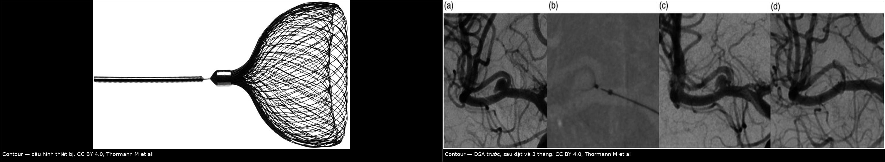
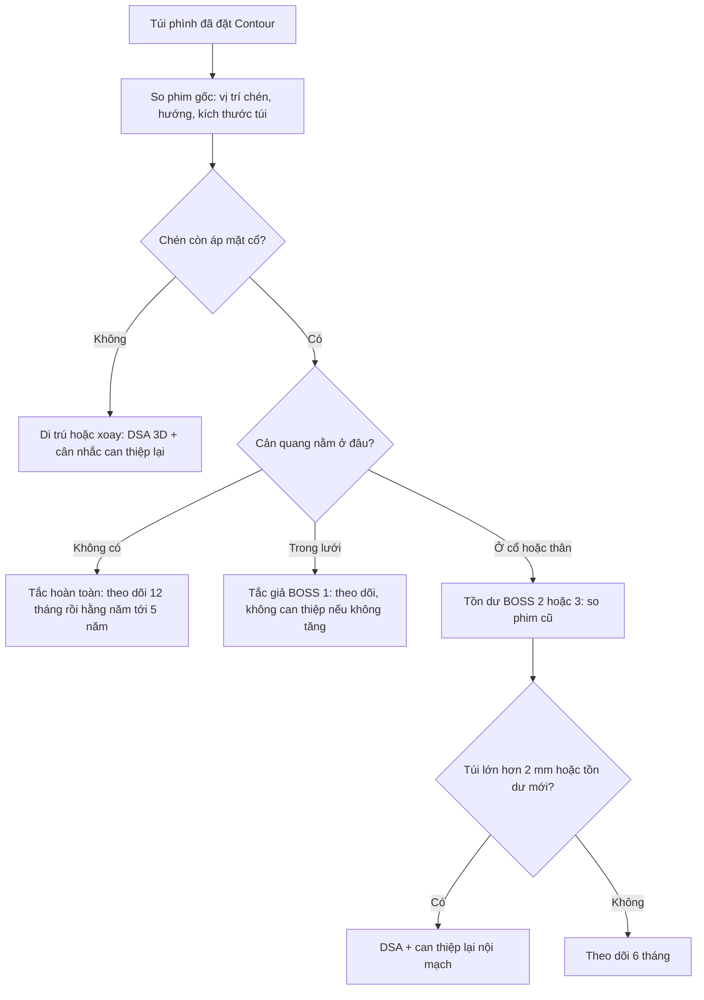
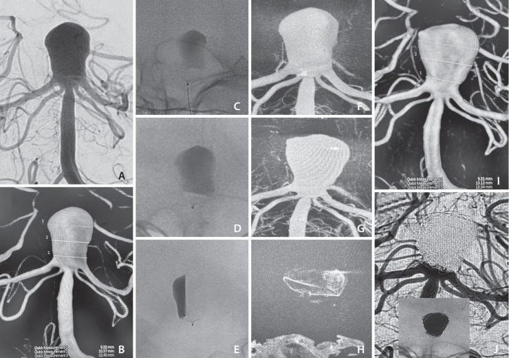
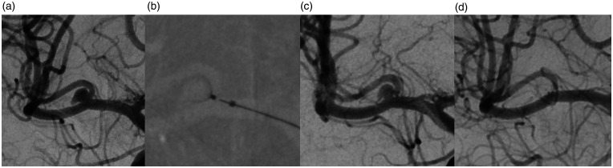

# 3076 — Theo dõi sau thiết bị nội túi Contour: thang đọc riêng, di trú và "vòng sáng" của lưới / Follow-up of the Contour intrasaccular device

**Tags:** `pattern:ton-du` `pattern:tai-phat` `pattern:di-tru-thiet-bi` `pattern:ngam-thuoc-trong-luoi` `pattern:co-rut-thiet-bi` `vung:nao` `vung:mach-nao` `score:BOSS` `score:Raymond-Roy` `protocol:DSA` `protocol:CTA-pho` `protocol:MRA` `protocol:CBCT-tinh-mach`

**Mức chắc chắn (certainty):** tổng hợp y văn (literature synthesis) — phân tích gộp **192 bệnh nhân / 206 túi phình** (Interv Neuroradiol 2024, PMC11571174); loạt **76 túi** theo dõi trung bình 12 tháng (J Neurosurg 2025, PMID 39151207); phân tích đa trung tâm **25 túi** áp thang BOSS (World Neurosurg 2024, PMID 38195027); theo dõi **5 năm** ở 8 bệnh nhân (AJNR 2025, PMID 40506231); đồng thuận DELPHI **24 chuyên gia** về theo dõi thiết bị nội túi (Interv Neuroradiol 2025, PMC12460278); ca nguyên văn vỡ muộn 15 tháng (Neurointervention 2025, PMC11900283) và ca di trú 18 tháng (J Neurointerv Surg 2024, PMID 36941045). Bằng chứng chủ yếu hồi cứu, không có thử nghiệm ngẫu nhiên.

> **Câu chốt:** Contour **không phải WEB thu nhỏ**: thiết bị là một **lưới nitinol hình chén đặt ở mặt cổ**, kích thước chọn theo **đường kính cổ và đường kính thân**, **không phụ thuộc chiều cao túi**. Vì vậy khi đọc theo dõi, ba câu hỏi không phải "tắc hay không tắc" mà là: **(1) lưới còn áp sát mặt cổ không? (2) cản quang nằm trong lưới, ở cổ, hay giữa thành túi và lưới? (3) túi có lớn thêm > 2 mm hoặc đổi hình không?** Sai lầm chết người: **coi một lần chụp 6 tháng bình thường là "khỏi"** — đã có ca di trú hoàn toàn lúc **18 tháng** và ca vỡ muộn tử vong lúc **15 tháng** sau khi thiết bị ban đầu nằm đúng.

## 1. Tổng quan bệnh học – cơ chế hình ảnh

### 1.1 Thiết bị và cơ chế: vì sao đặt ở cổ mà không cần stent

- **Contour (Cerus Endovascular/Stryker)** là **thiết bị rối loạn dòng nội túi (intrasaccular flow disruptor)** dạng **lưới nitinol dệt hình chén/cúp**, thả **hoàn toàn trong túi phình**, tự bung ra và **áp mặt cắt của chén vào mặt cổ**. Các cỡ thường dùng **5–14 mm**, đưa qua microcatheter **0,027″** (thế hệ đầu) hoặc **0,021″** (thế hệ sau).
- **Cơ chế kép:** (1) **chuyển hướng dòng ở cổ** — tái tạo lại chỗ chia đôi của mạch mẹ; (2) **rối loạn dòng trong túi** — làm giảm vận tốc, tạo ứ trệ, huyết khối và **nội mô hóa mặt cổ**. Vì không để lại kim loại trong lòng mạch mẹ, bệnh nhân thường chỉ cần **một thuốc kháng kết tập tiểu cầu** thay vì kháng kết tập kép.
- **Chỉ định kinh điển:** túi phình **ngã ba** cổ rộng (dome-to-neck < 2 hoặc cổ ≥ 4 mm). Chọn cỡ theo **đường kính cổ và đường kính lớn nhất của thân**, **không theo chiều cao** — khác WEB vốn phải "lấp đầy" buồng túi.

### 1.2 Vì sao hình ảnh trông như vậy (vật lý + mô bệnh)

- **Nitinol cản quang mạnh:** trên DSA, lưới hiện thành **khối sáng có hoa văn dệt**; trên CTA/CBCT là **vành/cúp tăng đậm độ**. Vì lưới **có lỗ**, một lớp cản quang mỏng **len giữa các sợi** là hiện tượng cơ học bình thường, không phải "túi còn thông".
- **Hiệu ứng cứng chùm tia (beam hardening)** quanh nitinol tạo **vệt tối và viền sáng giả**; trên MRI, **hệ số cảm từ (susceptibility)** của cụm van/thân thiết bị gây **vùng mất tín hiệu lớn ở điểm thả (detachment zone)** — đúng vị trí cần nhìn nhất để đánh giá áp cổ.
- **"Vòng sáng" (bright ring):** khi mặt chén nhìn **tiếp tuyến**, lưới tạo **một vành sáng kín**; nếu cản quang nằm **ngoài vành này và men theo thành túi**, đó là **tồn dư thân (BOSS 3)**, không phải ánh kim. Ngược lại, **vành sáng thứ hai** nằm ngay trong vành thứ nhất thường là **thành đối diện của chính chén** — đừng đọc thành hai lớp cản quang.
- **Vì sao chọn cỡ sai lại di trú:** chén chỉ giữ được nhờ **lực hướng tâm ở mặt cổ**; nếu cổ lớn hơn cỡ thiết bị, hoặc **đường kính lớn nhất nằm xa cổ** (thân phình rộng ở đáy), lưới không có điểm tựa → **xoay, lật hình dù (reversed umbrella), trôi vào đáy túi**.

### 1.3 Số liệu trụ cột

| Đại lượng | Con số | Nguồn |
|---|---|---|
| Tắc đủ (adequate occlusion) | **85%** (95% CI 78–90), **206 túi** | PMC11571174 |
| Tắc hoàn toàn ở 12 tháng | **57,1%**; tồn dư cổ **28,6%**; tồn dư thân **14,3%** (76 túi) | PMID 39151207 |
| BOSS 0/0′ ở 1 năm | **65,5%** (25 túi); ứ trệ cản quang **58,3%** | PMID 38195027 |
| Di trú thiết bị | **4%** gộp (95% CI 2–9); **20%** di trú muộn ở loạt 25 túi; **12%** trong thủ thuật | PMC11571174; PMID 38195027 |
| Thuyên tắc huyết khối | **6%** gộp; **3,9%** ở loạt 76 túi | PMC11571174; PMID 39151207 |
| Can thiệp lại | **5,4%** (76 túi); **12%** (25 túi) | PMID 39151207; PMID 38195027 |
| Thời điểm hỏng muộn | di trú **18 tháng**; vỡ muộn **15 tháng** | PMID 36941045; PMC11900283 |
| Ngưỡng coi là tiến triển | túi lớn thêm **> 2 mm** | PMC12460278 |

- **Bằng chứng "siết cổ" theo thời gian:** ở 7 túi, diện tích lỗ cổ giảm từ **15,52 → 13,30 mm²** và chiều rộng cổ từ **5,01 → 4,49 mm** sau trung bình **10 tháng** (PMC11607031) — nghĩa là cổ thu nhỏ dần là **lành tính**, đừng nhầm với co rút thiết bị.

## 2. Mẫu hình + chẩn đoán phân biệt theo vị trí (gamut)

Cùng một "chấm sáng" trong túi đã đặt Contour có **sáu** khả năng, phân biệt bằng **vị trí tương đối với lưới** và **hình dạng thiết bị**:

1. **Cản quang trong lưới (BOSS 1)** — hoa văn theo sợi, bờ trong theo lưới, không đổi qua nhiều lần chụp → **"tắc giả"**, không phải thất bại.
2. **Cản quang ở cổ, ngoài lưới (BOSS 2)** — chỏm lồi ngay mặt cổ, giữa lưới và mạch mẹ → tồn dư cổ.
3. **Cản quang giữa thành túi và mặt ngoài lưới (BOSS 3)** — lưỡi liềm men theo thành túi, lan ra ngoài chu vi lưới → tồn dư thân.
4. **Hốc gần rất mỏng sát điểm thả (BOSS 0′)** — lớp cản quang mỏng trong hốc gần; **bậc kém tái lập nhất** với Contour.
5. **Di trú/xoay thiết bị** — chén lệch khỏi mặt cổ, **đỉnh chén quay ra cổ** ("dù lật"), hoặc trôi vào đáy túi; cổ **hở hoàn toàn** dù trước đó đã kín.
6. **Túi lớn lên không có cản quang mới** — hình thái đổi, đường kính tăng > 2 mm; có thể là **dấu sớm nhất** của mất áp cổ, trước khi thấy tồn dư rõ.

**Gamut theo vị trí:** đỉnh thân nền và ngã ba động mạch não giữa là nơi hay gặp nhất (32,9% và 28,9% trong loạt 76 túi) — cũng là nơi **áp lực dòng và chuyển động mạch mẹ lớn nhất**, nên di trú ở đây có hậu quả nặng nhất.

## 3. Bảng so sánh phân biệt (ma trận đối chiếu)

| Thực thể (entity) | Hình ảnh điển hình | Chốt vào (rule-in) | Chốt loại (rule-out) | Gợi ý xác nhận |
|---|---|---|---|---|
| **Tắc hoàn toàn (BOSS 0)** | Lưới đậm độ đều, **không cản quang** trong túi ở mọi thì | Không ngấm ở **mọi bình diện**, thiết bị **không đổi** so với phim ngay sau đặt | Có lớp mỏng sát điểm thả → **0′**, không phải 0 | DSA 3D + VasoCT/CBCT |
| **Hốc gần (BOSS 0′)** | Chỏm lồi nhỏ **sát điểm thả**, không lan vào thân túi | Khu trú, bờ lồi, **không tăng qua các lần chụp** | Ngấm lan vào thân túi → **BOSS 3** | DSA 3D; CTA dễ đọc nhầm thành 0 |
| **Ngấm trong lưới (BOSS 1)** | Hoa văn cản quang **giữa các sợi**, bờ trong theo hình lưới | Bờ trong **theo lưới**, không vượt mặt cổ, ổn định ≥ 6 tháng | Cản quang **ngoài** mặt lưới → 2 hoặc 3 | CBCT tĩnh mạch; so phim cũ |
| **Tồn dư cổ (BOSS 2)** | Chỏm cản quang **ngay mặt cổ, ngoài lưới** | Nằm giữa lưới và mạch mẹ, **không có thành túi bao ngoài** | Có thành túi bao quanh → **BOSS 3** | DSA 3D xoay |
| **Tồn dư thân (BOSS 3)** | **Lưỡi liềm** giữa thành túi và mặt ngoài lưới | Có thành túi bao ngoài, lan ra ngoài chu vi lưới | Chỉ ở cổ → 2; trong lưới → 1 | DSA + so phim ngay sau đặt |
| **Di trú/xoay thiết bị** | Chén lệch cổ, **đỉnh quay ra cổ**, hoặc trôi vào đáy; **khoảng cách từ điểm thả đến cổ tăng** | So phim gốc thấy **vị trí/hướng đổi**, cổ hở mới | Đổi hình nhẹ do tổ chức hóa nhưng **vẫn áp cổ** | DSA 3D + VasoCT; CTA 40 keV |
| **Co rút/ép thiết bị** | Chiều cao chén **ngắn lại**, vành không còn áp cổ | Khoảng cách hai đầu lưới **giảm rõ rệt** so với phim gốc, đo cùng bình diện 3D | Không đổi qua 2 lần chụp | Đo trên DSA 3D, không đo trên CTA |
| **Túi lớn lên** | Đường kính thân/cổ tăng, bờ đổi hình | Tăng **> 2 mm** hoặc hình thái mới | Tăng < 1 mm trong sai số đo | Cùng modality, cùng bình diện |
| **Giả tổn thương do kim loại** | Vành sáng/đám tối **theo hướng tia**, không theo thành túi | Đổi theo cửa sổ/tái tạo, **không thấy trên DSA** | Có trên ≥ 2 modality và đúng vị trí giải phẫu | DSA phân giải cao |

*Trái: lưới nitinol hình chén với cụm điểm thả ở cuống. Phải: (a) DSA trước đặt; (b) thiết bị bung tại cổ; (c) ngay sau đặt còn ứ trệ; (d) 3 tháng tắc hoàn toàn. Nguồn: PMC9244739, CC BY 4.0, Thormann M et al. Ảnh ghép letterbox.*

## 4. Protocol chụp + hệ phân độ/điểm chuẩn hóa

### 4.1 Protocol theo dõi

- **Ngay sau đặt:** DSA + **3D xoay** + **VasoCT/CBCT** — lưu phim **"gốc"** để đo vị trí, hướng chén, khoảng cách điểm thả–cổ và kích thước túi. Không có phim gốc thì không thể gọi "di trú".
- **3–6 tháng:** DSA là chuẩn; nếu bệnh nhân không chụp xâm lấn được, **CTA phổ 40 keV + thuật toán giảm nhiễu kim loại (OMAR)** cho kết quả gần DSA nhất *trong mô hình in vitro*; **MRA/TOF và T1 có artifact cảm từ lớn ở điểm thả**, **T2 lát mỏng** chỉ xem được vòm túi, **không đánh giá được cổ và mạch mẹ**.
- **12 tháng, sau đó hằng năm tới ≥ 5 năm:** đồng thuận DELPHI chọn **MRA lúc 6 tháng** cho túi đã tắc hoàn toàn (58% chuyên gia), **DSA 6 tháng** nếu còn tồn dư, rồi **chụp hằng năm**; **không có đồng thuận** về modality của các lần hằng năm. Loạt 5 năm cho thấy **tắc tiến triển tới 2 năm nhưng có thể xấu lại sau đó** → khuyến cáo theo dõi **tối thiểu 5 năm**.
- **Ngưỡng can thiệp lại:** túi **lớn > 2 mm**, tồn dư **mới/tăng**, hoặc **di trú/co rút có hở cổ**. Can thiệp nội mạch được ưu tiên hơn mổ; kỹ thuật gồm **coil qua/ quanh thiết bị (CoCoJaMBO)**, stent-assisted coiling, hoặc đặt flow diverter.

### 4.2 Thang đọc: dùng BOSS nhưng phải "dịch" cho Contour

| Bậc BOSS | Định nghĩa gốc cho WEB | Cách áp cho Contour |
|---|---|---|
| **0** | Không cản quang trong túi | Giữ nguyên |
| **0′** | Lớp mỏng trong **hốc gần** sát marker gần | **Kém tin cậy nhất** — cụm thả của Contour là một khối kim loại, artifact làm mất lớp mỏng |
| **1** | Cản quang **trong lưới** | Giữ nguyên; đọc bờ trong theo sợi lưới |
| **2** | Tồn dư **cổ**, ngoài lưới | Giữ nguyên |
| **3** | Tồn dư **thân**, giữa thành túi và lưới | Giữ nguyên; đây là bậc **hay bị bỏ sót nhất** vì "vòng sáng" của lưới che |

> **Phản biện:** BOSS được thiết kế cho **hai marker của WEB**; một loạt 25 túi Contour vẫn dùng BOSS và báo **65,5% đạt 0/0′**. Nhưng vì **0′ phụ thuộc hốc gần**, với Contour nên báo **"vị trí cản quang + độ áp cổ + kích thước túi"** bằng lời, rồi mới quy ra bậc — đừng để con số thay cho mô tả.

## 5. Biến thể bình thường và cạm bẫy

- **"Vòng sáng" không phải cản quang:** vành sáng của lưới nhìn tiếp tuyến, cộng viền sáng do tái tạo, rất giống tồn dư cổ. **Luật bờ trong:** bờ theo **sợi lưới** = trong lưới; bờ theo **thành túi** = ngoài lưới.
- **BOSS 1 bền không phải thất bại:** ngấm trong lưới có thể tồn tại nhiều năm mà không tăng thể tích; can thiệp lại là quá tay.
- **Một lần 6 tháng bình thường không loại trừ hỏng muộn:** ca "dù lật" đúng vị trí lúc 6 tháng, trôi hoàn toàn lúc **18 tháng**; ca vỡ muộn tử vong lúc **15 tháng** sau khi bỏ theo dõi.
- **Túi lớn lên có thể đi trước tồn dư:** đo **cùng modality, cùng bình diện**; ngưỡng **> 2 mm** mới đủ để hành động.
- **Chọn cỡ theo bảng hãng không miễn trừ sai:** nếu **đường kính lớn nhất nằm xa cổ**, chén không có điểm tựa; cân nhắc **thiết bị lớn hơn** hoặc **thêm coil** để tăng ổn định.
- **MRI dễ đánh lừa:** artifact cảm từ ở điểm thả có thể **che mất tồn dư cổ**; đừng dùng MRI để loại trừ tồn dư. **CTA thường quy** cũng có thể **bỏ sót BOSS 0′** do hiệu ứng thể tích riêng phần.
- **Đừng đọc như coil:** không có "coil mass compaction"; ngôn ngữ "RROC class" chỉ nên dùng để tóm tắt, không thay cho mô tả vị trí cản quang.

## 6. Tự lượng giá — Blind Quiz

**Ca 1 — 60 tuổi, đau đầu dữ dội, tiền sử đặt Contour cho túi đỉnh thân nền 15 tháng trước, bỏ tái khám**

- Gợi ý lâm sàng: túi đỉnh thân nền cổ **9,2 mm**, đường kính **10,4 mm**, đáy xa **12,4 mm**; đã đặt Contour **14 mm**; không tái khám.
- Câu hỏi: (1) Thiết bị còn áp cổ không? (2) Túi có thay đổi kích thước? (3) Ba chẩn đoán phân biệt và dấu hiệu chốt?

<b>Bấm để hiện đáp án (findings + chẩn đoán)</b>

- **Dấu hiệu:** (A–B) túi cổ rộng trước đặt; (C–F) thiết bị bung đúng mặt cổ, còn ứ trệ; (G–H) **15 tháng: thiết bị trôi vào đáy túi, lật hình "dù ngược"**, túi lớn lại (**cổ 9,2 mm, ngang 13,1 mm, đáy xa 15,3 mm**); (I) 3D cho thấy túi đổi hình; (J) chụp can thiệp lại bằng Y-stent + coil.
- **Chẩn đoán:** **di trú thiết bị + túi lớn lên + vỡ muộn (xuất huyết não thất tử vong)**. Cơ chế: chén mất áp cổ → dòng vào lại → túi giãn và vỡ; đáy túi rộng ở xa cổ là yếu tố làm thiết bị mất điểm tựa.
- **Bài học:** một lần đặt đúng không bảo đảm kín lâu dài; **theo dõi ≥ 5 năm** và **đo túi trên cùng bình diện**.
- Nguồn ảnh: *Neurointervention* 2025, PMC11900283, CC BY-NC 4.0, Koc O et al (nguyên bản, không chỉnh sửa).

**Ca 2 — 54 tuổi, túi ngã ba động mạch não giữa bên phải, đã đặt Contour 021; chụp lại 3 tháng**

- Gợi ý lâm sàng: túi không vỡ, cổ **2,5 mm**, ngang **5,0 mm**, cao **5,5 mm**; động mạch chủ có nhánh tận cùng góc nhọn.
- Câu hỏi: (1) Thiết bị có hình dạng gì và đặt ở đâu? (2) DSA 3 tháng có tồn dư không? (3) Vì sao không dùng RROC đơn thuần?

<b>Bấm để hiện đáp án (findings + chẩn đoán)</b>

- **Dấu hiệu:** lưới dệt hình **chén/cúp** có cụm thả ở cuống; (a) DSA trước đặt; (b) thiết bị bung tại cổ; (c) ngay sau đặt còn **ứ trệ cản quang**; (d) **3 tháng: tắc hoàn toàn, không tồn dư, thiết bị không di trú**.
- **Chẩn đoán:** **tắc hoàn toàn sau 3 tháng** — BOSS 0; đây là diễn tiến mong đợi.
- **Vì sao không dùng RROC đơn thuần:** RROC gộp mọi "còn cản quang" vào một lớp; với thiết bị nội túi, **vị trí** cản quang (trong lưới / ở cổ / quanh thân) quyết định hành động — BOSS giữ được thông tin đó.
- Nguồn ảnh: *Neuroradiol J* 2022, PMC9244739, CC BY 4.0, Thormann M et al (ảnh ghép letterbox từ Fig. 1 + Fig. 2).

**Ca 3 — 58 tuổi, túi ngã ba động mạch não giữa, đặt Contour 9 mm cho túi 10 mm; 6 tháng kín, 18 tháng đau đầu nhẹ**

- Gợi ý lâm sàng: không có khiếm khuyết thần kinh; túi **10 mm**, thiết bị **9 mm**; lần 6 tháng thiết bị đúng vị trí.
- Câu hỏi: (1) Cần đo gì ở lần 18 tháng? (2) Nếu thiết bị trôi hoàn toàn vào đáy túi nhưng bệnh nhân không triệu chứng, xử trí thế nào? (3) Cạm bẫy nào khiến lần 6 tháng bị đọc "ổn định" sai?

<b>Bấm để hiện đáp án (findings + chẩn đoán)</b>

- **Dấu hiệu cần đo:** khoảng cách **điểm thả → mặt cổ**, hướng **đỉnh chén** (vào túi hay quay ra cổ), đường kính **cổ/ngang/cao** của túi, và **vị trí cản quang** so với lưới.
- **Nếu trôi hoàn toàn, không triệu chứng:** đây là **di trú muộn** (đã báo cáo 18 tháng, thiết bị lật hình dù, túi còn ngấm hoàn toàn nhưng không biến cố). Không mổ cấp; **đánh giá lại bằng DSA 3D**, cân nhắc can thiệp lại vì cổ đã hở, và **theo dõi sát** vì nguy cơ vỡ muộn đã được ghi nhận.
- **Cạm bẫy:** lần 6 tháng chỉ chụp **một bình diện** hoặc dùng **CTA/MRI có artifact** → bỏ sót di trú sớm; luôn so **phim gốc** và đo trên **3D**.
- Nguồn ảnh: *Neuroradiol J* 2022, PMC9244739, CC BY 4.0, Thormann M et al.

## Bài liên quan chéo
- [266 – Theo dõi sau WEB: thang BOSS, co rút lưới](../266-theo-doi-sau-web-tui-phinh/lesson.md)
- [257 – Theo dõi tái phát sau can thiệp túi phình](../257-theo-doi-tai-phat-sau-can-thiep-tui-phinh/lesson.md)
- [207 – Phình mạch nội sọ chưa vỡ](../207-phinh-mach-noi-so-chua-vo/lesson.md)
- [216 – Dị dạng mạch và huyết khối xoang](../216-di-dang-mach-CVST/lesson.md)

## Ảnh
- `images/3076_theo-doi-contour_DSA-VasoCT_PMC11900283-F1.jpg` — DSA/3D/VasoCT: đặt đúng, di trú 15 tháng, dù ngược.
- `images/3076_theo-doi-contour_DSA_PMC9244739-F2.jpg` — DSA trước, trong, sau đặt và 3 tháng.
- `images/3076_theo-doi-contour_DSA-thiet-bi_PMC9244739-F1.jpg` — cấu hình lưới hình chén.
- `images/composite_contour-thiet-bi-dsa.jpg` — ảnh ghép đối chiếu.
- Nguồn, giấy phép từng ảnh: `images/CREDITS.md` và `sources.md`.

> Không dùng để chẩn đoán độc lập khi chưa có người hướng dẫn.
