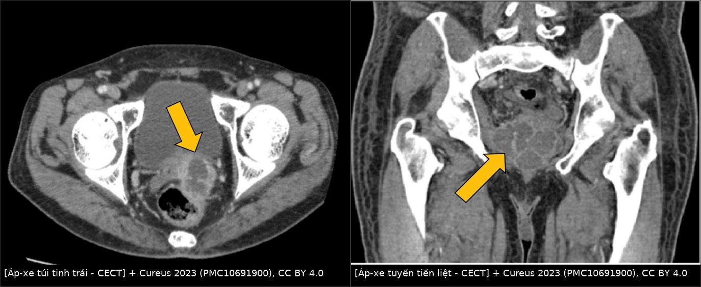
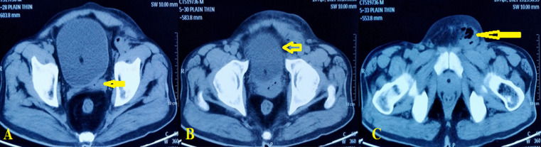
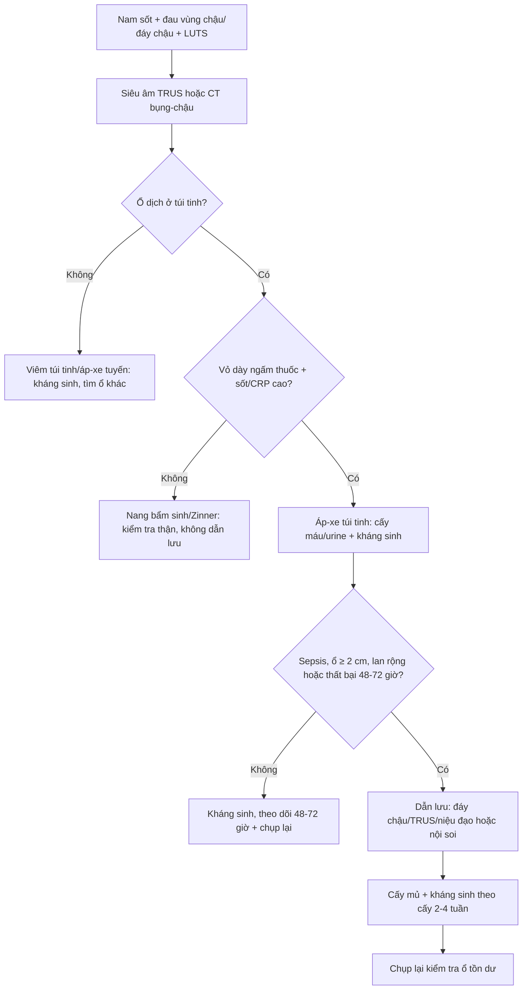
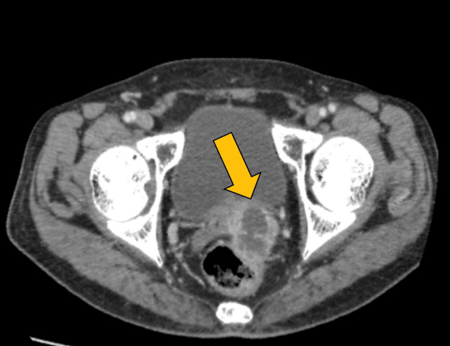
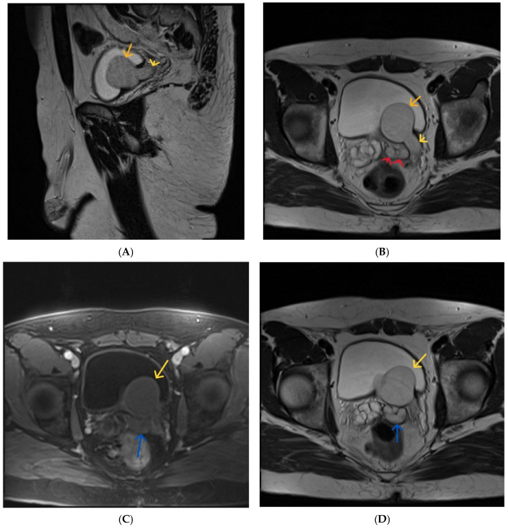

# 3077 — Áp-xe túi tinh: ổ mủ sau bàng quang, khi nào chỉ kháng sinh và khi nào phải dẫn lưu

**Tags:** `pattern:ap-xe` `pattern:tu-dich-thuy-dich` `pattern:day-thanh` `pattern:ngam-thuoc-vien` `pattern:han-che-khuech-tan` `vung:tiet-nieu` `vung:tieu-khung` `vung:sinh-duc` `protocol:CT-bung-chau` `protocol:MRI-tieu-khung` `protocol:TRUS` `protocol:dan-luu` `score:qSOFA`
**Mức chắc chắn (certainty):** tổng hợp y văn (literature synthesis) — ghép **review 20 ca** (Pandey, trích trong Pan Afr Med J 2023, PMC10066645), **ca hình ảnh CT** (Cureus 2023, PMC10691900), **ca áp-xe túi tinh + áp-xe tuyến tiền liệt có MRI** (J Med Case Rep 2024, PMC11549752), **ca biến chứng viêm phúc mạc** (World J Clin Cases 2023, PMC9923855), **ca dẫn lưu qua đáy chậu** (Res Rep Urol 2024, PMC11624677), **loạt 42 ca bệnh túi tinh trên MRI** (Int Braz J Urol 2018, PMC5815537) và **review Zinner** (Diagnostics 2026, PMC13115000). Không có ca do nhóm tự chụp.

> **Câu hỏi thực hành:** nam **60 tuổi**, đái tháo đường kiểm soát kém, sốt **38,5°C**, đau vùng chậu–đáy chậu, CRP **182 mg/L**, bạch cầu **13.250/mm³**; CT thấy **ổ dịch 28 × 27 mm vỏ dày ngấm thuốc ở túi tinh phải**. Đây là **nang túi tinh bẩm sinh** hay **áp-xe**, và **có phải dẫn lưu ngay không**?
> Bài chốt **ba quyết định**: **(1) ổ dịch túi tinh + sốt/CRP cao + vỏ dày ngấm thuốc → áp-xe cho đến khi chứng minh ngược; (2) kháng sinh đơn thuần chỉ đủ cho ổ nhỏ, không nhiễm trùng huyết — ổ ≥ 2 cm, sepsis hoặc không đáp ứng 48–72 giờ phải dẫn lưu; (3) kiểm tra thận cùng bên trước khi can thiệp — nang túi tinh + thận bất sản là Zinner, không phải áp-xe.** Nối [3055 – Áp-xe tuyến tiền liệt](../3055-ap-xe-tuyen-tien-liet/lesson.md), [158 – Tuyến tiền liệt & PI-RADS](../158-tien-liet-tuyen-PIRADS/lesson.md).

## 1. Tổng quan bệnh học – cơ chế hình ảnh: vì sao ổ mủ nằm sau bàng quang

- **Giải phẫu:** hai túi tinh nằm **sau bàng quang, trên tuyến tiền liệt**, đổ vào **ống phóng tinh** rồi vào niệu đạo sau; tuyến tiền liệt, ống dẫn tinh và túi tinh **dùng chung đường ra và có hệ mạch – bạch mạch rất gần nhau** → **nhiễm trùng lan từ tuyến tiền liệt/niệu đạo là đường vào thường gặp nhất**.
- **Sinh lý bệnh:** tắc **ống phóng tinh** (phì đại tuyến tiền liệt, sonde niệu đạo lưu lâu, thủ thuật niệu đạo, dị tật ống) → ứ dịch + vi khuẩn → **viêm rồi tạo ổ mủ**. Đái tháo đường, suy giảm miễn dịch, HIV, nghiện rượu làm tăng nguy cơ. **E. coli** là tác nhân hay gặp nhất; ngoài ra *Klebsiella*, *Proteus*, *Citrobacter*; **lao** ở vùng lưu hành.
- **TẠI SAO ổ mủ có vỏ dày ngấm thuốc:** phản ứng viêm tạo **màng xơ – mạch máu tân sinh** quanh ổ mủ; màng này **ngấm thuốc cản quang** ở thì muộn. Dịch bên trong là **mủ (xác bạch cầu, protein, mảnh tổ chức)** nên **không ngấm thuốc**, có thể có **cặn lắng/bọt khí**.
- **TẠI SAO hạn chế khuếch tán:** mủ đặc, nhiều tế bào và protein → **chuyển động Brown của nước bị cản** → **DWI tăng tín hiệu, ADC giảm**. Đây là dấu giúp phân biệt **áp-xe (ADC thấp)** với **nang đơn thuần (ADC cao, dịch trong)**; nhưng **không có ngưỡng ADC đồng thuận riêng cho túi tinh** — phải đọc cùng hình thái và lâm sàng.
- **Ngưỡng định lượng phải thuộc:**

| Biến số | Số liệu | Nguồn |
|---|---|---|
| Số ca đã báo | **< 100 ca** từ 1978; **28 ca** trong y văn tiếng Anh (2009); **< 40 ca** (2024) | PMC9923855; PMC2740224; PMC11624677 |
| Triệu chứng (review 20 ca) | **Sốt 74%**, **đái khó 58%**, **tuyến tiền liệt/mào tinh dễ đau 32%** | PMC10066645 (trích Pandey) |
| Kích thước ổ trong các ca | **28 × 27 mm**; **38 × 13 mm**; **40 × 24 mm**; ổ áp-xe tuyến + túi tinh **70 × 60 × 43 mm** | PMC12143768; PMC11624677; PMID 42587330; PMC11549752 |
| Lượng mủ dẫn lưu | **8 mL** (đáy chậu); **> 100 mL** (qua bẹn) | PMC11624677; PMC2740224 |
| CRP / bạch cầu lúc vào | **182 mg/L** / **13.250/mm³**; **258 mg/L** kèm qSOFA **3/3** | PMC12143768; PMC11549752 |

## 2. Mẫu hình + chẩn đoán phân biệt theo đường lan và bối cảnh (gamut)

- **Gamut theo đường lan:**
  - **Từ tuyến tiền liệt (hay nhất):** áp-xe tuyến tiền liệt lan trực tiếp → túi tinh; có thể **áp-xe túi tinh đơn thuần** hoặc **đồng thời**.
  - **Từ niệu đạo/bàng quang:** sonde lưu lâu, thủ thuật nội soi, viêm niệu đạo; tắc ống phóng tinh do phì đại tuyến tiền liệt.
  - **Theo đường sinh dục:** viêm mào tinh – ống dẫn tinh lan ngược; sau triệt sản/thủ thuật bẹn.
  - **Ít gặp:** lao niệu – sinh dục (tiểu máu, vôi hóa, "đái mủ vô khuẩn"), nhiễm nấm ở người suy giảm miễn dịch.
- **Gamut theo hình ảnh — "ổ dịch túi tinh":** áp-xe · nang bẩm sinh/Zinner · nang ống phóng tinh · nang Müllerian/Wolffian · u túi tinh (thể đặc) · áp-xe tuyến tiền liệt lan · viêm túi tinh (dày thành, không ổ dịch) · xuất huyết túi tinh (T1 tăng).
- **Mẹo nhớ 3 câu hỏi:** **(1) có sốt/CRP cao không? (2) vỏ dày ngấm thuốc hay thành mỏng? (3) thận cùng bên có tồn tại không?**

## 3. Bảng so sánh phân biệt (ma trận đối chiếu)

| Thực thể (entity) | Hình ảnh điển hình (US/CT/MRI) | Chốt vào (rule-in) | Chốt loại (rule-out) | Gợi ý xác nhận |
|---|---|---|---|---|
| **Áp-xe túi tinh** | Ổ dịch **vỏ dày ngấm thuốc viền**, cặn/bọt khí, **DWI cao – ADC thấp**, T2 hỗn hợp cao | **Sốt + CRP cao + vỏ dày ngấm thuốc + cặn trong ổ** | **Thành mỏng, không ngấm thuốc, không triệu chứng** → nang | Siêu âm/CT/MRI; chọc hút có mủ là chốt |
| **Nang túi tinh bẩm sinh / Zinner** | Nang **thành mỏng**, dịch trong, **không ngấm thuốc**, thường **một bên**; kèm **thận cùng bên bất sản** | **Thận bất sản cùng bên + nang túi tinh + không viêm** | **Vỏ dày, sốt, CRP cao** → áp-xe | CT/MRI hệ niệu; siêu âm thận |
| **Nang ống phóng tinh / Müllerian** | Nang **đường giữa**, thành mỏng, dịch trong, không ngấm thuốc | **Vị trí đường giữa + thành mỏng + không viêm** | **Lệch một bên + vỏ dày** → áp-xe | MRI T2; không can thiệp nếu không triệu chứng |
| **Áp-xe tuyến tiền liệt lan túi tinh** | Ổ dịch **trong tuyến tiền liệt** lan ra sau, đa thùy; túi tinh dày/ứ dịch | **Ổ chính ở tuyến + lan túi tinh** | **Ổ chính ở túi tinh, tuyến bình thường** → áp-xe túi tinh | MRI/CT; dẫn lưu ổ tuyến có thể làm xẹp ổ túi tinh |
| **U túi tinh** | **Thành phần đặc** ngấm thuốc, có thể vôi hóa; không phải ổ dịch đơn thuần | **Phần đặc ngấm thuốc + không mủ** | **Ổ dịch hoàn toàn, không phần đặc** → loại | MRI + sinh thiết nếu nghi |
| **Viêm túi tinh** | **Dày thành lan tỏa (≈ 3 mm)**, ngấm thuốc viền, **không có ổ dịch** | **Dày thành + không ổ dịch + đáp ứng kháng sinh** | **Có ổ dịch có vỏ** → áp-xe | MRI; theo dõi sau kháng sinh |
| **Xuất huyết túi tinh** | **T1 tăng tín hiệu**, T2 hỗn hợp; không vỏ dày | **T1 cao + không sốt** | **T1 thấp + vỏ dày** → áp-xe | MRI không tiêm + có/không tiêm |

*Cureus 2023 (PMC10691900), CC BY 4.0: **trái** — ổ dịch giảm đậm độ, vỏ dày ngấm thuốc ở **túi tinh trái** (mũi tên vàng); **phải** — ổ dịch đa thùy trong **tuyến tiền liệt** (mũi tên vàng). Hai ổ có thể cùng tồn tại; **vị trí ổ chính quyết định đường dẫn lưu**. Ảnh ghép letterbox, giữ nguyên panel và mũi tên của tác giả.*

*Pan Afr Med J 2023 (PMC10066645), CC BY 4.0: **(A)** ổ dịch ở **túi tinh trái** (mũi tên vàng); **(B)** viêm/tổn thương bàng quang phía trên (mũi tên vàng); **(C)** ổ mủ lan ra **vùng bẹn** (mũi tên vàng). Đây là biến thể "áp-xe túi tinh biểu hiện như khối bẹn" — dễ bị chẩn đoán nhầm thoát vị/áp-xe mô mềm.*

## 4. Protocol chụp + ngưỡng xử trí

- **Xét nghiệm trước hình ảnh:** tổng phân tích tế bào máu, **CRP**, cấy máu + cấy nước tiểu, glucose/HbA1c; **PSA có thể tăng nhẹ** (ca 44 tuổi: **3,71 µg/L** so với nền **0,90 µg/L**) — không dùng PSA để chẩn đoán áp-xe.
- **Chẩn đoán hình ảnh theo bậc:**
  - **Siêu âm qua ngả trực tràng (TRUS):** đầu tay, thấy ổ **giảm âm, vỏ dày, vách, cặn**; có thể **hướng dẫn chọc hút/dẫn lưu**.
  - **CT bụng – chậu có cản quang:** đánh giá **lan ra ngoài (bẹn, đáy chậu, phúc mạc)**, khí trong ổ, áp-xe tuyến tiền liệt/thận kèm; cần cho **qSOFA/sepsis**.
  - **MRI tiểu khung (T1, T2, DWI/ADC, sau gadolinium):** khi ổ phức tạp, cần phân biệt **nang – áp-xe – u**, hoặc lập kế hoạch mổ. Dấu chốt: **DWI cao/ADC thấp + vỏ ngấm thuốc viền**; dịch **T1 thấp, T2 cao không đồng nhất**.
  - **Không cần** niệu đồ tĩnh mạch/CT niệu đồ thường quy nếu không có tiểu máu hoặc nghi tổn thương đường niệu trên.
- **Ngưỡng và lựa chọn dẫn lưu:** **không có ngưỡng kích thước đồng thuận** trong y văn (chủ yếu ca lâm sàng). Thực hành hợp lý:
  - **Ổ nhỏ, không sepsis, đáp ứng kháng sinh sau 48–72 giờ:** có thể **chỉ kháng sinh** (ca 58 tuổi HIV/đái tháo đường: áp-xe túi tinh được điều trị bảo tồn, chỉ dẫn lưu ổ bẹn).
  - **Ổ ≥ 2 cm, sepsis/qSOFA ≥ 2, đau nhiều, không đáp ứng 48–72 giờ, hoặc lan ra bẹn/đáy chậu/phúc mạc:** **dẫn lưu** + kháng sinh.
  - **Đường dẫn lưu:** **qua đáy chậu dưới gây tê tại chỗ** (ca 44 tuổi, 8 mL mủ, xuất viện ngày 1); **qua trực tràng dưới hướng dẫn TRUS**; **qua niệu đạo/vesiculoscopy** (kèm HoLEP nếu có tắc cổ bàng quang); **nội soi ổ bụng/mổ mở** khi ổ lớn, lan phúc mạc hoặc thất bại đường khác.
  - **Kháng sinh:** phổ gram âm (ceftriaxone/piperacillin–tazobactam) ± metronidazole nếu kỵ khí; **điều chỉnh theo cấy**, thời gian **2–4 tuần** tùy đáp ứng (ca dùng 14 ngày uống sau IV; ca khác 3 tuần).

## 5. Biến thể bình thường và cạm bẫy

- **Bẫy 1 — nang bẩm sinh bị gọi là áp-xe:** nang **thành mỏng, dịch trong, không ngấm thuốc**, bệnh nhân **không sốt**; dẫn lưu vô ích và có thể gây nhiễm trùng. Luôn hỏi **sốt/CRP** và đo **độ dày/thành ngấm thuốc**.
- **Bẫy 2 — bỏ sót Zinner:** nang túi tinh một bên + **thận cùng bên bất sản**; nếu chỉ nhìn khung chậu sẽ bỏ qua. Trước khi can thiệp, **siêu âm/CT hệ niệu** để tìm thận bất sản/niệu quản lạc chỗ.
- **Bẫy 3 — áp-xe tuyến tiền liệt "đội lốt" áp-xe túi tinh:** ổ chính ở tuyến có thể lan ra túi tinh; **dẫn lưu ổ tuyến** đôi khi làm xẹp cả ổ túi tinh (ca 60 tuổi: dẫn lưu áp-xe tuyến qua TRUS + kháng sinh dài, ổ túi tinh thoái triển).
- **Bẫy 4 — vỡ ổ vào phúc mạc:** đau bụng lan tỏa, sốc nhiễm khuẩn; ca sonde lưu lâu đã tiến triển thành **viêm phúc mạc toàn thể, MODS, sốc nhiễm khuẩn** — phải **dẫn lưu ổ đáy chậu + ổ bụng** kịp thời.
- **Bẫy 5 — lao túi tinh:** bệnh cảnh mạn, **vôi hóa**, tiểu máu, "mủ vô khuẩn"; cấy/PCR lao trước khi kết luận áp-xe thông thường.
- **Bẫy 6 — biến chứng sau can thiệp:** teo túi tinh và **rối loạn xuất tinh** sau điều trị bảo tồn; **thuyên tắc phổi** đã được báo sau dẫn lưu nội soi ổ bụng — dự phòng huyết khối theo nguy cơ.
- **Cạm bẫy mặt cắt:** trên CT không cản quang, **túi tinh giãn chứa dịch** có thể trông giống bàng quang/ nang; dùng **thì muộn + tái tạo vành/dọc** và đối chiếu **ống phóng tinh** để xác định túi tinh.

## 6. Tự lượng giá — Blind Quiz

**Ca 1 — 60 tuổi, đái tháo đường, sốt và đau vùng chậu.**

- Gợi ý lâm sàng: HbA1c **11,8%**, sốt 2 tuần, tiểu khó, CRP/bạch cầu tăng; siêu âm thấy ổ dịch trong túi tinh trái.
- Câu hỏi: Mô tả dấu hiệu chính? Ba chẩn đoán phân biệt? Có cần dẫn lưu ngay không?

<b>Bấm để hiện đáp án</b>

- Dấu hiệu (findings): ổ **giảm đậm độ** trong **túi tinh trái**, **vỏ dày ngấm thuốc viền**, có cặn bên trong (mũi tên vàng); không thấy phần đặc ngấm thuốc.
- Chẩn đoán (diagnosis): **áp-xe túi tinh trái** trên nền đái tháo đường kiểm soát kém.
- Phân biệt: **nang túi tinh bẩm sinh/Zinner** (thành mỏng, không sốt), **áp-xe tuyến tiền liệt lan** (ổ chính ở tuyến), **u túi tinh** (phần đặc ngấm thuốc).
- Điều trị: kháng sinh phổ gram âm + **dẫn lưu** nếu ổ ≥ 2 cm/sepsis/không đáp ứng; ca này được điều trị kháng sinh và theo dõi, nhưng nguyên tắc chung là **dẫn lưu ổ mủ có triệu chứng**.
- Nguồn ảnh: Cureus 2023 (PMC10691900), CC BY 4.0.

**Ca 2 — 58 tuổi, HIV/đái tháo đường, khối bẹn đau.**

- Gợi ý lâm sàng: khối bẹn trái đau 15 ngày, sốt; tiền sử HIV và đái tháo đường.
- Câu hỏi: (A)–(C) cho thấy đường lan nào? Vì sao không được chỉ mổ "áp-xe bẹn" mà bỏ qua ổ chính?

<b>Bấm để hiện đáp án</b>

- Dấu hiệu (findings): **(A)** ổ dịch ở **túi tinh trái**; **(B)** tổn thương/viêm **bàng quang** phía trên; **(C)** ổ mủ lan theo **dây chằng bẹn ra vùng bẹn**.
- Chẩn đoán (diagnosis): **áp-xe túi tinh trái lan ra bẹn** — ổ bẹn chỉ là ngọn, ổ chính ở túi tinh.
- Điều trị: **dẫn lưu ổ bẹn + kháng sinh toàn thân**; ổ túi tinh có thể điều trị bảo tồn nếu nhỏ và hết triệu chứng (ca này bảo tồn túi tinh). Nếu chỉ mổ ổ bẹn mà không điều trị ổ chính → tái phát/nhiễm khuẩn huyết.
- Nguồn ảnh: Pan Afr Med J 2023 (PMC10066645), CC BY 4.0.

**Ca 3 — Nang túi tinh hay áp-xe? Cần kiểm tra gì trước khi can thiệp?**

- Gợi ý lâm sàng: nam trẻ, đau vùng chậu tái diễn, **không sốt**; siêu âm thấy nang sau bàng quang.
- Câu hỏi: (B) cho thấy gì? Vì sao phải chụp hệ niệu trước khi chọc/dẫn lưu?

<b>Bấm để hiện đáp án</b>

- Dấu hiệu (findings): **(B)** axial T2 — **nang túi tinh** (mũi tên đỏ) cạnh **niệu quản giãn/niệu quản lạc chỗ** và **ureterocele** (mũi tên vàng/cam); các panel khác cho thấy **thận trái bất sản**.
- Chẩn đoán (diagnosis): **hội chứng Zinner** — thận một bên bất sản + nang túi tinh cùng bên + tắc ống phóng tinh.
- Vì sao: nang **thành mỏng, không ngấm thuốc**, bệnh nhân không nhiễm trùng → **không dẫn lưu**; can thiệp mù có thể làm nhiễm trùng nang và tổn thương niệu quản lạc chỗ. Điều trị chỉ khi có triệu chứng/tắc.
- Nguồn ảnh: Diagnostics 2026 (PMC13115000), CC BY 4.0.

## Bài liên quan chéo
- [100 – Tổng quan hệ Bụng](../100-tong-quan-he-bung/lesson.md)
- [3055 – Áp-xe tuyến tiền liệt](../3055-ap-xe-tuyen-tien-liet/lesson.md)
- [158 – Tuyến tiền liệt & PI-RADS](../158-tien-liet-tuyen-PIRADS/lesson.md)
- [3067 – Hẹp niệu quản do BK sau ghép thận](../3067-hep-nieu-quan-do-bk-sau-ghep-than/lesson.md)
- [672 – Biến chứng muộn sau tái tạo bàng quang](../672-bien-chung-muon-sau-tai-tao-bang-quang/lesson.md)

## Ảnh
- 4 ảnh + 1 composite: **CC BY 4.0** (Cureus 2023, PMC10691900; Pan Afr Med J 2023, PMC10066645; Diagnostics 2026, PMC13115000) — nguyên bản, composite chỉ letterbox + dải attribution, không crop/kéo giãn; chi tiết trong `images/CREDITS.md`.

> Không dùng để chẩn đoán độc lập khi chưa có người hướng dẫn.
