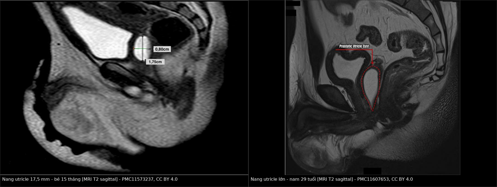
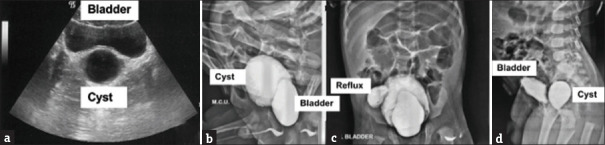
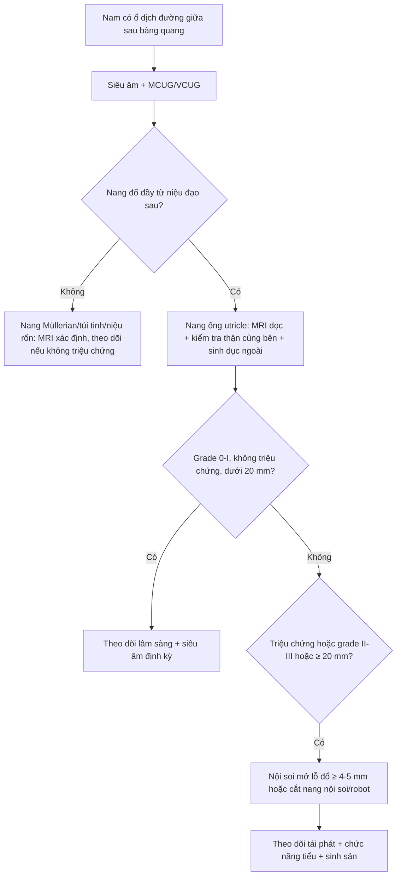
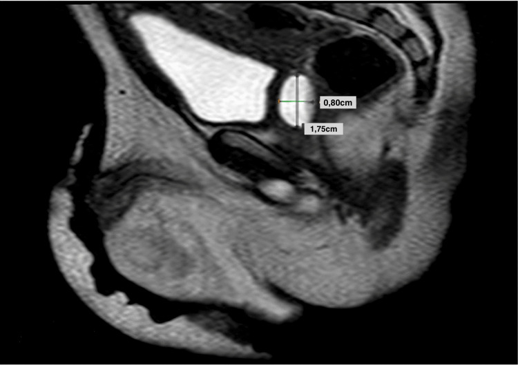
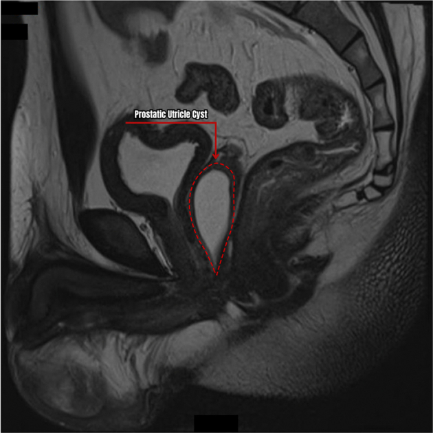
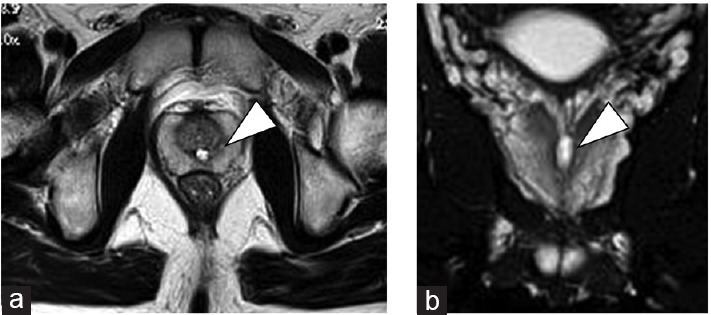

# 3078 — Nang ống utricle & nang ống Müllerian: ổ dịch ĐƯỜNG GIỮA sau bàng quang — khi nào theo dõi, khi nào mổ

**Tags:** `pattern:nang-duong-giua` `pattern:o-dich-thuy-dich` `pattern:thanh-mong` `pattern:thong-nieu-dao` `pattern:di-tat-kem` `vung:tiet-nieu` `vung:tuyen-tien-liet` `vung:tieu-khung` `protocol:MRI-tieu-khung` `protocol:VCUG` `protocol:TRUS` `protocol:noi-soi-nieu-dao` `score:PUC-grade`
**Mức chắc chắn (certainty):** tổng hợp y văn (literature synthesis) — ghép **phân tích gộp 22 ca trẻ có cơ quan sinh dục ngoài bình thường** (BMC Urol 2019, PMC6446365), **nghiên cứu đoàn hệ nội soi ở trẻ hẹp niệu đạo thể gần** (Front Pediatr 2025, PMC11897568), **nghiên cứu MRI 4.990 nam trung–cao tuổi** (The Prostate 2025, PMC12211538) và **các ca có ảnh** (Cureus 2024, PMC11573237; Int J Surg Case Rep 2024, PMC11607653; J Indian Assoc Pediatr Surg 2025, PMC12094596; Asian J Androl 2022, PMC9491043). Không có ca do nhóm tự chụp.

> **Câu hỏi thực hành:** bé trai **15 tháng**, viêm mào tinh–tinh hoàn tái diễn nhiều đợt dù đã dùng kháng sinh, bìu trái sưng đau; MCUG thấy **cấu trúc nang sau bàng quang đổ đầy khi đi tiểu**; MRI T2 dọc thấy **nang đường giữa 17,5 × 8 mm** ngay sau niệu đạo sau. Đây là **nang bẩm sinh cần mổ** hay **biến thể bình thường của ống utricle**?
> Bài chốt **ba quyết định**: **(1) nang đường giữa ngay sau niệu đạo sau, thành mỏng, đổ đầy từ niệu đạo = nang ống utricle (prostatic utricle cyst) cho đến khi chứng minh ngược; (2) không phải nang nào cũng mổ — grade 0–I, không triệu chứng, < 20 mm thì theo dõi; (3) trước khi can thiệp phải kiểm tra THẬN cùng bên và cơ quan sinh dục ngoài — 32% có bất sản thận một bên, và thể gần/DSD là bối cảnh hay gặp.** Nối [3055 – Áp-xe tuyến tiền liệt](../3055-ap-xe-tuyen-tien-liet/lesson.md), [3077 – Áp-xe túi tinh](../3077-ap-xe-tui-tinh/lesson.md).

## 1. Tổng quan bệnh học – cơ chế hình ảnh: vì sao ổ dịch nằm đúng đường giữa

- **Giải phẫu – phôi thai:** ống utricle (prostatic utricle, "utricle of the prostate") là **túi cùng đường giữa dài ~6 mm** nằm trong tuyến tiền liệt, đổ vào **gò tinh (verumontanum)** của niệu đạo sau, giữa hai lỗ ống phóng tinh (PMC11897568). Phần **sọ** phát sinh từ **ống Müllerian**, phần **đuôi** phối hợp ống Müllerian + ống Wolffian + xoang niệu dục (PMC6446365) — vì thế biểu mô lót có thể là **trụ, chuyển tiếp, vuông hoặc vảy** tùy đoạn.
- **Sinh lý bệnh:** bình thường ống Müllerian thoái triển dưới **yếu tố ức chế Müllerian (MIF/AMH)** của tinh hoàn thai. Thoái triển **không hoàn toàn** và/hoặc **giảm kích thích androgen lên xoang niệu dục** → ống utricle tồn dư và **giãn thành nang** (PMC6446365). Lỗ đổ hẹp + tuyến lót tiết nhầy → ứ dịch; vì **thông với niệu đạo**, nước tiểu trào vào khi đi tiểu → **ứ nước tiểu thứ phát, nhiễm trùng, sỏi, viêm mào tinh tái diễn**.
- **TẠI SAO tín hiệu MRI như vậy:**
  - Dịch đơn thuần (nước tiểu/nhầy loãng): **T1 thấp, T2 rất cao**, không ngấm thuốc — giống mọi nang dịch.
  - **Nhầy đặc, protein cao hoặc xuất huyết cũ** → **T1 tăng** dần; đây là lý do ổ "nang" có thể sáng trên T1 mà **không phải mỡ** (không mất tín hiệu khi fat-sat).
  - **Sỏi trong nang** → **trống tín hiệu** mọi chuỗi xung, thấy rõ trên CT.
  - **Thành mỏng, đều, không ngấm thuốc** khi không viêm; **thành dày + ngấm thuốc viền + hạn chế khuếch tán** khi bội nhiễm (khác biệt với áp-xe — bài 3055/3077).
- **Ngưỡng định lượng phải thuộc:**

| Biến số | Số liệu | Nguồn |
|---|---|---|
| Tần suất ống utricle | **1%** nam giới khi mổ tử thi; **5%** ở bệnh nhân niệu khoa; **2,54%** (127/4.990) nam 40–90 tuổi trên MRI | PMC6446365; PMC12211538 |
| Ống utricle bình thường | dài **~6 mm** | PMC11897568 |
| Trẻ hẹp niệu đạo thể gần | nang utricle **73,5%** (25/34); trục dọc **10–35 mm** (trung vị **15 mm**) | PMC11897568 |
| Nguy cơ có triệu chứng | **12%** (3/25) sau trung bình **30 tháng**; nang **≥ 20 mm: 3/10 có triệu chứng vs 0/15 nang < 20 mm** (p = 0,024) | PMC11897568 |
| "Nang lớn" theo định nghĩa giải phẫu | **> 1 cm**; triệu chứng thường khi **≥ 2,5 cm** | PMC11607653 |
| 22 ca trẻ có sinh dục ngoài bình thường | tuổi trung bình **5,8** (2 tháng–18 tuổi); bất sản thận một bên **32%** | PMC6446365 |
| Triệu chứng (22 ca) | NTH/tiết mủ niệu đạo/đái mủ **41%**; LUTS kích thích **17%**; LUTS tắc nghẽn **14%**; bí tiểu **18%**; viêm mào tinh **14%** | PMC6446365 |
| Giá trị chẩn đoán từng phương thức | siêu âm đúng **68%**; VCUG/RUG **59%**; CT/MRI **50%** | PMC6446365 |
| Kích thước ca điển hình | **17,5 × 8 mm** (15 tháng); **8 × 3 cm** (6 tháng); **1,6 × 1,5 × 4,4 cm** (29 tuổi) | PMC11573237; PMC12094596; PMC11607653 |

- **Nhãn "nang ống Müllerian" vs "nang ống utricle":** nhiều tài liệu dùng lẫn. Khác biệt thực dụng: **nang ống utricle thông với niệu đạo sau** (thấy thuốc vào nang khi VCUG), hình **ống/giọt**, gặp ở **trẻ** và thường kèm hẹp niệu đạo, tinh hoàn ẩn, DSD; **nang ống Müllerian** điển hình **không thông** với niệu đạo, hình **tròn**, gặp ở **nam 20–40 tuổi có sinh dục ngoài bình thường** (PMC6446365). Sự khác biệt này quyết định việc **có cần nội soi đóng/mở lỗ đổ hay chỉ theo dõi**.

## 2. Mẫu hình + chẩn đoán phân biệt theo vị trí và tuổi (gamut)

- **Theo vị trí — "ổ dịch ĐƯỜNG GIỮA sau bàng quang":**
  - **Ngay sau niệu đạo sau, trong tuyến tiền liệt:** nang ống utricle (thông niệu đạo) · nang ống Müllerian (không thông) · nang ống phóng tinh (ejaculatory duct cyst) · áp-xe tuyến tiền liệt · thoái hóa nang của ung thư tuyến tiền liệt.
  - **Lệch một bên, trên tuyến tiền liệt:** nang túi tinh (seminal vesicle cyst) — đặc biệt **hội chứng Zinner** (kèm bất sản thận cùng bên) · nang niệu quản lạc chỗ.
  - **Trước bàng quang, đường giữa:** nang niệu rốn (urachal cyst) — dính thành bụng trước, không liên quan niệu đạo.
  - **Thông với bàng quang:** túi thừa bàng quang (bladder diverticulum) — cổ rộng ở thành bàng quang, không ở niệu đạo sau.
- **Theo tuổi/bối cảnh:**
  - **Trẻ có hẹp niệu đạo thể gần, tinh hoàn ẩn, DSD** → nang ống utricle, thường grade II–III, dễ có triệu chứng.
  - **Nam 20–40 tuổi, sinh dục ngoài bình thường, nang tròn** → nang ống Müllerian; có thể đến vì **vô sinh do tắc ống phóng tinh** (vô sinh do tắc chiếm 20–40% các ca vô tinh).
  - **Nam lớn tuổi, chụp MRI tuyến tiền liệt vì lý do khác** → ống utricle nhỏ (trung bình **0,4 cm³**) là **biến thể tình cờ**, không can thiệp.
- **Ba câu hỏi chốt:** **(1) nang có đổ đầy từ niệu đạo sau không (VCUG/nội soi)? (2) thận cùng bên có tồn tại không? (3) có triệu chứng/≥ 20 mm/grade II–III không?**

## 3. Bảng so sánh phân biệt (ma trận đối chiếu)

| Thực thể (entity) | Hình ảnh điển hình (US/VCUG/MRI) | Chốt vào (rule-in) | Chốt loại (rule-out) | Gợi ý xác nhận |
|---|---|---|---|---|
| **Nang ống utricle** | Nang **đường giữa**, hình ống/giọt, **cổ hẹp về gò tinh**, thành mỏng; T2 rất cao, T1 thấp (hoặc cao nếu nhầy/máu); **đổ đầy khi đi tiểu** | **Thấy lỗ đổ ở gò tinh + nang đổ đầy từ niệu đạo sau** | **Không thấy thuốc vào nang + nang tròn trên tuyến** → nghĩ nang Müllerian | VCUG/MCUG + nội soi niệu đạo; MRI dọc để đo trục dài |
| **Nang ống Müllerian** | Nang **tròn, đường giữa, trong/trên tuyến tiền liệt**, thành mỏng, **không thông niệu đạo** | **Nang tròn + không đổ đầy từ niệu đạo + nam 20–40 tuổi, sinh dục ngoài bình thường** | **Có lỗ đổ ở gò tinh + hình ống** → nang ống utricle | MRI T2 dọc; nội soi xác nhận không có lỗ đổ |
| **Nang túi tinh / Zinner** | Nang **lệch một bên**, trên–sau tuyến tiền liệt, T2 cao; **thận cùng bên bất sản**, niệu quản lạc chỗ | **Nang một bên + bất sản thận cùng bên** | **Nang đúng đường giữa + hai thận đủ** → loại | Siêu âm/CT hệ niệu + MRI tiểu khung |
| **Áp-xe tuyến tiền liệt** | Ổ dịch **vỏ dày ngấm thuốc**, cặn/khí, **DWI cao–ADC thấp**, đông đặc quanh | **Sốt + CRP cao + vỏ dày ngấm thuốc** | **Thành mỏng, không ngấm, không sốt** → nang | MRI có DWI; chọc hút nếu còn nghi |
| **Túi thừa bàng quang** | Túi **thông với bàng quang**, cổ ở thành bàng quang; thường thấy được trên cystography thì đổ đầy | **Cổ túi ở thành bàng quang, trên não cổ bàng quang** | **Cổ nang ở niệu đạo sau/gò tinh** → nang utricle | Cystography thì đổ đầy + MPR; nội soi bàng quang |
| **Nang niệu rốn** | Nang **đường giữa phía TRƯỚC**, dính rốn–đỉnh bàng quang, không liên quan tuyến tiền liệt | **Vị trí trước bàng quang + dính thành bụng** | **Nằm sau bàng quang** → loại | Siêu âm thành bụng + MRI |
| **Ung thư tuyến tiền liệt thoái hóa nang** | Nang **không đồng nhất**, có **phần đặc ngấm thuốc**, xâm lấn; PSA cao | **Phần đặc ngấm thuốc + PSA cao + tuổi lớn** | **Nang thuần dịch, thành mỏng, PSA bình thường** → loại | MRI đa tham số + PSA + sinh thiết |

*Trái — bé 15 tháng, viêm mào tinh tái diễn: nang **17,5 × 8 mm** ngay sau niệu đạo sau (Cureus 2024, PMC11573237, CC BY 4.0). Phải — nam 29 tuổi, vô sinh nguyên phát: nang lớn **1,6 × 1,5 × 4,4 cm** choán toàn bộ tuyến tiền liệt (Int J Surg Case Rep 2024, PMC11607653, CC BY 4.0). Cùng một bệnh, hai cực kích thước — **quyết định theo triệu chứng + grade, không theo "thấy nang là mổ"**. Ảnh ghép letterbox, giữ nguyên nhãn của tác giả.*

*J Indian Assoc Pediatr Surg 2025 (PMC12094596), CC BY-NC-SA 4.0: **(a)** siêu âm dọc — nang sau bàng quang; **(b–d)** MCUG — nang **8 × 3 cm** đổ đầy từ niệu đạo sau, đồng thời niệu quản lạc chỗ đổ vào nang và **thận phải không lên hình**. Đây là lý do phải chụp hệ niệu trước khi mổ: bỏ sót niệu quản lạc chỗ = cắt vào đường niệu.*

## 4. Protocol chụp + phân độ và ngưỡng xử trí

- **Bậc chẩn đoán hình ảnh:**
  - **Siêu âm (bụng dưới qua ngả bụng, đáy chậu hoặc qua trực tràng):** đầu tay — ổ dịch đường giữa sau bàng quang, thành mỏng; đúng chẩn đoán **68%** trong loạt gộp. Hạn chế: khó thấy nang nhỏ (grade 0–I).
  - **MCUG/VCUG (hoặc RUG):** chứng minh **thông với niệu đạo sau** — tiêu chuẩn phân biệt với nang Müllerian; đồng thời phát hiện **niệu quản lạc chỗ, trào ngược, hẹp niệu đạo**. Đúng **59%**.
  - **MRI tiểu khung (T1, T2 dọc + ngang, DWI, sau gadolinium):** bắt buộc khi cân nhắc mổ — xác định **đỉnh nang so với cổ bàng quang** (phân độ), quan hệ **trực tràng – túi tinh – ống dẫn tinh**, tìm **phần đặc** và **sỏi**. Đúng **50%** khi dùng đơn thuần, nhưng là phương thức **lập kế hoạch mổ** tốt nhất.
  - **CT:** ít lợi thế hơn MRI; hữu ích khi cần **sỏi**, biến chứng, hoặc chống chỉ định MRI.
  - **Nội soi niệu đạo:** tiêu chuẩn vàng — thấy **lỗ đổ ở gò tinh**; đặt catheter vào nang để bơm thuốc hoặc **dẫn đường cho mổ nội soi**.
- **Phân độ theo hình ảnh (grade 0–III, theo VCUG):** grade 0 — khu trú ở gò tinh; grade I — dưới cổ bàng quang; grade II — **vượt qua cổ bàng quang**; grade III — lỗ đổ **xa hơn cơ thắt ngoài, ở niệu đạo hành** (PMC6446365; PMC11573237).
- **Ngưỡng xử trí:** grade 0–I **không triệu chứng** → **theo dõi, không can thiệp**; grade II–III, **có triệu chứng** (NTH tái diễn, viêm mào tinh, bí tiểu, đái rỉ sau tiểu, vô sinh do tắc) hoặc **≥ 20 mm** → **can thiệp** (PMC11897568; PMC6446365).
- **Lựa chọn can thiệp:**
  - **Nội soi: mở rộng lỗ đổ/incision** đạt đường kính **≥ 4–5 mm**, hoặc đặt catheter dẫn lưu — ít xâm lấn nhưng **tái phát cao hơn** (PMC12094596; PMC6446365).
  - **Cắt nang nội soi ổ bụng/robot** — ưu tiên khi nang lớn, grade II–III, tái phát sau nội soi; có thể dùng **stent niệu quản trong nang làm "đèn dẫn đường"** để tránh tổn thương ống dẫn tinh/niệu đạo (PMC11573237).
  - **Mổ mở** (sau xương mu, qua bàng quang, sau trực tràng) — nay ít dùng.
  - **Trước mọi can thiệp:** siêu âm/CT **hệ niệu** tìm bất sản thận, niệu quản lạc chỗ; khám và đánh giá **DSD** nếu cơ quan sinh dục ngoài không điển hình.

## 5. Biến thể bình thường và cạm bẫy

- **Bẫy 1 — "thấy nang là mổ":** ống utricle nhỏ gặp ở **2,54%** nam trung–cao tuổi chụp MRI vì lý do khác, thể tích trung bình **0,4 cm³**, hầu như vô hại (PMC12211538). Không triệu chứng + grade 0–I + < 20 mm → **theo dõi**.
- **Bẫy 2 — bỏ sót bất sản thận/niệu quản lạc chỗ:** **32%** ca nang utricle có **bất sản thận một bên** (PMC6446365); niệu quản lạc chỗ có thể **đổ vào chính nang** — siêu âm thận **trước** khi chọc/cắt.
- **Bẫy 3 — bỏ sót DSD:** nang utricle là một phần của **hội chứng ống Müllerian tồn tại (PMDS)** và các DSD 46,XY; ca 46,XX SRY-negative có nang utricle lớn đã được báo. Cơ quan sinh dục ngoài "bình thường" không loại trừ hoàn toàn.
- **Bẫy 4 — nhầm nang với áp-xe:** nang bội nhiễm có **thành dày, ngấm thuốc, hạn chế khuếch tán**; nhưng **không có ngưỡng ADC riêng cho ống utricle** — phải đọc cùng sốt/CRP và cấy. Điều trị áp-xe là **dẫn lưu + kháng sinh**, không phải cắt nang ngay.
- **Bẫy 5 — T1 sáng bị đọc là mỡ:** nhầy đặc/máu cũ làm **T1 tăng**; nếu không có fat-sat đối chiếu, dễ gọi sai là "nang mỡ" (teratoma). Thêm **T1 fat-sat**.
- **Bẫy 6 — nang nhỏ trên siêu âm bị bỏ qua:** nang grade 0–I **không thấy rõ** trên siêu âm và có thể **không đổ đầy** trên VCUG (đúng chỉ 59%) — nếu lâm sàng mạnh (viêm mào tinh tái diễn, đái rỉ sau tiểu), **nội soi niệu đạo** là bước quyết định.
- **Bẫy 7 — tái phát sau nội soi:** mở lỗ đổ quá nhỏ (< 4–5 mm) → hẹp lại, ứ dịch trở lại; cần đo đường kính lỗ sau mổ và theo dõi.

## 6. Tự lượng giá — Blind Quiz

**Ca 1 — Bé trai 15 tháng, viêm mào tinh–tinh hoàn tái diễn, bìu trái sưng đau.**

- Gợi ý lâm sàng: nhiều đợt viêm mào tinh dù kháng sinh, cấy nước tiểu *Pseudomonas aeruginosa*; sinh dục ngoài bình thường; MCUG thấy nang sau bàng quang đổ đầy khi đi tiểu.
- Câu hỏi: Nang nằm ở đâu so với bàng quang và niệu đạo? Vì sao viêm mào tinh lại tái diễn? Ba chẩn đoán phân biệt và bước xác nhận?

<b>Bấm để hiện đáp án</b>

- Dấu hiệu (findings): nang **đường giữa**, thành mỏng, kích thước **17,5 × 8 mm**, nằm **ngay sau niệu đạo sau/tuyến tiền liệt**, đổ đầy từ niệu đạo khi đi tiểu.
- Chẩn đoán (diagnosis): **nang ống utricle (prostatic utricle cyst)** — nước tiểu ứ trong nang, vi khuẩn trào ngược theo ống phóng tinh gây **viêm mào tinh tái diễn**.
- Phân biệt: **nang ống Müllerian** (không thông niệu đạo, tròn), **nang túi tinh/Zinner** (lệch bên + bất sản thận cùng bên), **túi thừa bàng quang** (cổ ở thành bàng quang).
- Xác nhận: nội soi thấy lỗ đổ ở gò tinh; trước mổ kiểm tra **thận cùng bên** và **sinh dục ngoài**. Ca này được **cắt nang nội soi ổ bụng** với stent niệu quản làm dẫn đường.
- Nguồn ảnh: Cureus 2024 (PMC11573237), CC BY 4.0.

**Ca 2 — Bé trai 6 tháng, bí tiểu và nhiễm trùng niệu tái diễn.**

- Gợi ý lâm sàng: bí tiểu, nhiễm trùng niệu; siêu âm thấy nang sau bàng quang; xạ hình thận thấy **thận phải không chức năng**.
- Câu hỏi: (a)–(d) cho thấy gì? Vì sao phải chụp hệ niệu và làm xạ hình trước khi mổ?

<b>Bấm để hiện đáp án</b>

- Dấu hiệu (findings): siêu âm **(a)** nang sau bàng quang **8 × 3 cm**, dịch có echo (nghi nhiễm); MCUG **(b–d)** nang đổ đầy từ niệu đạo sau, **niệu quản lạc chỗ đổ vào nang**, **thận phải không lên hình**.
- Chẩn đoán (diagnosis): **nang ống utricle lớn + thận phải lạc chỗ/không chức năng + niệu quản lạc chỗ đổ vào nang**.
- Vì sao: cắt nang mà không biết niệu quản lạc chỗ sẽ **cắt vào đường niệu** hoặc bỏ lại thận không chức năng gây nhiễm trùng; ca này mổ nội soi 3D cắt nang + xử lý thận/niệu quản lạc chỗ + cố định tinh hoàn.
- Nguồn ảnh: J Indian Assoc Pediatr Surg 2025 (PMC12094596), CC BY-NC-SA 4.0.

**Ca 3 — Nam 29 tuổi, vô sinh nguyên phát và viêm mào tinh–tinh hoàn tái diễn.**

- Gợi ý lâm sàng: vô tinh, nhiều đợt viêm mào tinh–tinh hoàn; MRI thấy cấu trúc nang đường giữa lớn.
- Câu hỏi: Vì sao nang gây **vô sinh do tắc**? Kích thước nào được coi là "lớn"? Hướng xử trí?

<b>Bấm để hiện đáp án</b>

- Dấu hiệu (findings): nang **1,6 × 1,5 × 4,4 cm**, choán toàn bộ tuyến tiền liệt, **không có ổ hạn chế khuếch tán** (không phải áp-xe/u đặc).
- Chẩn đoán (diagnosis): **nang ống utricle lớn gây tắc ống phóng tinh → vô tinh do tắc**.
- Vì sao: nang chèn/tắc đường xuất tinh chung; "nang lớn" được định nghĩa **> 1 cm**, và **≥ 2,5 cm** thường có triệu chứng.
- Xử trí: **cắt nang bằng robot** + **micro-TESE** lấy tinh trùng dự trữ nếu muốn sinh sản; ca này có thai thành công sau một chu kỳ IVF.
- Nguồn ảnh: Int J Surg Case Rep 2024 (PMC11607653), CC BY 4.0.

**Ca 4 — Nam 38 tuổi, vô tinh, không sốt.**

- Gợi ý lâm sàng: vô tinh, xuất tinh máu tái diễn; không đau, không sốt.
- Câu hỏi: Nang nhỏ như vậy có cần mổ không? Cần phân biệt với gì?

<b>Bấm để hiện đáp án</b>

- Dấu hiệu (findings): nang nhỏ **đường giữa trong tuyến tiền liệt** (đầu mũi tên), thành mỏng, không có phần đặc.
- Chẩn đoán (diagnosis): **nang ống utricle nhỏ** — có thể chỉ là **biến thể**, nhưng trong bối cảnh vô tinh phải đánh giá **tắc ống phóng tinh** và nhiễm trùng đường sinh dục.
- Phân biệt: nang Müllerian (tròn, không thông), nang túi tinh, áp-xe tuyến tiền liệt.
- Xử trí: điều trị nguyên nhân nhiễm trùng/tắc; **không cắt nang chỉ vì kích thước** nếu không có triệu chứng tắc.
- Nguồn ảnh: Asian J Androl 2022 (PMC9491043), CC BY-NC-SA 4.0.

## Bài liên quan chéo
- [100 – Tổng quan hệ Bụng](../100-tong-quan-he-bung/lesson.md)
- [3055 – Áp-xe tuyến tiền liệt](../3055-ap-xe-tuyen-tien-liet/lesson.md)
- [3077 – Áp-xe túi tinh](../3077-ap-xe-tui-tinh/lesson.md)
- [158 – Tuyến tiền liệt & PI-RADS](../158-tien-liet-tuyen-PIRADS/lesson.md)
- [672 – Biến chứng muộn sau tái tạo bàng quang](../672-bien-chung-muon-sau-tai-tao-bang-quang/lesson.md)
- [3067 – Hẹp niệu quản do BK sau ghép thận](../3067-hep-nieu-quan-do-bk-sau-ghep-than/lesson.md)

## Ảnh
- 4 ảnh + 1 composite: **CC BY 4.0** (Cureus 2024, PMC11573237; Int J Surg Case Rep 2024, PMC11607653) và **CC BY-NC-SA 4.0** (J Indian Assoc Pediatr Surg 2025, PMC12094596; Asian J Androl 2022, PMC9491043) — nguyên bản, composite chỉ letterbox + dải attribution, không crop/kéo giãn; chi tiết trong `images/CREDITS.md`.

> Không dùng để chẩn đoán độc lập khi chưa có người hướng dẫn.
