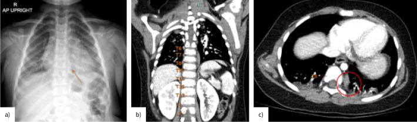
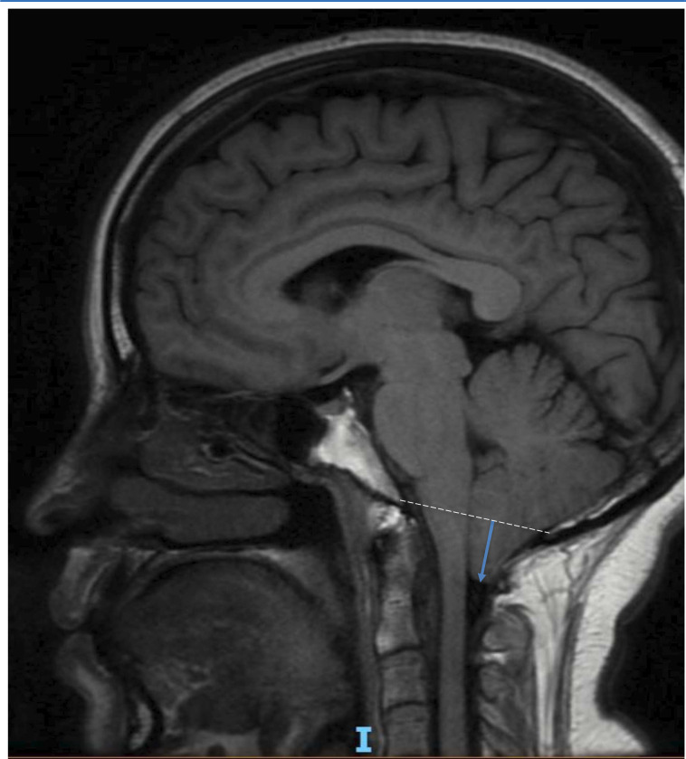
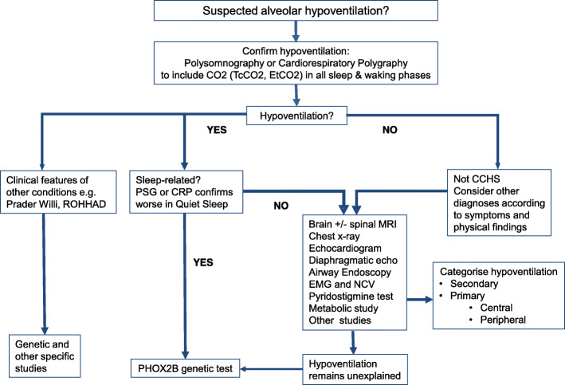
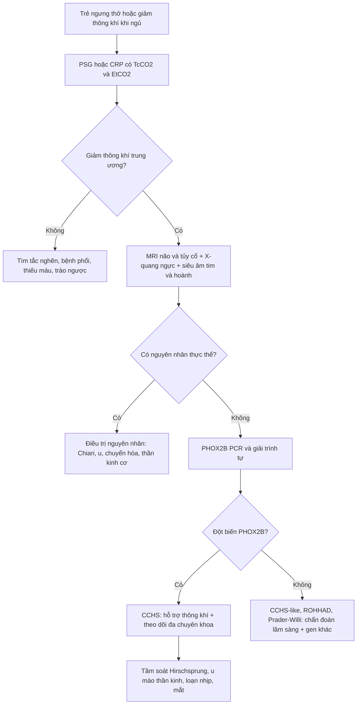
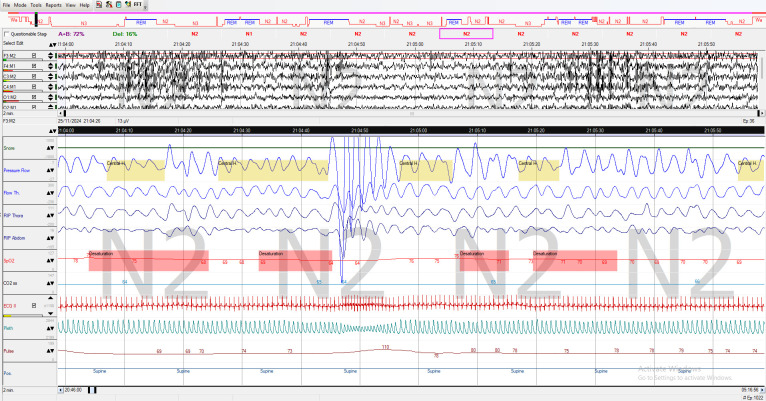
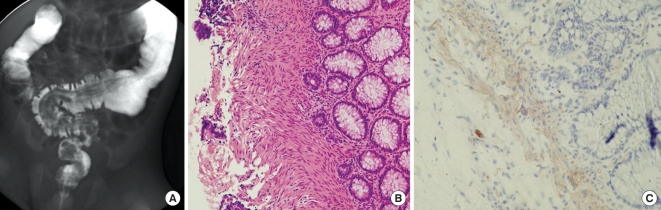

# 3079 — Hội chứng ngưng thở trung ương bẩm sinh (CCHS): khi phổi bình thường nhưng “đồng hồ thở” không chạy

**Tags:** `pattern:giam-thong-khi-trung-uong` `pattern:ngung-tho-trung-uong` `pattern:phe-quan-binh-thuong` `vung:than-nao` `vung:duong-tho` `vung:phoi` `anatomy:than-nao` `protocol:PSG` `protocol:MRI-nao-tuy` `protocol:XR-nguc` `protocol:do-dien-sinh-co-hoanh` `score:AASM-hypoventilation` `score:PHOX2B-genotype`
**Mức chắc chắn (certainty):** tổng hợp y văn (literature synthesis) — ghép **hướng dẫn chẩn đoán – theo dõi CCHS 2020** (Orphanet J Rare Dis, PMC7503443), **review đa chuyên khoa 2022** (PMC8963195), **ca Haddad syndrome có ảnh đối quang** (J Korean Med Sci 2011, PMC3031022), **ca ROHHAD có X-quang/CT trung thất** (ERJ Open Res 2026, PMC13386199) và **ca Chiari I có MRI** (BMJ Case Rep 2026, PMC12887155). Không có ca do nhóm tự chụp.

> **Câu hỏi thực hành:** sơ sinh đủ tháng **ngưng thở tái diễn khi ngủ**, **SpO₂ 70–80%**, **PaCO₂ 60 mmHg** nhưng **phổi trong**, không rít, không co kéo; cho thở CPAP thì vẫn giảm thông khí khi ngủ sâu. Bạn nghĩ **bệnh phổi**, **ngưng thở do trào ngược**, hay **“đồng hồ thở” ở thân não**? Bài chốt **ba bước**: **(1) chứng minh giảm thông khí trung ương bằng PSG có đo CO₂; (2) loại trừ nguyên nhân thực thể bằng MRI não–tủy, X-quang ngực, siêu âm tim/hoành; (3) xác nhận bằng PHOX2B** — không chẩn đoán CCHS chỉ vì “ngưng thở”.

## 1. Tổng quan bệnh học – cơ chế hình ảnh: phổi lành nhưng não không “nghe” CO₂

- **Bản chất:** CCHS (congenital central hypoventilation syndrome; tên cũ “lời nguyền Ondine – Ondine’s curse”) là **giảm thông khí trung ương bẩm sinh** do **giảm hoặc mất đáp ứng với tăng CO₂ và giảm O₂**, nặng nhất khi **ngủ NREM**, kèm **rối loạn chức năng tự chủ** (Hirschsprung, u mào thần kinh, loạn nhịp tim).
- **Gen – cơ chế:** **PHOX2B** (4p12) là yếu tố phiên mã điều khiển phát triển **hệ thần kinh tự chủ và các nơ-ron hô hấp** ở **nhân retro-trapezoid/parafacial** — nơi cảm nhận CO₂. Đột biến **PARM** (polyalanine repeat mutation) chiếm **~90%**, **NPARM** ~10% (PMC8963195). Trình tự bình thường **20 alanine**; CCHS do giãn thành **24–33** alanine, kiểu gen **20/24 – 20/33**; hay gặp **20/25, 20/26, 20/27**.
- **TẠI SAO tổn thương không thấy trên CT/MRI:** đột biến làm **mạng nơ-ron hóa học CO₂ phát triển sai** chứ không tạo khối, nhồi máu hay dị tật lớn — vì vậy **MRI não bình thường không loại trừ CCHS**; MRI dùng để **loại trừ nguyên nhân thứ phát** (Chiari, u thân não, nhồi máu, loạn sản).
- **TẠI SAO nặng nhất khi ngủ NREM:** khi thức và ngủ REM còn có **điều khiển “hành vi”/các đường khác**; trong **ngủ yên (quiet sleep/NREM)**, thông khí phụ thuộc gần như hoàn toàn vào **điều khiển tự động theo CO₂** — hệ này hỏng nên **nhịp thở đều nhưng nông, giảm tần số và thể tích khí lưu thông**, CO₂ tăng dần.
- **TẠI SAO X-quang phổi bình thường:** bệnh ở **trung tâm điều khiển**, không ở nhu mô phổi. X-quang dùng để **loại trừ viêm phổi, xẹp, dị tật phổi, thoát vị hoành** và phát hiện **biến chứng hít sặc** — không dùng để chẩn đoán CCHS.
- **Dịch tễ và ngưỡng phải thuộc:**

| Biến số | Số liệu | Nguồn |
|---|---|---|
| Tần suất | **1/148.000–1/200.000** trẻ sinh sống; hiện mắc **1/500.000** | PMC7503443 |
| Đột biến PHOX2B | **PARM ~90%**, **NPARM ~10%**; PARM giãn **20 → 24–33** alanine | PMC8963195 |
| Thể khởi phát muộn | Thường **20/24 hoặc 20/25**, giảm thông khí nhẹ hơn | PMC7503443 |
| U mào thần kinh | **3–5%** bệnh nhân CCHS (neuroblastoma, ganglioneuroma) | PMC7503443 |
| Ngất/ngất lịm | Tới **25%** bệnh nhân, do nhịp chậm, asystole thoáng qua hoặc tụt huyết áp | PMC7503443 |
| Ngưỡng giảm thông khí khi ngủ ở trẻ | **PCO₂ > 50 mmHg (6,7 kPa)** trong **> 25% tổng thời gian ngủ** (AASM 2012) | PMC7503443 |
| Ngưỡng ở người lớn | **PaCO₂ > 55 mmHg (7,3 kPa) ≥ 10 phút**, hoặc tăng **≥ 10 mmHg** so với khi thức nằm ngửa và **> 50 mmHg ≥ 10 phút** | PMC7503443 |
| Mục tiêu thông khí | **PCO₂ 35–45 mmHg (4,7–6,0 kPa)**; **EtCO₂ 30–40 mmHg** | PMC7503443 |

## 2. Mẫu hình + chẩn đoán phân biệt theo vị trí (gamut)

- **Mẫu hình cốt lõi:** **giảm thông khí trung ương** = giảm tần số/thể tích thở, **không có cố gắng tắc nghẽn**, **không co kéo**, **không nghẹt mũi**, **không đáp ứng với CPAP**; CO₂ tăng, O₂ giảm, nặng hơn ở **NREM**.
- **Gamut theo vị trí tổn thương:**
  - **Thân não (brainstem):** CCHS · **Chiari I/II** chèn hành–tủy · u thân não · nhồi máu/chảy máu · bệnh Leigh · viêm não · ngộ độc opioid/thuốc an thần.
  - **Tủy cổ cao:** chèn ép, syrinx, chấn thương, u — mất đường đi từ trung tâm hô hấp xuống hoành.
  - **Dây thần kinh hoành:** liệt hoành một/hai bên sau mổ tim, chấn thương sinh ngả, u trung thất.
  - **Cơ – thần kinh cơ:** loạn dưỡng cơ, SMA, myasthenia, bệnh cơ bẩm sinh — giảm thông khí do yếu cơ, không phải trung ương.
  - **Đường thở – phổi:** tắc nghẽn trên/dưới thanh môn, hẹp khí quản, bệnh phổi mạn, xẹp — có co kéo, có tiếng rít, đáp ứng phần nào với CPAP.
  - **Chuyển hóa – nội tiết:** hạ đường huyết, tăng amoniac, suy giáp, béo phì giảm thông khí (OHS).
- **Gamut theo tuổi:**
  - **Sơ sinh:** CCHS · ngưng thở non tháng · bệnh màng trong · hít phân su · dị tật phổi · Chiari · rối loạn chuyển hóa.
  - **Nhũ nhi – trẻ nhỏ:** CCHS thể muộn · **ROHHAD** · Prader–Willi · Chiari · u thân não · động kinh/ngưng thở do trào ngược.
  - **Trẻ lớn – người lớn:** ROHHAD · OHS · bệnh thần kinh cơ · tổn thương thân não mắc phải · CCHS thể muộn.
- **Mẹo nhớ 4 câu hỏi:** **(1) có giảm thông khí khi thức không? (2) có tắc nghẽn đường thở không? (3) có dấu thần kinh/tủy không? (4) PHOX2B có đột biến không?**

## 3. Bảng so sánh phân biệt (ma trận đối chiếu)

| Thực thể (entity) | Hình ảnh/lâm sàng điển hình | Chốt vào (rule-in) | Chốt loại (rule-out) | Gợi ý xác nhận |
|---|---|---|---|---|
| **CCHS** | Phổi trong; PSG giảm thông khí trung ương nặng ở NREM; không tắc nghẽn; có thể táo bón/Hirschsprung, u mào thần kinh | **Giảm thông khí trung ương khi ngủ + không nguyên nhân thực thể + PHOX2B đột biến** | **Đáp ứng hoàn toàn với CPAP, có tắc nghẽn rõ, hoặc có tổn thương thân não** → không phải CCHS | PHOX2B PCR + giải trình tự; PSG có CO₂ |
| **ROHHAD** | Béo phì khởi phát nhanh, rối loạn chức năng vùng dưới đồi, giảm thông khí, rối loạn tự chủ; có thể **u mào thần kinh cạnh sống** | **Béo phì + giảm thông khí + rối loạn nội tiết/tự chủ, không đột biến PHOX2B** | **Cân nặng bình thường, chỉ giảm thông khí khi ngủ** → nghĩ CCHS | Lâm sàng + nội tiết + tầm soát u (CT/MRI, MIBG) |
| **Prader–Willi** | Béo phì, giảm trương lực, chậm phát triển, cuồng ăn; ngưng thở thường **tắc nghẽn** hơn trung ương | **Mất đoạn 15q11–q13/giảm biểu hiện** + kiểu hình đặc trưng | **Giảm thông khí trung ương thuần khi ngủ, không kiểu hình PWS** → không phải | Methylation/array; PSG |
| **Chiari I** | **Hạnh nhân tiểu não xuống dưới đường McRae ≥ 5 mm**, có thể syrinx; đau đầu, yếu chi, rung giật nhãn cầu | **MRI thấy hạnh nhân thoát vị + giảm thông khí trung ương** | **Không thoát vị hạnh nhân, không syrinx** → loại | MRI sọ–tủy cổ T1/T2; đo McRae |
| **Bệnh cơ/thần kinh cơ** | Yếu cơ, giảm phản xạ, teo cơ; giảm thông khí do yếu, **không chỉ khi ngủ** | **Yếu cơ + giảm thông khí khi thức + men cơ/EMG bất thường** | **Sức cơ bình thường, chỉ giảm thông khí khi ngủ** → nghĩ trung ương | EMG/NCV, CK, sinh thiết cơ nếu cần |
| **OHS (béo phì giảm thông khí)** | BMI cao, ngáy, ngưng thở tắc nghẽn + giảm thông khí khi thức; **PaCO₂ > 45 mmHg khi thức** | **BMI ≥ 30 + PaCO₂ > 45 mmHg khi thức, sau loại trừ nguyên nhân khác** | **Không béo phì, PaCO₂ khi thức bình thường** → loại | Khí máu khi thức; PSG |
| **Ngưng thở tắc nghẽn (OSA)** | Ngáy, co kéo, **ngưng thở có cố gắng**, giảm thông khí không tương xứng | **Chỉ số ngưng thở–giảm thở tắc nghẽn tăng, có cố gắng** | **Không cố gắng, không tắc nghẽn, giảm thông khí khi NREM** → trung ương | PSG; CPAP thử |
| **Tổn thương thân não mắc phải** | Khởi phát cấp/từ từ sau chấn thương, sốt, đột quỵ; dấu thần kinh khu trú | **MRI/DWI thấy tổn thương + bệnh cảnh phù hợp** | **MRI bình thường, bệnh cảnh bẩm sinh** → nghĩ CCHS | MRI sọ có DWI; khám thần kinh |

*ERJ Open Res 2026 (PMC13386199), CC BY-NC 4.0: **(a)** X-quang ngực — khối mờ hình thoi chồng lên bóng tim; **(b, c)** CT có cản quang — khối mô mềm **đồng nhất, bờ rõ, cạnh sống trái T7–T9**, sau đó giải phẫu bệnh là **ganglioneuroma trưởng thành**. Đây là hàng phân biệt quan trọng: **ROHHAD** có thể kèm u mào thần kinh và giảm thông khí trung ương, nhưng **không có đột biến PHOX2B**. Ảnh nguyên bản, không cắt ghép.*

*BMJ Case Rep 2026 (PMC12887155), CC BY-NC 4.0: MRI T1 sagittal — **hạnh nhân tiểu não sa xuống 11 mm dưới đường McRae** (mũi tên xanh), chèn ép hành–tủy. Chiari I là nguyên nhân **thứ phát** của giảm thông khí trung ương; **phải loại trừ trước khi gọi CCHS**. Ảnh nguyên bản.*

## 4. Protocol chụp + hệ phân độ/ngưỡng xử trí

- **Bước 1 — chứng minh giảm thông khí:** **PSG (polysomnography)** hoặc **CRP (cardiorespiratory polygraphy)** có **TcCO₂/EtCO₂** ở **cả lúc ngủ và lúc thức**, đủ chu kỳ ngủ; ghi **SpO₂, CO₂, luồng khí, cố gắng ngực–bụng, ECG**. Ngưỡng AASM 2012 như bảng mục 1.
- **Bước 2 — loại trừ nguyên nhân thực thể (theo hướng dẫn 2020):**
  - **MRI sọ + tủy cổ** (T1/T2 lát mỏng qua hành–tủy, đo hạnh nhân so với **đường McRae**; tìm syrinx, u, nhồi máu, loạn sản).
  - **X-quang ngực** (2 tư thế khi cần): phổi, màng phổi, hoành, khí quản; tìm hít sặc/xẹp.
  - **Siêu âm tim**: tăng áp phổi, shunt, chức năng tim.
  - **Siêu âm/soi hoành**: liệt hoành, eventration; **đo dẫn truyền thần kinh hoành** khi nghi.
  - **Nội soi đường thở** nếu có rít/tắc nghẽn; **EMG/NCV** nếu nghi thần kinh cơ; **chuyển hóa** (đường huyết, amoniac, lactat, axit hữu cơ) ở trẻ nhỏ.
- **Bước 3 — xác nhận di truyền:** **PHOX2B** bằng **PCR khuếch đại vùng giàu GC + điện di đoạn + giải trình tự** (phát hiện cả PARM và NPARM). **Không bỏ sót NPARM** vì thể này có thể giảm thông khí nhẹ nhưng **nguy cơ Hirschsprung/u cao**.
- **Bước 4 — tầm soát bệnh kèm:** **barium enema** khi nghi Hirschsprung (thấy **vùng chuyển tiếp** — đoạn vô hạch hẹp, phía trên giãn); **sinh thiết hút trực tràng** là tiêu chuẩn vàng. **Siêu âm bụng/CT/MRI + MIBG** tầm soát u mào thần kinh ở **20/28–20/33 và NPARM**. **Holter/ILR** tìm nhịp chậm–asystole; **siêu âm tim** định kỳ; **khám mắt** (khô mắt, lác) hàng năm.
- **Theo dõi (hướng dẫn 2020):** trẻ **< 2 tuổi: mỗi 2–6 tháng**; **≥ 2 tuổi: hàng năm** — PSG/CRP có CO₂, khí máu khi thức, đánh giá thông khí tự thở và cài đặt máy; **phát triển thần kinh** mỗi 4–6 tháng (< 2–3 tuổi), sau đó mỗi 2 năm; **tầm soát u** theo kiểu gen (xem trên).
- **Điều trị:** **hỗ trợ thông khí** (NIV, mở khí quản, **kích thích cơ hoành** ở ca chọn lọc), **tránh thuốc ức chế hô hấp** (opioid, benzodiazepine, gây mê không giám sát), **monitor tại nhà**, xử lý táo bón/Hirschsprung, điều trị loạn nhịp, tư vấn di truyền.

*Orphanet J Rare Dis 2020 (PMC7503443), CC BY 4.0: **xác nhận giảm thông khí bằng PSG/CRP có CO₂** → phân biệt **liên quan giấc ngủ** (PSG nặng hơn ở quiet sleep) với **không liên quan giấc ngủ** → **MRI não/tủy, X-quang ngực, siêu âm tim/hoành, nội soi, EMG/NCV, xét nghiệm chuyển hóa** → **PHOX2B** khi không tìm được nguyên nhân. Ảnh nguyên bản.*

## 5. Biến thể bình thường và cạm bẫy

- **Ngưng thở non tháng (apnea of prematurity):** thường **tự hết theo tuổi thai**, không kèm rối loạn tự chủ, không có đột biến PHOX2B — **không gọi CCHS**.
- **Thở chu kỳ ở nhũ nhi:** mẫu hình đều đặn, **không giảm thông khí kéo dài**, không tăng CO₂ — đừng chẩn đoán nhầm.
- **MRI bình thường không loại trừ CCHS:** CCHS là bệnh **chức năng/di truyền**; thiếu tổn thương không có nghĩa là không bệnh.
- **EtCO₂ có thể thấp giả do rò khí, ống thở, tưới máu kém:** phải **đối chiếu TcCO₂ và khí máu**, không dựa một kênh.
- **Chỉ chụp PSG khi ngủ:** bỏ sót **giảm thông khí khi thức** ở thể nặng; phải đo **cả lúc thức**.
- **Béo phì + ngưng thở:** dễ quy hết cho OSA; nếu **PaCO₂ khi thức > 45 mmHg** hoặc giảm thông khí **không tương xứng với tắc nghẽn**, nghĩ **OHS/ROHHAD**, không phải OSA đơn thuần.
- **Chiari “nhẹ”:** hạnh nhân xuống **5–6 mm** có thể vô tình; tìm **syrinx, mất dòng dịch não tủy, triệu chứng** trước khi quy cho Chiari.
- **Thuốc an thần/opioid sau mổ:** gây giảm thông khí trung ương **mắc phải**, hồi phục — hỏi kỹ thuốc trước khi làm xét nghiệm di truyền.
- **Gọi “Ondine’s curse”** dễ gây nhầm với ngưng thở tắc nghẽn; dùng **CCHS** và mô tả **trung ương**.

## 6. Tự lượng giá — Blind Quiz

**Ca 1 — Trẻ 2,5 tuổi béo phì, giảm thông khí dai dẳng sau viêm phổi. Nhìn PSG trước, mô tả kiểu thở.**

- Gợi ý: trẻ **2,5 tuổi**, béo phì, giảm thông khí dai dẳng sau viêm phổi; PSG ghi khi **tạm ngừng BPAP**.
- Câu hỏi: Có **cố gắng thở** trong cơn ngưng thở không? Giảm thông khí nặng ở giai đoạn ngủ nào? 3 chẩn đoán phân biệt và xét nghiệm chốt?

<b>Bấm để hiện đáp án (findings + chẩn đoán)</b>

- **Dấu hiệu:** các đoạn **giảm biên độ luồng khí và thể tích** lặp lại, **SpO₂ tụt** (đường đỏ), **PetCO₂ cao/dao động**, không có **co kéo ngực–bụng nghịch pha**; các cơn **ngưng thở trung ương** chiếm ưu thế trong **N2 (quiet sleep)**.
- **Chẩn đoán:** giảm thông khí trung ương; ở trẻ béo phì khởi phát nhanh + rối loạn vùng dưới đồi, đây là **ROHHAD**, không phải CCHS (không có PHOX2B). Phân biệt: CCHS, OHS, OSA, Chiari, bệnh cơ.
- **Xác nhận:** PSG có TcCO₂/EtCO₂ + khí máu khi thức; MRI não–tủy; PHOX2B; tầm soát u mào thần kinh.
- **Nguồn ảnh:** ERJ Open Res 2026 (PMC13386199), CC BY-NC 4.0.

**Ca 2 — Trẻ CCHS táo bón, bụng chướng; chụp đối quang đại tràng.**

- Gợi ý: trẻ có CCHS, chậm phân xu, bụng chướng; ảnh gồm **đối quang (A)** và **mô học (B, C)**.
- Câu hỏi: Đoạn nào hẹp, đoạn nào giãn? Vì sao CCHS lại kèm bệnh này? Xét nghiệm chuẩn để xác nhận?

<b>Bấm để hiện đáp án</b>

- **Dấu hiệu:** **(A)** đoạn **trực tràng–sigma hẹp** (vô hạch) với **vùng chuyển tiếp hình phễu**, phía trên **đại tràng giãn**; **(B, C)** mô học cho thấy **không có tế bào hạch** và **tăng sợi thần kinh**.
- **Chẩn đoán:** **Hirschsprung (Haddad syndrome = CCHS + Hirschsprung)** — cùng nguồn gốc **mào thần kinh/PHOX2B**.
- **Xác nhận:** **sinh thiết hút trực tràng** (tiêu chuẩn vàng); barium enema chỉ **gợi ý**, không thay thế mô học.
- **Nguồn ảnh:** J Korean Med Sci 2011 (PMC3031022), CC BY-NC 3.0.

**Ca 3 — Trẻ béo phì + giảm thông khí khi ngủ + khối cạnh sống. Xem X-quang/CT.**

- Câu hỏi: Khối nằm ở khoang nào? Nó liên quan gì đến kiểu hình béo phì – giảm thông khí? Cần tầm soát gì tiếp?

<b>Bấm để hiện đáp án</b>

- **Dấu hiệu:** khối **trung thất sau, cạnh sống trái T7–T9**, đồng nhất, bờ rõ; X-quang chỉ thấy **mờ hình thoi** chồng bóng tim.
- **Chẩn đoán:** **ganglioneuroma** trong bệnh cảnh **ROHHAD** — u mào thần kinh là bệnh kèm, không phải CCHS.
- **Tiếp theo:** MRI toàn thân/MIBG, siêu âm bụng, xét nghiệm nội tiết; **không** làm PHOX2B thay cho tầm soát u.
- **Nguồn ảnh:** ERJ Open Res 2026 (PMC13386199), CC BY-NC 4.0.

## Bài liên quan chéo
- [600 – Tổng quan hệ Nhi khoa](../600-tong-quan-nhi-khoa/lesson.md)
- [610 – Suy hô hấp sơ sinh & dị dạng phổi](../610-suy-ho-hap-so-sinh-va-di-dang-phoi/lesson.md)
- [6100 – Chăm sóc và cai ống mở khí quản ở trẻ](../6100-cham-soc-va-cai-ong-mo-khi-quan-tre/lesson.md)
- [1830 – OSA ở trẻ Prader–Willi](../1830-osa-prader-willi-tre/lesson.md)
- [1803 – Ngưng thở khi ngủ tắc nghẽn ở trẻ bệnh phổi mạn](../1803-ngung-tho-khi-ngu-tac-nghen-tre-benh-phoi-man/lesson.md)
- [6123 – Rối loạn nuốt và hít sặc ở trẻ mở khí quản](../6123-roi-loan-nuot-va-hit-sac-tre-mo-khi-quan/lesson.md)

> Không dùng để chẩn đoán độc lập khi chưa có người hướng dẫn.
