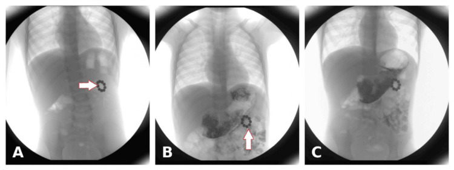
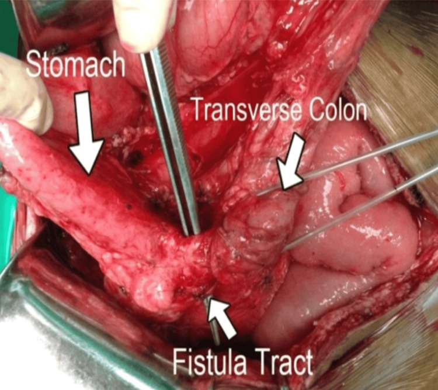
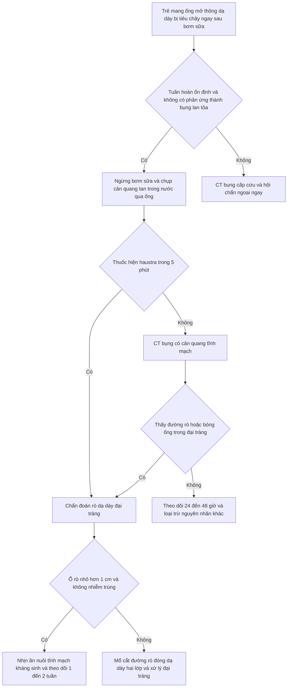
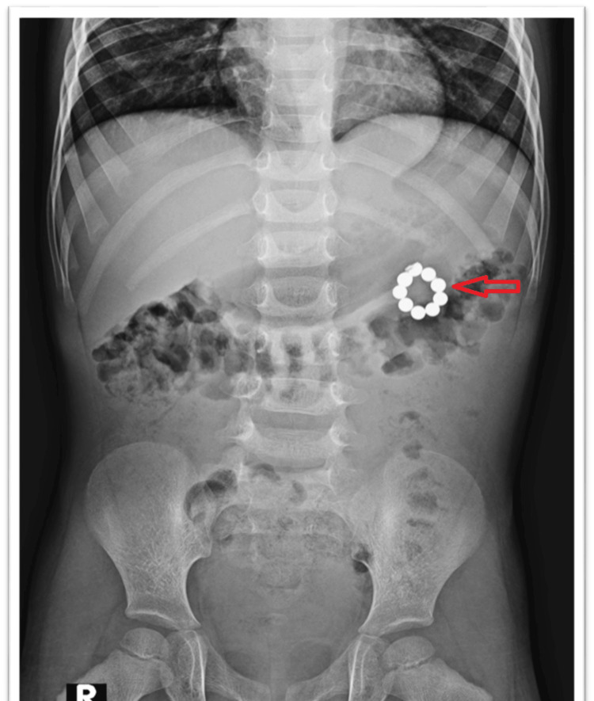
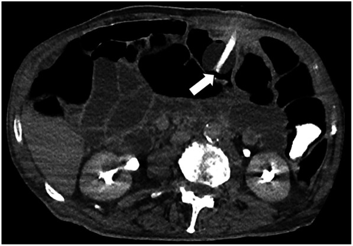

# 3080 — Rò dạ dày–đại tràng ở trẻ / Gastrocolic fistula in children

**Tags:** `pattern:duong-ro` `pattern:di-vat` `pattern:mat-vi-tri-ong` `vung:da-day` `vung:dai-trang` `vung:thanh-bung` `protocol:chup-ro-can-quang` `protocol:CT-bung` `protocol:noi-soi` `protocol:sieu-am`

**Mức chắc chắn (certainty):** tổng hợp y văn (literature synthesis) — ghép 2 ca công bố có ảnh gốc (trẻ 4 tuổi sau nuốt nam châm — **Kheya JN và cs., *Cureus* 2026, PMC13185078, CC BY 4.0**; người lớn 83 tuổi rò ba nhánh sau thay ống mở thông dạ dày — **Pittacolo M và cs., *Front Surg* 2025, PMC12672460, CC BY 4.0**) với 1 tổng quan hệ thống về mở thông dạ dày ở trẻ (**Ibrahim MK và cs., 2026, PMC13696405**) và 1 ca trẻ 12 tuổi rò dạ dày–đại tràng lên (**Ke M và cs., 2026, PMC13081263**). Số nào nguồn không đưa thì ghi "chưa rõ", không bịa.

> **Bài này trả lời 4 câu hỏi của buổi trực có trẻ mang ống mở thông dạ dày:**
> (1) **Tiêu chảy ngay sau bơm sữa vài phút — dị ứng sữa hay rò vào đại tràng?** (2) **Chụp gì để chốt: cản quang qua ống, CT hay nội soi?** (3) **Thuốc hiện ở đâu thì gọi là rò, thuốc không hiện có loại trừ được không?** (4) **Khi nào rút ống theo dõi — khi nào mổ ngay?**
> Khác với [1829 – nút bị vùi](../1829-hoi-chung-nut-bi-vui-tre/lesson.md) (nút chui vào thành, **không có** thông với đại tràng) và [1813 – rò da–dạ dày sau rút ống](../1813-ro-da-da-day-sau-rut-ong-mo-thong-tre/lesson.md) (rò ra **da**, không ra **đại tràng**): ở đây thức ăn đi thẳng vào **khung đại tràng**, gây tiêu chảy, nhiễm khuẩn và mất nước.

## 1. Tổng quan bệnh học – cơ chế hình ảnh

### 1.1 Vì sao đường rò gần như luôn là dạ dày – đại tràng NGANG

- Thành sau **thân và hang vị** nằm áp trực tiếp lên **đại tràng ngang**; giữa hai tạng chỉ có **dây chằng dạ dày–đại tràng (gastrocolic ligament)** — một lá mỡ–phúc mạc **mỏng 1–2 mm** ở trẻ nhỏ, **không có lớp cơ** chắn.
- Mô hoại tử do chèn ép chỉ cần **hai bề mặt niêm mạc bị ép vào nhau** trong vài ngày: thiếu máu cục bộ niêm mạc → loét → **hoại tử xuyên thành cả hai phía** → dính → **đường rò**.
- Vì vậy bản đồ vị trí rất hẹp: **hang vị/thân dạ dày ↔ đại tràng ngang** (nam châm, ống mở thông dạ dày), **dạ dày ↔ đại tràng lên** khi nam châm nằm ở góc gan, hiếm hơn **dạ dày ↔ đại tràng sigma** (rò ba nhánh sau mở thông dạ dày).

### 1.2 Ba cơ chế — và "cửa sổ thời gian" khác nhau

| Cơ chế | Bối cảnh | Thời gian tới rò | Vì sao |
|---|---|---|---|
| **Iatrogenic** – ống mở thông dạ dày (PEG/RIG/button) | Đặt ống, **thay ống**, hoặc nút trong tì vào thành | **Ngày → nhiều tháng** (thường phát hiện khi thay ống) | Nút/bóng nằm trong đại tràng (đặt lạc) hoặc tì mạn vào thành → loét do áp lực |
| **Dị vật** – nam châm | ≥ 2 nam châm ở **hai quai khác nhau** | **Vài ngày → vài tuần** | Hai nam châm hút nhau **xuyên thành ruột**, ép niêm mạc → hoại tử do áp lực |
| **Viêm/u** | Loét dạ dày–tá tràng, viêm tụy, ung thư (người lớn) | Tuần → tháng | Viêm xuyên thành + mô hoại tử dính vào đại tràng |

- **Số liệu nền (bắt buộc thuộc):** thủng đại tràng khi đặt ống mở thông dạ dày **0,1% (310/272.866 ca PEG)** và **0,2% (390/190.851 ca RIG)**; tỉ lệ biến chứng chung **0,4–22,5% (PEG)** so với **13–43% (RIG)**; tử vong 30 ngày sau PEG **9–10%** nhưng **tử vong do thủ thuật < 0,1%**; **tắc ống 20–45%** — chính lần **thay ống vì tắc** là lúc đường rò "lộ diện" (PMC12672460).
- Ở trẻ, **biến chứng nặng 0–3%** khi mở thông dạ dày đơn thuần, tăng vài lần nếu kèm **chống trào ngược hoặc ống hỗng tràng** (PMC13696405). Rò dạ dày–đại tràng được xếp vào nhóm **biến chứng nặng** trong tổng quan này.

### 1.3 TẠI SAO thấy được trên từng phương thức (vật lý + mô bệnh)

- **Chụp cản quang qua ống (fluoroscopy):** thuốc **tan trong nước** đi theo **đường ngắn nhất** — nếu ống nằm trong đại tràng hoặc có đường rò, thuốc hiện **các túi cùng (haustra)**, bờ **phân đoạn, có dải cơ dọc** trong **vài giây đến 5 phút**; dạ dày bình thường **không có** các dải này. Dấu chốt là **hình dạng đại tràng**, không phải "thuốc chảy xuống dưới".
- **CT:** thấy **dải mô mềm nối hai tạng**, **khí/dịch trong đường rò**, và **bóng ống hoặc nam châm nằm trong lòng đại tràng** — dấu hiệu "không thể cãi". CT không phụ thuộc dòng chảy nên **vẫn dương tính khi đường rò đã bịt kín tạm thời**.
- **Nội soi:** nhìn trực tiếp **nam châm/nút xuyên qua thành** và vết loét quanh đó — vừa chẩn đoán vừa lấy được dị vật nông.
- **Vì sao cản quang có thể âm tính giả:** đầu ống **bít kín lỗ rò**, phù nề làm đường rò xẹp, hoặc thuốc đi **quá nhanh** qua dạ dày xuống tá tràng mà không vào đường rò → **âm tính không loại trừ**.

*Ba khung cản quang baryt dạ dày–tá tràng: (A, B) viên nam châm dạng chuỗi ở bờ cong lớn, **tạo khuyết bóng và dày niêm mạc khu trú**; (C) hành tá tràng bình thường. Hình ảnh này buộc phải nghĩ tới **viên nam châm đã xuyên thành**, không còn trong lòng dạ dày. Nguồn: Cureus 2026, PMC13185078, CC BY 4.0.*

## 2. Mẫu hình + chẩn đoán phân biệt theo vị trí và cơ chế (Gamut)

- **Theo vị trí rò:** dạ dày–đại tràng **ngang** (nhiều nhất: ống mở thông, nam châm) → dạ dày–đại tràng **lên** (nam châm ở góc gan; ca trẻ 12 tuổi PMC13081263) → dạ dày–**sigma** (rò phức tạp sau PEG) → tá tràng–đại tràng (loét/viêm tụy) → **dạ dày–da** (khác hoàn toàn: [1813](../1813-ro-da-da-day-sau-rut-ong-mo-thong-tre/lesson.md)).
- **Theo cơ chế:** (1) **đặt lạc ống** vào đại tràng; (2) **áp lực mạn** của nút/bóng; (3) **dị vật từ tính**; (4) **loét/viêm/u**; (5) **sau mổ** (miệng nối, dẫn lưu).
- Gợi nhớ **3M + I**: **M**isplacement (đặt lạc ống), **M**agnet (nam châm), **M**alignancy/ulcer (u/loét), **I**atrogenic (sau mổ, sau thay ống).
- **Mẫu hình lâm sàng–hình ảnh đặc trưng:** **tiêu chảy ngay trong 5–30 phút sau bơm sữa**, phân lỏng, có khi **hơi thối**, kèm **ợ hơi phân**, sụt cân, mất nước; phim bụng có thể **bình thường**.

## 3. Bảng so sánh phân biệt (ma trận đối chiếu)

| Thực thể (entity) | Hình ảnh điển hình | Chốt vào (rule-in) | Chốt loại (rule-out) | Gợi ý xác nhận |
|---|---|---|---|---|
| **Rò dạ dày–đại tràng** | Cản quang qua ống: thuốc hiện **haustra** trong ≤ 5 phút; CT: **dải mô mềm nối dạ dày–đại tràng** ± khí trong đường rò | **Thuốc vào đại tràng + tiêu chảy ngay sau bơm sữa** | Không có đường nối trên CT **và** cản quang âm tính lặp lại → nghĩ nguyên nhân khác | Cản quang tan trong nước → CT bụng có cản quang tĩnh mạch → nội soi |
| **Đặt lạc ống vào đại tràng (chưa rò)** | **Bóng/nút trong lòng đại tràng**, dạ dày **không có** ống; bơm nước vào bóng thấy bóng nằm ở khung đại tràng | **Bóng ống trong đại tràng trên CT** | Bóng trong dạ dày trên CT → loại | CT bụng; kiểm tra dịch hút ra (pH, phân) |
| **Rò da–dạ dày (gastrocutaneous)** | Thuốc thoát ra **mặt da** quanh lỗ mở, không vào đại tràng | **Thuốc chảy ra ngoài qua lỗ mở** | Thuốc vào đại tràng → không phải rò da | Chụp cản quang qua ống, đặt gạc đánh dấu |
| **Tiêu chảy do công thức (osmotic/dumping)** | Không có đường rò; tiêu chảy **30–120 phút** sau ăn, liên quan **nồng độ/thể tích** | **Giảm khi pha loãng/tăng thời gian bơm** | Tiêu chảy **< 5 phút** sau bơm + ợ hơi phân → nghĩ rò | Thử công thức, theo dõi; cản quang khi nghi ngờ |
| **Nhiễm trùng/áp-xe quanh lỗ mở** | Mô mềm dày quanh lỗ mở, **không có đường nối** với đại tràng; có thể có dịch | **Đau, đỏ, chảy mủ tại lỗ mở** | Có đường nối dạ dày–đại tràng → rò | Siêu âm mô mềm, CT |
| **Thủng đại tràng đơn thuần** | **Khí tự do**, dịch tự do, viêm phúc mạc lan tỏa; **không** thấy đường rò | **Khí ngoài lòng + phản ứng thành bụng** | Khí tự do lượng nhiều + sốc → thủng, không chờ cản quang | CT bụng cấp cứu, hội chẩn ngoại ngay |
| **Viêm dạ dày–ruột nhiễm trùng** | Ruột non/đại tràng **dày thành lan tỏa**, không khu trú; không có bóng ống lạc | **Sốt, nôn, tiêu chảy cấp, dịch tễ** | Tiêu chảy **chỉ sau bơm sữa**, kéo dài nhiều tuần → nghĩ rò | Cấy phân, theo dõi; hình ảnh khi không điển hình |

*Đường rò xơ dày nối thành sau hang vị với đại tràng ngang; mô quanh đường rò viêm, xơ — dấu hiệu của quá trình **áp lực mạn** chứ không phải thủng cấp. Nguồn: Cureus 2026, PMC13185078, CC BY 4.0.*

### 3.1 Ba dấu hiệu "đọc đúng thì chốt" — và ba dấu hiệu dễ đọc sai

- **Đọc đúng:** (1) **haustra** khi bơm thuốc qua ống; (2) **bóng ống trong đại tràng** trên CT; (3) **nam châm nằm ngoài lòng dạ dày** trên cản quang/CT.
- **Đọc sai:** (1) thuốc xuống **tá tràng–hỗng tràng non** bị gọi là "đại tràng" (thiếu haustra, thiếu dải cơ dọc); (2) **khí trong mô mềm quanh lỗ mở** bị gọi là "khí tự do" (khí tự do phải **ngoài lòng ruột, dưới hoành** và di chuyển khi đổi tư thế); (3) **bóng ống bị xẹp** trên CT bị bỏ qua — luôn so với **thành dạ dày** để xác định bóng nằm ở tạng nào.

## 4. Protocol chụp + quyết định xử trí

### 4.1 Trình tự hình ảnh (khi trẻ có ống mở thông dạ dày và nghi rò)

1. **Ngừng bơm sữa ngay**, đặt sonde dạ dày giải áp, bù dịch; **không bơm thêm** qua ống đang nghi lạc.
2. **Chụp cản quang tan trong nước qua ống:** iohexol **180–300 mgI/mL**; **5 mL** nếu < 1 tuổi, **10 mL** trẻ lớn; tư thế **thẳng + nghiêng**, chiếu liên tục **1–5 phút**, chụp muộn tới **10 phút**. **Không dùng baryt** khi nghi thủng/rò.
3. **CT bụng–chậu có cản quang tĩnh mạch**, lát **1–2 mm**, thì **tĩnh mạch cửa**; thêm **cản quang trực tràng** khi cần chứng minh thông thương. Tìm: dải nối hai tạng, khí/dịch trong đường rò, **bóng ống trong đại tràng**, khí tự do, áp-xe.
4. **Nội soi dạ dày** khi cản quang/CT chưa chốt hoặc để **lấy nam châm nông**.
5. **Siêu âm** chỉ để tìm **dịch/áp-xe quanh lỗ mở** — không dùng để loại trừ rò.

### 4.2 Ngưỡng và lựa chọn điều trị

- **Ổ rò nhỏ (< 1 cm), không nhiễm trùng, không tắc ruột:** có thể **nhịn ăn + nuôi tĩnh mạch + kháng sinh** (phủ kỵ khí) và theo dõi **1–2 tuần**; một phần đóng kín tự phát khi đường rò chưa biểu mô hóa.
- **Ổ rò lớn, xơ dày, có triệu chứng kéo dài, hoặc thất bại nội khoa:** **mổ** — cắt đường rò, **đóng dạ dày hai lớp**, đóng hoặc **cắt nối đại tràng**; rò phức tạp nhiều tạng → **cắt đại tràng + mở thông dạ dày mới** (ca 3 nhánh, PMC12672460).
- **Nam châm:** **lấy bằng nội soi nếu còn trong lòng**; đã xuyên thành/dính hai quai → **mổ** (ca 4 tuổi: 5 viên lấy qua nội soi, **4 viên còn trong đường rò**, khuyết thành **1–1,5 cm** ở hang vị và đại tràng ngang).
- **Đóng bằng clip/OTSC qua nội soi** là lựa chọn cho lỗ nhỏ, thành mềm, không nhiễm trùng — **chưa có số liệu ngẫu nhiên ở trẻ**, cần chọn bệnh nhân.

### 4.3 Dự phòng — làm đúng thì gần như không gặp

- **Xác nhận vị trí ống trước lần dùng đầu tiên:** hút dịch **pH ≤ 5,5** gợi ý dạ dày; **nghe bụng có hơi là vô giá trị** (âm thanh lan từ dạ dày sang đại tràng). Nghi ngờ → **chụp cản quang** trước khi bơm sữa.
- **Khi thay ống:** đo lại **độ dài lỗ mở**, không đẩy ống quá sâu, **không bơm bóng khi chưa chắc trong dạ dày**, và **kiểm tra lại vị trí bằng cản quang** nếu lần thay khó.
- **Nam châm:** tư vấn phụ huynh, **cấm đồ chơi nam châm cho trẻ < 6 tuổi**; nuốt **≥ 2 nam châm** là chỉ định **can thiệp sớm**, không theo dõi thụ động.

## 5. Biến thể bình thường và cạm bẫy

- **Biến thể bình thường:** đại tràng ngang **sa xuống thấp**, chồng lên dạ dày trên phim tư thế đứng — dễ đọc thành "dạ dày nằm trong khung đại tràng"; **hơi trong dạ dày** lan sang đại tràng ngang khi bơm hơi qua nội soi.
- **Cạm bẫy 1 — "ống còn đó nghĩa là ống đúng chỗ":** đường rò có thể **tồn tại nhiều tháng mà trẻ vẫn ăn được**, đến khi **thay ống** thì đường rò **bị xé** và bệnh cảnh bùng lên (ca 83 tuổi, PMC12672460). Không bao giờ coi "nuôi ăn được" là bằng chứng ống nằm trong dạ dày.
- **Cạm bẫy 2 — tiêu chảy sau bơm sữa bị quy cho "không dung nạp lactose/công thức":** mốc thời gian **< 5 phút** và **ợ hơi phân/thối** là dấu hiệu rò, không phải dumping (dumping **30–120 phút**).
- **Cạm bẫy 3 — bỏ sót nam châm thứ hai:** trên phim chỉ thấy một chuỗi ở dạ dày, viên còn lại đã ở **đại tràng** — luôn đếm **đủ số viên phụ huynh mô tả**, và chụp lại **toàn bộ bụng–chậu**.
- **Cạm bẫy 4 — cản quang âm tính:** đường rò bị nút/bóng bít hoặc phù nề xẹp → **âm tính không loại trừ**; nghi ngờ cao thì **CT**.
- **Cạm bẫy 5 — "khí trong thành" vs "khí tự do":** khí **trong thành đường rò** là dấu hiệu của rò; **khí tự do dưới hoành** mới là thủng ổ bụng — hai bệnh cảnh, hai thái độ xử trí.

## 6. Tự lượng giá — Blind Quiz

**Ca 1 — Bé trai 4 tuổi, đau bụng từng cơn 3 ngày, không ai thấy nuốt dị vật.**

- Gợi ý lâm sàng: đau quặn từng cơn, giảm tạm với thuốc chống co thắt, không sốt.
- Câu hỏi: dị vật là gì, nằm ở đâu, và **vì sao xếp thành vòng**? Cần làm gì tiếp?

<b>Bấm để hiện đáp án</b>

- **Nhiều nam châm dạng chuỗi xếp thành vòng ở hạ sườn trái** — các viên hút nhau thành chuỗi, không phải "một dị vật tròn".
- Xếp vòng = **các viên đã bám vào nhau qua thành ruột**, không còn tự do trong lòng.
- Việc tiếp theo: **cản quang tan trong nước** xác định viên có còn trong lòng dạ dày hay đã xuyên thành; nội soi lấy phần nông, chuẩn bị mổ.
- Nguồn: Cureus 2026, PMC13185078, CC BY 4.0.

**Ca 2 — Cùng bệnh nhi, cản quang dạ dày–tá tràng trong ngày.**

- Câu hỏi: viên nam châm còn trong lòng dạ dày không? Dấu hiệu nào nói "đã xuyên thành"?

<b>Bấm để hiện đáp án</b>

- Viên nam châm **tạo khuyết bóng ở bờ cong lớn kèm dày niêm mạc khu trú** — nằm **ngoài lòng** dạ dày, đã xuyên thành.
- Nội soi lấy được **5 viên**; **4 viên còn lại** nằm trong đường rò → **mổ**: đường rò giữa **thành sau hang vị và đại tràng ngang**, khuyết thành **1–1,5 cm** mỗi phía.
- Nguồn: Cureus 2026, PMC13185078, CC BY 4.0.

**Ca 3 — Cụ ông 83 tuổi, Parkinson, thay ống mở thông dạ dày vì tắc; hôm sau đau bụng và tiêu chảy.**

- Câu hỏi: bóng ống nằm ở tạng nào? Vì sao đau bụng xuất hiện **sau khi thay ống**?

<b>Bấm để hiện đáp án</b>

- Bóng ống đã bơm nằm **trong lòng đại tràng ngang** — ống đặt lạc vào đại tràng khi thay bằng đường cản quang.
- Đường rò dạ dày–đại tràng **đã có từ trước** (do thủ thuật ban đầu), được ống cũ "giữ kín"; khi thay ống, đường rò **dehisce** → đau bụng, tiêu chảy, viêm phúc mạc hóa học.
- Mổ: **ba đường rò** (dạ dày–ngang, dạ dày–sigma), cắt đại tràng + đóng dạ dày hai lớp + mở thông dạ dày mới; ra viện **ngày 8**.
- Bài học: **thay ống ở bệnh nhân có tiền sử thay ống khó phải kiểm tra vị trí bằng cản quang**, không dựa vào "bơm thấy trơn".
- Nguồn: Front Surg 2025, PMC12672460, CC BY 4.0.

## Bài liên quan chéo
- [600 – Tổng quan Nhi khoa](../600-tong-quan-nhi-khoa/lesson.md)
- [1829 – Nút bị vùi sau mở thông dạ dày](../1829-hoi-chung-nut-bi-vui-tre/lesson.md) (cùng thiết bị, khác cơ chế)
- [1813 – Rò da–dạ dày sau rút ống](../1813-ro-da-da-day-sau-rut-ong-mo-thong-tre/lesson.md) (rò ra da)
- [1805 – Rút ống mở thông & cai nuôi ống](../1805-rut-ong-mo-thong-da-day-cai-ong-tre/lesson.md)
- [083 – Nuôi ăn qua sonde](../083-nuoi-an-qua-sonde/lesson.md)
- [160 – Bụng cấp ở trẻ](../160-bung-cap-GI/lesson.md) (khí tự do, thủng tạng rỗng)

## Ảnh
- `images/3080_ro-da-day-dai-trang_XR_PMC13185078.jpg` — phim bụng thẳng, nam châm xếp vòng — *Cureus* 2026, PMC13185078, **CC BY 4.0**.
- `images/3080_ro-da-day-dai-trang_chup-can-quang_PMC13185078.jpg` — cản quang dạ dày–tá tràng 3 khung — cùng bài, **CC BY 4.0**.
- `images/3080_ro-da-day-dai-trang_mo_PMC13185078.jpg` — đường rò trong mổ — cùng bài, **CC BY 4.0**.
- `images/3080_ong-trong-dai-trang_CT_PMC12672460.jpg` — CT: bóng ống trong đại tràng ngang — *Front Surg* 2025, PMC12672460, **CC BY 4.0**.
- Chi tiết nguồn + giấy phép từng ảnh: `images/CREDITS.md`.

> Không dùng để chẩn đoán độc lập khi chưa có người hướng dẫn.
