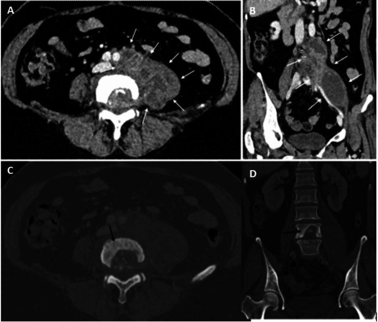
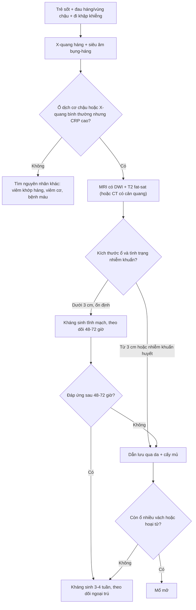
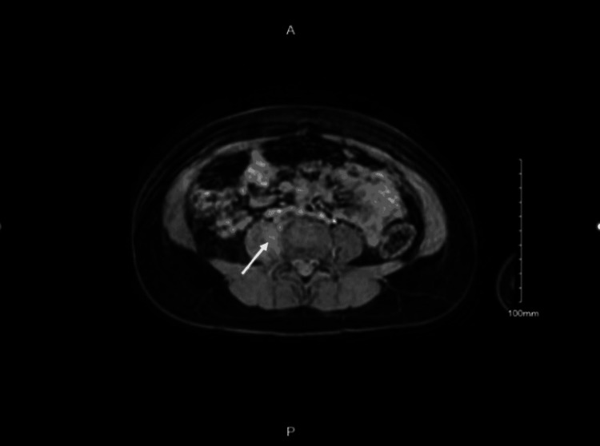
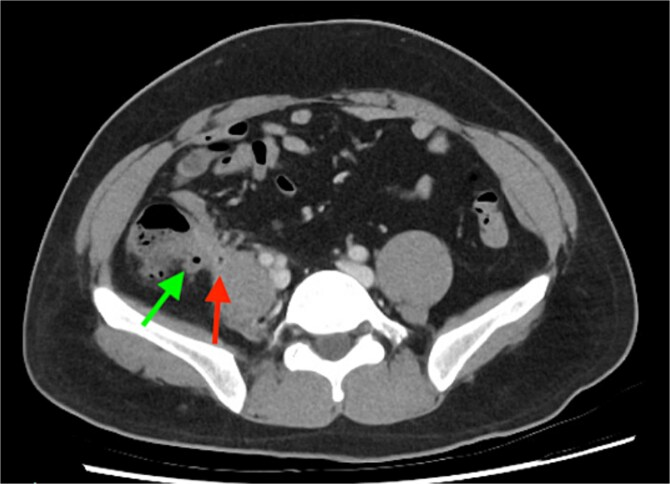

# 3081 — Áp-xe cơ chậu (psoas abscess) ở trẻ: đau háng – đi khập khiễng, X-quang háng bình thường vẫn không loại trừ

**Tags:** `pattern:ap-xe` `pattern:o-dich` `pattern:mat-duong-vien-co-chau` `pattern:vien-ngam-thuoc` `vung:o-bung` `vung:sau-phuc-mac` `vung:co-chau` `anatomy:co-chau` `protocol:CT-bung-co-can-quang` `protocol:MRI-co-xuong`
**Mức chắc chắn (certainty):** tổng hợp y văn (literature synthesis) — ghép **loạt 28 trẻ áp-xe cơ chậu trong 20 năm** (BMC Infect Dis 2026, PMC13621494; CC BY-NC-ND), **ca trẻ 5 tuổi sốt – đau háng – từ chối tì chân, X-quang háng bình thường, chẩn đoán bằng MRI** (Cureus 2022, PMC9217099; CC BY), **ca áp-xe cơ chậu do lao cột sống bắt chước viêm ruột thừa** (Cureus 2025, PMC12720216; CC BY) và **ca viêm ruột thừa gây áp-xe cơ chậu** (J Surg Case Rep 2026, PMC13147445; CC BY). Không có ca do nhóm tự chụp.

> **Câu hỏi thực hành:** bé gái **5 tuổi**, đau háng phải **3 ngày**, **không chịu đi**, **sốt 38,4°C**, không chấn thương. **X-quang háng bình thường**; siêu âm khớp háng "không tràn dịch". CRP **96 mg/L**, bạch cầu **16,8 G/L**. Bác sĩ trực kết luận "viêm khớp háng thoáng qua" và cho về.
> Bài chốt **ba quyết định**: **(1) đau háng + đi khập khiễng + sốt ở trẻ, X-quang bình thường KHÔNG loại trừ áp-xe cơ chậu — ổ mủ nằm sau phúc mạc, ngoài khớp háng; (2) dấu CT chốt là cơ chậu to, mất đường viền mỡ quanh cơ, ổ dịch 0–20 HU có viền ngấm thuốc, ± khí, ± phá hủy thân sống; (3) ổ ≥ 3 cm hoặc không đáp ứng kháng sinh 48–72 giờ phải dẫn lưu qua da, không chờ "khớp háng bình thường".**

## 1. Tổng quan bệnh học – cơ chế hình ảnh: vì sao X-quang háng bình thường

- **Giải phẫu quyết định hình ảnh:** cơ chậu (psoas) đi từ **T12–L5** dọc thân sống, chui dưới **dây chằng bẹn** cùng cơ chậu (iliacus) tạo **khoang cơ chậu – chậu (iliopsoas compartment)** nằm **ngoài phúc mạc**, **trước khớp háng và cột sống thắt lưng**. Vì vậy ổ mủ ở đây **không làm thay đổi khớp háng trên X-quang** và **không gây tràn dịch khớp** trên siêu âm — đúng cái bẫy của ca 5 tuổi (PMC9217099).
- **Hai cơ chế bệnh sinh (phân loại kinh điển):**
  - **Nguyên phát (primary):** lây **qua đường máu hoặc bạch huyết** từ ổ xa, hay gặp ở **trẻ em**, thường **một loại vi khuẩn**, đứng đầu là **Staphylococcus aureus** (PMC9217099). Đây là thể hay gặp ở trẻ khỏe mạnh, không có ổ nhiễm kề bên.
  - **Thứ phát (secondary):** lan **trực tiếp** từ cấu trúc kề bên — **khớp háng, cột sống, đường tiêu hóa, động mạch chủ, đường niệu – sinh dục** — hoặc sau **chấn thương/thủ thuật** vùng bẹn, cột sống thắt lưng, khớp háng; có thể **một hoặc nhiều loại vi khuẩn**, gồm **vi khuẩn đường ruột và kỵ khí** (PMC9217099).
- **TẠI SAO dịch mủ có đậm độ thấp:** mủ là **dịch giàu protein, tế bào chết và nước**, không phải mô đặc — trên CT điển hình **0–20 HU** (gần nước), **không ngấm thuốc bên trong**, chỉ có **viền ngấm thuốc** do mô hạt viêm quanh ổ. Ngược lại, **máu tụ cấp** đặc hơn nhiều (**50–70 HU**) và **không có viền viêm** — đây là điểm phân biệt cốt lõi với máu tụ cơ chậu (thường gặp ở trẻ dùng kháng đông hoặc bệnh máu).
- **TẠI SAO MRI nhạy hơn ở trẻ:** ổ mủ **tăng tín hiệu mạnh trên T2 fat-sat/STIR**, **hạn chế khuếch tán** (sáng trên DWI, tối trên ADC) do độ nhớt và mật độ tế bào cao, và **viền ngấm thuốc** sau tiêm. MRI còn thấy **phù tủy xương** (thân sống, cánh chậu) và **lan vào ống sống/ngoài màng cứng** — những thứ CT bỏ sót và là lý do phải chụp MRI khi nghi lao hoặc có dấu thần kinh.
- **TẠI SAO "mất đường viền mỡ cơ chậu" là dấu sớm:** bình thường cơ chậu có **lớp mỡ rõ** ngăn cách với thận, thân sống và mạch chậu. Phù và dịch viêm **thấm vào lớp mỡ này** → trên CT mất dải mỡ mỏng đó **trước khi** có ổ dịch rõ; đây là dấu cần tìm khi ổ còn nhỏ.
- **Con số vận hành ở trẻ (loạt 28 ca, 20 năm):** nam:nữ **1:1**; **32,1% dưới 5 tuổi**; **64,3% có bệnh nền**; **đau háng có ở 100% ca nguyên phát**; **sốt gặp 54,5% ca thứ phát** nhưng **chỉ 16,7% ca nguyên phát**; vi khuẩn hay gặp là **Gram dương, đặc biệt Staphylococcus**; **nằm viện trung vị 38 ngày (21,0–57,5)**; **67,9% phải can thiệp ngoại khoa**; **không có ca tử vong** (PMC13621494).
- **Vì sao sốt thấp ở thể nguyên phát:** ổ mủ **khu trú, không có ổ nhiễm niêm mạc** nên đáp ứng viêm toàn thân yếu hơn; trẻ chỉ đau và đi khập khiễng. Vì vậy **không có sốt cao không loại trừ** áp-xe cơ chậu.

## 2. Mẫu hình + chẩn đoán phân biệt theo vị trí (gamut)

- **Theo vị trí ổ dịch:**
  - **Trong cơ chậu (intra-psoas):** thể nguyên phát; ổ đơn độc, thường một bên, sát thân sống.
  - **Cơ chậu – chậu (iliopsoas):** lan xuống hố chậu, sát khớp háng; dễ nhầm viêm khớp háng.
  - **Cơ vuông thắt lưng (quadratus lumborum):** sau thận, lan từ ổ thận; trên CT thấy ổ **sau cơ chậu**.
  - **Lan lên cột sống:** phá hủy thân sống + ổ ngoài màng cứng (lao/Pott) — ca PMC12720216.
  - **Lan vào thận:** rò cơ chậu – thận (đã gặp ở trẻ 2 tuổi với ổ nhiều vách lan vào thận, PMC12020822).
  - **Lan vào khớp háng:** ổ dịch trong khớp + mất lớp mỡ quanh cổ xương đùi.
- **Theo hình thái trên CT/MRI:**
  1. **Ổ dịch có viền** (rim-enhancing collection) — điển hình.
  2. **Cơ chậu to, phù, chưa hóa mủ** (pyomyositis) — chưa có ổ dịch rõ, chỉ ngấm thuốc lan tỏa.
  3. **Ổ dịch có khí** — sau thủ thuật hoặc vi khuẩn sinh hơi; **khí một mình không chứng minh áp-xe** nếu mới can thiệp.
  4. **Ổ nhiều vách (multiloculated)** — khó dẫn lưu qua da, dễ tái phát.

*Hình 1 — CT thì tĩnh mạch cửa: (A) axial và (B) coronal — ổ dịch lớn trong **cơ chậu trái** (mũi tên trắng), cơ chậu căng to, mất đường viền mỡ; (C–D) cửa sổ xương — **phá hủy thân sống L4** (mũi tên đen). Đây là áp-xe lao (Pott) bắt chước viêm ruột thừa. Nguồn: Salih AF, Malik S., Cureus 2025 (PMC12720216), CC BY 4.0.*

## 3. Bảng so sánh phân biệt (ma trận đối chiếu)

| Thực thể | Hình ảnh điển hình | Chốt vào (rule-in) | Chốt loại (rule-out) | Gợi ý xác nhận |
|---|---|---|---|---|
| **Áp-xe cơ chậu** | Cơ chậu to; ổ dịch **0–20 HU**, **viền ngấm thuốc**, **mất đường viền mỡ**; ± khí; ± phá hủy thân sống | **Ổ dịch trong cơ chậu + viền ngấm thuốc + phù mô quanh**; sốt/CRP cao | Cơ chậu đối xứng, không ổ dịch, mỡ quanh cơ còn rõ → loại | CT có cản quang hoặc MRI; **chọc hút/dẫn lưu** lấy mủ + cấy |
| **Máu tụ cơ chậu** | Khối **50–70 HU** (cấp), **không viền ngấm thuốc**, không khí; bối cảnh chấn thương/kháng đông/bệnh máu | **Đậm độ cao + không viền + tiền sử chấn thương/rối loạn đông** | Đậm độ thấp, có viền, có phù lan tỏa → loại | Theo dõi CT; không chọc khi còn nghi máu tụ chưa ổn định |
| **Viêm cơ chậu (pyomyositis)** | Cơ to, **ngấm thuốc lan tỏa**, chưa có ổ dịch; T2/STIR sáng | **Ngấm thuốc cơ lan tỏa, không ổ dịch** | Có ổ dịch có viền → loại | MRI; kháng sinh theo kinh nghiệm |
| **U cơ chậu (sarcoma/lymphoma/di căn)** | Khối **đặc**, ngấm thuốc **không đều**, không viền mỏng; có thể xâm lấn xương | **Thành phần đặc + ngấm thuốc trong khối + không sốt cấp** | Ổ dịch thuần, viền mỏng đều → loại | MRI + sinh thiết; **không dẫn lưu mù** |
| **Phình mạch nhiễm khuẩn (mycotic aneurysm)** | Túi mạch **ngấm thuốc thì động mạch**, thông với động mạch chủ/chậu; ± khí quanh mạch | **Ngấm thuốc đồng thì với động mạch + thông lòng mạch** | Không ngấm thuốc thì động mạch → loại | CTA; **chống chỉ định chọc** |
| **Viêm ruột thừa sau manh tràng + áp-xe** | Ruột thừa to, thâm nhiễm, ổ dịch **sát cơ chậu phải**, ± sỏi phân | **Ruột thừa bất thường + ổ dịch kề cơ chậu phải** | Ruột thừa bình thường, ổ dịch trung tâm cơ → loại | CT; mổ nội soi |
| **Viêm khớp háng nhiễm khuẩn** | **Tràn dịch khớp**, dày bao khớp, tiêu đầu xương; cơ chậu **bình thường** | **Tràn dịch khớp + hạn chế vận động + cơ chậu bình thường** | Có ổ dịch trong cơ chậu → loại | Siêu âm khớp + chọc khớp; **không bỏ sót ổ cơ chậu kèm** |
| **Viêm đĩa đệm – thân sống** | Phù tủy xương 2 thân sống kề đĩa, hẹp đĩa, ± ổ ngoài màng cứng | **Phù tủy 2 thân sống + hẹp đĩa + ngấm thuốc đĩa** | Tủy xương bình thường → loại | MRI có gadolinium; cấy máu/sinh thiết |

## 4. Protocol chụp – ngưỡng dẫn lưu – theo dõi

### 4.1 Trình tự chẩn đoán ở trẻ

- **Siêu âm là bước đầu** (không bức xạ): tìm ổ dịch trong cơ chậu, tràn dịch khớp háng, ứ nước thận. Hạn chế: **hơi ruột che**, ổ sâu sau phúc mạc — **siêu âm âm tính không loại trừ**.
- **MRI là lựa chọn ưu tiên khi trẻ hợp tác hoặc có thể an thần**: không bức xạ, thấy **phù tủy xương, lan ống sống, viêm đĩa đệm**, phân biệt ổ dịch – u – máu tụ tốt hơn. Dùng **T2 fat-sat/STIR + DWI + T1 sau tiêm**.
- **CT có cản quang** khi: trẻ **nặng/nhiễm khuẩn huyết**, cần **dẫn lưu cấp**, nghi tổn thương xương, hoặc MRI không khả dụng. Đọc **cửa sổ mô mềm + cửa sổ xương**; lát ≤ 1 mm để dựng coronal.
- **Xét nghiệm:** CRP, công thức máu, **cấy máu 2 lần** trước kháng sinh; nếu dẫn lưu: **cấy mủ + nhuộm Gram + PCR lao** khi dịch "lạnh", không mủ điển hình.

### 4.2 Ngưỡng can thiệp

- **Ổ < 3 cm, trẻ ổn định:** thử **kháng sinh tĩnh mạch 48–72 giờ** + theo dõi sát; nhiều ca nguyên phát nhỏ đáp ứng mà không cần dẫn lưu.
- **Ổ ≥ 3 cm, hoặc không cải thiện sau 48–72 giờ, hoặc nhiễm khuẩn huyết:** **dẫn lưu qua da dưới hướng dẫn siêu âm/CT** — vừa điều trị vừa lấy mẫu vi sinh.
- **Mổ mở** khi: ổ **nhiều vách/hoại tử cơ**, dẫn lưu thất bại, có **tổn thương tạng kèm cần xử lý** (ruột thừa, thận, cột sống), hoặc lao có chèn ép tủy.
- **Kháng sinh:** khởi đầu theo kinh nghiệm phủ **S. aureus** (và vi khuẩn ruột nếu thứ phát), xuống thang theo cấy; thời gian thường **3–4 tuần** (tĩnh mạch rồi uống) — ca lao theo phác đồ kháng lao, **90 mL mủ** đã hút trong ca PMC12720216.
- **Theo dõi:** sốt còn sau **48–72 giờ** sau dẫn lưu → chụp lại tìm ổ còn sót/nhiều vách; đánh giá lại CRP mỗi 48–72 giờ.

## 5. Biến thể bình thường và cạm bẫy

- **X-quang háng bình thường là bẫy số một:** ca 5 tuổi có **X-quang háng hoàn toàn bình thường**, chẩn đoán chỉ nhờ **MRI** sau khi CRP tăng (PMC9217099). Ổ mủ **ngoài khớp và sau phúc mạc** nên không để lại dấu trên phim háng.
- **Siêu âm khớp háng "không tràn dịch" cũng không loại trừ:** áp-xe cơ chậu có thể **kèm** tràn dịch khớp phản ứng, nhưng nhiều ca **không** — phải khảo sát **cơ chậu**, không chỉ khớp.
- **Bất đối xứng cơ chậu do tư thế:** trẻ nằm nghiêng/vẹo cột sống làm hai cơ chậu khác cỡ; đọc trên **hai bình diện** và tìm **mất đường viền mỡ + viền ngấm thuốc** thay vì chỉ so kích thước.
- **Khí trong cơ chậu sau can thiệp:** khí sau chọc/dẫn lưu/mổ là bình thường trong 1–3 ngày; chỉ coi là dấu nhiễm khi **khí tăng thêm** hoặc có mô hoại tử.
- **Lao (Pott) — "áp-xe lạnh":** ca PMC12720216 vào viện vì đau bụng **1–2 tháng**, sốt, CRP **49 mg/L**, Hb **95 g/L**; CT thấy **ổ cơ chậu trái lớn + phá hủy L4**. Dẫn lưu mù rồi cho kháng sinh thường sẽ **che mất chẩn đoán** — luôn **nhuộm Ziehl–Neelsen/PCR lao** khi ổ dịch kèm phá hủy thân sống.
- **Áp-xe cơ chậu do viêm ruột thừa:** trẻ đau hố chậu phải, ổ dịch **sát cơ chậu** nhưng nguồn là **ruột thừa viêm** (PMC13147445) — chỉ dẫn lưu mà không xử lý ruột thừa sẽ tái phát.
- **Bỏ sót thứ hai (satisfaction of search):** thấy ổ cơ chậu rồi dừng lại → bỏ **phá hủy thân sống**, **rò thận**, **huyết khối tĩnh mạch chậu**. Luôn đọc **xương + thận + mạch** trên cùng bộ ảnh.

## 6. Tự lượng giá — Blind Quiz

**Ca 1 — bé gái 5 tuổi, đau háng 3 ngày, X-quang bình thường**

- Gợi ý lâm sàng: 5 tuổi, đau háng phải tăng dần, **từ chối tì chân**, không chấn thương; X-quang háng bình thường.
- Câu hỏi: Dấu hiệu trên ảnh? Vì sao X-quang bình thường? Chẩn đoán?

<b>Bấm để hiện đáp án (findings + chẩn đoán)</b>

- Dấu hiệu: **ổ nhỏ 5 mm trong cơ chậu phải** (mũi tên), phù và ngấm thuốc quanh ổ.
- Chẩn đoán: **áp-xe cơ chậu nguyên phát** — ổ nằm **ngoài khớp háng, sau phúc mạc**, nên X-quang háng không thấy bất thường.
- Cơ chế: nhiễm khuẩn huyết khu trú vào cơ giàu mạch → tụ mủ; MRI phát hiện vì ổ tăng tín hiệu T2/ngấm thuốc viền, X-quang chỉ thấy xương.
- Nguồn ảnh: Idris I et al., Cureus 2022 (PMC9217099), Hình 1, CC BY 4.0.

**Ca 2 — nữ 50 tuổi, đau bụng dưới 1–2 tháng, sốt, gầy sút**

- Gợi ý lâm sàng: đau hố chậu trái lan ra sau, sốt, sụt cân; CRP 49 mg/L, Hb 95 g/L; ban đầu nghĩ viêm ruột thừa.
- Câu hỏi: Hai tổn thương trên cùng bộ CT? Chẩn đoán? Cần xét nghiệm gì trên dịch hút?

<b>Bấm để hiện đáp án (findings + chẩn đoán)</b>

- Dấu hiệu: **ổ dịch lớn trong cơ chậu trái** + **phá hủy thân sống L4** trên cửa sổ xương; MRI xác nhận ổ nhiều vách lan mô cạnh sống và khoang ngoài màng cứng.
- Chẩn đoán: **áp-xe cơ chậu do lao cột sống (Pott)** — hút được **90 mL mủ**, cấy dương **M. tuberculosis** (kháng isoniazid).
- Cần làm: nhuộm Ziehl–Neelsen, **PCR lao**, cấy lao + kháng sinh đồ; không chỉ cấy vi khuẩn thường.
- Nguồn ảnh: Salih AF, Malik S., Cureus 2025 (PMC12720216), Hình 1, CC BY 4.0.

**Ca 3 — trẻ đau hố chậu phải, ổ dịch cạnh cơ chậu**

- Gợi ý lâm sàng: đau hố chậu phải, sốt; CT có cản quang.
- Câu hỏi: Mũi tên xanh và mũi tên đỏ chỉ gì? Vì sao chỉ dẫn lưu ổ dịch là chưa đủ?

<b>Bấm để hiện đáp án (findings + chẩn đoán)</b>

- Dấu hiệu: **mũi tên xanh** — ruột thừa viêm, thâm nhiễm; **mũi tên đỏ** — ổ dịch trong cơ chậu kề bên.
- Chẩn đoán: **viêm ruột thừa biến chứng áp-xe cơ chậu** — phải xử lý **nguồn** (cắt ruột thừa) cùng với dẫn lưu/kháng sinh, nếu không sẽ tái phát.
- Nguồn ảnh: Dominkovic M, Chen G., J Surg Case Rep 2026 (PMC13147445), Hình 1, CC BY 4.0.

## Bài liên quan chéo

- [1721 – Nhiễm khuẩn stent niệu quản](../1721-nhiem-khuan-stent-nieu-quan/lesson.md)
- [162 – Tắc ruột](../162-tac-ruot/lesson.md)
- [160 – Bụng cấp do đường tiêu hóa](../160-bung-cap-GI/lesson.md)
- [691 – Sỏi bàng quang và catheter ở trẻ](../691-soi-bang-quang-va-soi-quanh-catheter-o-tre/lesson.md)
- [1620 – Khối tiểu khung lành tính](../1620-u-nuoc-than-urinoma-khoi-tieu-khung-lanh-tinh/lesson.md)

## Ảnh

- `3081_ap-xe-co-chau-tre_MRI_PMC9217099.jpg` — MRI ổ áp-xe 5 mm trong cơ chậu ở trẻ 5 tuổi; Idris I et al., Cureus 2022 (PMC9217099), **CC BY 4.0**.
- `3081_ap-xe-co-chau-tre_CT_PMC12720216.jpg` — CT axial/coronal + cửa sổ xương: áp-xe cơ chậu lao + phá hủy L4; Salih AF, Malik S., Cureus 2025 (PMC12720216), **CC BY 4.0**.
- `3081_ap-xe-co-chau-tre_CT_PMC13147445.jpg` — CT: viêm ruột thừa + áp-xe cơ chậu; Dominkovic M, Chen G., J Surg Case Rep 2026 (PMC13147445), **CC BY 4.0**.
- Nguồn + giấy phép từng ảnh: `images/CREDITS.md`.

> Không dùng để chẩn đoán độc lập khi chưa có người hướng dẫn.
