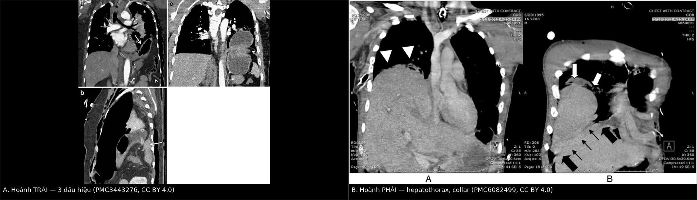
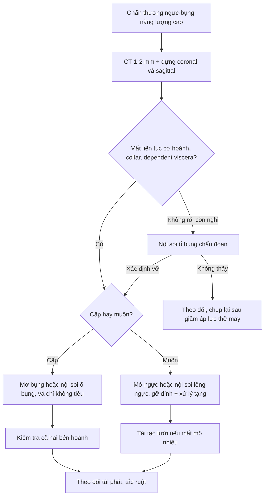
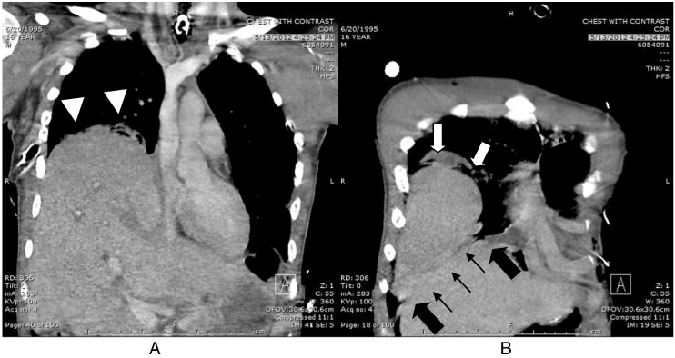
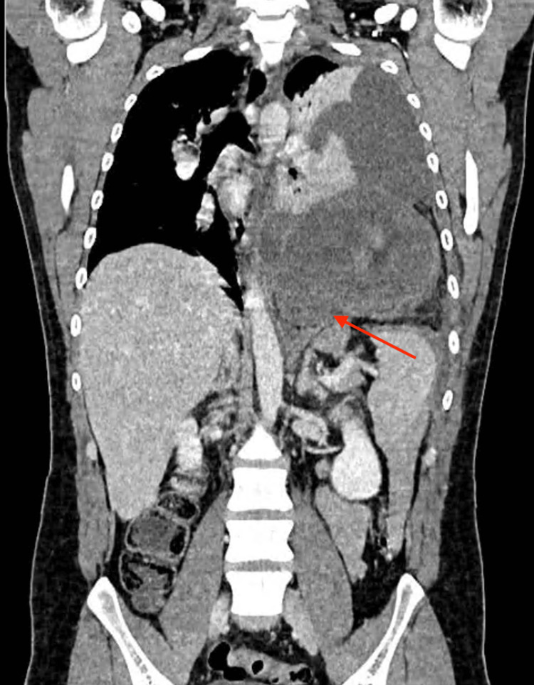

# 3082 — Vỡ cơ hoành sau chấn thương: dấu "cổ áo", "tạng tựa lưng" và bên PHẢI dễ bỏ sót

**Tags:** `pattern:chan-thuong` `pattern:vo-co-hoanh` `pattern:thoat-vi-tang` `pattern:collar-sign` `pattern:hepatothorax` `vung:co-hoanh` `vung:long-nguc` `vung:o-bung` `anatomy:co-hoanh` `score:AAST` `protocol:CT-chan-thuong` `protocol:laparoscopy`
**Mức chắc chắn (certainty):** tổng hợp y văn (literature synthesis) — ghép **loạt 35 ca vỡ cơ hoành ba trung tâm** (Turk Gogus Kalp Damar Cerrahisi Derg 2025, PMC12728965), **ca vỡ hoành HAI BÊN 16 tuổi bị bỏ sót bên phải qua 3 lần CT** (Trauma Case Rep 2015, PMC6082499), **ca thoát vị dạ dày muộn 4 năm sau vết đâm, hoại tử dạ dày** (Cureus 2026, PMC13160381) và **tổng quan CT chấn thương ngực mô tả đủ 3 dấu hiệu** (Insights Imaging 2012, PMC3443276). Không có ca do nhóm tự chụp.

> **Câu hỏi thực hành:** nam **16 tuổi**, tai nạn ô tô lật nhiều vòng; X-quang thấy **dạ dày nằm trong ngực trái**, mổ ngay vá hoành trái. Sau mổ **thở máy kéo dài**, X-quang hằng ngày "bất thường bên phải nhưng không đặc hiệu"; **3 lần CT đều không báo vỡ hoành phải**. Câu hỏi: **vì sao bên phải bị bỏ sót, dấu nào trên CT phải tìm, và khi nào cần nội soi ổ bụng chẩn đoán?**
> Bài chốt **ba quyết định**: **(1) vỡ hoành trái 80–90% nhưng bên PHẢI mới là bên bị bỏ sót — CT chỉ nhạy 50–83% bên phải so với 78–100% bên trái; (2) ba dấu chốt là mất liên tục cơ hoành có bờ cuộn, dấu "cổ áo" (collar) và dấu "tạng tựa lưng" (dependent viscera); bên phải thêm "hepatothorax", "hump", "band"; (3) chẩn đoán sớm thì mổ ngay bằng đường bụng; phát hiện muộn thì đường ngực/nội soi lồng ngực — chờ vì "chưa có thoát vị" là chờ hoại tử tạng.**

## 1. Tổng quan bệnh học – cơ chế hình ảnh: vì sao TRÁI nhiều mà PHẢI khó thấy

- **Tần suất – ba con số khác nhau vì ba mẫu số khác nhau:** **0,4–1,5%** trong toàn bộ chấn thương ngực; **0,8–7%** ở bệnh nhân chấn thương kín nhập viện (PMC3443276); **8%** chấn thương kín năng lượng cao và **10–15%** chấn thương xuyên thấu (PMC12728965). **Bỏ sót/ chẩn đoán muộn 9–41%** (PMC12728965).
- **Bên nào:** **trái 80–90%** (PMC12728965), tương ứng **2/3–3/4** trong tổng quan CT (PMC3443276); trong loạt 35 ca, **trái 62,9% tổng thể nhưng 85% ở nhóm chấn thương kín** (PMC12728965).
- **TẠI SAO trái nhiều:** nửa phải cơ hoành **nằm dưới gan** — gan vừa **hấp thu lực**, vừa là "nắp chặn" nên **lỗ rách nhỏ bên phải không đủ để gan chui lên**. Hệ quả ngược lại: **khi gan đã chui lên được thì lỗ đã rất lớn**, và trước đó hình ảnh **gần như bình thường**. Đây là lý do **CT bên phải chỉ nhạy 50–83%** so với **78–100% bên trái** (PMC3443276).
- **TẠI SAO vỡ:** (1) **tăng áp lực ổ bụng đột ngột** khi ngực bị ép → lực đẩy tạng lên vùng cơ hoành yếu nhất (phần sau–bên, nơi ống màng phổi–phúc mạc đóng muộn); (2) **lực xé (shear)** giữa phần cơ hoành di động và phần dính vào khung sườn/cột sống khi giảm tốc. Vì vậy vỡ hoành gần như **luôn kèm đa chấn thương**: **92% có tổn thương tạng kèm** ở nhóm chấn thương kín (PMC12728965), hay gặp **lách, gan, phổi, gãy sườn dưới** (PMC3443276).
- **TẠI SAO thở máy áp lực dương che dấu chẩn đoán:** áp lực trong lồng ngực dương **đẩy ngược** tạng xuống; chỉ khi **giảm áp lực/ cai máy** thì chênh áp bụng–ngực mới đủ để tạng chui lên. Ca PMC6082499 chẩn đoán muộn đúng trong bối cảnh **thở máy kéo dài** — đây là cạm bẫy cơ chế, không phải lỗi đọc phim đơn thuần.
- **TẠI SAO ba dấu hiệu lại xuất hiện:**
  - **Mất liên tục cơ hoành + bờ cuộn (club-shaped edge):** cơ rách co về hai phía, đầu cơ dày lên như "gậy đánh gôn" — thấy rõ nhất trên **dựng ảnh coronal/sagittal**.
  - **Collar sign ("cổ áo"):** tạng chui qua lỗ hẹp bị **thắt eo** tại chỗ đi qua cơ hoành; dấu này cũng là **dấu hiệu nguy cơ hoại tử** vì lỗ chật.
  - **Dependent viscera sign ("tạng tựa lưng"):** bình thường cơ hoành nằm giữa tạng bụng và phổi; khi rách, tạng **tựa trực tiếp vào thành ngực sau** — trên CT thấy **tạng chạm thành ngực phụ thuộc, không có phổi/cơ hoành chen giữa**.
- **Con số vận hành:** trong loạt 35 ca, **đường kính lỗ rách trung vị 5,7 cm (chấn thương kín) và 4,04 cm (xuyên thấu)**; **biến chứng 40%**, **tử vong 5,7%**, nằm viện **4–16 ngày** (PMC12728965). **CT chẩn đoán trước mổ chỉ 56%** — nghĩa là **gần một nửa được phát hiện trong mổ** (PMC12728965).

## 2. Mẫu hình + chẩn đoán phân biệt theo vị trí (gamut)

- **Theo bên và vị trí lỗ:**
  - **Trái sau–bên:** hay gặp nhất; tạng chui lên là **dạ dày, đại tràng, mạc nối, lách, ruột non**.
  - **Phải sau–bên:** **gan** chui lên (hepatothorax); hình ảnh **tinh tế**, dễ đọc thành "vòm hoành cao" hoặc "tràn dịch".
  - **Hai bên:** hiếm; **bên phải thường bị bỏ sót khi đang mổ bên trái** — 3/5 ca vỡ hai bên trong y văn cũng bị bỏ sót như vậy (PMC6082499).
  - **Giữa/ trước (central tendon, Morgagni):** hiếm sau chấn thương, dễ nhầm thoát vị bẩm sinh.
- **Theo mẫu hình trình bày:**
  1. **Cấp – có thoát vị rõ:** dạ dày/đại tràng trong ngực, mức khí–dịch, trung thất lệch.
  2. **Cấp – không thoát vị:** chỉ **mất liên tục cơ hoành** ± máu tụ quanh cơ hoành — dễ bỏ nhất.
  3. **Muộn – tạng đã chui lên từ lâu:** khó thở, đau bụng, **xoắn/ hoại tử dạ dày** (ca PMC13160381: vết đâm **4 năm trước**, vào viện vì đau thượng vị 4 ngày, CT thấy dạ dày trong ngực, mổ vì **hoại tử dạ dày**).
  4. **"Bịt kín" bởi tạng:** lỗ rách bị gan/lách bít tạm → **không có thoát vị, không có khí tự do**, hình ảnh gần bình thường.

## 3. Bảng so sánh phân biệt (ma trận đối chiếu)

| Thực thể | Hình ảnh điển hình | Chốt vào (rule-in) | Chốt loại (rule-out) | Gợi ý xác nhận |
|---|---|---|---|---|
| **Vỡ cơ hoành do chấn thương** | **Mất liên tục cơ hoành + bờ cuộn**; **collar sign**; **dependent viscera sign**; tạng trong ngực | **Chấn thương năng lượng cao + mất liên tục cơ hoành trên ≥ 2 bình diện + tạng tựa thành ngực sau** | Cơ hoành liên tục trên đủ 2 bình diện + không tạng lạc chỗ → loại (nhưng **không loại trừ được nếu chỉ 1 bình diện**) | CT dựng coronal + sagittal; nội soi ổ bụng khi còn nghi |
| **Vỡ hoành PHẢI (hepatothorax)** | **Gan trong ngực**, **hump sign** (vòm gan đội lên), **band sign**, **collar sign**, mất vòm hoành phải | **Mất liên tục cơ hoành phải + gan tựa thành ngực sau + mất "dấu cơ hoành liên tục"** | Vòm hoành phải liền, không dải mô bất thường → loại | 3 lần CT vẫn có thể bỏ sót → **nội soi ổ bụng chẩn đoán** (PMC6082499) |
| **Giãn cơ hoành (eventration)** | Vòm hoành **cao, liên tục, mỏng nhưng không đứt**; tạng ở dưới | **Cơ hoành còn liền, mỏng đều, không collar sign** | Có mất liên tục hoặc collar → loại | So sánh 2 thì hô hấp; MRI khi không rõ |
| **Thoát vị hoành bẩm sinh (Bochdalek/ Morgagni)** | Lỗ **sau–bên (trái)** hoặc **trước–trong (phải)**, bờ lỗ **nhẵn, không dập** | **Bờ lỗ nhẵn + không dấu chấn thương + phát hiện tình cờ** | Bờ rách dập, có máu tụ, bối cảnh chấn thương → loại | CT; tiền sử; đối chiếu phim cũ |
| **Thoát vị hoành – thực quản (hiatal hernia)** | Dạ dày qua **lỗ thực quản**, trên **cơ hoành liền** | **Dạ dày quanh lỗ thực quản + cơ hoành liền** | Cơ hoành đứt ở phần cơ → loại | CT coronal; nội soi tiêu hóa |
| **Xoắn dạ dày (gastric volvulus)** | Dạ dày căng, **mức khí–dịch lớn**, có thể **ở trong ngực** | **Dạ dày xoay quanh trục + căng + không thoát được** | Dạ dày vị trí bình thường → loại | CT; **đây là biến chứng của vỡ hoành, không phải chẩn đoán thay thế** |

*Trái (A): vỡ hoành **trái** — tạng chui lên, **bờ cơ hoành cuộn**, dấu **collar** và **dependent viscera** (dựng coronal a, sagittal b, coronal c). Phải (B): vỡ hoành **phải** — **hepatothorax** (đầu mũi tên), **hump** (mũi tên trắng), **collar** (mũi tên đen), **band** (đường mũi tên); ca này **3 lần CT đều không báo**. Hai bệnh nhân khác nhau ở hai bài khác nhau. Nguồn: Insights Imaging 2012 PMC3443276 + Trauma Case Rep 2015 PMC6082499, đều CC BY 4.0. Ảnh ghép letterbox, không crop.*

## 4. Protocol chụp – phân độ AAST – quy trình điều trị

### 4.1 Chụp gì, đọc gì

- **CT ngực–bụng cản quang, lát 1–2 mm**, **bắt buộc dựng coronal + sagittal**: phần lớn lỗ rách nằm **sau–bên**, gần như **song song mặt phẳng axial** nên chỉ thấy trên dựng ảnh (PMC3443276).
- **Không dùng X-quang để loại trừ:** độ nhạy chỉ **17% bên phải** và **27–60% bên trái** (PMC3443276). X-quang **âm tính không loại trừ**.
- **Đọc theo 5 bước:** (1) vòm hoành hai bên có **liên tục** không; (2) **bờ cơ hoành có dày/cuộn**; (3) tạng bụng có **chạm thành ngực sau**; (4) **collar sign** tại lỗ; (5) bên phải: **vòm gan có "hump"**, có **band** bất thường, **mất dấu cơ hoành liên tục**.
- **Nội soi ổ bụng chẩn đoán** khi CT không kết luận nhưng **cơ chế + tổn thương tạng kèm** gợi ý mạnh — ca PMC6082499 chẩn đoán xác định bằng **nội soi ổ bụng ngày 17**, thấy gan trong ngực.
- **Siêu âm tại giường** (POCUS) có vai trò khi bệnh nhân không đi CT được: **quai ruột nằm sát nhu mô phổi, mất đường hoành** — hữu ích nhưng phụ thuộc người làm.

### 4.2 Phân độ AAST cơ hoành (2018) và ý nghĩa thực hành

| Độ | Mô tả | Ý nghĩa |
|---|---|---|
| **I** | Đụng dập cơ hoành | Thường không cần can thiệp |
| **II** | Rách **< 2 cm** | Vá thì đầu; nếu bỏ sót dễ thành thoát vị muộn |
| **III** | Rách **2–10 cm** | Vá; phần lớn ca chấn thương kín rơi vào nhóm này |
| **IV** | Rách **> 10 cm**, mất mô **≤ 25 cm²** | Cân nhắc **lưới/ tái tạo** nếu không đóng được không căng |
| **V** | Mất mô **> 25 cm²** | Tái tạo phức tạp, nguy cơ thoát vị tái phát cao |

- **Lỗ rách trung vị đo được trên mổ: 5,7 cm (kín) và 4,04 cm (xuyên thấu)** (PMC12728965) → phần lớn là **độ III**.
- **Khâu không tiêu là chuẩn**; trong loạt 35 ca **tất cả được vá thì đầu bằng chỉ không tiêu, không dùng lưới** (PMC12728965).

### 4.3 Đường mổ và thời điểm

| Tình huống | Đường vào | Lý do |
|---|---|---|
| **Cấp, nghi tổn thương tạng bụng** | **Mở bụng** (hoặc nội soi ổ bụng) | **92% có tổn thương tạng kèm** (PMC12728965); vá hoành từ dưới dễ hơn |
| **Cấp, chỉ tổn thương hoành, bệnh nhân ổn định** | **Nội soi ổ bụng** | Ít xâm lấn, vẫn đánh giá được cả hai bên hoành |
| **Muộn, tạng đã dính/ hoại tử trong ngực** | **Mở ngực hoặc nội soi lồng ngực** | Gỡ dính, xử lý tạng hoại tử, vá từ trên |
| **Vỡ hai bên** | **Mở bụng** (đánh giá cả hai) | Bên phải dễ bị bỏ sót khi chỉ mổ bên trái (PMC6082499) |

- **Thời điểm:** mổ **ngay khi chẩn đoán** ở thể cấp — trong loạt 35 ca, **74,2% mổ trong ngày nhập viện** (PMC12728965). **Chờ đợi "vì chưa có thoát vị" là sai**: lỗ rách không tự liền và tạng có thể chui lên bất kỳ lúc nào, kể cả **4 năm sau** (PMC13160381).
- **Cạm bẫy thở máy:** đặt **áp lực dương** có thể **che mất thoát vị**; trước khi kết luận "hoành bình thường", cần **hạ áp lực/ thử nghiệm cai máy** hoặc **chụp lại khi giảm áp lực** (PMC6082499).
- **Sau mổ:** theo dõi **thoát vị tái phát** (đặc biệt độ IV–V), **tắc ruột sớm**, và **tràn dịch/ dày màng phổi** bên vá.

## 5. Biến thể bình thường và cạm bẫy

- **Bên phải là bẫy số một:** **3 lần CT liên tiếp** không báo vỡ hoành phải dù có **hepatothorax + hump + band + collar** (PMC6082499). Nếu **cơ chế mạnh + tổn thương lách/ gan/ sườn dưới**, phải **chủ động tìm** các dấu này và **không chấp nhận câu "không thấy bất thường"**.
- **"Vòm hoành cao" không phải chẩn đoán:** giãn cơ hoành, liệt hoành do tổn thương thần kinh hoành, vòm gan cao bẩm sinh đều cho hình ảnh tương tự; phân biệt bằng **cơ hoành còn liền** và **không có collar**.
- **Thở máy làm mất dấu:** như trên — giảm áp lực rồi chụp lại.
- **Bỏ sót thứ hai khi đã tìm thấy một (satisfaction of search):** thấy dạ dày trong ngực trái rồi dừng lại → bỏ bên phải. **Luôn đọc cả hai bên hoành** trước khi kết thúc.
- **Tràn dịch/ tràn khí "không giải thích":** tạng trong ngực có thể gây **tràn dịch phản ứng** hoặc **tràn khí** do thủng tạng; đừng chỉ đặt dẫn lưu rồi theo dõi.
- **Biến thể bình thường dễ nhầm:** **thùy gan phụ/ rãnh gan sâu** và **mỡ dưới hoành** có thể tạo "dải" giả trên CT; **thoát vị Bochdalek người lớn** (0,17% CT bụng) có bờ lỗ **nhẵn** — khác bờ rách dập sau chấn thương.
- **Muộn: đừng quên xoắn/ hoại tử** — ca PMC13160381 mổ vì **hoại tử dạ dày**; hỏi **triệu chứng tiêu hóa** ở bệnh nhân có "bất thường hoành cũ".

## 6. Tự lượng giá — Blind Quiz

**Ca 1 — Nam 16 tuổi, tai nạn ô tô lật; CT ngực–bụng sau mổ vá hoành trái. Có gì bất thường bên phải?**

- Gợi ý: bệnh nhân thở máy kéo dài; X-quang hằng ngày "bất thường phải nhưng không đặc hiệu".
- Hỏi: mô tả 4 dấu hiệu trên ảnh? Vì sao 3 lần CT trước đó không báo?

<b>Bấm để hiện đáp án</b>

- **A (coronal):** gan chui lên ngực phải — **hepatothorax** (đầu mũi tên); **B (sagittal):** **hump sign** (mũi tên trắng), **collar sign** (mũi tên đen), **band sign** (đường mũi tên).
- **Vì sao bỏ sót:** vỡ hoành phải **nhỏ, bị gan bịt**; **thở máy áp lực dương** đẩy tạng xuống; lỗ rách chỉ **song song mặt axial** nên không thấy nếu không dựng sagittal.
- **Xác định:** nội soi ổ bụng **ngày 17** thấy gan trong ngực → mổ vá.
- Nguồn: Trauma Case Rep 2015, PMC6082499, CC BY 4.0.

**Ca 2 — Nam 25 tuổi, vết đâm ngực trái 4 năm trước, nay đau thượng vị 4 ngày, nôn. Chẩn đoán và vì sao phải mổ cấp?**

<b>Bấm để hiện đáp án</b>

- **Dạ dày (thân + phình vị + phần hang) nằm trong ngực trái** qua lỗ hoành nhỏ (mũi tên), phổi trái xẹp, tràn dịch cùng bên.
- **Chốt vào:** tiền sử xuyên thấu + tạng trong ngực + **triệu chứng tắc/ xoắn** → **thoát vị hoành muộn biến chứng**, không phải "đau dạ dày".
- Trong ca này dạ dày đã **hoại tử** → mổ cấp; lỗ rách chỉ **~2 cm** vẫn đủ gây xoắn và hoại tử.
- Nguồn: Cureus 2026, PMC13160381, CC BY 4.0.

**Ca 3 — Hai bệnh nhân vỡ hoành trái và phải: dấu nào giúp phân biệt, và dấu nào báo nguy cơ hoại tử?**

<b>Bấm để hiện đáp án</b>

- **Trái (A):** tạng chui lên rõ, **bờ cơ hoành cuộn**, **collar** + **dependent viscera**.
- **Phải (B):** **hepatothorax**, **hump**, **collar**, **band** — không có "dạ dày trong ngực" để dễ nhận ra.
- **Collar sign** là dấu báo **tạng bị thắt tại lỗ hẹp** → nguy cơ **xoắn/ hoại tử**, cần mổ sớm.
- Nguồn: Insights Imaging 2012 PMC3443276 + Trauma Case Rep 2015 PMC6082499, CC BY 4.0.

## Bài liên quan chéo
- [3083 – Chấn thương khí–phế quản do lực tù](../3083-chan-thuong-khi-phe-quan-do-luc-tu/lesson.md) (cùng cơ chế giảm tốc)
- [080 – Chấn thương ngực kín](../080-chan-thuong-nguc/lesson.md) (đọc CT theo tầng, AAST)
- [045 – Thành ngực & thoát vị hoành](../045-thanh-nguc-hoanh/lesson.md) (Bochdalek người lớn, dấu ngoài màng phổi)
- [608 – Theo dõi sau mổ thoát vị hoành bẩm sinh](../608-theo-doi-sau-mo-thoat-vi-hoanh-bam-sinh/lesson.md) (thoát vị hoành ở trẻ)
- [1776 – Bệnh cơ hoành do thở máy](../1776-benh-co-hoanh-do-tho-may/lesson.md) (giảm áp lực, cai máy)
- [162 – Tắc ruột](../162-tac-ruot/lesson.md) (biến chứng thoát vị nghẹt)

## Ảnh
- File: `3082_vch_CT_PMC3443276-F21.jpg`, `3082_vch_CT_PMC6082499-F2.jpg`, `3082_vch_CT_PMC13160381-F1.jpg`, `composite_3082_trai-phai.jpg`. Nguồn + giấy phép từng ảnh trong `images/CREDITS.md`.

> Không dùng để chẩn đoán độc lập khi chưa có người hướng dẫn.
