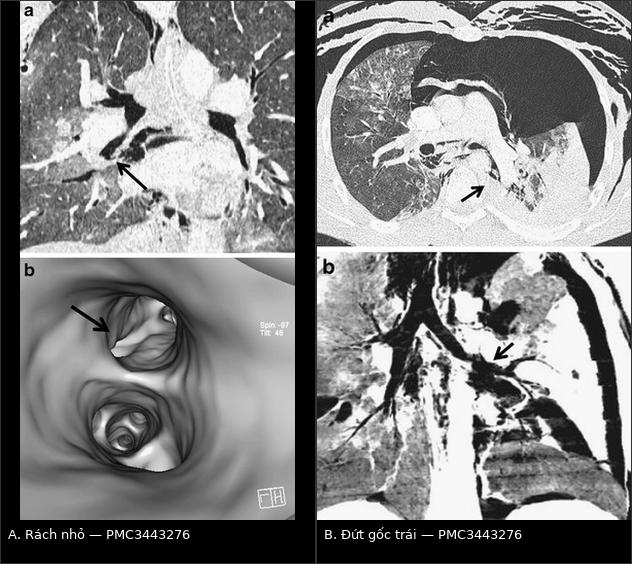
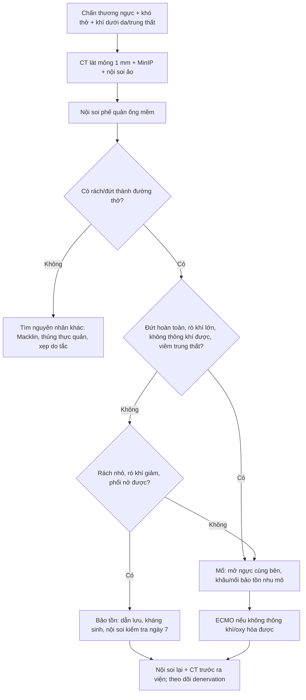
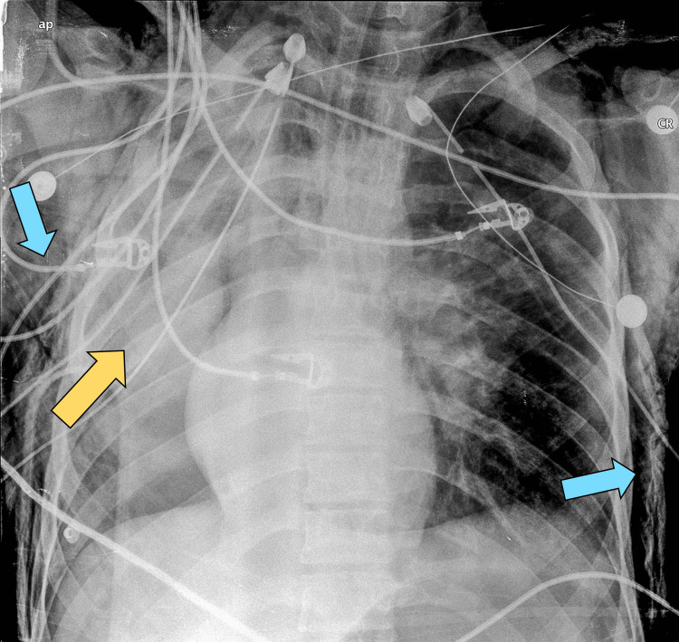
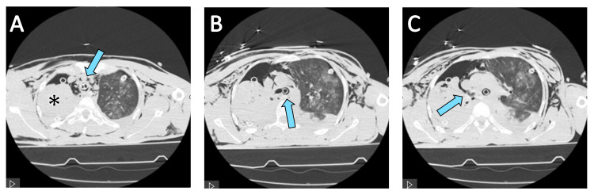

# 3083 — Chấn thương khí–phế quản do lực tù: "phổi rơi" (fallen lung) và tràn khí dai dẳng dù đã dẫn lưu

**Tags:** `pattern:chan-thuong` `pattern:tran-khi-dai-dang` `pattern:fallen-lung` `pattern:tran-khi-trung-that` `vung:khi-quan` `vung:phe-quan` `vung:phoi` `vung:trung-that` `anatomy:khi-quan` `protocol:CT-lat-mong` `protocol:MinIP` `protocol:noi-soi-phe-quan`
**Mức chắc chắn (certainty):** tổng hợp y văn (literature synthesis) — ghép **ca đứt phế quản gốc phải 16 tuổi sau tai nạn mô tô, xẹp phổi dai dẳng dù hai dẫn lưu** (Cureus 2025, PMC11875394), **ca vỡ phế quản gốc phải 26 tuổi do tường đổ** (Clin Case Rep 2019, PMC6333061), **loạt 73 ca chấn thương phế quản mổ ngực** (World J Clin Cases 2022, PMC9210895), **loạt 4 ca** (J Thorac Dis 2024, PMC11494571) và **tổng quan CT chấn thương ngực có hình fallen lung/MinIP** (Insights Imaging 2012, PMC3443276). Bài **không** có ca do nhóm tự chụp.

> **Câu hỏi thực hành:** nam **16 tuổi**, tai nạn mô tô năng lượng cao, vào viện khó thở, khí dưới da; X-quang có **tràn khí hai bên**, đặt **hai dẫn lưu**; sau đó **rò khí liên tục bên phải** và **phổi phải không nở dù dẫn lưu thông**. Câu hỏi: **vì sao phổi không nở, chụp gì để tìm chỗ rách, và bệnh nhân cần mổ hay có thể theo dõi?**
> Bài chốt **ba quyết định**: **(1) tràn khí dai dẳng + phổi không nở sau dẫn lưu = lỗ rò nằm ở đường thở lớn, không phải "dẫn lưu kém"; (2) CT lát mỏng dựng MinIP + nội soi phế quản ống mềm là cặp chẩn đoán — CT định vị, nội soi đo độ sâu/độ dài; (3) đứt hoàn thành, rò khí không kiểm soát, không thể thông khí hoặc viêm trung thất → mổ khâu bảo tồn nhu mô phổi.** Nối [3057 – Vỡ khí quản sau đặt nội khí quản](../3057-vo-khi-quan-phe-quan-sau-dat-noi-khi-quan/lesson.md), [080 – Chấn thương ngực kín](../080-chan-thuong-nguc/lesson.md), [098 – Barotrauma & tràn khí do thông khí áp lực](../098-barotrauma-tran-khi-ap-luc-tho-may/lesson.md).

## 1. Tổng quan bệnh học – cơ chế hình ảnh: vì sao đứt ĐÚNG chỗ carina và vì sao phổi "rơi"

- **Tần suất – con số quyết định mức nghi ngờ:** chấn thương khí–phế quản (tracheobronchial injury, TBI) chiếm **0,2–5%** bệnh nhân chấn thương ngực (PMC11494571); một loạt **3.018 ca chấn thương ngực** có **73 ca tổn thương phế quản = 2,4%** (PMC9210895); tổng quan CT xếp **tổn thương đường thở 2,8–5,4%** các tổn thương ngực (PMC3443276). **Tử vong trước khi tới viện tới 80%** (PMC11494571); ở nhóm tới được viện và được mổ, tử vong **6,9% (5/73)** — **7,9% ở nhóm lực tù** và **5,7% ở nhóm xuyên thấu** (PMC9210895).
- **Yếu tố nguy cơ đã ghi nhận:** **dị tật bẩm sinh khí quản, nữ, tuổi > 65** (PMC11494571). Cơ chế năng lượng cao (tai nạn mô tô, tường đổ, ngã cao) là bối cảnh điển hình của hai ca trong bài.
- **Vị trí — "luật 2 và 2,5":** chỗ rách hay gặp nhất là **2 cm trên carina** (khí quản ngực) và **phế quản gốc trong vòng 2,5 cm từ carina**, **bên phải nhiều hơn bên trái** (PMC3443276). **TẠI SAO đúng chỗ đó:** khí quản **cố định ở sụn nhẫn và carina**, còn phổi treo mềm; khi cơ thể giảm tốc đột ngột, hai đầu cố định đứng yên còn khối phổi bị kéo về trước — **lực xé tập trung đúng nơi chuyển tiếp**. Ngoài ra **nén ngực khi glottis đóng** làm áp lực trong lòng đường thở tăng vọt, và **thành sau màng không có sụn** là điểm yếu chịu lực (cùng lý do như vỡ khí quản sau đặt ống — bài 3057).
- **Ba cơ chế, ba hình ảnh khác nhau:**
  1. **Nén – bùng nổ áp lực (compression/ burst):** ngực bị ép khi glottis đóng → khí không thoát → rách **thành sau màng**, khí thoát vào **trung thất** trước.
  2. **Giảm tốc (deceleration):** rách/đứt ngang tại **điểm cố định** (carina, phế quản gốc) → **mất liên tục hoàn toàn**, phổi mất treo → **fallen lung**.
  3. **Nén phế quản gốc vào cột sống:** tổn thương phế quản gốc phải, thường kèm chấn thương ngực nặng khác.
- **TẠI SAO có dấu "phổi rơi" (fallen lung sign):** bình thường phổi treo vào rốn phổi bằng phế quản, động–tĩnh mạch phổi. Khi **phế quản gốc đứt/gần đứt**, phổi mất "dây treo cứng", xẹp lại và **rơi ra phía sau – ngoài, xa rốn phổi**, tựa vào thành ngực phụ thuộc. Ngược lại, **xẹp do tắc phế quản** (nút nhầy, u, dị vật) vẫn **dính rốn phổi** và co về phía rốn. Đây là dấu **gợi ý đứt phế quản gốc**, không phải xẹp thông thường (PMC3443276, Hình 20).
- **TẠI SAO tràn khí "dai dẳng" dù đã dẫn lưu:** lỗ rò nằm **trước** hệ thống dẫn lưu — khí từ đường thở lớn vào khoang màng phổi **nhanh hơn** khả năng hút của ống, nên phổi **không nở** dù ống thông và máy hút hoạt động. Trong ca PMC11875394, **rò khí liên tục bên phải** kèm **xẹp hoàn toàn phổi phải** là lý do đặt chỉ định nội soi phế quản cấp; khí máu lúc đó **P/F < 100, PCO₂ 90 mmHg, pH 7,2**.
- **TẠI SAO khí trung thất một mình KHÔNG đặc hiệu:** cơ chế **Macklin** (vỡ phế nang → khí theo bao mạch–phế quản vào trung thất) cho hình ảnh y hệt. Tổng quan CT liệt kê khí trung thất, khí dưới da, tràn khí, tràn máu là **dấu hiệu không đặc hiệu**, còn **khuyết thành đường thở kèm thoát khí, fallen lung và tràn khí dai dẳng sau dẫn lưu** mới là dấu **tương đối đặc hiệu** (PMC3443276).
- **Vật lý áp dụng cho trẻ:** theo Hagen–Poiseuille, trở lực tỉ lệ nghịch với **bán kính lũy thừa 4**. Phế quản gốc trẻ đường kính **4 mm** (bán kính 2 mm); phù nề làm hẹp 1 mm (bán kính 1,5 mm) → trở lực **×(2/1,5)⁴ ≈ 3,2 lần**. Vì vậy cùng một vết rách, trẻ mất bù nhanh hơn và **mọi can thiệp làm giảm 1 mm lòng đường thở đều là biến cố**.

## 2. Mẫu hình + chẩn đoán phân biệt theo vị trí (gamut)

- **Theo vị trí — quyết định đường mổ và cách đặt ống:**
  - **Khí quản cổ (trên eo):** khí dưới da cổ, thay đổi giọng, khó thở; đường vào **cổ**.
  - **Khí quản ngực (dưới eo tới carina, hay gặp 2 cm trên carina):** khí trung thất ± tràn khí; đường vào **ngực phải**.
  - **Phế quản gốc (trong 2,5 cm từ carina, phải > trái):** tràn khí dai dẳng, **fallen lung**, xẹp phổi không hồi phục; đường vào **ngực cùng bên**. Ca PMC6333061: nam **26 tuổi**, tường đổ lên ngực, **tràn máu–tràn khí hai bên**, đặt dẫn lưu hai bên nhưng **rò khí ồ ạt và phổi phải không nở**, CT gợi ý **vỡ phế quản gốc phải**.
  - **Phế quản thùy/phân thùy:** rách nhỏ, khó thấy trên MPR thường — cần **nội soi ảo** (Hình của PMC3443276).
- **Theo mẫu hình — 4 kiểu trình bày:**
  1. **Khí trung thất + khí dưới da, KHÔNG tràn khí** → nghĩ khí quản ngực (dễ bị đọc thành Macklin).
  2. **Tràn khí dai dẳng + phổi không nở dù dẫn lưu** → nghĩ phế quản gốc.
  3. **Fallen lung** → nghĩ đứt phế quản gốc.
  4. **Bệnh nhân đang thở máy: rò khí quanh ống, bơm căng bóng vẫn rò** → nghĩ vỡ thành sau khí quản (bài 3057), khác hẳn thể chấn thương kín.
- **Bảng giá trị các dấu hiệu trên CT:**

| Dấu hiệu trên CT | Cơ chế | Giá trị thực hành |
|---|---|---|
| **Mất liên tục thành khí quản/phế quản** trên MPR | Rách toàn thành | **Chốt vào mạnh nhất**; cần cửa sổ mô mềm + dựng dọc |
| **Khí thoát qua chỗ rách** trên **MinIP** dày 3–5 mm | Lỗ rò còn thông | **Dấu trực tiếp**, thấy rõ hơn MPR thường (PMC3443276) |
| **Fallen lung sign** | Phổi mất treo rốn phổi | **Rất gợi ý đứt phế quản gốc**, phân biệt với xẹp do tắc |
| **Tràn khí dai dẳng sau dẫn lưu** | Rò trước hệ thống dẫn lưu | **Dấu tương đối đặc hiệu**, quyết định chụp/nội soi |
| **Khí trung thất, khí dưới da** | Khí theo mô liên kết | **Nhạy, KHÔNG đặc hiệu** (Macklin, ARDS) |
| **Tràn khí bụng** | Khí xuống qua lỗ hoành | Bẫy: dễ bị đọc thành **thủng tạng rỗng** |

## 3. Bảng so sánh phân biệt (ma trận đối chiếu)

| Thực thể | Hình ảnh điển hình | Chốt vào (rule-in) | Chốt loại (rule-out) | Gợi ý xác nhận |
|---|---|---|---|---|
| **Đứt phế quản gốc do lực tù** | Mất liên tục phế quản **≤ 2,5 cm từ carina**, **fallen lung**, tràn khí dai dẳng, khí trung thất | **Rò khí liên tục + phổi không nở dù dẫn lưu thông + fallen lung** | Phổi nở hoàn toàn sau dẫn lưu, không rò khí → loại | CT lát mỏng + MinIP; **nội soi phế quản** xác định |
| **Rách khí quản ngực** | Rách **2 cm trên carina**, khí trung thất lan tỏa ± khí dưới da | **Khí trung thất mới sau chấn thương + khuyết thành sau trên MPR** | Không khuyết thành, khí trung thất có từ trước → loại | Nội soi ống mềm; CT dựng dọc |
| **Rách nhỏ phế quản thùy** | MPR thường **không thấy**; **nội soi ảo** thấy đường rách | **Đường rách trên nội soi ảo + khí quanh phế quản** | Nội soi ảo bình thường → loại | Nội soi ảo + nội soi thật |
| **Khí trung thất do vỡ phế nang (Macklin)** | Khí trung thất **lan theo bao mạch**, phổi có đông đặc/bệnh nền, thở máy áp lực cao | **Bệnh nhu mô + áp lực cao + KHÔNG rò khí** | Có rò khí hoặc khuyết thành → loại | Theo dõi, giảm áp lực |
| **Thủng thực quản (Boerhaave)** | Khí + dịch **quanh thực quản**, tràn dịch màng phổi trái, mức khí–dịch | **Đau sau nôn + tràn dịch trái + khí quanh thực quản** | Không khí/dịch quanh thực quản → loại | CT cản quang uống thuốc; nội soi **khi còn nghi** |
| **Xẹp phổi do tắc (nút nhầy, máu cục)** | Phổi xẹp **co về rốn phổi**, phế quản đầy dịch, **không rò khí** | **Xẹp + phế quản đầy + hút ra nút nhầy thì phổi nở** | Có fallen lung hoặc rò khí → loại | Nội soi phế quản điều trị |

*Trái (A): rách nhỏ phế quản thùy giữa — MPR thường khó thấy, **nội soi ảo** thấy rõ đường rách. Phải (B): **đứt phế quản gốc trái** — phổi xẹp rơi ra ngoài rốn phổi; dựng **MinIP** cho thấy khí thoát qua chỗ rách. Hai bệnh nhân khác nhau trong cùng bài. Nguồn: Insights Imaging 2012, PMC3443276, CC BY 4.0. Ảnh ghép letterbox, không crop.*

## 4. Protocol chụp – phân loại theo giải phẫu – quy trình điều trị

### 4.1 Chụp gì, đọc gì

- **CT ngực cản quang, lát mỏng 1,0–1,5 mm**, dựng **axial + coronal + sagittal**; đọc **cửa sổ mô mềm và cửa sổ phổi**.
- **MinIP (minimum-intensity projection) dày 3–5 mm** dọc trục đường thở: làm nổi **lòng đường thở chứa khí** và **đường rò**, trong khi MIP thông thường lại **che mất** chỗ hẹp/khuyết thành. Tổng quan CT và loạt 4 ca đều nhấn **MinIP giúp phát hiện TBI** (PMC3443276, PMC11494571).
- **Nội soi ảo (virtual bronchoscopy)** hữu ích cho **rách nhỏ ở phế quản thùy**, nơi MPR thường bỏ sót (Hình 19, PMC3443276).
- **Nội soi phế quản ống mềm là chuẩn chẩn đoán** — làm **càng sớm càng tốt** khi có bộ ba **chấn thương ngực + khó thở + khí dưới da/trung thất** (PMC11494571). Khi nội soi cần ghi: **khoảng cách tới carina, độ dài, độ sâu (niêm mạc hay toàn thành), mô trung thất lộ ra, có bọt khí hoạt động**.
- **CT không thay nội soi:** CT định vị và phát hiện biến chứng (trung thất, màng phổi, thực quản); độ sâu và độ dài do nội soi quyết định.

### 4.2 Phân loại giải phẫu dùng để chọn đường mổ

> Chưa có thang điểm quốc tế riêng cho TBI do chấn thương kín; thực hành dùng **phân loại theo vị trí + độ sâu**, còn thể **sau đặt ống** dùng **phân độ Cardillo** (xem bài 3057).

| Mức | Vị trí | Đặc điểm | Đường vào / xử trí |
|---|---|---|---|
| **I** | Khí quản cổ | Rách thành sau màng hoặc vòng sụn | Đường **cổ**; khâu thì đầu |
| **II** | Khí quản ngực (2 cm trên carina) | Rách thành màng, khí trung thất | **Mở ngực phải**; khâu thành màng mũi vắt |
| **III** | Phế quản gốc (≤ 2,5 cm từ carina) | Đứt/rách, fallen lung | **Mở ngực cùng bên**; nối tận–tận, tránh cắt nhu mô |
| **IV** | Phế quản thùy/phân thùy | Rách nhỏ, khó thấy | Thường **bảo tồn**; nội soi ảo để phát hiện |

### 4.3 Quyết định bảo tồn hay mổ

- **Mổ (ưu tiên bảo tồn nhu mô phổi):** **đứt hoàn toàn**, **rách toàn thành có rò khí lớn không kiểm soát**, **không thể thông khí** đường thở tổn thương, **viêm trung thất**, **mất chất/gãy sụn**. Trong loạt 73 ca, **tất cả đều mở ngực**, và **22 ca được "pulmo-tractotomy" cầm máu — tránh cắt phổi** (PMC9210895). Loạt 4 ca: **mổ bảo tồn nhu mô là lựa chọn hàng đầu**, chỉ **cắt phổi khi nhu mô đã hỏng** (PMC11494571).
- **Bảo tồn có điều kiện:** rách nhỏ, **rò khí giảm dần**, **phổi nở được**, không nhiễm trùng trung thất, bệnh nhân **không phụ thuộc thông khí áp lực cao**. Loạt 4 ca ghi nhận **bảo tồn có thể thử với tổn thương khu trú** nhưng **không phải chuẩn** (PMC11494571).
- **Gây mê – thông khí:** đặt **ống một nòng đẩy qua khỏi chỗ rách vào phế quản gốc đối diện** để thông khí phổi lành (kinh nghiệm loạt 73 ca, PMC9210895); hoặc **ống hai nòng** nhưng phải kiểm tra vị trí **bằng nội soi ngay sau đặt và sau mỗi lần đổi tư thế**. **ECMO** dành cho ca không thể thông khí/oxy hóa — **2/4 ca** trong loạt PMC11494571 cần ECMO.
- **Kỹ thuật khâu:** mũi rời hoặc vắt bằng **chỉ tiêu tổng hợp đơn sợi 3-0/4-0**, **không căng**, có thể **chen vạt cơ/ màng phổi**; kiểm tra **kín khí bằng nước muối + thông khí** trước khi đóng.
- **Sau mổ:** nội soi kiểm tra **ngày 7** và trước ra viện; theo dõi **mất thần kinh chi phối phế quản** (denervation) gây **ứ đờm, xẹp phổi tái diễn** — biến chứng được nêu riêng trong loạt 4 ca (PMC11494571). Thời gian nằm viện **10–60 ngày**, ca tổn thương phế quản gốc nằm lâu nhất.

## 5. Biến thể bình thường và cạm bẫy

- **"Dẫn lưu kém" không phải chẩn đoán:** nếu **phổi không nở + rò khí liên tục** dù ống thông, **kiểm tra đường thở trước khi đổi ống to hơn**; đổi/ hút mạnh chỉ làm tăng rò.
- **Fallen lung ≠ xẹp do tắc:** xẹp do tắc **co về rốn phổi**; fallen lung **rơi ra ngoài**. Nếu chỉ thấy "phổi trắng" trên X-quang mà không hỏi **phổi dính rốn hay không**, dễ bỏ sót đứt phế quản.
- **Khí trung thất đơn thuần** không chứng minh và không loại trừ TBI — phải tìm **khuyết thành + rò khí**.
- **Dùng MIP thay MinIP:** MIP (maximum) làm dày mạch máu, **che lấp lòng đường thở**; với đường thở phải dùng **MinIP 3–5 mm**.
- **Ống hai nòng:** bóng khí quản/phế quản bơm quá căng hoặc ống quá cỡ ở bệnh nhân **thấp, nữ, lớn tuổi** là tổ hợp nguy cơ; xác nhận vị trí bằng nội soi **sau khi đặt và sau khi đổi tư thế**.
- **Tràn khí bụng** do khí từ trung thất xuống: **đừng mổ bụng** trước khi loại trừ tổn thương đường thở.
- **Biến thể bình thường dễ nhầm:** **phế quản khí quản (tracheal bronchus)** cấp cho thùy trên phải có thể làm **thùy trên phải xẹp** khi đặt ống quá sâu — hình ảnh giống "tắc phế quản" sau chấn thương; nhận ra bằng vị trí lỗ phế quản bất thường trên CT.

## 6. Tự lượng giá — Blind Quiz

**Ca 1 — Nam 16 tuổi, tai nạn mô tô; X-quang sau khi đặt hai dẫn lưu. Đọc phim trước khi mở đáp án.**

- Gợi ý: khó thở, khí dưới da; máy theo dõi ghi nhận rò khí liên tục bên phải.
- Hỏi: phổi phải ở trong tình trạng nào? Hai dấu hiệu ngoài phổi? Nếu dẫn lưu đã đúng vị trí thì nguyên nhân không nở là gì?

<b>Bấm để hiện đáp án</b>

- **Xẹp hoàn toàn phổi phải** (mũi tên vàng) **dù đã có dẫn lưu hai bên**; **khí dưới da** lan rộng (mũi tên xanh).
- **Chốt vào:** rò khí liên tục + phổi không nở = **lỗ rò ở đường thở lớn**, không phải dẫn lưu kém.
- Bước tiếp: **CT lát mỏng + nội soi phế quản**; ca này nội soi thấy **đứt phế quản gốc phải cách carina ~2 cm**, thể xoắn.
- Nguồn: Cureus 2025, PMC11875394, CC BY 4.0.

**Ca 2 — Cùng bệnh nhân, CT ngực. Ống thở nằm ở đâu, và vì sao phổi phải vẫn xẹp?**

<b>Bấm để hiện đáp án</b>

- **A:** phổi phải xẹp hoàn toàn (dấu *), ống hai nòng trong khí quản; **B–C:** ống được đẩy vào **phế quản gốc trái** để thông khí phổi lành.
- Xẹp **không hồi phục** vì khí từ phế quản phải đứt thoát vào khoang màng phổi; đặt ống vào bên lành là **chiến lược thông khí**, không sửa được chỗ đứt.
- Cạm bẫy: đọc "xẹp do ống sai vị trí" rồi đẩy ống sang phải → **thổi khí vào trung thất**, làm nặng thêm.
- Nguồn: Cureus 2025, PMC11875394, CC BY 4.0.

**Ca 3 — Hai ca dưới đây khác nhau ở điểm nào, và ca nào phải mổ?**

<b>Bấm để hiện đáp án</b>

- **A:** rách **nhỏ** phế quản thùy giữa — MPR thường **không thấy**, **nội soi ảo** thấy đường rách; có thể **bảo tồn** nếu rò khí giảm.
- **B:** **đứt phế quản gốc trái** — **fallen lung sign**, MinIP thấy khí thoát qua chỗ rách; **chỉ định mổ** khâu/nối bảo tồn nhu mô.
- Nguyên tắc: **vị trí quyết định đường mổ, độ sâu + rò khí quyết định bảo tồn hay mổ**.
- Nguồn: Insights Imaging 2012, PMC3443276, CC BY 4.0.

## Bài liên quan chéo
- [3057 – Vỡ khí quản – phế quản lớn sau đặt nội khí quản](../3057-vo-khi-quan-phe-quan-sau-dat-noi-khi-quan/lesson.md) (thể do ống, phân độ Cardillo)
- [3082 – Vỡ cơ hoành sau chấn thương](../3082-vo-co-hoanh-sau-chan-thuong/lesson.md) (cùng cơ chế giảm tốc, cùng bẫy "phổi không nở")
- [080 – Chấn thương ngực kín](../080-chan-thuong-nguc/lesson.md) (đọc CT theo tầng, AAST)
- [098 – Barotrauma & tràn khí do thông khí áp lực](../098-barotrauma-tran-khi-ap-luc-tho-may/lesson.md) (khí trung thất do vỡ phế nang)
- [041 – Tràn khí màng phổi](../041-tran-khi-mang-phoi/lesson.md) (chẩn đoán và dẫn lưu)

## Ảnh
- File: `3083_ctkpqt_CXR_PMC11875394-F1.jpg`, `3083_ctkpqt_CT_PMC11875394-F2.jpg`, `3083_ctkpqt_CT_PMC3443276-F19.jpg`, `3083_ctkpqt_CT_PMC3443276-F20.jpg`, `composite_3083_rach-nho-dut-goc.jpg`. Nguồn + giấy phép từng ảnh trong `images/CREDITS.md`.

> Không dùng để chẩn đoán độc lập khi chưa có người hướng dẫn.
