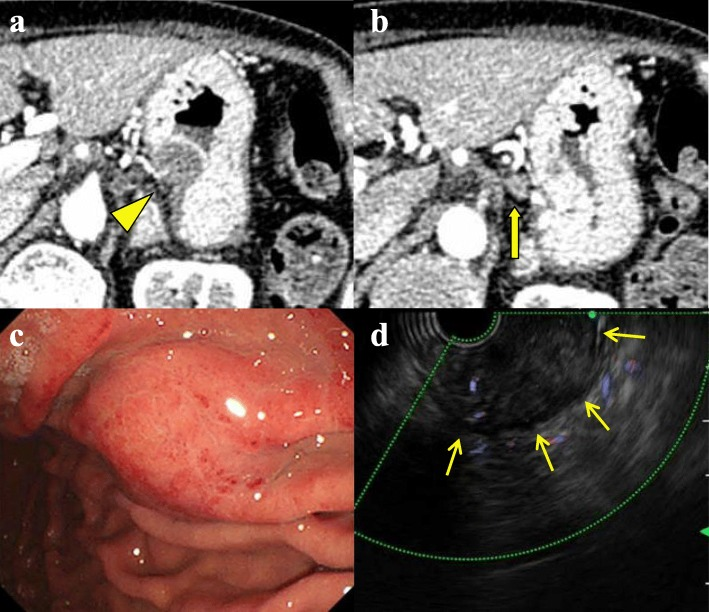
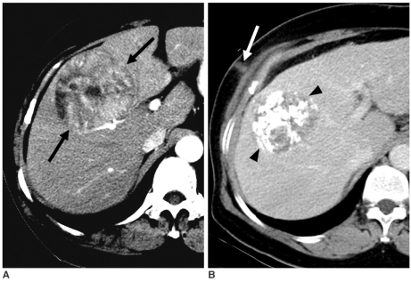
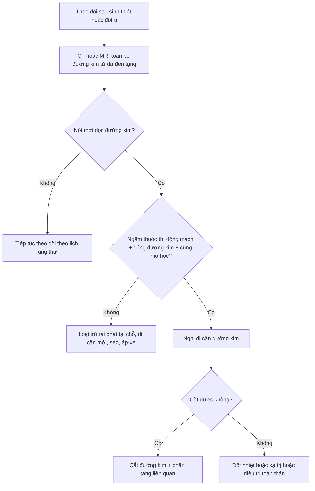
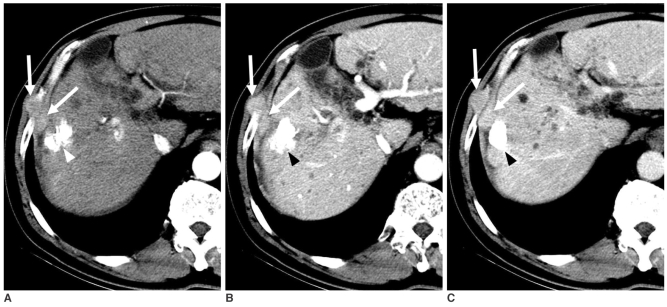

# 3084 — Di căn theo đường kim sau sinh thiết/đốt u: nốt nhỏ ven đường kim, hệ quả lớn

**Tags:** `pattern:not` `pattern:di-can` `pattern:not-duong-kim` `pattern:ngam-thuoc` `vung:o-bung` `vung:thanh-bung` `vung:gan` `vung:da-day` `protocol:CT-bung` `protocol:PET-CT` `protocol:EUS-FNA` `protocol:sinh-thiet` `protocol:dot-nhiet`
**Mức chắc chắn (certainty):** tổng hợp y văn (literature synthesis) — ghép **loạt 10 năm về di căn đường kim sau can thiệp HCC** (Korean J Radiol 2008, PMC2627263), **tổng quan hệ thống EUS-TA** (Diagnostics 2022, PMC9498098), **ca EUS-FNA tụy có CT/endoscopy/EUS** (BMC Gastroenterol 2020, PMC6964060) và **ca EUS-FNA phát hiện muộn** (DEN Open 2024, PMC11033486). Không có ca do nhóm tự chụp.

> **Câu hỏi thực hành:** bệnh nhân **65 tuổi**, HCC **thùy phải 7 cm dưới bao gan**, sinh thiết qua da **4 tháng trước**; CT theo dõi thấy **dải mô mềm dài 2 cm trong mô mỡ dưới da thành ngực phải**, đúng đường kim cũ. Đây là **thoát vị, áp-xe, sẹo**, hay **di căn đường kim**? Bài chốt **ba nguyên tắc**: **(1) nốt nằm đúng đường kim + ngấm thuốc như u nguyên phát = nghi di căn đường kim; (2) phải đọc toàn bộ đường kim từ da vào tạng, không chỉ vùng u; (3) cách phòng tốt nhất là chọn đường kim, giảm số lần chọc và đốt/bịt đường kim khi có thể.**

## 1. Tổng quan bệnh học – cơ chế hình ảnh: vì sao tế bào u “đi theo” kim

- **Cơ chế:** khi kim xuyên qua u, **tế bào u dính vào thành kim/lòng kim** rồi được kéo ra theo đường kim; tế bào còn sống **bám vào mô mỡ, cơ, thành tạng** và tạo **ổ di căn nhỏ dọc đường**. Đây là **gieo trồng do can thiệp (iatrogenic implantation)**, không phải di căn theo đường máu/bạch huyết.
- **Vì sao nốt ngấm thuốc:** mô u cấy vào đường kim **tân sinh mạch** giống u nguyên phát; trên CT có cản quang, nốt **ngấm thuốc thì động mạch**, có thể **đồng đậm độ với cơ** trên phim không cản quang — vì vậy **phải chụp có cản quang và đọc đúng thì**.
- **Vì sao nằm trong mỡ dưới da:** mỡ có **đậm độ thấp (−50 đến −100 HU)**, nên nốt mô mềm **nổi bật** dù chỉ **vài mm**; trong cơ, nốt **đồng đậm độ** nên dễ bỏ sót nếu không so sánh thì động mạch.
- **Vì sao có thể xuất hiện muộn:** tế bào cấy vào có thể **ngủ yên**; ca HCC xuất hiện sau **4 tháng**, sau RFA **13 tháng**, sau EUS-FNA **25 tháng** và có ca **2,5 năm** — theo dõi ngắn không loại trừ.
- **Ngưỡng định lượng phải thuộc:**

| Bối cảnh | Tỷ lệ / số liệu | Nguồn |
|---|---|---|
| Sinh thiết HCC qua da | **0–5,1%**; tại một trung tâm **9/1.182 = 0,76%** | PMC2627263 |
| PEIT (tiêm ethanol) HCC | **1/53 = 1,9%** | PMC2627263 |
| RFA HCC | **0–4,4%**; một trung tâm báo **12,5%** | PMC2627263 |
| EUS-TA (chọc hút/ sinh thiết qua nội soi) | Gộp **0,3%** (95% CI **0,2–0,4%**) trên **13.238 bệnh nhân**, **I² = 0%** | PMC9498098 |
| EUS-TA ung thư tụy | **0,4%** (0,2–0,6%) | PMC9498098 |
| EUS-TA nang tụy | **0,3%** (0,1–0,5%) | PMC9498098 |
| EUS-TA và di căn phúc mạc về sau | **OR 1,02** (0,72–1,46) — **không tăng** so với không chọc | PMC9498098 |
| Thời gian xuất hiện | **4 tháng** (sinh thiết HCC); **13 tháng** (RFA); **25 tháng** (EUS-FNA); **2,5 năm** | PMC2627263; PMC6964060; PMC12629836 |
| Kích thước nốt | **23 mm** ở thành dạ dày; **10 mm** u dưới niêm mạc; **2 nốt nhỏ** ở cơ liên sườn | PMC6964060; PMC2627263 |

- **Yếu tố nguy cơ (từ loạt HCC):** u **dưới bao gan**, kim **lớn (14–17 G)** và **nhiều lần chọc** (trung bình **2,8 lần** ở nhóm có di căn), **kim end-cutting** làm mảnh bệnh phẩm vụn, **không đốt đường kim**, **PEIT nhiều đợt**, u **> 2 cm**, độ mô học cao, suy giảm miễn dịch (PMC2627263).

## 2. Mẫu hình + chẩn đoán phân biệt theo vị trí (gamut)

- **Mẫu hình chung:** **một hoặc vài nốt tròn/bầu dục, ngấm thuốc, nằm trên một đường thẳng** từ tạng đích ra da; có thể **dạng dải** nếu tế bào lan dọc đường kim; thường **không có vỏ**, không hoại tử trung tâm khi còn nhỏ.
- **Gamut theo đường vào:**
  - **Thành ngực – màng phổi:** sau sinh thiết phổi/màng phổi, đốt u phổi — nốt ở **cơ liên sườn, mô dưới da, khoang màng phổi**.
  - **Thành bụng:** sau sinh thiết gan, **RFA/PEI HCC**, sinh thiết thận/tụy — nốt ở **cơ thẳng bụng, mô mỡ dưới da, phúc mạc**.
  - **Thành dạ dày:** sau **EUS-FNA xuyên dạ dày** u tụy — nốt **dưới niêm mạc**, có thể loét niêm mạc.
  - **Vùng đáy chậu:** sau sinh thiết tiền liệt tuyến qua đáy chậu — nốt dọc đường kim ở **đáy chậu/mô cạnh trực tràng**.
  - **Cổ – tuyến giáp:** sau FNA/đốt u giáp — nốt ở **cơ trước giáp/đường kim**.
  - **Vú:** sau core biopsy — nốt dọc đường kim trong mô vú/mô mỡ.
  - **Xương – mô mềm:** sau sinh thiết xương — nốt trong **mô mềm quanh xương/đường kim**.
  - **Hệ thần kinh:** sau sinh thiết định vị (đặc biệt **DIPG**) — di căn đường kim trong nhu mô não.
- **Gamut theo hình ảnh:** di căn đường kim · **tái phát tại chỗ** (sát bờ đốt) · **di căn mới** trong tạng · **sẹo xơ/u hạt** · **áp-xe/tụ máu** · **di căn lỗ trocar** sau nội soi · **mô tuyến giáp lạc chỗ** ở đường kim cổ.

## 3. Bảng so sánh phân biệt (ma trận đối chiếu)

| Thực thể (entity) | Hình ảnh điển hình | Chốt vào (rule-in) | Chốt loại (rule-out) | Gợi ý xác nhận |
|---|---|---|---|---|
| **Di căn đường kim** | Một/vài nốt **ngấm thuốc**, nằm **đúng đường kim**, từ tạng ra da; có thể dạng dải; xuất hiện sau **4 tháng–2,5 năm** | **Vị trí đúng đường kim + ngấm thuốc thì động mạch + cùng mô học u nguyên phát** | **Nốt ngoài đường kim, không ngấm thuốc, không liên quan thủ thuật** → không phải | CT có cản quang đa thì; PET-CT; sinh thiết nốt |
| **Tái phát tại chỗ sau đốt** | Nốt **sát bờ ổ đốt**, thường **không đúng đường kim**, ngấm thuốc ở thì động mạch; có thể kèm **thải thuốc** | **Nằm trong/ sát ổ đốt + lớn dần + ngấm thuốc** | **Nằm dọc đường kim ra da, cách ổ đốt** → nghĩ gieo trồng | CT/MRI đa thì; so ảnh cũ; sinh thiết nếu ảnh hưởng điều trị |
| **Di căn mới trong tạng** | Nốt **trong nhu mô tạng**, không theo đường kim; có thể nhiều ổ | **Nhiều nốt + không liên quan đường kim + bệnh cảnh tiến triển** | **Một nốt đơn độc đúng đường kim** → nghĩ seeding | CT ngực/bụng; PET-CT; mô học |
| **Sẹo xơ/u hạt** | Nốt **giảm đậm độ**, bờ đều, **không ngấm thuốc** hoặc ngấm rất ít; ổn định qua nhiều lần chụp | **Không ngấm thuốc + không lớn sau ≥ 6–12 tháng** | **Ngấm thuốc mạnh + lớn dần** → không phải sẹo | So sánh nhiều mốc; MRI T2/ADC; theo dõi |
| **Áp-xe/tụ máu đường kim** | Ổ dịch **0–20 HU**, vỏ ngấm thuốc viền, có thể **bọt khí**, đau/sốt | **Sốt/đau + vỏ dày + khí + đáp ứng kháng sinh** | **Không sốt, đặc, ngấm thuốc đặc** → nghĩ u | Siêu âm/CT; chọc hút nếu cần |
| **Di căn lỗ trocar** | Nốt ở **thành bụng/lỗ trocar** sau mổ nội soi, thường **nhiều lỗ** hoặc lỗ lấy bệnh phẩm | **Tiền sử nội soi + nốt tại lỗ trocar + cùng mô học** | **Chỉ một đường kim nhỏ, không qua lỗ trocar** → nghĩ seeding đường kim | CT thành bụng; so vị trí trocar |
| **U mô mềm nguyên phát/khác** | Khối **không tương ứng đường kim**, có thể vôi hóa, mỡ, mạch máu | **Không liên quan thủ thuật + đặc điểm mô học riêng** | **Đúng đường kim + tiền sử ung thư** → nghĩ seeding | MRI mô mềm; sinh thiết |

*BMC Gastroenterol 2020 (PMC6964060), CC BY 4.0: **(a)** CT — khối **23 mm giảm đậm độ ở thành thân dạ dày** (đầu mũi tên) sau **25 tháng**; **(b)** hạch quanh dạ dày to (mũi tên); **(c)** nội soi — u dưới niêm mạc **~10 mm** thành sau dạ dày; **(d)** EUS — khối **giảm âm ở dưới niêm mạc** (mũi tên). Đây là đường vào **xuyên dạ dày** — ổ gieo trồng nằm ngay thành dạ dày. Ảnh nguyên bản.*

*Korean J Radiol 2008 (PMC2627263), CC BY-NC 3.0: **(A)** HCC **7 cm dưới bao gan** (mũi tên); **(B)** sau sinh thiết **4 tháng** — **dải mô mềm ngấm thuốc trong mô mỡ dưới da thành ngực phải** (mũi tên trắng), đúng đường kim; u nguyên phát đã được TACE (đầu mũi tên đen). Đây là dạng **hình dải** của gieo trồng đường kim. Ảnh nguyên bản.*

## 4. Protocol chụp + ngưỡng xử trí

- **Trước thủ thuật — phòng ngừa là chính:**
  - **Chọn đường kim ngắn nhất, tránh qua màng phổi/phúc mạc/tạng lành không cần thiết**; với u gan dưới bao, cân nhắc đường **liên sườn** thay vì xuyên qua phúc mạc.
  - **Dùng kim nhỏ nhất đủ lấy bệnh phẩm**, **giảm số lần chọc**; với EUS, **EUS-FNB** có thể lấy mô với ít lần chọc hơn FNA (khuyến cáo từ tổng quan).
  - **Hệ coaxial** (kim ngoài giữ đường, kim trong thay nhiều lần) và **bịt/đốt đường kim** khi rút (gelatin sponge, đốt nhiệt) — bằng chứng không đồng nhất nhưng được nhiều nhóm áp dụng.
  - **Với RFA:** đốt đường kim, dùng điện cực làm mát trong, giảm số phiên đốt — các tác giả cho là làm giảm gieo trồng so với PEIT.
- **Theo dõi sau thủ thuật:**
  - **Chụp toàn bộ đường kim**, không chỉ tạng đích: CT ngực/bụng có cản quang **từ da vào tạng**; với EUS, **nội soi + EUS** đánh giá thành dạ dày/thực quản.
  - **Thời điểm:** lần đầu theo lịch ung thư (thường **3–6 tháng**), sau đó tùy bệnh; **không có lịch thống nhất cho seeding** — phải duy trì cảnh giác **nhiều năm** vì ca muộn **2,5 năm**.
  - **PET-CT** khi CT nghi ngờ hoặc để phân biệt sẹo/u; lưu ý **âm giả** với u nhầy, **dương giả** với viêm.
- **Xử trí khi phát hiện:**
  - **Cắt bỏ đường kim + phần tạng liên quan** nếu còn mổ được và bệnh nhân đủ điều kiện — đây là cách chữa triệt để nhất.
  - **Đốt nhiệt/RFA/cryo** hoặc **xạ trị** nếu không mổ được, tổn thương nhỏ, đơn độc.
  - **Điều trị toàn thân** theo bệnh nền khi đã có di căn ngoài đường kim; **không coi seeding là “di căn xa”** khi nó còn khu trú.

## 5. Biến thể bình thường và cạm bẫy

- **Nốt nhỏ trong mỡ dưới da sau sinh thiết** hay bị bỏ qua vì “chỉ là mỡ”; **luôn đọc đường kim** trên mọi lát cắt từ da vào tạng.
- **Nhầm với thoát vị/thoát vị mỡ**: nốt seeding **đặc, ngấm thuốc**, không có cổ túi phúc mạc; thoát vị có **mỡ và mạch** đi vào.
- **Nhầm với áp-xe**: seeding **không sốt, không đau**, không có vỏ dày/bọt khí; áp-xe đáp ứng kháng sinh và có **vỏ ngấm thuốc viền**.
- **Tái phát tại chỗ vs seeding**: tái phát **sát bờ ổ đốt**, seeding **dọc đường kim ra da**; hai tổn thương có thể cùng tồn tại — đừng dừng ở một tổn thương.
- **PET âm không loại trừ**: u nhầy, tổn thương **< 5 mm**, đường kim ở mô mỡ ít tế bào → vẫn cần CT/MRI và theo dõi.
- **PET dương không chứng minh u**: viêm sau đốt/sinh thiết, mô hạt, nhiễm trùng đều bắt FDG; cần **đối chiếu hình thái và mô học**.
- **Nhiều nốt = nhiều lần chọc**: đừng gọi là “di căn đa ổ” nếu các nốt **thẳng hàng trên một đường kim**.
- **Đường kim xuyên qua tạng lành** (dạ dày, phổi, phúc mạc) làm tăng nguy cơ; ghi lại **đường vào** trong báo cáo để lần sau còn đối chiếu.
- **Không có hệ phân độ chuẩn** cho seeding; mô tả **vị trí, kích thước, số nốt, mô học** thay vì gán độ.

## 6. Tự lượng giá — Blind Quiz

**Ca 1 — HCC dưới bao gan, sinh thiết 4 tháng trước, nay có dải mô mềm ở thành ngực.**

- Gợi ý: nữ **65 tuổi**, HCC **7 cm dưới bao gan**, sinh thiết bằng kim end-cutting, đã TACE.
- Câu hỏi: Dấu hiệu ở **(B)** nằm ở đâu? Vì sao nó **ngấm thuốc**? Chẩn đoán và 3 phân biệt?

<b>Bấm để hiện đáp án (findings + chẩn đoán)</b>

- **Dấu hiệu:** **dải mô mềm dài, ngấm thuốc trong mô mỡ dưới da thành ngực phải**, nằm đúng **đường kim** từ gan ra da; u gan đã TACE (đầu mũi tên đen).
- **Chẩn đoán:** **di căn đường kim (needle tract seeding)** sau sinh thiết HCC — mô u cấy vào mỡ dưới da, tân sinh mạch nên ngấm thuốc.
- **Phân biệt:** áp-xe/tụ máu (không ngấm đặc, có vỏ), sẹo xơ (không ngấm, ổn định), di căn mới trong gan (không theo đường kim).
- **Nguồn ảnh:** Korean J Radiol 2008 (PMC2627263), CC BY-NC 3.0.

**Ca 2 — Sau RFA HCC 13 tháng, hai nốt nhỏ ở cơ liên sườn.**

- Gợi ý: nam **72 tuổi**, RFA HCC bằng điện cực đa nan, có lipiodol trong u.
- Câu hỏi: Hai nốt nằm ở đâu? Chúng **ngấm thuốc thì nào**? Vì sao không phải tái phát tại chỗ?

<b>Bấm để hiện đáp án</b>

- **Dấu hiệu:** **(A–C)** hai nốt **ngấm thuốc thì động mạch**, nằm trong **cơ liên sườn dọc đường kim cũ**; ổ đốt có **lipiodol** (đầu mũi tên), không còn u sống.
- **Chẩn đoán:** **di căn đường kim sau RFA**, không phải tái phát tại chỗ (tái phát sát bờ ổ đốt, không theo đường kim ra thành ngực).
- **Xử trí:** cắt/đốt nốt đường kim nếu còn khu trú; tiếp tục theo dõi toàn bộ đường kim.
- **Nguồn ảnh:** Korean J Radiol 2008 (PMC2627263), CC BY-NC 3.0.

**Ca 3 — Sau EUS-FNA u tụy 25 tháng, khối thành dạ dày.**

- Gợi ý: bệnh nhân đã cắt đuôi tụy vì ung thư biểu mô tuyến tụy; EUS-FNA **xuyên dạ dày** trước đó.
- Câu hỏi: Khối nằm ở lớp nào của thành dạ dày? Vì sao đúng vị trí này? Cần phân biệt với gì?

<b>Bấm để hiện đáp án</b>

- **Dấu hiệu:** **(a)** khối **23 mm giảm đậm độ ở thành thân dạ dày**; **(b)** hạch quanh dạ dày; **(c)** u dưới niêm mạc **~10 mm**; **(d)** EUS khối **giảm âm dưới niêm mạc**.
- **Chẩn đoán:** **di căn đường kim ở thành dạ dày** sau EUS-FNA xuyên dạ dày — tế bào u tụy cấy vào **lớp dưới niêm mạc** rồi lan ra.
- **Phân biệt:** u dưới niêm mạc nguyên phát (GIST, leiomyoma), tái phát tại miệng nối, hạch di căn, áp-xe thành dạ dày.
- **Nguồn ảnh:** BMC Gastroenterol 2020 (PMC6964060), CC BY 4.0.

## Bài liên quan chéo
- [100 – Tổng quan hệ Bụng](../100-tong-quan-he-bung/lesson.md)
- [3061 – Di căn lỗ trocar sau PIPAC và nội soi](../3061-di-can-lo-trocar-sau-pipac-va-noi-soi/lesson.md)
- [121 – Khối gan & LI-RADS](../121-khoi-gan-LIRADS/lesson.md)
- [910 – Dẫn lưu áp-xe mật/thận qua da](../910-abscess-biliary-nephrostomy/lesson.md)
- [1629 – Đốt nhiệt nhân giáp lành tính đặc](../1629-dot-nhiet-nhan-giap-lanh-tinh-dac/lesson.md)

> Không dùng để chẩn đoán độc lập khi chưa có người hướng dẫn.
