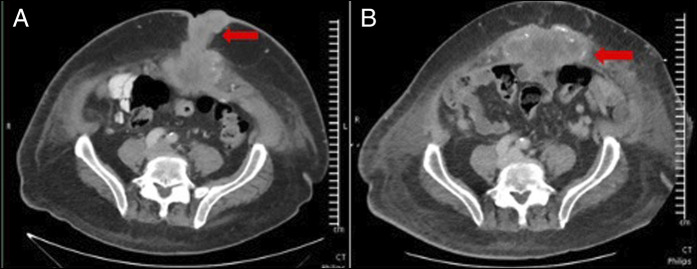
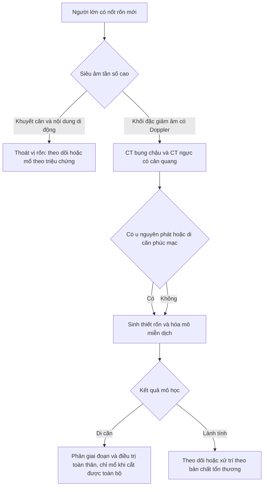
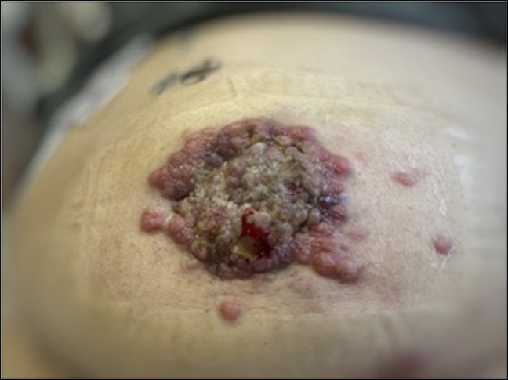

# 3085 — Nốt rốn (Sister Mary Joseph) / Sister Mary Joseph nodule

**Tags:** `pattern:not` `pattern:di-can-da` `pattern:khoi-thanh-bung` `vung:ron-bung` `vung:thanh-bung` `protocol:sieu-am-tan-so-cao` `protocol:CT-bung` `protocol:sinh-thiet` `protocol:MRI-thanh-bung`

**Mức chắc chắn (certainty):** tổng hợp y văn (literature synthesis) — ghép 1 ca công bố có ảnh gốc (nam 65 tuổi, di căn rốn từ ung thư tụy — **Aijaz P et al., *ACG Case Rep J* 2026, PMC13004200, CC BY-NC-ND 4.0**), 1 tổng quan ca + y văn (ung thư đường mật — **Ky LJE et al., *Clin Case Rep* 2025, PMC12544702, CC BY 4.0**) và 1 đoàn hệ đa trung tâm về sống còn (**Tal O et al., *Cancers* 2026, PMC13024660, CC BY 4.0**). Số nào nguồn không đưa thì ghi "chưa rõ".

> **Bài này trả lời 4 câu hỏi khi khám thấy "cục ở rốn":**
> (1) **Nốt rốn ở người lớn là thoát vị, u mỡ, hay di căn?** (2) **Siêu âm/CT đọc thế nào để không bỏ sót di căn?** (3) **Vì sao tuyệt đối không mổ "thoát vị rốn" khi chưa biết bản chất?** (4) **Sinh thiết gửi xét nghiệm gì để tìm ung thư nguyên phát?**
> Đây là mặt **da–thành bụng** của di căn phúc mạc ([143](../143-u-trung-bieu-mo-phuc-mac-vs-carcinomatosis/lesson.md)); khác di căn **lỗ trocar** sau mổ nội soi ([3061](../3061-di-can-lo-trocar-sau-pipac-va-noi-soi/lesson.md)) ở đường vào và cách phòng.

## 1. Tổng quan bệnh học – cơ chế hình ảnh

### 1.1 Vì sao ung thư ổ bụng "chọn" đúng rốn

- Rốn là **điểm yếu giải phẫu**: da dính trực tiếp vào **cân rốn**, không có lớp mỡ dày; các **mạch máu rốn** và **dây chằng rốn giữa** là đường dẫn từ phúc mạc ra da.
- **5 cơ chế lan (Balakrishnan, tổng hợp trong PMC12544702):** (I) **bạch mạch ngược dòng** dưới thanh mạc từ hạch nách/bẹn/cạnh động mạch chủ (phụ khoa, thận); (II) **động mạch** qua nối động mạch thượng vị dưới–ngực bên–ngực trong; (III) **tĩnh mạch** qua nối tĩnh mạch nách/ngực trong/đùi và **hệ cửa qua tĩnh mạch rốn**; (IV) **lan trực tiếp qua phúc mạc** (tiêu hóa); (V) theo **ống niệu rốn, ống noãn hoàng tồn tại, dây chằng liềm** (tiết niệu–sinh dục).
- **Vì sao thấy được trên hình ảnh:** khối là **mô đặc tăng sinh mạch** chen vào mỡ dưới da — trên siêu âm **giảm âm, không đồng nhất, có tín hiệu Doppler**; trên CT **đậm độ mô mềm 30–50 HU, ngấm thuốc sau tiêm**, bờ **không đều, xâm lấn mô mỡ và da**; trên MRI **T2 trung gian, hạn chế khuếch tán, ngấm thuốc** — tức là mô **tế bào dày đặc**, khác mỡ (T1 sáng, T2 sáng, không ngấm) và khác nang (T2 rất sáng, không ngấm).

### 1.2 Số liệu nền (bắt buộc thuộc)

- **Tần suất:** **1–3%** các ung thư ổ bụng–chậu (PMC12544702; PMC13024660); ở ung thư tụy, di căn da **< 3%** và vị trí hay gặp nhất là **rốn** (PMC13004200).
- **Không tìm được ung thư nguyên phát ở 17,7%** ca (Hugen, dẫn trong PMC12544702) — nên **không được dừng lại khi chưa thấy u**.
- **Tiên lượng:** sống trung vị **7,9 tháng** (Hugen); có ca tử vong **7 ngày–3 tháng** sau nhập viện; nhưng **ngoại lệ sống dài** có thật, nhất là khi **cắt được toàn bộ u** (PMC12544702).
- **Phụ khoa:** nốt rốn được xếp **FIGO IVB**; trong một đoàn hệ 87 ca ung thư buồng trứng giai đoạn IV, **26,4% (23/87)** có nốt rốn, **cắt u hoàn toàn 65,2%**, sống trung vị **chưa đạt** so với **47,2 tháng** ở nhóm di căn khác (HR 0,44; KTC 95% 0,17–1,12; p = 0,084) — **tín hiệu, chưa đủ kết luận** (PMC13024660).
- **Kích thước:** có thể tới **10 cm**; bề mặt **nứt, loét hoại tử**, tiết dịch **thanh dịch/máu/nhầy/mủ** (PMC12544702).

## 2. Mẫu hình + chẩn đoán phân biệt theo vị trí và bối cảnh (Gamut)

- **Theo hình thái:** **nốt đặc đơn độc** (di căn, u mỡ, u xơ) → **khối viêm đỏ đau** (viêm rốn, áp-xe) → **khối thoát vị** (thoát vị rốn, thoát vị lỗ rốn có quai ruột) → **tổn thương loét tiết dịch** (di căn, u hạt sinh mủ, nang tuyến rốn).
- **Theo ung thư nguyên phát:** nữ → **buồng trứng** hàng đầu; nam → **dạ dày, đại tràng, tụy**; cả hai → **đường mật, gan, bàng quang, vú, phổi** (PMC12544702).
- **Theo dấu hiệu "báo động":** nốt **cứng, cố định, bờ không đều**, phát triển **tuần–tháng**, kèm **sụt cân, cổ trướng, hạch** → di căn cho đến khi chứng minh ngược lại.
- Gợi nhớ **UMBILICUS**: **U**ng thư (di căn), **M**ỡ/u xơ (lành), **B**ệnh rốn bẩm sinh (nang noãn hoàng, ống niệu rốn), **I**nflammation (viêm rốn/áp-xe), **L**ạc nội mạc (endometriosis), **I**atrogenic (u hạt quanh lỗ mở), **C**ục máu/tụ máu, **U**mbilical hernia (thoát vị), **S**ẹo lồi/keloid.

## 3. Bảng so sánh phân biệt (ma trận đối chiếu)

| Thực thể (entity) | Hình ảnh điển hình | Chốt vào (rule-in) | Chốt loại (rule-out) | Gợi ý xác nhận |
|---|---|---|---|---|
| **Nốt rốn di căn (SMJN)** | Nốt **đặc giảm âm** dưới da rốn, ngấm thuốc, bờ **không đều, xâm lấn**; CT **30–50 HU** trước tiêm | **Nốt đặc xâm lấn cân + có u nguyên phát/di căn phúc mạc** | Nốt **đồng âm mỡ, không ngấm thuốc, có vỏ rõ** → nghĩ lành | Sinh thiết + hóa mô miễn dịch; CT ngực–bụng–chậu |
| **Thoát vị rốn** | **Khuyết cân rốn** + quai ruột/mỡ đi qua, **thay đổi khi Valsalva**, có thể có nhu động | **Khuyết cân + nội dung thoát vị di động** | Khối **đặc, cố định, không có khuyết cân** → không phải thoát vị | Siêu âm Valsalva; CT khi nghi biến chứng |
| **U mỡ (lipoma) rốn** | **Đồng âm/giảm âm nhẹ, đều**, **không có Doppler**, **mỡ −40 đến −120 HU** trên CT | **HU âm thuần mỡ, bờ rõ, không ngấm thuốc** | **Đậm độ mô mềm + ngấm thuốc** → loại u mỡ | Siêu âm; CT nếu không chắc |
| **Lạc nội mạc rốn** | Nốt **đặc ± nang nhỏ**, đau **theo chu kỳ kinh**, có thể chảy máu theo kỳ | **Đau/ra máu theo chu kỳ + tiền sử sản khoa** | Không liên quan chu kỳ + sụt cân → nghĩ ác | MRI: ổ xuất huyết T1 sáng; sinh thiết |
| **Viêm rốn/áp-xe** | Dày mô mềm, **tăng sinh mạch, dịch hóa**, có thể khí | **Đỏ, đau, sốt, chảy mủ** | Khối **cứng, không đau, không sốt** → không phải viêm đơn thuần | Siêu âm; **chọc hút chỉ sau khi loại di căn** |
| **U hạt quanh lỗ mở (granuloma)** | Nốt nhỏ **ở mép lỗ mở** dạ dày–da, ẩm, dễ chảy máu | **Vị trí đúng mép lỗ mở + tiền sử ống** | Khối **cách lỗ mở, xâm lấn sâu** → nghĩ di căn | Nội soi/khám; sinh thiết nếu không điển hình |
| **Nang noãn hoàng/ống niệu rốn** | Nang **dịch** dưới rốn, hình ống, có thể thông bàng quang | **Cấu trúc dạng ống, dịch, ở đường giữa dưới rốn** | Khối **đặc ngấm thuốc** → không phải nang | Siêu âm; CT/MRI đường đi |

*(A) Nốt mô mềm **quanh rốn** xâm lấn mỡ dưới da; (B) ổ di căn khác ở **thành bụng trước**. Bờ không đều, đậm độ mô mềm, ngấm thuốc — mẫu hình của di căn chứ không phải u mỡ. Nguồn: ACG Case Rep J 2026, PMC13004200, CC BY-NC-ND 4.0 (nguyên bản).*

### 3.1 Ba câu hỏi hình ảnh quyết định

1. **Khối có khuyết cân không?** Có + nội dung di động theo Valsalva = thoát vị; không có khuyết cân + khối đặc = **phải loại di căn**.
2. **Đậm độ/tín hiệu có phải mỡ không?** **−40 đến −120 HU** hoặc T1 sáng + fat-sat tối = mỡ lành; **30–50 HU** + ngấm thuốc = mô đặc.
3. **Có u nguyên phát hoặc dịch phúc mạc không?** Luôn chụp **toàn bộ ngực–bụng–chậu**; 17,7% không tìm thấy u nguyên phát nhưng **di căn phúc mạc/hạch** vẫn gợi ý.

## 4. Protocol chụp + quy trình chẩn đoán

### 4.1 Trình tự (không đảo thứ tự)

1. **Khám + siêu âm tần số cao (12–18 MHz)** tại giường: vị trí so với cân rốn, kích thước **mm**, đậm độ, bờ, **Doppler**, có khuyết cân hay không.
2. **CT bụng–chậu có cản quang tĩnh mạch** (lát **1–2 mm** vùng rốn) **+ CT ngực**: tìm u nguyên phát, di căn phúc mạc, hạch, di căn phổi.
3. **MRI thành bụng** khi cần phân biệt mô mềm–máu–nhầy (T1/T2 fat-sat, DWI, sau tiêm) hoặc khi CT không kết luận.
4. **Sinh thiết (core 14–16 G hoặc FNA) TRƯỚC mọi can thiệp khác**, gửi **hóa mô miễn dịch** định nguồn: **CK7/CK20**, **PAX8** (buồng trứng/nội mạc), **CDX2** (đại tràng), **TTF1** (phổi/tuyến giáp), **GATA3** (vú/niệu), **S100/HMB45** (melanoma).
5. **Không chọc dẫn lưu "áp-xe" và không mổ "thoát vị"** khi chưa có kết quả mô học — ca PMC13004200 cho thấy nốt **lớn nhanh, loét, đau** sau mổ nội soi thoát vị, kèm **di căn lỗ trocar**.

### 4.2 Ngưỡng hành động

- Nốt rốn **> 10 mm, đặc, không đau, phát triển trong vài tuần** ở người **> 40 tuổi** → **sinh thiết trong vòng 1–2 tuần**.
- Có **ung thư đã biết** + nốt rốn mới → coi là **di căn cho tới khi chứng minh ngược lại**, không chờ "theo dõi 3 tháng".
- Sau khi có mô học: chuyển **ung thư học** để phân giai đoạn; phẫu thuật chỉ đặt ra khi **cắt được toàn bộ** (như 65,2% ca buồng trứng cắt hoàn toàn, PMC13024660).

### 4.3 Vì sao thứ tự này quan trọng

- **Mổ trước, chẩn đoán sau** làm tăng nguy cơ **gieo rắc tại vết mổ** và **di căn lỗ trocar** — đúng diễn tiến của ca PMC13004200 sau mổ nội soi thoát vị.
- **Chọc hút/dẫn lưu** một nốt di căn có thể tạo **đường rò tiết dịch vĩnh viễn** và nhiễm trùng tại chỗ.

## 5. Biến thể bình thường và cạm bẫy

- **Biến thể bình thường:** **nếp da rốn dày** ở người béo, **sẹo rốn cũ** sau mổ nội soi, **u hạt rốn** ở trẻ sơ sinh (rụng cuống rốn) — đều **không xâm lấn cân**, không ngấm thuốc mạnh.
- **Cạm bẫy 1 — gọi là "thoát vị rốn" vì sờ thấy khối:** thoát vị có **khuyết cân**; nốt di căn là **khối đặc cố định**. Ca PMC13004200: nốt nhỏ trước mổ, **lớn nhanh và loét sau mổ**.
- **Cạm bẫy 2 — điều trị "viêm rốn" bằng kháng sinh nhiều đợt:** nốt rốn **không đau, không sốt, không đỏ** mà vẫn lớn → **không phải viêm**; trì hoãn sinh thiết làm mất cơ hội điều trị.
- **Cạm bẫy 3 — chỉ chụp vùng rốn:** bỏ sót u nguyên phát ở **tụy/buồng trứng/dạ dàng** và di căn phúc mạc; luôn chụp **ngực–bụng–chậu**.
- **Cạm bẫy 4 — tưởng "u mỡ" vì siêu âm giảm âm nhẹ:** u mỡ **không có Doppler và −40 đến −120 HU**; khối **có mạch + đậm độ mô mềm** phải sinh thiết.
- **Cạm bẫy 5 — bỏ qua rốn khi khám bụng:** nốt có thể **nằm trong nếp rốn**, chỉ thấy khi **lộn rốn ra** — khám rốn là bước bắt buộc ở mọi bệnh nhân sụt cân/cổ trướng.

## 6. Tự lượng giá — Blind Quiz

**Ca 1 — Nam 65 tuổi, đái tháo đường, thấy nốt nhỏ quanh rốn trước khi mổ thoát vị rốn theo kế hoạch.**

- Gợi ý lâm sàng: nốt **tăng nhanh sau mổ**, loét, đau; CT có **khối đuôi tụy 3,4 cm** và **ổ khuyết xương đốt sống**.
- Câu hỏi: hai ổ mũi tên trên CT là gì? Vì sao **không được mổ thoát vị** trước khi chẩn đoán?

<b>Bấm để hiện đáp án</b>

- (A) **Nốt di căn quanh rốn**, (B) **ổ di căn thành bụng trước** — bờ không đều, đậm độ mô mềm, ngấm thuốc.
- Chẩn đoán: **ung thư biểu mô tuyến ống tụy giai đoạn IV** (khối đuôi tụy **3,4 cm** + di căn da + di căn xương); sinh thiết: **KRAS G12C, MTAP, CDKN2A/B mất, TP53**.
- Vì sao không mổ trước: can thiệp vào ổ di căn **gieo rắc tại vết mổ**; ca này còn có **di căn lỗ trocar** sau nội soi.
- Nguồn: ACG Case Rep J 2026, PMC13004200, CC BY-NC-ND 4.0.

**Ca 2 — Cùng bệnh nhân, nhìn bụng trước khi mổ: mô tả trước, đừng đoán.**

- Câu hỏi: mô tả tổn thương; ba chẩn đoán phân biệt; một câu hỏi lịch sử giúp phân biệt?

<b>Bấm để hiện đáp án</b>

- Nốt **quanh rốn, hợp nhất, loét, dễ chảy máu**, lan ra **trên xương mu** — hình thái di căn da, không giống u mỡ/thoát vị.
- Phân biệt: **di căn rốn (SMJN)**, **u hạt sinh mủ**, **lạc nội mạc rốn** (đau theo chu kỳ), **thoát vị rốn** (khuyết cân).
- Câu hỏi lịch sử: **"Có đau/ra máu theo chu kỳ kinh không?"** — có thì nghĩ lạc nội mạc; không kèm sụt cân, không đau → nghi di căn.
- Nguồn: ACG Case Rep J 2026, PMC13004200, CC BY-NC-ND 4.0 (nguyên bản, không chỉnh sửa).

## Bài liên quan chéo
- [141 – Phúc mạc: giải phẫu & tổng quan](../141-phuc-mac/lesson.md)
- [143 – U trung biểu mô phúc mạc vs carcinomatosis](../143-u-trung-bieu-mo-phuc-mac-vs-carcinomatosis/lesson.md)
- [3061 – Di căn lỗ trocar sau PIPAC và nội soi](../3061-di-can-lo-trocar-sau-pipac-va-noi-soi/lesson.md)
- [1618 – Di căn da thành ngực ở ung thư vú](../1618-di-can-da-thanh-nguc-ung-thu-vu/lesson.md)
- [121 – Khối gan và LI-RADS](../121-khoi-gan-LIRADS/lesson.md) (tìm u nguyên phát)

## Ảnh
- `images/3085_di-can-ron_CT_PMC13004200.jpg` — CT: nốt quanh rốn + ổ thành bụng trước — *ACG Case Rep J* 2026, PMC13004200, **CC BY-NC-ND 4.0** (nguyên bản).
- `images/3085_di-can-ron_lam-sang_PMC13004200.jpg` — ảnh lâm sàng nốt rốn — cùng bài, **CC BY-NC-ND 4.0** (nguyên bản).
- Chi tiết nguồn + giấy phép: `images/CREDITS.md`.

> Không dùng để chẩn đoán độc lập khi chưa có người hướng dẫn.
