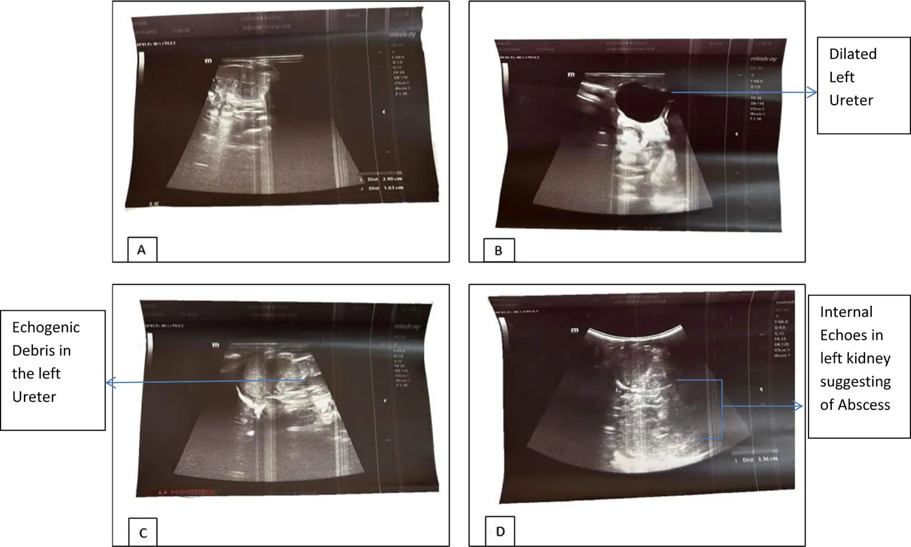
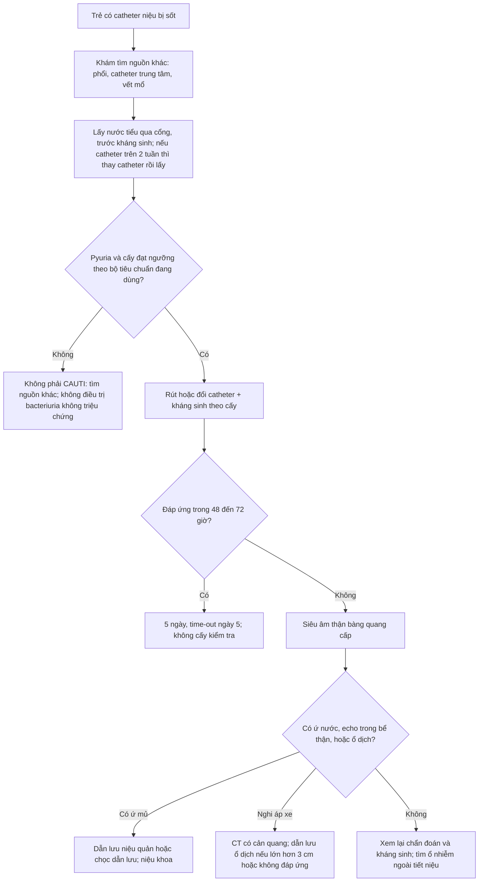
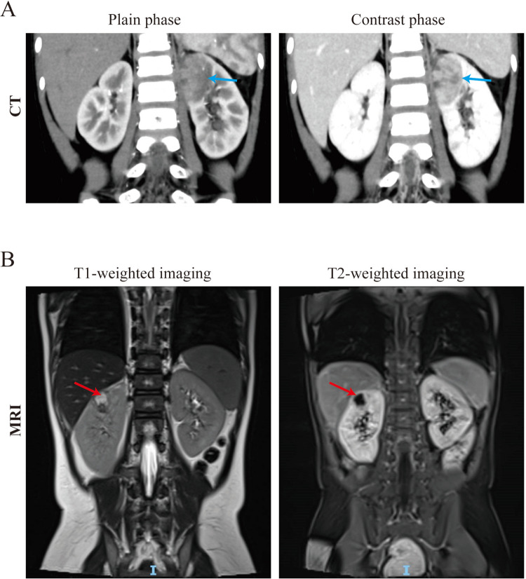

# 3086 — Nhiễm khuẩn đường niệu liên quan catheter (CAUTI) ở trẻ / Catheter-associated urinary tract infection in children

**Tags:** `pattern:nhiem-trung-tiet-nieu` `pattern:bacteriuria` `pattern:device-associated` `vung:bang-quang` `vung:than` `protocol:cay-nuoc-tieu` `protocol:sieu-am-than-tiet-nieu` `protocol:CT-bung-chau` `score:NHSN-SUTI`

**Mức chắc chắn (certainty):** tổng hợp y văn (literature synthesis) — ghép hướng dẫn + 3 chuỗi dữ liệu có PMCID: (a) phác đồ NICU với **ngưỡng cấy ≥ 50.000 CFU/mL**, **5 ngày kháng sinh**, thời điểm siêu âm/VCUG (**Magers J et al., *J Perinatol* 2026, PMC13190328, CC BY 4.0**); (b) can thiệp PICU hạ CAUTI từ **3,3 → 0,9/1.000 ngày catheter** (**Linam M et al., *Antimicrob Steward Healthc Epidemiol* 2025, PMC11704929, CC BY 4.0**); (c) 2 ảnh biến chứng giải phẫu (**Adhikari N et al., *Ann Med Surg* 2026, PMC13354487, CC BY 4.0**; bài 12 năm về áp-xe thận nhi, PMC13424581, CC BY 4.0). Ngưỡng theo **CDC/NHSN 2024, IDSA 2009, AAP 2011, IDSA 2019 (ASB)** — ghi phiên bản, không ghi tên tác giả guideline khi chưa đối chiếu.

> **Bài này trả lời 4 câu hỏi khi trẻ có catheter niệu bị sốt:**
> (1) **Cấy ở đâu và ngưỡng bao nhiêu CFU mới gọi là CAUTI?** (2) **Vì sao bốn bộ tiêu chuẩn (NHSN, IDSA, AAP, NICU) cho bốn ngưỡng khác nhau — dùng cái nào?** (3) **Khi nào cần siêu âm/CT, và hình ảnh trả lời câu hỏi gì mà cấy không trả lời được?** (4) **Khi nào KHÔNG điều trị?**
> Đây là mặt **thiết bị – nhiễm khuẩn** của đường tiểu nhi; nối [3010 – Hẹp miệng nối niệu quản–bàng quang](../3010-hep-mien-noi-nieu-quan-bang-quang-o-tre/lesson.md) và [3058 – Xuất huyết mảnh ghép ruột](../3058-xuat-huyet-manh-tu-ghep-ruot-sau-tang-dung-tich-bang-quang/lesson.md).

## 1. Tổng quan bệnh học – cơ chế hình ảnh

### 1.1 Vì sao có catheter là có nguy cơ

- Catheter lưu **bỏ qua ba hàng rào**: cơ thắt niệu đạo, **niêm mạc niệu đạo có IgA và vi khuẩn chí bình thường**, và **dòng nước tiểu rửa trôi** khi đi tiểu tự nhiên. Nước tiểu còn lại trong bàng quang là **môi trường nuôi cấy**.
- **Hai đường lây:** (I) **nội bào (intraluminal)** — vi khuẩn bám thành ống dẫn lưu, **trào ngược từ túi dẫn lưu** lên bàng quang (đúng cơ chế mà can thiệp ở PICU nhắm vào: bỏ tã + dụng cụ chống trào ngược, PMC11704929); (II) **ngoại bào (extraluminal)** — **màng sinh học (biofilm)** hình thành quanh catheter trong niệu đạo, vi khuẩn đi ngược theo khe catheter–niêm mạc.
- **Thời gian là yếu tố nguy cơ số một:** tại PICU, nguy cơ tăng rõ khi catheter lưu **> 3 ngày** — chính là lý do đơn vị này chuyển sang **đi buồng theo ca cho trẻ có catheter > 3 ngày** (PMC11704929). Ở trẻ, các yếu tố cộng thêm: **niệu đạo ngắn**, **bàng quang thần kinh**, **CAKUT (bể thận ứ nước, trào ngược)**, **dinh dưỡng kém**, **điều trị kháng sinh rộng trước đó**.
- **Tần suất nền:** nhiễm khuẩn tiểu là nhiễm khuẩn vi khuẩn nặng thường gặp nhất ở nhũ nhi — **4,6–13,6%** trẻ có sốt; ở trẻ **sinh non/high-risk NICU** tới **25%** (PMC13190328).

### 1.2 TẠI SAO hình ảnh KHÔNG chẩn đoán CAUTI — nhưng vẫn bắt buộc phải biết đọc

- Chẩn đoán CAUTI là **sự kiện vi sinh – lâm sàng**: vi khuẩn trong nước tiểu **không tạo tín hiệu** trên siêu âm hay CT. Không có "hình ảnh của CAUTI".
- Hình ảnh trả lời **ba câu hỏi khác**, và chỉ ba câu này mới làm thay đổi điều trị:
  1. **Có tắc nghẽn/ứ nước không?** (bể thận giãn, đài thận tù) → **ứ mủ (pyonephrosis)** là cấp cứu niệu khoa, kháng sinh đơn thuần không đủ.
  2. **Có ổ mủ ngoài lòng bể thận không?** (áp-xe thận/quanh thận) → cần **dẫn lưu**, không chỉ kháng sinh.
  3. **Có khí trong thành bàng quang không?** (viêm bàng quang khí thũng — rất hiếm ở trẻ, gặp ở đái tháo đường/suy giảm miễn dịch) → nguy cơ thủng bàng quang, cần CT.
- **TẠI SAO thấy được trên siêu âm:** nước tiểu **bình thường là dịch đồng nhất, trống âm**; khi có **mủ – tế bào – mảnh tổ chức**, trong lòng bể thận xuất hiện **echo bên trong (internal echoes)** và **mảnh tăng âm lơ lửng (echogenic debris)** — đó là dấu hiệu **pyonephrosis**, không phải "sỏi". Áp-xe là **ổ dịch có vỏ** — trên CT **vỏ ngấm thuốc, trung tâm không ngấm**, trên MRI **T2 sáng, DWI hạn chế khuếch tán, ngấm viền**.
- **TẠI SAO phải phân biệt với ứ nước đơn thuần:** ứ nước **không nhiễm** thì dịch **trống âm, thành bể thận mỏng đều**, không sốt; ứ nước **nhiễm** thì **echo trong lòng, thành dày, sốt cao, CRP tăng** — cùng hình dạng, khác nội dung.

### 1.3 Số liệu nền (bắt buộc thuộc)

- **CAUTI ở PICU:** **0,5/1.000 ngày catheter** (2017–2019) → **3,3** (2019–2021) → **0,9** sau can thiệp; khoảng cách trung bình giữa hai CAUTI **349 → 88 → 200 ngày**, dài nhất **573 ngày** (PMC11704929).
- **Ngưỡng cấy theo bộ tiêu chuẩn:**
  - **CDC/NHSN** (giám sát): catheter phải lưu **> 2 ngày lịch** (ngày đặt = ngày 1) và còn/đã rút trong ngày xảy ra biến cố; cấy **≥ 10⁵ CFU/mL**, **≤ 2 loài**, kèm **≥ 1 triệu chứng**.
  - **IDSA 2009** (điều trị): cấy **≥ 10³ CFU/mL** một loài + triệu chứng, ở bệnh nhân **đang có catheter hoặc vừa rút < 48 giờ**.
  - **AAP 2011** (trẻ 2–24 tháng có sốt): cần **có mủ (pyuria)** + cấy **≥ 50.000 CFU/mL** từ **mẫu catheter**; mẫu **chọc trên xương mu** ngưỡng thấp hơn hẳn (mọi mọc một loài).
  - **Phác đồ NICU 2026:** **≥ 50.000 CFU/mL** (catheter hoặc chọc trên xương mu), **có hay không có pyuria**; **≥ 10.000 CFU/mL kèm pyuria** vẫn điều trị; **đa loài = nhiễm bẩn** trừ khi lặp lại và có một loài đạt ngưỡng (PMC13190328).
- **Điều trị:** **5 ngày** cho UTI không nhiễm khuẩn huyết, **time-out ngày 5** để quyết định kéo lên **7 ngày**; **90%** trẻ đạt ≤ 6 ngày, **1%** tái phát cùng loài trong 7 ngày (PMC13190328).
- **Vì sao ngưỡng khác nhau:** NHSN cần **độ đặc hiệu cao** để so sánh giữa các bệnh viện (nên 10⁵); IDSA điều trị **cá thể** nên hạ xuống 10³ để không bỏ sót; AAP thêm **pyuria** vì trẻ nhỏ dễ nhiễm bẩn mẫu; NICU dùng 5 × 10⁴ vì mẫu catheter ở trẻ sơ sinh **rất dễ nhiễm bẩn**. **Ngưỡng không phải chân lý — là đánh đổi độ nhạy/đặc hiệu.**

## 2. Mẫu hình + chẩn đoán phân biệt theo vị trí (Gamut)

- **Theo vị trí:** **bàng quang** (viêm bàng quang — đau dưới rốn, đái máu, không sốt cao) → **thận** (viêm thận–bể thận cấp — sốt cao, đau hông lưng, CRP tăng) → **quanh thận** (áp-xe quanh thận, liệt ruột) → **toàn thân** (nhiễm khuẩn huyết, ABUTI khi cấy máu cùng loài với nước tiểu).
- **Theo bối cảnh:** **sốt trong 48 giờ đầu sau đặt catheter** → nghĩ nguyên nhân khác hoặc nhiễm khi đặt; **sốt sau 3–7 ngày** → CAUTI/ứ mủ; **sốt dai dẳng sau khi đã dùng kháng sinh đúng** → **ổ mủ hoặc tắc nghẽn**, phải chụp.
- Gợi nhớ **CATHETER**: **C**ystitis (viêm bàng quang) · **A**bscess (áp-xe thận/quanh thận) · **T**ắc nghẽn (pyonephrosis, van niệu đạo sau) · **H**ematogenous (nhiễm khuẩn huyết) · **E**mphysematous (khí thũng) · **T**umor/nang (bóng catheter giả khối) · **E**xtra-urinary (VAP, CLABSI, ổ mổ) · **R**esidual (bí tiểu tồn dư do catheter tắc).

## 3. Bảng so sánh phân biệt (ma trận đối chiếu)

| Thực thể (entity) | Hình ảnh điển hình | Chốt vào (rule-in) | Chốt loại (rule-out) | Gợi ý xác nhận |
|---|---|---|---|---|
| **CAUTI (nhiễm khuẩn tiểu có triệu chứng)** | Siêu âm/CT **bình thường** hoặc chỉ dày thành bàng quang nhẹ; **không có ổ mủ** | **Triệu chứng + cấy đạt ngưỡng của bộ tiêu chuẩn đang dùng + không có nguồn khác** | Cấy **< 10³ CFU/mL** và không pyuria → không phải CAUTI | Cấy từ **cổng lấy mẫu**, trước kháng sinh; rút/đổi catheter |
| **Bacteriuria không triệu chứng (ASB)** | Hình ảnh **bình thường**; không có phản ứng viêm | **Cấy dương + KHÔNG triệu chứng + không pyuria** | Có sốt/đau hông lưng → không phải ASB đơn thuần | **Không cấy tầm soát**; nếu đã cấy dương: **không điều trị** (IDSA 2019) trừ thai/phẫu thuật niệu có tổn thương niêm mạc |
| **Ứ mủ bể thận (pyonephrosis)** | Siêu âm: bể thận giãn + **echo bên trong, mảnh lơ lửng**, thành dày; CT: mức dịch–mủ, **dày thành bể thận, thâm nhiễm quanh thận** | **Sốt cao + ứ nước + echo trong lòng bể thận** | Bể thận giãn nhưng **dịch trống âm, không sốt** → ứ nước đơn thuần | Siêu âm cấp tại giường; CT nếu cần; **dẫn lưu (nephrostomy/stent) là điều trị quyết định** |
| **Áp-xe thận / quanh thận** | CT: **ổ dịch vỏ ngấm thuốc**, trung tâm không ngấm, có thể **khí**; MRI: T2 sáng + **DWI hạn chế**, ngấm viền | **Ổ dịch có vỏ trong nhu mô/quanh thận + sốt kéo dài** | Chỉ thâm nhiễm lan tỏa không ổ dịch → viêm thận cấp, kháng sinh đơn thuần | CT có cản quang; MRI nếu cần; **dẫn lưu ổ ≥ 3 cm hoặc không đáp ứng 48–72 giờ** |
| **Viêm bàng quang khí thũng** | CT: **khí trong thành bàng quang** ("chuỗi hạt"), có thể khí trong lòng | **Khí trong thành bàng quang trên CT** | Khí trong lòng ống dẫn lưu (do thủ thuật) → không phải khí thũng | CT bụng–chậu; kiểm tra đái tháo đường/suy giảm miễn dịch (hiếm ở trẻ) |
| **Sốt không do đường tiểu** | Ổ nhiễm ngoài tiết niệu: **đông đặc phổi, ổ cạnh cột sống, catheter trung tâm, vết mổ** | **Có ổ nhiễm ngoài tiết niệu + cấy nước tiểu âm/không pyuria** | Cấy nước tiểu đạt ngưỡng + pyuria → không loại CAUTI | X-quang/CT ngực, siêu âm ổ mô mềm, cấy máu |

*Bốn mặt cắt: (A, B) thận và **niệu quản trái giãn**; (C, D) **echo bên trong và mảnh tăng âm lơ lửng** trong bể thận/niệu quản — mủ, không phải sỏi; gợi ý **áp-xe/ứ mủ**. Đây là biến chứng phải loại trừ khi trẻ có catheter bị sốt dai dẳng. Nguồn: Ann Med Surg 2026, PMC13354487, CC BY 4.0.*

## 4. Protocol: lấy mẫu – ngưỡng – điều trị – khi nào chụp

### 4.1 Lấy mẫu (sai ở bước này làm sai toàn bộ chẩn đoán)

1. **Không bao giờ cấy nước tiểu từ túi dẫn lưu** — túi là nơi vi khuẩn mọc tự do; mẫu từ túi gần như luôn dương tính giả.
2. Lấy qua **cổng lấy mẫu (sampling port)** của ống dẫn lưu: sát khuẩn bằng **cồn 70%**, đợi **≥ 30 giây**, hút bằng kim/ống tiêm vô khuẩn (quy trình của APSIC 2023).
3. **Nếu catheter đã lưu > 2 tuần (IDSA 2009):** **rút và đặt catheter mới**, lấy mẫu từ catheter mới — vì **biofilm** trên catheter cũ làm mẫu luôn dương tính và không phản ánh bàng quang.
4. **Cấy TRƯỚC kháng sinh**; kèm **tổng phân tích nước tiểu** (pyuria: ≥ 5 BC/HPF hoặc ≥ 10 BC/mm³ nước tiểu không ly tâm — theo bảng phác đồ NICU 2026).
5. **Nếu rút catheter được:** lấy **nước tiểu giữa dòng** sau khi rút — ít nhiễm bẩn hơn mẫu từ catheter lưu lâu.

### 4.2 Bảng ngưỡng theo bộ tiêu chuẩn (dùng đúng bộ của mình, ghi vào hồ sơ)

| Bộ tiêu chuẩn | Đối tượng | Ngưỡng cấy | Điều kiện kèm |
|---|---|---|---|
| CDC/NHSN 2024 (giám sát) | Mọi lứa tuổi, có catheter > 2 ngày lịch | **≥ 10⁵ CFU/mL**, ≤ 2 loài | ≥ 1 triệu chứng; trẻ ≤ 1 tuổi: sốt > 38°C, hạ nhiệt < 36°C, cơn ngưng thở, nhịp tim chậm, li bì |
| IDSA 2009 (điều trị) | Người lớn và trẻ có catheter hoặc rút < 48 giờ | **≥ 10³ CFU/mL** một loài | Triệu chứng phù hợp, không có nguồn khác |
| AAP 2011 | Trẻ **2–24 tháng** có sốt | **≥ 50.000 CFU/mL** (mẫu catheter) | **Bắt buộc có pyuria**; chọc trên xương mu: ngưỡng thấp hơn hẳn |
| Phác đồ NICU 2026 | Sơ sinh/sinh non | **≥ 50.000 CFU/mL** (catheter hoặc chọc) | **≥ 10.000 + pyuria** cũng điều trị; đa loài = nhiễm bẩn |

### 4.3 Điều trị (ngắn, vì đây là bài hình ảnh)

- **Rút/đổi catheter là can thiệp hiệu quả nhất** — không rút thì tỷ lệ thất bại và tái phát cao; đổi catheter cũng cải thiện triệu chứng nhanh hơn đơn thuần kháng sinh.
- **5 ngày** nếu không nhiễm khuẩn huyết, **time-out ngày 5**; kéo **7 ngày** khi đáp ứng chậm, dị dạng đường tiểu, hoặc vi khuẩn đa kháng (PMC13190328).
- **Không cấy kiểm tra** sau khi hết sốt nếu đáp ứng tốt; cấy lại khi **không cải thiện sau 48–72 giờ** (lúc đó **phải chụp** để tìm ổ mủ/tắc nghẽn).

### 4.4 Khi nào chụp gì

- **Siêu âm thận – bàng quang (RUS):** chỉ định **trong đợt điều trị** ở trẻ có UTI sốt (AAP 2011; phác đồ NICU cũng đặt RUS trong đợt — PMC13190328); **bắt buộc sớm** nếu sốt **> 48–72 giờ không cải thiện**, nghi **tắc nghẽn**, tiền sử **CAKUT/van niệu đạo sau**, hoặc sờ thấy bàng quang căng.
- **CT bụng–chậu có cản quang:** nghi **áp-xe thận/quanh thận**, **khí thũng**, hoặc siêu âm không trả lời được; ở trẻ **cân nhắc liều** (ALARA) — ưu tiên siêu âm + MRI nếu có.
- **VCUG:** **không** làm thường quy sau UTI sốt đầu tiên; theo phác đồ NICU: **sau UTI thứ 2** hoặc khi **RUS bất thường** (giãn > độ II, sẹo, nghi trào ngược cao độ) — PMC13190328.
- **DMSA:** đánh giá **sẹo thận**, làm **sau 4–6 tháng** (không trong đợt cấp vì phù nhu mô giả sẹo).

## 5. Biến thể bình thường và cạm bẫy

- **Biến thể bình thường:** **bóng catheter trong bàng quang** — vòng tăng âm kèm bóng lưng, **di chuyển khi bơm/rút nước**, không có tưới máu → không phải khối u; **bể thận giãn nhẹ khi bàng quang rất căng** (hết khi thông tiểu) → đừng gọi là hẹp khúc nối.
- **Cạm bẫy 1 — điều trị bacteriuria không triệu chứng:** IDSA 2019 khuyến cáo **không tầm soát, không điều trị** ASB (trừ thai kỳ và phẫu thuật niệu có tổn thương niêm mạc); điều trị chỉ tạo **kháng thuốc và loạn khuẩn**, không cải thiện kết cục.
- **Cạm bẫy 2 — cấy từ túi dẫn lưu:** gần như luôn dương → CAUTI "giả" và kháng sinh vô ích.
- **Cạm bẫy 3 — pyuria = nhiễm khuẩn:** pyuria chỉ là **phản ứng viêm**, có thể do catheter cọ sát, sỏi, thuốc; thiếu **cấy đạt ngưỡng + triệu chứng** thì không phải CAUTI.
- **Cạm bẫy 4 — không rút catheter:** kháng sinh đơn thuần trên catheter cũ (**biofilm**) thất bại; đây là lỗi thường gặp nhất khi "sốt mãi không hết".
- **Cạm bẫy 5 — siêu âm bình thường thì loại trừ viêm thận:** viêm thận–bể thận cấp **thường không thấy gì** trên siêu âm; siêu âm bình thường **không loại trừ** nhiễm nhu mô.
- **Cạm bẫy 6 — bỏ sót tắc nghẽn:** trẻ có **van niệu đạo sau**, **hẹp khúc nối**, **bàng quang thần kinh** — sốt + bàng quang căng + creatinin tăng = **siêu âm ngay**, không chờ hết kháng sinh.
- **Cạm bẫy 7 — candiduria:** nấm trong nước tiểu ở trẻ có catheter thường là **cột mốc (colonization)**; chỉ điều trị khi có triệu chứng, thủ thuật niệu, hoặc giảm bạch cầu hạt — không điều trị theo "cấy dương".

## 6. Tự lượng giá — Blind Quiz

**Ca 1 — Sơ sinh có catheter niệu, sốt, bụng chướng; siêu âm thận trái.**

- Gợi ý lâm sàng: sốt cao, bạch cầu tăng, không đáp ứng kháng sinh sau 48 giờ.
- Câu hỏi: (1) Mô tả bất thường trong lòng bể thận/niệu quản. (2) Vì sao đây **không phải** ứ nước đơn thuần? (3) Bước điều trị quyết định là gì?

<b>Bấm để hiện đáp án (findings + chẩn đoán)</b>

- **Findings:** thận trái **ứ nước**, **niệu quản trái giãn**; trong lòng có **echo bên trong và mảnh tăng âm lơ lửng** (mủ/mảnh tổ chức), thành bể thận dày.
- **Chẩn đoán:** **ứ mủ bể thận (pyonephrosis)** trên nền tắc nghẽn — biến chứng của nhiễm khuẩn tiểu trên đường tiểu tắc nghẽn, không phải "nhiễm khuẩn tiểu đơn thuần".
- **Vì sao không phải ứ nước đơn thuần:** dịch ứ nước **trống âm**; ở đây có **echo/debris** + sốt + không đáp ứng kháng sinh = **mủ**.
- **Điều trị quyết định:** **dẫn lưu** (đặt ống thông niệu quản hoặc chọc dẫn lưu qua da) + kháng sinh; kháng sinh đơn thuần không đủ.
- **Nguồn:** Ann Med Surg 2026, PMC13354487, CC BY 4.0 (ảnh nguyên bản).

**Ca 2 — Trẻ 8 tuổi, catheter niệu 10 ngày vì bàng quang thần kinh, sốt 39°C kéo dài; CT bụng–chậu có cản quang.**

- Gợi ý lâm sàng: đau hông lưng, CRP tăng; đã dùng kháng sinh 5 ngày không đỡ.
- Câu hỏi: (1) Tổn thương ở đâu và bản chất là gì? (2) Dấu hiệu nào trên CT/MRI chốt "ổ mủ" thay vì "viêm lan tỏa"? (3) Khi nào phải dẫn lưu?

<b>Bấm để hiện đáp án (findings + chẩn đoán)</b>

- **Findings:** (A) CT thì thường và thì có cản quang — ổ **giảm đậm độ** trong nhu mô thận **có vỏ ngấm thuốc**, trung tâm không ngấm; (B) MRI — ổ **T1 tối, T2 sáng**, ngấm viền, hạn chế khuếch tán.
- **Chẩn đoán:** **áp-xe thận** (biến chứng của viêm thận–bể thận cấp, hay gặp hơn khi có tắc nghẽn/thiết bị).
- **Chốt "ổ mủ":** **vỏ ngấm thuốc + trung tâm không ngấm + hạn chế khuếch tán**; viêm lan tỏa chỉ **thâm nhiễm không ổ dịch**.
- **Dẫn lưu:** ổ **≥ 3 cm** hoặc **không đáp ứng kháng sinh 48–72 giờ**; kèm rút/đổi catheter và giải quyết tắc nghẽn nếu có.
- **Nguồn:** PMC13424581, *Pediatric renal abscess* 2026, CC BY 4.0 (ảnh nguyên bản).

## Bài liên quan chéo
- [600 – Tổng quan Nhi khoa](../600-tong-quan-nhi-khoa/lesson.md)
- [3009 – Đo bàng quang ruột sau tăng dung tích bàng quang](../3009-do-bang-quang-ruot-sau-tang-dung-tich-bang-quang-o-tre/lesson.md)
- [3010 – Hẹp miệng nối niệu quản–bàng quang ở trẻ](../3010-hep-mien-noi-nieu-quan-bang-quang-o-tre/lesson.md)
- [3011 – Biến chứng niệu quản sau ghép thận](../3011-bien-chung-nieu-quan-sau-ghep-than/lesson.md)
- [3058 – Xuất huyết mảnh ghép ruột sau tăng dung tích bàng quang](../3058-xuat-huyet-manh-tu-ghep-ruot-sau-tang-dung-tich-bang-quang/lesson.md)
- [1721 – Nhiễm khuẩn stent niệu quản](../1721-nhiem-khuan-stent-nieu-quan/lesson.md) (biofilm trên thiết bị — cùng cơ chế)
- [691 – Soi bàng quang và soi quanh catheter ở trẻ](../691-soi-bang-quang-va-soi-quanh-catheter-o-tre/lesson.md)

## Ảnh
- `images/3086_cauti_SA-than_PMC13354487.jpg` — siêu âm thận sơ sinh: ứ mủ bể thận + niệu quản giãn — *Ann Med Surg* 2026, PMC13354487, **CC BY 4.0**.
- `images/3086_cauti_CT-apxe-than_PMC13424581.jpg` — CT/MRI áp-xe thận ở trẻ — PMC13424581 (2026), **CC BY 4.0**.
- Chi tiết nguồn + giấy phép: `images/CREDITS.md`.

> Không dùng để chẩn đoán độc lập khi chưa có người hướng dẫn.
