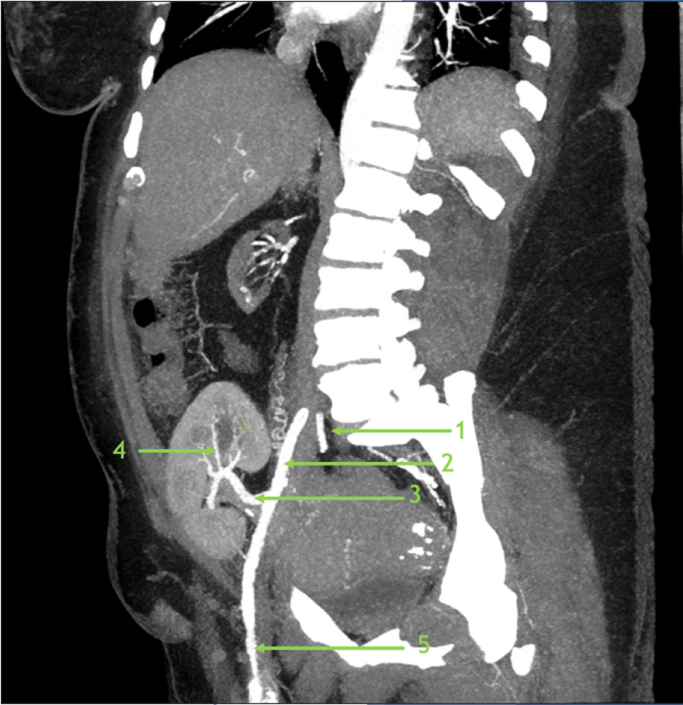
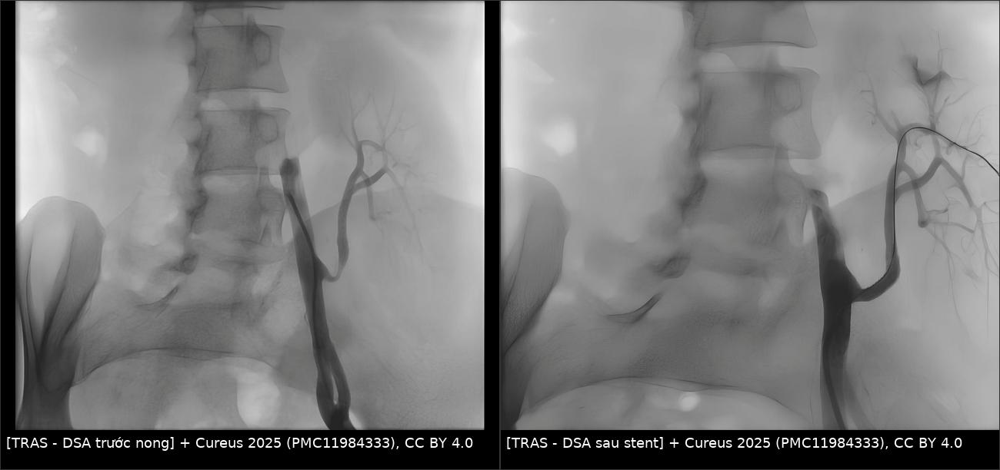
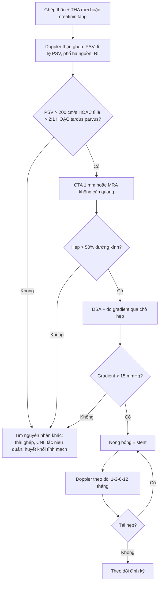
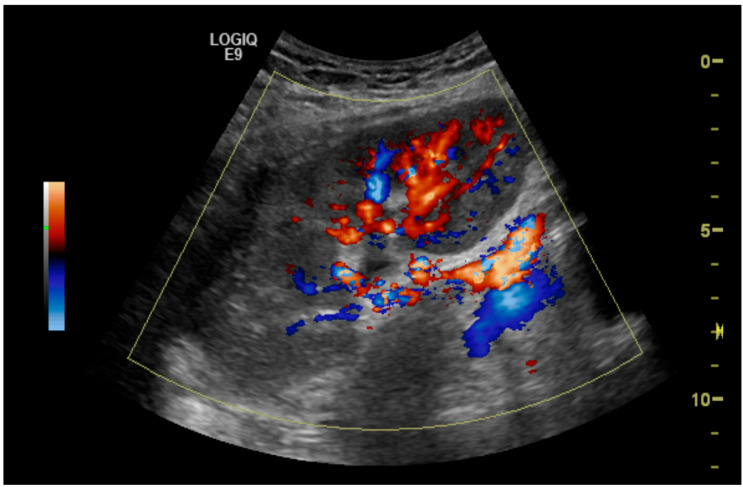

# 3087 — Hẹp động mạch thận ghép (TRAS): vì sao PSV cao mà RI vẫn bình thường

**Tags:** `pattern:hep-mach` `pattern:tardus-parvus` `pattern:roi-loan-pho-doppler` `vung:o-bung` `vung:than-ghep` `anatomy:dong-mach-than` `protocol:Doppler-than-ghep` `protocol:CTA-mach` `score:PSV`
**Mức chắc chắn (certainty):** tổng hợp y văn (literature synthesis) — ghép **tổng quan biến chứng mạch–bạch mạch sau ghép thận** (Abdom Radiol 2025, PMC12602614; CC BY), **loạt 367 ca ghép thận có 28 ca nghi TRAS, 25 ca chụp mạch, 24 ca xác định** (Diagnostics 2025, PMC12293588; CC BY) và **loạt nhi 7 ca TRAS được nong bóng/stent trong 22 năm** (Cureus 2025, PMC11984333; CC BY). Không có ca do nhóm tự chụp.

> **Câu hỏi thực hành:** bệnh nhân **52 tuổi**, ghép thận **4 tháng** trước, đến khám vì **huyết áp 168/96 mmHg** dù đã dùng **3 thuốc hạ áp**, creatinin từ **1,4 lên 2,3 mg/dL**. Doppler thận ghép: **PSV 380 cm/s** tại miệng nối, **RI 0,68** ở cực dưới. Bác sĩ lâm sàng hỏi: "RI 0,68 là bình thường, có cần chụp mạch không?"
> Bài chốt **ba quyết định**: **(1) TRAS là biến chứng mạch hay gặp nhất sau ghép thận, hiện gặp 1–3% và thường xuất hiện trong 3–6 tháng đầu; (2) chẩn đoán dựa vào PSV tại chỗ hẹp + tỉ lệ PSV + phổ tardus parvus hạ nguồn, KHÔNG dựa vào RI — RI trung bình trong loạt TRAS xác định chỉ 0,71–0,73; (3) Doppler dương tính vẫn cần CTA/MRA rồi DSA có đo gradient (> 15 mmHg) trước khi nong bóng/stent, vì 1/25 ca Doppler dương có mạch máu bình thường.**

## 1. Tổng quan bệnh học – cơ chế hình ảnh: vì sao hẹp 50% đã đủ gây bệnh

- **Định nghĩa giải phẫu – huyết động:** TRAS là **giảm > 50% đường kính lòng mạch** hoặc **giảm > 15 mmHg áp lực** qua đoạn hẹp (PMC12602614). Hai tiêu chuẩn này không tương đương: hẹp 50% đường kính đã là **hẹp 75% diện tích** — đúng ngưỡng bắt đầu có ý nghĩa huyết động, nên phần lớn ca "hẹp vừa" trên hình đã đủ gây tăng huyết áp.
- **Dịch tễ đã đổi theo thời gian:** trước đây được cho tới **23%**, các đoàn hệ lớn gần đây chỉ **~1–3%** ca ghép thận (PMC12602614). Ở trẻ, **6,32%** trong loạt 22 năm của Serbia, và **5–15%** ở trẻ tăng huyết áp sau ghép; **thận hiến từ người chết 11,11%** so với **thận hiến sống 3,39%** (PMC11984333).
- **Thời điểm:** phần lớn xuất hiện **trong năm đầu**, đa số trong **3–6 tháng đầu** sau ghép (PMC12602614) — trùng đúng "cửa sổ" mà creatinin và huyết áp thường được cho là do thải ghép hoặc do thuốc ức chế miễn dịch.
- **Bệnh học – vì sao hẹp hay ở miệng nối:** các nguyên nhân được nêu gồm **kỹ thuật mổ làm tổn thương động mạch người hiến khi lấy thận**, **gập/kẹp động mạch khi tạo miệng nối**, **chênh cỡ mạch người cho – người nhận**, **thải ghép mạn** và **nhiễm CMV** (PMC12602614). Miệng nối là nơi có **hai yếu tố cùng lúc**: mô bị kẹp trong mổ (xơ nội mạc sau đó) và **thay đổi đường kính đột ngột** (rối loạn dòng chảy, tăng ứng suất thành mạch).
- **TẠI SAO Doppler thấy PSV cao:** theo nguyên lý liên tục, vận tốc tỉ lệ nghịch với diện tích lòng mạch; hẹp còn 50% đường kính làm **diện tích còn 25%**, nên **vận tốc trung bình tăng ~4 lần**. Vì vậy PSV **> 200 cm/s** (so với 60–120 cm/s bình thường) là dấu hiệu trực tiếp của hẹp có ý nghĩa.
- **TẠI SAO có "tardus parvus" ở hạ nguồn:** hẹp gây **mất năng lượng** (tỉ lệ với bình phương vận tốc) → áp lực tưới sau hẹp giảm và **mất sóng biên độ cao**. Phổ phía sau trở nên **thoải lên, đỉnh muộn, biên độ thấp** — chính là **tardus** (chậm) **parvus** (nhỏ). Đây là dấu huyết động, **không phải dấu giải phẫu**, nên nó xuất hiện cả khi hẹp nằm **ngoài** động mạch thận ghép (ví dụ hẹp động mạch chậu của người nhận).
- **TẠI SAO KHÔNG dùng RI để chẩn đoán:** RI = (PSV − EDV)/PSV phản ánh **sức cản toàn bộ** của nhu mô và **áp lực nhu mô**, không phản ánh riêng độ hẹp. Trong loạt 28 ca TRAS, **RI trung bình 0,71 ± 0,17 (cực trên), 0,73 ± 0,19 (giữa), 0,71 ± 0,21 (cực dưới)** và **chỉ 15/28 (54%) có RI > 0,7** (PMC12293588) — nghĩa là **gần một nửa ca TRAS có RI "bình thường"**.
- **Con số vận hành:** PSV trung bình trong loạt TRAS xác định là **462,57 ± 166,28 cm/s** (PMC12293588). Lâm sàng lúc chẩn đoán thường là **creatinin ~2,1 mg/dL, huyết áp tâm thu > 150 mmHg, cách ghép ~6 tháng** (dẫn lại trong PMC12293588); loạt này có **huyết áp tâm thu trung bình 151 mmHg** và **creatinin 2,43 mg/dL**.

## 2. Mẫu hình + chẩn đoán phân biệt theo vị trí (gamut)

- **Theo vị trí hẹp** (đọc CTA/DSA theo đúng thứ tự này):
  1. **Miệng nối động mạch thận – động mạch chậu ngoài:** hay gặp nhất; hẹp **1–2 cm đầu**, thường do xơ nội mạc hoặc kỹ thuật.
  2. **Đoạn gần sát miệng nối (proximal donor artery):** hẹp do kẹp/tổn thương lúc lấy thận.
  3. **Thân động mạch thận ghép:** gập (kinking) hoặc bị **chèn ép từ ngoài** bởi lymphocele, máu tụ, nang quanh thận.
  4. **Rốn thận:** hẹp nhánh, hẹp trong nhu mô.
  5. **"Hẹp dòng vào" (inflow stenosis) — động mạch chậu của người nhận:** hẹp **trước** miệng nối, gây giảm áp toàn bộ thận ghép; trên Doppler giống TRAS nhưng **không có hẹp tại động mạch thận**.
- **Theo cơ chế:** xơ nội mạc (intimal hyperplasia) · gập/kẹp cơ học · chèn ép bởi khối dịch quanh thận · huyết khối · loạn sản/xơ vữa mạch người hiến.
- **Theo kiểu trình bày lâm sàng:**
  1. **Tăng huyết áp mới/xấu đi** (thường cần ≥ 2 thuốc) — kiểu hay gặp nhất.
  2. **Suy chức năng thận ghép** (creatinin tăng, thiểu niệu) — dễ bị quy cho thải ghép.
  3. **Pickering syndrome:** tăng huyết áp kịch phát + **phù phổi cấp** do hẹp động mạch thận ở bệnh nhân **chỉ còn một thận** (chính là thận ghép) (PMC12602614).
  4. **Phát hiện tình cờ** trên Doppler định kỳ, chưa có triệu chứng.
- **Ảnh giải phẫu chuẩn để đọc CTA:** xem Hình 1 — số 1 là **động mạch chậu trong**, 2 là **động mạch chậu ngoài**, 3 là **động mạch thận ghép chính**, 4 là **nhánh phân thùy**, 5 là **động mạch đùi chung**. Đọc sai mốc 2→3 là nguyên nhân hay gọi nhầm "hẹp" ở chỗ mạch gập bình thường.

*Hình 1 — CTA dựng sagittal thận ghép hố chậu phải: 1 động mạch chậu trong, 2 động mạch chậu ngoài, 3 động mạch thận ghép chính, 4 nhánh phân thùy, 5 động mạch đùi chung. Nguồn: White-Dzuro CE et al., Abdom Radiol 2025 (PMC12602614), CC BY 4.0.*

## 3. Bảng so sánh phân biệt (ma trận đối chiếu)

| Thực thể | Hình ảnh điển hình | Chốt vào (rule-in) | Chốt loại (rule-out) | Gợi ý xác nhận |
|---|---|---|---|---|
| **TRAS (hẹp miệng nối)** | PSV tại chỗ hẹp **> 200 cm/s**, tỉ lệ PSV hẹp/trước hẹp **> 2:1**, **tardus parvus** hạ nguồn; CTA: hẹp khu trú **> 50%** đường kính | **PSV > 200 cm/s + tỉ lệ > 2:1 + phổ hạ nguồn bất thường**; hoặc **hẹp > 50% trên CTA/MRA** | Động mạch đều, **không có tardus parvus**, tỉ lệ PSV < 2:1 → loại | DSA + **gradient > 15 mmHg**; nong bóng ± stent |
| **Hẹp động mạch chậu người nhận (inflow)** | Hẹp **trước** miệng nối trên CTA; **tardus parvus** lan tỏa cả thận ghép; chênh áp đoạn chậu–đùi | **Hẹp ở động mạch chậu + gradient trước miệng nối** | Động mạch chậu bình thường, hẹp chỉ tại miệng nối → loại | DSA đo áp **hai bên miệng nối**; xử lý tổn thương chậu trước |
| **Thải ghép cấp (TCMR)** | Thận **to, phù, giảm tưới**, PSV **giảm**, RI **tăng > 0,8**, không hẹp khu trú | **Thận to + RI cao + không hẹp mạch + đáp ứng corticoid** | Có hẹp khu trú + PSV cao → loại | Sinh thiết (Banff); Doppler theo dõi |
| **Độc thận do CNI** | Tưới máu giảm nhẹ, RI tăng nhẹ, **không hẹp**, nồng độ thuốc cao | **Nồng độ CNI cao + cải thiện khi giảm liều** | Hẹp khu trú rõ → loại | Nồng độ thuốc; sinh thiết nếu không rõ |
| **Huyết khối tĩnh mạch thận ghép** | Thận **to, đau**, **mất phổ tĩnh mạch**, đảo chiều dòng động mạch thì tâm trương; CT: khuyết thuốc tĩnh mạch | **Mất phổ tĩnh mạch + thận to cấp** | Tĩnh mạch thông, có phổ → loại | CTA/CTV; siêu âm có Doppler màu |
| **Tắc nghẽn niệu quản** | **Ứ nước**, RI **tăng**, phổ động mạch còn tốt; không hẹp mạch | **Ứ nước + RI tăng + không hẹp mạch** | Không ứ nước, có hẹp mạch → loại | Siêu âm, CT niệu quản; đặt stent/niệu quản |
| **Giả phình/AVF sau sinh thiết** | Ổ tăng tín hiệu mạch, **dòng xoáy "yin-yang"**, PSV rất cao tại ổ; AVF có dòng tốc độ cao thì tâm trương | **Ổ mạch ngoài lòng + dòng rối tại chỗ** | Không ổ mạch, phổ bình thường → loại | CTA/DSA; đốt mạch |

*Hình 2 — DSA một bệnh nhi TRAS: **trái** hẹp nặng tại miệng nối động mạch thận ghép, **phải** sau nong bóng + đặt stent, lòng mạch thông thoáng và các nhánh phân thùy hiện rõ. Nguồn: Spasojevic Dimitrijeva B et al., Cureus 2025 (PMC11984333), CC BY 4.0; ảnh ghép letterbox, không crop.*

## 4. Protocol chụp – ngưỡng Doppler – chỉ định can thiệp

### 4.1 Doppler là bước đầu, nhưng phải đo đủ ba biến

- **Đầu dò 3,5–5 MHz**, bệnh nhân nằm ngửa, **góc Doppler ≤ 60°**; khảo sát động mạch thận ghép từ **miệng nối** đến rốn thận, sau đó lấy phổ **trung tâm nhu mô ở 3 cực** (trên/giữa/dưới).
- **Ba biến phải ghi trong kết luận:** (1) **PSV tại chỗ hẹp và trước chỗ hẹp** (để tính tỉ lệ); (2) **hình dạng phổ hạ nguồn** (tardus parvus/turbulence/spectral broadening); (3) **AT và RI** ở nhu mô — RI để theo dõi, **không** để chẩn đoán hẹp.
- **Ngưỡng được dùng (không có tiêu chuẩn thống nhất trên thế giới):**
  - Ngưỡng "mềm": **PSV > 200 cm/s**, **tỉ lệ hẹp/trước hẹp > 2:1**, **tardus parvus/turbulence** hạ nguồn (PMC12602614).
  - Ngưỡng "chặt" của một cơ sở lớn: **2 trong 3** tiêu chí **PSV > 300 cm/s**, **tỉ lệ > 3:1**, **tardus parvus/aliasing** (PMC12602614).
  - Theo nghiên cứu riêng: **PSV ≥ 250 cm/s** cho **độ nhạy 100%, độ đặc hiệu 95%** (Baxter, dẫn lại); **PSV > 257,5 cm/s** cho **độ nhạy 78,57%, độ đặc hiệu 100%** (Qi, dẫn lại); tổng hợp chung **độ nhạy > 90%, độ đặc hiệu > 80%, phụ thuộc người làm** (PMC12293588).
- **Vì sao phải ghi rõ ngưỡng của cơ sở:** cùng một PSV 260 cm/s, với ngưỡng mềm là "hẹp", với ngưỡng chặt là "chưa đủ" — nếu không ghi, kết quả không so sánh được giữa các lần.

### 4.2 Khi Doppler dương: CTA/MRA rồi DSA

- **CTA** (lát **1 mm**, thì động mạch) cho giải phẫu miệng nối, nhánh, và **loại trừ nguyên nhân ngoài mạch** (lymphocele, máu tụ chèn ép). Hạn chế: **thuốc cản quang i-ốt trên thận ghép** — dùng liều tối thiểu, hydration theo quy trình.
- **MRA không cản quang** được xem là **an toàn, đáng tin cậy** và không cần gadolinium (PMC12602614) — ưu tiên ở bệnh nhân **eGFR thấp**, tránh nguy cơ **xơ hóa da do gadolinium**.
- **DSA** là chuẩn xác định, kèm **đo gradient áp lực qua chỗ hẹp**: **> 15 mmHg** là ngưỡng can thiệp (PMC12602614). DSA cũng là lúc quyết định nong/stent ngay.

### 4.3 Điều trị và kết quả

- **Nong bóng (PTA) ± stent:** stent dành cho **tổn thương ostial/miệng nối** và ca **hồi phục đàn hồi (recoil)** sau nong. Tỉ lệ thành công lâm sàng (cải thiện huyết áp hoặc chức năng thận) **65–94%**, **tái hẹp 4,2%** (PMC12602614).
- **Ở trẻ:** 7 ca TRAS được can thiệp, **5 ca chỉ nong bóng**, **2 ca cần stent**, **2 ca phải can thiệp lại** (tổng 7 lần nong); theo dõi trung bình **56,86 ± 45,76 tháng**, **không có biến chứng**, huyết áp và số thuốc hạ áp giảm, **eGFR cải thiện không có ý nghĩa thống kê**; 1 ca tiến triển bệnh thận mạn độ IV vì **nhiễm CMV nặng kèm** (PMC11984333).
- **Mổ tái thông** dành cho ca thất bại nội mạch, tổn thương dài, hoặc hẹp kèm tổn thương động mạch chậu phức tạp.

## 5. Biến thể bình thường và cạm bẫy

- **RI bình thường KHÔNG loại trừ TRAS:** đây là cạm bẫy số một — **54% ca TRAS có RI > 0,7** nhưng nghĩa là **46% còn lại nằm dưới 0,7**, và RI trung bình 0,71–0,73 (PMC12293588). Nếu chỉ nhìn RI sẽ bỏ sót gần nửa số ca.
- **Doppler dương tính vẫn có thể mạch bình thường:** **1/25 ca (4%)** có DSA bình thường dù Doppler kết luận hẹp (PMC12293588). Vì vậy **không nong theo Doppler đơn thuần** — phải có hình ảnh giải phẫu + gradient.
- **Gập mạch (kinking) giả hẹp:** động mạch thận ghép đi từ động mạch chậu lên hố thận thường **gấp khúc**; đoạn gấp cho **PSV cao cục bộ** nhưng **không có hẹp thật** và **không có gradient**. Đọc CTA dựng đa bình diện trước khi kết luận.
- **Giả phình/AVF sau sinh thiết thận:** ổ mạch ngoài lòng có **dòng xoáy tốc độ cao**, làm PSV vùng lân cận tăng; phân biệt bằng **ổ mạch + dòng rối tại chỗ**, không có hẹp dạng tấm.
- **Đo khi giảm thể tích:** mất nước làm PSV giảm và RI thay đổi — đo lại khi bệnh nhân đủ dịch, cùng tư thế, cùng đầu dò.
- **"Hẹp dòng vào" bị bỏ qua:** nếu chỉ khảo sát từ miệng nối trở đi sẽ bỏ hẹp **động mạch chậu người nhận** — luôn đặt đầu dò lên **động mạch chậu ngoài trước miệng nối**.
- **Trẻ em:** động mạch thận ghép có thể **< 3 mm**, dùng đầu dò tần số cao, góc ≤ 60°, và so sánh với **Doppler nền ngay sau ghép** thay vì chỉ dùng ngưỡng người lớn.

## 6. Tự lượng giá — Blind Quiz

**Ca 1 — nam 57 tuổi, ghép thận 3 tháng, creatinin tăng**

- Gợi ý lâm sàng: ghép thận 3 tháng, huyết áp khó kiểm soát, creatinin tăng; Doppler màu tại miệng nối.
- Câu hỏi: Dấu hiệu chính trên ảnh? Ba chẩn đoán phân biệt? Dấu nào chốt?

<b>Bấm để hiện đáp án (findings + chẩn đoán)</b>

- Dấu hiệu: **dòng chảy tăng tốc, hẹp lòng mạch tại miệng nối** động mạch thận với động mạch chậu ngoài (aliasing tại chỗ hẹp), tương ứng hẹp **90%** trong bài gốc.
- Chẩn đoán: **hẹp động mạch thận ghép tại miệng nối**. Cơ chế: hẹp làm diện tích lòng mạch giảm mạnh → vận tốc tăng theo nguyên lý liên tục, tạo aliasing màu tại chỗ hẹp.
- Phân biệt: gập mạch, giả phình/AVF sau sinh thiết, hẹp động mạch chậu người nhận.
- Nguồn ảnh: Mirza A et al., Diagnostics 2025 (PMC12293588), Hình 1, CC BY 4.0.

**Ca 2 — nữ 31 tuổi, ghép thận hố chậu phải, suy thận tiến triển**

- Gợi ý lâm sàng: ghép thận hố chậu phải, creatinin tăng dần; cần xác định mốc giải phẫu trước khi kết luận hẹp.
- Câu hỏi: Kể tên 5 mốc mạch được đánh số? Vì sao phải xác định mốc trước khi gọi "hẹp"?

<b>Bấm để hiện đáp án (findings + chẩn đoán)</b>

- Dấu hiệu: 1 động mạch chậu trong, 2 động mạch chậu ngoài, 3 động mạch thận ghép chính, 4 nhánh phân thùy, 5 động mạch đùi chung.
- Chẩn đoán: **giải phẫu bình thường của thận ghép** — bài học là **đọc đúng mốc** trước khi gọi hẹp; đoạn gấp giữa 2 và 3 là nơi hay bị gọi nhầm.
- Nguồn ảnh: White-Dzuro CE et al., Abdom Radiol 2025 (PMC12602614), Hình 1, CC BY 4.0.

**Ca 3 — bệnh nhi TRAS, trước và sau can thiệp**

- Gợi ý lâm sàng: trẻ ghép thận, tăng huyết áp sau ghép; DSA trước và sau can thiệp.
- Câu hỏi: Hai ảnh khác nhau ở đâu? Vì sao phải đo gradient trước khi nong?

<b>Bấm để hiện đáp án (findings + chẩn đoán)</b>

- Dấu hiệu: trái — **hẹp nặng tại miệng nối**; phải — **stent** làm lòng mạch rộng ra, các nhánh phân thùy hiện đầy đủ hơn.
- Chẩn đoán: **TRAS được nong bóng + đặt stent**. Gradient > 15 mmHg xác nhận hẹp có ý nghĩa huyết động; nong khi chưa có gradient là can thiệp vào tổn thương không gây bệnh.
- Nguồn ảnh: Spasojevic Dimitrijeva B et al., Cureus 2025 (PMC11984333), Hình 1 và 4, CC BY 4.0; ảnh ghép letterbox, không crop.

## Bài liên quan chéo

- [1750 – U thận ghép](../1750-utuc-than-ghep/lesson.md)
- [3011 – Biến chứng niệu quản sau ghép thận](../3011-bien-chung-nieu-quan-sau-ghep-than/lesson.md)
- [190 – Sỏi niệu quản thận ghép, bàng quang thần kinh](../190-soi-nieu-quan-than-ghep-bang-quang-than-kinh/lesson.md)
- [116 – Nhiễm trùng nặng sau ghép tạng](../116-nhiem-trung-nang-gan-ghep-than/lesson.md)

## Ảnh

- `3087_hep-dong-mach-than-ghep_CTA_PMC12602614.jpg` — CTA sagittal giải phẫu mạch thận ghép; White-Dzuro CE et al., Abdom Radiol 2025 (PMC12602614), **CC BY 4.0**.
- `3087_hep-dong-mach-than-ghep_Doppler_PMC12293588.jpg` — Doppler màu hẹp 90% tại miệng nối; Mirza A et al., Diagnostics 2025 (PMC12293588), **CC BY 4.0**.
- `3087_hep-dong-mach-than-ghep_DSA-truoc_PMC11984333.jpg` / `_DSA-sau_PMC11984333.jpg` — DSA trước/sau nong bóng + stent; Spasojevic Dimitrijeva B et al., Cureus 2025 (PMC11984333), **CC BY 4.0**.
- `composite_3087_truoc-sau-stent.jpg` — ảnh ghép đối chiếu tạo bằng `tools/make_composite.py`, letterbox nền đen, không crop.
- Nguồn + giấy phép từng ảnh: `images/CREDITS.md`.

> Không dùng để chẩn đoán độc lập khi chưa có người hướng dẫn.
