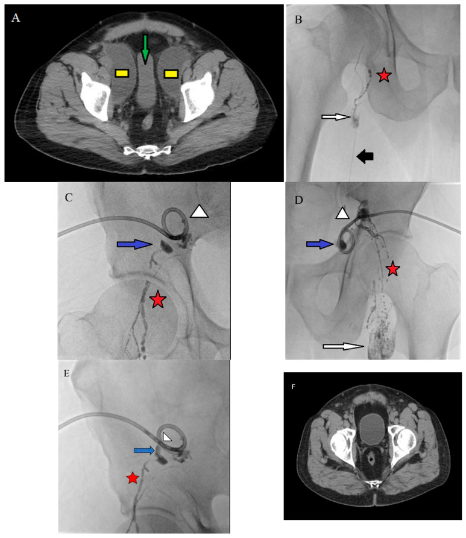
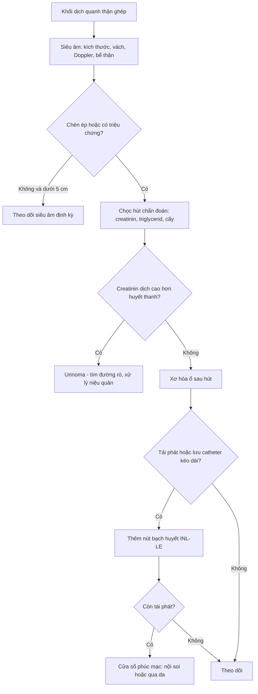
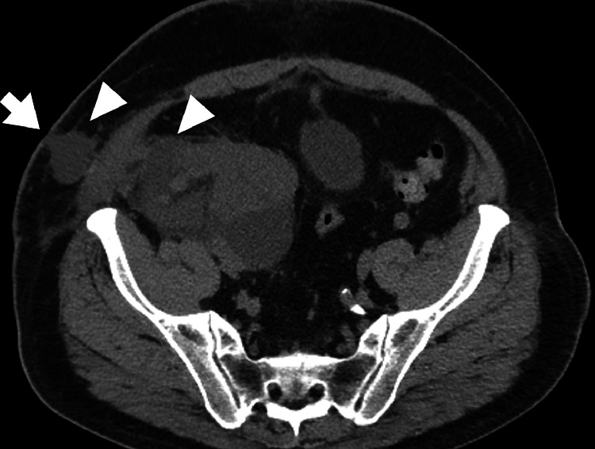
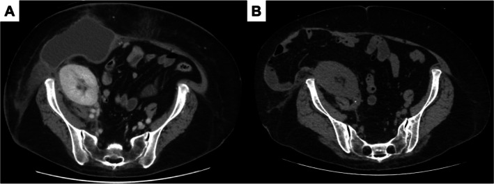

# 3088 — Nang bạch huyết quanh thận ghép (perigraft lymphocele): khối dịch chèn ép niệu quản & khi nào chọc – xơ hóa – cửa sổ phúc mạc

**Tags:** `pattern:dich-quanh-manh-ghep` `pattern:khoi-dich` `pattern:u-nuoc-than` `pattern:chen-ep` `vung:than-ghep` `vung:nieu-quan` `vung:sau-phuc-mac` `vung:bang-quang` `protocol:sieung-am` `protocol:CT-bung-can-quang` `protocol:MRI-bung` `protocol:choc-hut` `protocol:cua-so-phuc-mac`

**Mức chắc chắn (certainty):** tổng hợp y văn (literature synthesis) — ghép 1 tổng quan (World J Transplant 2026, PMC13250785, CC BY-NC), 1 đoàn hệ 88 ca ghép thận (World J Nephrol 2026, PMC13010633, CC BY-NC), 1 so sánh 47 bệnh nhân/55 nang (J Clin Med 2026, PMC12940964, CC BY 4.0), 2 ca nguyên văn (Radiol Case Rep 2025, PMC12022647, CC BY-NC-ND; IJU Case Rep 2026, PMC12704230, CC BY-NC-ND). Số nào nguồn không đưa thì ghi "chưa rõ".

> **Bài này trả lời 4 câu hỏi của ca "khối dịch quanh thận ghép" trên siêu âm/CT:**
> (1) **Đây là nang bạch huyết hay nước tiểu rò (urinoma), máu tụ, áp-xe?** (2) **Kích thước nào được theo dõi, kích thước nào phải can thiệp?** (3) **Chọc hút đơn thuần hay xơ hóa, có cần nút bạch huyết?** (4) **Khi nào chuyển cửa sổ phúc mạc (mổ nội soi hoặc qua da)?**
> Đây là **phần "khối dịch quanh ghép"** của [1750 – UTUC thận ghép](../1750-utuc-than-ghep/lesson.md) (khối đặc/khuyết lòng) và [190 – Nội soi niệu quản thận ghép](../190-soi-nieu-quan-than-ghep-bang-quang-than-kinh/lesson.md) (hẹp niệu quản); phần **ứ nước do hẹp miệng nối** khác cơ chế.

## 1. Tổng quan bệnh học – cơ chế hình ảnh

### 1.1 Nang bạch huyết hình thành thế nào

- Khi ghép thận, các **mạch bạch huyết quanh động–tĩnh mạch chậu** và **rốn thận ghép** bị cắt mà không buộc kín. Dịch bạch huyết rỉ vào **khoảng sau phúc mạc kín**, không có đường thoát, tích lại thành ổ. Sau vài tuần, tổ chức xơ quanh ổ tạo **vỏ giả (pseudocapsule)** — **không có biểu mô lót** bên trong, khác nang thận thật.
- **Tần suất:** sau ghép thận **0,6–38%** tùy loạt; **5–10%** người ghép có nang **có triệu chứng** (World J Transplant 2026, PMC13250785). Một đoàn hệ 88 ca: **17% (15/88)**, khởi phát trung bình **30 ngày** (khoảng 30–330 ngày), **67%** trong **3 tháng đầu** (PMC13010633).
- **Vì sao "quanh thận ghép" là vị trí điển hình:** thận ghép nằm **ngoài phúc mạc** ở hố chậu, giữa **cơ chậu** và **bàng quang**; mọi dịch rỉ đều bị giữ trong cùng một khoang kín, nên ổ dịch **áp sát cực dưới/rốn ghép** và lan ra **dưới da qua chỗ rách cân** nếu vết mổ hở.

### 1.2 TẠI SAO dịch bạch huyết trông "đơn thuần" trên mọi phương thức

- Bạch huyết là **dịch trong, ít tế bào, ít protein** (protein thấp hơn huyết tương) → **không cản tia**: trên CT đo được **0–20 HU**, không ngấm thuốc, vỏ mỏng đều; trên MRI **T1 thấp, T2 rất cao** (gần nước), **không hạn chế khuếch tán** nhiều (ADC cao).
- **So sánh đậm độ quyết định tên gọi** (nguyên lý chung của khối dịch sau mổ):

| Bản chất | CT (HU) | T1 / T2 | Dấu hiệu phân biệt |
|---|---|---|---|
| **Bạch huyết (lymphocele)** | **0–20** | thấp / rất cao | vỏ mỏng, không ngấm, **creatinin dịch = huyết thanh** |
| **Nước tiểu (urinoma)** | 0–10 | thấp / rất cao | **creatinin dịch > huyết thanh**, thường có đường rò từ niệu quản/bể thận |
| **Máu tụ cấp** | **50–70** | trung gian–cao / thấp | tăng đậm độ, không đồng nhất, vỏ dày |
| **Mủ (áp-xe)** | 5–25 | thấp / cao | **vỏ dày ngấm thuốc**, khí trong ổ, sốt |
| **Mỡ** | **−50 đến −100** | cao / cao (bão hòa mỡ) | mất tín hiệu trên fat-sat |

- **Xét nghiệm dịch là "chốt loại" rẻ nhất:** trong ca minh họa, **creatinin dịch 0,9–1,0 mg/dL bằng huyết thanh** → loại urinoma (IJU Case Rep 2026, PMC12704230). Nếu nghi rò dưỡng chấp, đo **triglycerid dịch** (ngưỡng tham chiếu **> 110 mg/dL** dùng trong bài 1839/1855).

### 1.3 TẠI SAO nang nhỏ lại nguy hiểm khi to ra

- Khoang quanh ghép có **ba cấu trúc bị chèn ép theo thứ tự**: **niệu quản ghép** (đi sau phúc mạc, sát cực dưới) → **tĩnh mạch chậu** → **bàng quang**. Chèn niệu quản gây **ứ nước thận ghép** — creatinin tăng, siêu âm thấy bể thận giãn; chèn tĩnh mạch gây **phù chi dưới cùng bên**, nguy cơ huyết khối.
- Vì vậy **"khối dịch không triệu chứng" chỉ đúng khi đã loại trừ chèn ép**: siêu âm phải đo **bể thận ghép** và **Doppler tĩnh mạch chậu**, không chỉ đo kích thước ổ dịch.

## 2. Mẫu hình + chẩn đoán phân biệt theo vị trí (Gamut)

### 2.1 Gamut theo vị trí quanh thận ghép

- **Giữa thận ghép và bàng quang / cực dưới ghép:** nang bạch huyết (thường gặp nhất), urinoma từ miệng nối niệu quản–bàng quang, máu tụ sau sinh thiết, áp-xe.
- **Rốn ghép / dọc bó mạch chậu:** nang bạch huyết sau bóc hạch, **giả phình miệng nối động mạch** (phải loại trước khi chọc), huyết khối tĩnh mạch.
- **Trong nhu mô/quanh bao thận ghép:** nang thận ghép đơn độc, **ứ nước bể thận** (không phải ổ ngoài thận), nang bạch huyết trong xoang, tụ máu dưới bao.
- **Dưới da, qua chỗ rách cân:** nang bạch huyết lan ra vết mổ (ca PMC12022647: ổ dịch **6,6 × 5,7 × 11,8 cm** lan tới dưới da, da hở, rỉ dịch vàng trong).

### 2.2 Gợi nhớ **LUHAS** — 5 khối dịch sau ghép

**L**ymphocele (bạch huyết), **U**rinoma (nước tiểu), **H**ematoma (máu tụ), **A**bscess (áp-xe), **S**eroma (thanh dịch vết mổ). Ba câu hỏi luôn hỏi: **(1) đậm độ bao nhiêu HU? (2) creatinin/triglycerid dịch? (3) có chèn ép niệu quản – tĩnh mạch không?**

## 3. Bảng so sánh phân biệt (ma trận đối chiếu)

| Thực thể (entity) | Hình ảnh điển hình (US/CT/MRI) | Chốt vào (rule-in) | Chốt loại (rule-out) | Gợi ý xác nhận |
|---|---|---|---|---|
| **Nang bạch huyết** | Ổ **0–20 HU**, vỏ mỏng đều, không ngấm, **giữa ghép và bàng quang**, có vách mảnh; US: trống âm, tăng âm sau | **Dịch đơn thuần + creatinin dịch = huyết thanh + bối cảnh sau ghép 2–6 tuần** | Creatinin dịch **> huyết thanh** → urinoma; **50–70 HU** → máu tụ | Chọc hút dưới siêu âm: creatinin, triglycerid, cấy |
| **Urinoma** | Ổ dịch sát **miệng nối niệu quản–bàng quang** hoặc cực dưới, có thể thấy **đường rò** trên CT trễ 10–15 phút | **Creatinin dịch cao hơn huyết thanh**, hoặc thuốc cản quang bài tiết vào ổ trên thì trễ | Creatinin dịch = huyết thanh → nang bạch huyết | CT niệu quản có thì trễ / MR urography |
| **Máu tụ** | **50–70 HU** (cấp), đồng nhất hoặc có mức; không ngấm | **Tăng đậm độ trên CT không cản quang** + sau sinh thiết/chọc | 0–20 HU → dịch đơn thuần | So sánh HU trước/sau; theo dõi thể tích |
| **Áp-xe** | Vỏ **dày, ngấm thuốc**, khí trong ổ (không bắt buộc), dịch không đồng nhất; hạn chế khuếch tán trên DWI | **Sốt + đau + vỏ ngấm thuốc** | Vỏ mỏng không ngấm + không sốt → nang bạch huyết | Cấy dịch, kháng sinh; dẫn lưu |
| **Seroma vết mổ** | Ổ dịch **dưới da, nông**, theo vết mổ, không liên quan rốn ghép | Vị trí **dưới cân, nông**, sau mổ ngay | Sâu, sát rốn ghép → nang bạch huyết | US: độ sâu so với cân |
| **Ứ nước bể thận ghép** | Bể thận giãn hình **"bàn tay"/nhiều nhánh**, thông với niệu quản; vỏ thận mỏng | **Cấu trúc dạng ống phân nhánh trong xoang thận**, không phải ổ đơn độc | Ổ ngoài thận đẩy thận sang bên → nang | US Doppler + CT trễ |

*Nang bạch huyết chậu hai bên (A, ô vàng) làm hẹp ngang bàng quang (mũi tên xanh); B–E: chụp bạch huyết trong hạch + can thiệp; F: CT sau điều trị. Nguồn: J Clin Med 2026 (PMC12940964), Fig. 2, CC BY 4.0.*

## 4. Protocol chụp + ngưỡng xử trí

### 4.1 Trình tự chẩn đoán

1. **Siêu âm là bước đầu** (rẻ, không bức xạ, đo được vỏ/vách và bể thận). Đánh giá: kích thước 3 chiều, vách, cặn, **Doppler tĩnh mạch chậu cùng bên**, **độ giãn bể thận ghép**.
2. **CT bụng–chậu có cản quang**: thì **không cản quang** (đo HU, tìm máu tụ/vôi), thì **tĩnh mạch cửa** (vỏ, mô quanh), thì **trễ 10–15 phút** (rò nước tiểu). Lát **≤ 2 mm** vùng hố ghép.
3. **MRI** khi dịch phức tạp, nghi u/nang thận ghép hoặc cần phân biệt vách: **T1, T2, DWI/ADC, T1 fat-sat sau tiêm**; nang bạch huyết **không ngấm thuốc**, không có thành phần đặc.
4. **Chọc hút chẩn đoán** khi còn nghi ngờ: gửi **creatinin, triglycerid, tế bào, cấy**. **Không chọc** khi chưa loại **giả phình** (Doppler) và **rối loạn đông** chưa sửa.

### 4.2 Ngưỡng và bậc thang điều trị

- **< 5 cm, không triệu chứng:** theo dõi siêu âm định kỳ; đa số tự thoái triển trong vài tháng (PMC13250785). **Không can thiệp chỉ vì "có dịch"**.
- **Có triệu chứng hoặc chèn ép (ứ nước, phù chi, đau):** **chọc hút dưới siêu âm** là bước đầu — nhưng **tái phát tới 59%** nếu chỉ hút (PMC13250785).
- **Xơ hóa ổ (sclerotherapy):** povidone-iodine, ethanol hoặc doxycycline sau khi hút; trung bình **1–4 lần**, có ca tới **14 lần** (PMC12940964). **Chống chỉ định khi ổ thông với đường niệu** (nguy cơ xơ hóa niệu quản).
- **Thêm nút bạch huyết (intranodal lymphangiography + lymphatic embolization, INL–LE):** trong 55 nang (47 bệnh nhân), phối hợp INL–LE giảm có ý nghĩa **dịch ngày 3, số lần xơ hóa và thời gian lưu catheter** (p < 0,001); trên phân tích đa biến, INL–LE gắn độc lập với **thời gian lưu catheter ngắn hơn** (β = −0,803; p = 0,001) (PMC12940964).
- **Cửa sổ phúc mạc (peritoneal fenestration):** khi thất bại/thể khó. Nội soi là chuẩn; **cửa sổ qua da bằng bóng dưới CT** là thay thế ở ca khó mổ: đặt catheter **10 Fr**, rút sau **3 tuần**, không tái phát trong **2,5 năm** (PMC12704230).

## 5. Biến thể bình thường và cạm bẫy

- **"Dịch quanh ghép" sau mổ 1–2 tuần là bình thường:** ổ dịch nhỏ, vỏ chưa rõ, không chèn ép — **không gọi là nang bạch huyết** nếu chưa có vỏ và chưa tồn tại > 2–3 tuần.
- **Cạm bẫy 1 — chọc/xơ hóa urinoma:** creatinin dịch **không được** bỏ qua. Xơ hóa một ổ thông với đường niệu có thể làm **hẹp/xơ niệu quản ghép**.
- **Cạm bẫy 2 — tưởng ứ nước là nang:** ứ nước bể thận có **cấu trúc ống phân nhánh**, bờ trong là niệu mô; nang là **ổ đơn độc đẩy thận sang bên**. Đo bể thận trên siêu âm trước và sau khi bàng quang rỗng.
- **Cạm bẫy 3 — bỏ sót giả phình:** khối dịch đập theo mạch, có **phổ xoáy (yin-yang)** trên Doppler → **tuyệt đối không chọc**; cần CTA và can thiệp mạch.
- **Cạm bẫy 4 — máu tụ cấp giả dịch:** bệnh nhân thiếu máu/đông máu kém, ổ "dịch" 20–35 HU có thể là máu tụ; đo HU trên CT **không cản quang** và chụp lại sau 24–48 giờ.
- **Cạm bẫy 5 — vách mảnh trong nang không phải u:** vách mảnh < 2 mm, không ngấm, không có nốt đặc → lành tính; chỉ sinh thiết khi có **thành phần đặc ngấm thuốc**.
- **Cạm bẫy 6 — hút xong "hết dịch" rồi kết luận khỏi:** nang bạch huyết tái tích nhanh trong vài ngày vì còn **rò bạch huyết hoạt động**; cần kế hoạch xơ hóa/nút chứ không hút lặp vô ích.

## 6. Tự lượng giá — Blind Quiz

**Ca 1 — Nam 45 tuổi, ghép thận 6 tuần, creatinin tăng nhẹ, siêu âm thấy ổ dịch quanh cực dưới ghép.**

- Gợi ý lâm sàng: vết mổ hở, rỉ dịch vàng trong; không sốt.
- Câu hỏi: ổ dịch nằm ở khoang nào? Đậm độ bao nhiêu là "dịch"? Ba chẩn đoán phân biệt và xét nghiệm nào chốt?

<b>Bấm để hiện đáp án (findings + chẩn đoán)</b>

- Findings: ổ dịch lớn **6,6 × 5,7 × 11,8 cm** quanh thận ghép, **lan ra mô dưới da** qua chỗ rách cân, da không liên tục (mũi tên/đầu mũi tên trắng).
- Chẩn đoán: **nang bạch huyết quanh thận ghép có rò ra vết mổ** — dịch đơn thuần, không sốt, không khí trong ổ.
- Chốt loại: **creatinin dịch = huyết thanh** (urinoma), **50–70 HU** (máu tụ), vỏ dày ngấm + khí (áp-xe).
- Nguồn ảnh: Radiol Case Rep 2025 (PMC12022647), Fig. 1, CC BY-NC-ND 4.0 (nguyên bản, không cắt/ghép).

**Ca 2 — Nữ 60 tuổi, ghép thận 2 tuần, nang bạch huyết dai dẳng đã hút 4 lần, mỗi lần 500–750 mL.**

- Câu hỏi: Vì sao hút lặp không khỏi? Hai lựa chọn can thiệp tiếp theo? Tiêu chí thành công?

<b>Bấm để hiện đáp án (findings + chẩn đoán)</b>

- Findings: (A) trước — nang dưới da lớn, **hở cân**; (B) sau 6 tháng — ổ dịch **biến mất**, không tái phát.
- Chẩn đoán: nang bạch huyết **khó trị** do còn rò bạch huyết hoạt động → **cửa sổ phúc mạc qua da bằng bóng** (catheter 10 Fr, rút sau 3 tuần), không tái phát **2,5 năm**.
- Vì sao hút thất bại: hút chỉ lấy dịch, **không đóng nguồn rò**; cửa sổ phúc mạc cho dịch thoát vào ổ phúc mạc — nơi hấp thu.
- Nguồn ảnh: IJU Case Rep 2026 (PMC12704230), Fig. 3, CC BY-NC-ND 4.0 (nguyên bản).

**Ca 3 — Nam 52 tuổi, sau bóc hạch chậu vì ung thư bàng quang, siêu âm thấy hai ổ dịch chậu, bàng quang bị hẹp ngang.**

- Câu hỏi: Đây là nang hay ứ nước? Dấu hiệu nào trên CT chứng minh chèn ép? Bậc thang điều trị?

<b>Bấm để hiện đáp án (findings + chẩn đoán)</b>

- Findings: hai ổ dịch **đồng nhất, vỏ mỏng** ở hai bên chậu (ô vàng); **bàng quang hẹp ngang** do chèn (mũi tên xanh).
- Chẩn đoán: **nang bạch huyết chậu hai bên sau bóc hạch** — không phải ứ nước vì ổ nằm **ngoài** đường niệu, không thông với bể thận.
- Điều trị: chọc hút + xơ hóa; nếu dai dẳng → thêm **nút bạch huyết INL–LE** (giảm dịch ngày 3, số lần xơ hóa, thời gian catheter; p < 0,001); cuối cùng là cửa sổ phúc mạc.
- Nguồn ảnh: J Clin Med 2026 (PMC12940964), Fig. 2, CC BY 4.0.

## Bài liên quan chéo
- [1750 – UTUC ở bệnh nhân thận ghép](../1750-utuc-than-ghep/lesson.md) (khối đặc/khuyết lòng, không phải khối dịch)
- [190 – Nội soi niệu quản thận ghép](../190-soi-nieu-quan-than-ghep-bang-quang-than-kinh/lesson.md) (hẹp niệu quản, ứ nước)
- [3011 – Biến chứng niệu quản sau ghép thận](../3011-bien-chung-nieu-quan-sau-ghep-than/lesson.md) (hẹp miệng nối & rò nước tiểu)
- [1839 – Chylothorax sau cắt/ghép gan](../1839-chylothorax-sau-cat-gan/lesson.md) (ngưỡng triglycerid dịch > 110 mg/dL)
- [1855 – LVA và chuyển hướng dòng ống ngực](../1855-lva-chuyen-huong-dong-ong-nguc/lesson.md) (can thiệp bạch huyết)

## Ảnh
- `images/3088_nang-bach-huyet_CT_PMC12940964-Fig2.jpg` — CT + chụp bạch huyết + CT sau điều trị, **CC BY 4.0**.
- `images/3088_nang-bach-huyet_CT_PMC12022647-Fig1.jpg` — CT hố chậu, **CC BY-NC-ND 4.0** (nguyên bản).
- `images/3088_nang-bach-huyet_CT_PMC12704230-Fig3.jpg` — CT trước/sau cửa sổ phúc mạc, **CC BY-NC-ND 4.0** (nguyên bản).
- Chi tiết nguồn + giấy phép: `images/CREDITS.md`; link gốc trong `sources.md`.

> Không dùng để chẩn đoán độc lập khi chưa có người hướng dẫn.
