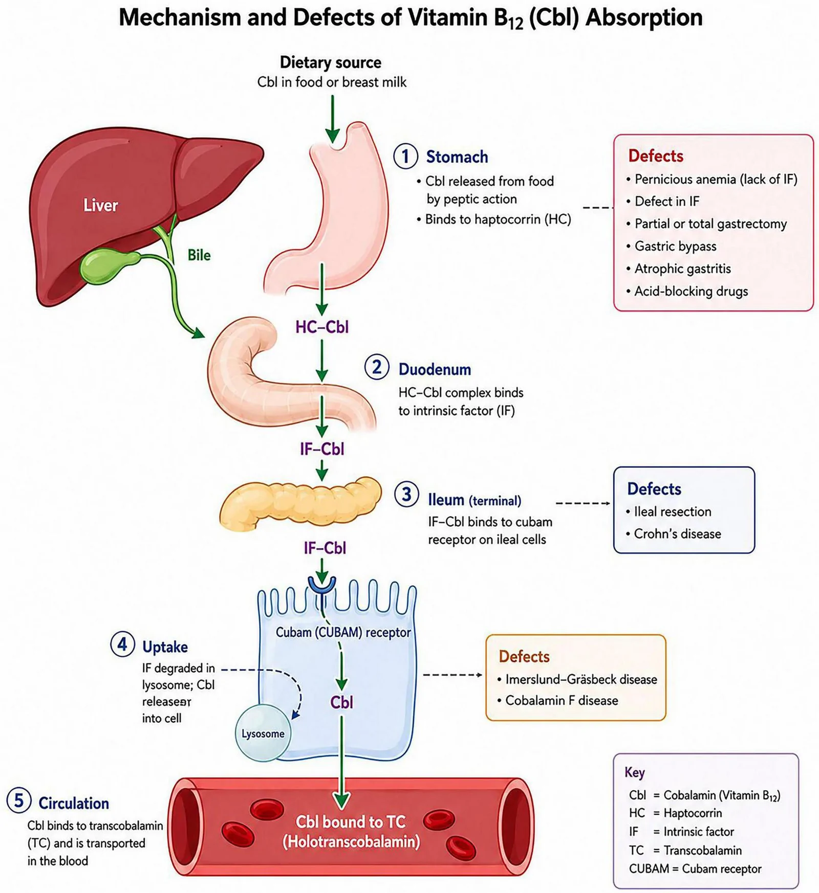
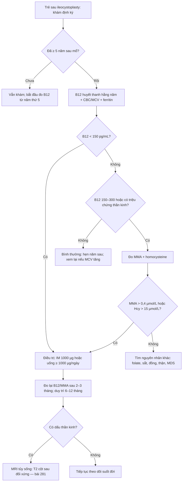
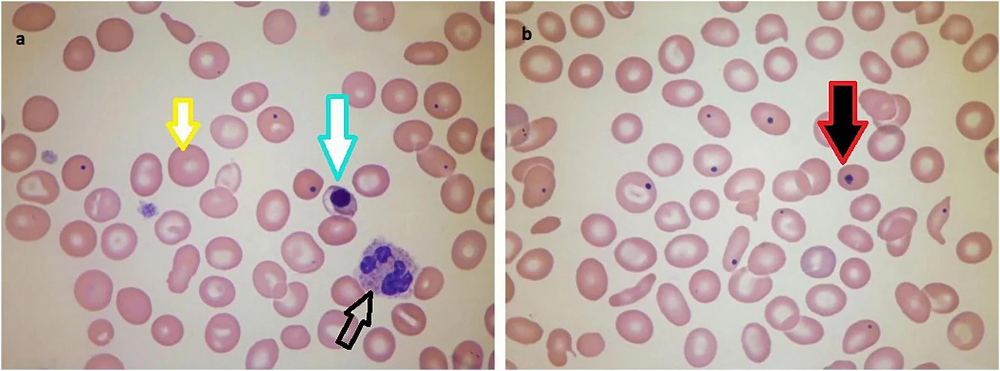

# 3089 — Thiếu vitamin B12 và thiếu máu megaloblastic sau tăng dung tích bàng quang bằng hồi tràng ở trẻ / Vitamin B12 deficiency and megaloblastic anaemia after ileocystoplasty

**Tags:** `pattern:thieu-mau-hong-cau-to` `pattern:thieu-hut-vi-chat` `pattern:bien-chung-muon` `pattern:thieu-mau` `vung:tiet-nieu` `vung:bang-quang` `vung:tuy-xuong` `anatomy:hoi-trang-cuoi` `protocol:B12` `protocol:MMA-homocysteine` `protocol:MRI-tuy-song` `incidentaloma:thieu-mau-sau-tang-dung-tich`
**Mức chắc chắn (certainty):** tổng hợp y văn (literature synthesis) — ghép **bốn loạt trẻ tăng dung tích bàng quang** (J Urol 2008, PMID 18295265; J Pediatr Urol 2012, PMID 21183408; J Pediatr Urol 2015, PMID 26165193; Sci Rep 2024, PMC10879155), **một tổng quan chuyển lưu niệu** (Transl Androl Urol 2026, PMC13657767), **hướng dẫn EAU/ESPU/ERN 2025 về spinal dysraphism** (Eur Urol Open Sci 2026, PMC13136771) và **một tổng quan về biểu hiện huyết học của thiếu B12** (Front Nutr 2026, PMC13508813). Không có ca do nhóm tự chụp.

> **Câu hỏi thực hành:** bé gái **13 tuổi**, **bàng quang thần kinh** do thoát vị tủy–màng tủy, **tăng dung tích bàng quang bằng hồi tràng (ileocystoplasty) cách đây 8 năm**, tự thông sạch (CIC) qua lỗ thông Mitrofanoff. Ba tháng nay **mệt, học kém, da hơi vàng**, không sốt, không đái máu. Xét nghiệm: **Hb 9,4 g/dL**, **MCV 106 fL**, **LDH 720 U/L**, **haptoglobin thấp**, **B12 180 pg/mL**, **folate 9,8 ng/mL**, **creatinin bình thường**, **ferritin 42 ng/mL**.
> Bài chốt **ba quyết định**: **(1) thiếu B12 sau tăng dung tích bằng hồi tràng là chuyện của năm thứ 5–7 trở đi, không phải biến chứng của giai đoạn hậu phẫu** — 21% trẻ có B12 thấp và 41% thấp–giới hạn ở mốc **7 năm**, nên "mấy năm đầu bình thường" không cho phép ngừng theo dõi; **(2) vùng B12 150–300 pg/mL là vùng xám, phải đo MMA/homocysteine trước khi kết luận**, vì tổn thương tủy có thể xuất hiện **trước khi có thiếu máu**; **(3) uống 250 µg/ngày không đủ bền vững** (chỉ 4/23 bệnh nhi về bình thường sau trung bình 49 tháng) — dùng **tiêm bắp 1000 µg** hoặc **uống liều cao ≥ 1000 µg/ngày**, và **không bao giờ bù folate đơn thuần**. Nối [281 – Thoái hóa tủy kết hợp bán cấp do thiếu B12](../281-thoai-hoa-tuy-ket-hop-b12/lesson.md), [280 – Bệnh tủy do thiếu đồng](../280-benh-tuy-thieu-dong/lesson.md), [3058 – Xuất huyết từ mảnh ghép ruột sau tăng dung tích bàng quang](../3058-xuat-huyet-manh-tu-ghep-ruot-sau-tang-dung-tich-bang-quang/lesson.md), [672 – Biến chứng muộn sau tái tạo bàng quang bằng ruột](../672-bien-chung-muon-sau-tai-tao-bang-quang/lesson.md).

## 1. Tổng quan bệnh học – cơ chế hình ảnh: vì sao cắt đoạn hồi tràng lại gây thiếu B12 SAU NHIỀU NĂM

- **Chỉ một cửa hấp thu:** B12 (cobalamin, Cbl) trong thức ăn được **pepsin/acid dạ dày** tách khỏi protein và gắn **haptocorrin (HC)**; ở tá tràng **protease tụy** phân hủy HC, Cbl chuyển sang **yếu tố nội tại (intrinsic factor, IF)** do tế bào thành tiết ra; phức hợp **IF–Cbl** mới gắn được **receptor cubam (cubilin–amnionless)** trên **tế bào hồi tràng cuối**, được nội bào hóa, phân giải trong lysosome và gắn **transcobalamin (TC)** để vào máu. Nghĩa là: **không có hồi tràng cuối = không có đường hấp thu**, dù chế độ ăn đầy đủ (PMC13508813).
- **Mảnh ghép lấy ở đâu:** tạo hình bàng quang thường lấy **15–40 cm hồi tràng**, đặt **cách van hồi–manh tràng ít nhất 15–20 cm** (PMC10879155); nhưng đoạn hấp thu B12 là **~60–100 cm cuối của hồi tràng**. Vì vậy **mảnh ghép càng gần van hồi–manh tràng, nguy cơ càng cao**; loạt 105 trẻ cho thấy nhóm **chừa 60 cm** có B12 trung bình **524 pg/mL** so với **419 pg/mL** ở nhóm không chừa — khác biệt **chưa có ý nghĩa thống kê** (PMID 21183408), tức **không có ngưỡng "an toàn" nào được chứng minh**.
- **TẠI SAO lại muộn 5–7 năm:** cơ thể dự trữ **2–5 mg B12** (chủ yếu ở gan), nhu cầu **2,4 µg/ngày** ở người lớn và mất **~0,1–0,2% dự trữ/ngày**; khi cắt đường hấp thu, phải **3–5 năm** mới cạn dự trữ — ở trẻ có dự trữ nhỏ hơn và nhu cầu theo cân nặng cao hơn, thời gian có thể **ngắn hơn**, nhưng biểu hiện lâm sàng vẫn thường **sau 5 năm**. Số liệu trẻ: ở mốc **7 năm sau mổ**, **6/29 (21%)** có B12 **≤ 200 pg/mL** và **12/29 (41%)** ở mức **201–300 pg/mL** — tức **62% đã bất thường** (PMID 18295265); loạt 105 trẻ ghi nhận **44%** ca có giá trị đo ở năm thứ 7 dưới **300 pg/mL**, và **2 ca thiếu thực sự (< 150 pg/mL) đều sau 7 năm** (PMID 21183408).
- **TẠI SAO thiếu B12 gây thiếu máu "to" và "tan máu trong tủy":** B12 là cofactor của **methionine synthase** (chuyển homocysteine → methionine, tái tạo THF cho tổng hợp thymidylate) và **methylmalonyl-CoA mutase**. Thiếu B12 → **tổng hợp DNA chậm** → nhân tế bào chín chậm hơn bào tương (**bất đồng bộ nhân–bào tương**) → **nguyên hồng cầu khổng lồ (megaloblast)** bị phá hủy ngay trong tủy (**tạo máu không hiệu quả**). Hệ quả xét nghiệm: **MCV > 100 fL**, **LDH tăng**, **bilirubin gián tiếp tăng**, **haptoglobin giảm**, **reticulocyte thấp không tương xứng** — bộ ba này **bắt chước tan máu** và là lý do bệnh nhi bị chẩn đoán nhầm (PMC13508813).
- **TẠI SAO có tổn thương thần kinh mà không có thiếu máu:** ứ **methylmalonyl-CoA** → acid methylmalonic (MMA) → **hủy myelin** ở **cột sau và bó vỏ–tủy bên** = **thoái hóa tủy kết hợp bán cấp (subacute combined degeneration, SCD)** — xem bài [281](../281-thoai-hoa-tuy-ket-hop-b12/lesson.md). Có thể có **dị cảm, mất cảm giác rung, thất điều, sa sút trí tuệ** với **MCV và Hb bình thường**; đây là lý do phải **đo MMA/homocysteine** ở vùng xám, không chờ thiếu máu.
- **TẠI SAO tần suất khác nhau giữa các loạt:** loạt trẻ 113 bệnh nhân ghi **47,5%** (48/101) trẻ có bệnh lý thần kinh và **33,3%** (4/12) trẻ không do thần kinh có B12 thấp/thấp–giới hạn (**p = 0,54**) — **bệnh nền không dự báo được** (PMID 26165193). Ở người lớn sau chuyển lưu niệu: **23%** sau ileal conduit, **15%** sau Indiana pouch, **15%** sau neobladder (Eur Urol 2008, PMID 17904276); **22%** trong loạt 51 bệnh nhân sống sót, tất cả đều có **xạ trị trước mổ hoặc bể chứa** (PMID 8262100); neobladder hồi–đại tràng **13,6%**, neobladder hồi tràng **13%**, và **tới 35%** bệnh nhân chuyển lưu có đoạn hồi tràng cuối cùng phải dùng B12 thay thế (PMC13657767).
- **TẠI SAO uống liều thấp thất bại về lâu dài:** khi không còn hồi tràng cuối, chỉ còn **khuếch tán thụ động ~1% liều uống**. Uống **250 µg/ngày** hấp thu được vài µg — đủ để sửa xét nghiệm ban đầu nhưng **không bền**: 23 bệnh nhi điều trị (uống 250 µg/ngày hoặc tiêm bắp 1000 µg/tháng), sau trung bình **49 tháng** chỉ **4/23 (17%)** có B12 bình thường (PMID 26165193). Ngược lại, **thử nghiệm ngẫu nhiên ở bệnh nhân chuyển lưu niệu** cho thấy **uống và tiêm đều hiệu quả** khi **liều uống đủ cao** (PMC13657767) — nghĩa là vấn đề **liều**, không phải "uống không bao giờ hiệu quả".

*Sơ đồ 5 bước: dạ dày (Cbl tách khỏi thức ăn, gắn haptocorrin) → tá tràng (gắn yếu tố nội tại IF) → **hồi tràng cuối** (IF–Cbl gắn receptor cubam) → nội bào hóa/lysosome → máu (gắn transcobalamin). Khung đỏ ghi khiếm khuyết tương ứng; ở bài này khiếm khuyết nằm đúng ô **"Ileum (terminal): ileal resection"** — mảnh ghép hồi tràng đã lấy mất đoạn hấp thu, nên **dự trữ cạn dần trong nhiều năm** rồi mới biểu hiện. Nguồn: Front Nutr 2026 (**PMC13508813**), **CC BY**, nguyên bản.*

## 2. Mẫu hình + chẩn đoán phân biệt theo THỜI GIAN và THEO KIỂU THIẾU MÁU (Gamut)

- **Theo thời gian sau mổ (quyết định khi nào bắt đầu tầm soát):**
  - **< 5 năm:** hiếm gặp thiếu thực sự → **không được coi là "đã qua nguy cơ"**.
  - **5–7 năm:** giai đoạn **thấp–giới hạn** (201–300 pg/mL) xuất hiện nhiều nhất — **đây là cửa sổ can thiệp**.
  - **> 7 năm:** **21% thấp**, **41% thấp–giới hạn** (PMID 18295265); nguy cơ **tăng dần theo thời gian** (tương quan âm có ý nghĩa, p < 0,01 — PMID 21183408).
- **Theo kiểu thiếu máu (giúp không bỏ sót thể "che lấp"):**
  - **Hồng cầu to đơn thuần** (MCV > 100 fL, Hb giảm, reticulocyte thấp) → nghĩ **B12/folate** trước tiên.
  - **MCV bình thường nhưng Hb thấp** → **thiếu sắt + thiếu B12 cùng lúc** (thiếu máu **dimorphic**) hoặc **bệnh thận mạn** — ở trẻ CIC, đái máu vi thể và mất sắt là chuyện thường.
  - **MCV cao + pancytopenia** → B12 nặng, **MDS**, hoặc **bệnh tủy do thiếu đồng** (bài [280](../280-benh-tuy-thieu-dong/lesson.md)).
  - **MCV bình thường + dấu thần kinh** → **đo MMA/homocysteine**; đừng chờ MCV.
- **Mnemonic "B12 STORE":** **S**urgery cắt hồi tràng / **T**erminal ileum mất, **O**ral liều thấp, **R**esection dài/gần van, **E**lderly–**E**xclusion (PPI, metformin, N₂O) — năm nhóm nguyên nhân "mất đường hấp thu hoặc mất chức năng".

## 3. Bảng so sánh phân biệt (ma trận đối chiếu)

| Thực thể (entity) | Hình ảnh/xét nghiệm điển hình | Chốt vào (rule-in) | Chốt loại (rule-out) | Gợi ý xác nhận |
|---|---|---|---|---|
| **Thiếu B12 sau mảnh ghép hồi tràng** | **MCV > 100 fL**, LDH ↑, haptoglobin ↓, reticulocyte thấp; **B12 < 150 pg/mL** hoặc **150–300 + MMA > 0,4 µmol/L / Hcy > 15 µmol/L**; phết máu: **đại hồng cầu, neutrophil nhiều thùy (≥ 5 thùy)** | **Tiền sử ileocystoplasty/ileal conduit + B12 thấp hoặc MMA/Hcy tăng + đáp ứng với B12** | **B12 > 300 pg/mL + MMA và Hcy bình thường** → loại thiếu B12 (nhưng vẫn có thể thiếu folate/đồng) | B12 + MMA + Hcy; thử điều trị 4–8 tuần rồi đo lại |
| **Thiếu folate** | MCV cao, **B12 bình thường**, **folate huyết thanh < 4 ng/mL** (hoặc RBC folate thấp); **không có dấu thần kinh** | **Folate thấp + B12 bình thường + hết thiếu máu sau bù folate** | **Có dấu thần kinh** → không được quy cho folate đơn thuần | Folate; **luôn đo kèm B12** trước khi bù |
| **Thiếu sắt (che lấp macrocytosis)** | **MCV bình thường/thấp**, ferritin ↓, TSAT < 20%, RDW cao; ở trẻ CIC thường do đái máu vi thể | **Ferritin thấp + đáp ứng sắt** | **Ferritin bình thường không loại trừ** (ferritin là phản ứng viêm cấp) | Ferritin + TSAT + CRP; bù sắt rồi đo lại MCV |
| **Thiếu đồng (copper deficiency myelopathy)** | Thiếu máu/giảm bạch cầu, **MCV bình thường hoặc cao**; **MRI tủy giống hệt SCD** ("chữ V ngược" cột sau) | **Đồng huyết thanh thấp + kẽm cao + đáp ứng đồng** | **B12/MMA bình thường mà vẫn có myelopathy** → nghĩ đồng | Ceruloplasmin/đồng, kẽm (bài 280) |
| **Thiếu máu bệnh thận mạn** | MCV **bình thường**, creatinin/eGFR bất thường, **PTH ↑**, hồng cầu đều | **eGFR giảm + Hb thấp + đáp ứng EPO** | **MCV > 100 fL** hoặc MMA ↑ → không phải nguyên nhân duy nhất | Creatinin/eGFR, PTH, sắt |
| **Thiếu máu do viêm mạn** | MCV bình thường/thấp, **ferritin ↑**, sắt ↓, CRP ↑ | **CRP ↑ + ferritin ↑ + đáp ứng điều trị nguyên nhân** | **Ferritin thấp** → loại | CRP, ferritin, TSAT |
| **Rối loạn sinh tủy (MDS)** | MCV cao, **cytopenia nhiều dòng**, loạn sản trên tủy đồ; **không đáp ứng B12** | **Loạn sản ≥ 10% ở một dòng + cytogenetic** | **Đáp ứng hoàn toàn sau 8 tuần B12** → loại MDS | Tủy đồ + sinh học phân tử; chỉ định khi không đáp ứng |
| **Thiếu B12 "chức năng" (N₂O, metformin, PPI)** | B12 có thể **bình thường**, **MMA/Hcy tăng**; có phơi nhiễm | **Phơi nhiễm + MMA/Hcy tăng + đáp ứng B12** | Không phơi nhiễm và MMA/Hcy bình thường | Hỏi thuốc/khí gây mê; đo MMA trước–sau |

## 4. Protocol theo dõi + ngưỡng điều trị

- **Lịch tầm soát (khuyến cáo từ dữ liệu trẻ):** đo **B12 huyết thanh hằng năm bắt đầu từ năm thứ 5 sau tăng dung tích**, và **theo dõi suốt đời** cùng khám, siêu âm thận–bàng quang, chức năng thận, khí máu (EAU/ESPU/ERN 2025 — PMC13136771; J Urol 2008 — PMID 18295265).
- **Bộ xét nghiệm tối thiểu mỗi lần:** **CBC + MCV + RDW**, **reticulocyte**, **LDH**, **haptoglobin**, **bilirubin toàn phần/gián tiếp**, **ferritin + TSAT**, **folate**, **creatinin/eGFR**, **B12**.
- **Ngưỡng diễn giải:** **B12 < 150 pg/mL (< 111 pmol/L)** = thiếu; **150–300 pg/mL** = **vùng xám** → đo **MMA** (bình thường < 0,4 µmol/L; một số phòng xét nghiệm dùng < 270 nmol/L) và **homocysteine** (bình thường < 15 µmol/L). **MMA tăng** là dấu hiệu **sớm và đặc hiệu hơn B12 huyết thanh**; **Hcy tăng** nhạy nhưng không đặc hiệu (tăng trong suy thận, folate thấp).
- **Điều trị:** **tiêm bắp cyanocobalamin 1000 µg** — liều nạp **1000 µg cách ngày trong 1–2 tuần** (hoặc 1000 µg/tuần × 4), sau đó **1000 µg mỗi tháng**; **hoặc** uống **1000–2000 µg/ngày** (khuếch tán thụ động ~1%) nếu tuân thủ tốt. **Không dùng 250 µg/ngày** làm phác đồ dài hạn (thất bại 83% sau ~4 năm — PMID 26165193).
- **Theo dõi đáp ứng:** **reticulocyte tăng ngày 3–5**, **Hb tăng ~1 g/dL mỗi 2–3 tuần**, MCV về bình thường sau **6–8 tuần**. **Đo lại B12/MMA sau 2–3 tháng**, rồi **mỗi 6–12 tháng**. **Kiểm tra kali** trong 1–2 tuần đầu ở ca thiếu máu nặng (tạo máu nhanh → hạ kali).
- **Không bù folate đơn thuần khi chưa loại thiếu B12:** folate có thể **che lấp thiếu máu** nhưng **không ngăn được tổn thương thần kinh**, thậm chí **làm nặng**.
- **Vai trò hình ảnh:** không có hình ảnh nào chẩn đoán thiếu B12. **MRI tủy sống** khi có dấu thần kinh: **T2 tăng tín hiệu đối xứng cột sau ("chữ V ngược"/"tai thỏ")** — chi tiết ở bài [281](../281-thoai-hoa-tuy-ket-hop-b12/lesson.md). **Siêu âm/CT bể chứa** khi thiếu máu kèm đái máu để tìm **sỏi/mảnh ghép loét** (bài [3058](../3058-xuat-huyet-manh-tu-ghep-ruot-sau-tang-dung-tich-bang-quang/lesson.md)).

## 5. Biến thể bình thường và cạm bẫy

- **"B12 bình thường" không loại trừ thiếu B12:** phần lớn B12 trong máu gắn **haptocorrin** (không giao được cho tế bào); **MMA/Hcy** phản ánh B12 **nội bào**. B12 đo được **bình thường** trong **thiếu B12 chức năng** do **N₂O**, **metformin**, **PPI kéo dài** — và đã có ca **SCD với B12 800 pg/mL** (bài 281).
- **Vùng 150–300 pg/mL là vùng hành động, không phải "theo dõi":** đây đúng là vùng của **năm thứ 5–7**; chờ đến khi B12 < 150 là chờ **thiếu máu + tổn thương tủy**.
- **Thiếu sắt che lấp MCV:** trẻ CIC có **đái máu vi thể/loét mảnh ghép** thường thiếu sắt; MCV có thể **bình thường** dù thiếu B12 nặng (**thiếu máu dimorphic**). Luôn làm **ferritin + TSAT** cùng lúc.
- **Bù folate trước khi loại thiếu B12** → thiếu máu đỡ nhưng **tổn thương tủy tiến triển**; đây là sai lầm cổ điển, vẫn gặp khi chỉ nhìn MCV.
- **"Mấy năm đầu bình thường nên không cần theo dõi":** dự trữ 2–5 mg giải thích vì sao bình thường lúc đầu; nguy cơ **tăng dần**, không giảm.
- **Mảnh ghép "xa van hồi–manh tràng" không miễn trừ:** nhóm chừa 60 cm có B12 cao hơn nhưng **không có ý nghĩa thống kê**; không có ngưỡng khoảng cách an toàn.
- **Quy kết mệt/mất tập trung cho "bàng quang thần kinh" hoặc "tuổi dậy thì":** thiếu B12 ở trẻ biểu hiện **mệt, học kém, dễ kích thích, dị cảm**; chỉ cần **CBC + B12** là phân biệt được.
- **Bổ sung B12 dự phòng cho mọi bệnh nhân:** chưa có bằng chứng; **theo dõi + điều trị khi bất thường** là cách đúng (loạt 22 trẻ không dùng dự phòng, chỉ 1 ca thiếu — PMC10879155).

## 6. Tự lượng giá — Blind Quiz

**Ca 1 — Bé gái 8 năm sau ileocystoplasty, mệt và da hơi vàng.**

- Gợi ý lâm sàng: **Hb 9,4 g/dL, MCV 106 fL, LDH 720 U/L, haptoglobin thấp, B12 180 pg/mL**; không sốt, không đái máu.
- Câu hỏi: Mô tả ba dấu hiệu trên phết máu? Vì sao LDH cao mà không phải tan máu ngoại mạch? Bước tiếp theo?

<b>Bấm để hiện đáp án (findings + chẩn đoán)</b>

- Dấu hiệu (panel a): **đại hồng cầu (mũi tên vàng)**, **nguyên hồng cầu có nhân (mũi tên xanh)** và **neutrophil nhiều thùy (mũi tên đen, ≥ 5 thùy)**; panel b: **thể Howell–Jolly (mũi tên đỏ)**.
- Chẩn đoán: **thiếu máu megaloblastic do thiếu B12 sau ileocystoplasty** — tạo máu không hiệu quả trong tủy gây **tan máu nội tủy** (LDH ↑, bilirubin gián tiếp ↑, haptoglobin ↓, reticulocyte thấp).
- Vì sao bây giờ: dự trữ B12 2–5 mg cạn dần; ở mốc **7 năm**, **21%** trẻ có B12 ≤ 200 pg/mL và **41%** ở 201–300 pg/mL (PMID 18295265).
- Bước tiếp theo: **đo MMA + homocysteine** (xác nhận), **điều trị IM 1000 µg/tháng** (hoặc uống ≥ 1000 µg/ngày), **đo lại sau 2–3 tháng**; kiểm tra kali tuần đầu.
- Nguồn ảnh: Front Nutr 2026 (**PMC13508813**), **CC BY**, nguyên bản.

**Ca 2 — Bé trai 12 tuổi, 9 năm sau tăng dung tích, dị cảm hai chân, Hb 12,8 g/dL, MCV 94 fL.**

- Gợi ý lâm sàng: **B12 240 pg/mL**, không thiếu máu; mẹ hỏi "có cần tiêm không vì xét nghiệm vẫn trong khoảng tham chiếu".
- Câu hỏi: Vì sao không được dừng ở "B12 bình thường"? Xét nghiệm nào quyết định? Hình ảnh nào cần nếu có dấu tủy?

<b>Bấm để hiện đáp án (findings + chẩn đoán)</b>

- **B12 240 pg/mL nằm trong vùng xám 150–300** và **có triệu chứng thần kinh** → phải đo **MMA và homocysteine**.
- Nếu **MMA > 0,4 µmol/L** hoặc **Hcy > 15 µmol/L** → **thiếu B12 nội bào**, điều trị dù MCV bình thường.
- Nếu có dấu tủy: **MRI tủy sống** tìm **T2 tăng tín hiệu đối xứng cột sau** ("chữ V ngược") — bài [281](../281-thoai-hoa-tuy-ket-hop-b12/lesson.md); đồng thời loại **thiếu đồng** (bài 280) nếu B12/MMA bình thường.
- Điểm cần nhớ: **tổn thương thần kinh có thể xuất hiện trước thiếu máu**; chờ Hb/MCV là chờ di chứng không hồi phục.

**Ca 3 — Bé gái 16 tuổi đang uống B12 250 µg/ngày 4 năm, B12 vẫn 210 pg/mL.**

- Gợi ý lâm sàng: tuân thủ tốt, không nôn, không tiêu chảy; ileocystoplasty 11 năm trước; MCV 99 fL.
- Câu hỏi: Vì sao uống liều này thất bại? Chọn phác đồ nào? Theo dõi ra sao?

<b>Bấm để hiện đáp án (findings + chẩn đoán)</b>

- Khi mất hồi tràng cuối, chỉ còn **khuếch tán thụ động ~1% liều**; **250 µg/ngày** chỉ hấp thu vài µg — không đủ bù.
- Dữ liệu trẻ: 23 bệnh nhi điều trị uống 250 µg/ngày hoặc IM 1000 µg/tháng, sau **49 tháng** chỉ **4/23 (17%)** bình thường (PMID 26165193).
- Chọn: **IM 1000 µg/tháng** (hoặc uống **≥ 1000 µg/ngày**); đo lại **B12 + MMA** sau 2–3 tháng, sau đó **6–12 tháng/lần**; theo dõi **suốt đời**.
- Phản biện: thử nghiệm ngẫu nhiên ở người lớn chuyển lưu niệu cho thấy **uống liều cao cũng hiệu quả** (PMC13657767) — vấn đề là **liều**, không phải đường dùng.

## Bài liên quan chéo
- [281 – Thoái hóa tủy kết hợp bán cấp do thiếu vitamin B12](../281-thoai-hoa-tuy-ket-hop-b12/lesson.md) (MRI tủy, ngưỡng B12/MMA)
- [280 – Bệnh tủy do thiếu đồng](../280-benh-tuy-thieu-dong/lesson.md) (bắt chước SCD, B12 bình thường)
- [3058 – Xuất huyết từ mảnh ghép ruột/dạ dày sau tăng dung tích bàng quang](../3058-xuat-huyet-manh-tu-ghep-ruot-sau-tang-dung-tich-bang-quang/lesson.md) (đái máu → thiếu sắt che lấp)
- [672 – Biến chứng muộn sau tái tạo bàng quang bằng ruột](../672-bien-chung-muon-sau-tai-tao-bang-quang/lesson.md)
- [3009 – Dò bàng quang–ruột sau tăng dung tích bàng quang](../3009-do-bang-quang-ruot-sau-tang-dung-tich-bang-quang-o-tre/lesson.md)

## Ảnh
- `images/3089_thieu-b12_so-do-hap-thu_PMC13508813-F1.webp` — sơ đồ hấp thu B12 và các khiếm khuyết, CC BY.
- `images/3089_thieu-b12_phiet-do-mau_PMC13508813-F2.webp` — phết máu: đại hồng cầu, nguyên hồng cầu có nhân, neutrophil nhiều thùy, thể Howell–Jolly, CC BY.
- Chi tiết nguồn + giấy phép từng ảnh: `images/CREDITS.md`; danh sách bài gốc: `sources.md`.

> Không dùng để chẩn đoán độc lập khi chưa có người hướng dẫn.
