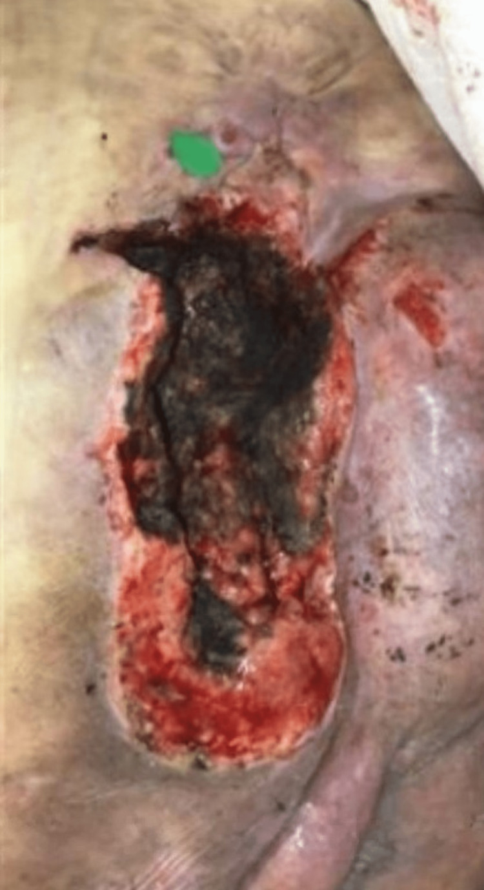
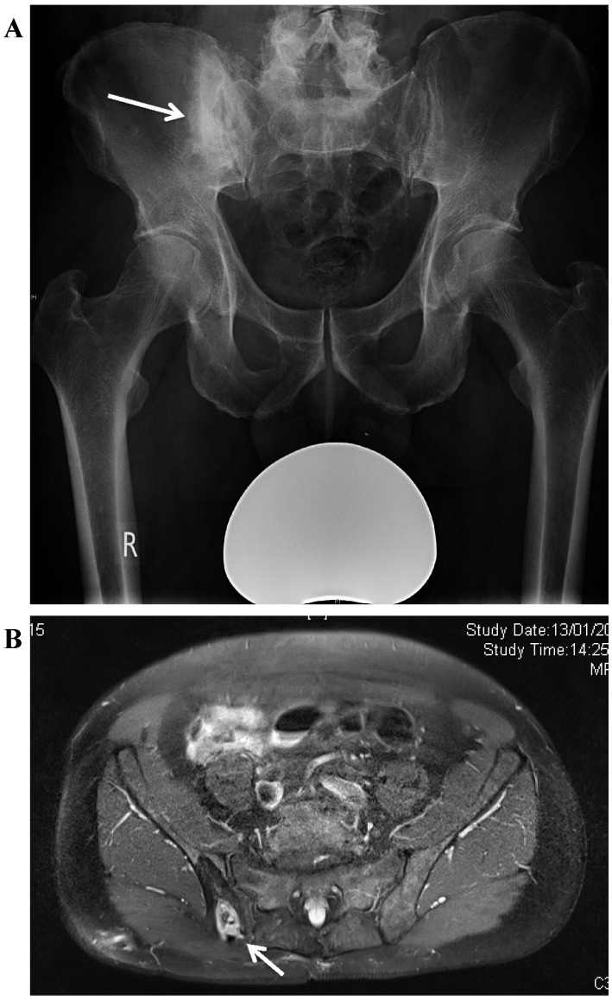
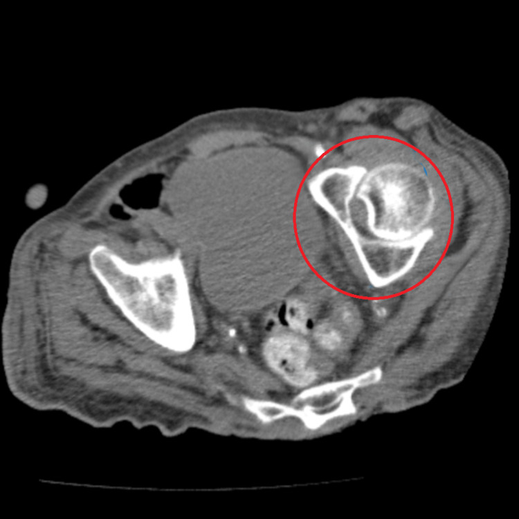
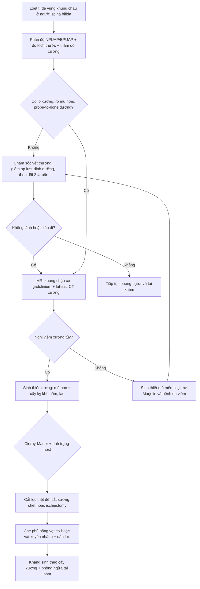

# 309 — Loét tì đè & viêm xương tủy vùng khung chậu ở người lớn spina bifida / Pressure injuries and pelvic osteomyelitis in adults with spina bifida

**Tags:** `pattern:loet-ti-de` `pattern:viem-xuong-tuy` `vung:khung-chau` `vung:da-mo-mem` `score:NPUAP-EPUAP` `score:Cierny-Mader` `protocol:MRI-khung-chau` `anatomy:spina-bifida`
**Mức chắc chắn (certainty):** tổng hợp y văn (literature synthesis) — hệ thống chẩn đoán viêm xương tủy dưới loét + cohort phẫu thuật khung chậu + cohort tái phát sau vạt; số liệu gắn PMCID, ảnh CC ghi giấy phép từng file.

## 1. Tổng quan bệnh học – cơ chế hình ảnh

- **Người lớn spina bifida (SB) không còn là “bệnh nhi”:** tùy mức tổn thương thần kinh, chỉ **17–61%** người bệnh sống tới **40 tuổi** (Eriks-Hoogland I và cs, *Front Rehabil Sci* 2024;5:1371556, PMC11417090). Da là cơ quan bị bỏ quên nhiều nhất: trong chương trình chuyển tiếp, **31%** báo có vấn đề da (bài 673).
- **Cơ chế loét:** **mất cảm giác + liệt + ngồi/nằm lâu + biến dạng khung chậu + lực cắt (shear)** → thiếu máu cục bộ tại **ụ ngồi (ischial tuberosity)**, **xương cùng (sacrum)**, **mấu chuyển lớn (greater trochanter)**. Ụ ngồi là vị trí chịu lực lớn nhất khi ngồi xe lăn; đây cũng là nơi tái phát nhiều nhất.
- **Từ loét đến viêm xương tủy:** vi khuẩn từ ổ loét lan **liên tục (contiguous)** vào xương. Đây là **viêm xương tủy đa vi khuẩn**: trong loạt 61 người lớn mổ viêm xương tủy khung chậu, **52,5%** cấy ra **≥ 2 loài**; ụ ngồi là vị trí thường gặp nhất; phân loại Cierny–Mader: **type II 19, type III 35, type IV 7** (Dudareva M và cs, *J Bone Jt Infect* 2017;2(4):184-193, PMC5671931).
- **Tần suất viêm xương tủy dưới loét stage 3–4 rất dao động:** tổng quan hệ thống 6 nghiên cứu (1986–2016) ghi nhận **17–86%**, đa số khoảng **20%** — tức là **không thể “đoán” theo lâm sàng**, phải có bằng chứng mô học (Chicco M và cs, *J Bone Jt Infect* 2020;6:21-32, PMC7517666).
- **TẠI SAO hình ảnh thay đổi — vật lý & mô học:**
  - **MRI:** phù tủy xương do viêm → **T2/STIR tăng tín hiệu, T1 giảm tín hiệu**, ngấm thuốc sau tiêm; ổ hoại tử/xương chết (sequestrum) không ngấm; **đường rò (sinus tract)** ngấm thuốc lan từ da vào xương là dấu hiệu mạnh. Nhưng **lực tì đè mạn tính tự nó gây phù tủy và xơ hóa phản ứng** → **dương tính giả**, nhất là ở vùng ụ ngồi.
  - **CT:** thấy **phá hủy vỏ xương, xơ hóa, mảnh xương chết, khí trong mô mềm**; tốt hơn MRI để đánh giá vỏ xương và lập kế hoạch cắt xương, nhưng **kém nhạy** với tủy xương viêm sớm.
  - **X-quang:** thường **âm sớm**; chỉ thấy phá hủy khi bệnh đã tiến triển — không dùng để loại trừ.
  - **Xét nghiệm:** CRP/ESR hỗ trợ theo dõi, **không đủ chẩn đoán**; **cấy mô nông** phản ánh hệ vi khuẩn bề mặt, không phải xương.
- **Hiệu suất của các phương thức so với “chuẩn vàng” mô học xương** (PMC7517666):
  - Khám lâm sàng: độ nhạy **22–33%**, độ đặc hiệu **60–79%**.
  - **MRI: độ nhạy 0–94%, độ đặc hiệu 22–25%** (hai nghiên cứu, cỡ mẫu nhỏ).
  - X-quang/CT: **đặc hiệu cao nhưng độ nhạy thấp**.
  - Xạ hình xương: độ nhạy **64–100%**, độ đặc hiệu **0–57%**.
  - **Cấy xương: độ nhạy cao, độ đặc hiệu thấp** do nhiễm bẩn.
  - Kết luận của tổng quan: **không phương thức nào đủ tin cậy** — **sinh thiết xương + mô học** vẫn là chuẩn vàng.
- **Hệ quả lâm sàng của “MRI dương tính giả”:** trong 73 vạt ở 41 bệnh nhân, **giá trị tiên đoán dương của MRI chỉ 84,6%** và **giá trị tiên đoán âm 16,7%**; có/không viêm xương tủy trên cấy xương **không làm khác thời gian lành hay tỷ lệ biến chứng** (McCarthy J và cs, *Plast Reconstr Surg Glob Open* 2017;5:e1263, PMC5404448). Nghĩa là: **MRI không được dùng một mình để quyết định cắt xương**.

*Loét tì đè vùng mông trái ở bệnh nhân **spina bifida** kèm đái tháo đường và béo phì: ổ loét **18,26 × 8,22 × 7 cm**, đáy phủ **vảy hoại tử đen (eschar)** che mất độ sâu → **không phân độ được (unstageable)** cho đến khi cắt lọc. Nguồn: Bruzzese GL, McKenna S, *Cureus* 2023;15(8):e43470 (PMC10425705), Fig. 1, CC BY 3.0 — ảnh nguyên bản.*

## 2. Mẫu hình + chẩn đoán phân biệt theo vị trí (gamut)

- **Theo vị trí tì đè:**
  - **Xương cùng:** hay gặp ở người nằm; loét rộng, dễ thông vào ống sống → **áp-xe ngoài màng cứng** (biến chứng thần kinh cấp cứu).
  - **Ụ ngồi:** hay gặp ở người ngồi xe lăn; **tái phát cao nhất** sau vạt (OR 3,67 so với vị trí khác — Selsjord AR và cs, *Int Wound J* 2025;22:e70211, PMC11999728).
  - **Mấu chuyển lớn:** loét do nằm nghiêng; dễ nhầm **viêm bao hoạt dịch mấu chuyển (trochanteric bursitis)**.
  - **Gót chân, chẩm, vai:** loét do nằm; thường bị bỏ sót khi chỉ khám vùng cùng cụt.
- **Theo mẫu hình tổn thương:**
  - **Loét đơn thuần chưa viêm xương:** đáy mô hạt, không lộ xương, không mùi, CRP nhẹ.
  - **Loét + viêm xương tủy:** lộ xương, chảy mủ kéo dài, **đường rò**, xương sờ thấy; MRI/CT phá hủy xương.
  - **Loét + ung thư biểu mô vảy (Marjolin):** loét lâu năm, bờ cứng lồi, đau tăng, chảy máu — **sinh thiết mọi ổ loét không lành sau 4–8 tuần**.
  - **Loét + bệnh da viêm:** pyoderma gangrenosum (bờ tím, đau, lan nhanh), viêm mạch, lao da.
  - **Loét + rò dịch não tủy:** ở người có myelomeningocele đã vá — dịch trong, dấu “halo”, tăng khi gắng sức; dễ bị chẩn đoán nhầm là loét tì đè (Taylor EM và cs, *Eplasty* 2013;13:ic62, PMC3827833).
  - **Loét + cốt hóa lạc chỗ (heterotopic ossification):** khối xương trong mô mềm quanh khớp háng, có thể loét da trên khối xương.
- **Mnemonic vị trí “SITA”: Sacrum – Ischium – Trochanter – Ankle/heel** (cùng cụt – ụ ngồi – mấu chuyển – gót).

## 3. Bảng so sánh phân biệt (ma trận đối chiếu)

| Thực thể (entity) | Hình ảnh/lâm sàng điển hình | Chốt vào (rule-in) | Chốt loại (rule-out) | Gợi ý xác nhận |
|---|---|---|---|---|
| Loét stage 3–4 KHÔNG viêm xương | Loét sâu tới mô dưới da/cơ, đáy mô hạt, không lộ xương | **Đáy sạch, mô hạt, không lộ xương, CRP thấp** | **Lộ xương + chảy mủ + đường rò** → phải loại viêm xương | Thăm dò bằng que (probe-to-bone) + MRI/CT |
| Viêm xương tủy dưới loét | Lộ xương, mủ, rò; MRI phù tủy + ngấm, CT phá hủy vỏ | **Mô học xương có viêm + cấy xương dương** | **MRI bình thường + không lộ xương + CRP thấp** → ít nghĩ viêm xương | Sinh thiết xương (mô học + cấy), không chỉ cấy mô nông |
| Ung thư biểu mô vảy (Marjolin) | Loét > 10 năm, bờ cứng lồi, đau, chảy máu; hủy xương | **Sinh thiết da/mô mềm có tế bào ác** | Sinh thiết âm + loét lành sau cắt lọc → loại | Sinh thiết nhiều điểm, CT/MRI đánh giá xâm lấn |
| Pyoderma gangrenosum | Bờ tím, đau nhiều, lan nhanh, **không nhiễm khuẩn** | **Bờ tím đặc trưng + đáp ứng corticoid** | Cấy mủ + sốt + phá hủy xương → nghĩ nhiễm trùng | Sinh thiết loại trừ nhiễm trùng/ác; hội chẩn da liễu |
| Lao da/xương | Loét mạn, bờ nham nhở, có thể lao xương khung chậu | **AFB/PCR dương + hình ảnh hủy xương** | PCR âm + cấy thường dương → loại | Sinh thiết + PCR lao |
| Rò dịch não tủy (sau vá MMC) | Dịch trong, dấu halo, tăng khi gắng sức, không mủ | **Beta-2 transferrin dương** | Dịch đục/mủ + cấy dương → loại | Beta-2 transferrin, CT/MRI định vị |
| Viêm bao hoạt dịch mấu chuyển | Đau mấu chuyển, sưng khu trú, không loét sâu | **Sưng/đau khu trú + MRI dịch quanh gân, xương nguyên** | Phá hủy xương trên CT → viêm xương | Siêu âm + MRI; chọc hút |
| Cốt hóa lạc chỗ | Khối cứng trong cơ, hạn chế vận động; X-quang có xương trưởng thành | **Xương có vỏ/vân trong mô mềm, tách khỏi xương chính** | Phá hủy vỏ xương liên tục → nghĩ viêm xương/u | X-quang/CT; ALP; MRI khi chưa rõ |

### Ảnh chốt: phá hủy xương do viêm xương tủy

*(A) X-quang khung chậu: ổ khuyết xương (lucency) ở **cánh xương chậu phải** với **xơ hóa quanh (involucrum)**, mũi tên trắng. (B) MRI axial: **phá hủy xương, ổ xương chết trung tâm** và **đường rò ngấm thuốc ra da vùng mông** (mũi tên). Bệnh cảnh: người liệt hai chi dưới, viêm xương tủy khung chậu mạn — cùng cơ chế với người lớn spina bifida. Nguồn: Dudareva M và cs, *J Bone Jt Infect* 2017;2(4):184-193 (PMC5671931), Fig. 3 A–B, CC BY-NC 4.0 — giữ nguyên bản.*

*CT axial không cản quang: vùng **ly giải xen xơ hóa (lytic–sclerotic)** ở **cánh xương chậu trái** (khoanh đỏ), kèm dày mô mềm và thay đổi quanh xương — hình ảnh viêm xương tủy mạn tính. Đây là kiểu tổn thương mà **X-quang thường bỏ sót**. Nguồn: Tetoff T, Kaur J, Zambrano C, *Cureus* 2026;18(6):e111080 (PMC13380024), Fig. 4, CC BY 4.0 — ảnh nguyên bản.*

## 4. Protocol chụp + hệ phân độ/điểm chuẩn hóa

### 4.1 Trình tự chẩn đoán
- **Bước 1 — lâm sàng:** đo kích thước, độ sâu, đáy ổ loét; **thăm dò bằng que (probe-to-bone)**; tìm **lộ xương, mùi, đường rò**; khám toàn bộ da (gót, chẩm, vai); đánh giá dinh dưỡng (albumin, prealbumin), đường huyết.
- **Bước 2 — xét nghiệm:** **CRP, ESR**, công thức máu; **cấy máu** nếu sốt; **không dùng cấy mô nông để chẩn đoán viêm xương**.
- **Bước 3 — hình ảnh:**
  - **MRI khung chậu có gadolinium + fat-sat** (T1, T2/STIR, T1 sau tiêm): phù tủy, ngấm thuốc, **đường rò**, áp-xe mô mềm, lan vào ống sống.
  - **CT không cản quang lát mỏng:** phá hủy vỏ xương, xương chết, khí; dùng khi MRI chống chỉ định hoặc để lập kế hoạch cắt xương.
  - **X-quang** chỉ để có nền, không loại trừ.
- **Bước 4 — chuẩn vàng:** **sinh thiết xương qua đường loét hoặc qua da**, lấy **nhiều mẫu** cho **mô học + cấy kỵ khí + nấm + lao**; nếu có thể **ngừng kháng sinh 2 tuần** trước lấy mẫu (theo tổng quan PMC7517666, chỉ 1/6 nghiên cứu tuân thủ điều kiện này).

### 4.2 Phân độ phải nhớ
- **Phân độ loét NPUAP/EPUAP 2019:** **stage 1** — da nguyên vẹn, đỏ không mất màu; **stage 2** — mất một phần lớp bì, đáy hồng/ẩm; **stage 3** — mất toàn bộ lớp dày, thấy mỡ, **chưa lộ xương/gân/cơ**; **stage 4** — lộ **xương, gân, cơ, sụn**; **unstageable** — bị che bởi vảy hoại tử/slough; **deep tissue pressure injury** — đỏ/tím sẫm không mất màu, da còn nguyên.
- **Cierny–Mader:** type **I** tủy xương, **II** bề mặt, **III** khu trú, **IV** lan tỏa; kèm **host A/B/C** (A = lành mạnh, B = suy giảm, C = không chịu được mổ). Loạt 61 ca: **II 19, III 35, IV 7**; **30 ca cần vạt che phủ** (PMC5671931).
- **Kết cục phẫu thuật:** trong loạt 61 người lớn, **tái phát 11,5%** (trung bình **1,5 năm**, 92 ngày–5,3 năm), **12 ca tử vong** trong theo dõi (PMC5671931). Sau vạt ở người SCI, **tái phát 46%** (25/54); yếu tố tăng: **xe lăn cơ (OR 3,9)**, **vạt ở ụ ngồi (OR 3,67)**; yếu tố giảm: **theo dõi tại đơn vị tủy sống (OR 0,28)**, **có trợ lý chăm sóc (OR 0,15)** (PMC11999728). Loét ụ ngồi tái phát chung **15–30%** (PMC13320726).

### 4.3 Nguyên tắc điều trị
- **Kiểm soát nhiễm trùng + cắt lọc triệt để:** cắt da, mô dưới da, cơ hoại tử và **xương đến khi còn chảy máu**; cắt **ụ ngồi (ischiectomy)** khi xương viêm không hồi phục; để lại mô mềm khỏe.
- **Che phủ bằng vạt:** vạt cơ/musculocutaneous hoặc **vạt xuyên nhánh (perforator flap)** — mấu chuyển (SGAP), vạt cơ mông, vạt keystone; đặt **dẫn lưu kín**, tránh đè lên vạt.
- **Bổ trợ:** **xi măng xương mang kháng sinh** (vancomycin/tobramycin) cho ổ xương rộng, **NPWT** khi nhiễm chưa kiểm soát, kháng sinh theo cấy xương (không theo cấy mô nông).
- **Phòng ngừa tái phát là điều trị bắt buộc:** **bản đồ áp lực (pressure mapping)**, thay đổi tư thế, **nệm/đệm phù hợp**, kiểm soát co cứng, dinh dưỡng, **tái khám tại đơn vị tủy sống**.

## 5. Biến thể bình thường và cạm bẫy

- **MRI dương tính không bằng viêm xương:** phù tủy do tì đè/xơ hóa phản ứng rất thường gặp ở stage 4; **PPV 84,6%, NPV 16,7%** trong loạt vạt (PMC5404448) → **không cắt xương chỉ vì MRI**.
- **MRI âm tính không loại trừ viêm xương** khi đã có lộ xương/rò mủ; độ nhạy trong y văn dao động **0–94%** (PMC7517666) — quyết định dựa trên **mô học + cấy xương**.
- **Cấy mô nông luôn “dương”** do hệ vi khuẩn bề mặt; **chỉ cấy xương sâu** mới định hướng kháng sinh.
- **Ổ loét nhỏ ngoài da, hang lớn dưới da:** không đánh giá độ sâu bằng mắt; cần thăm dò và MRI/CT.
- **Bỏ sót ung thư biểu mô vảy (Marjolin)** ở loét > 10 năm: loét “không lành” phải **sinh thiết**, kể cả khi MRI chỉ thấy viêm.
- **Rò dịch não tủy giả loét** ở người đã vá myelomeningocele: dịch trong, dấu halo, tăng khi ho/gắng sức — hỏi tiền sử, **beta-2 transferrin** (PMC3827833).
- **Áp-xe ngoài màng cứng** là biến chứng của loét cùng cụt sâu: đau lưng, sốt, yếu chi mới → **MRI toàn bộ cột sống cấp**, không chờ.
- **“Unstageable” không phải stage 4:** chỉ phân độ sau khi cắt lọc đủ để thấy đáy; ghi sai độ sâu sẽ sai kế hoạch mổ.
- **Cốt hóa lạc chỗ và thay đổi sau mổ** có thể giả u/tái phát trên X-quang — đối chiếu CT/MRI và so phim cũ.

## 6. Tự lượng giá — Blind Quiz

**Ca 1 — Nam 34 tuổi, spina bifida, ngồi xe lăn, nhập viện vì sốt và chảy mủ vùng mông trái. Vùng loét không đau.**

- Hỏi: mô tả tổn thương? Vì sao không phân độ được? Hai biến chứng phải loại trừ?

<b>Bấm để hiện đáp án (findings + chẩn đoán)</b>

- **Findings:** ổ loét lớn vùng mông trái (**18,26 × 8,22 × 7 cm**), đáy phủ **vảy hoại tử đen**, viền da đỏ/macerated; không đau do mất cảm giác.
- **Vì sao không phân độ được:** đáy bị **eschar/slough che** — chỉ phân độ sau khi cắt lọc; trên thực tế tổn thương đã tới xương (stage 4).
- **Biến chứng phải loại trừ:** **viêm xương tủy khung chậu** (lộ xương, mủ, rò) và **nhiễm khuẩn huyết/áp-xe vùng chậu**; ở loét cùng cụt sâu còn phải loại **áp-xe ngoài màng cứng**.
- **Bước tiếp theo:** CRP/ESR, cấy máu, **MRI khung chậu có gadolinium + fat-sat**, **sinh thiết xương** khi nghi viêm xương.
- **Nguồn ảnh:** Bruzzese GL, McKenna S, *Cureus* 2023;15(8):e43470 (PMC10425705), Fig. 1, CC BY 3.0.

**Ca 2 — Bệnh nhân liệt hai chi dưới, loét tì đè mạn vùng mông phải, chảy mủ tái diễn nhiều năm. Xem X-quang và MRI.**

- Hỏi: dấu hiệu trên X-quang? MRI bổ sung gì? Vì sao không thể chẩn đoán chỉ bằng hình ảnh?

<b>Bấm để hiện đáp án (findings + chẩn đoán)</b>

- **X-quang (A):** ổ **khuyết xương (lucency)** ở cánh chậu phải với **xơ hóa quanh (involucrum)** — dấu hiệu viêm xương tủy mạn.
- **MRI (B):** **phá hủy xương, ổ xương chết trung tâm**, **đường rò ngấm thuốc** từ xương ra da vùng mông.
- **Chẩn đoán:** **viêm xương tủy khung chậu mạn** do loét tì đè (lan liên tục).
- **Vì sao không chỉ dựa hình ảnh:** MRI có thể dương tính giả do phù tủy tì đè; **mô học + cấy xương** mới xác nhận và định hướng kháng sinh.
- **Nguồn ảnh:** Dudareva M và cs, *J Bone Jt Infect* 2017;2(4):184-193 (PMC5671931), Fig. 3 A–B, CC BY-NC 4.0.

**Ca 3 — Bệnh nhân lớn tuổi, loét cùng cụt sâu, sốt; CT bụng–chậu không cản quang được chỉ định vì không làm được MRI.**

- Hỏi: mô tả tổn thương xương? CT mạnh/yếu gì so với MRI? Cần làm gì để chốt?

<b>Bấm để hiện đáp án (findings + chẩn đoán)</b>

- **Findings:** vùng **ly giải xen xơ hóa** ở **cánh chậu trái** (khoanh đỏ), bờ không đều, kèm **dày mô mềm** quanh xương.
- **Chẩn đoán:** **viêm xương tủy khung chậu** (gợi ý mạn tính do xơ hóa); cần loại trừ ác tính nếu bờ phá hủy rộng.
- **CT mạnh:** vỏ xương, mảnh xương chết, khí, lập kế hoạch cắt xương; **CT yếu:** tủy xương viêm sớm, đường rò, áp-xe mô mềm.
- **Để chốt:** **sinh thiết xương** (mô học + cấy), CRP/ESR, cấy máu; nếu MRI không làm được, CT là lựa chọn thay thế hợp lý.
- **Nguồn ảnh:** Tetoff T, Kaur J, Zambrano C, *Cureus* 2026;18(6):e111080 (PMC13380024), Fig. 4, CC BY 4.0.

## Bài liên quan chéo

- [300 – Tổng quan hệ Cơ xương khớp](../300-tong-quan-he-co-xuong-khop/lesson.md)
- [673 – Chuyển tiếp sang người lớn ở spina bifida & bàng quang thần kinh](../673-chuyen-tiep-nguoi-lon-spina-bifida-bang-quang-than-kinh/lesson.md)
- [677 – Chăm sóc & biến chứng ống dẫn lưu trên xương mu ở trẻ](../677-cham-soc-ong-dan-luu-tren-xuong-mu-o-tre/lesson.md)
- [671 – Nhiễm trùng tiểu & viêm thận–bể thận ở trẻ có bàng quang thần kinh](../671-nhiem-trung-tieu-bang-quang-than-kinh-o-tre/lesson.md)
- [672 – Biến chứng muộn sau tái tạo bàng quang bằng ruột](../672-bien-chung-muon-sau-tai-tao-bang-quang/lesson.md)

## Ảnh

- `images/309_loet-ti-de_Anh-PMC10425705-F1.jpg` — loét tì đè spina bifida, CC BY 3.0.
- `images/309_viem-xuong-tuy_MRI-PMC5671931-F3.jpg` — X-quang + MRI viêm xương tủy, CC BY-NC 4.0.
- `images/309_viem-xuong-tuy_CT-PMC13380024-F4.jpg` — CT phá hủy xương, CC BY 4.0.

Nguồn và giấy phép từng ảnh: [`images/CREDITS.md`](images/CREDITS.md).

> Không dùng để chẩn đoán độc lập khi chưa có người hướng dẫn.
