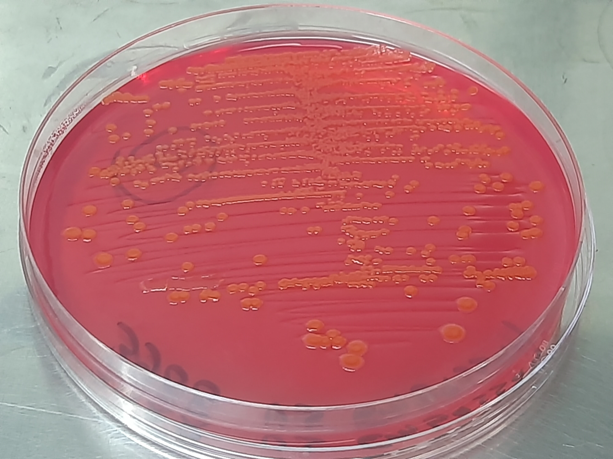
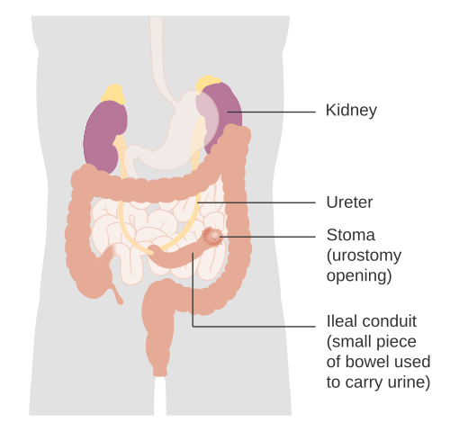
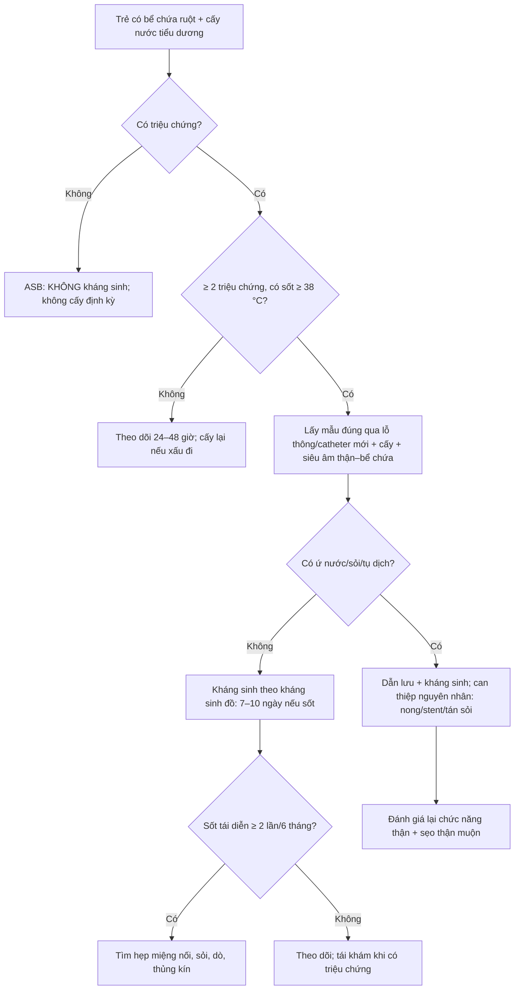

# 3090 — Bacteriuria không triệu chứng vs nhiễm khuẩn tiểu có triệu chứng ở trẻ có bể chứa ruột / Asymptomatic bacteriuria versus symptomatic UTI in children with an enteric urinary reservoir

**Tags:** `pattern:bacteriuria` `pattern:nhiem-khuan-tieu` `pattern:khang-thuoc` `pattern:viem-dai-thang-do-khang-sinh` `vung:tiet-nieu` `vung:bang-quang` `anatomy:be-chua-ruot` `protocol:cay-nuoc-tieu` `protocol:CIC` `protocol:khang-sinh` `incidentaloma:bacteriuria`
**Mức chắc chắn (certainty):** tổng hợp y văn (literature synthesis) — ghép **một loạt 186 trẻ CIC** (Spinal Cord 2022, PMID 34446838), **một loạt 22 trẻ sau tăng dung tích bàng quang** (Sci Rep 2024, PMC10879155), **hai loạt neobladder ở người lớn** (BJU Int 2005, PMID 16042736; BJU Int 2008, PMID 18070190), **hướng dẫn EAU/ESPU/ERN 2025** (Eur Urol Open Sci 2026, PMC13136771) và **hướng dẫn IDSA 2019 về bacteriuria không triệu chứng** (Clin Infect Dis 2019, PMID 30895288). Không có ca do nhóm tự chụp.

> **Câu hỏi thực hành:** bé trai **9 tuổi**, **bàng quang thần kinh** do thoát vị tủy–màng tủy, **tăng dung tích bàng quang bằng hồi tràng + lỗ thông Mitrofanoff cách đây 4 năm**. Đến khám định kỳ, **không sốt, không đau, không nôn**, nước tiểu **hơi đục và có nhầy**. Mẹ mang theo kết quả cấy từ **túi dẫn lưu (stoma bag)**: **E. coli > 10⁵ CFU/mL**, "nhiều bạch cầu"; mẹ xin kháng sinh vì "lần trước bác sĩ cũng cho".
> Bài chốt **ba quyết định**: **(1) cấy dương là nền của bể chứa ruột, không phải chẩn đoán** — 77% trẻ CIC và tới 100% trẻ sau tăng dung tích bàng quang có bacteriuria không triệu chứng; **(2) chỉ điều trị khi có ≥ 2 triệu chứng (trong đó sốt ≥ 38 °C là quan trọng nhất) + cấy ≥ 10⁵ CFU/mL một loại vi khuẩn + ≥ 10 bạch cầu/HPF**, và **không điều trị bacteriuria không triệu chứng** (IDSA 2019: chỉ điều trị khi có thai hoặc trước thủ thuật niệu khoa xâm lấn có chấn thương niêm mạc); **(3) mẫu cấy phải lấy qua lỗ thông/catheter mới, không lấy từ túi** — mẫu từ túi thường **nhiều loại vi khuẩn** và dẫn tới kháng sinh sai. Nối [3086 – CAUTI ở trẻ](../3086-cauti-o-tre/lesson.md), [3058 – Xuất huyết từ mảnh ghép ruột sau tăng dung tích bàng quang](../3058-xuat-huyet-manh-tu-ghep-ruot-sau-tang-dung-tich-bang-quang/lesson.md), [3009 – Dò bàng quang–ruột sau tăng dung tích bàng quang](../3009-do-bang-quang-ruot-sau-tang-dung-tich-bang-quang-o-tre/lesson.md), [691 – Sỏi bàng quang và sỏi quanh catheter](../691-soi-bang-quang-va-soi-quanh-catheter-o-tre/lesson.md).

## 1. Tổng quan bệnh học – cơ chế hình ảnh: vì sao bể chứa ruột "luôn có vi khuẩn"

- **Bể chứa ruột không phải bàng quang:** niêm mạc hồi tràng **tiết chất nhầy**, **không có lớp glycosaminoglycan chống bám dính** của niêm mạc niệu, **không có phản xạ rửa sạch**, và **không co bóp tống hết nước tiểu**. Chất nhầy + nước tiểu tồn lưu + **CIC đẩy vi khuẩn từ da/lỗ thông vào** = môi trường nuôi cấy liên tục (PMC10879155).
- **TẠI SAO cấy dương gần như chắc chắn:** 22 trẻ sau tăng dung tích bàng quang, **100% (22/22)** có bacteriuria không triệu chứng tại lần theo dõi cuối; **E. coli 18/22**, Klebsiella 1, Citrobacter 1, Streptococcus agalactiae 1, Morganella 1 (PMC10879155). Ở **186 trẻ CIC** (281 mẫu), bacteriuria không triệu chứng **77% (95% CI 72–82%)**, **E. coli 71%**, Klebsiella 13%, Proteus 10% (PMID 34446838).
- **TẠI SAO "nhiều bạch cầu" không giúp phân biệt:** trong 119 mẫu nước tiểu của 40 bệnh nhân neobladder, **118/119 có bạch cầu**, và **nồng độ bạch cầu trung bình ở mẫu vô khuẩn là 1181/µL** so với **491/µL ở mẫu có bacteriuria không triệu chứng** (p < 0,05) — tức **bạch cầu niệu không tương quan thuận với nhiễm khuẩn**, vì niêm mạc hồi tràng phản ứng với vi khuẩn **khác niêm mạc bàng quang** (PMID 18070190). Đây là lý do **không được dùng pyuria làm chốt nhiễm trùng** ở bể chứa ruột.
- **TẠI SAO cấy dương không đồng nghĩa bệnh:** vi khuẩn trong bể chứa sống trong **màng sinh học (biofilm)** trên niêm mạc ruột và trong chất nhầy; **không xâm nhập mô** thì **không gây sốt, không tăng CRP, không tăng bạch cầu máu**. Loạt neobladder ghi **không có chỉ số viêm tăng và không triệu chứng dù mật độ vi khuẩn cao** (PMID 18070190).
- **TẠI SAO điều trị bacteriuria không triệu chứng lại có hại:** mỗi đợt kháng sinh chọn lọc vi khuẩn đề kháng. Ở 186 trẻ CIC: **ESBL 11%**, **đa kháng (MDR) 9%**, **16%** mẫu dương có ESBL và/hoặc MDR (PMID 34446838); loạt 22 trẻ sau tăng dung tích: **55,6% E. coli đề kháng quinolone** dù chỉ 5,6% đề kháng cefazolin (PMC10879155). Thêm nguy cơ **viêm đại tràng do C. difficile**, dị ứng, và **che lấp nhiễm trùng thật** khiến lần sốt sau bị điều trị muộn.
- **TẠI SAO vẫn phải sợ nhiễm trùng thật:** khi vi khuẩn **lên thận**, viêm thận–bể thận ở bệnh nhân neobladder là **nguyên nhân suy thận mạn ít được nhận ra** (Kidney Int Rep 2023, PMC10719585); **thủng tự phát bể chứa** xảy ra **1/22 trẻ** sau **3,4 năm**, biểu hiện **sốc nhiễm khuẩn E. coli** và phải mổ (PMC10879155). Vậy thái độ đúng là **không điều trị bacteriuria, nhưng không bỏ qua triệu chứng**.
- **TẠI SAO sốt ≥ 38 °C là mốc:** hướng dẫn EAU/ESPU định nghĩa nhiễm khuẩn tiểu ở trẻ CIC bằng **≥ 2 triệu chứng lâm sàng** (sốt ≥ 38 °C, đau bụng/lưng, són tăng lên, đau khi tiểu, nước tiểu hôi) **+ ≥ 100.000 CFU/mL một loại vi khuẩn + ≥ 10 bạch cầu/HPF**; **cấy dương đơn thuần không đủ** vì bacteriuria không triệu chứng rất thường gặp ở người CIC (PMC13136771).

*Thạch CLED (cysteine–lactose–electrolyte-deficient) là môi trường chuẩn cho cấy nước tiểu: khuẩn lạc **vàng cam, bóng** = vi khuẩn **lên men lactose** (E. coli điển hình). Bài học của ảnh không nằm ở việc "có khuẩn lạc", mà ở chỗ **cùng một hình ảnh này xuất hiện ở trẻ hoàn toàn khỏe mạnh và ở trẻ sốt 39 °C** — quyết định nằm ở **lâm sàng + số lượng + loài**, không ở đĩa thạch. Nguồn: Wikimedia Commons, **CC BY 4.0** (Ajay Kumar Chaurasiya), nguyên bản.*

*Sơ đồ một đoạn ruột được tách ra làm **bể chứa dẫn nước tiểu** và **lỗ thông ra da (stoma)**: niệu quản đổ vào đoạn ruột, đoạn ruột thông ra thành bụng. Ở trẻ có lỗ thông **Mitrofanoff**, đường vào là catheter — nơi vi khuẩn từ da và từ tay người chăm sóc **được đưa vào bể chứa mỗi lần CIC**, giải thích vì sao **cấy dương là chuyện thường ngày**. Nguồn: Cancer Research UK, Wikimedia Commons, **CC BY-SA 4.0**, nguyên bản.*

## 2. Mẫu hình + chẩn đoán phân biệt theo HỘI CHỨNG (Gamut)

- **Không triệu chứng, cấy dương** → **bacteriuria không triệu chứng (ASB)** — **không điều trị**.
- **Đau khi tiểu, đau trên xương mu, són tăng, nước tiểu hôi, không sốt** → **viêm bàng quang/bể chứa có triệu chứng** — điều trị ngắn, cấy trước khi dùng kháng sinh.
- **Sốt ≥ 38 °C + đau lưng/mạn sườn, không có ổ nhiễm khác** → **viêm thận–bể thận (febrile UTI)** — cấy máu nếu nặng, **siêu âm thận–bể chứa để loại tắc nghẽn**, kháng sinh 7–10 ngày.
- **Sốt + ứ nước trên siêu âm** → **tắc nghẽn do hẹp miệng nối niệu quản–bể chứa/sỏi** (bài [3010](../3010-hep-mien-noi-nieu-quan-bang-quang-o-tre/lesson.md), [691](../691-soi-bang-quang-va-soi-quanh-catheter-o-tre/lesson.md)) — **kháng sinh đơn thuần sẽ thất bại**, cần dẫn lưu.
- **Đau bụng cấp sau CIC, bụng gồng, sốt, nước tiểu ít** → **thủng bể chứa** (bài [3009](../3009-do-bang-quang-ruot-sau-tang-dung-tich-bang-quang-o-tre/lesson.md)) — **cấp cứu ngoại khoa**, không phải "nhiễm trùng tiểu".
- **Tiêu chảy sau đợt kháng sinh** → **C. difficile**, không phải UTI tái phát.
- **Nước tiểu đục/nhầy mạn, cấy nhiều loại** → **mẫu bẩn/ống thông sai kỹ thuật**, không phải nhiễm trùng.
- **Gợi nhớ "POUCH":** **P**erforation (thủng), **O**bstruction (tắc), **U**rinary sepsis, **C**lostridium sau kháng sinh, **H**ygiene/specimen error (lấy mẫu sai).

## 3. Bảng so sánh phân biệt (ma trận đối chiếu)

| Thực thể (entity) | Hình ảnh/xét nghiệm điển hình | Chốt vào (rule-in) | Chốt loại (rule-out) | Gợi ý xác nhận |
|---|---|---|---|---|
| **Bacteriuria không triệu chứng** | Cấy **≥ 10⁵ CFU/mL một loài** (thường E. coli); **bạch cầu niệu có thể có**; CRP/bạch cầu máu bình thường; siêu âm bình thường | **Cấy dương + hoàn toàn không triệu chứng + không tăng chỉ số viêm** | **Sốt ≥ 38 °C, đau lưng, són tăng, CRP tăng** → không còn là ASB | **Không cấy định kỳ**; nếu đã cấy thì **không điều trị** |
| **Nhiễm khuẩn tiểu có triệu chứng (viêm bàng quang/bể chứa)** | Cấy **≥ 10⁵ CFU/mL** + **≥ 10 bạch cầu/HPF**; siêu âm: thành bể chứa dày, không ứ nước | **≥ 2 triệu chứng** (đau tiểu, đau trên xương mu, són tăng, nước tiểu hôi) **+ cấy + bạch cầu niệu** | **Không triệu chứng** → ASB; **cấy nhiều loài** → mẫu bẩn | Cấy qua lỗ thông/catheter mới; điều trị 5–7 ngày theo kháng sinh đồ |
| **Viêm thận–bể thận (febrile UTI)** | **Sốt ≥ 38 °C + đau mạn sườn**; siêu âm: **ứ nước thận** ± sỏi; CT/MR khi nghi áp-xe | **Sốt + đau lưng + cấy dương + bạch cầu niệu, không ổ nhiễm khác** | **Siêu âm bình thường + không sốt** → không phải viêm thận | Siêu âm thận–bể chứa; cấy máu nếu nhiễm khuẩn huyết; kháng sinh 7–10 ngày |
| **Tắc nghẽn (hẹp miệng nối/sỏi) có nhiễm khuẩn** | **Ứ nước–niệu quản** trên siêu âm/CT; sỏi cản quang; thành bể chứa dày | **Sốt + ứ nước + cấy dương** | **Không ứ nước** → ít khả năng tắc | Siêu âm → CT không cản quang/CT niệu; **dẫn lưu + kháng sinh** |
| **Thủng bể chứa** | **Dịch tự do/khí ngoài lòng ruột, dày thành, tụ dịch quanh bể chứa** trên CT; X-quang có khí tự do (không nhạy) | **Đau bụng cấp sau CIC + sốt + bụng gồng ± nước tiểu ít** | **Không đau bụng, sinh hoạt bình thường** → loại | CT bụng–chậu có cản quang; **mổ cấp cứu** |
| **Sỏi bể chứa** | CT không cản quang: **cấu trúc cản quang trong lòng bể chứa**, có thể ứ nước | **Sỏi trên CT + đái máu/đau liên quan CIC** | **Không sỏi** → tìm nguyên nhân khác | CT không cản quang; nội soi/tán sỏi (bài 691) |
| **Viêm đại tràng do C. difficile** | Tiêu chảy nhiều lần sau kháng sinh, **bạch cầu máu tăng**, độc tố A/B dương; bụng chướng | **Tiêu chảy sau kháng sinh + độc tố dương** | **Không tiêu chảy, không dùng kháng sinh trước đó** → loại | Xét nghiệm độc tố; ngừng kháng sinh gây bệnh |
| **Mẫu cấy bẩn (từ túi/da)** | **≥ 3 loài**, số lượng thấp, có vi khuẩn da (coagulase-negative staphylococci, Corynebacterium) | **Nhiều loài + lấy từ túi** | **Một loài ≥ 10⁵ từ catheter mới** → mẫu đúng | **Lấy lại qua lỗ thông/catheter mới** trước khi kết luận |

## 4. Protocol lấy mẫu – diễn giải – điều trị + phòng ngừa

- **Khi nào cấy:** **chỉ khi có triệu chứng** (sốt, đau lưng/bụng, đau tiểu, són tăng rõ) hoặc **trước thủ thuật niệu khoa xâm lấn có chấn thương niêm mạc** (sinh thiết, tán sỏi, đặt stent); **không cấy định kỳ ở trẻ không triệu chứng** — IDSA 2019 không khuyến cáo sàng lọc/điều trị ASB, chỉ trừ **thai kỳ** và **trước thủ thuật niêm mạc** (PMID 30895288).
- **Lấy mẫu đúng:** đặt **catheter mới vô khuẩn** qua lỗ thông Mitrofanoff/niệu đạo, **bỏ 2–5 mL đầu**, lấy phần giữa; **không lấy từ túi dẫn lưu (bag) hoặc từ bề mặt stoma**; gửi phòng xét nghiệm **< 2 giờ** (hoặc bảo quản lạnh 4 °C) — mẫu để lâu → **bội nhiễm**, số lượng sai.
- **Diễn giải:** **≥ 10⁵ CFU/mL một loài** = bacteriuria; **≥ 3 loài** = nghi mẫu bẩn → **lấy lại** trước khi dùng kháng sinh. **Bạch cầu niệu/ nitrite không dùng để chốt** (bạch cầu có ở 118/119 mẫu neobladder; nitrite âm ở vi khuẩn Gram dương và mẫu nhiều loài — PMID 18070190).
- **Ngưỡng điều trị (EAU/ESPU 2025):** **≥ 2 triệu chứng** trong đó **sốt ≥ 38 °C** là dấu hiệu nặng nhất **+ ≥ 10⁵ CFU/mL một loài + ≥ 10 bạch cầu/HPF** (PMC13136771). **Sốt đơn thuần không có triệu chứng tiết niệu phải tìm ổ nhiễm khác** trước khi quy cho bể chứa.
- **Kháng sinh:** **cấy trước, dùng kháng sinh theo kháng sinh đồ**; khởi đầu theo **kháng sinh đồ lần trước + dịch tễ địa phương** nếu đang sốt. **Viêm bàng quang/bể chứa: 5–7 ngày**; **sốt/viêm thận–bể thận: 7–10 ngày**. Tránh **quinolone** khi có lựa chọn khác (đề kháng 55,6% trong loạt trẻ — PMC10879155).
- **Hình ảnh:** **siêu âm thận–bể chứa** là bước đầu khi **sốt** (tìm **ứ nước, sỏi, tụ dịch**); **CT bụng–chậu có cản quang** khi nghi **thủng/tắc phức tạp**; **DMSA** chỉ để đánh giá sẹo thận muộn, **không dùng cho ASB**.
- **Phòng ngừa:** kỹ thuật CIC sạch, **làm rỗng hoàn toàn**, điều trị **táo bón**, uống đủ nước; **không dùng kháng sinh dự phòng liên tục** (giảm nhiễm nhưng **tăng đề kháng**, bằng chứng xung đột — PMC13136771); ca kháng trị có thể xem xét **bơm gentamicin nội bể** theo hướng dẫn, nhưng phải chọn bệnh nhân.
- **Theo dõi sau đợt:** nếu sốt tái diễn **≥ 2 lần/6 tháng**, tìm **hẹp miệng nối, sỏi, ứ nước, dò** (bài 3009, 3010, 691) trước khi tăng kháng sinh.

## 5. Biến thể bình thường và cạm bẫy

- **"Nước tiểu đục và hôi" = nhiễm trùng:** sai. Bể chứa ruột **luôn có nhầy** và **luôn có vi khuẩn**; mùi phụ thuộc **chế độ ăn, thời gian ứ, loài vi khuẩn**, không phải dấu hiệu mô nhiễm.
- **Pyuria là chốt:** sai. **118/119 mẫu** neobladder có bạch cầu, và **bạch cầu trung bình cao hơn ở mẫu vô khuẩn** (1181 vs 491/µL) — pyuria phản ánh **viêm niêm mạc ruột**, không phải xâm nhập vi khuẩn.
- **Nitrite âm loại trừ UTI:** sai. Nitrite âm trong **Gram dương**, **mẫu nhiều loài**, **bể chứa rỗng nhanh** (nitrat cần ≥ 4 giờ lưu).
- **Cấy từ túi dẫn lưu:** mẫu **bội nhiễm** kinh điển; kết quả **≥ 3 loài** là dấu hiệu **lấy sai**, không phải "nhiễm trùng đa khuẩn".
- **Dùng kháng sinh trước khi có kết quả cấy ở trẻ không sốt:** làm mất cơ hội biết loài/kháng sinh đồ, tăng đề kháng, và **không cải thiện triệu chứng** vì không có nhiễm trùng mô.
- **Kháng sinh dự phòng liên tục sau vài đợt "nhiễm trùng":** tạo vòng lặp **đề kháng – bùng phát – kháng sinh mạnh hơn**; bằng chứng về lợi ích **xung đột** và **tăng đề kháng** đã được ghi nhận (PMC13136771).
- **Sốt ở trẻ có bể chứa luôn là UTI:** phải **khám toàn thân** (phổi, tai–mũi–họng, da, catheter) vì viêm phổi/viêm tai giữa ở trẻ bàng quang thần kinh **dễ bị quy sai**; cấy máu khi nhiễm khuẩn huyết.
- **Bỏ sót thủng bể chứa:** đau bụng sau CIC + sốt + **nước tiểu ít** có thể là **thủng tự phát** (1/22 trẻ, sau 3,4 năm — PMC10879155); X-quang **không nhạy**, cần **CT** và **mổ**.
- **Không điều trị ASB bị hiểu là "không cần theo dõi":** vẫn phải **khám định kỳ, siêu âm, chức năng thận, B12** (bài [3089](../3089-thieu-b12-sau-tang-dung-tich-bang-quang/lesson.md)); chỉ **không điều trị vi khuẩn không triệu chứng**.

## 6. Tự lượng giá — Blind Quiz

**Ca 1 — Bé trai 9 tuổi, khám định kỳ, cấy từ túi dương, hoàn toàn không triệu chứng.**

- Gợi ý lâm sàng: **4 năm sau ileocystoplasty + Mitrofanoff**, không sốt, CRP bình thường, siêu âm thận bình thường.
- Câu hỏi: Có cần kháng sinh? Vì sao? Nếu muốn chắc chắn mẫu đúng thì làm gì?

<b>Bấm để hiện đáp án (findings + chẩn đoán)</b>

- Đây là **bacteriuria không triệu chứng (ASB)**: **77%** trẻ CIC và **100%** trẻ sau tăng dung tích bàng quang có ASB (PMID 34446838; PMC10879155).
- **Không kháng sinh** (IDSA 2019: chỉ điều trị thai kỳ và trước thủ thuật niêm mạc; EAU/ESPU: cấy dương đơn thuần không đủ — PMID 30895288; PMC13136771).
- Mẫu từ **túi** là mẫu sai; nếu cần cấy lại, lấy **qua lỗ thông/catheter mới**, bỏ 2–5 mL đầu.
- Vì sao: điều trị ASB **không cải thiện kết cục** nhưng chọn lọc **ESBL 11%/MDR 9%** (PMID 34446838).

**Ca 2 — Cùng bệnh nhi, 3 tuần sau sốt 39,2 °C, đau lưng phải, nôn; cấy qua lỗ thông: E. coli 10⁵.**

- Gợi ý lâm sàng: không ho, không đau tai, không tiêu chảy; siêu âm thận phải **ứ nước độ 2**.
- Câu hỏi: Chẩn đoán? Vì sao kháng sinh đơn thuần có thể thất bại? Bước nào bắt buộc trước khi kết luận "kháng sinh thất bại"?

<b>Bấm để hiện đáp án (findings + chẩn đoán)</b>

- Chẩn đoán: **viêm thận–bể thận trên nền tắc nghẽn** (sốt ≥ 38 °C + đau lưng + cấy 10⁵ + ứ nước độ 2).
- **Kháng sinh đơn thuần thất bại** vì **ứ nước do hẹp miệng nối niệu quản–bể chứa/sỏi** — cần **dẫn lưu** (nong bóng/stent qua da hoặc mở thận ra da) + kháng sinh (bài [3010](../3010-hep-mien-noi-nieu-quan-bang-quang-o-tre/lesson.md), [691](../691-soi-bang-quang-va-soi-quanh-catheter-o-tre/lesson.md)).
- Bắt buộc: **siêu âm thận–bể chứa** trước/ngay khi bắt đầu kháng sinh; nếu sốt tái diễn **≥ 2 lần/6 tháng** → tìm hẹp/sỏi/dò.
- Phản biện: bằng chứng định nghĩa UTI ở trẻ CIC đến từ **hướng dẫn EAU/ESPU** (PMC13136771); **IDSA 2019 không bao gồm trẻ em**, nên phải phối hợp cả hai — không áp nguyên văn tiêu chuẩn người lớn.

**Ca 3 — Bé gái 7 tuổi, 3 lần "nhiễm trùng tiểu" trong 4 tháng, mỗi lần cấy từ túi có 3 loài.**

- Gợi ý lâm sàng: mỗi đợt **sốt nhẹ 37,8–38,2 °C**, không đau lưng; siêu âm bình thường; đã dùng 3 đợt kháng sinh khác nhau.
- Câu hỏi: Sai ở đâu? Làm gì để cắt vòng lặp kháng sinh?

<b>Bấm để hiện đáp án (findings + chẩn đoán)</b>

- **Mẫu từ túi + ≥ 3 loài** = **mẫu bẩn**, không phải nhiễm trùng đa khuẩn; sốt nhẹ không ổ + không đau lưng **không đủ tiêu chuẩn** nhiễm khuẩn tiểu.
- Làm lại: **cấy qua lỗ thông/catheter mới**, **chỉ khi có ≥ 2 triệu chứng**, kèm **CRP + siêu âm**; khám tìm ổ nhiễm khác.
- Nếu vẫn sốt tái diễn: tìm **hẹp miệng nối, sỏi, dò, thủng kín** (bài 3009/3010/691) trước khi nghĩ "kháng sinh yếu".
- Bài học: **kỹ thuật lấy mẫu là một phần của chẩn đoán**; đổi mẫu trước khi đổi kháng sinh.

## Bài liên quan chéo
- [3086 – CAUTI ở trẻ và cai sonde](../3086-cauti-o-tre/lesson.md) (bacteriuria do sonde lưu — cùng nguyên lý "cấy dương ≠ nhiễm trùng")
- [3058 – Xuất huyết từ mảnh ghép ruột/dạ dày sau tăng dung tích bàng quang](../3058-xuat-huyet-manh-tu-ghep-ruot-sau-tang-dung-tich-bang-quang/lesson.md)
- [3009 – Dò bàng quang–ruột sau tăng dung tích bàng quang](../3009-do-bang-quang-ruot-sau-tang-dung-tich-bang-quang-o-tre/lesson.md) (thủng/dò = cấp cứu)
- [3010 – Hẹp miệng nối niệu quản–bàng quang](../3010-hep-mien-noi-nieu-quan-bang-quang-o-tre/lesson.md)
- [691 – Sỏi bàng quang và sỏi quanh catheter](../691-soi-bang-quang-va-soi-quanh-catheter-o-tre/lesson.md)
- [3089 – Thiếu B12 và thiếu máu megaloblastic sau tăng dung tích bàng quang](../3089-thieu-b12-sau-tang-dung-tich-bang-quang/lesson.md) (phần "theo dõi dài hạn" không phải kháng sinh)

## Ảnh
- `images/3090_bacteriuria_cay-nuoc-tieu_Wikimedia-CLED-CCBY40.jpg` — khuẩn lạc E. coli trên thạch CLED, CC BY 4.0.
- `images/3090_bacteriuria_so-do-ileal-conduit_Wikimedia-CRUK-CCBYSA40.png` — sơ đồ bể chứa ruột/lỗ thông, CC BY-SA 4.0.
- Chi tiết nguồn + giấy phép từng ảnh: `images/CREDITS.md`; danh sách bài gốc: `sources.md`.

> Không dùng để chẩn đoán độc lập khi chưa có người hướng dẫn.
