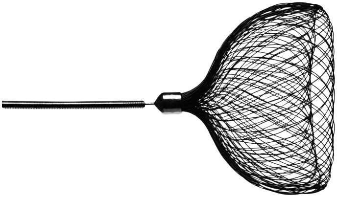
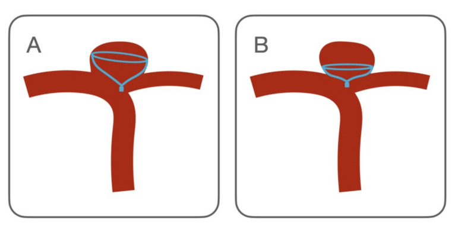
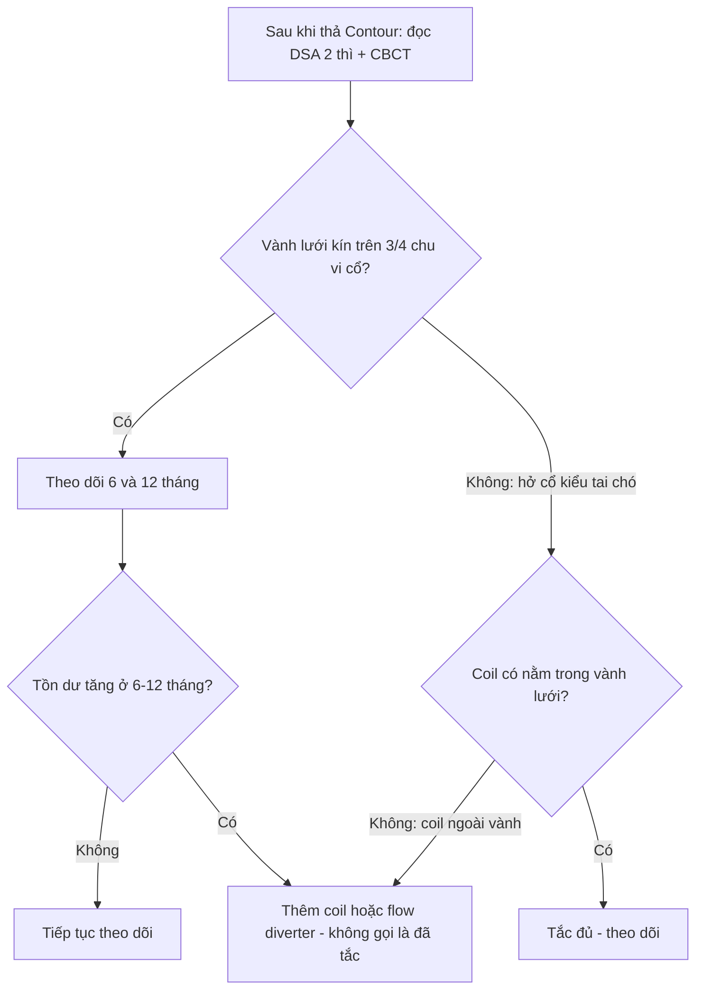
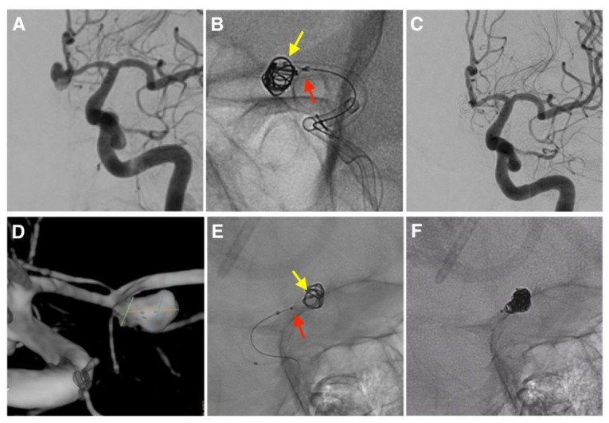
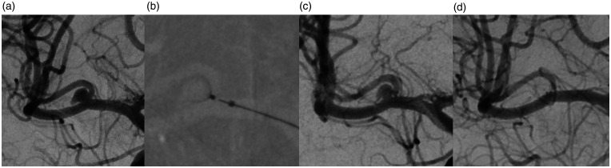

# 3091 — Coil hóa phối hợp thiết bị nội túi Contour (CoCoJaMBO): khi nào thêm coil, kỹ thuật "giam" microcatheter và biến chứng / Contour-assisted coiling (CoCoJaMBO)

**Tags:** `pattern:ton-du` `pattern:coil-trong-tui` `pattern:di-tru-thiet-bi` `pattern:di-dang-thiet-bi` `vung:nao` `vung:mach-nao` `score:Raymond-Roy` `score:BOSS` `protocol:DSA` `protocol:CBCT` `protocol:CTA-pho` `protocol:MRA`

**Mức chắc chắn (certainty):** tổng hợp y văn (literature synthesis) — ghép **loạt CoCoJaMBO 8 túi phình** (Wodarg et al. 2023, *Interv Neuroradiol*, **PMC9893242**, truy cập tự do không giấy phép mở), **loạt IFD-AC 15 túi phình có ảnh DSA** (Diana et al. 2022, *Brain Sci* 12:991, **PMC9394360**, CC BY 4.0), **phân tích gộp 192 bệnh nhân / 206 túi** (Jagtiani et al. 2026, *Interv Neuroradiol*, **PMC11571174**, CC BY 4.0), **loạt 106 bệnh nhân** (Wodarg et al. 2025, **PMC11979839**), **loạt Anh 54 bệnh nhân theo dõi 2 năm** (Islim et al. 2026, **PMC12158970**) và **so sánh Contour với coil thường 42 túi** (Mostafa et al. 2023, *Sci Rep*, **PMC10039918**, CC BY 4.0). Nhóm **không có bệnh nhân của mình**; các loạt đều **hồi cứu, cỡ mẫu nhỏ (8–15 túi)** cho riêng kỹ thuật phối hợp coil — mọi tỷ lệ dưới đây phải đọc kèm khoảng tin cậy rộng.

> **Câu chốt:** Contour là **lưới nitinol đặt ở mặt cổ** chứ không lấp đầy buồng túi, nên khi lưới **không phủ kín cổ** (tồn dư kiểu "tai chó"/dog-ear), khi thiết bị **phải chọn nhỏ hơn cổ** để không lồi vào mạch mẹ, hoặc khi túi **đã vỡ cần tắc ngay lập tức**, người ta **giam (jail) một microcatheter coil 0,017″ trong túi trước, thả Contour, rồi bơm coil và chỉ tháo thiết bị sau khi coil xong** (CoCoJaMBO). Kỹ thuật này cho **tắc hoàn toàn ngay sau thủ thuật 92,3%** trong loạt 13 ca làm được, nhưng **tái thông 16,7%** ở theo dõi giữa kỳ và có **1/15 biến cố thiếu máu (6,7%)**, **1 ca tháo thiết bị sớm**, **1 ca phải bít tạm mạch mẹ**. Cạm bẫy chết người: **coil nằm ngoài lưới, men theo thành túi** — trông như "tắc" trên DSA nhưng thực chất là **tồn dư thân**, và đây chính là nhóm tái phát.

## 1. Tổng quan bệnh học – cơ chế hình ảnh (TẠI SAO)

### 1.1 Thiết bị: một cái "chén" nitinol ở mặt cổ, không phải lưới lấp buồng túi
- **Contour Neurovascular System (CNS)** là **thiết bị rối loạn dòng nội túi (intrasaccular flow disruptor)** dạng **lưới nitinol dệt hai lớp, mỗi lớp 72 sợi (tổng 144 sợi)**, có **1 marker bạch kim** cản quang, **có thể thu hồi (retrievable)** và **tháo bằng điện phân (electrolytic detachment)**; đưa qua microcatheter **0,021″** hoặc **0,027″**.
- Khác WEB (lấp đầy buồng túi, chọn cỡ theo **chiều cao** túi), CNS **chỉ chiếm nửa dưới túi và áp mặt chén vào mặt cổ** — chọn cỡ theo **đường kính cổ và đường kính lớn nhất của thân**, không theo chiều cao. Các cỡ thường dùng **5–14 mm**.
- **TẠI SAO không cần stent:** toàn bộ kim loại nằm **trong túi**, không có vật liệu trong lòng mạch mẹ → **không cần kháng kết tập kép**; trong túi đã vỡ, loạt IFD-AC **không dùng kháng kết tập tiểu cầu** mà vẫn không có biến chứng chảy máu.
- **TẠI SAO vẫn hở cổ:** mặt chén là **một vành tròn**, còn cổ túi ngã ba thường **bầu dục, lệch tâm, có thùy phụ**. Khi vành không trùm hết chu vi cổ, phần cổ còn hở tạo **túi thừa nhỏ hình tai chó (dog-ear)** — đúng nơi dòng máu vào mạnh nhất và đúng nơi tái phát.

*Hình: cấu hình đã thả của **Contour Neurovascular System** — vành lưới áp cổ, marker bạch kim ở tâm. Thormann M et al., *Neuroradiol J* 2022 (PMC9244739), Fig. 1, **CC BY 4.0** — nguyên bản, không crop/ghép.*

### 1.2 Vì sao thêm coil lại chữa được — ba cơ chế
- **Lấp "tai chó":** coil xếp vào chỗ lưới không phủ, làm **giảm vận tốc dòng và tăng diện tích bề mặt gây huyết khối** ngay tại cổ hở. Trong loạt IFD-AC, chỉ **1/2 ca còn hở cổ** tiến triển thành tồn dư cổ và tái phát ở theo dõi giữa kỳ.
- **Ổn định thiết bị đặt thiếu cỡ:** khi phải chọn CNS nhỏ hơn cổ để **không lồi vào mạch mẹ**, chén bị **bẹp (flat configuration)** và **bám thành kém** → nguy cơ **di trú vào đáy túi**. Coil **chèn phía trên** tạo lực giữ, biến một thiết bị "lỏng" thành khối vững.
- **Tắc ngay trong túi đã vỡ:** lưới đơn thuần cần **thời gian huyết khối**; ở túi vỡ, bệnh nhân còn **ống dẫn lưu, tăng huyết áp, rối loạn đông** — cần **tắc cơ học tức thì** để không tái vỡ. Coil bổ sung đạt việc này mà **không cần kháng kết tập kép** (khác stent-assisted coiling).

### 1.3 Vật lý hình ảnh: đọc đúng "sáng" và "tối"
- **Nitinol cản quang mạnh** nhưng **có lỗ**: một lớp cản quang mỏng **len giữa các sợi** là **hiện tượng cơ học bình thường**, không phải túi còn thông. Coil đặc hơn lưới nên **khối coil sáng, đều, không hoa văn** — phân biệt được bằng **hoa văn dệt** của lưới.
- **Hiệu ứng cứng chùm tia (beam hardening)** quanh nitinol tạo **vệt tối cạnh viền sáng**; trên CBCT, **vành sáng** của chén khi nhìn tiếp tuyến dễ bị đọc thành **"vành cản quang thứ hai"** = tồn dư.
- **TẠI SAO phải chụp nhiều thì:** coil làm **tắc dòng ngay** nhưng lưới vẫn **thấm thuốc chậm** vài giây; đọc tắc ở **thì muộn** mới phân biệt được **tắc thật** với **ứ trệ trong lưới**.

### 1.4 Số liệu trụ cột (bắt buộc nhớ)

| Đại lượng | Con số | Nguồn |
|---|---|---|
| **CoCoJaMBO** — số ca | **8 bệnh nhân** (5 nữ), tuổi **60,1 ± 9,2**; **3/8 sau vỡ não**; thân túi **12,8 ± 7,6 mm**, rộng **10,3 ± 5,4 mm**, cổ **5,5 ± 2,5 mm**, **D/N 1,9 ± 1,0** | PMC9893242 |
| **CoCoJaMBO** — kết quả tức thì | **Tắc hoàn toàn 5/8**; **1 ca bít tạm mạch mẹ** (mở lại ngay); **1 ca thiết bị tháo sớm** không di chứng; không biến cố khác | PMC9893242 |
| **IFD-AC** (Contour/Neqstent + coil) | **15 túi** (10 vỡ/5 chưa vỡ); làm được **13**; **RROC 1 = 12/13 (92,3%)**, RROC 2 = 1 (7,7%) | PMC9394360 |
| **IFD-AC** — biến chứng & theo dõi | Thiếu máu **1/15 (6,7%)**, chảy máu **0**; theo dõi 12 túi: **tắc đủ 83,4%**, **tái thông 16,7%**, **1 ca phải điều trị lại bằng flow diverter** | PMC9394360 |
| **Phân tích gộp Contour** | **192 bệnh nhân / 206 túi**: tắc đủ **85%** (KTC 95% 78–90), độc lập chức năng **96%** (88–99), thời gian thủ thuật **76,15 phút** (43,5–108,8) | PMC11571174 |
| **Biến cố gộp** | Thuyên tắc **6%** (4–11), xuất huyết dưới nhện **1%**, đột quỵ nhẹ **2%**, đau đầu **1%**, **di trú thiết bị 4%** (2–9) | PMC11571174 |
| **So sánh với WEB** | WEB: tắc **83,3%**, điều trị lại **8,4%**, thuyên tắc **5,6%** — Contour **85%** và **6%**, khác biệt **không có ý nghĩa thống kê** | PMC11571174 |
| **Loạt 106 bệnh nhân / 109 túi** | Thả thành công **95,5%**; 6 tháng **RRS 1 63,4%**, RRS 2 23,1%, RRS 3a 5,8%, 3b 7,2%; 12 tháng **RRS 1 55,5%**; 24 tháng **RRS 1 70,0%** | PMC11979839 |
| **Loạt Anh 54 bệnh nhân** | 6 tháng **RROC 1 56%**, tắc đủ **88%**; 2 năm **RROC 1 60,9%**, tắc đủ **82,6%** | PMC12158970 |
| **Contour so với coil thường** (D/N ≥ 1,6; 42 túi) | Nhanh hơn (p = 0,0002) và **ít liều xạ hơn** (p = 0,002); biến chứng **33,3% (coil) vs 14,3% (Contour)**; **can thiệp lại 21,4% vs 7,6%** | PMC10039918 |

- **Điểm chết người về ngưỡng:** "tắc hoàn toàn ngay sau thủ thuật" **không** đồng nghĩa "tắc bền" — trong chính loạt IFD-AC, **92,3% tắc ngay** nhưng **16,7% tái thông** ở theo dõi; và trong phân tích gộp, **tắc đủ chỉ 85%** nghĩa là **1/7 bệnh nhân còn tồn dư đủ để phải theo dõi sát**.

## 2. Mẫu hình + chẩn đoán phân biệt theo tình huống (Gamut)

**Mẫu hình khởi điểm:** túi phình **ngã ba cổ rộng** (cổ ≥ 4 mm hoặc **D/N < 2**), đã đặt **Contour**; trên DSA sau thả còn **một túi nhỏ cản quang ở mép cổ** (dog-ear) hoặc **thân túi còn thấm thuốc thì muộn**.

- **Nhóm 1 — hở cổ có chủ đích (dog-ear):** lưới phủ **không hết chu vi cổ**; coil lấp phần hở. Đây là **chỉ định chính** của CoCoJaMBO.
- **Nhóm 2 — thiết bị thiếu cỡ để bảo vệ mạch mẹ:** chén bẹp, bám thành kém → coil **giữ thiết bị tại chỗ**, chống di trú.
- **Nhóm 3 — túi đã vỡ:** ưu tiên **tắc tức thì**, không chờ huyết khối tự nhiên; **không dùng kháng kết tập kép** nếu không có stent.
- **Nhóm 4 — túi lớn/kết hợp huyết khối một phần:** coil **lấp phần còn thông**, tránh bơm coil vào vùng huyết khối cũ (nguy cơ **di trú coil** và **thuyên tắc**).
- **Nhóm 5 — tái phát sau coil thường:** gắn thêm Contour ở cổ rồi coil bổ sung phần tồn dư — nhưng **không** thay thế được flow diverter khi cổ quá rộng.

**Gamut theo lựa chọn thay thế:** stent-assisted coiling (SAC), balloon-remodeling coiling, flow diverter (FD), WEB, và **phẫu thuật kẹp cổ** (khi túi vôi hóa, có khối máu tụ chèn ép, hoặc thất bại nội mạch nhiều lần).

## 3. Bảng so sánh phân biệt (ma trận đối chiếu)

| Thực thể (entity) | Hình ảnh điển hình | Chốt vào (rule-in) | Chốt loại (rule-out) | Gợi ý xác nhận |
|---|---|---|---|---|
| **CoCoJaMBO (Contour + coil)** | Lưới dệt hình chén áp cổ + **khối coil đặc, không hoa văn** nằm **trong** vành lưới; tồn dư cổ kiểu tai chó được lấp | **Coil nằm trong vành lưới + lưới vẫn áp sát cổ ở ≥ 3/4 chu vi** | Coil **men theo thành túi, ngoài vành lưới** → tồn dư thân, không phải "đã tắc" | DSA 2 thì + CBCT không cản quang; đối chiếu ảnh ngay sau thủ thuật với 6 tháng |
| **SAC (stent + coil)** | Stent **trong lòng mạch mẹ** + coil trong túi; cần **kháng kết tập kép** | Thấy **stent vắt qua cổ**, đầu stent ở hai bên cổ | Không thấy stent, hoặc stent **gãy/gập** → mất tác dụng giữ coil | CTA/CBCT mạch; DSA thì muộn; kiểm tra tuân thủ kháng kết tập |
| **Flow diverter (FD)** | Lưới ống **trong lòng mạch mẹ**, che cổ; tắc **chậm 3–12 tháng** | **Không còn dòng vào túi ở thì muộn**, lưới ống phủ cổ | Còn dòng vào túi ở 6 tháng → **chưa hiệu quả**, không được gọi là thất bại sớm | DSA 6–12 tháng; CTA/MRA có artifact kim loại lớn |
| **WEB** | Thiết bị nội túi **lấp đầy buồng túi**, hình trụ/cầu, chọn theo **chiều cao** | Thiết bị **chạm cả vòm và cổ**, không di trú | Thiết bị **nằm lệch đáy túi**, còn khoang trên đỉnh → chọn thiếu cỡ | CBCT; so cỡ thiết bị với chiều cao túi đo trên 3D |
| **Balloon-remodeling coiling** | Bóng **tạm thời** ở mạch mẹ trong lúc bơm coil; sau thủ thuật **không còn kim loại ở mạch mẹ** | Coil đủ đặc, **không có vật liệu trong lòng mạch mẹ** sau khi xả bóng | Bóng xì/di trú, coil lồi vào mạch mẹ | DSA sau xả bóng; kiểm tra coil protrusion trên 3D |

*Hình: ba cấu hình mà lưới Contour **không tự tắc được** và cần coil bổ sung. Diana F et al., *Brain Sci* 2022;12:991 (PMC9394360), Fig. 3, **CC BY 4.0** — nguyên bản, không crop/ghép.*

### 3.1 Ba dấu hiệu đọc ảnh quyết định (đọc theo thứ tự)
1. **Vành lưới có kín không?** Nhìn **tiếp tuyến mặt cổ** trên CBCT: vành sáng phải **liên tục**. Mất liên tục một cung = **hở cổ thật**, không phải artifact.
2. **Coil nằm trong hay ngoài vành?** Trong vành = **đúng ý đồ**; ngoài vành, men thành = **coil lạc vào tồn dư thân** — trên DSA vẫn "đặc" nhưng không có giá đỡ.
3. **Còn dòng vào thì muộn không?** Ứ trệ trong lưới vài giây là bình thường; **dòng vào túi ở ≥ 3 giây thì muộn** là còn thông.

## 4. Protocol chụp + kỹ thuật + thang điểm

### 4.1 Trước thủ thuật
- **DSA + chụp xoay 3D (3D rotational angiography)** cho **mọi** ca: đo **cổ, chiều cao, đường kính lớn nhất của thân, D/N**, chọn **working projection** và cỡ thiết bị theo **bảng cỡ của hãng (Cerus)**.
- **CTA/CTV** khi cần loại trừ **nhánh mạch mẹ** sát cổ (ngã ba MCA, ACoA) và lập kế hoạch đường vào.

### 4.2 Kỹ thuật CoCoJaMBO (theo mô tả nguyên văn của 2 loạt)
1. **Giam microcatheter coil trước:** đưa **microcatheter 0,017″ (Echelon 10)** vào túi, giữ đầu catheter trong túi.
2. **Thả Contour** qua microcatheter **0,021″** (hoặc 0,027″) tại mặt cổ, **chưa tháo**.
3. **Bơm coil** qua catheter đã giam, xếp coil vào chỗ hở cổ/thiếu cỡ; theo dõi **coil không lồi vào mạch mẹ**.
4. **Tháo thiết bị sau khi coil xong** (detachment cuối cùng) — đây là điểm khác biệt cốt lõi so với "thả thiết bị rồi mới coil".
5. **Kiểm tra:** DSA 2 thì + CBCT; nếu coil lồi vào mạch mẹ → thu hồi coil/dùng stent chuyển hướng.

- **Thuốc:** heparin **ACT 200–250 giây**; **nimodipine 15 mg** qua đường guiding; **túi chưa vỡ**: kháng kết tập đơn hoặc kép theo protocol đơn vị; **túi đã vỡ**: **không kháng kết tập** (loạt IFD-AC làm đúng như vậy, không có biến chứng chảy máu).

### 4.3 Thang điểm theo dõi
- **Raymond–Roy (RROC):** 1 = tắc hoàn toàn; 2 = tồn dư cổ; 3a = tồn dư thân, 3b = tồn dư thân + cổ. Mốc đọc: **6 tháng, 12 tháng** (và 24 tháng nếu còn tồn dư).
- **BOSS (Contour)** cho tồn dư trong lưới — xem bài 3076.
- Ngưỡng hành động thực hành: **RROC 3a/3b ở 6 tháng** hoặc **tăng kích thước tồn dư** → cân nhắc **coil bổ sung, flow diverter hoặc mổ**.

## 5. Biến thể bình thường và cạm bẫy

- **Biến thể bình thường:** **ứ trệ cản quang trong lưới** vài giây, **vành sáng đôi** của chén khi nhìn tiếp tuyến, **vệt tối do cứng chùm tia** quanh marker bạch kim — cả ba **không phải tồn dư**.
- **Cạm bẫy 1 — "tắc trên DSA" nhưng tồn dư thân:** coil đặc ở cổ che mất phần thân còn thông; phải xem **thì muộn** và **CBCT**, không kết luận trên ảnh đơn thì.
- **Cạm bẫy 2 — tháo thiết bị quá sớm:** 1/8 ca CoCoJaMBO **tháo thiết bị sớm** (không di chứng, nhưng mất cấu hình dự kiến). Tháo **sau** khi coil xong là quy tắc, không phải tùy hứng.
- **Cạm bẫy 3 — coil lạc vào mạch mẹ:** thấy **đầu coil nhô ra ngoài vành lưới** trên working projection → dừng bơm, kiểm tra 3D, cân nhắc **thu hồi coil** hoặc **stent bắt coil**; bỏ qua = thuyên tắc nhánh.
- **Cạm bẫy 4 — chọn thiết bị to để "che hết cổ":** chén **lồi vào mạch mẹ** gây hẹp/thuyên tắc; thà **thiếu cỡ + coil bổ sung** còn hơn lồi.
- **Cạm bẫy 5 — bỏ theo dõi sau khi "tắc hoàn toàn":** 16,7% tái thông trong loạt IFD-AC; **tắc ngay không miễn trừ theo dõi 6–12 tháng**.

## 6. Tự lượng giá — Blind Quiz

**Ca 1 — túi phình ngã ba, thủ thuật phối hợp**

- Gợi ý lâm sàng: túi phình ngã ba cổ rộng; bác sĩ quyết định **thả thiết bị nội túi rồi bơm coil**.
- Câu hỏi: Thiết bị nằm ở đâu so với khối coil? Dấu hiệu nào cho biết coil **đúng chỗ**? Ba chẩn đoán phân biệt của "còn cản quang ở cổ"?

<b>Bấm để hiện đáp án (findings + chẩn đoán)</b>

- Dấu hiệu: lưới (mũi tên đỏ) áp mặt cổ; **microcatheter coil bị giam** (mũi tên vàng) nằm trong túi; coil xếp **trong vành lưới**; các panel là 3 ca khác nhau của loạt IFD-AC.
- Chẩn đoán: **CoCoJaMBO/IFD-AC** — thiết bị giữ cổ, coil lấp phần hở. Cơ chế: coil trong vành lưới làm tăng diện tích bề mặt và giảm vận tốc tại cổ hở.
- Nguồn ảnh: Diana F et al., *Brain Sci* 2022;12:991 (PMC9394360), Fig. 1, **CC BY 4.0**.

**Ca 2 — Contour ở túi phình ngã ba MCA**

- Gợi ý lâm sàng: túi phình MCA ngã ba, cổ rộng, chưa vỡ.
- Câu hỏi: Thiết bị có phủ kín cổ chưa? Nếu còn hở một cung ở mép cổ, làm gì tiếp và vì sao?

<b>Bấm để hiện đáp án (findings + chẩn đoán)</b>

- Dấu hiệu: (a) DSA trước — túi phình ngã ba MCA; các panel sau là cấu hình thiết bị đã thả, mặt chén áp cổ.
- Chẩn đoán: **Contour đơn thuần**; nếu còn hở cổ kiểu dog-ear → **coil bổ sung (CoCoJaMBO)** thay vì thả thêm thiết bị.
- Nguồn ảnh: Thormann M et al., *Neuroradiol J* 2022 (PMC9244739), Fig. 2, **CC BY 4.0**.

**Ca 3 — cấu hình thiết bị và quyết định thêm coil**

- Gợi ý lâm sàng: ba bệnh nhân khác nhau, mỗi người một cấu hình thiết bị–túi.
- Câu hỏi: Cấu hình nào **bắt buộc** thêm coil? Cấu hình nào chỉ **cân nhắc**? Dấu hiệu nào trên CBCT phân biệt "thiếu cỡ" với "đặt sai vị trí"?

<b>Bấm để hiện đáp án (findings + chẩn đoán)</b>

- Dấu hiệu: (A) lưới **không phủ hết cổ**, còn túi thừa mép cổ; (B) thiết bị **bẹp, bám thành kém** do chọn nhỏ để tránh lồi vào mạch mẹ; (C) cấu hình phức tạp/túi lớn.
- Chẩn đoán: **(A) và (B) là chỉ định rõ của coil bổ sung**; (C) tùy dòng còn lại và nguy cơ. Phân biệt: **thiếu cỡ** = vành lưới liên tục nhưng **không áp sát thành**; **đặt sai** = vành lưới lệch hẳn về một phía cổ.
- Nguồn ảnh: Diana F et al., *Brain Sci* 2022;12:991 (PMC9394360), Fig. 3, **CC BY 4.0**.

## Bài liên quan chéo
- [3076 — Theo dõi sau Contour: thang BOSS, di trú và "vòng sáng" của lưới](../3076-theo-doi-sau-contour-noi-tui/lesson.md)
- [266 — Theo dõi sau đặt WEB túi phình](../266-theo-doi-sau-web-tui-phinh/lesson.md)
- [257 — Theo dõi tái phát sau can thiệp túi phình](../257-theo-doi-tai-phat-sau-can-thiep-tui-phinh/lesson.md)

> Không dùng để chẩn đoán độc lập khi chưa có người hướng dẫn.
