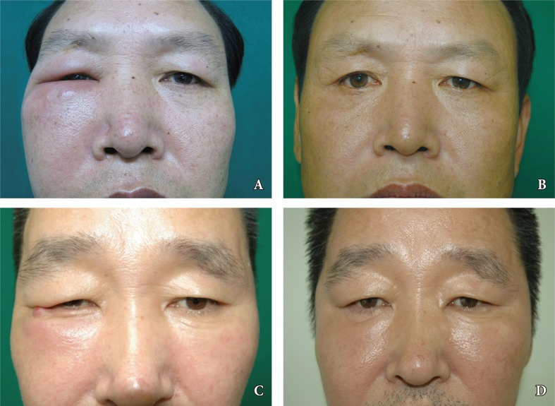
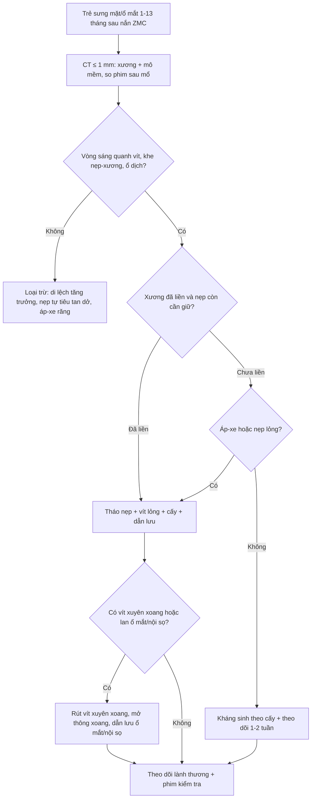
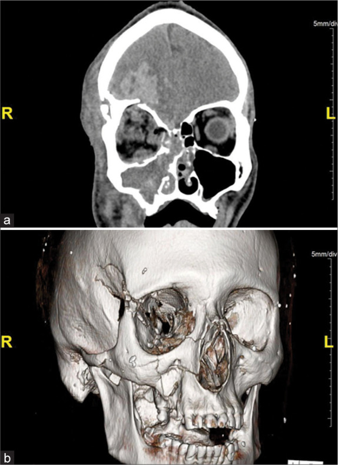

# 3092 — Nhiễm trùng mảnh ghép (nẹp–vít) sau nắn cố định gò má–hàm trên ở trẻ: sưng mặt muộn không phải "sưng sau mổ"

**Tags:** `pattern:nhiem-manh-ghep` `pattern:sung-mat-muon` `pattern:xoang-ham-day-thanh` `pattern:loet-vet-mo` `pattern:hoai-tu-xuong` `vung:go-ma` `vung:so-mat` `vung:hoc-mat` `vung:xoang-ham` `protocol:CT-lat-mong` `protocol:CT-co-can-quang` `protocol:MRI-hoc-mat` `score:ty-le-thao-nep` `incidentaloma:khong`
**Mức chắc chắn (certainty):** tổng hợp y văn (literature synthesis) — ghép **tổng quan + 2 ca nguyên văn nhiễm nẹp tự tiêu sau nắn gò má** (*Arch Craniofac Surg* 2016, PMCID **PMC5556715**, CC BY-NC), **ca nguyên văn áp-xe nội sọ sau gãy trần ổ mắt + ổ răng** (*Surg Neurol Int* 2022, PMCID **PMC9699880**, CC BY-NC-SA), **phân tích gộp 54 nghiên cứu/562 trẻ gãy ổ mắt** (*Craniomaxillofac Trauma Reconstr* 2026, PMCID **PMC13024892**, CC BY), **loạt 109 ca nắn–cố định xương mặt** (*J West Afr Coll Surg* 2026, PMCID **PMC13362880**, CC BY-NC-SA), **2 loạt tháo nẹp lớn** (*Med Pharm Rep* 2019, PMCID **PMC6853036**, CC BY-NC-ND; *Front Dent* 2020, PMCID **PMC7882199**, CC BY-NC; *J Korean Assoc Oral Maxillofac Surg* 2016, PMCID **PMC5009191**, CC BY-NC). Không có ca do nhóm tự chụp.

> **Câu chốt:** trẻ gãy gò má–hàm trên (ZMC) được nắn–cố định bằng nẹp, **2–13 tháng sau** xuất hiện **sưng một bên mặt/ổ mắt, đau âm ỉ, đôi khi chảy mủ qua đường miệng hoặc mí**. Đây **không phải "sưng hậu phẫu"** — đó là **nhiễm mảnh ghép (hardware infection)**, và câu hỏi quyết định không phải "kháng sinh gì" mà là **"nẹp đã vững xương chưa để tháo, và có thông với xoang hàm không"**. Tỷ lệ nhiễm nẹp tự tiêu **< 5%**, nẹp titanium khoảng **2,3–12%** tuỳ loạt; **45% ca tháo nẹp vì nhiễm** và **45% tháo trong năm đầu** (PMC5556715, PMC6853036).

## 1. Tổng quan bệnh học – cơ chế hình ảnh (TẠI SAO)

### 1.1. Vì sao mảnh ghép lại nhiễm — và vì sao trẻ khác người lớn

- **Màng sinh học (biofilm):** vi khuẩn bám vào bề mặt titanium/polymer trong vài giờ, tiết ma trận polysaccharide; **kháng sinh không diệt được vi khuẩn trong biofilm** ở nồng độ đạt được trong máu. Vì vậy **nhiễm muộn, âm ỉ, tái phát sau khi ngừng kháng sinh** là đặc trưng — khác **áp-xe cấp** sau mổ vài ngày.
- **Vi chuyển động (micromotion):** vít lỏng → nẹp "thở" theo nhai/nuốt → **tiêu xương quanh vít (periprosthetic osteolysis)** → **vòng sáng quanh vít trên CT** là dấu hiệu sớm nhất của nhiễm mảnh ghép.
- **Đường vào từ xoang hàm:** nẹp nằm trên **thành trước xoang hàm**; **vít xuyên vào lòng xoang** tạo đường thông trực tiếp từ **niêm mạc xoang viêm** ra mảnh ghép. Đây là lý do **viêm xoang hàm trước mổ là yếu tố nguy cơ** và **vít ngắn < 4 mm** được khuyến cáo ở xoang hàm (PMC5556715).
- **Vì sao trẻ khác người lớn:**
  - **Xương mỏng, mầm răng và thân răng sữa/vĩnh viễn sát nẹp** → nẹp có thể **xuyên vào mầm răng**, gây nhiễm khuẩn từ **ổ răng** (đúng cơ chế ca áp-xe nội sọ dưới đây: **ổ răng + gãy trần ổ mắt** — PMC9699880).
  - **Xương trẻ lành nhanh** → nẹp chỉ cần giữ **3–6 tuần**; **tháo sớm an toàn hơn** người lớn khi đã có biến chứng.
  - **Xương đang lớn** → nẹp có thể **di lệch tương đối theo thời gian** (growth-related migration), **không phải nhiễm**, nhưng **cùng biểu hiện sưng/cộm** — đây là cạm bẫy lớn nhất khi đọc ảnh ở trẻ.
  - **Nẹp tự tiêu (absorbable, PLLA/PDLLA/PGA)** tan trong **9 tháng – 3 năm**, giữ lực **3–4 tháng**, **yếu đi sau 4 tháng**; **mảnh polymer phân huỷ dở** gây **viêm mạn + nhiễm muộn** — ca 48 tuổi trong bài sưng mặt **13 tháng** sau nắn ZMC bằng nẹp tự tiêu (PMC5556715). Với trẻ, **nhiễm nẹp tự tiêu 0/44 ca** trong một loạt nhi nhưng **mảnh tan dở vẫn có thể phải lấy ra** (PMC5556715 dẫn loạt nhi).

### 1.2. TẠI SAO CT là chuẩn — vật lý của xương, kim loại và mủ

| Tổn thương | Vật lý – cơ chế | Dấu hiệu cần tìm |
|---|---|---|
| **Tiêu xương quanh vít** | Mô xương mất khoáng quanh vít → ít mô cản tia → **giảm HU** | **Vòng sáng (lucency) ≥ 1 mm quanh thân vít**, bờ không đều; so với vít bên cạnh |
| **Nẹp lỏng / di lệch** | Mất cố định | **Khe giữa nẹp và xương ≥ 1 mm**, nẹp **nghiêng/xoay** so với phim ngay sau mổ; **gãy vít** |
| **Viêm xương (osteomyelitis)** | Phù tủy + tiêu xương + phản ứng màng xương | **Phản ứng màng xương (periosteal reaction)**, dày xương, **ổ tiêu xương (sequestrum)**, **mảnh xương chết**; trên MRI **phù tủy T2/STIR tăng**, ngấm thuốc |
| **Áp-xe mô mềm / dưới màng xương** | Ổ dịch giàu tế bào, hoại tử | **Ổ giảm tỷ trọng bờ ngấm thuốc**, dày cân; **khí trong ổ** nếu vi khuẩn sinh hơi; **DWI hạn chế mạnh** (ADC rất thấp) |
| **Thông xoang hàm–mảnh ghép** | Niêm mạc xoang viêm + vít xuyên thành xoang | **Dày niêm mạc xoang > 2 mm**, **mức dịch**, **vít nhô vào lòng xoang**, **khuyết thành xương** quanh vít |
| **Lan vào ổ mắt / nội sọ** | Nhiễm theo đường giải phẫu (trần ổ mắt, xoang sàng) | **Ổ dịch trong nón cơ / ngoài nón**, **mờ mỡ hốc mắt**, **tụ dịch ngoài màng cứng**, mờ xoang; trên MRI **ngấm thuốc màng não** |

- **Kim loại gây giả ảnh (artifact):** nẹp titanium **ít giả ảnh hơn** thép không gỉ, nhưng vẫn gây **vệt sáng/tối (streak)** trên CT và **vùng mất tín hiệu** trên MRI. Cách đọc: **cửa sổ xương (WW 2.000–4.000/WL 400–600)**, **lát mỏng ≤ 1 mm**, **tái tạo đa bình diện (MPR)**; đánh giá mô mềm **trước** khi đặt nẹp hoặc bằng **MRI** khi CT bị nhiễu.
- **TẠI SAO nhiễm muộn lại "âm thầm" trên phim:** tổn thương bắt đầu bằng **tiêu xương quanh vít và viêm màng xương** — chỉ **vài mm**, dễ bị đọc là "không thay đổi so với phim cũ". Vì vậy **bắt buộc so phim ngay sau mổ** và **đo vòng sáng quanh vít bằng mm**.

### 1.3. Ngưỡng định lượng nằm lòng

| Đại lượng | Số liệu | Nguồn |
|---|---|---|
| Nhiễm nẹp tự tiêu sau cố định xương mặt (đa số loạt) | **< 5%** | PMC5556715 |
| Nhiễm nẹp tự tiêu trong **59 ca ZMC** | **1 ca** | PMC5556715 (dẫn Bell & Kindsfater) |
| Nhiễm nẹp tự tiêu ở **44 ca trẻ** | **0 ca** | PMC5556715 |
| Nhiễm nẹp ở xương hàm dưới: tự tiêu vs titanium | **4,26% (2/47)** vs **2,27% (1/44)** | PMC5556715 |
| Tháo nẹp: titanium vs tự tiêu | **12%** vs **2–3%** | PMC5556715 |
| Tỷ lệ tháo nẹp chung ở xương mặt | **7% – 33,8%** | PMC6853036 |
| Tháo nẹp trong loạt 1.026 ca nẹp hàm mặt | **9,16%**; **nhiễm và lộ nẹp là lý do thường gặp nhất** | PMC7882199 |
| Tháo nẹp trong loạt 530 ca chấn thương hàm mặt | **22,6%**, trong đó **81,7% do bệnh nhân yêu cầu** | PMC5009191 |
| Tháo nẹp trong 109 ca nắn–cố định (Nigeria) | **2,8% (3/109)**; 1 ca **nhiễm + nẹp di lệch**, 1 ca **trẻ — lo ngại ảnh hưởng tăng trưởng** | PMC13362880 |
| **Nhiễm là lý do tháo nẹp** | **45% (9/20)** | PMC6853036 |
| Thời điểm tháo nẹp | **45% trong năm đầu** (15% < 3 tháng; 15% 3–6 tháng; 15% 6–12 tháng); **30% sau 2 năm** | PMC6853036 |
| Biến chứng vật liệu tái tạo ổ mắt ở **562 trẻ/563 mảnh ghép** | nhiễm/tháo vật liệu/quay lại phòng mổ **1–4%** ở mọi nhóm | PMC13024892 |
| Nẹp tự tiêu: thời gian tan / giữ lực | **9 tháng – 3 năm** / **3–4 tháng** (yếu sau 4 tháng) | PMC5556715 |
| Vít ở thành xoang hàm | khuyến cáo **< 4 mm** để không xuyên vào xoang | PMC5556715 |

- **Chưa rõ — cần tra:** không có **thang điểm hình ảnh** được thẩm định cho nhiễm mảnh ghép xương mặt; mọi ngưỡng mm ở mục 1.2 là **tổng hợp mô tả hình ảnh**, không phải tiêu chuẩn chẩn đoán.

## 2. Mẫu hình + chẩn đoán phân biệt theo vị trí (Gamut)

- **Theo vị trí — nẹp ở đâu, biến chứng ở đó:**
  - **Thành trước xoang hàm / trụ gò má–hàm trên:** sưng má, đau khi nhai, **chảy mủ qua lợi/rãnh tiền đình**; hay kèm **viêm xoang hàm**.
  - **Bờ dưới ổ mắt / sàn ổ mắt:** **sưng mí dưới, đỏ**, có thể **lồi mắt/nhìn đôi** nếu áp-xe trong ổ mắt; nẹp/mesh gần **mí** dễ **lộ (exposure)**.
  - **Cung gò má – khớp trán–gò má:** sưng vùng thái dương, **cộm da**, đau khi há miệng; nẹp nông dưới da dễ **lộ** ở trẻ gầy.
  - **Nẹp xuyên mầm răng / ổ răng:** **áp-xe quanh răng sữa**, có thể lan **xoang hàm → hốc mắt → nội sọ** (ca PMC9699880: **gãy trần ổ mắt + áp-xe răng → áp-xe trán**).
- **Theo thời gian — "sưng" ở tuần 1 khác "sưng" ở tháng 6:**
  - **< 1 tháng:** nhiễm vết mổ cấp, tụ máu nhiễm, **dehiscence**; thường **không cần tháo nẹp** nếu nẹp vững.
  - **1–6 tháng:** nhiễm biofilm, **lộ nẹp**, **lỏng vít**, **viêm xoang quanh vít** — đây là **cửa sổ phổ biến nhất** (45% tháo nẹp trong năm đầu — PMC6853036).
  - **> 6 tháng – vài năm:** **viêm xương mạn**, **mảnh nẹp tự tiêu tan dở**, **di lệch theo tăng trưởng**; ca 13 tháng và 6 tháng trong PMC5556715.
- **Gamut "sưng mặt muộn sau nắn ZMC":** **nhiễm mảnh ghép** · **áp-xe răng/mầm răng** · **viêm xoang hàm** · **tụ máu tổ chức hoá** · **lộ vật liệu không nhiễm** · **di lệch theo tăng trưởng** · **tái phát u** (hiếm nhưng phải nghĩ nếu không có chấn thương) · **rò dịch não tuỷ** (nếu kèm gãy trần ổ mắt).

## 3. Bảng so sánh phân biệt (ma trận đối chiếu)

| Thực thể (entity) | Hình ảnh điển hình (CT/MRI) | Chốt vào (rule-in) | Chốt loại (rule-out) | Gợi ý xác nhận |
|---|---|---|---|---|
| **Nhiễm mảnh ghép (biofilm)** | **Vòng sáng quanh vít**, khe nẹp–xương, **dày mô mềm khu trú**, ổ dịch bờ ngấm thuốc | **Sưng/đau muộn + vít lỏng trên CT + mủ khi mở**; cấy **S. aureus / tụ cầu da / liên cầu miệng / vi khuẩn kỵ khí** | Nẹp **vững, không vòng sáng, không ổ dịch** → không phải nhiễm mảnh ghép | CT lát ≤ 1 mm + so phim sau mổ; cấy mủ + **siêu âm dịch**; thử kháng sinh ngắn |
| **Áp-xe do răng/mầm răng** | **Ổ tiêu xương quanh chân răng sữa**, mờ xoang hàm cùng bên, có thể **khí** | **Sâu răng/sưng lợi + ổ quanh chóp**; đau khi gõ răng | Nẹp **không liên quan răng**, không ổ quanh chóp → nghĩ mảnh ghép | Phim quanh chóp/CBCT; nhổ răng sữa/điều trị tủy, dẫn lưu |
| **Viêm xoang hàm quanh vít** | **Dày niêm mạc xoang > 2 mm**, mức dịch, **vít nhô vào lòng xoang** | **Chảy mủ mũi cùng bên + đau vùng má**, hình ảnh xoang tương ứng **đúng vị trí vít** | Niêm mạc xoang **< 2 mm**, không vít xuyên thành → không do nẹp | Nội soi mũi xoang, CT xoang; **rút vít xuyên xoang + mở thông** nếu tái diễn |
| **Viêm xương hàm (osteomyelitis)** | **Phản ứng màng xương**, **sequestrum**, tiêu xương lan, phù tủy T2/STIR | **Đau sâu + sốt + mủ xương + hình ảnh phá xương** | Xương **nguyên vẹn, chỉ vòng sáng quanh vít** → nhiễm mảnh ghép đơn thuần | CT + MRI; cấy xương; kháng sinh dài (**4–6 tuần**), cắt lọc |
| **Lộ vật liệu không nhiễm** | Nẹp nhô qua niêm mạc/da, **mô mềm quanh mỏng nhưng không ổ dịch** | **Thấy nẹp, không mủ, không đau, không vòng sáng** | **Có mủ/đau/vòng sáng** → nhiễm, không phải lộ đơn thuần | Khám + CT; **cắt bỏ nẹp nông** nếu cọ sát, theo dõi |
| **Mảnh nẹp tự tiêu tan dở** | **Nốt/tổ chức không đồng nhất quanh vị trí nẹp**, có thể **viền ngấm thuốc**, không có kim loại | **Tiền sử nẹp tự tiêu + sưng 6–13 tháng + mảnh polymer khi lấy ra** | Có **kim loại trên CT** → không phải nẹp tự tiêu | MRI (tránh giả ảnh), siêu âm; lấy mảnh nếu có triệu chứng |
| **Di lệch theo tăng trưởng** | Nẹp **di chuyển so với phim cũ** nhưng **không vòng sáng, không ổ dịch**, xương lành | **Trẻ đang lớn + cộm da, không viêm**; xương đã liền | **Đau/mủ/vòng sáng** → nhiễm, không phải di lệch | So phim chuỗi; tháo nẹp theo kế hoạch nếu cộm/lệch |

*Hai ca **người lớn** (48 tuổi — A/B; 45 tuổi — C/D) sau nắn gò má và sàn ổ mắt bằng **nẹp tự tiêu**: (A) sưng má phải **13 tháng** sau mổ; (C) sưng đỏ vùng ổ mắt phải **6 tháng** sau mổ; (B, D) hết sưng sau khi **lấy mảnh nẹp–vít phân huỷ dở**. Ảnh nguyên bản, không crop. Nguồn: *Arch Craniofac Surg* 2016, PMCID PMC5556715, CC BY-NC 3.0.*

## 4. Protocol chụp + phân tầng xử trí

### 4.1. Protocol hình ảnh

1. **CT sọ–mặt không cản quang, lát ≤ 1 mm, cửa sổ xương + cửa sổ mô mềm, tái tạo đa bình diện** — đây là **chuẩn** để đo vòng sáng quanh vít, khe nẹp–xương, niêm mạc xoang, và phát hiện **sequestrum**. **Bắt buộc so với CT ngay sau mổ** (cùng máy nếu được) để phát hiện **thay đổi ≥ 1 mm**.
2. **CT có cản quang** khi nghi **áp-xe mô mềm, viêm xoang biến chứng, hoặc lan ổ mắt**: tìm **ổ dịch bờ ngấm thuốc**, **dày cân**, **huyết khối xoang hang** (nếu lồi mắt + sốt cao).
3. **MRI hốc mắt – hàm mặt (T1, T2 fat-sat, DWI, T1 sau tiêm)** khi: **lồi mắt, nhìn đôi, giảm thị lực**, nghi **lan nội sọ**, hoặc CT bị **giả ảnh kim loại** nhiều. **Giá trị:** phân biệt **phù/viêm mô mềm – áp-xe (DWI hạn chế mạnh)** – **viêm tủy xương (phù tủy T2 tăng)**.
4. **Siêu âm đầu dò thẳng tần số cao** ở vùng má/mí: phát hiện **ổ dịch dưới màng xương**, hướng dẫn **chọc hút cấy** — rẻ, không bức xạ, làm được tại giường.
5. **Phim quanh chóp/CBCT răng** khi ổ nhiễm **gần mầm răng/răng sữa** — ổ răng là nguồn nhiễm thường bị bỏ sót (ca PMC9699880).

### 4.2. Phân tầng xử trí (không có thang điểm — dựa trên 3 câu hỏi)

- **Câu 1 — Xương đã liền chưa?** Trẻ thường liền sau **3–6 tuần** với nẹp đúng; nếu **đã liền** → **tháo nẹp là an toàn** và là **điều trị triệt để** nhiễm biofilm.
- **Câu 2 — Có ổ mủ/áp-xe hoặc nẹp lỏng?** Có → **mở dẫn lưu + tháo nẹp/vít lỏng + cấy**; để lại nẹp lỏng là **nguồn tái phát**.
- **Câu 3 — Có thông xoang hàm hoặc lan ổ mắt/nội sọ?** Có → **phối hợp TMH/nhãn khoa/ngoại thần kinh**: **rút vít xuyên xoang, mở thông xoang hàm**, dẫn lưu ổ mắt/nội sọ; **không chờ kháng sinh đơn thuần**.

| Mức độ | Hình ảnh – lâm sàng | Xử trí | Kháng sinh |
|---|---|---|---|
| **Nhiễm nông vết mổ** | Đỏ, chảy dịch, **không ổ dịch sâu**, nẹp vững | Mở da/niêm mạc, dẫn lưu, giữ nẹp | **1–2 tuần** kháng sinh theo cấy (kinh nghiệm: kháng tụ cầu) |
| **Nhiễm sâu / áp-xe quanh nẹp** | **Ổ dịch ngấm thuốc**, vòng sáng quanh vít, mủ | **Tháo nẹp/vít lỏng**, cắt lọc mô hoại tử, dẫn lưu | **2–4 tuần**, theo cấy |
| **Viêm xương** | **Sequestrum**, phản ứng màng xương, phá xương | **Cắt lọc xương chết**, tháo nẹp, **tái tạo sau** | **4–6 tuần** (khởi đầu tĩnh mạch) |
| **Thông xoang / viêm xoang quanh vít** | Dày niêm mạc > 2 mm, vít trong lòng xoang | **Rút vít + mở thông xoang hàm** (FESS); tháo nẹp nếu tái diễn | 2–4 tuần + điều trị TMH |
| **Lan ổ mắt / nội sọ** | Ổ dịch hốc mắt, tụ dịch ngoài màng cứng, viêm màng não | **Dẫn lưu cấp + tháo vật liệu**, phối hợp đa chuyên khoa | Kháng sinh tĩnh mạch dài, theo cấy |

## 5. Biến thể bình thường và cạm bẫy

- **"Nẹp tự tiêu thì không nhiễm":** sai. Nẹp tự tiêu **tan dở** gây **viêm mạn + nhiễm muộn tới 13 tháng** (PMC5556715); trên CT **không thấy kim loại** nên rất dễ bỏ qua — phải **hỏi loại nẹp đã dùng**.
- **Sưng sau mổ "bình thường":** phù mô mềm sau nắn ZMC giảm dần trong **2–4 tuần**; **sưng tăng lại hoặc xuất hiện sau 6 tuần** là **bất thường**, không phải "phù kéo dài".
- **Di lệch theo tăng trưởng ≠ nhiễm:** trẻ lớn, nẹp **di chuyển** nhưng **không vòng sáng, không mủ, không đau** → **tháo theo kế hoạch** nếu cộm; **không dùng kháng sinh dài**.
- **Bẫy kim loại trên CT:** giả ảnh **streak** quanh nẹp có thể **che mất vòng sáng 1 mm**; đổi cửa sổ, **MPR**, hoặc **MRI** khi cần. Đừng kết luận "không tiêu xương" trên ảnh nhiễu.
- **Bẫy "chỉ đau, không sưng":** đau khi nhai + **vít lỏng** có thể là **biểu hiện sớm nhất** — tương tự 30% ca tháo nẹp vì **đau không có dấu nhiễm** (PMC6853036); ở trẻ **không được bỏ qua đau tăng dần** sau 3 tháng.
- **Bẫy ổ răng:** trẻ gãy ZMC kèm **răng sữa sâu/tổn thương** — ổ nhiễm từ răng có thể **lan xoang → hốc mắt → nội sọ** dù nẹp vững (ca PMC9699880: **áp-xe trán** sau chấn thương mặt + **áp-xe răng**, có **rách màng não ở trần ổ mắt**).
- **Bẫy satisfaction of search:** đã thấy nẹp lỏng thì vẫn phải **soát xoang hàm, hốc mắt, nội sọ và mầm răng** — bỏ sót ổ thứ hai là sai lầm hay gặp.

*Ca **người lớn 40 tuổi** (minh hoạ cơ chế lan nhiễm, không phải trẻ): (a) CT coronal không cản quang — **đám giảm tỷ trọng/đậm độ hỗn hợp ở thuỳ trán phải** tại vị trí gãy trần ổ mắt, kèm mờ các xoang cùng bên; (b) tái tạo 3D — **gãy phức tạp xương mặt phải** gồm trần ổ mắt. Ổ nhiễm đường vào từ **áp-xe răng**. Ảnh nguyên bản, không crop. Nguồn: *Surg Neurol Int* 2022, PMCID PMC9699880, CC BY-NC-SA 4.0.*

## 6. Tự lượng giá — Blind Quiz

**Ca 1 — Bé trai 13 tuổi, ngã xe đạp gãy ZMC phải, được nắn–cố định bằng nẹp 4 tháng trước. Nay sưng má phải tăng dần 2 tuần, đau khi nhai, không sốt.**

- Hỏi: (1) 3 chẩn đoán phân biệt cho sưng muộn; (2) trên CT bạn đo những gì; (3) khi nào phải tháo nẹp?

<b>Bấm để hiện đáp án (findings + chẩn đoán)</b>

- **Ảnh minh hoạ (người lớn, không phải bệnh nhi):** sưng má/ổ mắt một bên xuất hiện **6–13 tháng** sau nắn bằng nẹp tự tiêu, hết sau khi lấy mảnh nẹp phân huỷ dở.
- **Phân biệt:** **nhiễm mảnh ghép** (vòng sáng quanh vít, khe nẹp–xương), **áp-xe răng/mầm răng**, **viêm xoang hàm quanh vít**, **di lệch theo tăng trưởng**, **mảnh nẹp tự tiêu tan dở**.
- **Đo trên CT:** vòng sáng quanh vít (mm), khe nẹp–xương (mm), dày niêm mạc xoang (ngưỡng **> 2 mm**), vít có nhô vào lòng xoang, ổ dịch/khí, phản ứng màng xương.
- **Tháo nẹp khi:** xương **đã liền** + có **áp-xe/nẹp lỏng/lộ nẹp/viêm xoang tái diễn**; **không tháo** khi nẹp vững, chỉ nhiễm nông.
- Nguồn ảnh: *Arch Craniofac Surg* 2016, PMCID PMC5556715, CC BY-NC 3.0 (nguyên bản).

**Ca 2 — Bé 9 tuổi, chấn thương mặt 3 tuần trước (gãy trần ổ mắt + xoang hàm), nay sốt, sưng mí trên, đau đầu; khám thấy răng sữa sâu, lợi sưng.**

- Hỏi: đường lan nhiễm khả dĩ? Dấu hiệu nào trên ảnh buộc phải tầm soát nội sọ?

<b>Bấm để hiện đáp án</b>

- **Đường lan:** **áp-xe răng → xoang hàm → trần ổ mắt gãy → nội sọ** (hoặc qua tĩnh mạch không van vùng mặt).
- **Dấu hiệu báo động:** **đám giảm tỷ trọng/đậm độ hỗn hợp ở thuỳ trán** cùng bên với gãy trần ổ mắt; **mờ xoang cùng bên**; trên MRI **ổ hạn chế khuếch tán mạnh** = áp-xe.
- **Xử trí:** **CT/MRI não + hốc mắt**, kháng sinh tĩnh mạch, **dẫn lưu áp-xe + xử lý ổ răng**, phối hợp ngoại thần kinh; **không chỉ điều trị "viêm xoang"**.
- Nguồn ảnh: *Surg Neurol Int* 2022, PMCID PMC9699880, CC BY-NC-SA 4.0 (nguyên bản).

**Ca 3 — Bé 11 tuổi, nắn ZMC 8 tháng trước, nay **cộm da vùng gò má**, không đau, không mủ; CT: nẹp di chuyển 3 mm so với phim cũ nhưng **không vòng sáng quanh vít**.**

<b>Bấm để hiện đáp án</b>

- **Chẩn đoán:** **di lệch nẹp theo tăng trưởng**, không phải nhiễm.
- **Vì sao:** xương đã liền, không phản ứng tiêu xương/viêm; nẹp nông dưới da ở trẻ đang lớn.
- **Xử trí:** **tháo nẹp theo kế hoạch** (thủ thuật nhỏ) nếu cộm/ảnh hưởng thẩm mỹ; **không kháng sinh dài**, không dẫn lưu.
- **Cạm bẫy:** nếu chỉ đọc "nẹp di lệch" mà bỏ qua **thiếu vòng sáng + không mủ** sẽ điều trị nhiễm oan; ngược lại, nếu có **vòng sáng + đau** thì đó là nhiễm, không phải tăng trưởng.

## Bài liên quan chéo
- [1716 – Gãy phức hợp gò má–hàm trên ở trẻ](../1716-gay-phuc-hop-go-ma-ham-tren-o-tre/lesson.md)
- [1708 – Gãy lồi cầu xương hàm dưới ở trẻ](../1708-gay-loi-cau-xuong-ham-duoi-o-tre/lesson.md)
- [1918 – Nhiễm CMV sau ghép gan ở trẻ](../1918-nhiem-cmv-sau-ghep-gan-o-tre/lesson.md) (nguyên tắc "ổ nhiễm thứ hai" ở trẻ có can thiệp)
- [249 – Rò động mạch cảnh–xoang hang do chấn thương](../249-ro-dong-mach-canh-xoang-hang-chan-thuong/lesson.md) (biến chứng mạch cần loại trừ khi có lồi mắt + tiếng thổi)

## Ảnh
- `3092_nhiem-mang-ghep_clinical-absorbable_PMC5556715-F1.jpg` — 2 ca sưng muộn sau nẹp tự tiêu; *Arch Craniofac Surg* 2016, PMCID PMC5556715, CC BY-NC 3.0.
- `3092_nhiem-mang-ghep_CT-abscess_PMC9699880-F1.jpg` — CT coronal + 3D gãy xương mặt kèm áp-xe nội sọ; *Surg Neurol Int* 2022, PMCID PMC9699880, CC BY-NC-SA 4.0.
- Chi tiết nguồn, giấy phép, phái sinh: `images/CREDITS.md`; link bài gốc: `sources.md`.

> Không dùng để chẩn đoán độc lập khi chưa có người hướng dẫn.
