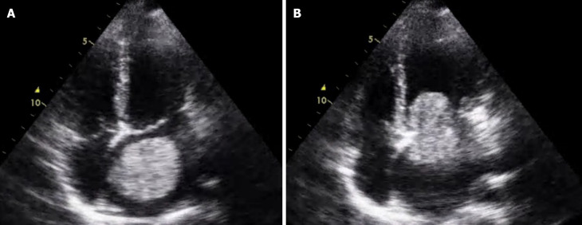
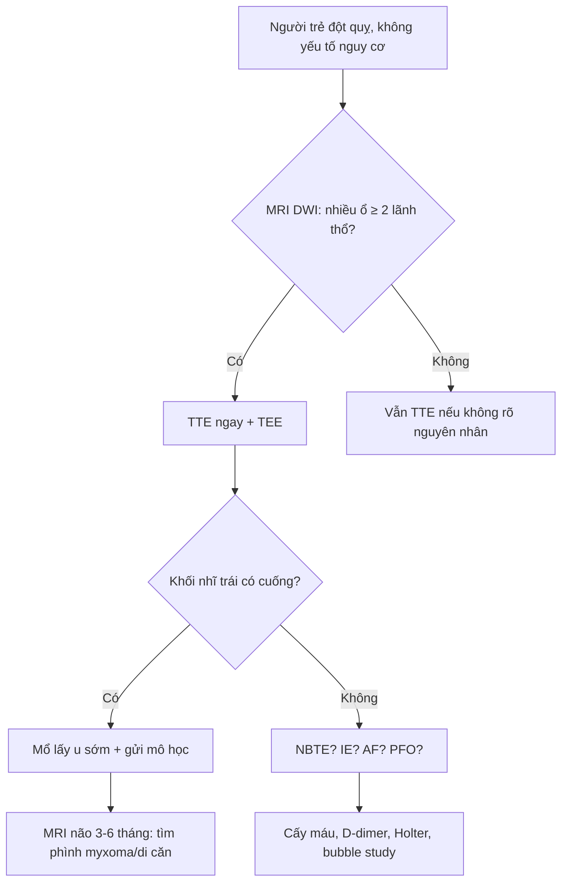
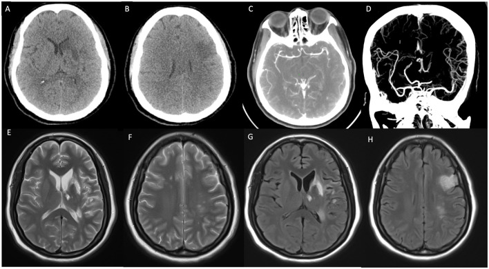
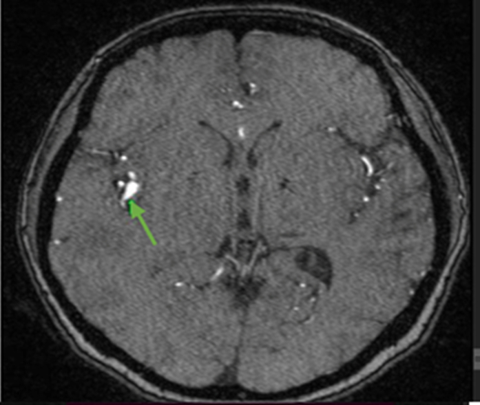

# 3093 — Nhồi máu não do u nhầy tim: nhiều ổ, túi phình myxoma & khi nào mổ tim / Cardiac myxoma stroke

**Tags:** `pattern:nhoi-mau-nao` `pattern:nhieu-o` `pattern:khong-dong-nhat` `vung:nao` `vung:tim` `score:TOAST` `protocol:MRI-DWI` `protocol:TEE` `protocol:CTA-mach-nao` `incidentaloma:khong`

**Mức chắc chắn (certainty):** tổng hợp y văn (literature synthesis) — **1 tổng quan cơ chế/điều trị** (*World J Cardiol* 2025, PMC12754060, CC BY-NC), **1 đoàn hệ 52 bệnh nhân u nhầy tim (13 ca biến cố mạch máu não)** (*Front Neurol* 2018, PMC6178925, CC BY), **2 phân tích gộp về tiêu sợi huyết và lấy huyết khối** (PMC9133336 và PMC9058073, CC BY), **1 loạt 41 ca** (PMC5818936, CC BY) và **4 ca nguyên văn có ảnh** (PMC13637264 CC BY; PMC11693650 CC BY; PMC12948571 CC BY-NC-ND; PMC12754060 CC BY-NC). Nhóm **không có bệnh nhân của mình**; chỗ nguồn lệch nhau (tỉ lệ thuyên tắc, thời điểm mổ) được ghi rõ là **mâu thuẫn nguồn**.

> **Câu chốt:** u nhầy tim (cardiac myxoma, CM) là **nguồn thuyên tắc tim phải được nghĩ tới ở người trẻ đột quỵ không có yếu tố nguy cơ**, đặc biệt khi **nhiều ổ ở nhiều lãnh thổ**. Ba số phải thuộc: **(1)** thuyên tắc gặp ở **20–45%** bệnh nhân CM, và **~50%** biến cố thuyên tắc rơi vào não (PMC12754060); **(2)** trong đoàn hệ 52 ca, **13 ca (25%)** có biến cố mạch máu não, **46%** xảy ra **dù đang dùng kháng kết tập/kháng đông**, và **23%** tái phát trong lúc chờ mổ — **khoảng cách từ biến cố đến mổ càng dài, tái phát càng nhiều** (p = 0,021) (PMC6178925); **(3)** lấy huyết khối cơ học đạt **tái thông 91,8%**, kết cục tốt 3 tháng **60,0%**, tử vong **8,6%** (35 ca/51 mạch) (PMC9058073). Nghĩa là: **TEE tìm khối nhĩ trái → mổ tim sớm, không thay bằng kháng đông; đừng bỏ sót túi phình myxoma xuất hiện muộn**.

## 1. Tổng quan bệnh học – cơ chế hình ảnh

### 1.1 Vì sao u nhầy tim gây đột quỵ — hai cơ chế, hai hình ảnh

- **Dịch tễ:** CM là **u tim nguyên phát thường gặp nhất**, chiếm **50–85%** u tim lành tính (PMC12754060), và **75–90%** nằm ở **nhĩ trái**, thường có **cuống bám vào hố bầu dục (fossa ovalis)**. Vì nằm trong buồng tim trái và **di động theo nhịp**, u dễ bị **bóp/nghiền** giữa van hai lá và thành nhĩ.
- **Cơ chế 1 — thuyên tắc mảnh u (tumor embolism):** mảnh mô nhầy bong ra, trôi theo động mạch cảnh → **tắc mạch lớn**, có thể **xâm nhập thành mạch** gây **túi phình myxoma** về sau. Mô học mảnh thuyên tắc: **chất nền nhầy, tế bào hình sao/thoi rải rác**, không phải fibrin (PMC13637264, Fig. 3C–E).
- **Cơ chế 2 — huyết khối trên bề mặt u (thromboembolism):** bề mặt u là nơi dòng chảy xoáy + tổn thương nội mạc → **cục fibrin–tiểu cầu** hình thành, bong ra thành nhiều mảnh nhỏ. Mô học mảnh thuyên tắc: **fibrin, không có tế bào u**.
- **TẠI SAO "nhiều ổ nhiều lãnh thổ":** một ổ nhồi máu đơn lẻ do một mạch; **nhiều ổ ở hai bán cầu/hai hệ tuần hoàn** chỉ có thể do **nguồn thuyên tắc trung tâm rải rác** — tim (CM, NBTE, viêm nội tâm mạc) hoặc quai ĐMC. Vì vậy "nhiều ổ" là **dấu hiệu định hướng nguồn tim**, không phải đặc điểm của xơ vữa.
- **TẠI SAO DWI sáng / ADC thấp:** thiếu máu cấp → bơm Na⁺/K⁺-ATPase thất bại → **phù độc tế bào** → nước vào nội bào → khuếch tán bị hạn chế. DWI dương **< 4,5 giờ**, trước khi FLAIR đổi tín hiệu; vì vậy **DWI là bản đồ lãnh thổ**, giúp đếm ổ và phân biệt một ổ lớn với nhiều ổ rải rác.
- **TẠI SAO u nhầy sáng trên T2:** mô u giàu **chất nền nhầy (glycosaminoglycan) chứa nhiều nước** → **T2 tăng tín hiệu mạnh**, T1 **đồng tín hiệu cơ**, ngấm thuốc **không đồng nhất** (mô u sống ngấm, vùng nhầy/xuất huyết/vôi hóa không ngấm). Đây là lý do **MRI tim** phân biệt u nhầy với huyết khối (huyết khối T2 tối, không ngấm).

### 1.2 Cơ chế túi phình myxoma — biến chứng muộn, dễ bỏ sót

- Tế bào u nhầy theo mảnh thuyên tắc **xâm nhập thành động mạch não**, phá **màng đàn hồi trong (internal elastic lamina)** và lớp cơ → thành mạch yếu dần → **giãn fusiform**, có thể **vỡ** hoặc **huyết khối tại chỗ**. Thời gian từ đột quỵ đến phát hiện phình thường **nhiều tháng đến nhiều năm**.
- Số liệu: một tổng quan hệ thống (dẫn trong *JACC Case Reports* 2026) chỉ đếm được **54 ca** phình não do myxoma — tức **rất hiếm nhưng không được bỏ qua** (PMC12948571). Vị trí hay gặp: **nhánh động mạch não giữa (MCA)** và vùng tưới máu của ổ nhồi máu cũ; phình **fusiform, nhiều ổ, không có cổ rõ**.
- Ca nguyên văn: nữ 54 tuổi, nhiều cơn đột quỵ tái diễn, phát hiện **nhiều túi phình fusiform** ở MCA hai bên và A3 phải; **9 tháng sau mổ**, túi ở đoạn insular gần MCA trái **tăng từ 0,8 × 0,8 cm lên 2,3 × 0,7 cm** — cho thấy phình myxoma **có thể lớn dần sau khi đã lấy u** (PMC12948571). Ca khác: **15 tháng sau mổ** xuất hiện **nhiều ổ di căn não**, **23 tháng** thấy **giãn phình M1–M2** kèm xuất huyết (PMC11693650).
- **Hệ quả thực hành:** sau khi lấy u nhầy, **không được dừng theo dõi hình ảnh não**; phình myxoma có thể xuất hiện **sau khi tim đã sạch u**.

### 1.3 Vì sao kháng đông không thay được mổ — số liệu

- Trong 52 bệnh nhân CM, **13 ca (25%)** có biến cố mạch máu não; **46%** biến cố xảy ra **khi đang dùng kháng kết tập tiểu cầu hoặc kháng đông**, và **23%** **tái phát trong giai đoạn "bắc cầu"** chờ mổ (PMC6178925). Đây là bằng chứng trực tiếp rằng **kháng đông không bảo vệ được** khỏi mảnh u.
- **Khoảng cách biến cố → mổ càng dài, tái phát càng nhiều** (p = 0,021) — lý do phải **mổ sớm khi an toàn**, không "chờ ổn định rồi tính".
- **Tiêu sợi huyết (IVT):** phân tích gộp 47 ca CM-AIS — **xuất huyết chuyển dạng 23,4%** (có triệu chứng **8,5%**), kết cục tốt 3 tháng **61,7%**, tử vong **4,3%** (PMC9133336). IVT **không bị cấm**, nhưng phải **cân nhắc nguy cơ chảy máu** và chuẩn bị **lấy huyết khối**.
- **Lấy huyết khối cơ học (MT):** 35 ca/51 mạch — **tái thông 91,8%**, kết cục tốt **60,0%**, tử vong **8,6%**; mảnh lấy ra ở 5 ca được xác định là **mô u nhầy** (PMC9058073). MT vừa **tái thông** vừa **lấy được bệnh phẩm để chẩn đoán**.

## 2. Mẫu hình + chẩn đoán phân biệt theo vị trí (gamut)

- **Theo số ổ:** **một ổ lớn** (tắc mạch lớn — CM, xơ vữa, bóc tách) vs **nhiều ổ nhiều lãnh thổ** (CM, NBTE, viêm nội tâm mạc, rung nhĩ, PFO, xơ vữa quai ĐMC) vs **nhiều ổ nhỏ rải rác kiểu "hoa anh đào"** (viêm mạch, huyết khối vi mạch).
- **Theo vị trí:** **vùng MCA** (hay gặp nhất, dễ gây liệt nửa người/thất ngôn); **hệ sống–nền** (chóng mặt, nhìn đôi, hội chứng tiểu não — ca basilar occlusion trong PMC13637264); **nhiều lãnh thổ hai bán cầu** (nguồn tim chắc chắn); **võng mạc** (điểm vàng đơn độc — 15% biến cố trong đoàn hệ 52 ca).
- **Theo hình ảnh tim:** **khối nhĩ trái có cuống** (CM) vs **huyết khối trong tiểu nhĩ** (rung nhĩ, hình đáy rộng, không cuống) vs **vegetate trên van** (viêm nội tâm mạc) vs **u nhú sợi cơ (papillary fibroelastoma)** (nhỏ, di động, trên van) vs **di căn tim** (nhiều ổ, xâm lấn cơ tim).
- **Bắt chước quan trọng:** **NBTE (bài [1712](../1712-trousseau-dong-mach-nbte/lesson.md))** — cùng "nhiều ổ nhiều lãnh thổ", nhưng **không có khối nhĩ trái**, có **ung thư/APS**, và điều trị là **LMWH** chứ không phải mổ tim. **Viêm nội tâm mạc nhiễm khuẩn** — sốt, cấy máu dương, vegetate trên van. **Rung nhĩ** — huyết khối tiểu nhĩ, không cuống. **PFO + huyết khối tĩnh mạch** — thuyên tắc nghịch (paradoxical embolism).

## 3. Bảng so sánh phân biệt (ma trận đối chiếu)

| Thực thể (entity) | Hình ảnh điển hình (MRI não + siêu âm tim) | Chốt vào (rule-in) | Chốt loại (rule-out) | Gợi ý xác nhận |
|---|---|---|---|---|
| **Thuyên tắc do u nhầy tim** | Nhiều ổ DWI ở nhiều lãnh thổ; **khối nhĩ trái có cuống ở hố bầu dục**, di động, T2 sáng, ngấm không đồng nhất | **Khối nhĩ trái có cuống + nhiều ổ nhồi máu + không có nguồn khác** | Không thấy khối trên TEE **không loại trừ hoàn toàn** (u nhỏ < 1 cm) | TEE (không phải TTE), MRI tim, mô học mảnh lấy ra |
| **NBTE (Trousseau động mạch)** | Nhiều ổ nhiều lãnh thổ; **vegetate nhỏ trên van**, không có khối nhĩ; bệnh ung thư/APS | **Ung thư + vegetate vô khuẩn + cấy máu âm** | Có khối nhĩ trái có cuống → CM, không phải NBTE | TEE, D-dimer, tầm soát ung thư |
| **Viêm nội tâm mạc nhiễm khuẩn** | Nhiều ổ nhồi máu + **vi phình mạch (mycotic aneurysm)**; vegetate trên van, có thể vỡ van | **Sốt + cấy máu dương + vegetate** | Không sốt, cấy âm, khối ở nhĩ → CM | Cấy máu 3 lần, TEE, kháng sinh |
| **Huyết khối nhĩ trái do rung nhĩ** | Khuyết trong **tiểu nhĩ trái**, **đáy rộng, không cuống**; nhĩ giãn; mạch não nhiều ổ | **Rung nhĩ + huyết khối tiểu nhĩ + không cuống** | Khối có cuống, di động, T2 sáng → CM | TEE, Holter, CHA₂DS₂-VASc |
| **Túi phình myxoma (muộn)** | **Fusiform, nhiều ổ**, nhánh MCA xa, không cổ; **tiền sử CM + đột quỵ**; có thể vôi hóa/xuất huyết | **Tiền sử CM + phình fusiform nhiều ổ ở nhánh xa** | Phình túi có cổ ở ngã ba, có yếu tố nguy cơ xơ vữa → phình thường | MRA/CTA, DSA, theo dõi 6–12 tháng |
| **PFO + thuyên tắc nghịch** | Nhiều ổ nhồi máu + **huyết khối tĩnh mạch sâu/PE**, không có khối tim | **PFO + huyết khối tĩnh mạch + không khối tim** | Có khối nhĩ trái → CM | Siêu âm cản quang (bubble study), Doppler chi dưới |
| **Viêm mạch não nguyên phát** | Nhiều ổ nhỏ vỏ–dưới vỏ hai bên, **hẹp–giãn xen kẽ** trên DSA, không khối tim | **Hẹp–giãn chuỗi hạt + không nguồn tim** | Có khối nhĩ + ổ lớn theo lãnh thổ → thuyên tắc | DSA, MRI độ phân giải cao, sinh thiết não/màng não |

*TEE (A) thì tâm thu: khối trong nhĩ trái; (B) thì tâm trương: khối **sa vào thất trái** — chứng minh u di động, dễ nghiền/bong. Nguồn: Cai B và cs, *World J Cardiol* 2025, Fig. 1 — PMC12754060, CC BY-NC. Ảnh nguyên bản, không crop.*

## 4. Protocol chụp + hệ phân độ/điểm chuẩn hóa

### 4.1 MRI não — "đếm ổ, tìm chuyển dạng chảy máu, đừng bỏ SWI"

- **Cấu trúc tối thiểu:** DWI + ADC, FLAIR, T2*, **SWI** (phát hiện vi xuất huyết/chuyển dạng chảy máu), MRA (hoặc CTA) và **T1 sau gad** nếu nghi phình myxoma. Thời gian chụp **< 24 giờ** từ khởi phát; DWI dương sớm **< 4,5 giờ**.
- **Đếm ổ theo lãnh thổ:** dùng **TOAST** để phân loại cơ chế; ghi rõ **số ổ, lãnh thổ (MCA/ACA/PCA/hệ sống–nền), kích thước lớn nhất**. "Nhiều ổ ở ≥ 2 lãnh thổ" là **red flag nguồn tim**.
- **Theo dõi:** sau mổ u, **MRI não 3–6 tháng/lần trong 2 năm đầu**, sau đó **hằng năm** — vì phình myxoma/di căn có thể xuất hiện **15–23 tháng sau mổ** (PMC11693650). Đây là **suy luận của nhóm biên soạn** từ 2 ca nguyên văn, không phải guideline.

### 4.2 Siêu âm tim — TTE trước, TEE để chốt

- **TTE** là bước đầu (nhanh, tại giường), nhưng **không đủ loại trừ** u nhỏ ở nhĩ trái. **TEE** có đầu dò **5–7 MHz** sát nhĩ trái, phân giải cao hơn, phát hiện được khối **< 1 cm** và xác định **cuống bám**.
- **Dấu hiệu:** khối **tăng âm, di động, có cuống**, bám **vách liên nhĩ/hố bầu dục**; kích thước thường **2–6 cm** nhưng có thể lớn hơn (ca PMC11693650: **3,9 × 2,6 cm** trên MRI; ca PMC12948571: **5 × 3 cm** sau mổ).
- **MRI tim:** T1 đồng tín hiệu, **T2 tăng tín hiệu**, ngấm thuốc không đồng nhất; phân biệt với **huyết khối** (T2 tối, không ngấm) và **u nhú sợi cơ** (nhỏ, trên van).
- **CT tim:** phát hiện **vôi hóa trong u** (gặp ở một phần u nhầy) và đánh giá xâm lấn; **không dùng CT thay MRI/TEE** để mô tả mô u.

### 4.3 Điều trị và thời điểm mổ — bằng chứng và khoảng trống

- **Phẫu thuật lấy u là điều trị triệt để duy nhất**, cắt cả **cuống + một vòng mô vách** để giảm tái phát. Nội soi ít xâm lấn/mini-thoracotomy được dùng ở nhiều trung tâm.
- **Thời điểm:** **chưa có guideline thống nhất**. Dữ liệu đoàn hệ cho thấy **trì hoãn làm tăng tái phát** (p = 0,021) (PMC6178925), nên **mổ sớm khi tình trạng thần kinh/tim cho phép**. Với **nhồi máu lớn có chuyển dạng chảy máu** hoặc **phù não nặng**, cân nhắc **chờ 2–4 tuần** — đây là **suy luận**, không phải khuyến cáo từ bài gốc.
- **Kháng đông/kháng kết tập KHÔNG thay thế mổ:** **46%** biến cố xảy ra khi đang dùng thuốc, **23%** tái phát khi bắc cầu (PMC6178925). Có thể dùng **LMWH** trong lúc chờ nhưng **không được coi là điều trị triệt để**.
- **IVT/MT:** có thể dùng (xem số liệu mục 1.3), nhưng **ưu tiên MT** khi tắc mạch lớn vì vừa tái thông vừa **lấy bệnh phẩm**; sau IVT phải **theo dõi chuyển dạng chảy máu**.
- **Sau mổ:** siêu âm tim **3–6 tháng** rồi hằng năm (tái phát **1–3%** với u đơn độc, cao hơn ở **Carney complex/thể gia đình** — cần tầm soát da, nội tiết, thận); **MRI não** theo mục 4.1.

## 5. Biến thể bình thường và cạm bẫy

- **TTE âm không loại trừ u nhỏ:** u **< 1 cm** hoặc bám thành sau có thể bị bỏ; **TEE** là bắt buộc khi nghi cao. Ca PMC11693650 có **TTE thấy khối 2,3 × 1,3 cm** nhưng MRI tim đo **3,9 × 2,6 cm** — kích thước thay đổi theo thì và phương tiện.
- **Nhãn "ESUS" (embolic stroke of undetermined source) là cạm bẫy:** bệnh nhân trẻ, nhiều ổ, không yếu tố nguy cơ mà **không làm TEE** sẽ bị xếp ESUS và **chỉ dùng kháng đông** — trong khi u nhầy cần **mổ**. Đừng dừng ở "không tìm thấy nguyên nhân".
- **Phình myxoma bị đọc là xơ vữa:** phình **fusiform, nhánh xa, nhiều ổ, bệnh nhân trẻ không yếu tố nguy cơ** — phải hỏi **tiền sử u nhầy tim** và so MRI cũ.
- **Vôi hóa trong u nhầy trên CT không loại trừ u:** một số u nhầy có **vôi hóa**, dễ bị gọi là "huyết khối vôi hóa" hoặc "u lành"; vôi hóa **không** đồng nghĩa với u nhầy điển hình.
- **Chuyển dạng chảy máu sau IVT:** nếu nhiều ổ + đã dùng IVT, **SWI** phải làm để không bỏ sót xuất huyết; **không** tiếp tục kháng đông mù.
- **Di căn/di căn màng não sau mổ:** có thể xuất hiện **15 tháng** sau mổ và bị nhầm là "tái phát đột quỵ" hoặc "xơ hóa sau nhồi máu"; **so sánh DWI + T1 sau gad + chụp tim**.
- **Carney complex:** u nhầy **hai bên/nhiều buồng/tái phát**, kèm **đốm sắc tố da, u cơ tim, u tuyến thượng thận/tuyến yên**; nếu trẻ hoặc tái phát → **tầm soát gia đình và gen PRKAR1A**.

## 6. Tự lượng giá — Blind Quiz (ảnh trơn ngoài, đáp án trong)

**Ca 1 — Nữ 52 tuổi, đột quỵ nhồi máu, sau đó phát hiện khối nhĩ trái. Nhìn TEE, mô tả trước.**

- Gợi ý: không rung nhĩ, không bệnh van tim; khối di động theo nhịp.
- Câu hỏi: (1) Khối nằm ở đâu, di chuyển thế nào? (2) Ba chẩn đoán phân biệt? (3) Vì sao TEE chứ không chỉ TTE?

<b>Bấm để hiện đáp án (findings + chẩn đoán)</b>

- **Dấu hiệu:** khối lớn trong **nhĩ trái**, (A) thì tâm thu nằm trong nhĩ, (B) thì tâm trương **sa qua van hai lá vào thất trái** — u **di động, có cuống**.
- **Chẩn đoán:** **u nhầy nhĩ trái** — nguyên nhân thuyên tắc não. Phân biệt: huyết khối tiểu nhĩ (đáy rộng, không cuống), vegetate (trên van, có sốt), u nhú sợi cơ (nhỏ, trên van).
- **Vì sao TEE:** đầu dò sát nhĩ trái, phân giải cao hơn TTE, thấy **cuống bám và kích thước thật**.
- **Nguồn ảnh:** Cai B và cs, *World J Cardiol* 2025, Fig. 1 — PMC12754060, CC BY-NC.

**Ca 2 — Nữ 52 tuổi, đột quỵ do u nhầy tim; MRI não lúc nhập viện.**

- Câu hỏi: (1) Ổ nhồi máu ở đâu, thuộc lãnh thổ nào? (2) Có dấu hiệu mạch máu lớn không? (3) Bước tiếp theo cần làm gì?

<b>Bấm để hiện đáp án</b>

- **Dấu hiệu:** (A–B) vùng giảm đậm độ **thùy thái dương sâu trái**, (C–D) **hẹp khu trú M2 của động mạch não giữa trái** trên CTA; (E–H) T2/FLAIR tăng tín hiệu tương ứng — nhồi máu **lãnh thổ MCA trái**.
- **Chẩn đoán:** **nhồi máu do thuyên tắc từ u nhầy nhĩ trái** (u đã thấy trên siêu âm tim); hẹp M2 có thể do **mảnh u/xơ hóa tại chỗ**.
- **Bước tiếp:** **TEE xác nhận u**, **MRI tim**, **mổ lấy u sớm**; theo dõi **phình myxoma** về sau.
- **Nguồn ảnh:** Ai X và cs, *Front Neuroimaging* 2024, Fig. 2 — PMC11693650, CC BY.

**Ca 3 — Nữ 54 tuổi, tiền sử nhiều cơn đột quỵ, đã mổ u nhầy nhĩ trái; MRI não 9 tháng sau mổ.**

- Câu hỏi: (1) Bất thường mạch máu là gì? (2) Cơ chế? (3) Xử trí và theo dõi?

<b>Bấm để hiện đáp án</b>

- **Dấu hiệu:** **túi phình fusiform** ở **nhánh MCA phải** (mũi tên xanh), không có cổ rõ; bệnh nhân có **nhiều túi phình** ở MCA hai bên và A3 phải, một túi **lớn dần sau mổ**.
- **Cơ chế:** tế bào u nhầy theo mảnh thuyên tắc **xâm nhập thành mạch**, phá màng đàn hồi trong → giãn fusiform; có thể **vỡ** hoặc **huyết khối**.
- **Xử trí:** **theo dõi hình ảnh định kỳ** (MRA/CTA 6–12 tháng); can thiệp (coil/stent/clip) chỉ khi **phình lớn nhanh, có triệu chứng hoặc nguy cơ vỡ cao**; ca này được **theo dõi bảo tồn**.
- **Nguồn ảnh:** Glory JB và cs, *JACC Case Rep* 2026, Fig. 4 — PMC12948571, CC BY-NC-ND.

## Bài liên quan chéo
- [200 – Tổng quan hệ Thần kinh](../200-tong-quan-he-than-kinh/lesson.md)
- [211 – Đột quỵ não](../211-dot-quy-nao/lesson.md)
- [1712 – Trousseau thể động mạch / NBTE](../1712-trousseau-dong-mach-nbte/lesson.md)
- [3060 – Hội chứng tăng tưới máu não](../3060-hoi-chung-tang-tuoi-mau-nao/lesson.md)
- [264 – U màng não do xạ](../264-u-mang-nao-do-xa/lesson.md)
- [800 – Tổng quan Tim mạch](../800-cardiovascular-overview/lesson.md)
- [820 – MRI tim: LGE & mapping](../820-cardiac-mri-lge-mapping/lesson.md)

## Ảnh
- Tên file: `3093_u-nhay-tim_<Modality>_PMC<id>-F<n>.jpg`; nguồn + giấy phép từng ảnh trong `images/CREDITS.md`.
- **Không có composite** vì một ảnh là **CC BY-NC-ND** (không được tạo tác phẩm phái sinh).

> Không dùng để chẩn đoán độc lập khi chưa có người hướng dẫn.
